# 财务主管零基础，我用AI编程打造Youtube视频矩阵，1个月通过4个YPP

> 来源：[https://xuqiwei1986.feishu.cn/docx/RiQAdV74Goe6HfxOG4Ucg1yvnnO](https://xuqiwei1986.feishu.cn/docx/RiQAdV74Goe6HfxOG4Ucg1yvnnO)

# 前言

本篇帖子，我将分享自己如何利用AI编程，从0到1开发了一个网站，实现了YouTube故事类短视频的批量生产，并借此在短时间内连续通过了4个频道的YPP（YouTube合作伙伴计划）认证。加上最早开通的YPP，目前总共运营的5个通过YPP的频道，都是印度故事。我开发的这套工作流，既能“手搓”打磨精品视频，也能实现自动化矩阵运营。成年人不做选择，我的策略是：手搓精品+自动化矩阵，两者兼顾。接下来，我将从头说起，详细拆解我的方法。

# 一、个人经历

大家好，我是雨文，我的专业是会计学，辞职前是一名财务主管，编程基础为零。2019年我太太就向我推荐过生财，但我当时还在上班，虽有关注，却无暇实践。去年底，因为太太的跨境电商生意有起色，我于今年4月辞去工作，准备协助她运营跨境电商，同时也正式开始探索生财的项目，我便取了网名‘雨文’——拆解自我太太的名字‘雯’。

今年五月，我同时报名了“深海圈”的两个项目：“YouTube AI视频”和“海外AI产品”。在之后的日子里，我一边“手搓”AI视频，一边AI编程，有时管理跨境电商，帮老婆做了一些RPA自动化提效工具。

8月份搬家后，为了同时推进跨境电商、AI视频制作和网站开发等多项任务，我必须追求极致的效率。为此，我搭建了一套高度整合的工作环境：

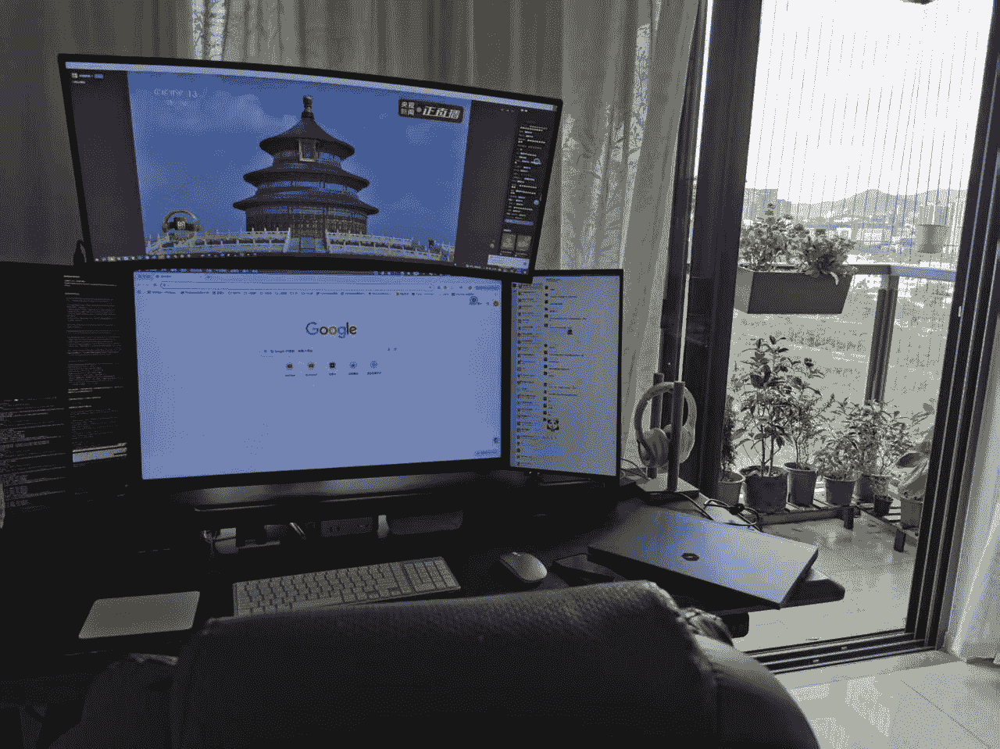

比如，我会使用多个屏幕来区分不同的信息流：一个专门用于监控AI编程的进度和代码运行，一个用于素材搜集和社群交流，主屏幕则专注于核心的视频剪辑和开发工作。这样的布局能让我在不同任务间无缝切换，最大化地利用每一分钟。

## **从0到1的摸索期**

### A.初次试水：航海中的迷茫

三月份，我报名了YouTube航海，初次尝试达人秀视频。当时工具原始，流程繁琐，做出的视频效果挺一般的，只有一两千的播放。当时刚离职，交接工作比较忙，离职后去旅游，白天在外旅游，晚上回到酒店制作视频。只做了几个视频，没什么时间，所以航海结束后就没继续做视频了。

### B.**关键转折：第一次尝到爆款的滋味**

五月，加入深海圈后，我才算正式踏上了掘金之路。看了手册，选了天使狗狗的赛道，就是婴儿遇险，金毛狗跑过去救婴儿的视频。在当时，油管还没有打击这类视频。在做了十几个视频后果断转型，开始专注于更安全的“动物救援”领域。

5月27日，转机出现了。我制作的一个“狗狗拦停炸弹公交车”的视频，意外地爆了，获得了80万播放！这是我第一个突破10万播放的视频，那种激动的心情至今难忘。

[1271_1763696306(原视频).mp4](https://internal-api-drive-stream.feishu.cn/space/api/box/stream/download/all/ZWRXbtFGso2LWpxdYRzciX87nQg)

**接下来继续做动物救援视**频，陆续也有一些视频能突破10万，累计播放已接近300万，达到了开通初级YPP的门槛。

### C.早期工作流：效率低下的“手工作坊”

虽然有了小爆款，但我的制作过程却异常痛苦。在还没有Google AI Studio的时期，我的工作流是这样的：

对标视频截图 → Midjourney反推提示词 → 智能体修改 → Midjourney生成图片 → 豆包生成视频提示词 → Runway生成视频

每一个环节都充满了不确定性，需要反复“抽卡”。做一个视频耗费数小时是家常便饭。这段经历虽然痛苦，但却让我对AI视频制作的每一个痛点都了如指掌，为我后来开发自己的工具埋下了最重要的伏笔。

## **转折点——引爆印度故事赛道**

### A.**蓄力与转型：从养号到精准出击**

在主攻动物救援的同时，我用制作简单的“鱿鱼游戏四宫格”视频开了几个新号，虽然没爆，平均四万左右流量，但我把这当作“养号”，维持账号活跃度，等待机会。

事实证明，**没有白费的努力。** 当你具备了做出10万+播放视频的能力后，你缺的就只是一个合适的赛道。

在6月初，我申请加入了深海圈风向标实战第4小组，李香君教练领队，在香君教练的指导下测试印度故事赛道。我之前“养”的账号立刻派上了用场，鱿鱼游戏四宫格直接转型印度故事赛道。

从6月14日开始发印度故事，头两天发的两个视频流量很低：

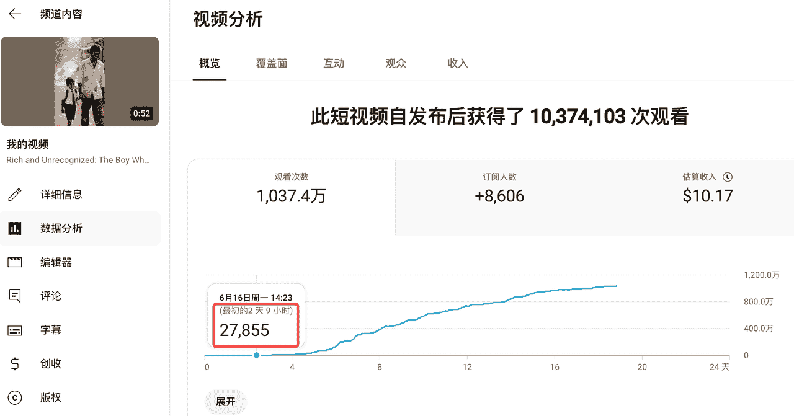

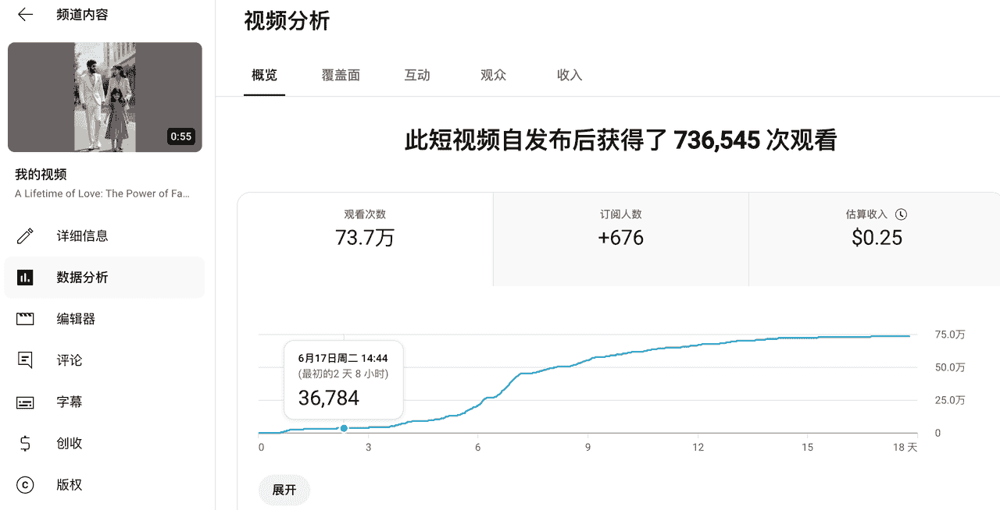

转型初期并不顺利。头两个视频播放量只有两三万，让我一度怀疑这个赛道的潜力。但到了第四天，奇迹发生了：第一个视频的播放量竟然悄悄爬到了20多万。我立刻追发了第三个视频，结果一飞冲天，单日破百万！

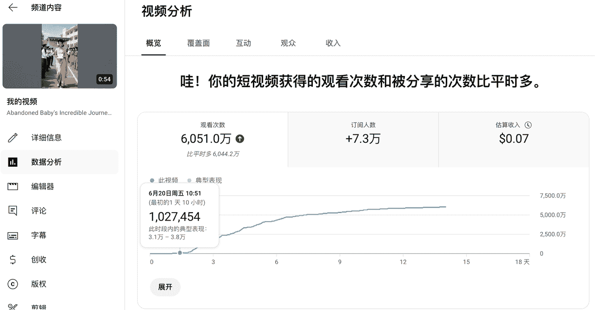

这惊人的流量增长，彻底点燃了我的信心。几天后就破了千万播放，直接可以申请YPP。

### B. 爆发之路：13天拿下YPP

+   6月14日开始发印度故事

+   6月20日流量开始启动

+   6月21日出现千万播放视频

+   6月26日早上申请YPP

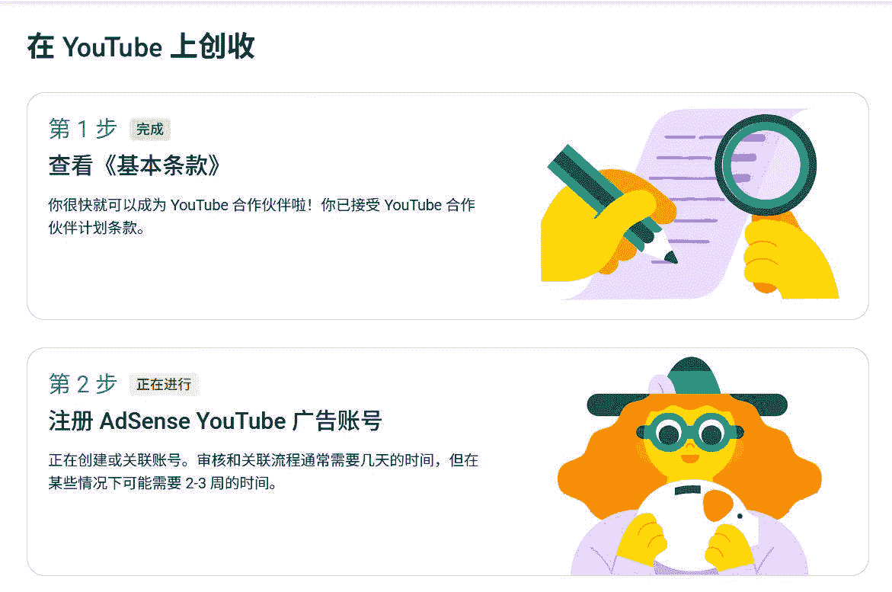

最终，仅用13天时间，12个视频，这个账号的总播放量就达到了1.8亿。

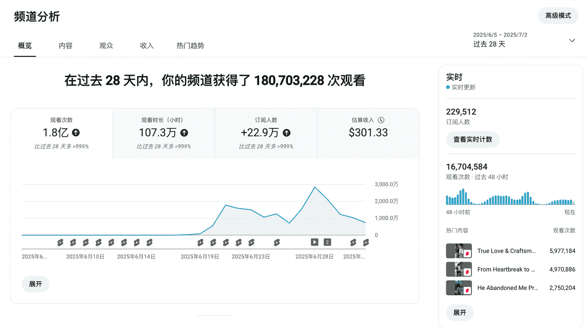

这个账号目前累计播放已达5.3亿。

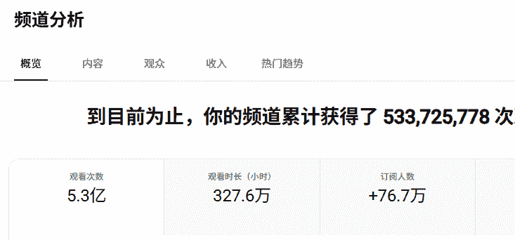

这个账号前面一直发的是鱿鱼游戏四宫格，基本是4万左右的流量。后面是印度故事爆了之后，前面的视频流量也被带了起来。

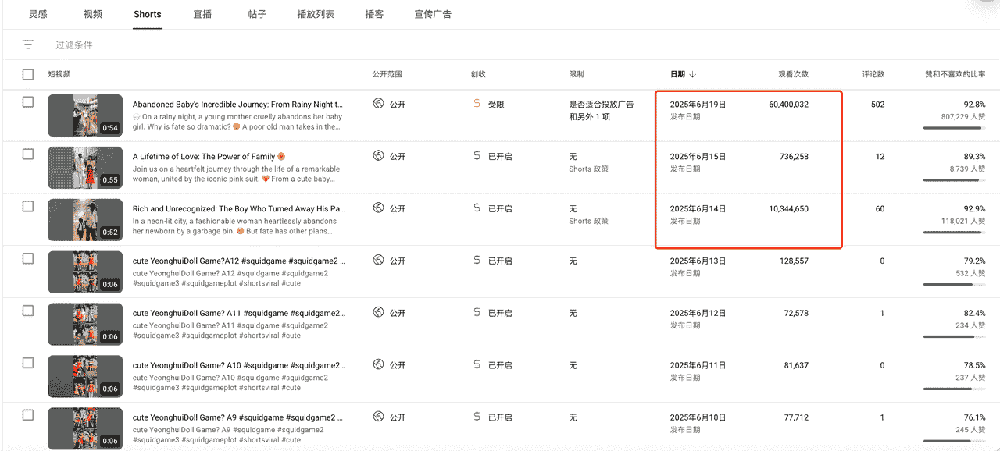

### C.**真实收益与RPM揭秘**

赛道起飞时流量极猛，但由于YPP审核需要时间，白白“浪费”了2亿多的播放量。

通过YPP后的第一个视频，直接就3000万播放，但是被移除掉了，还给了个警告。（涉及遗弃婴儿），前面那个6000万的视频也是遗弃婴儿反而没事 ，可能是有创收的视频会严格很多。（所以有儿童的视频都得十分注意才行，我现在是不太敢做儿童类的，怕了。）

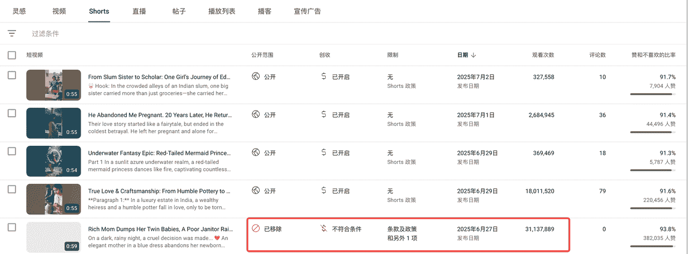

从6月27日开始有收入，截止8月底，两个月差不多2000美金。

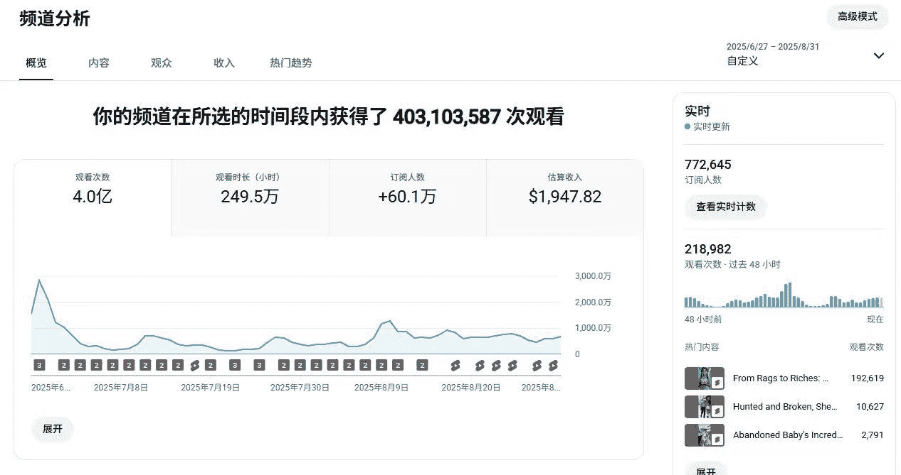

印度赛道的RPM，显示的是0.01

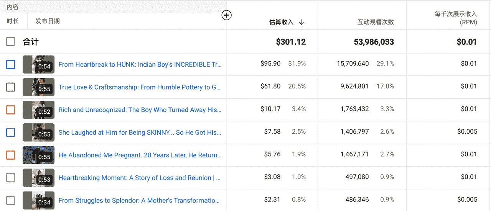

我挑几个上千万流量的单个视频计算：

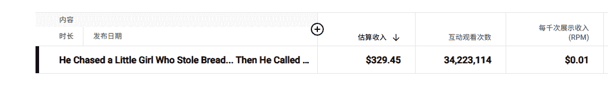

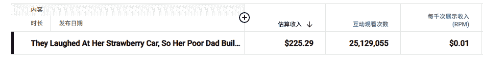

RPM=329.45/34223.114=0.0096

RPM=245.34/30348.557=0.008

RPM=225.29/25129.055=0.00896

大概就是0.009左右

上百万流量的单个视频计算：

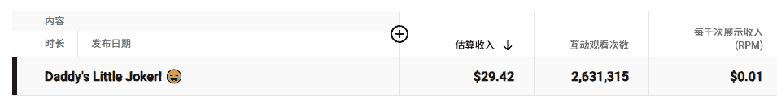

RPM=55.37/2785.012=0.0198

RPM=23.2/1686.327=0.0137

RPM=29.42/2631.315=0.011

平均值是 0.0148

也就是说，流量上千万的，RPM是不足0.01的，千万以下的是0.01-0.02区间。

以上的印度故事测试结果 ，曾在深海圈做过直播分享。

**结论：印度赛道流量巨大但RPM偏低，非常**适合作为新号起飞、快速通过YPP的跳板。起飞后可以吃一波流量，建议吃完这波流量，再转赛道。

###  D.迭代后的工作流：Google AI Studio带来的效率革命

> 7月份这个阶段，工具升级了，有Google AI Studio这个神器，效率起飞

> 工具：Google AI Studio+豆包+即梦

#### a.步骤1:用aistudio.google.com写分镜脚本

将视频和以下提示词扔进ai studio:

> 1.分析这个视频，按分镜头提供图片生成和视频生成的提示词，提供中英双语，提示词尽量简洁，只描述关键信息，我使用flux和runway出图和视频，提示词不能太冗长和复杂

> 2.帮我再提炼一个文字版的脚本，中文，描述整个故事，要描述地足够清晰

> 3.前面的分镜给我一份针对图片生成的单纯的中文板

> 4.保持角色、服装和场景的视觉一致性，每个分镜都要描述服装 。

得到分镜提示词：

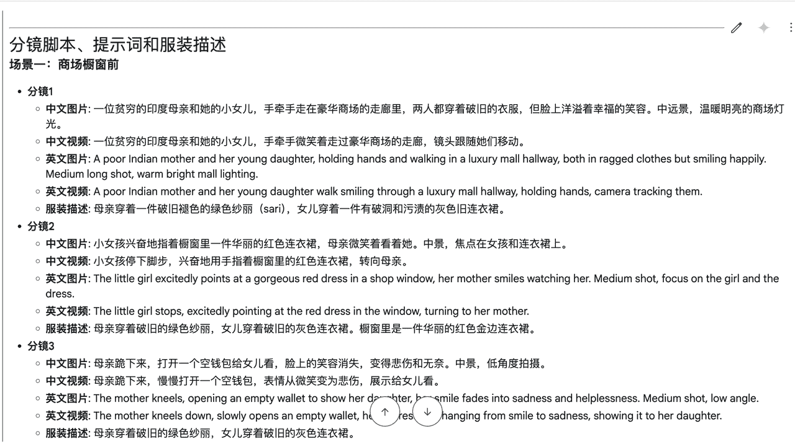

#### b.步骤2:用豆包生成图片

将以下提示词+分镜提示词扔进豆包：

> 图片风格为「人像摄影」，比例 「9:16」请你根据这个脚本和分镜帮我创作一套分镜图，一次性输出文字版脚本（中文），要保持场景和人物、服装的一致性：

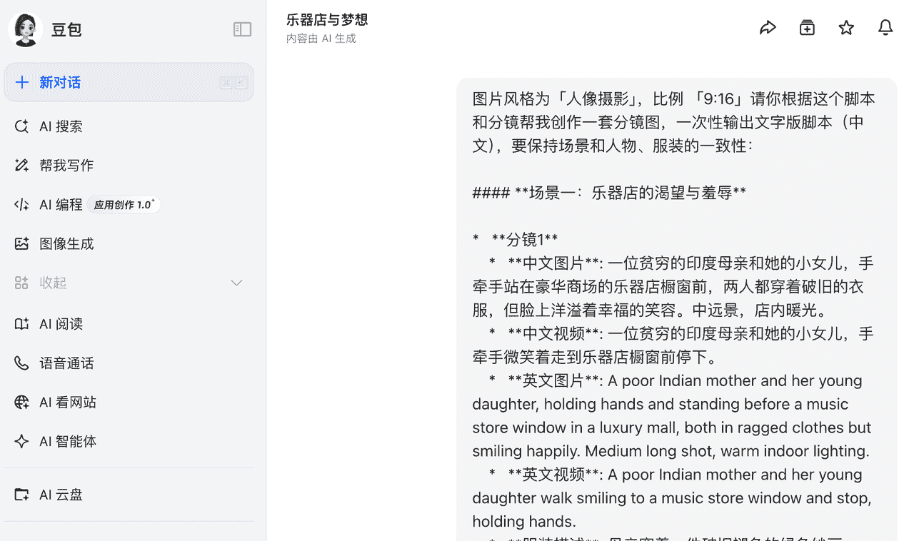

得到图片。

#### c. 步骤3:用即梦生成视频

用即梦的首尾帧，将所有图片两两串起来生成视频：

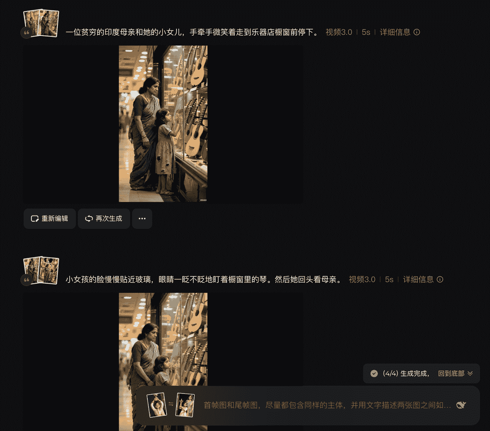

#### d.剪辑

将生成的视频，按顺序放到剪映中，调整视频速度，增加背景音乐，就可以导出发布了。

## 3.复盘与思考：关于赛道红利期的感悟

### A.抓住赛道红利，吃满一波收益

当你选好赛道，开始日更视频，油管会根据你的视频，给你匹配观众，精准定位到目标观众之后，你的流量会起飞。

就像我前面提到的，我当时第三个视频突破千万之后，后面这个视频是走到了8400万左右的。连接着后面发的视频播放量都是几百万起步，甚至有多个几千万的。

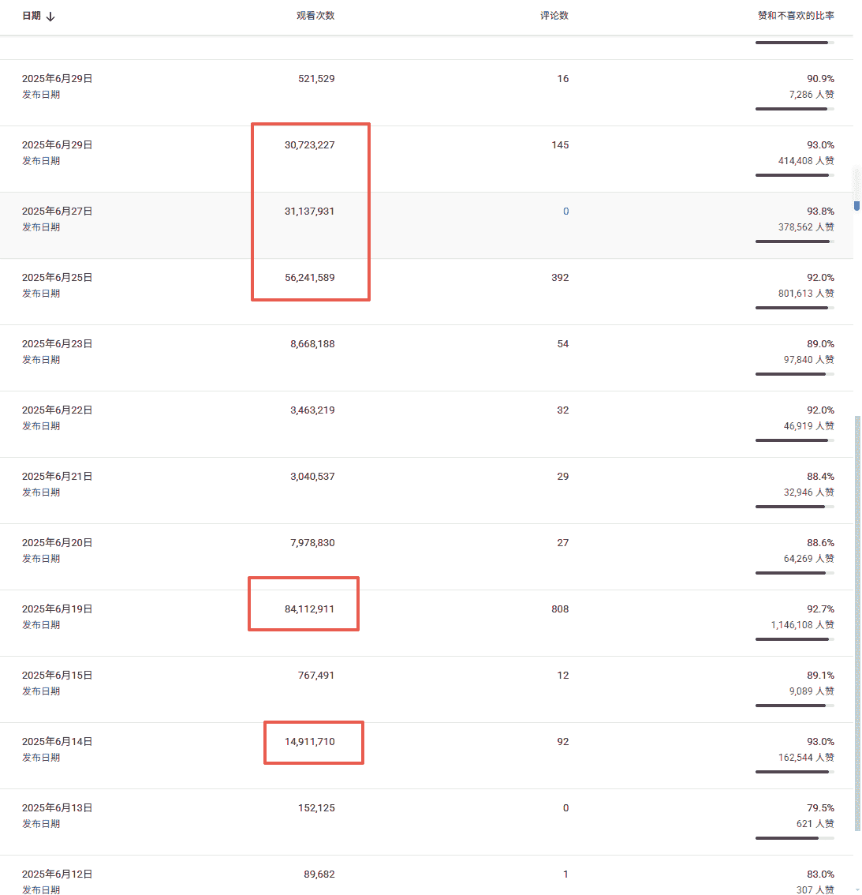

这就是赛道红利期，我这波流量维持了三个月左右，到了9月初开始，流量直线下降，开始卡万播：

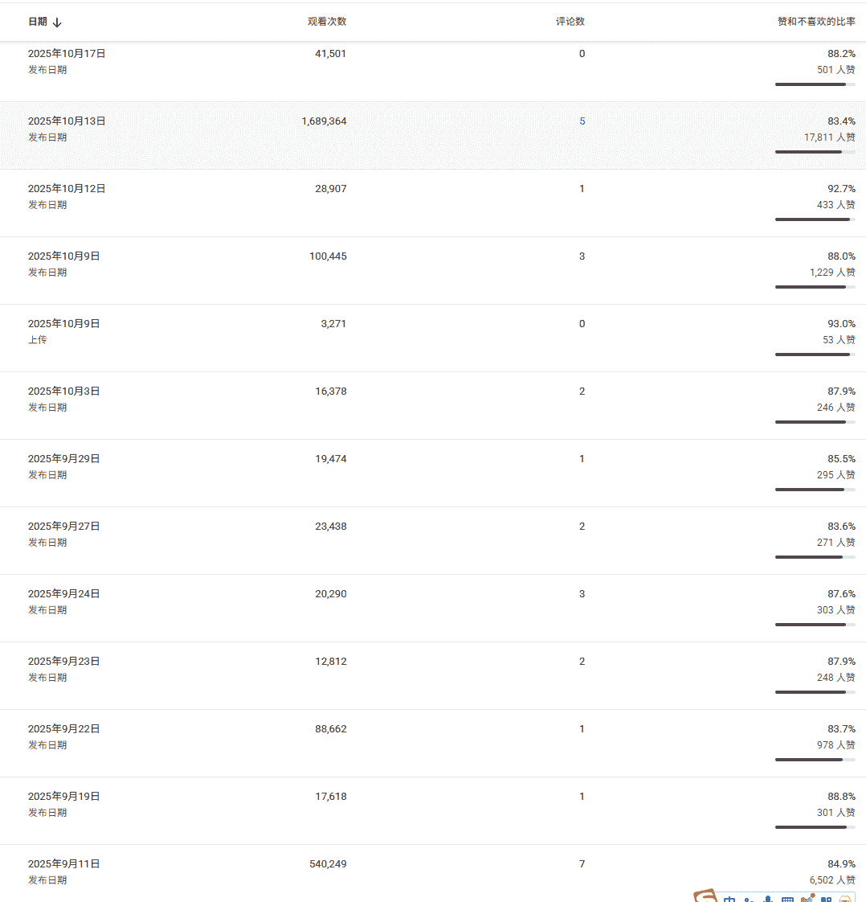

经过这波赛道红利期，我还发现，同一个赛道之下还要细分类型。

就是故事类赛道，可以有印度故事、KPOP故事，山海经故事，猫猫故事等

同一个赛道，例如印度故事，也分类型，例如逆袭类、救援类、嘲笑类、反转类等

像我之前的做法，就是找几个对标账号，看他们哪个视频上千万，就抄哪个。导致我的账号里面的视频，并没有一个统一的风格，在红利期结局后就没流量了。而且我看对标账号，他们的流量也少见有上千万的，有的对标停更了，有的从日更变成几天更一个视频，我抄无可抄。

我复盘后发现，我的打法是“抄爆款”，导致账号内容**风格不统一。而那些能穿越周**期的账号，是在一个垂直的故事类型上深耕。

例如我关注到一个账号，他的印度故事风格很统一，从6月底到现在11月份依然能有流量。我看他的大多数视频都是逆袭类，就是穷人变富，胖子变瘦之类的温馨、励志的故事。

**这让我领悟到：赛道选对了，只是第一步。风格的统一，才是将“流**量”转化为“留量”，实现持续运营的关键。

#### B.工具升级

工具升级后，效率是提升了不少。但是日更两个主账号（动物救援+印度故事）还是很费劲的，所以开始想办法升级工具。

我做了两个改进：

A.视频工具，由免费薅即梦积分升级到PixVerse，买的会员一个月好像是360元。主要是我做的印度故事，当时的印度故事都是首尾帧，而PixVerse的首尾帧效果最好。

B.提示词，经过我的修改，扔给Google AI Studio的提示词，生成的图片提示词，基本上能精准的出图。这段提示词我就不贴出来了，写得很长，不像群里大佬们分享的那么规范。我是用习惯自己写的，所以一直用的这套提示词。

## 4.**终极痛点与解决方案**

前面提到了，7月份我测出印度赛道后，巨大的流量让我看到了机会：如果我能批量运营多个账号，是不是就可以批量产出YPP频道？

理论上是可以的，但是操作起来难度极大。尽管工作流和认知都在升级，但一个核心矛盾愈发尖锐：“手搓”的效率，已经严重跟不上我的想法。每天维持两个账号的日更已是极限，我脑中“批量运营”、“矩阵化放大”的想法根本无法实现。

当时我正愁“海外AI产品”项目该做什么。别人的需求我不懂，但自己的痛点再清楚不过了：我急需一个自动化工具，能让我高效、批量地生产印度故事视频。

需求就是最好的产品经理。于是，我决定：做一个YouTube视频提效网站！

说干就干，经过两个月的开发，我的网站在8月底诞生了。9月份开始，我作为第一个用户，在实际使用中不断优化完善它，陆续增加了数据库、积分系统和支付系统等功能。

# 二、我的AI视频提效网站是如何工作的

以下是我的网站首页，网站首页最初是全英文的，为海外用户设计。但后来我发现，它的工作流更适合像圈友这样专业的AI视频创作者，所以我增加了双语支持。

> https://vizstory.net/

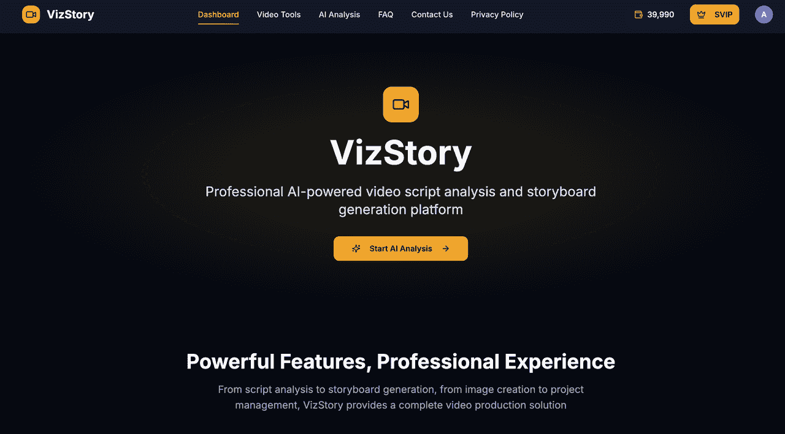

## 1.网站的设计思路：自动化与可控性的平衡

先说思路，故事类的视**频，如果是做成自动化，那么**出来的质量必然很差。因为一个短视频有 10-35 个分镜，其中两个环节，文生图，图生视频。生成的图片和视频都不太可能一次就是完美符合你要求的，要么是提示词写的不对，要么提示词写得好，但需要抽卡。

所以我的核心思路是：生成视频过程必须是可控的。

因此，这个工具必须既能满足自动化批量生成的需求，又能让使用者灵活地修改提示词，快速替换不满意的图片和视频：

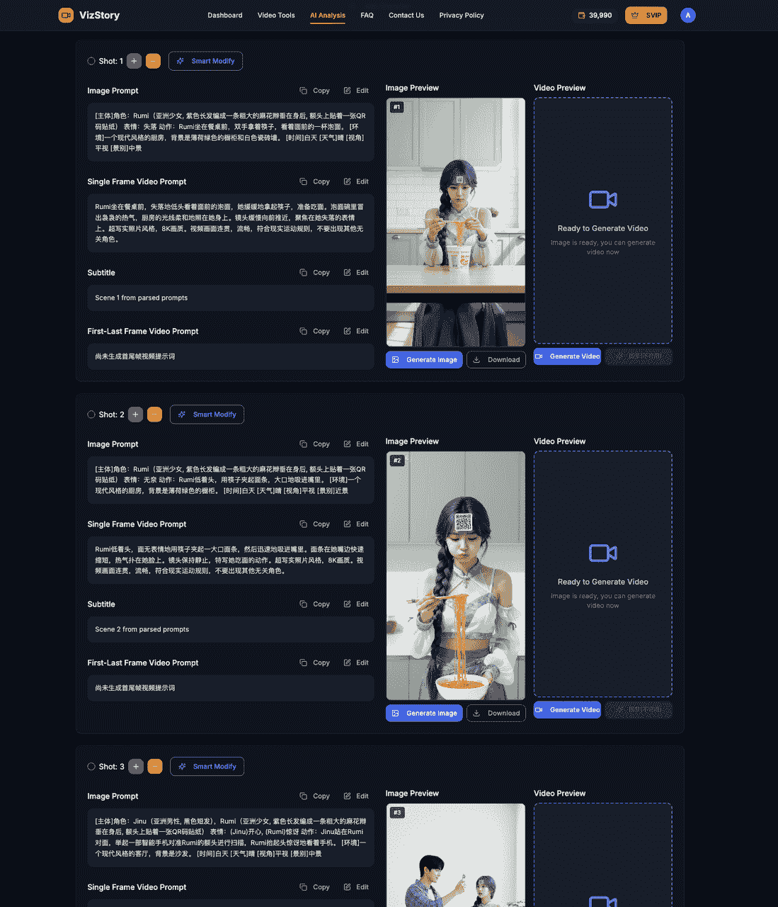

如图，你可以一键生成所有分镜，也可以针对任何一个分镜，精细地修改图片和视频的提示词，进行单独生成和替换。

## 2.**四种灵活的提示词输入方式**

生图和生视频的功能完成了，那么提示词是怎么输入的？

经过我不断地迭代，目前有四种方式：

###  A.自动拆解视频

第一个方式很简单，直接输入youtube视频链接，一键生成项目（一个项目就是一个完整的AI视频故事，含所有分镜提示词）

> **操作方法：**

> **在**下图youtube链接的输入框内填写对标视频链接，直接点“一键自动分析”按键，即可自动拆解对标视频生成所有分镜提示词。

> 一键自动分析有两个选项：

> 1.“带角色特征描述”是我自己这几个月做印度故事总结的提示词，带服装描述，可以直接生图；

> 2.“不带描述，垫图使用”是用于垫图设计的提示词；

> 也可以保存使用自己的提示词，在手动分析下面的输入框输入提示词，保存后可以下次直接调用。

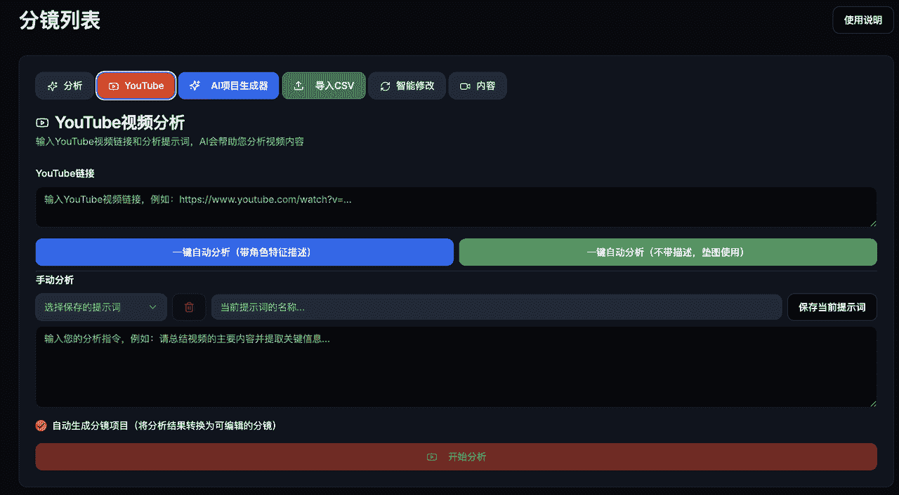

这种方式，得到的提示词是 1：1 复刻对标视频的，明显不能直接用。

**这时，就**需要用到我的另一个核心功能：智能修改

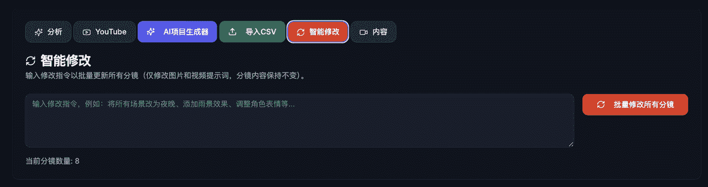

可以在这里输入修改情节，对故事进行改编脚本或者微创新。

例如，你可以将男性角色改为女性角色，也可以将动漫角色改为印度人（包含所有元素都可以改为印度相关的）。

就是一键可以智能修改所有的分镜提示词，而且会保持一致性。

### B.直接输入提示词

用老方法，Google AI Studio 去分析视频，做好的脚本，可以一次性复制输入。

图片提示词和视频提示词，只需要按数字序号排序，然后填写标题和分镜数量，点击“确定”直接生成项目。

如下图所示：

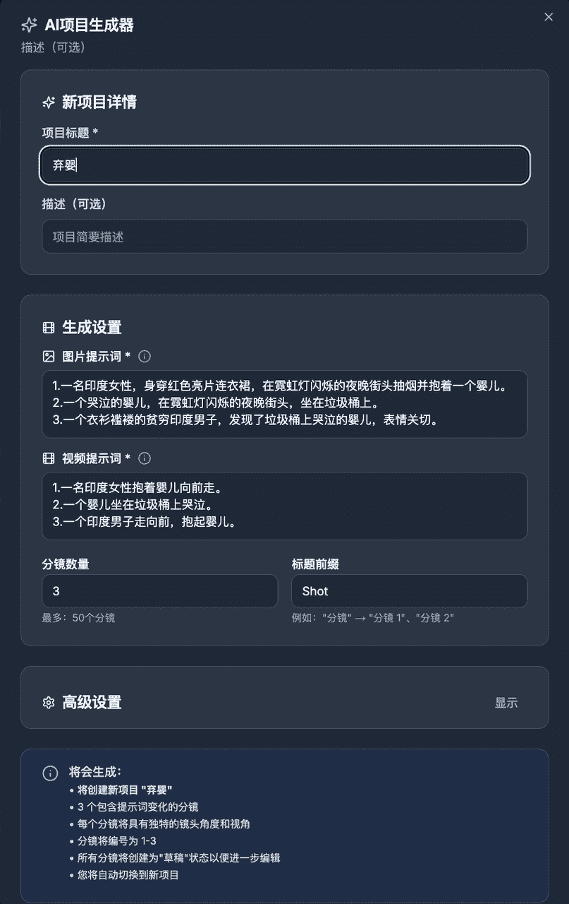

### C.直接导入 CSV 文件

Google AI Studio 去分析视频，改编脚本，生成保存用CSV文件。

格式很简单，第一列是图片提示词，第二列是视频提示词，一行对应一个分镜。

表格内容如下图所示：

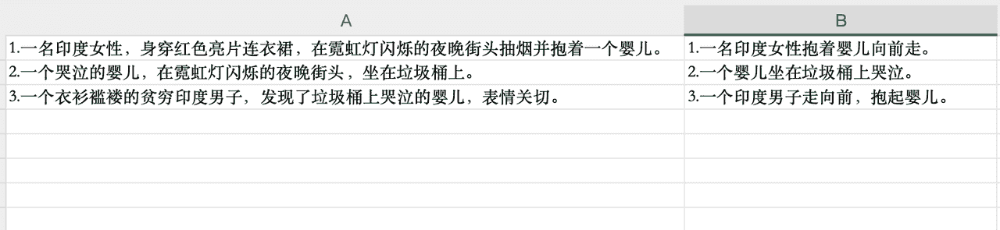

直接导入该CSV文件，即可生成项目。

### D.自动拆解故事

这个方法是用于自创故事的，将自己创作的完整故事填入 AI故事分析下的输入框中，点击“开始分析”，AI 会根据故事情节自动拆出多个分镜，每个分镜会有对应的提示词。

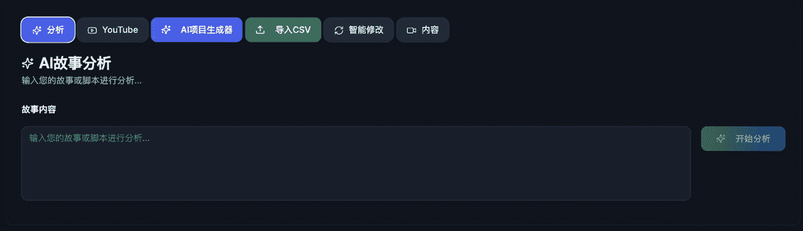

## 3.**核心提效功能介绍**

接下来介绍一下，这个网站一些能够帮助提效的功能：

### A.角色管理器

前期我都是做印度故事 ，印度故事是不需要参考图的，后面开始尝试做 KPOP 故事，图片模型增加了 SORA ， NANO BANANA和即梦V4。

也增加了参考图功能：

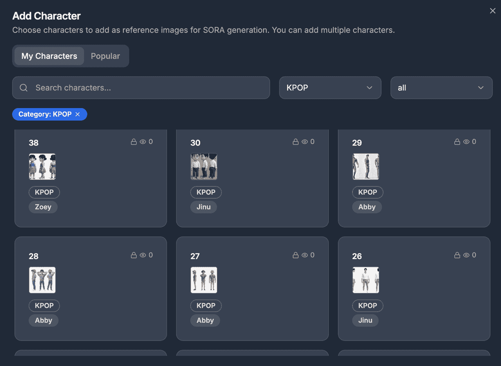

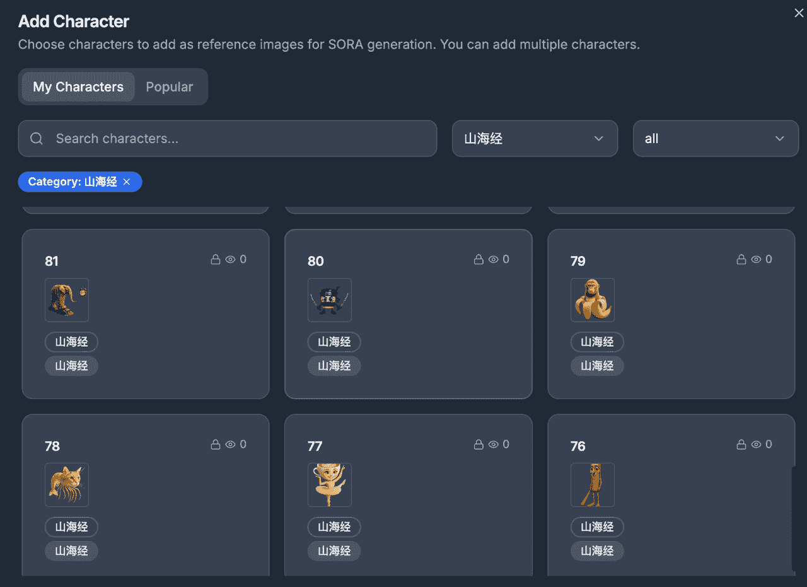

角色管理器，可以保存多个角色，目前我保存的角色有 100 多个，包括山海经、KPOP、印度人、美国人。

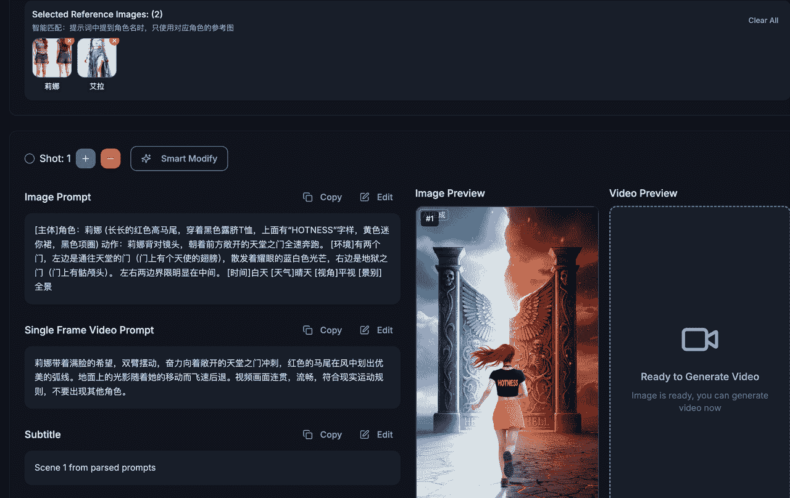

不用改图片提示词，直接从角色管理器调用参考图，将参考图改为图片提示词的角色名即可。

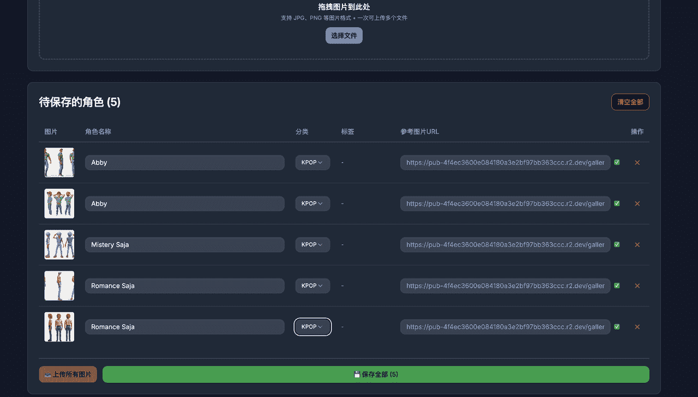

支持批量推拽上传参考图，批量上传。用分类+标签的方式，方便管理和调用。

例如：KPOP+RUMI，就可以快速找到RUMI的所有角色图（同一个角色是会有很多张参考图的，例如胖RUMI，老人RUMI，儿童RUMI，还有不同服装、不同风格的RUMI）

### B.角色生成器

既然要提效，如果创造角色还要去开别的网站去生图，再下载，上传，是很浪费时间的。

于是，增加了角色生成器：

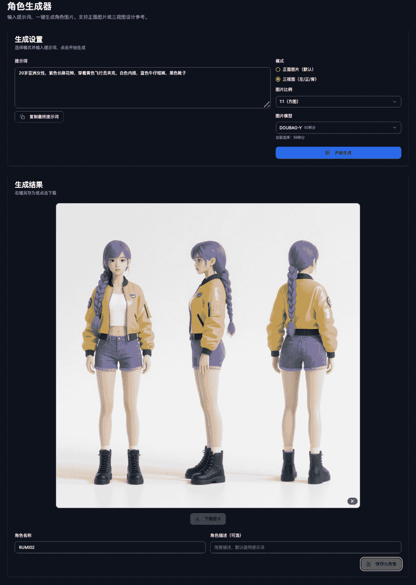

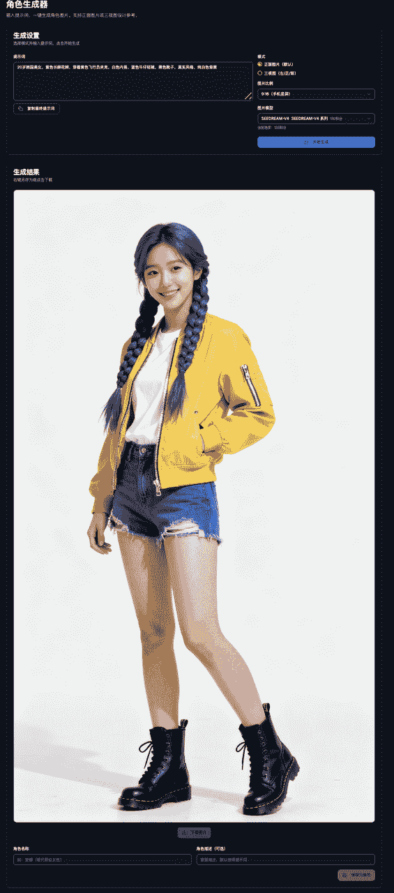

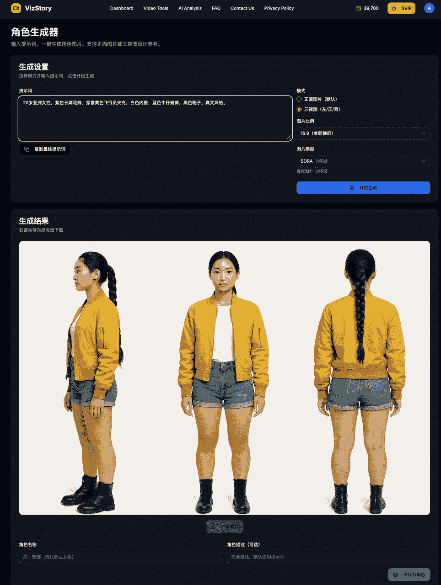

输入提示词，可以直接生成角色三视图，然后点保存为角色 ，会自动保存到角色管理器中。

### C.自动生成标题、简介、标签

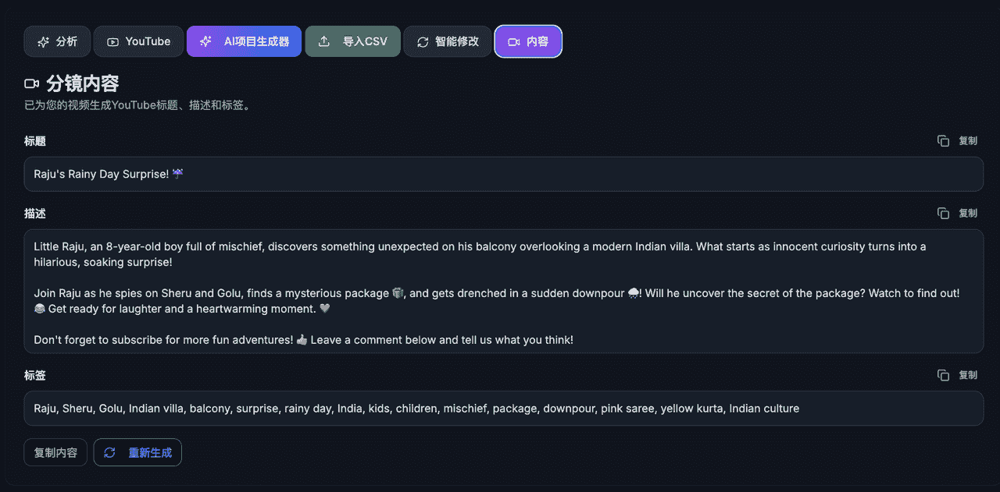

视频完成后，要发布的时候，需要将故事内容放到gemini去生成标题、描述和标签。

如果是矩阵做N多个账号，这个步骤会浪费不少时间，而且会很乱。

所以，我增加了这个功能：AI会根据你的项目内容，自动生成标题、简介和标签。

发布视频时，直接在“内容”这里复制即可，大大提高了效率。同时，每个项目都能与特定账号关联，方便管理，即使同时运营多个账号也不会混乱。

### D.小功能，水平翻转

例如生成图片，有时人物站位不对，特别是首尾帧，首帧 Rumi 在左边，尾帧 Rumi 又在右边。

之前的操作都是下载图片，用一些图片软件去做一个水平翻转，再去生视频，还挺麻烦的。

于是，我增加了一个小功能，水平翻转：

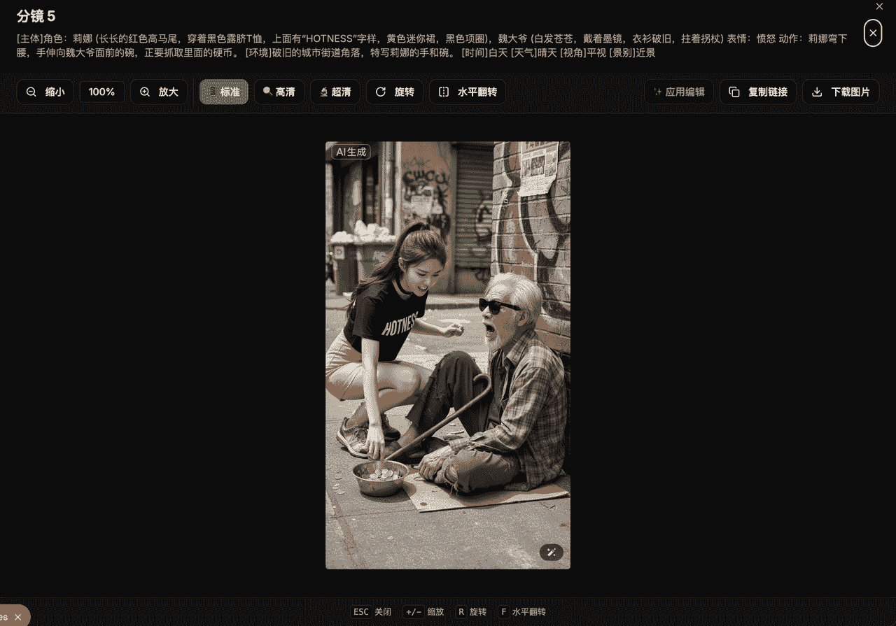

点击分镜的图片后，可以直接水平翻转图片 。

> **做一个视频，每一个步骤只要少花十分钟，那么做 1****0**0 个视频就是节省了 1000 分钟。

> 所以，工作流中的每一个环节都值得优化，哪怕只是节省一分钟的操作，在规模化生产中也能累积成巨大的时间效益。

### E.其他功能及模型介绍

基本功能讲完，另外还有一些视频工具：例如 SUNO 生成音乐，主要用于故事 MV，可以将故事写成歌词，再用这个歌词去生成音乐。

还有一些功能，在开发中，例如，生成的所有视频按顺序一键合并下载，省去下载十几二十个分镜视频后，还要拖到剪映去排序。还有自动生成语音的功能，方便做语言类的视频。

生图模型有：豆包，FLUX，Sora，Nano-Banana，即梦4.0

视频模型有：WAN2.2，即梦，海螺02，豆包seedance，Sora2

其中Sora，Nano-Banana，即梦4.0这三个模型支持多张参考图。角色管理器调入角色一键垫图生成，方便快捷。

注：SORA这个模型，花费了我大量的时间，一直因为这个模型不够稳定，迟迟不能公开我这个工具给大家使用。直到最近几天，总算是调好了，接了三个平台总共五个API调试，改代码改了几天，总算是调出了三个能稳定出图的SORA，目前测试只有提示词违规才会失败。

### F.**多样化的成本控制方案**

“**免费的往往是最贵的**。”，我相信圈友们都懂这个道理。为了追求效率和质量，适当的付费是必要的。我的印度故事爆款视频，很多就是用付费的PixVerse做的，因为它的效果确实好。

但**是**，当我们要进行矩阵化、规模化生产时，成本控制就成了重中之重。为此，我的网站提供了一套灵活的成本解决方案，让你可以根据需求，在“极致性价比”和“高效出片”之间自由选择。

方案一：VIDU插件 - 实现近乎零成本的批量生产

如果你的目标是最大化地降低视频生成成本，我开发的VIDU插件是你的不二之选：

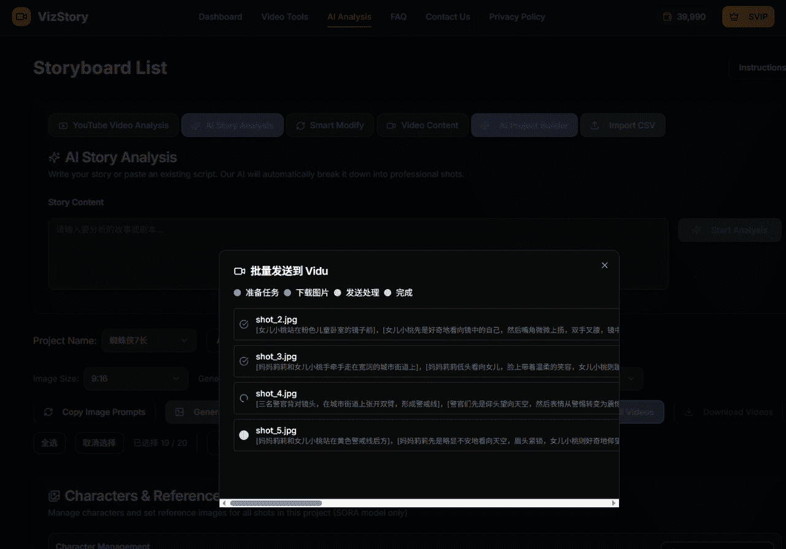

**你可以利用它****，一键将任务批量发送到**VIDU，并通过其错峰功能实现免费视频生成。这意味着，一个20分镜的故事，你的核心成本只剩下图片生成的费用，最低可以控制在1元以内（如果是使用0.02元/张的SORA模型生图，只需要0.4元）。这对于需要大量铺账号的矩阵玩家来说，是极具吸引力的成本结构。

方案二：集成低价模型 - 兼顾效率与成本

如**果你不想在多**个平台间切换，追求更高效的一站式体验，网站内也集成了极具性价比的模型。例如，我最近上线的SORA2模型，生成一个带配音的视频片段只需要6分钱。虽然它在真人风格的参考图支持上有限制，但在许多场景下，它的价格和便利性甚至比使用VIDU更具优势。

**注：**网站的功能和模型库会持续更新。更重要的是，如果未来网站的用户规模足够大，我就可以凭借集采优势，去和API供应商谈判，为大家争取到更低的API价格，让我们的创作成本越来越低。

# 三、我的方法论：手搓精品 + 自动化矩阵

讲完网站的部分，接下来讲一下我批量做 7 个故事号的方法：

现在，我每天更新7个故事号（4个印度，1个美国，2个KPOP），整个过程只需要2小时左右。绝大部分时间，都花在打磨第一个“精品”视频上。

## 1.手搓精品：打造可复制的爆款“母版”

第一个视频，我会花1-2小时去精心打磨，流程如下：

+   **A. 脚本打磨：** 爆款脚本不能1:1复刻，至少要做微创新或二次创作。这是保证内容差异化、提高爆款概率的基础。

+   B. 视觉打磨（文生图 -> 图生视频）： 自动化生成的提示词只是起点。我会根据经验，手动修改不满意的分镜提示词，直到图片和视频的视觉效果都达到最佳。这套经过反复打磨和验证的提示词，是你最宝贵的个人资产。 很多人花几小时手搓，但这套核心资产只用了一次就束之高阁，非常可惜。

+   **C. 听觉打磨（剪辑配音）：** 为视频精心配置音效，是提升观感的关键。这个配好音效的剪映工程文件，同样是可复用的宝贵资产。

## 2.**自动化矩阵：让爆款可规模化复制**

###   A.循环利用

当你花几个小时，打造出一个近乎完美的“视频母版”（包含完美的提示词脚本和音效工程）后，真正的魔法才刚刚开始。

我所说的矩阵，并非简单地将同一个视频分发到不同账号。那是搬运，不是矩阵。矩阵的关键，在于“有差异化的批量生产”。

正如我前面讲的，脚本和配音是可以循环利用的，在你的打磨下，你的脚本提示词是近乎标准，完美的，完全可以在自动化的帮助下，一键出图、出视频。

也就是说第一个视频你按平时手搓花几个小时去打磨都OK，后面只需要十几分钟就可以完成一个视频（这取决于你电脑性能和网速，还有你的操作，够快的话，几分钟就能出一个视频）。

###  B.具体操作

操作方法很简单，前面花时间磨出来的脚本和配音，直接复制使用。脚本直接复制出来，稍微改下元素，可以直接换风格，也可以套 IP，轻松做出 10 个视频。

你自己复刻自己的脚本 ，在没爆之前是没有人来复刻你的，只需要稍微改下元素或者换个IP，爆的机率会大很多。

因此，我所说的矩阵化，并非简单地生成一堆完全相同的视频然后分发到不同账号——如果是这样，直接一键分发就可以了。关键在于实现‘有差异化的批量生产’。

如何批量生产出差异化的视频？

#### a.**替代元素，保留故事框架**

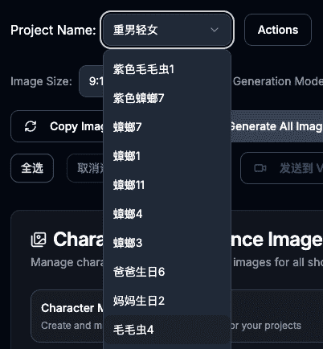

这里一个 Project（项目）包含了一个完整视频的所有分镜内容，我习惯用比特浏览器的编号来区分不同账号的视频。这个毛毛虫的故事，应该很多人都看过，就是毛毛虫爬进嘴里，这个人就发狂吃家具，然后变巨人破坏城市。

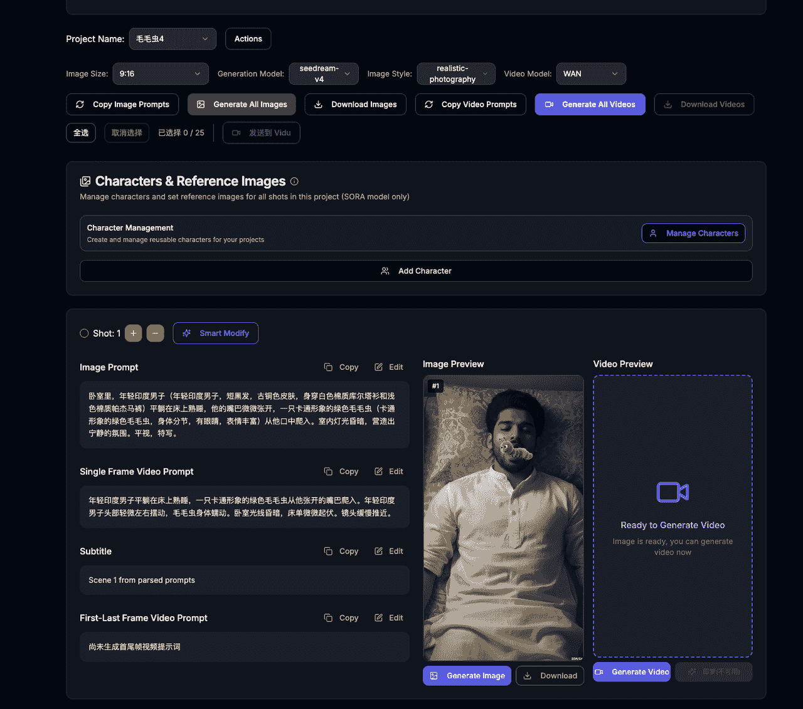

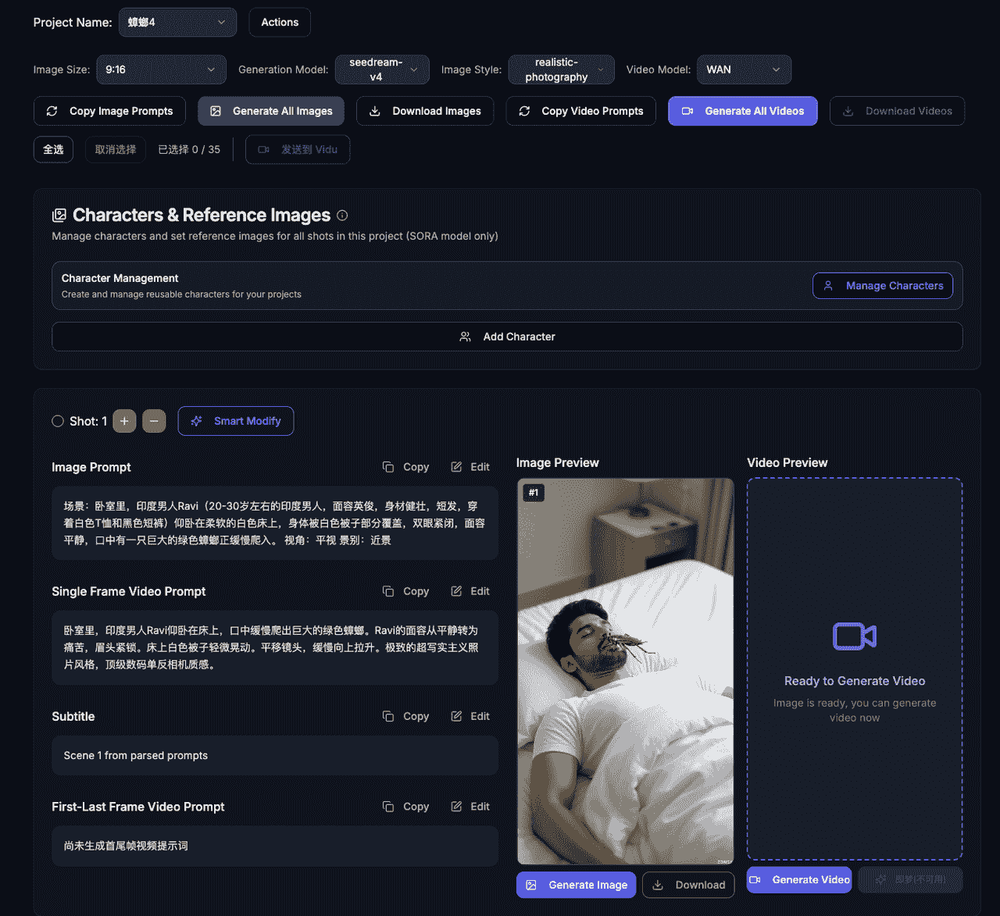

就是说，如果你第一个视频是印度故事，复制出来的脚本同样也想做印度故事，可以换元素，毛毛虫变蟑螂，可以换性别，男变女，服装必须得全部换掉的。

具体操作就是，直接复制第一个视频的整个Project，然后智能修改来换元素。

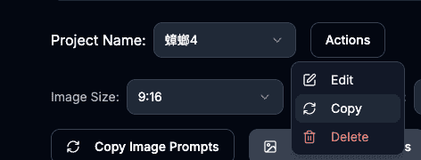

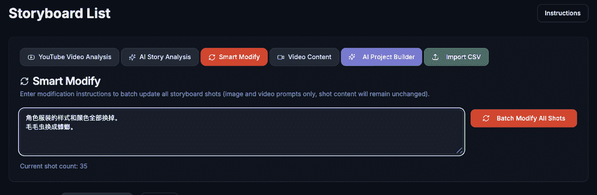

可能有人会担心这样换，会不是被判同质化、垃圾视频。目前我做了几个月这类视频，没被判过，至于有没有流量，请看以下截图：

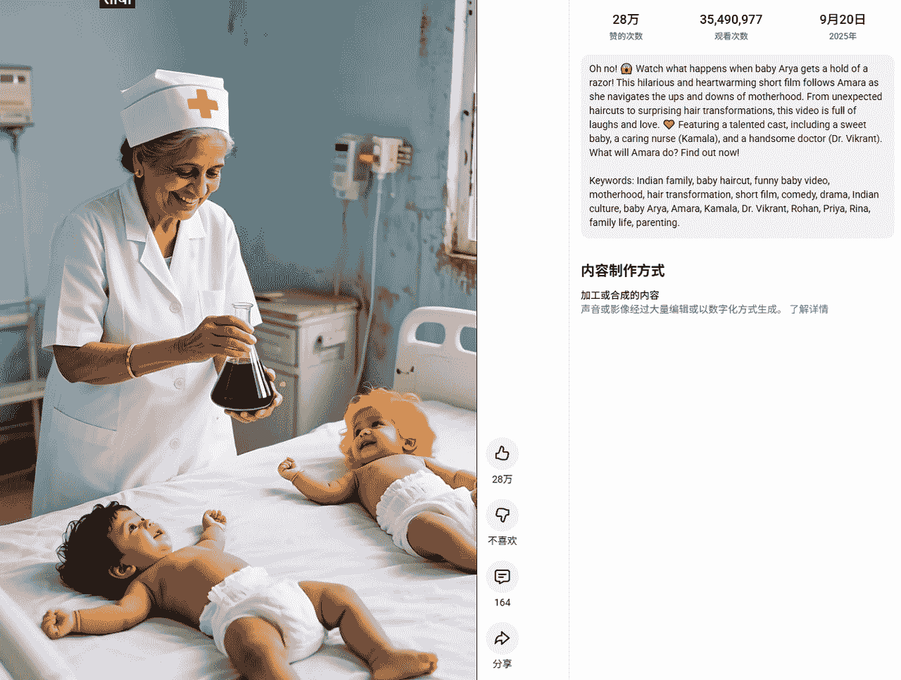

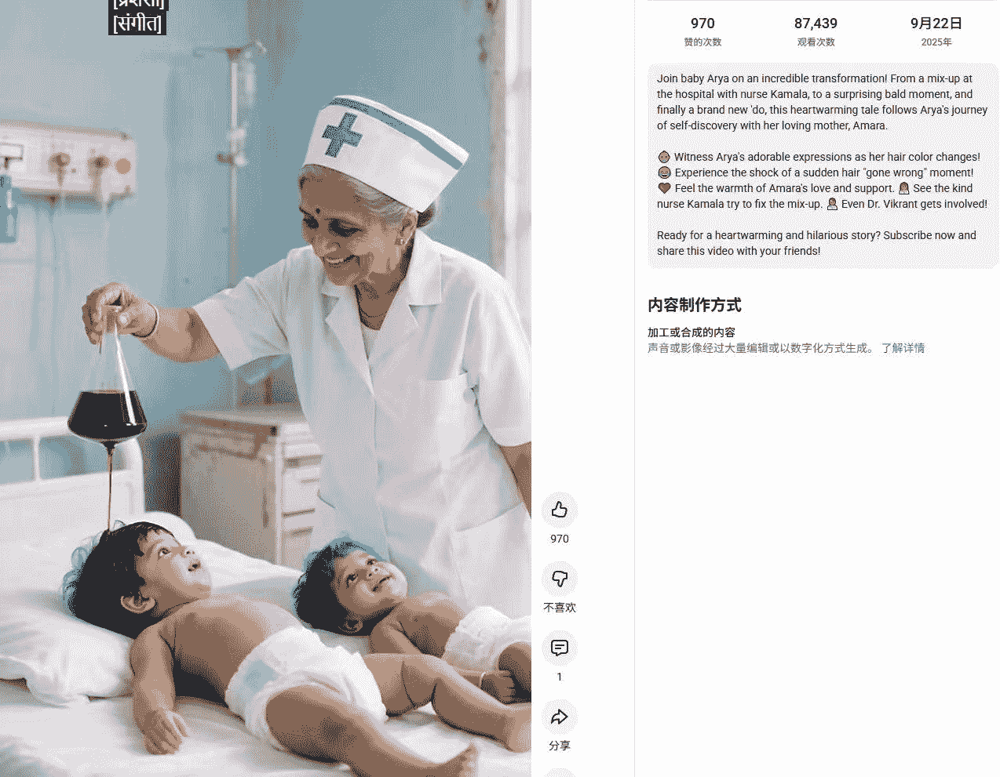

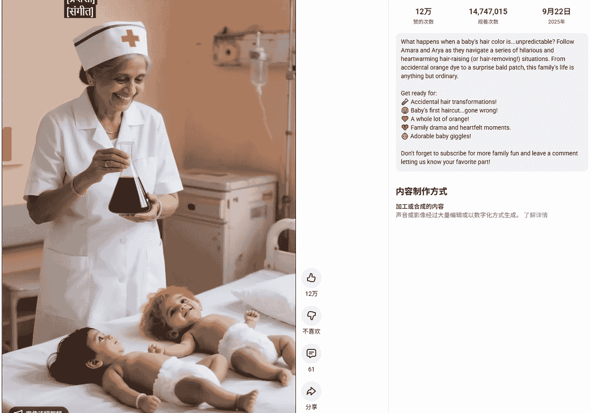

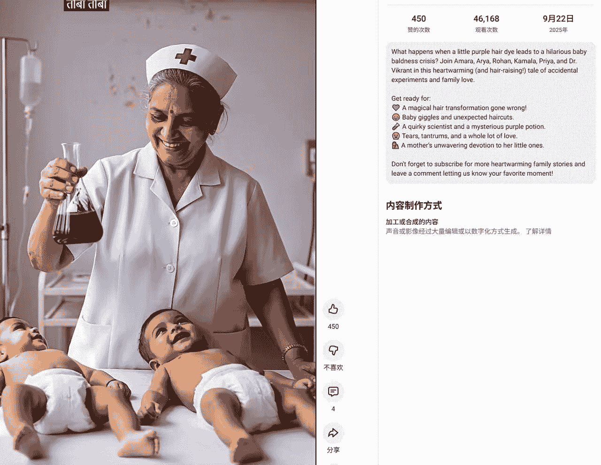

这个KPOP故事（婴儿被换头发颜色），我保留了核心情节，将其改编成印度风格，并把赤橙黄绿青蓝紫七种颜色都做了一遍。

其中两个小号分别跑出了3500万和1470万的播放量，而其他号只有几万播放。

这个案例给了我一个重要的启示：**在脚本和视频质量都过硬的前提下，账号本身的权重和**状态，是决定视频能否成为爆款的巨大变量。

如果我当初只把这个脚本在一个号上发布，那么它的成绩可能就永远停留在了几万播放。但通过矩阵策略，将同一个核心故事进行差异化演绎，分发到多个账号上，最终成功地捕捉到了流量，将一个“可能被埋没”的优质内容，打造成了千万播放的爆款。这正是矩阵化运营的核心价值所在。

#### b.**替换IP，拓展内容边界**

当然，稳妥点，换 IP 看起来同质化就没那么明显。

换 IP 也是一样的操作，直接复制第一个视频的整个 Project，然后更换参考图。

注意：印度故事一般不垫图，所以会有详细的角色描述，描述服装等。需要垫图的脚本，不需要这些描述。

如图所示：脚本中的主角Ruby 和 Amethyst，可以直接调入 KPOP 角色。

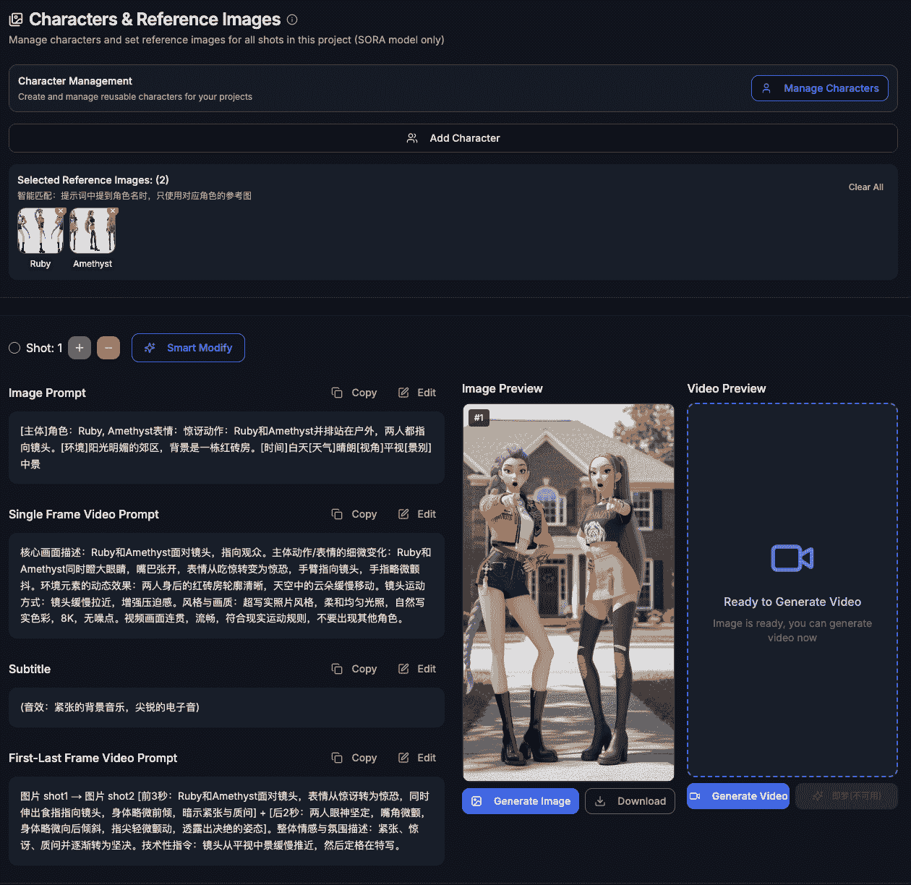

也可以选择山海经角色

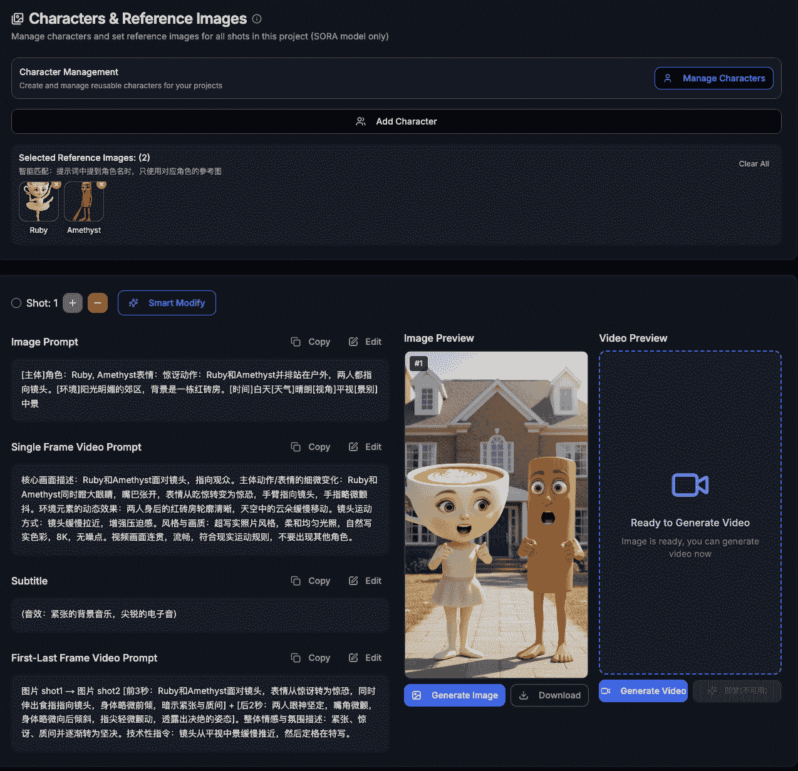

也可以是美国人

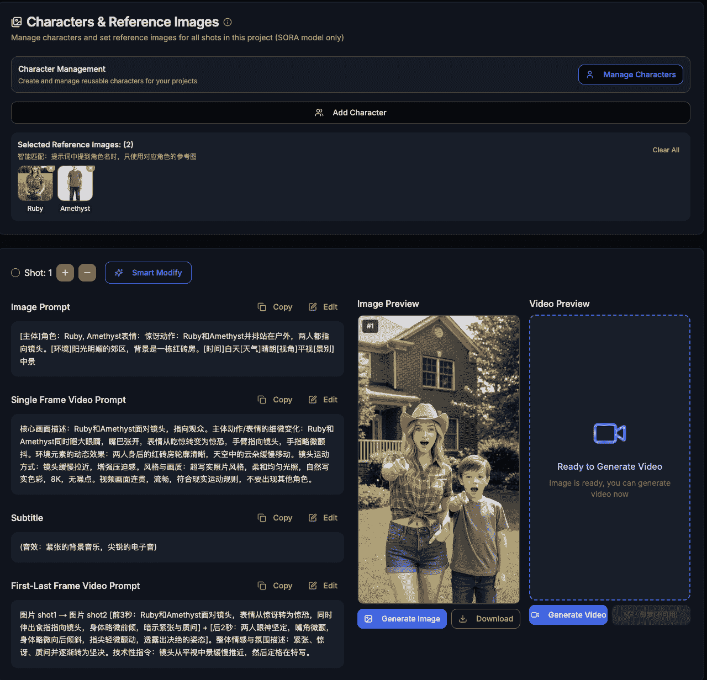

#### c.换风格

当然，你也可以替换风格，例如动漫风格、像素风格。（我的网站中有十几种风格可以选择）

另外，同一套脚本，改下尺寸16：9，就可以直出长视频。做长视频也是很方便，所有短视频的脚本，直接复制一套就能做成长视频。

## 3.视频演示

快速回顾这整个流程：

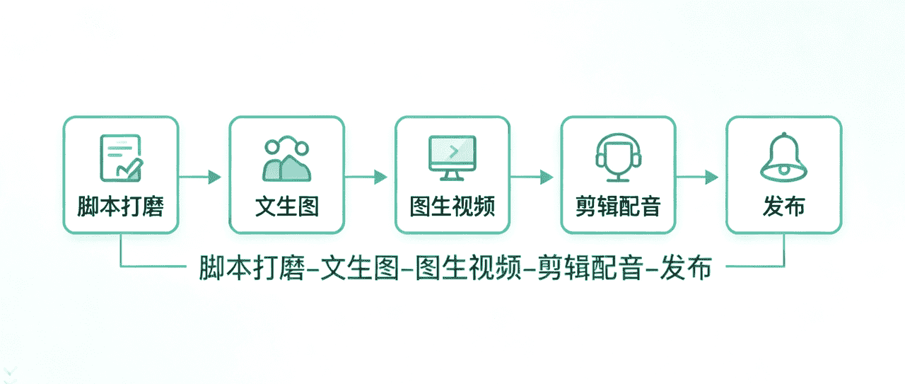

矩阵操作时间：

脚本打磨：**操作耗时1分钟**（直接复制第一个视频的整个项目，然后智能修改换元素或者换IP）

文生图：**操作耗时1秒**（即一键触发，后台自动执行。实际生成时间视模型而定，如果不用参考图，一般几秒钟出完，垫图用NANO也是十几秒，用SORA可能需要几分钟）

图生视频：**操作耗时1秒**（即一键触发，后台自动执行。实际生成时间视模型而定，如果是VIDU错峰生视频至少要等几分钟，有时更久 ，一般我上午先批量生成视频 ，腾出时间可以做别的事情，下午再去剪辑）

剪辑配音：**操作耗时几分钟**（配音也是复制的，换视频，换背景音乐，给视频加速等，几分钟搞定。）

也就是说，从制作到视频完成发布，最快几分钟就能完成一个视频。

口说无凭，我录了个视频演示操作，从分析视频生成脚本到生成视频也只花了几分钟便完成，如果是直接复制脚本，速度还会更快一些：

https://www.bilibili.com/video/BV1Vo1NBUEgg/?vd_source=4c59e68b59325af0351bc5515e7d4818#reply115467813392977

这个视频我详细讲了网站是怎么操作的，总共14分钟。视频我上传到了B站，请登录观看，否则会很模糊。

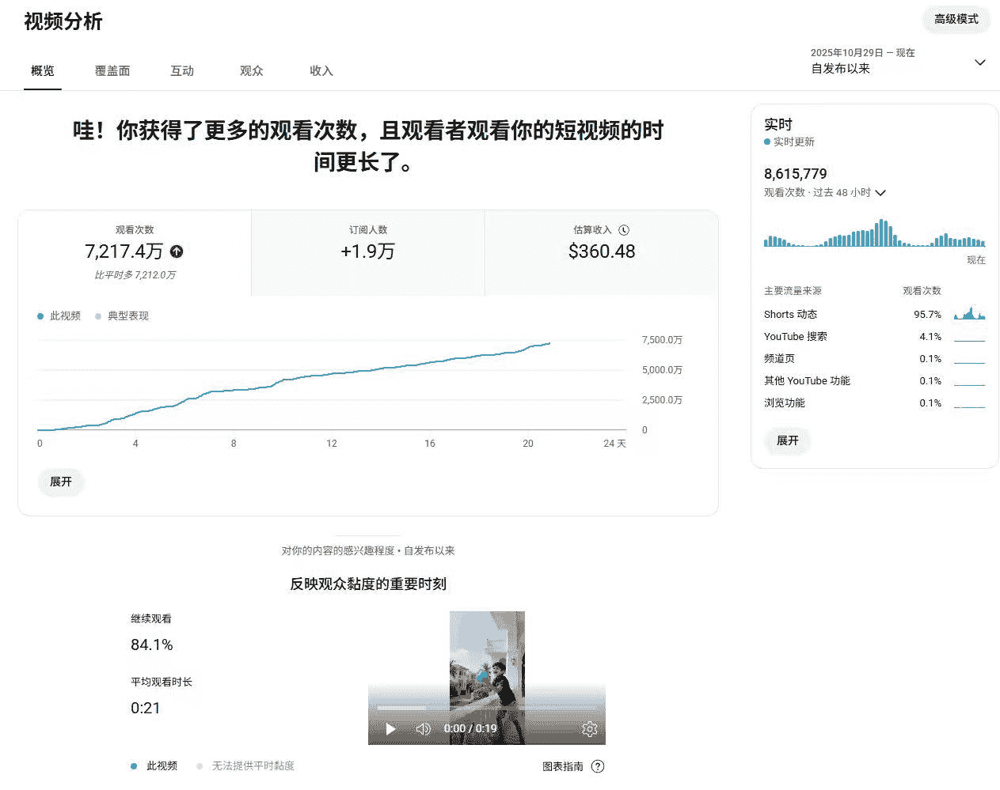

另外提一句，视频中提到的案例，扔水**球的印度故事，录**视频的时，它刚发**布2天，播放**量是189万，而现在已经跑到7200多万。这个爆款，正是我矩阵化策略的直接产物。它的‘母版’是一个KPOP故事，发布后仅有14万播放。而通过矩阵化、替换元素后，这条印度版视频却跑出了7200万的惊人流量。这再次证明了矩阵化的核心价值：不要轻易放弃一个好脚本，换个账号、换个风格，它就可能成为下一个爆款。"

这个视频分镜少，只花了我几分钟便完**成，成本1元**人民币，收益360美元+，第20天了，流量曲线还在向上跑，最新48小时还能增加8百多万，这曲线可能有机会破亿播。

# 四、总结

正如深海圈总教练曹淦在 9 月 16 日风向标说的：

> 好形式+好脚本+较低同质化程度/较高原创度=爆款

> 那么怎么进一步放大收益？怎么把一个爆款变成 1000 个爆款？

> 其实很简单，1000 个爆款=1000/n 个好形式*n 个好脚本

>

> 地区风格：印度风、欧美风、日韩风

> 经典的球星：梅西 C 罗、库里詹姆斯

> 大热的 ip：山海经、kpop、星期三

> 随便乱编都有流量的动物形象：猫猫、狗狗、卡皮巴拉、猴子

>

> 在这个大的壳里还可以换画风、换角色、换 IP，这数量可不是做加法，是做乘法哦，形式做出来几十上百种都不为过。

而我的工具，正是为了完美匹配这个公式而生：

+   **累积脚本：** 网站的项目管理功能，可以让你系统地保存和管理每一个打磨好的爆款脚本，形成你自己的核心资产库。

+   **套风格，套IP：** 自动化的流程，可以让你轻松地将这些脚本批量套用到不同风格（印度风、欧美风、动漫风）和不同IP（山海经、KPOP、动物）上，实现爆款的乘法式增长。

> 以后出新的大热 IP，可以第一时间套上脚本，秒出视频。

如果你具备了‘手搓’爆款的能力（这是1），那么自动化工具就能帮你在这个1后面加上无数个0。我相信，很多圈友已经具备了‘手搓’爆款的能力，而我的工具，就是为了补上那块‘规模化生产’的拼图。网站已经上线，可以体验，操作有问题可以找鱼丸链接我。

> 以上讲解的网站网址是https://vizstory.net/

# 五、致谢

最后，我想诚挚地感谢这一路上帮助过我的平台与良师益友。

+   **感谢生财有术**，这里不仅是一个信息宝库，更是一个高质量的连接器，让我认识许多优秀的朋友与前辈。为了能与大家有更深入的交流，我最近也报名了深圳的联合办公，期待能与更多优秀的圈友共同努力，共同成长。

+   **感谢总教练曹淦**，**曹**总教对深海圈尽心尽责，每周风雨无阻的风向标，以及常常持续到深夜的作业点评—甚至在我都已熬不住睡着后，他仍在不知疲倦地输出干货。

+   **感谢李香君教练**，对我的帮助非常大，非常感谢香君教练的信任，让我加入他的小组，一起并肩作战。在他的实战小组中，我得以快速验证赛道、拿到正反馈赚到美金。

+   **感谢刘小排**，刘小排老师的课程设计对零基础学员极为友好，深入浅出，让我这样的技术小白也能快速入门，为后续的网站开发打下了坚实的基础。

+   感谢在线下活动中结识的舒未读、无常、果林、Perry，在我从零开始学习编程最艰难的阶段，他们给予了我无私的帮助和关键的指点。参加过几次线下活动，认识的圈友都很热情友好，也很乐意无私分享，很感动。生财圈友都很棒，越分享越幸运，建议大家多参加线下活动。

+   **感谢柳一，**成为我网站第一个用户，给予支持和鼓励。

+   **感谢加绒**，在网站的细节上，她给予了我许多宝贵的建议。

独行者快，众行者远。正是这些善意与支持，构成了我前进路上最坚实的后盾。再次感谢大家！