# b站好物从佣金2位数到百万gmv，只用了30天，我是怎么做到的（录屏口播流）

> 来源：[https://xuqiwei1986.feishu.cn/docx/YYc1dqfFGoxmGUxZc6Ic2vSNnzg](https://xuqiwei1986.feishu.cn/docx/YYc1dqfFGoxmGUxZc6Ic2vSNnzg)

# 一、前言

写下这篇帖子的时候其实我挺感慨，因为我的后台刚刚显示我带货天数是70天整。

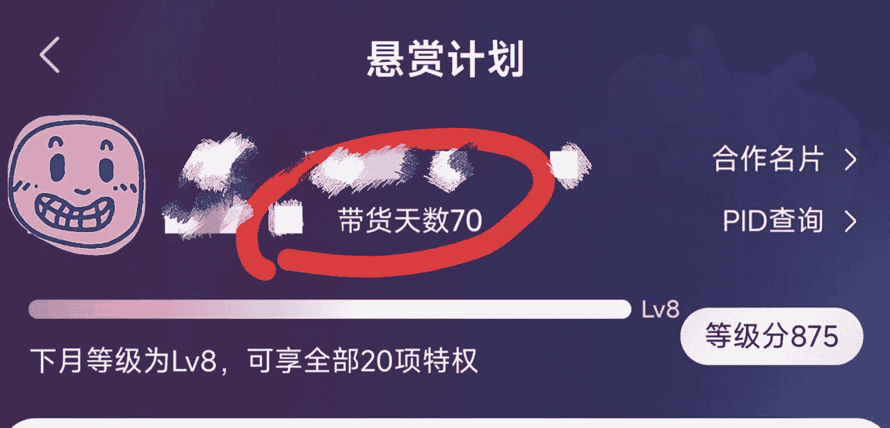

从0-1000，我花了将近1个月；而从1000到月入过万、gmv突破百万我也只用了一个月。

甚至在这次的双十一大战中，我的总gmv破了500w，到手佣金6w+，这也是一个月。

一个月，变成了我的成长周期，而每个周期都能有新的突破。

# **二、b站好物前景**

先来简单说下b站好物是什么，以及有哪些变现方式：

b站好物其实可以简单的理解成b站卖货，就是通过在视频或者直播是挂上链接，然后引导别人点你的链接买东西，有人买了之后，你就有佣金。

可以基本等同抖音或者小红书卖货，只不过前两者都是在自有平台上**卖货**，而b站是引导用户去京东、淘宝成交。在我看来，这其实是更健康的路径，因为京东淘宝作为老牌货架电商，他们的商品丰富程度不是抖音 小红书能比的，而且因为本身就要把用户引流到站外平台成交，所以b站在对于视频的各类违规限制上都是远远低于抖音小红书的。这一点等会儿会细讲。

再来说变现方式，b站变现方式其实和其它平台差不多，主要是商单和带货两种方式，深海圈的小伙伴们主要做的就是商单模式，这种模式需要真人出镜、单个视频制作成本较高，更新周期也比较长（一般是周更，勤快点一周两到三更），前期的收入可能不是很高，但一旦把账号做起来，商单价格价格非常香，也会更稳定，我就曾听说过b站2w粉的up，商单报价也是2w，而且这个粉丝刷还可以刷，所以你们细品。

而我目前走的是纯带货路子，可以说和商单号的模式正好相反，无所谓真人出不出镜，单个视频随手就能录制，熟练之后，从文案-录制-剪辑，半小时就能搞定，但同样的更新速度也需要很紧凑，至少需要保持日更。变现上面会比商单号正反馈来的更快，但稳定性是打不过商单号后期发展起来的变现能力的。所以最好的模式其实是商单和带货相结合，当然这一点我也还在摸索中，而且对于新手玩家来说，一开始也不可能两手抓，只能先进门，然后一点点调整。

# **三、收益数据＆我的来时路**

最开始做b站对时候我完全是当做副业来做的，看到比较简单的方式直接就尝试了。

我是从七月下旬开始做的，做的就是最简单的好价线报类账号，7月一共也就出了3单，第一单的佣金甚至只有7分钱。

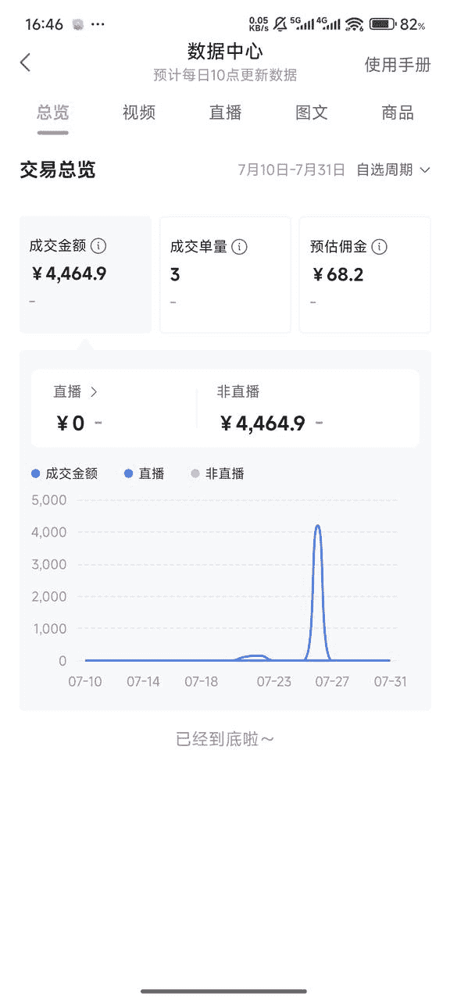

当时我还发帖请教，想知道是否办法能解决佣金低的问题，但可惜当时做这个的人太少了，大家都没解决的好办法

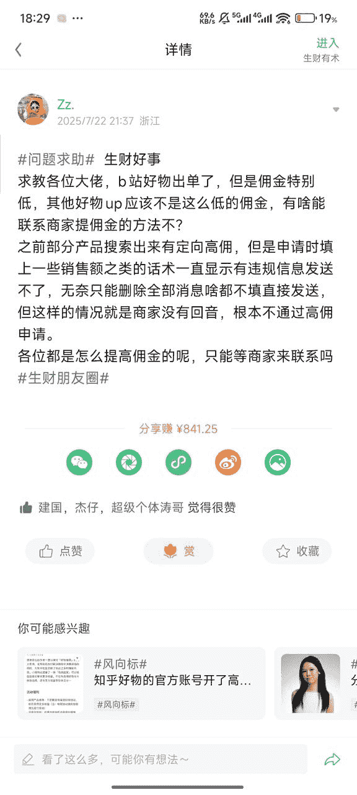

**痛定思痛，我开始研**究，如果佣金没法调整，那多做点gmv也行，质量不够数量来凑嘛。于是我开始研究对标账号都是怎么做到这么多gmv的，然后发现对标账号一天最少也要发四五条视频，而我每天只发一条视频的情况下还三天打鱼两天晒网。所以从8月开始，我每天最少4条视频，多的时候一天10条都有过，至此，收益开始有了提升：

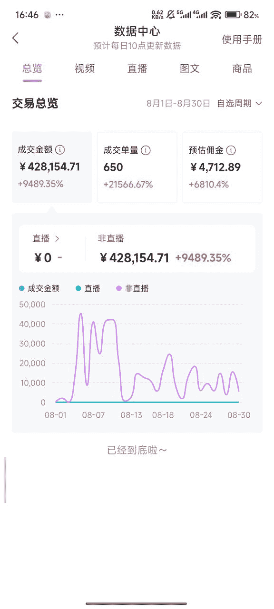

做**到这，第一个30天已经过去了，而此时我也大概了解了b**站的带货情况，也对于比较容易出单的品类有了些了解，同样的，我发现了线报类单个账号的上限也就差不多到此为止了，如果我还想放大收益，只能通过矩阵账号来进行，所以八月中旬我就开始思考其他出路。

9月1号b站排行榜一更新，我立刻上榜单找对标，找到了一些做的比较粗糙但出单很厉害的账号，我一个个账号分析，看自己能做哪个品类，决定开始筹建新账号，开始走录屏口播流。

**录屏口播，顾名思义，就是把你想推荐的**产品进行录屏，然后搭配口播讲述产品特点。

为什么是口播而不是ai配音呢？其实这个模式不是说ai配音就完全不行，但是如果你想让账号的活人感更强，那更推荐真人配音，这样用户的信任度也会更高。

这**里也想说明下，我最**开始搭建新账号其实也很迷茫，不知道该往哪个方向走，于是我把排行榜上我认为可以对标的账号全都摘了下来，然后一个个做排除法。

这点其实我也很建议大家尝试，毕竟一开始没人知道你到底能做哪类账号，但绝对做不起来的类型会好找很多。所以可以一点点排除，排除到只剩下那些让你犹豫 感觉可以试一试的对标，这个时候就简单了，仿照着他们的视频类型，都去尝试下，看哪一类的播放反馈比较好。

大家不用担心新号不推流的问题，就我目前尝试的来说，我觉得b站在推流方面其实比抖音、小红书都要友好，只要你的视频选题、封面、标题都确实不错，b站是实实在在会给你推流。

而且因为b站是导流到站外成交，所以在封面、标题上其实可以大胆很多，不用像做抖音 小红书一样总是怕违规，比如直接提“京东”“淘宝”等也完全没有问题。

9月初我在新账号发了第一个实拍视频，视频刚发就爆了上万播放，但一单没出，甚至连商品点击都少的可怜：

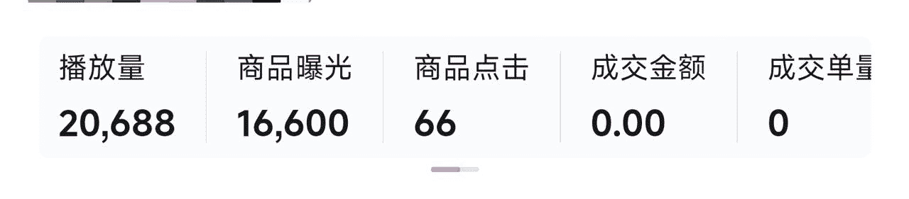

评论区当时基本都在说我的视频不够专业，确实，毕竟在此的一个月前我连电子产品的品牌都还分不清。

而我发布的第一条视频又是我在线下店顶着一堆人的目光急匆匆拍的，根本没有准备过词，也对产品没做到充分了解。

**所以后**来的视频，我都会在开始前加一个步骤：写文案。于是，我的视频数据变成了这样

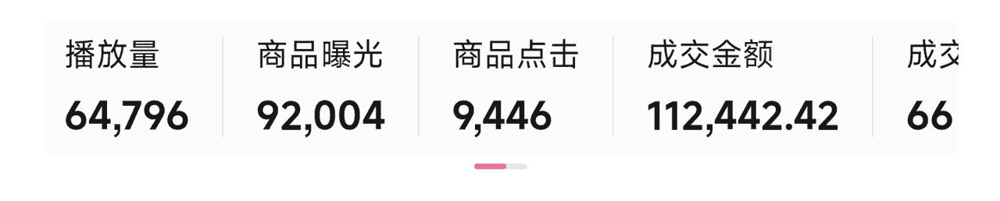

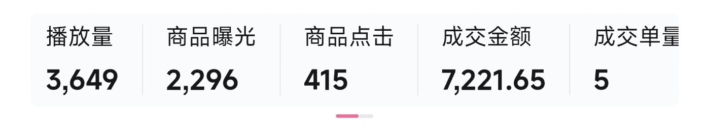

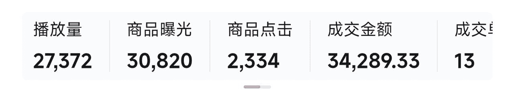

由于我对产品实在不了解，每次新拍一条视频，光是文案从构思到写出来修改完，我最少需要三四个小时，所以一天最多只能更新一条视频。

有些圈友应该已经找到了我的账号，很多人可能会觉得我的账号视频很简单，但其实在初期，甚至到双十一之前，我都一直在写文案。每一条视频的制作时长不少于两小时。后来逐渐熟练后，才变成一小时左右能出一条视频。

就这样跌跌撞撞，我在第一个月仍然到了百万gmv。

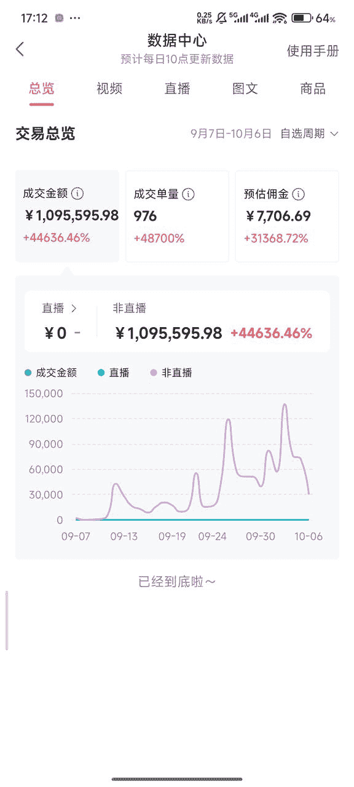

后来随着我越来越熟练，每天能发的视频数量渐渐增多，加上双十一的来临，我的数据变成了这样：

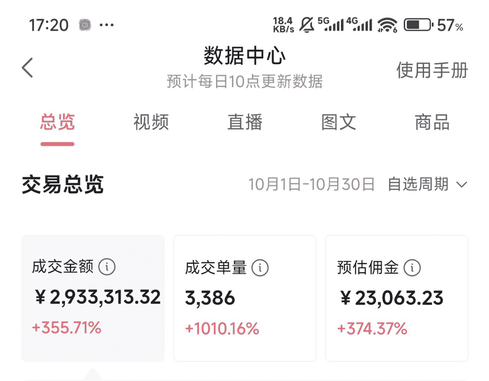

双十一期间，京东平台gmv共计377w+，淘宝gmv共计126w+，总计gmv超500w，到手佣金及奖励6w+

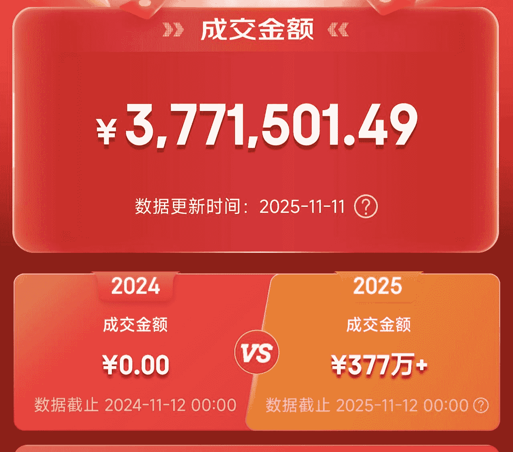

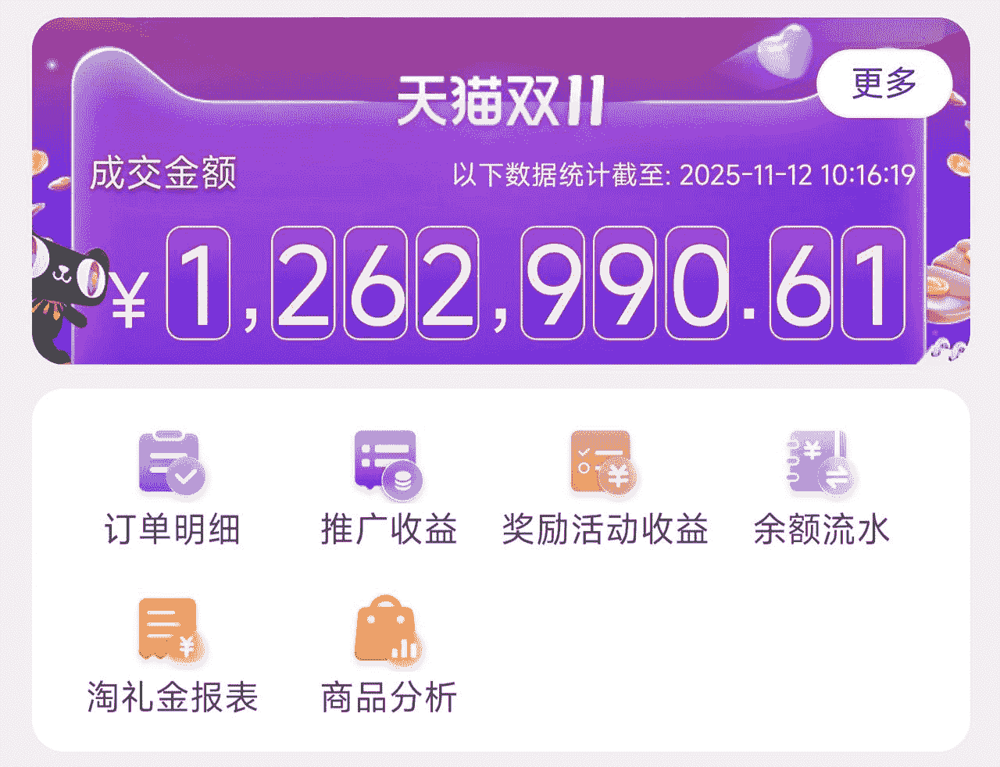

以上数据都是我通过纯自然流跑出来的，那会儿根本没想到投流，如果当时介入投流，数据应该至少能翻一倍。但没关系，这是我应该走的路。

至此，我的第二个30天结束，目前正在开启第三个30天。

# **四、如何从0开始**

对于这点，我只想说 **寻找你目前见到的所有变现方式，然后挑选出对你来说**最熟悉的模式，先干一个月，就会有质的变化。

## **找对标**

b站这个平台其实很友好，它把收益高的up主都放到了一个表单里，每个月都会更新一次，所以这对于新手小白来说其实非常友好，你只需要每个月去榜单里找到低粉高变现的up主，然后挑出你能做的模式，不断模仿就行了

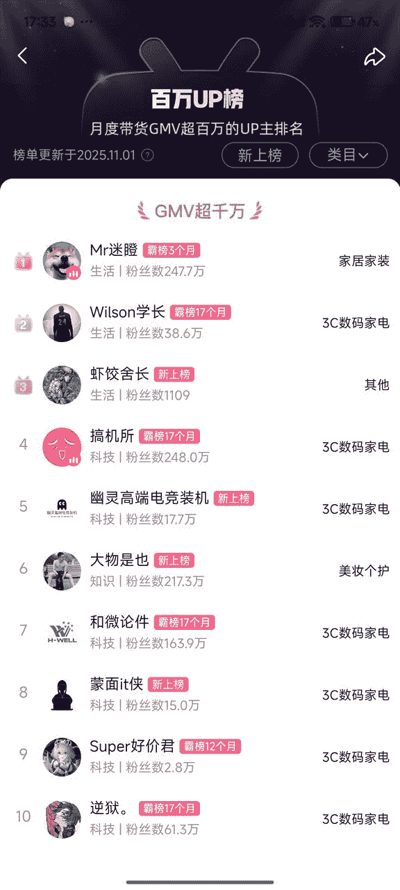

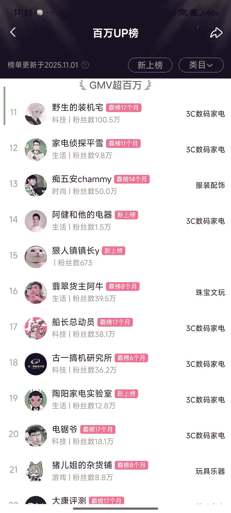

所谓低粉，少于1w粉丝的最优先考虑，其次可以看下5w粉以下的，因为b站很多粉丝其实也是买的，粉丝数据并不真实。

而且当大家遇到卡点，也很推荐去看对标，因为当你每发现一些新的玩法，再回看，你会从对标的视频里发现很多以前从没注意到的细节。

## **选品**

刚开始大家大概都不知道做什么品类，那就像亦仁说的，先从3c数码开始吧，这是最好出单的品类，也是我拿到了大结果的品类。

这一部分很多人可能会很想带佣金高的产品，但据我观察，高价高佣类的产品是很需要配合时机的，比如大家电，这一块大家都知道佣金很高，但其实出单真的不简单，尤其是做录屏口播流的同学，由于我们的视频时长短，整体文案很精炼，其实是很难让用户在短期内就做出决策的。

所以在平常的时候，大家电只要不是急需，下单的人很少。但如果你做账号的开始时间就在双十一期间，那你会发现家电类也会好出单很多。

**我的建议是，先从热度高的品类开始，等账号有权重有**热度了，再去带动高佣金但不好出单的品类。

并且观察榜单的话大家也能发现，大部分上榜的up都是数码类目的：

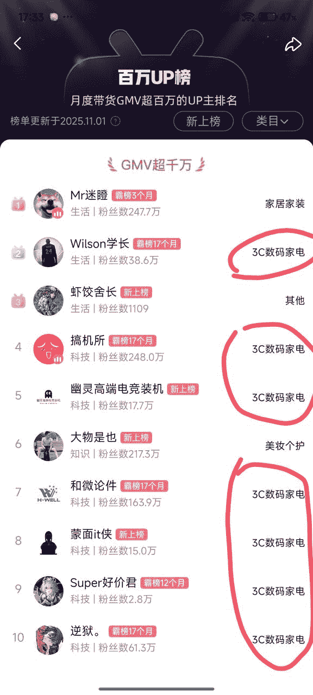

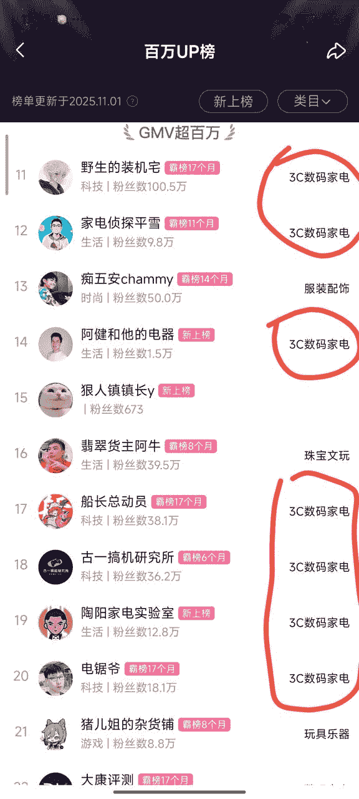

至于具体的品类，有个最笨但也最有效的方法，也是我**目前都还主要**用的，就是多刷对标视频，而且一定要人工刷。在这个过程中，你会不断的思考对标的视频结构是怎样的、封面文案又是如何做的，刷多了之后还能找到很多同类型但没上榜的账号，这些都可以成为你的素材来源。

榜上的up基本都是日更，或者至少两三天一更，只要你人工刷一周的账号，你就会发现自己根本不愁选品了。

## **文案**

在开头我就有提到过，文案很重要，而且我自己也是每条视频都会写文案。

那具体品类的文案怎么写呢？

在你确定好选品之后，如果是数码家电类的，可以直接去知乎搜索相关的信息，知乎虽然现在有些没落，很多大神也都停更了，但仍然有很多内容能供人参考。

举个例子，我在刚接触游戏本的时候一窍不通，甚至我都没用过游戏本，连具体的网游名字都报不出来一个。

所以当时我先去知乎搜索了游戏本相关的基础信息，比如“游戏本该怎么选” “游戏本的分类” “买游戏本的注意事项”等等，甚至其他一些看起来非常白痴的问题

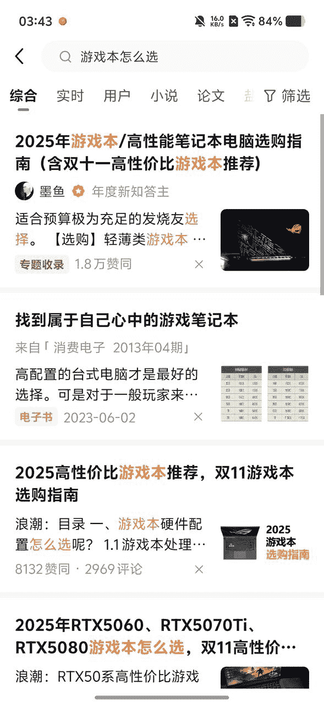

一开始直接选择高赞的文章看就行，里面一般也会详细介绍产品的选购要点，比如像我搜索游戏本，它相关的文章里面就会把cpu之类的配置也顺带都讲清楚。

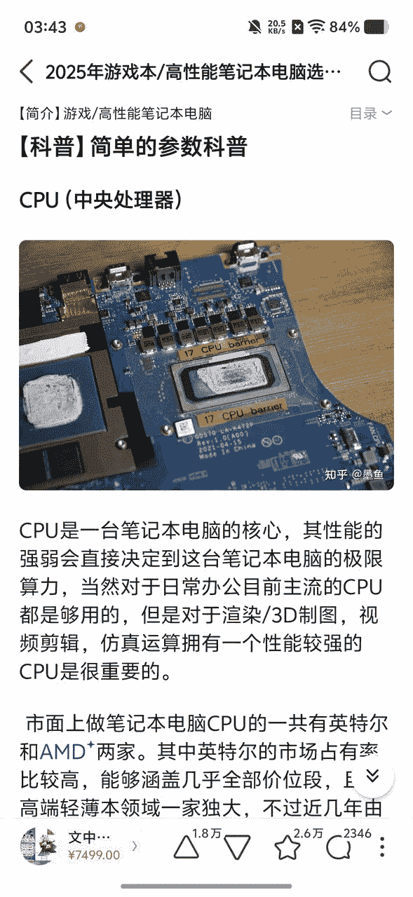

对产品有了大概了解之后，可以直接看你的对标都在推荐哪些产品，那你可以跟着他选品，对单品不了解那就再次去搜索。

不要怕麻烦，一开始一定是最难的，熟悉之后你会发现这些都很轻松。

同理，小红书、抖音、微博甚至官方旗舰店，你都可以去搜索相关的信息，如果觉得信息太多太繁杂，也可以利用下ai来提效。

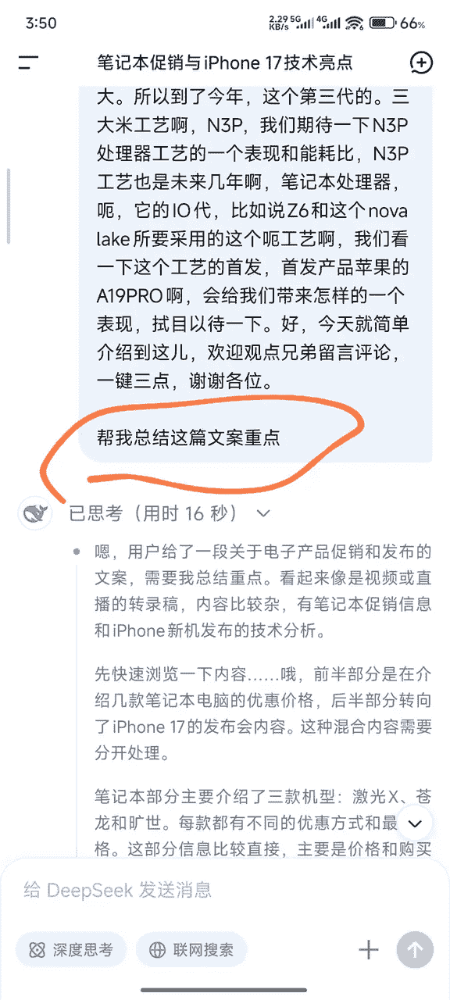

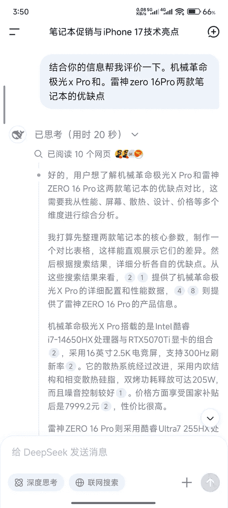

我对于ai其实也不是很熟悉，所以也没有特别复杂的提示词，但就只是普通的分析总结来说完全够用。

大家也不要总是被所谓的“提示词”困住，只要能表达出你的需求，ai基本都能给你一个答案。

而且文案是可以在手机上直接完成的，我从拍视频到现在所有文案基本都是在备忘录里完成：

这里还想强调下，在初期的时候不要给自己太大的压力，怎么简单怎么来，不然很容易会放弃。

最开始时大概率播放量、出单量都不会很好，但这个时候最重要的是你能否找到一个能让你长期坚持下去的做法。

## **更新节奏**

如果你是做长视频，至少保持周更，如果是制作比较粗糙的短视频，那一定要日更，甚至可以每日多更。举个我自己的对标例子：不寻常手机测评

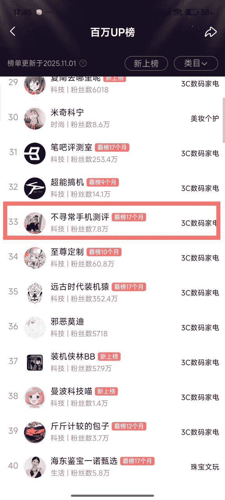

这个大佬这次排名33，每个月都在榜上，可以说从来没下过百万榜。但他最厉害的点就在于他的更新速度：

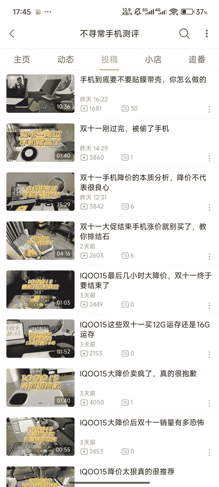

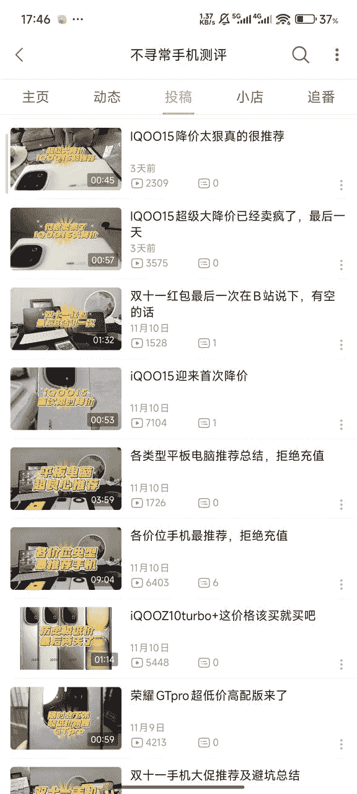

每天更新4-5个视频，其实点进去细看，会发现很多视频内容都很扯淡，还经常发一些和手机无关的吐槽😂，但就这样，他的每个视频播放量都能上千，每个月必在百万榜上。

他也是给我了很大启发的up主：原来不是每个视频都必须制作的很精良才能发，原来这样的视频都有人看，原来b站用户对up的容忍度这么高...

没错，b站是我目前觉得观众容忍度最高的平台，虽然评论区时不时也会diss博主，但那又怎样呢，他们不还是看了吗，不还是给你留言增加互动了吗？甚至封面做得再垃圾，都有人愿意点进来看，这就很离谱...可以说，b站是个还没被流量污染的平台。

## **封面和标题**

其实我的封面非常粗糙，有些圈友应该已经找到了我的账号，可以发现我都是随手截一帧视频里的画面，标题用的也是系统自带的文字模板，非常丑。但没关系，只要它是清晰醒目的就可以。

**在我看来你的封面文字丑不丑其实**关系不大，重点在于是否和你的视频风格匹配。比如我做的是简单的录屏口播流，那要是我做个非常专业的封面，大家点进来看后反而会有种割裂感，不如就用简单随意的方式来做就行。

而且我必须再次提到，这也是让我感到最省力的方式。

我的视频都是在手机上拍完后直接在手机剪映里剪辑，如果为了封面还要再去换软件专门做一张，那会让我觉得麻烦，一旦开始觉得麻烦，大概率这件事也坚持不了多久。

在坚持做视频面前，封面的好看程度就变成了微不足道的小事。

# 五、复盘与启发

## 1.找到离舒适圈最近的模式开始尝试

上文里我就一直提到，尽量找让自己觉得不麻烦的方式去做项目。

> 因为我和大多数人一样，都是普通人，在接触新项目前一定会产生畏难情绪。而选择一个离你舒适圈较近的方式去做，那一定会让你前期走的更顺，只有顺了，才有做下去的动力。

比如我第一个账号做的是线报，为啥呢，就是因为简单。

第一次了解到b站，是从亦仁的超级标，那会儿能参考的帖子很少，有一篇比较详细的帖子。那篇帖子里面提到了诸如好价线报、产品横评云测评等方式，对当时的我来说，横评、出镜等方式都太麻烦了，而且我平时也完全不会去了解数码家电之类的产品，连手机品牌有哪些都不清楚，甚至经常搞混oppo和vivo，b站这个平台我也从来没用过，所谓“b站风格”对我来说压根没概念，那在这样的情况下，如果我选择横评之类的方式去做长视频，一定很快就会放弃。所以我毫不犹豫选择了最简单的线报类。

线报的更新其实挺无脑的，只需要找到对标账号，然后看他发什么你就跟着发什么，甚至连文案都不怎么需要改，如果会点ai的话，甚至还能让智能体给你自动生成视频。这样的模式对当时的我来说就是离舒适圈最近的。

然后一旦你开始出单，尤其是没怎么费力气就开始出单，那尝到了甜头之后你会更有信心去做（但这里也想和大家说不要一直以正反馈为目标，这样很容易坚持不下去，详细的可以在生财里找一下相关文章，写的非常好）。

在做的过程中一步步拓展自己的舒适圈，到最后你会发现原来这些视频都有规律可循。

甚至你还能把目前在做的项目和曾经的经历结合起来，那种感觉会非常好。

## 2.找到志同道合的伙伴一起做

这一点非常重要！也是我本次做项目最大的收获。

我平时刷生财的时间比较少，所以b站深海圈的报名也错过了（这是我超后悔的事），当时虽然已经在做b站好价线报类的视频了，但一直苦于没人交流，很多视频只能自己慢慢摸索。

包括在做b站之前，我一直是独行侠，啥都自己干自己琢磨，甚至在我开设第二个账号的时候也是，完全是跟着对标懵懵懂懂的做了，结果误打误撞，有一条视频爆了，被圈友@小源 注意到了，然后在后台私信我，我们联合另一位同样在做的圈友组了小组，三人毫无保留、非常真诚的分享，至此，我才终于有“找到组织”的感觉。

而且在一次次的交流中，我越来越能明确自己账号的方向，最终我们小组全员都在当月实现了百万gmv。可以说，如果没有这个小组，我绝对做不成现在这样。

> 当然，很多人可能也怕自己研究出来的方法告诉别人之后自己会赚不了钱，那我借用之前一位大佬发的一段话：

> **当你看**到有人在真诚地分享赚钱的经验、方法和认知时，他本质上，是在发一张英雄帖。他是在用自己的认知，去筛选和吸引那些与他同频的、有行动力、有合作精神的同路人，一起来做大做强。而那些一听到赚钱就竖起防备之心，满脑子都是“他要割我韭菜”的人，从一开始，就被这张英雄帖，精准地筛选掉了。

我们的小组就是靠着一遍遍发布“英雄帖”，渐渐吸引了更多厉害的同路人，大家带着自己的方法论一起交流探讨，每交流一次，几乎所有人都会发出“错亿”的感慨，原来b站还能这么玩。

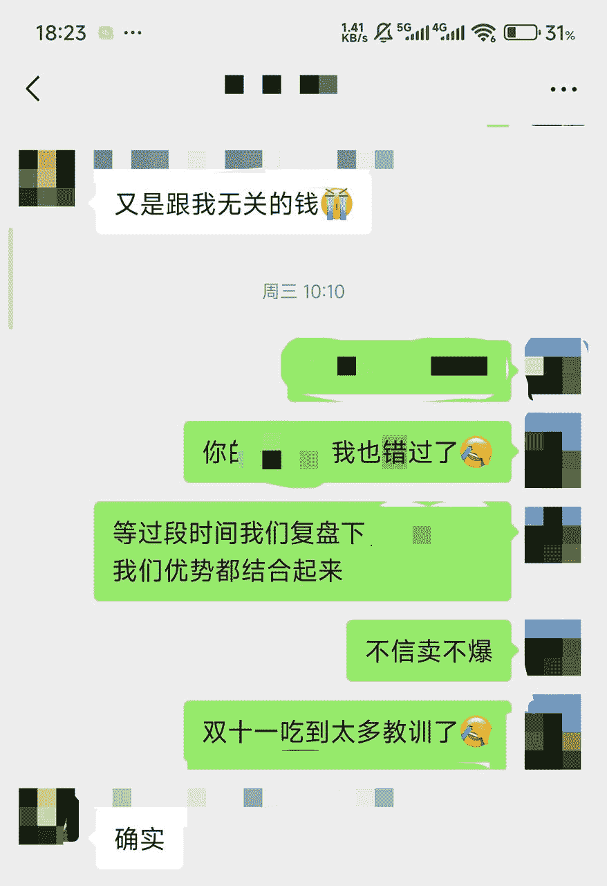

现在我们组内七个人，六人都做到了月百万gmv，甚至有大佬这次双11干到了千万gmv，还有一位小伙伴是做高佣品类，虽然gmv看着没那么显眼，但其实佣金一点都不少，是一种非常健康的方式。

并且我们有信心在下一次的机会来临时，能更好的综合所有人的方法论，再创新高！

这里也需要特别说明，请一定要找人品好 靠谱的人交流，这样才能一起共同进步。

“一个人能走的很快，但一群人能走的很远”

## 3.请相信，你不会失败

我很喜欢生财里的一句话：我不会失败，因为我要么成功要么学到东西。这句话也在这次真实的验证在我身上。

做b站之前，我在做抖音带货和小红书个人ip，小红书ip号让我成功脱离了职场，但随着广告市场的大环境变差，ip账号不再是我的主要收入来源；抖音短视频带货在去年的时候其实是个不错的项目，但随着入场人数大量增加，以及一些商家的“骚操作”，也逐渐变成了很多人眼中的“烂项目”。

这两段经历可能谈不上绝对的成功，但都给我带来不可忽视的影响。如果没有小红书，我可能到现在都不会想着出镜拍视频，不会知道该怎么和pr谈商单；没有抖音带货，我根本想象不到带货有多赚钱，也根本不知道带货视频的剪辑技巧有哪些，在刚开始做b站好物的时候，虽然平台是陌生的，但短视频带货我熟悉啊，无非是换了种方式，这也是让我一个月又一个月坚持下来的原因，就是我前文提到的，它没有离我舒适区太远。

> **所以**，这次的b站好物项目，不管你做的如何，是否还有力气继续坚持，我都想说，你已经成功了，已经学到东西了，这次的经验一定会在现在或未来的某个项目中帮到你，你需要做的只是不下牌桌。