# 我是如何用AI多个“超级员工”，从三个层面帮我赚钱

> 来源：[https://xuqiwei1986.feishu.cn/docx/VqWqdP8ZjoEnlFxPROac7lmenRr](https://xuqiwei1986.feishu.cn/docx/VqWqdP8ZjoEnlFxPROac7lmenRr)

**大**家好，我是来来，一名写了三本AI畅销书的作者，11次生财有术航海教练（AI绘画4次+AI视频2次+AI工作流2次N8N和COMFYUI+AI电商1次+AI知识库1次+飞书多维表格1次)，已创办12年的电商设计公司的CEO，AI企业顾问和培训讲师（客户有中国移动、长江商学院、三节课等），你看我的头衔很多，就知道事情很多很杂，时间永远不够用。但这三年来，我是把AI当做我的超级员工的。

> **AI是**我解决问题的“万能钥匙”。我不是把AI当成一个高深技术，而是把它当成我公司里的员工，ta24小时不睡觉、不要工资（电费会员费相对员工工资简直就是九牛一毛）、而且不会抱怨，能力超强的“超级员工”。并且我雇佣了不止一个，最少三个，下面请听我详细说说。

今天，我就从AI电商、AI内容工厂、AI自动化这三个层面，跟你聊聊我这个“人类老板”，怎么管理和使用多个“AI超级员工”来降本增效、开拓业务、最终赚到更多钱的。

# 第一层面：AI电商——我的“全能运营助理”

> 做电商，核心就三件事：选品、做图、写文案。

> **过去，这需要一整个团队来完成。现在，AI帮我扛下了**大半江山。人工核心是做审核和决策的工作。

## 选品采集与市场分析：从“人工拍脑袋”到“AI采集数据人工决策”

以前选品，要么靠经验直觉，要么靠人工一点点翻看平台数据，效率低还容易看走眼。现在，我会给我的“AI助理”下指令：

比如，我想在亚马逊上找一个有潜力的家居小品类。我会对AI说：

> “请分析当前亚马逊‘家居与厨房’类别下，客单价在20-50美元之间、近三个月搜索量上升快、但竞争程度中等偏下的细分产品。请列出5个潜在选项，并分别分析其优劣势和市场机会。”

几分钟内，AI就能给我一份结构清晰的报告。它可能会告诉我“便携式果蔬净化器”正在兴起，或者“磁性纱窗修复贴”存在市场空白。这大大缩短了我的决策周期，让我的选品从“凭感觉”变成了“有依据”。

+   采集国内电商数据我一般用**飞书多维表格的连接器中****心，非常强大和稳定，官方API安全不封号，可以从聚水潭，美**团，饿了么，景点，巨量千川，巨量广告，抖音，金数据，抖音来客等等平台采集电商数据，

+   采集国内自媒体平台的数据相对麻烦一点，但是也可以通过飞书多维表格联动coze工作流配合API，采集小红书，公众号，视频号等的自媒体数据。

+   **海外电商和海**外自媒体数据我就建议你用N8N工作流去采集，那是相当的爽，他的核心在于支持批量采集海外平台数据和发布到海外平台。

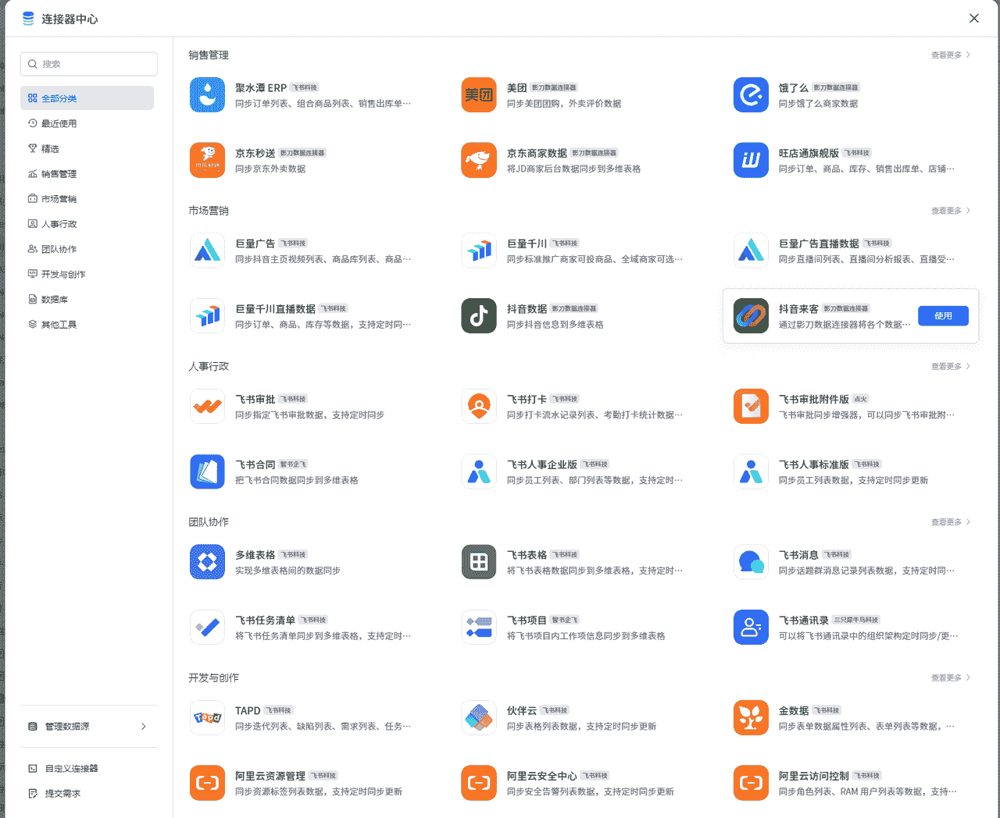

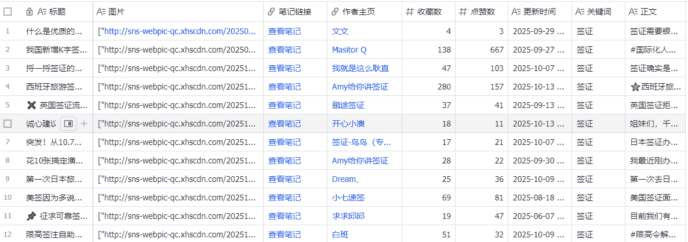

## 文案创作：AI一秒生成千百条，总有一条适合你

电商文案的核心是：抓人眼球、突出卖点、激发购买欲。过去一个文案一天可能写10条主图文案就头昏眼花了。现在，我让AI批量生产。

比如，我有一款“便携式咖啡杯”，它的卖点是“3秒加热、保温12小时、颜值高”。我会让AI这样工作：

> “针对‘便携式智能加热咖啡杯’，请生成：

+   5个不同风格的天猫商品标题（突出科技感、突出时尚感、突出实用性等）。

+   10条吸引人的抖音短视频文案脚本。

+   20条用于详情页的 bullet points（卖点罗列），分别从功能、材质、使用场景等角度阐述。

+   3套不同风格的详情页文案框架（极简科技风、温馨生活风、潮流炫酷风）。”

以前需要团队开会脑暴一上午的活儿，现在AI十分钟就搞定了。我的工作变成了“总编辑”：从AI生成的几十上百个选项里，挑选、修改、组合出最好的那条。效率提升了何止10倍。

> 这里要不得不提的就是飞书多维表格，不要简单的理解认为他是表格，他是把一个个AI超级员工塞到每个列中。左侧黄色的两列是采集到的小红书标题和正文，右边绿色的四列，是AI二创的正文和标题。

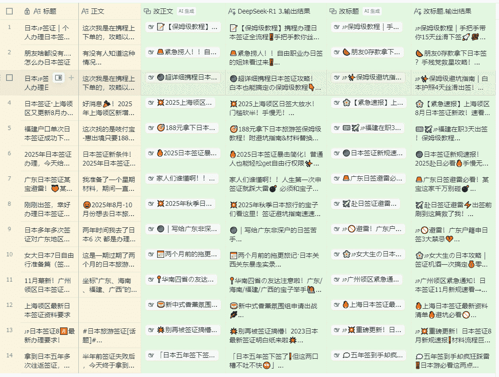

## 客服与售后：AI打造“永远不会骂人+永不掉线”的贴心客服

我们用AI搭建了一个智能客服系统。当客户来咨询时，AI会首先接待。

+   对于“发货了吗？”“有优惠吗？”“尺寸多大？”这类常规问题，AI能秒回，准确率100%。

+   对于更复杂的问题，AI会先给出初步解答，并同时提示我们的人工客服介入。

这样做的好处太大了：

+   解放人力：我的客服团队从此不用再回答重复、简单的问题，可以把精力集中在处理复杂投诉和精准营销上。

+   24小时服务：即使是半夜的订单咨询也不会丢失，用户体验极佳。

+   标准化应答：避免了不同客服回答口径不一致的问题。

这个“AI客服”不仅没让我的客服团队失业，反而让他们升级成了“客户关系管理专员”，工资更高了，工作价值也更大了。

> 这个客服因为牵扯到太多客户的敏感数据，没法展示给大家

# 第二层面：AI电商图片视频自动化——我的“王牌设计团队”

> **我**开了12年设计公司，太清楚图片生产的痛点了：成本高、沟通累、修改烦、周期长。AI的出现，直接重构了我的工作流。

## 商品图与模特图：AI零成本“拍”出千百张

这是对我生意改变最大的一点。以前为一个产品拍图，要请模特、租影棚、找摄影师、后期修图……一套下来，费时费钱。

现在呢？比如我有一款新设计的帆布鞋。

+   第1步：我用手机给这双鞋拍几张白底图。

+   第2步：把图片和指令丢给AI：

> “请将这张帆布鞋图片，放置在以下场景中：1. 阳光明媚的公园草坪上；2. 都市街拍的咖啡馆外；3. 充满设计感的家居室内。要求图片真实感强，风格清新自然。”

几分钟后，我就得到了这双鞋在不同场景下的高质量“实拍图”。我甚至可以要求：

> “请生成同一个模特，分别穿着这双鞋的白色、黑色、粉色款的照片。”

这意味着，我不用再生产大量库存来拍图，可以先上架，用AI图测试市场反应，再决定生产哪些颜色。这简直是商业模式上的降维打击。

1.  简单少量几十个，可以使用**飞书多维表格配合AI字段捷径**，可以瞬间生成各种模特图。

1.  **复杂大量一天几万个图**片的话，我就会用COMFYUI工作流，批量生成各种模特图和商品图

1.  从2025年初，我开始给其他电商卖家做定制电商图片和电商视频的工作流服务，这样一鱼多吃，自己公司也能用，还能卖钱。这些工作流给各位电商卖家是极大的降本增效。

1.  **举个实**际案例：有个TEMU帽子商家以前一月10个设计师手绘做1500款图案，现在一个COMFYUI工作流一天24小时AI生成1500个图案，节省了10个设计师的费用（一个设计师5千算一月5万一年就60万的费用节省下来变成利润），而且你算算效率提高了多少倍。

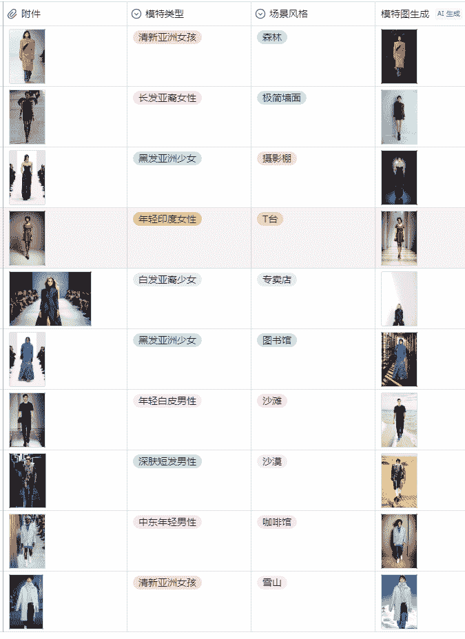

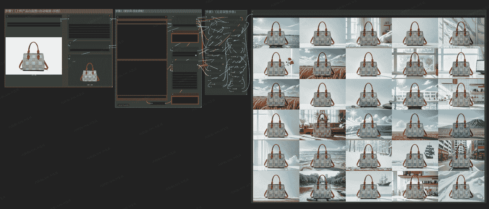

## 营销素材海量生成：AI一个指令，获得全网图库

做电商运营，天天都需要各种尺寸的图片：公众号首图、朋友圈九宫格、小红书笔记图、抖音封面……以前设计师会被这些琐碎需求逼疯。

现在，我有一套固定的AI工作流。比如要推一个“周末咖啡促销”活动。

我会对AI说：

> “请生成一张‘周末咖啡狂欢’的主题海报，风格为简约现代，主色调为暖棕色，需要包含咖啡杯、折扣标签等元素。并同时生成适合小红书方图、公众号横版 banner、朋友圈长图的三种尺寸版本。”

AI瞬间就能给出好几套方案。我挑一个最顺眼的，让设计师微调一下字体和logo，十分钟全部搞定。我的设计团队终于可以从重复劳动中解脱出来，去干更有创造性的品牌设计工作了。

1.  电商领域最多的还有一个洗图的COMFYUI工作流，方便从原图洗成一个接近的图，原因你懂得。

1.  换背景，换人物，换姿势，也是COMFYUI工作流最擅长的，这些统统都可以做，下面都有演示

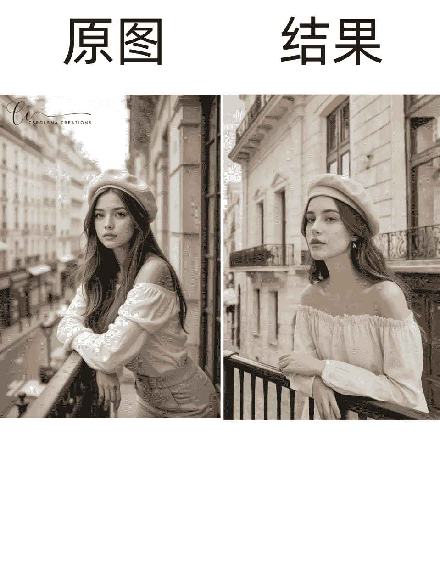

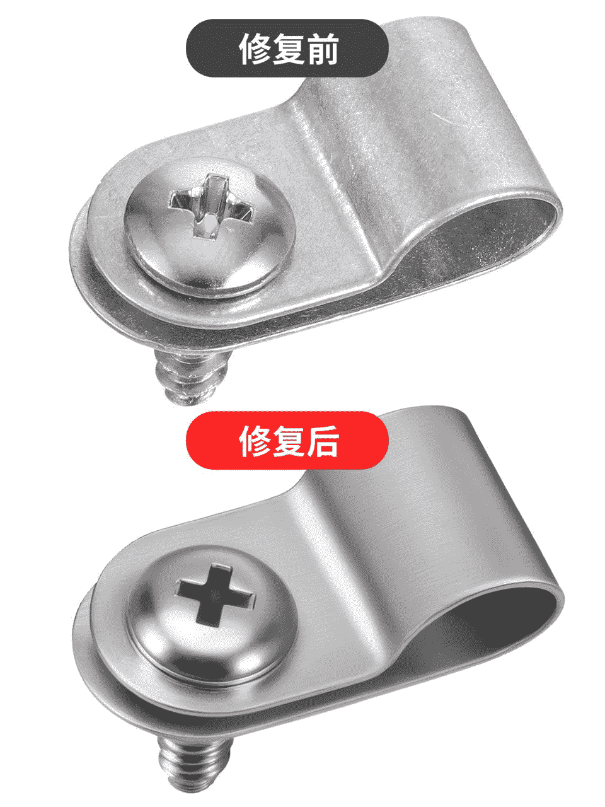

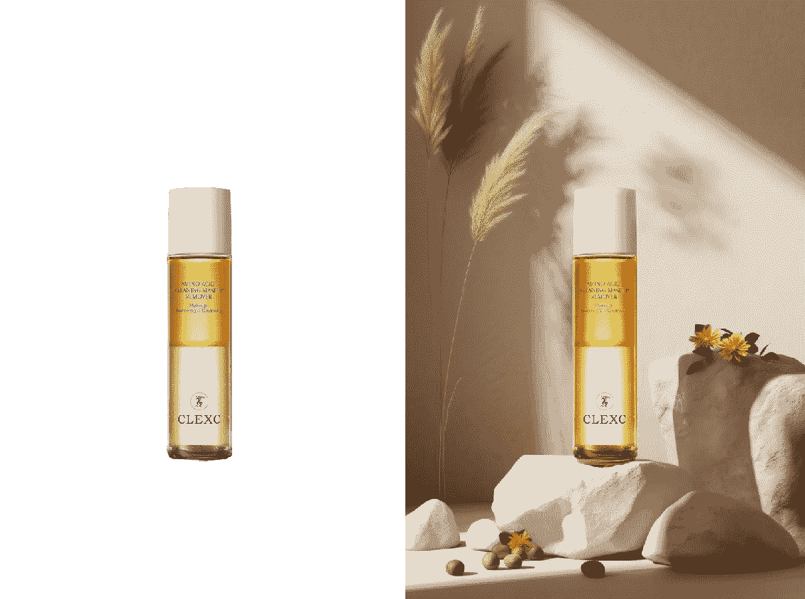

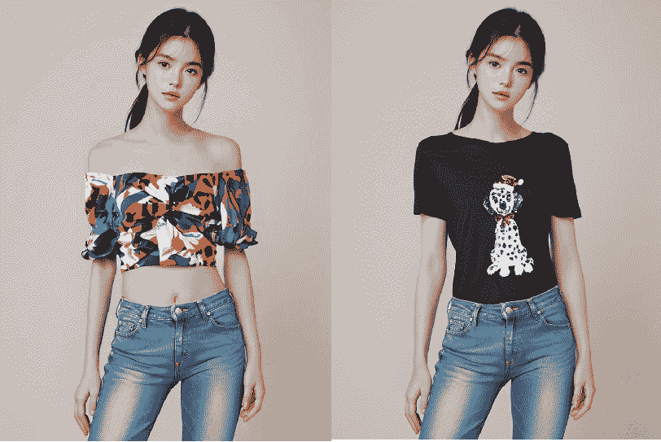

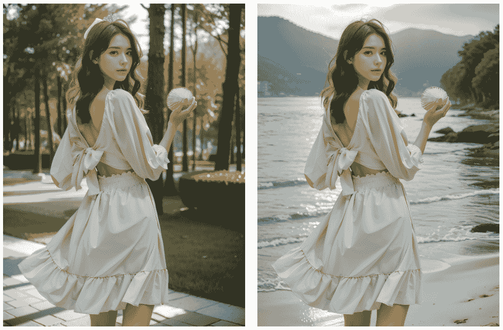

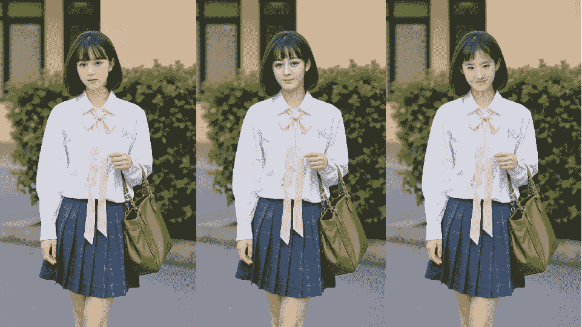

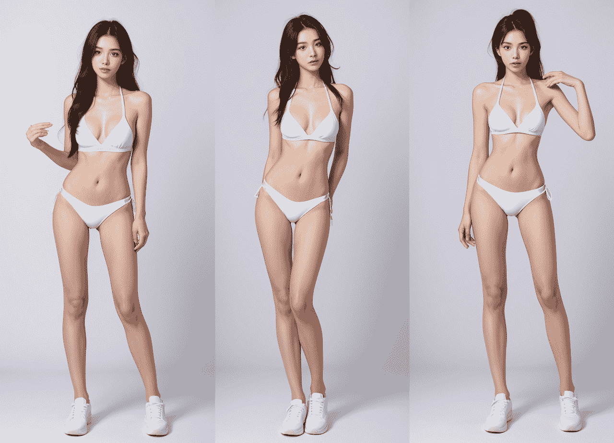

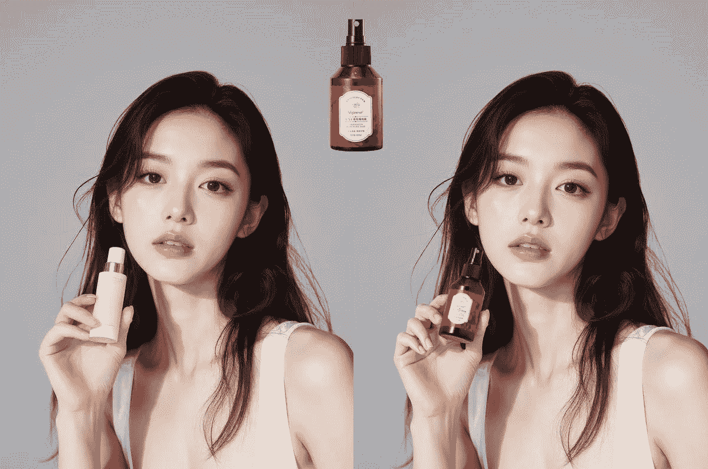

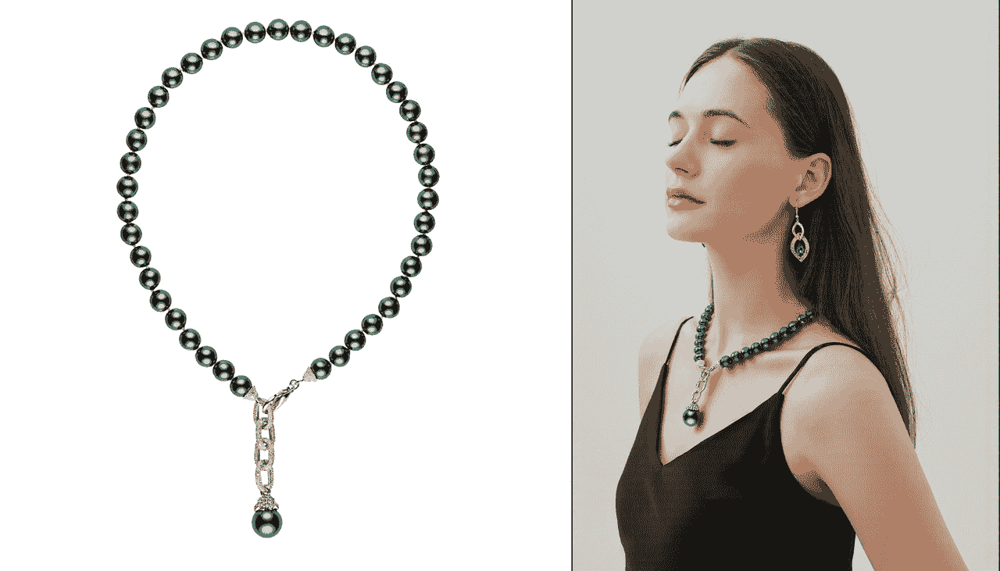

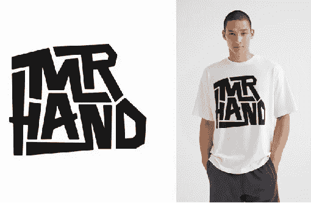

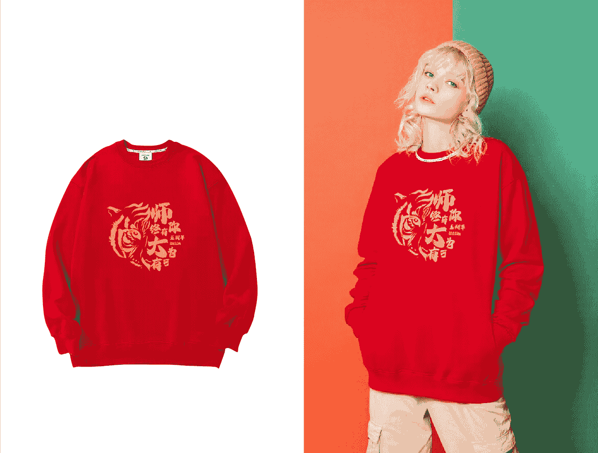

## 创意灵感激发：AI是永不枯竭的“外脑”

即使是资深设计师，也常有灵感枯竭的时候。现在，当接到一个客户brief时，我们会先让AI“脑暴”一轮。

比如客户说：“我们要为一个新品牌‘花间露’的蜂蜜设计包装，想要自然、高端的感觉。”

我们会让AI生成：

> 请为‘花间露’蜂蜜设计10款不同的包装风格方向，描述其视觉元素、色彩搭配和整体感觉。

AI可能会给出“手绘插画风”、“极简留白风”、“复古印章风”等我们没想到的方向。这些方案不是最终稿，但成了点燃我们团队创意火种的那根火柴，大大提升了前期的沟通效率和创意质量。

1.  简单的可以使用即梦的AGENT模式，他可以一次性生成40张图片和8个视频。

1.  复杂大量的话，我就会用COMFYUI工作流，批量生成各种模特图和商品图

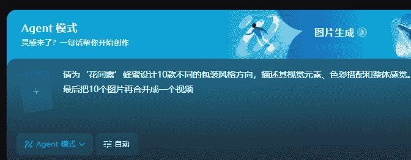

## AI已经生成图片和视频，还做了总结

> 我已经为"花间露"蜂蜜设计了10款不同风格的包装方案，每款都有独特的视觉特色：

1.  **中式传统风格** - 深棕玻璃瓶配金色书法字体，工笔画花卉装饰，古朴典雅

1.  **现代简约风格** - 透明方瓶配纯白标签，简约线条花朵，清新现代

1.  **田园风格** - 磨砂圆瓶配牛皮纸标签，手绘野花图案，温馨自然

1.  **奢华风格** - 深绿磨砂瓶配金色箔纸标签，精美花纹装饰，高端华丽

1.  **日系清新风格** - 淡粉玻璃瓶配半透明标签，樱花图案，清新甜美

1.  **复古工业风格** - 深灰金属瓶配复古标签，齿轮蜜蜂图案，硬朗复古

1.  **自然有机风格** - 棕色玻璃瓶配回收纸标签，蜂巢图案，环保有机

1.  **艺术装饰风格** - 深蓝玻璃瓶配Art Deco标签，几何花卉图案，华丽艺术

1.  **北欧极简风格** - 透明圆瓶配极简标签，简单线条花朵，纯净简约

1.  **波西米亚风格** - 彩色渐变瓶配手绘标签，花卉羽毛图案，浪漫自由

### **即梦出图有时候是比较粗糙的，但是不影响**我们人类，通过AI获取不一样的设计灵感。

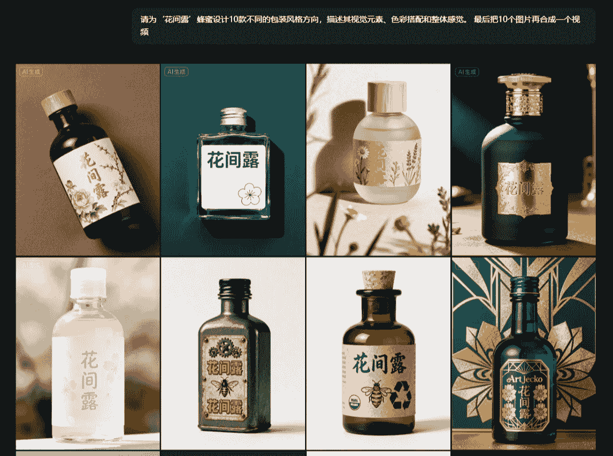

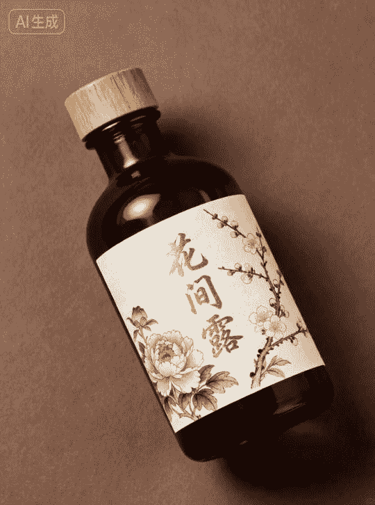

[jimeng-2025-11-20-5754.mp4](https://internal-api-drive-stream.feishu.cn/space/api/box/stream/download/all/H4NQbpJWPo0D5Yx81YPcT9nZnOg)

## 视频批量生成：AI二创视频

其实除了图片领域，现在AI视频也在电商领域也是大杀四方，可以看看下面来来做的案例

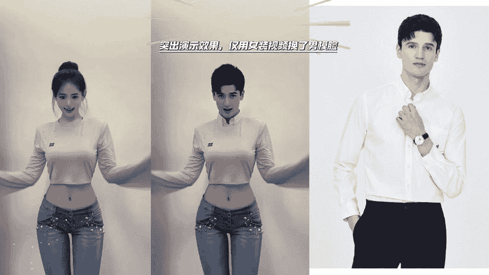

[二创视频.mp4](https://internal-api-drive-stream.feishu.cn/space/api/box/stream/download/all/WnyDbxfK6osp6HxV0rgcIzzKnhf)

# 第三层面：AI自动化——我的“专属流水线”

> 如果说前面两个层面是让AI帮我完成“单项任务”，那AI自动化就是让这些“超级员工”们串联起来，形成一条全自动的流水线。

## 培训业务升级：每个学员都有自己的“AI助教”

作为AI培训讲师，我无法同时回答几百个学员所有问题。现在，我为我每一门课程都训练了一个专属的“AI助教”。

这个AI助教学习了我的所有课程内容、课件和常见问答。当学员有疑问时，可以随时提问这个AI助教：

+   “老师，刚才讲的‘提示词工程’第三步，能再举个例子吗？”

+   “我这个图片用SD总生成不好，帮我看看我的提示词哪里有问题？”

AI助教能7x24小时提供精准的、基于我课程内容的解答。这极大地提升了学员的学习体验和满意度，也把我从重复的答疑中解放出来，去研发更优质的课程。对于企业客户（如中国移动、长江商学院）来说，这种高附加值的服务也让他们觉得“这钱花得值”。

1.  核心是用了AI知识库。生财有术之前的AI知识库，AI视频，AI工作流航海来来都配套制作的有专门的知识库，核心其实就是完成这个作用的，你不需要看文档，只需要问文档即可。

【ima知识库】【来来】AI知识库航海助手 https://ima.qq.com/wiki/?shareId=b5ff6100977c6b18131de7bbe0d3f5dbf5b7e7353e0a678ff1a354aae75a8ef5

【ima知识库】【来来】AI视频航海助手 https://ima.qq.com/wiki/?shareId=68f424960e23e4765c4fa2364dc925d14de34207409cfbd487e7a371455f6857

【ima知识库】【来来】AI工作流航海助手 https://ima.qq.com/wiki/?shareId=60d7aae1439ed4a2cd2be73a7539adda1e59c0d252401bda2047289ee20ee616

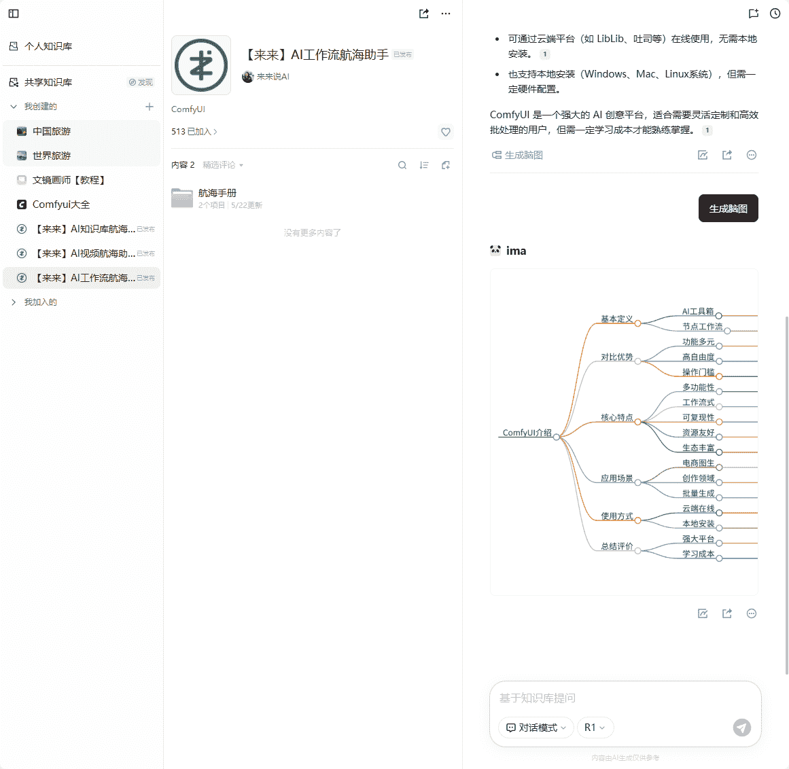

## 内容全自动发布：AI从“写”到“发”一气呵成

我的个人品牌需要持续在各个平台（公众号、知乎、小红书）更新内容。过去流程是：写稿 -> 排版 -> 做图 -> 逐个平台发布。非常繁琐。

现在，我搭建了一条AI流水线：

+   **第1步：AI写稿。**我给定一个主题，比如“普通人如何用AI做小红书”，AI会生成一篇草稿。

+   **第2步：我加工。**我把草稿修改、润色，变成我自己的口吻和风格，这是灵魂所在。

+   **第3步：AI自动处理：**我写完的终稿会自动触发一系列操作：

+   AI自动将这篇长文缩写成适合知乎的深度回答。

+   AI再将它拆解成3-5条适合小红书的口语化笔记。

+   AI根据文章内容，自动生成每一篇推送、每一条笔记所需要的配图。

+   **第4步：AI自动发布：****通过工具，将这些**处理好的内容和图片，自动发布到对应的平台后台（我需一键确认）。

这样一来，我只做最核心的“修改和审核”工作，其他所有重复性、流程性的工作全部被自动化了。我花一份时间，就能维护好几个平台的更新。

1.  简单上手就用飞书多维表格。

1.  复杂的建议用N8N实现。

## 数据分析与报告：AI秒级生成“决策参考”

我的公司每周都要看数据报告：销售数据、设计项目进度、培训业务反馈等等。以前需要助理花半天时间从各个系统导出数据，再做表格、做成PPT。

现在，我用AI搭建了一个“数据驾驶舱”。

我只需要问：

> “AI，汇报上周整体情况。重点分析：1. 哪个产品销售额增长最快？原因是什么？2. 设计部门哪个项目耗时超出预期？3. 最新的AI培训课程学员评价中最集中的关键词是什么？”

AI会立刻连接多维表格的数据库，分析、总结，并生成一份图表。这让我能随时、快速地掌握公司全局，做出精准决策。

1.  这里核心是用的飞书AI配合多维标的仪表盘，可以快速查看各种数据汇总。

# 总结与心法：你该如何开始？

聊了这么多具体的案例，你可能觉得AI无所不能。但我想告诉你，AI不是魔法，它就是一个工具。你想用它赚钱，核心是转变思维，除了吃饭，钓鱼，旅游，泡温泉等等这些重在体验的事情，其他重复低效的事情别再事必躬亲，要学会当一个“AI管理者”。让一堆“AI超级员工”给你赚钱，你就花钱就好了，哈哈哈。

### 给你三条最实在的建议

1.  **从小处着手，解决一个具体痛点。** 别想着一上来就搞全公司自动化。你先找一个你最烦、最多重复的工作开始。比如，你是不是每天都要写很多重复的邮件？让AI帮你写初稿。你是不是为找配图发愁？让AI帮你生成。从一个点开始，获得正反馈。

1.  你必须是“老板”，AI是“员工”。 最终决策和承担责任的人是你。AI生成的内容、图片、数据，你必须去检查、修改、赋予灵魂。不要当“甩手掌柜”，要当“总编辑”和“总审核”。

1.  **关注整体流程，而非单点技术。** 最高级的用法，不是用AI完成一个任务，而是用AI把多个任务串联起来，形成一个自动化的流水线。思考你的工作流中，哪些环节可以被AI替代和连接。

AI的时代已经到来，它不再是科幻电影里的概念，而是我们身边触手可及的生产力工具。对我而言，它不是一个让我焦虑的“替代者”，而是一个让我强大的“赋能者”。它帮我赚钱的方式，本质上就是把我从重复劳动中解放出来，让我能有更多时间去思考战略、去陪伴家人、去创造真正独一无二的价值。

**希望我的这些经验，能给你带来一些启发。从现在开始，试着招聘AI**这个“超级员工”吧，它准备好了为你工作。