# 上完小排老师的课，用时七天，做出一个产品赚到深海圈学费（全流程）

> 来源：[https://xuqiwei1986.feishu.cn/docx/X2lAdLgQRo08dOxVn6Ycz3OZnLf](https://xuqiwei1986.feishu.cn/docx/X2lAdLgQRo08dOxVn6Ycz3OZnLf)

## 一、从上小排老师的课到真正的产品

上一篇文章写到了上小白老师的课，让我人生第一次写了产品。

文章快速跳转：https://t.zsxq.com/zuRsN

这篇文章我主要想聊的是，我从零开始到现在写出一个能够收钱的产品的整个经过，和让我很开心、有成就感的过程。

其实前天我挺兴奋的，兴奋在于我正式收到产品的钱。

这个产品是有人愿意为了我付费的。

还把深海圈的学费赚回来了！

一直到现在，已经有50多个会员，这个感觉真的挺好的。

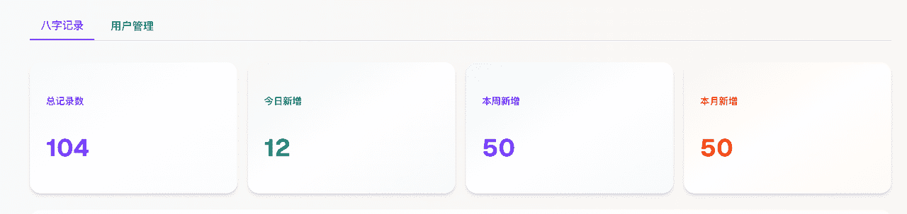

我觉得在AI编程的时代，重点都不是我们懂不懂编程，而是我们会不会更加善用工具。

因为当我们知道怎么善用工具，就可以在完全零基础的潜力之下，把一个我们喜欢的产品写出来。

---

## **二、写产品前的三个困惑**

我当时在写这个产品的时候，其实我经历了几个困惑：

+   第一个困惑就是——我要怎么设计我的网页。

+   第二个困惑是——我要把什么加进去。

+   第三个困惑是——会不会很难，会不会在写的过程中因为一些难点而导致我做不到。

但是我真正开始写这个产品的时候，我发现我想太多了。

所有的恐惧其实都是想象出来的。

**恐惧 = 没有一个明确的目标，**

**恐惧 = 没有行动。**

因为行动的那一刻开始，恐惧一定会消失。

行动就是确定性，而恐惧同时是想象、是不确定的。

我前面提到的三个我觉得可能会有的难点，其实都是想象的。

因为我没有实际地走过这个流程。

---

## **三、决定动手：上完课的那个晚上**

那天上完小白老师的课之后，第二天我其实没去。

因为一些家里的事情没办法到场

但那天晚上我就在想——

**如果说写程序这么简单，**

那我能不能真的写出一套属于我自己的八字软件？

---

## 四、第一个版本：从V0到Cursor

回到家之后，我的操作跟上课的时候其实不一样。

因为在上小排老师的课，我第一个是从v0开始写的产品，按照上课的课件，从航海手册中，按照原本的模版，直接修改做了一个产品介绍。

第一次写产品的时候，产品介绍还是我手敲的，我还得把API找到网站去复制贴上，贴到底下。

所以第一个产品我花了很多时间在设计产品该怎么写，但回到家后，我做了第二个产品，我就换了一种方式。

我告诉自己：

> **既**然是AI编程，所有的事情我都要用AI来完成，不要用人工来完成，我的原则就是——只要AI能做，我绝对不手动做。

---

## 五、Cursor上场：全程靠口喷

于是我打开了cursor，没有打开v0。

因为在上课的最后，同桌教了我怎么使用Cursor，小排老师也说，cursor使用起来会更专业更好用一些，就产品打磨来说，cursor能更好用，上课也教了怎么把v0的东西部署到Cursor。

坦白讲，上课时我听不太懂，没跟上进度。

所以再次告诉自己这个大原则：**所有事情都用AI完成。**

我知道在用AI的时候，我势必要有一个ai产品系统，以及对话产生新灵感的工具。

工具我选好了，就是Cursor + chatGPT

那时候我本来想用Claudecode，可是因为我不懂Claudecode，

**所以我只用Cu**rsor这个我熟悉的，不去碰不熟的。

这其实有个盲区：

**新**手总习惯上网找很多（更好用的），就算手边有熟悉的系统，如果花太多时间重新找，最终只会让结果更拖延，所以上手就用最熟悉，想更好未来在说。

---

## 六、从GPT开始：让AI帮我写八字软件

这次写的时候，开头第一步我就调整了方式：

> **我不手敲，我直接发给GPT。**

我对GPT说：

> “我想要做一个八字软件，请帮我写出一个大概的产品框架，我要让Cursor可以帮我直接跑出一套八字软件的方案。”

GPT马上跑出很多内容。

我没看，就直接复制，贴上给Cursor。（这里特别重要）

（这是我跟gpt的第一次对话）

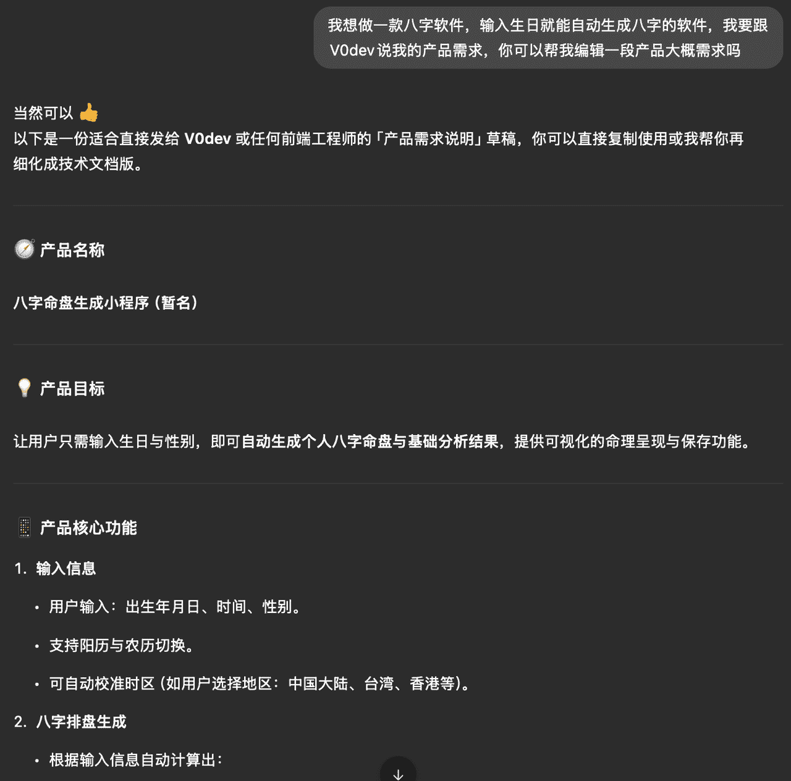

大概三五分钟后，它就跑出了一个很简易的输入八字的网站，当时出现了一个本地网址，什么xxx3000的，我还没看懂是什么，以为这个可以发给别人。

我心里想，这世界太了不起了。

然后我尝试输入第一个八字——**出来的是错的.......**

---

## **七、错误与调整：截图对话式修正**

这时候我有两种方法。

第一种是手敲告诉Cursor哪里错了，但我发现这种表达不如GPT精准。

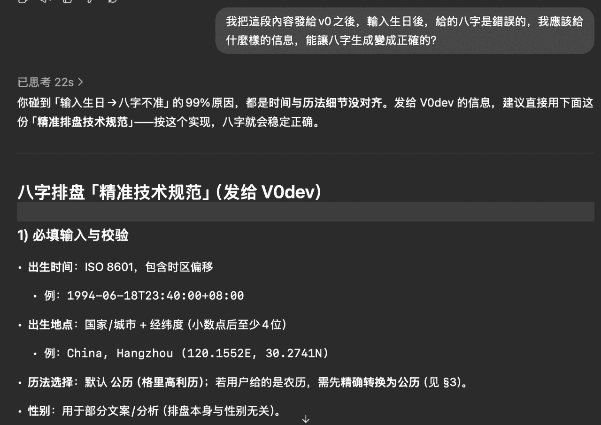

这几天跟AI相处，最大的感触就是：

**我说的越精准，得出来的结果就更精准，如果我说的**不精准，那就多说几次让AI帮你调整精准。

于是我把Cursor跑出来的本地网页截图发给GPT说：“这个生日出来的八字是错的，正确的应该是xxxxx。”

GPT跳出一段内容，我又没看，直接复制贴上Cursor。

来来回回改了五次，也跟GPT对话五次，我终于调整出一个能输入正确八字的软件系统。

（到这个步骤，也就花了不到30分钟，主要都在等系统跑。）

---

## 八、继续增加功能：让AI自己设计模块

我心里想：八字输入正确了，最重要的难题解决了。

那下一个就是——我要在八字软件里放些什么，还有一个问题是八字输入的页面太丑了（忘记拍照），我就在想怎么让介面可以好看，就找到了同学发给我的另一个人做的页面，我就这么跟GPT说：

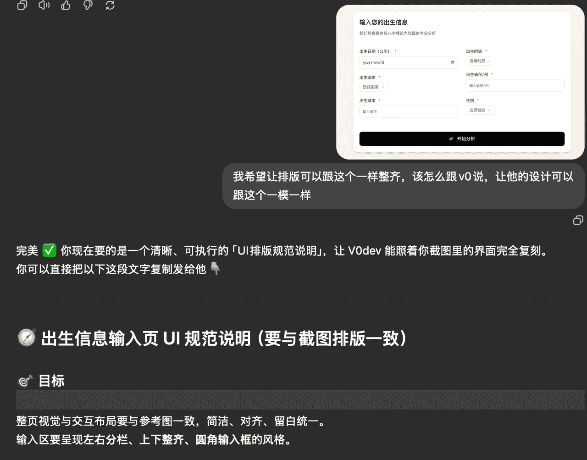

原来，这样就能解决问题，太爽了、也太简单了。

接著就是，导览页我该放什么，坦白说也没有头绪，这时候我出现两个想法：

+   一个是**我先想想**要放什么再告诉Cursor

+   另一个是——**继续交给GPT操心**

依旧提醒自己遵守原则：

> **“只用AI，不用我的脑。”**

我告诉GPT：

> “我想写一个八字软件，但我不知道放什麼比較好，你帮我想想吧。

GPT很快给了一套方案，我没看，直接贴给Cursor。

---

## **九、导览页的诞生**

我知道网页得有几个构成：

一个是产品本身，一个是导航页。

上课时有教怎么放导航，但我当时没听懂。

于是我去找了一个网页截图发给GPT，说：

> “我要做一个像这样的页面，请把上面的文字改成适合八字软件使用者看的版块。”

GPT马上帮我生成一整文案，我贴上Cursor后，它自动跳出了六个导览页，我当时都惊呆了，怎么一句话，就跑出了能自动跳转的导览页，都无法想像这是自己做的。

就这样，我做出了第一个版本。

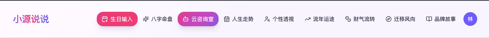

（第一版本的图找不到了，只好用最新版的解释一下这个场景）

我发现——

**我原本想象的那些“创意难题”，根本**都不难，只要说得清楚，AI就能立刻生成。

（事实上是，说的模糊AI也能生成）

---

## 十、截图式沟通：我用视觉和AI对话

我是一个很视觉感的人。

要我打文字描述，我反而说不清楚。

但要我看图说故事，我就能马上讲出问题点。

所以我只要看到页面的某个字太小，我就截图发给Cursor说：

> “这个字帮我放大。”

排版不顺眼，我就截图说：

> “这个线条帮我加粗，这个改横线，这个改曲线。”

就这么来来回回十几次，我做出了第一版，既能上线，也能运行。

这快一周的时间

我跟系统都是这么对话的（三分钟的视频，没有剪辑只有上字幕）

[生财文章，八字软件.MP4](https://internal-api-drive-stream.feishu.cn/space/api/box/stream/download/all/EpfwbN8TVoz0LhxBXtfcsLuBnkl)

---

## **十一、第二阶段：做会员系统**

我知道如果这个产品要上线，仅有页面还不够。

必须要有会员登录系统，否则我无法知道谁用了。

那时候我在想——

我是要做给国内的人用，还是海外的人用？

**我决定：先以国内私域为主。**

因为我要的是快速上线产品，卖给谁肯定是我第一个思考的问题

只要想好卖给谁，再结合自己最擅长的领域，就能更精准的下决定。

那既然如此，是否加付费功能好像就没那么重要，

是否要加Google登录也不是重点。

我只要能做出最基本的会员体系——输入邮箱、输入密码登录，

那就够用了。

---

## 十二、AI继续接管：让Cursor帮我搭后台

因为我忘记上课讲的步骤，因为上课说到这一段，我听的模模糊糊，练习的时候也不会做，就是不懂。

但是不担心，依旧回到最基本原则：

> **AI编程，就用AI解决。**

我直接发给GPT说：

> “我需要让产品可以加上google登入，该怎么做。”

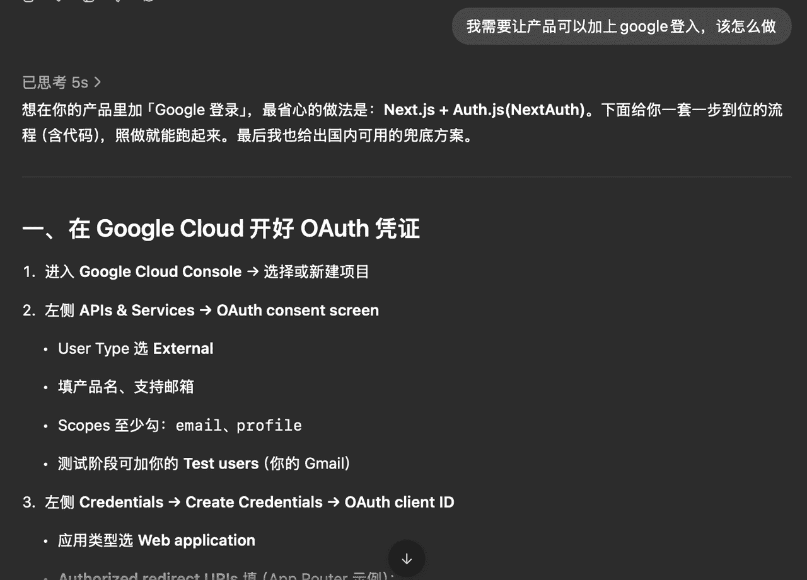

GPT说的好长，有点复杂，主要是我看不太懂，然後牽涉到什麼也看不懂，我又继续问：

> 第一阶段说的不够详细，我按照你的步骤做，没办法完成，可以说的更详细一点吗

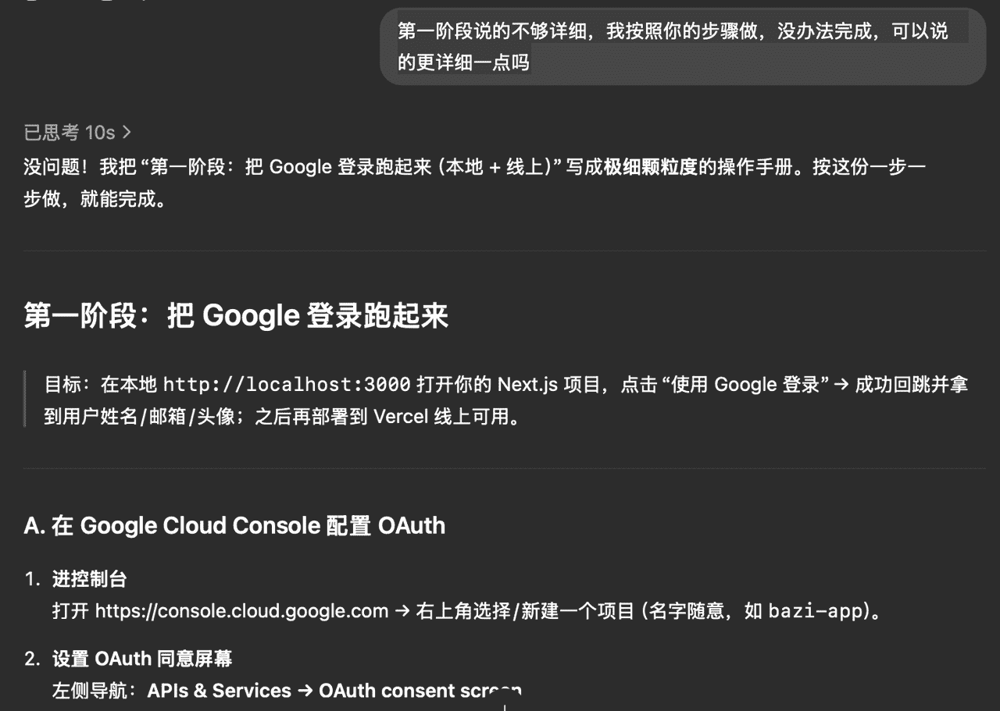

这里真的很复杂，一次好多步骤，但是AI编程有个很美的事情就是：

> 太难就跳过，让他给一个更好的替代方案。

想想我暂时我的需求也不给海外用户，所以最后cursor给了我另一个方案（找不到照片了）

我就按照他给的方案做，又快又不用我重新申请其他东西。

前面东搞西搞了快30分钟没搞定，后来替代方案一出来，cursor能一键帮我部属，太完美了！

---

## 十三、最重要的经验：不手动、就问AI

在整个过程中，我有一个核心原则：

> **只要AI能做，就不自己手动。**

只要它让我动手，我第一句话永远是：

> **“你能帮我操作吗？”**

如果它解释得太复杂，我就复制那段话发给GPT：

> **“请帮我把这段话变成我可以直接复制**贴给Cursor的版本，我是新手小白。”

GPT就会帮我把内容改成我能照抄的步骤。

这样来来回回，我发现——

AI每次都会给出更细、更清楚的指令，这世界太美妙了。

---

## 十四、遇到卡点：Cursor卡死不动、转向Claudecode

第三天，Cursor突然不能用了。

**屏幕上出现“61.9％……”跑出一堆英文错误**，我忘了具体数字，但它彻不能动也不会转。

（没找到图片.....）

**我快疯了。**

**我快疯了。**

**我快疯了。**

过程中一直截图问GPT，给的方案也都不能用

真的，当下都快疯了！

我上网查，有人说Claudecode比Cursor好用。

于是我问GPT：“怎么安装Cloud Code？”

GPT说要注册、要付费。

我注册失败，于是又问GPT“如果注册不了怎么办？”

还问朋友——

朋友说：“你去咸鱼看看吧。”

于是我上咸鱼找了个卖家，买了个账号。

这边请了一个程序员漂亮姑娘帮我远端设置环境（靠外力了！）

终于，我把Cursor转成Claudecode。

---

## 十五、从Cursor到Cloud Code的对比

Claudecode确实更完整，但用户体验不如Cursor。

Cursor能直接点开网页预览，Claudecode不行。

我得复制到线上才能看。

——这可能只是我操作少了步骤。

整体来说：

> Cursor更轻快，Claudecode更强大。

于是我决定：既然换了Claudecode，就坚持用它写下去。

---

## 十六、持续问AI：四天写出完整会员系统

接下来我照旧，遇到不会的问GPT，

遇到不熟的、要操作的，再问GPT。

一步步照做。

关键是——

当GPT给的方案太复杂，一定要习惯说：

> “我是一个新手小白，我完全不懂编程，请你给我更简单的步骤。”

每问一次，它就会给我更细致的版本。

就这样，我用了四天，写出了第一个能有会员登录的系统。

---

## **十七、第一次上线与收钱**

会员系统做好后，我测试登录时发现没法跳转。

我截图发给Claudecode，让它帮我处理。

当问题解决、系统能注册、能登录时，

我第一个念头是——

> “我终于写出来了！”

我马上找朋友说：“你们要买吗？”

他们都愿意付费。

我没加付款系统，就先私下收钱。

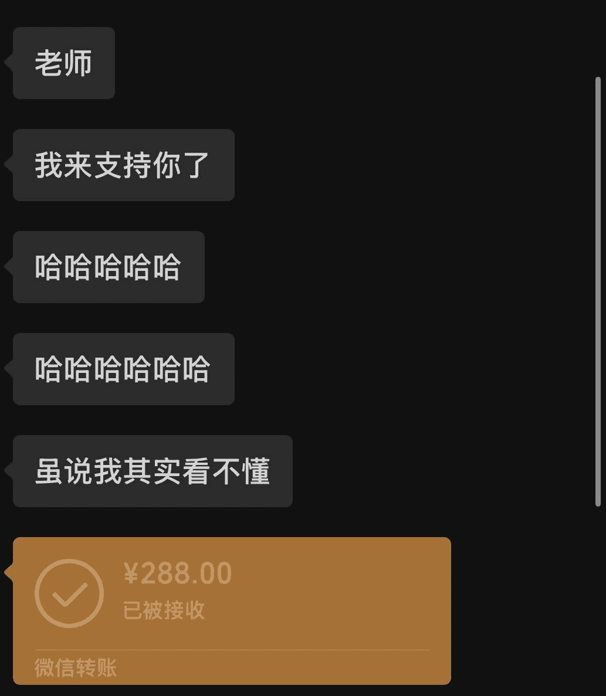

这让我更确认一件事：

> 先用自己最擅长的方法跑通赚钱的第一步。

---

## **十八、买域名、解决“梯子”问题**

但我发现Cursor跑的都是本地部署（local）。

我没法发链接给别人用。

我问GPT：“我要怎么拥有自己的网页？”

它让我买域名。

我照做，花了40美元买了两年。

我特别兴奋——

我终于有自己的域名了！

接着我问GPT：

> “能不能让我不用梯子，也能让国内用户看到？”

结果发现——不行。

没梯子打不开。

这时候我又慌了。

因为国内用户不会翻墙。

于是我再次请GPT帮我。

它给我一套方案，让我改DNS配置、调整部署。

我照做，虽然花了不少时间，但最后成功了。

那一刻，我真的感动。

> 我不用梯子，就能点开我自己的网页。

---

## 十九、上半场的总结：我和AI一起长大的过程

这就是我的上半场。

我觉得很得意，也很骄傲。

这整个过程，

其实是我和AI一起对话、一起成长的过程。

从最初不会，到真正上线、收钱，

我靠的不是技术，而是——沟通力。

---

## 二十、关键原则重申：不了解，只操作

不需要梯子就能够点进去的域名的这个流程，其实我在做的时候花了很多时间，然后也确实有点吃力。

但是这个过程中有一个很大的原则，那个也是我给自己定义的原则，就是

**我不需要了解。只需要操作。**

**我不需要了解，只需要操作。**

**我不需要了解，只需要操作。**

这件事情特别重要，

因为我从来都没有定义，以及想要成为一个很专业的程序员。

所以当我开始想去了解背后原因的时候，那我必定会掉到一个死胡同，

甚至会在正式上线的过程中浪费掉很多的时间，

可能就是为了了解某一个背后原因。

我觉得，在这个前提之下，

这个观念就特别的重要，最少我自己是有这样的想法。

所以这个过程中，我觉得最需要花的并不是思考。

甚至这整个过程中，我其实都没有花时间在思考。

我花的就是按照他告诉我的步骤一步一步的做，

**做到哪个环节不会，就随时截图发给**GPT，让GPT告诉我下一步应该怎么做。

这个网页如果都是英文，

我看不懂，我不知道点哪一个，

我再马上截图发给GPT问：

已经进行到了这一步，下一步我应该怎么操作，应该点哪一个，应该选哪一个。

这过程就很像是，我们在教小孩，你就指着他这个字念陈这个字，念王的这种感觉。

所以当我把域名正式变成国内可以直接连上的方式之后，

国内就能不需要vpn直接访问

这件事特别开心！

一直写到这，是我做产品的第5天，

也就是我每一天平均花两个小时，用5天的时间让我的产品正式上线。

---

## **二十一、合规与付款的折中方案**

那这边我想多聊一下，

因为一个产品想上线，我其实有查过，尤其跟八字有关的软件，

在国内是比较有争议的，

也就是我只要考虑它是否能够完全的合规，

以及跑通所有的流程，

我势必得花掉很多的时间，可能都是在审核上。

那我知道这个会有一点违背我最开始的初衷，

就是我想先做出来再说。

我也问了GPT：

说这样子的产品如果要正式上线并且可以收费，是不是要跑通很多的流程？

他就说需要ICP的备案，需要干嘛干嘛的，那我发现这些过程都很繁琐。

所以我只跟GPT说：

有没有什么让我可以快速做到的方案，最少不需要等待。

然后我又告诉他：

如果我目前先用你给的方案，未来当我想要在国内上线

并且可以用微信、支付宝能够直接付款，我能不能够再重新做一份，然后再重新备案？

GPT说：

可以，那既然可以，我就不担心了。

反正先上线能够让他们看到产品的框架，这个事情我就能够基础的完成。

---

## 二十二、下半场：第二周的进阶与云咨询室

那接着就是第二周。

我觉得第二周比第一周进步了很多。

因为第一周做的所有事情，我必须得在电脑前才可以操作。

到了第二周呢，我在开车的过程，我突然想到：

如果说只有在电脑前才可以操作，那我就得浪费很多的时间。

因为第一周我的想法就是，看到哪里要改，马上发给他，

看到哪里加什么内容，我就马上发给他，

把我过去的文章跟课件直接转给Cloud Code，

让他帮我做更新。

当然，

这里面可能会有更有效率并且更快的方法，

但是我还不知道。

所以第二周我的改变就是，我把一个我要的想法，先告诉GPT，让他帮我梳理，

以及我应该怎么跟Cloud Code沟通我的产品。

那到了第二周，

我觉得我最大的进步是，我没有在电脑前就能够有进度。

第二个进步是：

当有了产品思维，我就会想，一个使用产品的人会想什么？

尤其在这个软件的基础上，

我可能更多的是想针对他原本就懂一点命理的人，

他可以透过这个八字来排命盘。

但是这样子的受众群就会限制，

所以我就想要做一个云咨询室，

也就是他看不懂所有的领域都没有关系，

他只需要在上面打字，我就能够跟他对话。

于是，我就把这个想法告诉GPT，

我就跟他说我想要写一个软件，

那这个软件我希望可以加在我的产品里面。

然后，我不想用AI回答，

我希望可以把我以前讲课的所有内容跟所有文章放到一个云资料库，

然后这个云咨询室可以直接调取我的内容

——也就是我想生成一个

“我”的智能体，放在这个产品里面，我应该怎么做？

我只是把初步的想法告诉他，然后GPT就把他的理解跟我讲。

以下是我跟GPT大概的对话截图，

其实在跟GPT语音聊天的过程中，

我就不断的梳理，然后他会给我完善，我再梳理，他就在完善。

**下面的图片，可以不用看细节**

就是一个我与GPT聊天疏理的过程

聊到最后我的目标就一个：让我能直接复制贴上给Claudecode

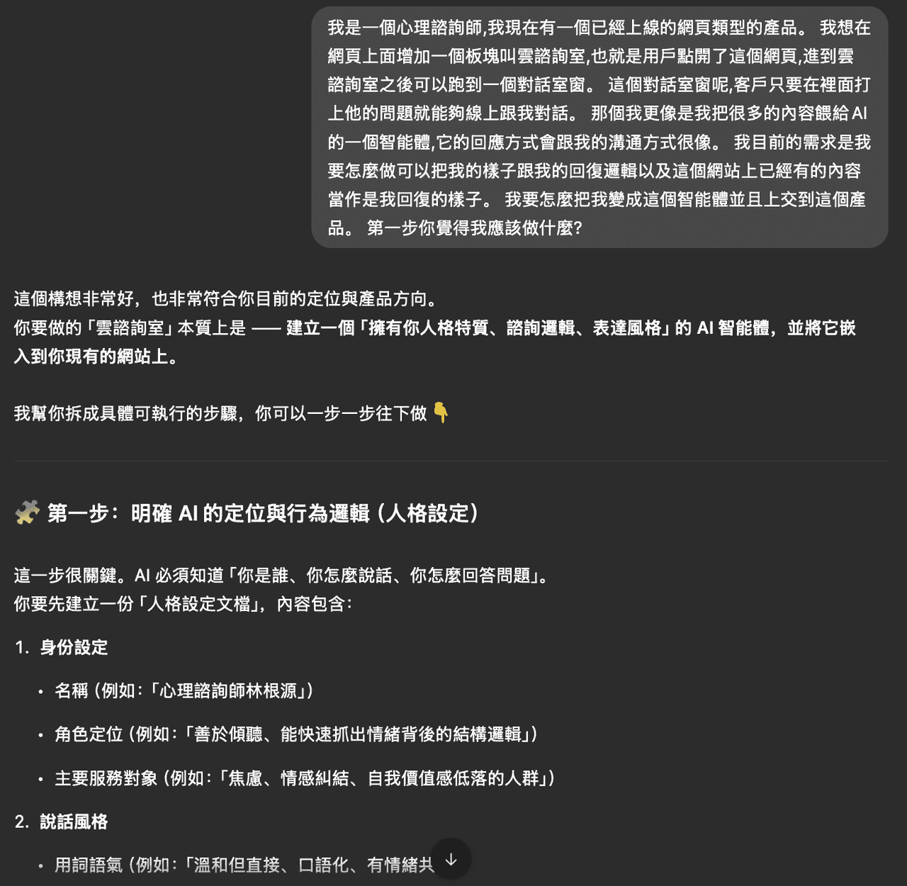

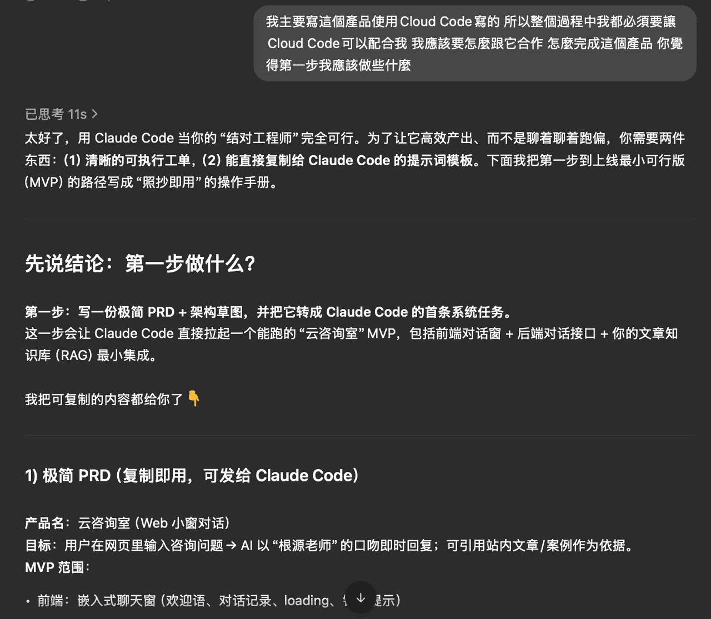

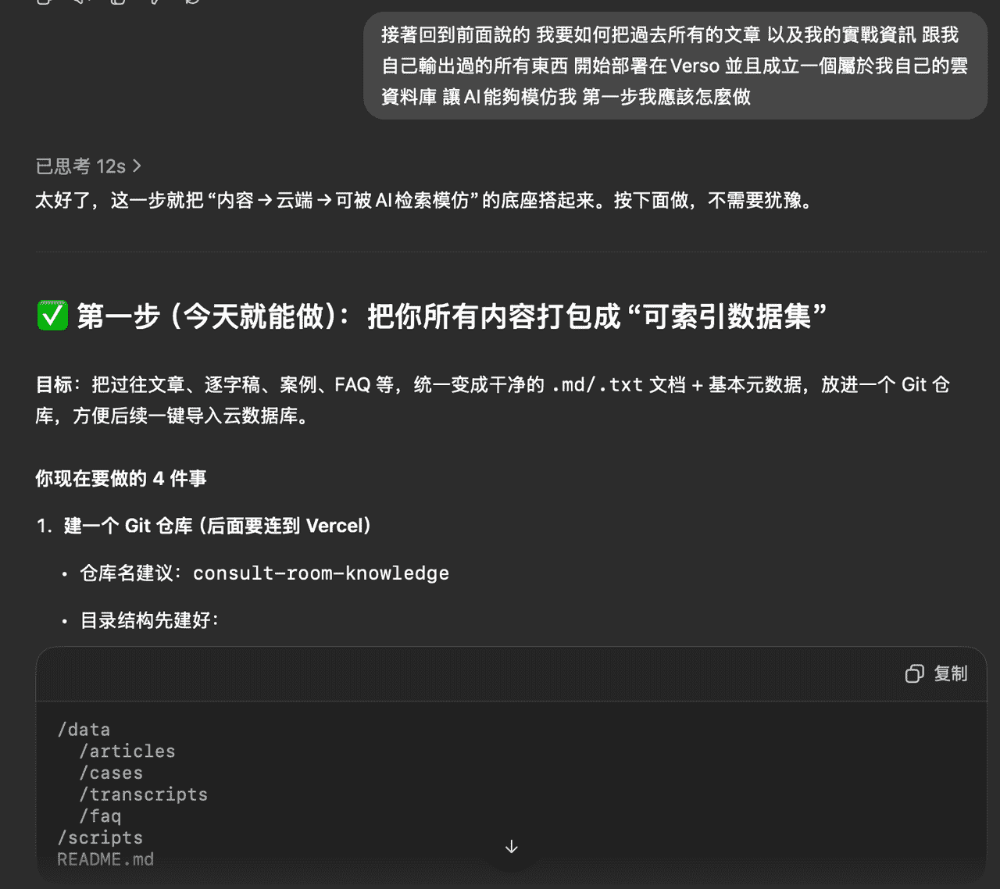

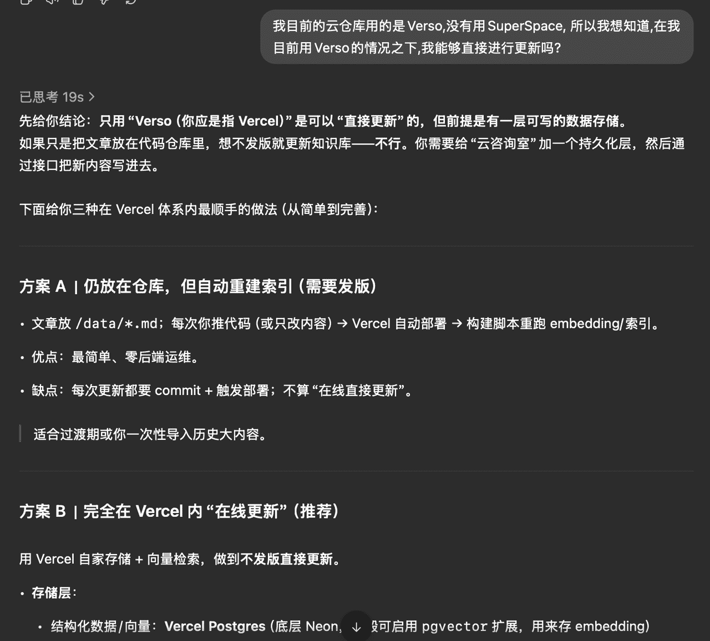

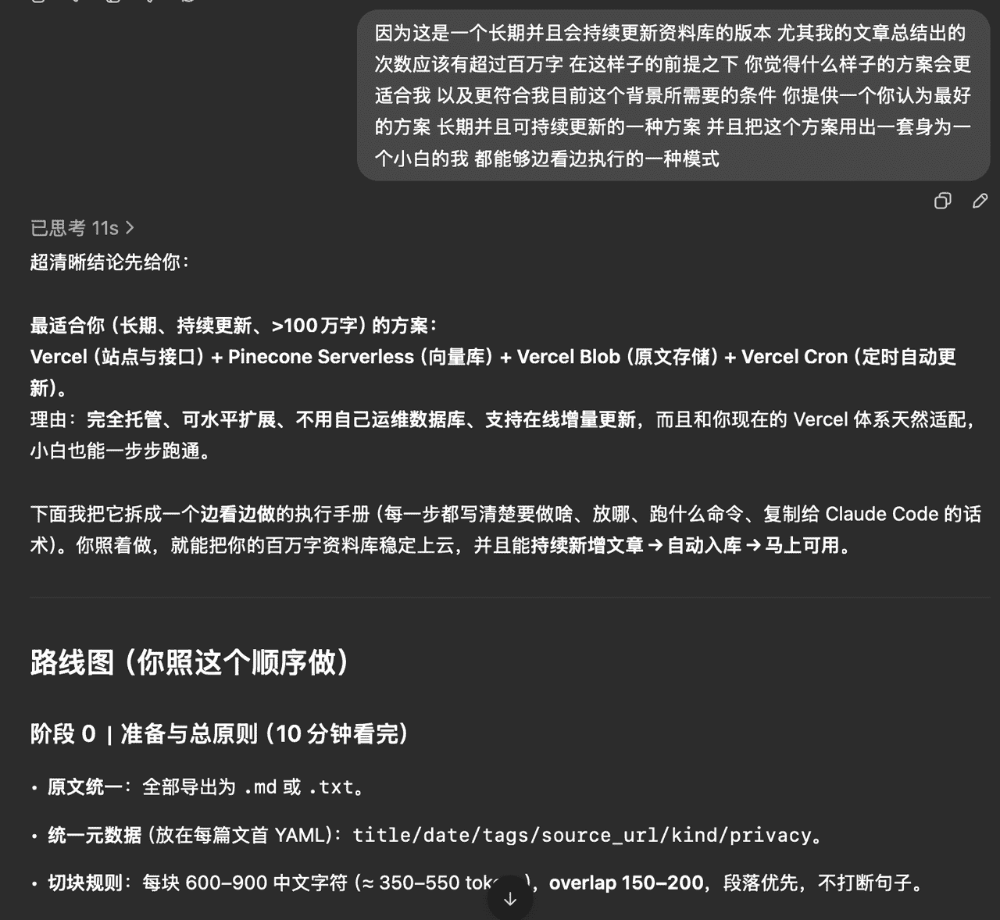

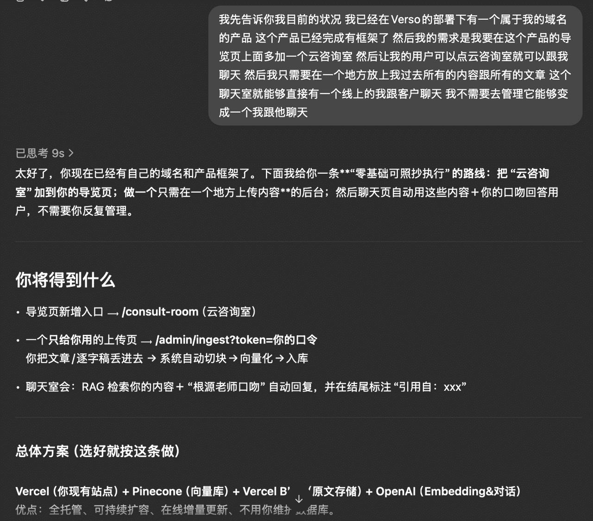

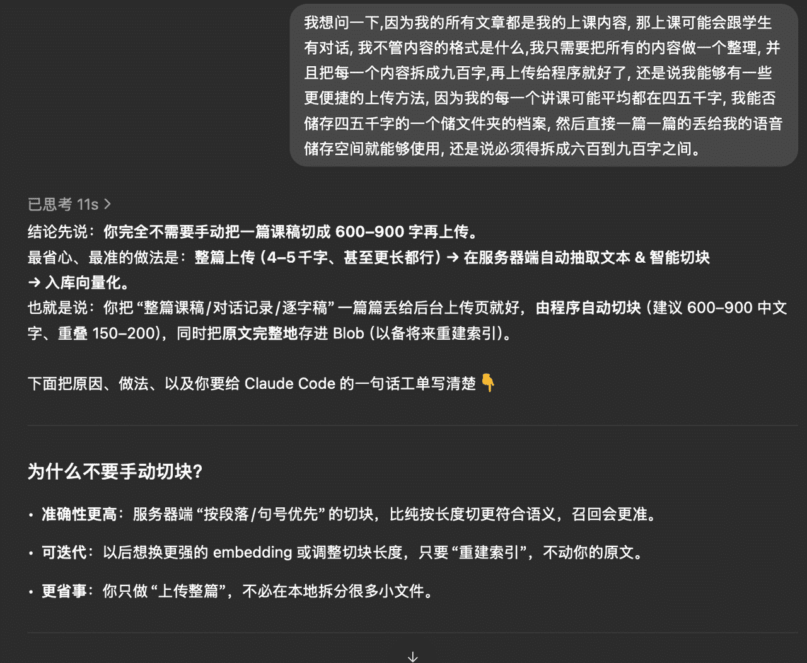

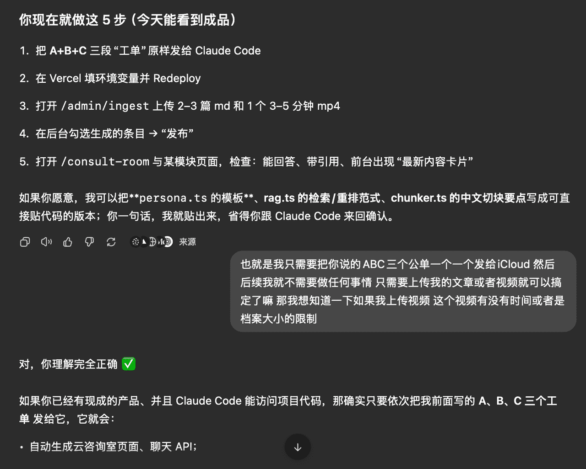

我输入给GPT的文字其实特别乱，甚至有些字是错的、

因为我用的是语音录制，直接发给GPT，

也不用管念对念错，以及想法有没有出问题，

只要念，GPT会自动的理解我的所有意思，因为他能把前后文连贯上。

（这个功能特别方便、轻巧，就是念就对了！）

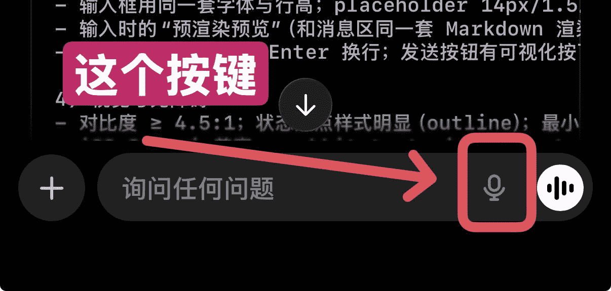

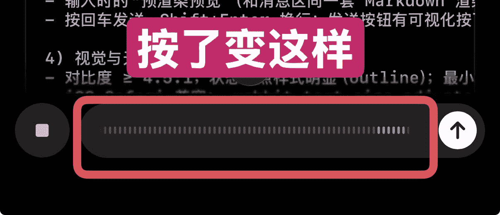

但这整个梳理的过程，

除了梳理我的想法之外，

第二个事情是我要怎么把我的想法告诉Claudecode。

他第一次给我的方案其实步骤挺多的，

然后里面有很多东西我真听不懂，我也没想了解，也没想研究。

所以我就又告诉他：

我真的是小白，我真的什么都不懂，能不能够给我个更简便的方法？

他又给了我一个方法。

我又告诉他，我还是看不懂。

有没有那种清晰的步骤，

我按照步骤来做，一步一步做，都不需要操作，

只需要复制贴上就可以。

他又说：

我给你一个A、B、C、D、E，你只要把A、B、C三个方案做完，

今天第一步你就能够启动正式的用你的云咨询室。

（就是对话的最后一张图）

我问了大概6~7轮，他最后给了我这个方案，

也就是

我大概花了20分钟跟GPT对话，

我的产品思路就因为跟GPT聊天的过程中变得更完善。

然后回到家之后，我只做一件事：

**把GPT说的A、B、C三个步骤，一点**一点的贴进Cloud Code，等它跑。

然后边跑的过程边等待，

其实最多时间还是在等待，

它就会自己部署，然后大概花了一些时间，我就完成初步的云咨询室。

---

## **二十三、云咨询室的小卡点与解决**

那这里面其实有一些小节点，那节点就是他说:

你用一个什么样子的云储存空间是可以更好的。

那这里面出现了两个问题。

**第一个问题：**

他让我在suspace注册一个账号，我发现这个注册起来确实有点麻烦。

**第二个问题：**

他让我到OpenAI去申请一个API Key，

那我发现当时申请这个Key的时候一直显示没法付款，

那我又觉得很麻烦。

所以我又问了GPT：

说如果这边无法付款，是否有一个可取代的方案？

> **所有的事情出来的那刻，我就先问GPT，GPT问完再问Cloud C**ode，——也就是GPT是我的对话工具，Cloud Code是我的技术落实工具。

那所有的东西我一定会特别强调：

能不能够让我完全不操作，你直接帮我操作？

**只要他让我手动去调整**的东西，我都一定会先问他：你能不能够帮我操作？

如果能帮我操作，你帮我操作了，我不需要手动是最好的。

那这个过程，我还多了一个点，

就是把我的过去的云资料库可以直接拖移上传到一个网页，

然后它就可以读取我的资料，变成智能回复。

那这个事情，我其实花挺多时间的。

我花了一个晚上加一个早上，等于将近快4个小时，我才完成了我的云咨询室。

虽然还没有特别的完善，但是最少可用。

那这过程就不断的调试，

可能对话的时候，我发现这个聊天的对象不太像我，

于是我又截图告诉GPT：

这里不太像我，有没有什么方法可以让他的表达更像我一点？

我感觉没有接入我的风格，这些词其实是非常通俗的表达，而不是我的专业风格。

**发现不对就：截图、问、改！**

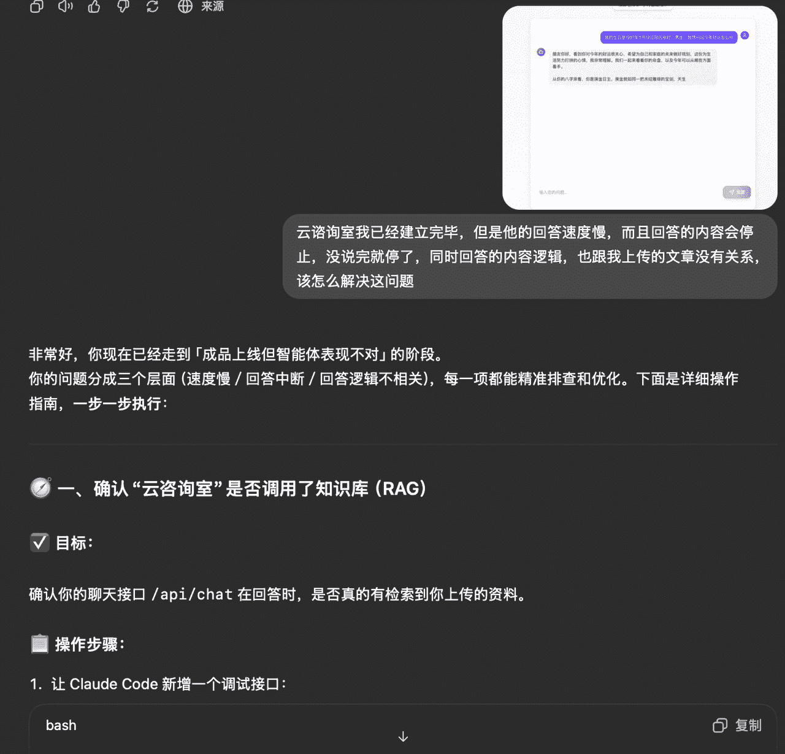

---

## 二十四、骄傲的底气：不懂编程，却能落地

最有趣的是，我在跟焦波聊天的时候，

我就给焦波发了一个我的目前的产品状况。

我就给他截图说：我都是这么跟Claudecode对话的。

然后，焦波当时说：“你怎么也懂这个？”

他发了一段英文，我看不懂。

我就说你说的是什么？我听不懂。

我只知道跟Claudecode还有GPT对话，

然后呢，所有事情都点Yes，所有事情只要点复制贴上，这就是我唯一需要做的事情。

所以你说的事情我不懂。

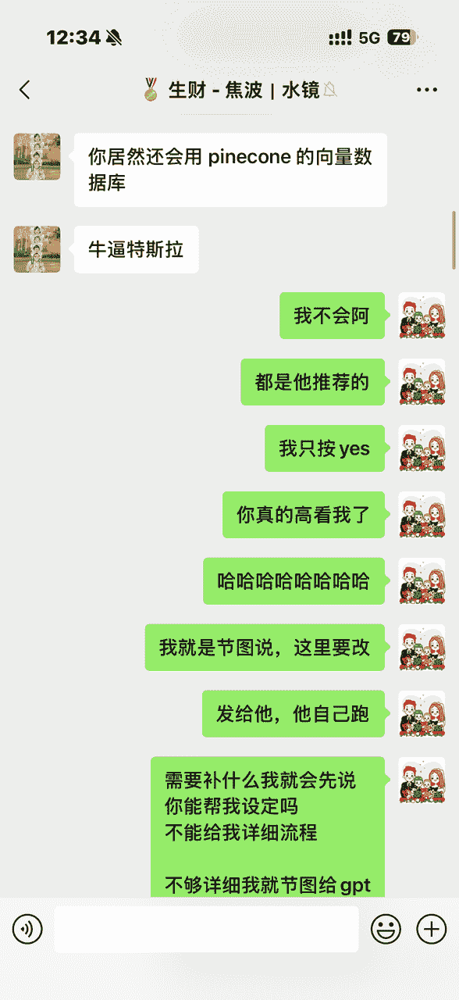

我觉得特别开心

虽然他说的内容我真的不懂

但是我很清晰的知道，

我没有想成为那个最专业的人，

因为这毕竟不是我的主业，

它可以是我的兴趣，可以是我实现梦想的工具，

但是我绝对不能在这个上面过度钻研，因为只要过度钻研，

这事情就跟我最开始想象的不太一样。

所以整个过程还是有个大原则：

> 只问加复制贴上加按照流程一步一步的做，

> 任何流程，只要不懂，随时停下来截图，再问他下一步该怎么做。

我发现AI有一个很好的点是：**它能够知道我前面说过什么。**

所以当我再重新问他的时候，他就会把我前面说过的内容再一次的发过来，

并且告诉我哪里哪里，你需要再怎么样。

我觉得这过程其实是实现我的梦想最好玩的部分。

那一直到了写这篇文章，我的云咨询室终于有一些些成型，

底下有一个小视频，

可以展示我的云咨询室，虽然回复的内容还不如预期，但最少初步的框架有了。

这个产品我觉得也算是有一定的样子了。

---

## 二十五、收尾：产品成果与AI编程心法

目前我就是每天想到什么改一点，想到什么加一点，

这个过程我觉得太美妙也太有趣了，这是我在整个用AI编程。

花了一周多一点的时间设计出的一套能够落实并且真正收到费用的产品。

这个过程中，我最骄傲的就是，到现在为止，我依旧不懂编程。

（当然，这只是制作的第一个产品，等未来制作第二个第三个，有可能会开始研究编程）

但有两个东西，我觉得再小白的你都得稍微的懂一点点：

+   一个是你要知道什么叫API Key

+   **第二个你要知道什么叫环境变量**

因为这两个地方是最需要手动去设定的，

你可以不用了解，但是一定要知道怎么操作，

当然这个过程最简单的还是按照GPT或者是Claudecode告诉你的方法，一步一步的来做。

还是要强调：

如果你的未来从来都没有想成为一个专业的程序员，

在使用AI编程的过程中，你要做的就是他让你干嘛你就干嘛，

一步一步做，遇到不懂的截图拉进去再问。

+   **不要去了解代码，**

+   **不要去了解细节，**

+   **不要去了解逻辑，**

+   **也不要去了解原因，**

+   **你要做的只是告诉他你想要什么，**

我觉得这个是AI编程最美妙的地方。

最后，小排老师牛逼。

深海圈的课，每个季度都可以开一次。

强烈安利跟推荐，每个人都去报名小排老师的课。

展示一段我的产品云咨询室的使用功能

（还不够完善，但是已经可以使用！）

谢谢你们，祝福圈友们，生财有术！

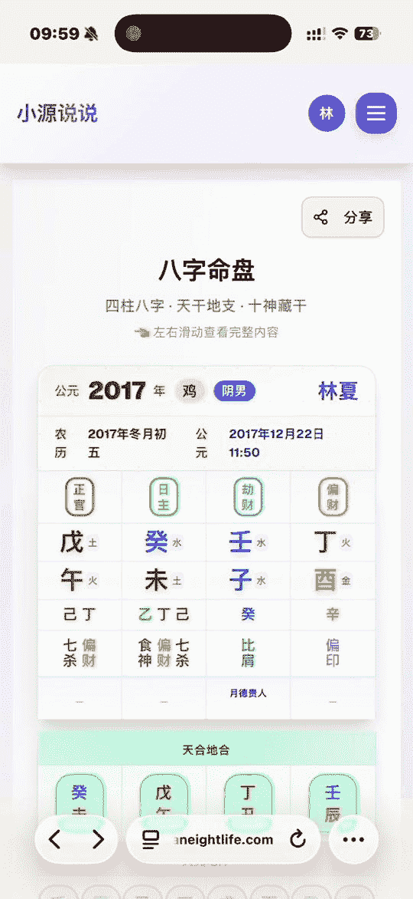

[VID_20251105100309339.MP4](https://internal-api-drive-stream.feishu.cn/space/api/box/stream/download/all/Ouz2brcV0od90wxEji8ccfm1nCd)

# 尾声的过去历史介绍

我是根源，同时也是第四期的生财圈友

一个有 2w+ 实战案例的心理咨询师

13年线下销售、团队管理经验。

2022 年开始转型线上，做一些知识付费的项目。

过去曾发表过几篇文章

都能看到这，代表你对文章的喜爱

肯定有一定的程度！

也欢迎阅读过去我写过的历史文章。

## **2021年的文章（精华x1）**

1.  **精华**《直觉式萨克斯 透过社群成功变现146万》
https://t.zsxq.com/116B1bcYc

1.  《73项被动收入打造》
https://t.zsxq.com/11EHjTH0P

1.  《杭州夜话02场，夜话官复盘》
https://t.zsxq.com/19IkX4UMl

1.  《年入百万，团队从20人到4万人》
https://t.zsxq.com/19JYt77hL

1.  《主题：如何更有效的链接见面会认识的圈友》
https://t.zsxq.com/19VY2LWg4

## **2022年的文章**

1.  《互联网小白，第 1 次做线上产品，7 天赚回 10 倍门票》
https://t.zsxq.com/11ooZZbM7

1.  《把捣乱分子『逆势』转成爱用者的好方式》
https://t.zsxq.com/19lipLhJ5

1.  《 好的内容，是目前依旧没退旧流行的变现方式 》
https://t.zsxq.com/19BLMAYw1

1.  《明白老师的一个启发，让我从100天日耕的过程赚了30W+》
https://t.zsxq.com/19BgNoxfi

## **2023年的文章（精华x6）**

1.  《私域的意义不是管理，而是经营》
https://t.zsxq.com/19WEsfSq1

1.  **精华**《9年传统行业 1 年时间，从一无所有，到年入 200 万》
https://t.zsxq.com/10nmEr1cA

1.  **精华**《25个提高微信成交率的小技巧》
https://t.zsxq.com/11AgRW24F

1.  **精华**《35 个让私域收入翻 3 倍的技巧》
https://t.zsxq.com/11FmV2aqZ

1.  **精华**《续篇 - 25个提高微信成交率的小技巧（26 - 50）》
https://t.zsxq.com/13yRbmUwo

1.  《 私域话题：涨价之后，如何回复以及留住客户？》
https://t.zsxq.com/11UJk9HxQ

1.  **精华**《成为自由职业者的20个必备特质 》
https://t.zsxq.com/14XTxhh15

1.  《 36个让私域成交率翻倍的实战指南！ 》
https://t.zsxq.com/17zSrYzvk

1.  **精华**《产品线有引流体系，如何通过沟通促成升单？》
https://t.zsxq.com/17ocUJEFA

1.  《知识付费赛道，如何透过处理『反对问题』，增加用户粘性和复购率？》
https://t.zsxq.com/181fSc5rv

## **2024年的文章（精华x12）**

1.  **精华**《第一次尝试「问答群形式」的公域往私域转化，7天变现11万》
https://t.zsxq.com/18gBXlWxE

1.  《 线上新手，我是如何用一套固定流程，累计成交 300 万高价产品？ 》
https://t.zsxq.com/18IWgDiXo

1.  **精华**《 私域话题-如何在客户咨询过程中，透过三个步骤提高2倍成交率？ 》
https://t.zsxq.com/196Ad34aR

1.  《私域的十倍增长话题：不同信任程度的客户，如何提升成交率？》
https://t.zsxq.com/YKHGT

1.  **精华**《 为什么都是做副业，我能第一年就达到七位数？ 》
https://t.zsxq.com/APodD

1.  《 写作赛道，如何使用「算账思维」精准地评估产出？》
https://t.zsxq.com/ymcEE

1.  《 私域+知识付费话题：如何通过增加合理的触达次数，提升2倍以上成交率？》
https://t.zsxq.com/elSxU

1.  《9年传统行业转型第2年，如何维持百万利润》
https://t.zsxq.com/61VlK

1.  《把副业做到超过主业收入，你必须得知道的20件事！》
https://t.zsxq.com/bkbd1

1.  **精华**《用这 13 个思维，我做过的副业全都成功变现！》
https://t.zsxq.com/1q1Re

1.  **精华**《如何找到靠谱的人，让项目成功几率提升十倍？》
https://t.zsxq.com/hJZfN

1.  《私域筛选流程小尝试，四位数产品课程，转化率40%》
https://t.zsxq.com/o2dJx

1.  《 30个『提高5倍微信成交率』的小技巧》
https://t.zsxq.com/oThQB

1.  《私域话题—引流来的客户，用什么样的话术，可以提高2倍成交率？》
https://t.zsxq.com/RuaIy

1.  **精华**《如何处理退费(反对)问题，让高客单产品的退费率大幅降低？》
https://t.zsxq.com/X2PEX

1.  《如何善待恶贵人，增加项目赚钱的稳定度？》
https://t.zsxq.com/aspYc

1.  **精华**【生财技能】如何透过几个标准、筛选出合适的合伙人？
https://t.zsxq.com/h1J4J

1.  **精华**【生财技能】我是如何做自己的时间管理体系、让工作效率能维持在挺不错的状态。
https://t.zsxq.com/u4HxT

1.  **精华**【失败经验】四万人的团队，如何凭证一身实力把团队搞崩盘
https://t.zsxq.com/YuLQz

1.  【生财技能】我知道副业很重要，但是却找不到坚持的动力
https://t.zsxq.com/SDRdD

1.  【生财技能】好的咨询师，都得有属于自己的课程
https://t.zsxq.com/sb0tW

1.  **精华**【生财认知】为什么大多数人的收入无法提升？
https://t.zsxq.com/bUiir

1.  **精华**【生财技能】新人如何在一个社群里正确的请教与互动
https://t.zsxq.com/d1GwK

1.  **精华**【航海好事】加入生财四年后，第一次有幸担任航海教练
https://t.zsxq.com/u77ZC

1.  【生财认知】找对圈子，是提升认知的关键，谢谢生财大学！
https://t.zsxq.com/Rf8Uq

## **2025年的文章（精华x3）**

1.  **精华**【生财技能】如何更好地培养用户，转化高客单产品
https://t.zsxq.com/JgXLd

1.  【生财认知】副业赚不到钱，很可能因为你的「单点思维」
https://t.zsxq.com/BNWu7

1.  **精华**主动社交的力量，让我从负债百万到稳定变现，迎来喜欢的生活
https://t.zsxq.com/rRAGa

1.  公众号日更新一年，3000关注、变现40多万
https://t.zsxq.com/jtSwG

1.  **精华**小型线下活动怎么组：从主题选择到活动控场、细节的全流程
https://t.zsxq.com/Tg2FI

1.  上完小排老师线下课之后，我对 AI 编程的看法彻底变了
https://t.zsxq.com/zuRsN

1.  钱少的时候更应该控制成本
https://t.zsxq.com/CkmcC