# 只想当个小UP，却觉醒了B站好物系统

> 来源：[https://xuqiwei1986.feishu.cn/docx/OxMKdWy0moMo6Mx28gWcGETbn6d](https://xuqiwei1986.feishu.cn/docx/OxMKdWy0moMo6Mx28gWcGETbn6d)

# 前言

**书寂锋藏，才惊四野，哈喽大家好，我是赚钱00**后鹿书野，第一年加入赚钱，聚焦做b站好物

我有主业，同时还是非全研究生，工作日干活，周末上课，每天只有两小时的全情投入，一个月撑死做出来5个视频（家蒙老师一开始就做了铺垫，一个月能做5个视频其实就挺牛的了，仰望星空还是需要先脚踏实地）

从0开始，75天，160个小时，10来个视频，带货8000多单

总体路程是一步一个脚印吧，第一个月拿到五位数收益，第二个月成为b站好物满级推荐官，第三个月（下个月能看到我）进入百万榜。

一共做了10来个视频，其中两个10w+，写了一篇精华帖

（[从零开始b站好物深海圈，只发了两个视频，开始日入1000，3天速通深海圈，预计10天破万收益，我做对了什么？  ](https://psborr04us.feishu.cn/docx/CqYMdV5JrodY3Ux9bBPcncs3nyd)）

佣金4万，平台补贴+商单1万+，品牌方给的东西一屋子。下个月我的账号就能在b站百万榜上被看见了。

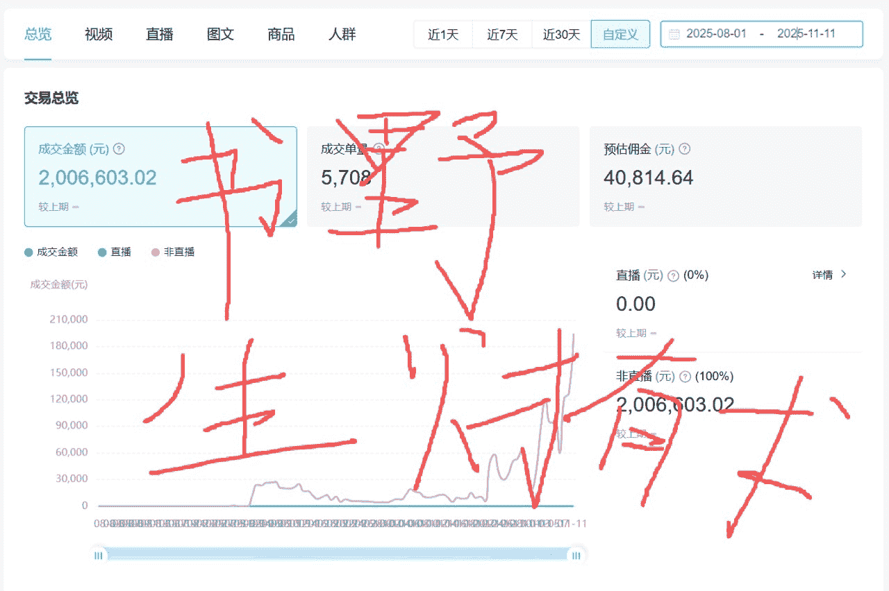

---

**越分享，越收获**，深海圈现在已经从几颗颗星星，逐步往群星闪耀的势头发展了，群内分享的流派和玩法也非常多，但目前的话我还是依旧选择常规横评流，因为太喜欢拆快递了，品牌方给的东西（加上我也买了一些）快把我的出租屋给填满了

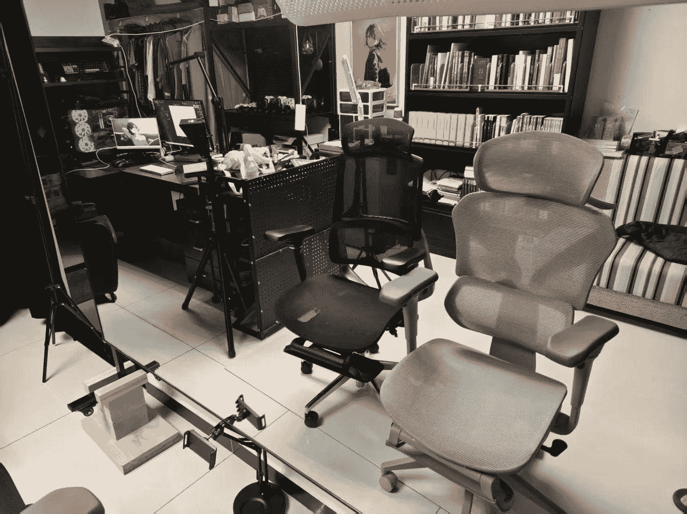

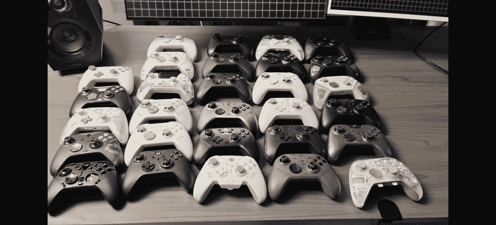

看过我之前的帖子的友友应该知道我的帖子都是比较干的，上一篇精华帖在这里

[从零开始b站好物深海圈，只发了两个视频，开始日入1000，3天速通深海圈，预计10天破万收益，我做对了什么？  ](https://psborr04us.feishu.cn/docx/CqYMdV5JrodY3Ux9bBPcncs3nyd)

这一篇当然也延续了这种风格，本篇帖子是当时作为优秀学员的直播稿，虽然是两个月前的**了，可这段时间以来，整个工**作流程核心上没有变，依然非常有价值，之所**以现在才发布，一是****因为我需****要3**个月的时间来去验证我的方向是否正确，而不是一时的侥幸，第二是因为备战双十一太忙了，最后外加“深海圈圈友先吃”的一点点偏爱。

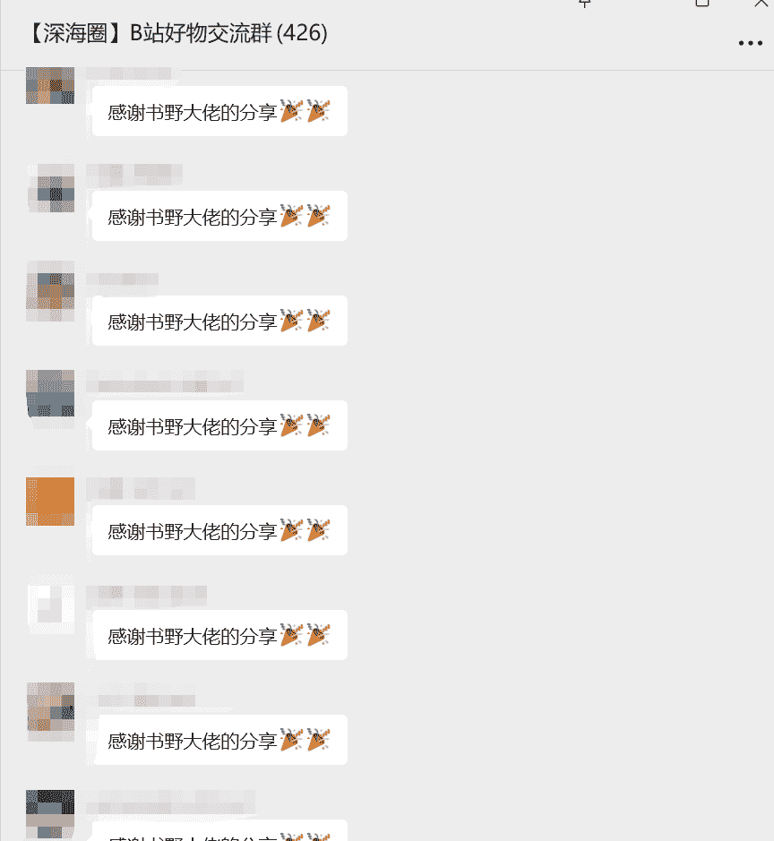

当然现在做也不会晚，就是有一点，就是我比较享受爬坡的过程，是能接受不断的投入10来个小时去做一个视频的，并且边做边大量思考的，并且由于我做出来了第一个10w+（自然流），已经有手感了，第二个月又做出了爆款的10w+，正反馈是比较高的（当然我前期的积累也很多），可能有的圈友花了大量的时间但是不出单的情况，我还是比较推荐大家先尝试源神口播流获取一点点正反馈，再做我这种号。

---

# 一、复杂的事情想要不乱，当然需要系统

> 顶层设计与认知  系统化思考  模块化执行

+   做长视频嘛，就是在慢慢爬坡~~~

大伙一开始做视频会遇到的卡点可能有这三个

**阶段一：卡在视频制作上**

剪辑最耗时，成片又不满意；返工多、效率低、节奏乱，如何能稳定的输出质量还不错的视频？

**阶段二：卡在选品上**

生产稳定了，那接下来，“管他三七二十一，先做了再说”.

前期没问题，但若注意选品，更可能事半工倍！猛猛出单！

更深一层，还有个隐性卡点——心法和自驱力。

目标不清、焦虑与恐惧、反馈机制弱、难形成稳定正循环。

**那么我的解决方案就是建立系统**

系统能告诉你，你当下应该做什么——下一步要做什么，**减少思考耗能**

系统能提醒你，这步该怎么做——要注意什么，**让你更能聚焦**

丰田TPS两大支柱：**标准化和自动化**，先有标准化，才能“自动化”

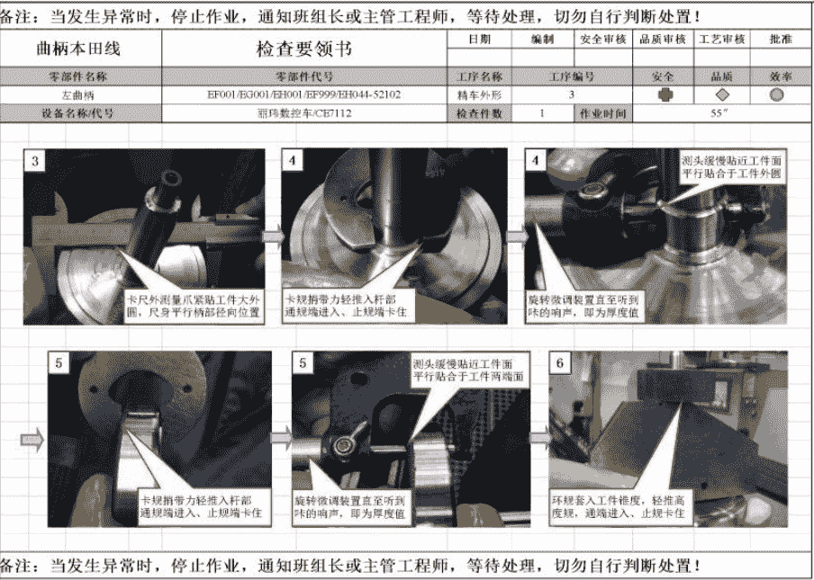

e.g.作业要领书

记录工作的所有步骤，内容

以及每个步骤中要注意的点（基准）

这就是“标准化”

我把这套系统模型打磨得差不多啦～

目前主要有两个核心模块：

一个是我在在选品时系统化的思考模型

一个是我自己用的标准化生产系统模型

此外，文章的最后一部分还专门增设一个“心力加油站”

# 二、差异化竞争的选品模型

之前一直都没太正式介绍过我是做什么的，这次简单介绍一下，我是公司战略运营部门的，做精益管理工作。

这里有两个关键词，一个是**战略**，一个是**精益管理****（起源于丰田的生产**方式，研究提效的，写SOP算是基本功）。

精益管理，大家看第三部分生产系统模型就行啦，我的生产系统是有很多流程的分析与设计在里面的。

目前还是手工，但已经标准化了，下一步就是考虑自动化了，利用AI、RPA的提效，把自己能最大的发挥价值的事情留给自己

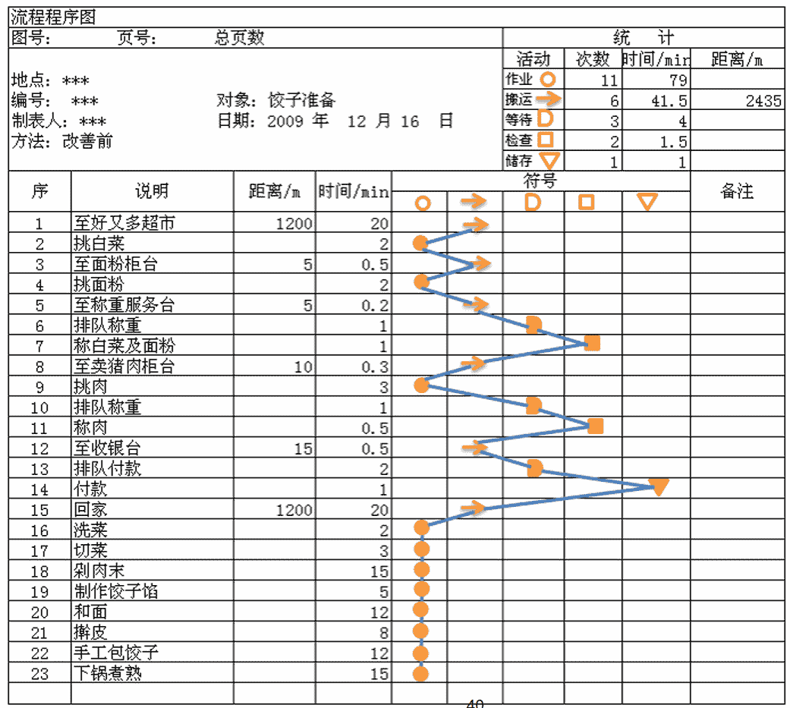

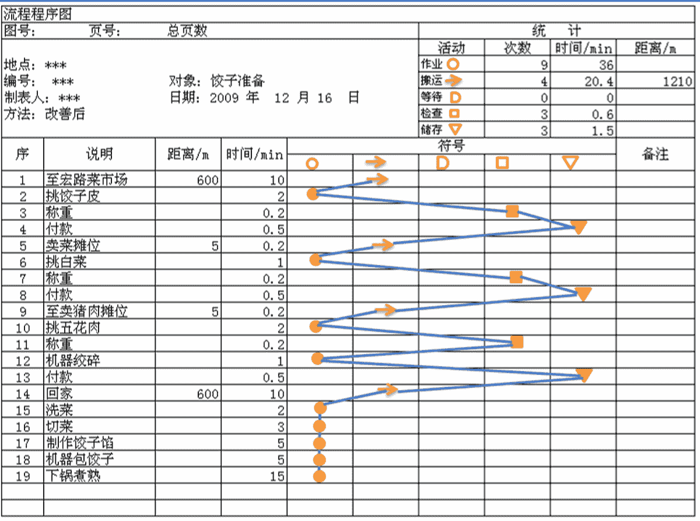

那么我们首先聊聊战略：

### 1. 战略的根本目的是要做什么呢？

> **战略并不是什么高高在上的东西。**

学术上讲，战略的设计与实施起源于适应外部环境变化的认知，终于形成差异化的核心竞争力。

通俗的说**战略的目的就是为了做到差异化，是为了摆脱无意**义的卷，也可以理解为我们熟知的ip与垂直。

正面战斗永远是最亏的战斗~

同一周期铺很多数量且同质化的视频分流量，导致两败俱伤。

最好的战斗：**不战而屈人之兵**——《孙子兵法》

**同一周期**没人跟你竞争，偷偷的一家独大

没什么人跟你竞争，你先占领了一片天地，那短期内，马太效应会持续稳固你的优势地位。

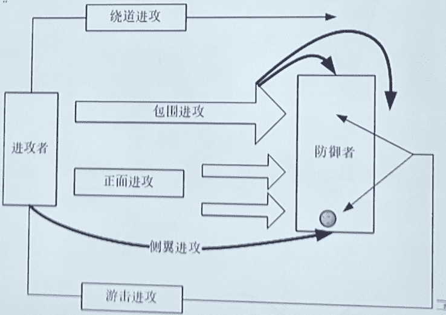

### 2. 做差异化的角度

> **内部的差异化**

#### （1）个人魅力：信任的硬通货

举例：

**真实的脆弱普通人感：** 大方地分享创作过程中的挑战、失败和学习心得。这种不加掩饰的真实能够迅速拉近与观众的距离，建立起“我们是一路人”的强烈情感纽带。

**感染力十足的热情：** 对所探讨的主题展现出源自内心的、不容置疑的热爱。这种热情具有极强的感染力，能够跨越屏幕，点燃观众的兴趣，并为创作者的专业性背书。

**权威性的幽默感：** 能够用风趣、易懂的语言将复杂或高深的知识“翻译”给大众，既展现了专业深度，又避免了居高临下的说教感。

#### （2）视频结构

举例：

一则经验的带货视频，其结构绝非简单的“开箱-测评-总结”三段论

@老师好我叫何同学——故事→挑战/创意→作为解决方案/工具的产品

#### （3）视频风格

**剪辑节奏：** 快节奏的蒙太奇，还是舒缓的长镜头；跳切、匹配剪辑等手法的运用。

**图形标识：** 字体、片头片尾、信息图表等视觉元素的统一性

**影像语言：** 构图、镜头运动、色彩调校，都是可以打造特色的地方

#### （4）人设ip

**标志性元素：** 口头禅、反复出现的“梗”、固定的视频栏目，这些小细节能让你更有记忆点。

**鲜明的原型：** 扮演一个清晰且令人印象深刻的角色，大家一下子就记住你了。

> **外部的差异化**

#### （5）人群的垂直

专卖给xxx人群，简单说就是 “专门服务某一类人”~ 比如你就聚焦 “职场新人”“宝妈群体”“学生党” 这类特定人群，做他们专属的内容和选品，精准又有亲和力。

#### （6）价位的垂直

比如就盯着 “500-1000 元价位” 的产品做内容，不管是数码、家居还是服饰，都围绕这个价位段深耕，让用户想到这个预算区间就想起你～

#### （7）需求的垂直

国庆旅行必备套装合集，这个就是一个典型的需求垂直 —— 精准抓准大家 “国庆出行要备什么” 的明确需求，做针对性的推荐，你说转化率能不高嘛～

#### （8）小众爱好的垂直

骑行，卖车和配件

### 3、抓好周期更替与群体需求

> 在充电宝的视频失败后，我还敢选择床帘这个小众的品

> **原因在于我知道开学季，大学生群体对床帘**有需求，且这个品类在今年并没有太多竞争者

#### （1）经验：平日里总结好好 “周期 x 群体 x  需求” 矩阵，提前准备好高质量的子弹，针对性的往上打

+   **床帘——完美交汇典例**

+   **周期：** “开学季”（8月至9月）是一个极其明确、能量高度集中的市场周期。每年此时，数百万大学生集中进入或返回校园，触发了对宿舍用品的刚性需求。这是一个可预测、高强度的消费浪潮。

+   **需求：** “大学生群体”是一个边界清晰、需求明确的目标客群。在集体宿舍这一特定场景下，他们面临着隐私缺失、空间有限、个性化表达受限等共同痛点。

**这也是为什么我3个视频产生的收益能比有的账**号做200多个视频的收益还多十几倍的原因

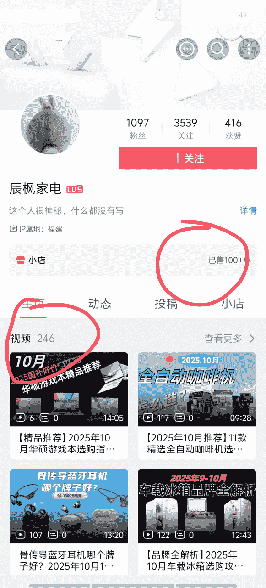

#### （2）做法：多总结购物平台，b站平台，每段时间的爆品，记录下来，大不了等明年再备战

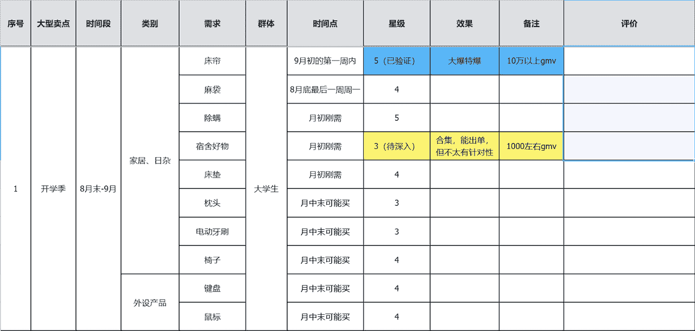

# 三、**标准化生产系统模型**

# 个人用的模板在这里[生产计划模板](https://psborr04us.feishu.cn/docx/VHlidIProoFCpNxGzaic4hRQnLc)

> 目前基本上一个视频的产出要12个小时，剪辑时间大概2个小时以内

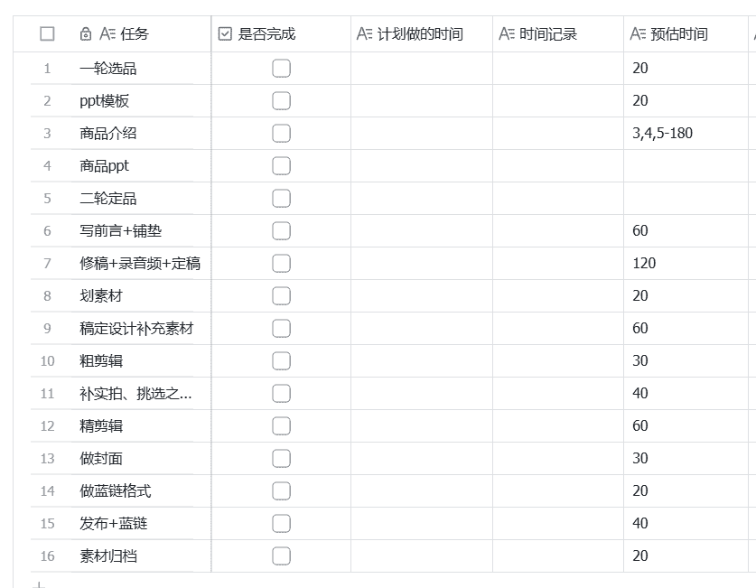

### 0、系统设计时考虑的核心要素

#### （1）自创的高效剪辑方法

把剪辑分为粗剪辑和精剪辑

粗剪辑任务（30分钟左右）：

铺音轨，铺底片（动态背景/人物口播），文稿对齐，根据字幕铺照片

ps:视频分为a-roll流（底片铺人物口播）和b-roll流（底片铺动态背景)

精剪辑任务（60分钟左右）：填空白，加入场与出场，加音效，做完视频

围绕着剪辑来构建生产系统

#### （2）模块化的拆分，为自动化铺垫

所有的任务都要模块化拆分，动作标准化，标准化的工作未来可以让AI来做

### 1. 初步选品（20分钟）

#### （1）做什么：在确定品类后对品类进行选品

#### （2）**小技巧**

##### **01**：利用锁佣机制，提升佣金收入

> 锁佣机制：

> 点了链接 ，15天，同店锁佣（好像是，不太确定），异店锁佣，时间会短很多

> **同店没买这个买别的，也有佣金**

> 没买这个品类，跨店买相同品类，也有佣金

e.g. 即使佣金少我也会带类似于京东京造的百货模式的牌子

你没卖这个品类，卖了别的，有佣金，例如推京造充电宝的链接，他买了京造的椅子，毛巾和雨伞

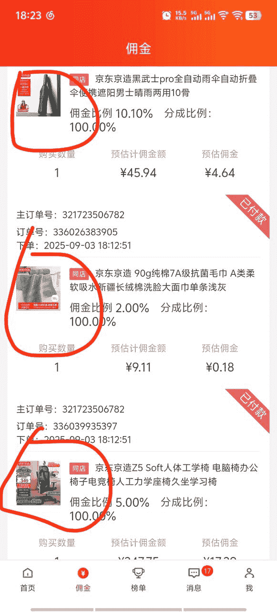

##### 02：京东搜索榜，把主流商品留下，要确保横评里每个品牌至少留一到两个

利用锁佣机制，只要观众打算买这个品类，

会搜一搜搜索榜单，看一看有哪些牌子，或者本身就有一些带有预期的牌子

当观众看到你的视频介绍了他熟悉的牌子，大概率会看，点一下蓝链。

**咱们的核心目标就是观众点击蓝联**

因为不管观众买具体哪一款（无论低价档还是高价档），都能吃到锁佣，都有money。

##### **03：埋一两款“高佣小众”品牌；且在对应的品类/价格**档位里，不要同时摆放可平替的主流低佣产品

比如从0到500有5个价格档位，你挑一个价位，例如300-400价位，这个价位只埋高佣，不要放低佣主流产品。

或者这个产品有若干个类型，挑一个类型，这个类型只放高佣，不要放低佣主流产品。

可以有更多的维度，可以综合使用，排列组合。

万一观众真就买了呢，一单高佣能抵5-10单主流中低佣。

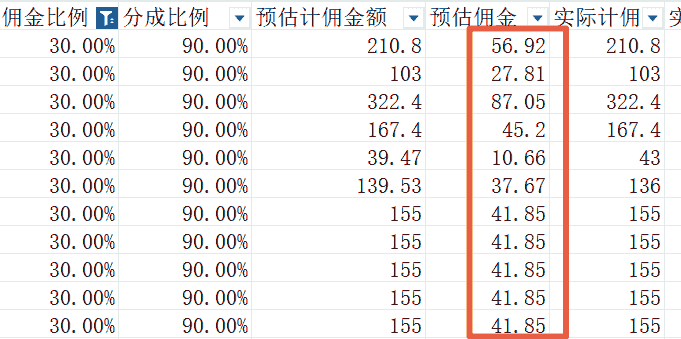

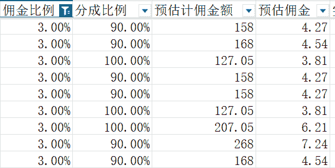

##### **04： 高效选品，先划类型，再划价格档位，每个类型里的不同档位**都至少选3个，确保能满足上面的两条需求。

**先多选一些，先不**要做筛选，不要过多的用脑子判断，20分钟先选出来，查缺补漏后面再做，不然会很浪费时间

因为你大概是不知道各个商品的特点的，等后面写商品文案的时候，了解了商品，再去掉没有必要带的品

（去掉在类型上，价格档位上，功能差不多的这种重复的品）

### 2. 做ppt模板（20分钟）

#### （1）做什么：确定核心数据，做一个能套用的初版ppt模板

确定核心数据比较重要，但可以用别人的，但自己要清楚要关注哪几个点，主要方便自己后面写文案

做一个差不多的能套用的ppt模板就行，尽量用以前的模板微调

#### （2）小技巧：利用套版批量套用ppt

基本上各种设计软件都有这个功能，参数你甚至可以用ai爬取到信息表里，上传数据一套就行

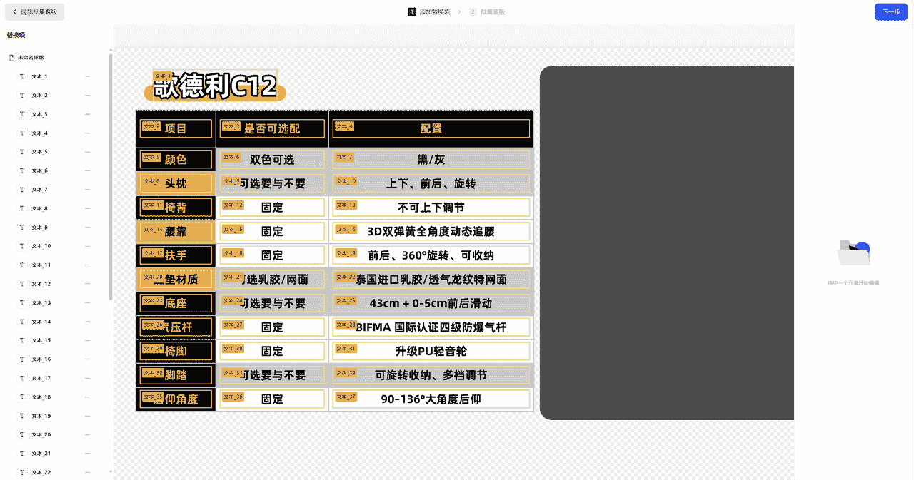

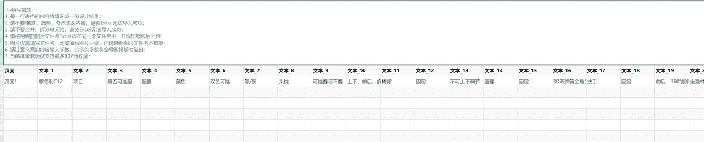

### 3. 商品介绍+ 商品ppt+二轮定品（平均一个商品10分钟，预计要3个小时做完）

#### **（1）做什么：**边看品，边写介绍稿（先写粗略版的，后面还会精修），边做商品ppt，边去掉多余的品做定品

看商品介绍页面，**他有啥你写啥就行**，也不用提参数什么的，顺带截图把商品图片之类的粘到ppt

过程中每个商品基本都看了一遍了，要去掉在类型上，价格档位上，功能差不多的这种重复的品

#### **（2）小技巧**

##### **01：多屏幕物理外挂**

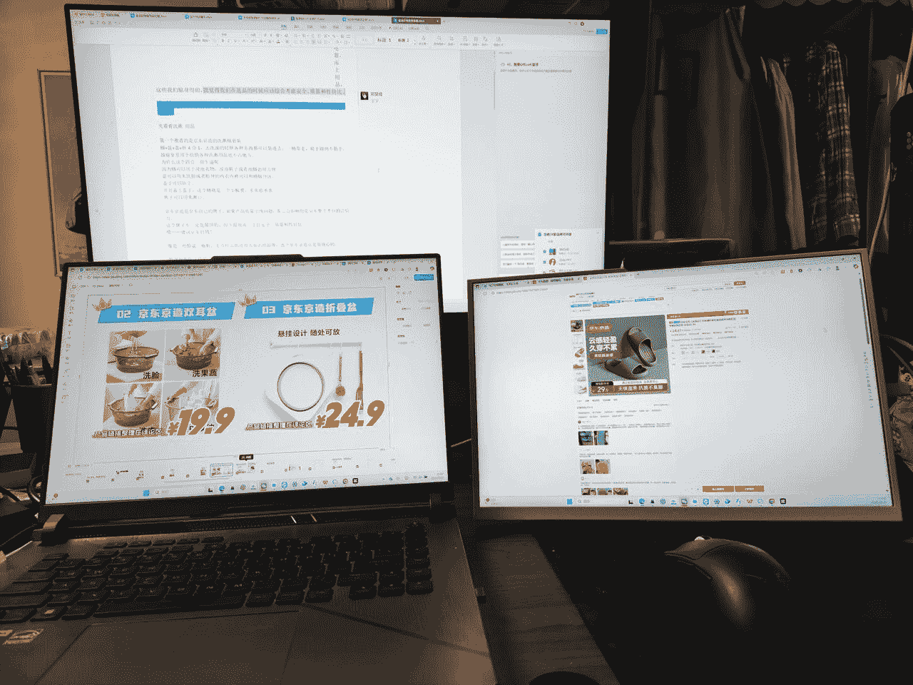

##### 02：用插件直接拖动图片素材到稿定设计上

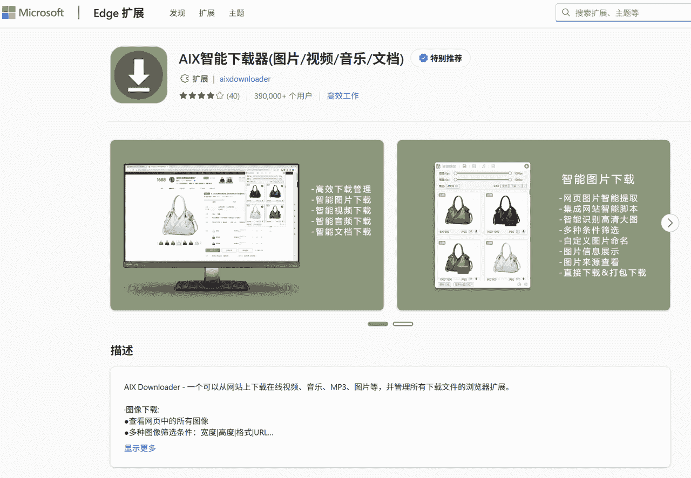

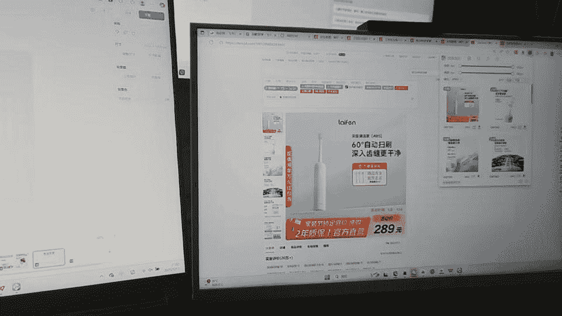

[492cced3fa73834bcccab11d5f2bd9d2.mp4](https://internal-api-drive-stream.feishu.cn/space/api/box/stream/download/all/C5XUbiJtcosVp1x5VV9c0Nn9n8g)

##### 03：有好看的商品视频注意保存一下，留着剪辑的时候补素材

### 4. 写前言+铺垫稿（60分钟）

#### （1）做什么：写前言+铺垫稿，这步的核心是铺钩子，想想怎么激发观众兴趣

#### （2）怎么写：可以看看我之前写的帖子中第二部分2.3.1的部分

[从零开始b站好物深海圈，只发了两个视频，开始日入1000，3天速通深海圈，预计10天破万收益，我做对了什么？  ](https://psborr04us.feishu.cn/docx/CqYMdV5JrodY3Ux9bBPcncs3nyd)

### 5. 修稿+录音频+定稿（120分钟）

#### **（1）做什么：主要修改商品稿，录**稿子的时候发现有不通顺的地方修改一下措辞

之前写稿的那版稿子都是商品描述，这版要修一遍商品稿子，技巧可以看看我之前写的帖子中第二部分2.3.1的部分

[从零开始b站好物深海圈，只发了两个视频，开始日入1000，3天速通深海圈，预计10天破万收益，我做对了什么？  ](https://psborr04us.feishu.cn/docx/CqYMdV5JrodY3Ux9bBPcncs3nyd)

#### （2）提示：**要录全部的稿子，**定稿很重要，不定稿就没有音轨，没有音轨就做不到高效剪辑

如果剪辑的时候突然发现文稿还能优化怎么办呢？不要管他，每个视频推的品这个月推荐完了，下个月还能推荐，这版就不要动了，可以下个月复用的时候再修稿子。

### 6. 划素材（20分钟）

#### （1）做什么：过一遍定稿文档，确定各个句子做成视频的时候用什么素材

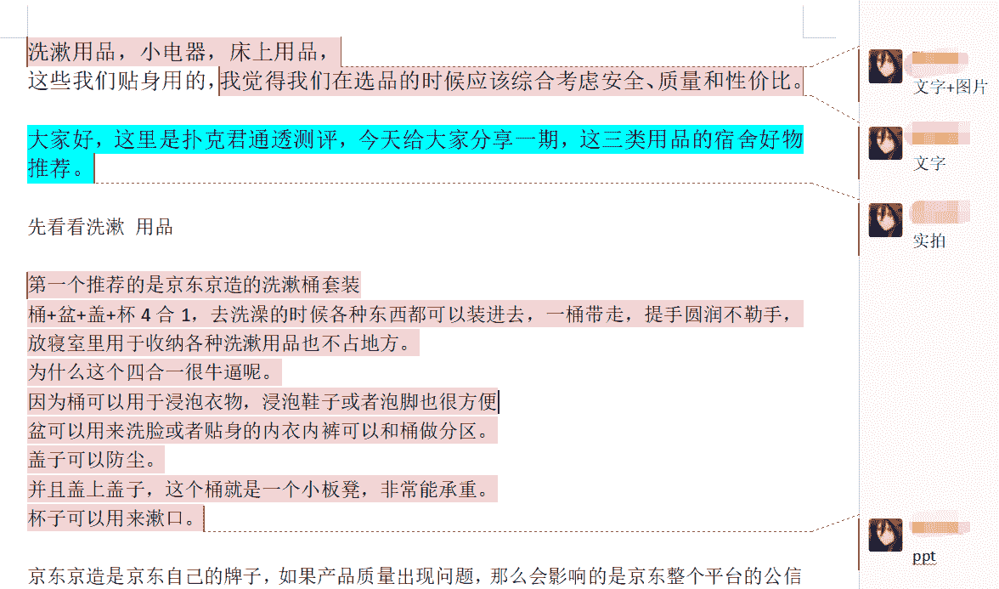

#### **（2）划分类别举例**一共有五种，要交叉着排布

**01 实拍**

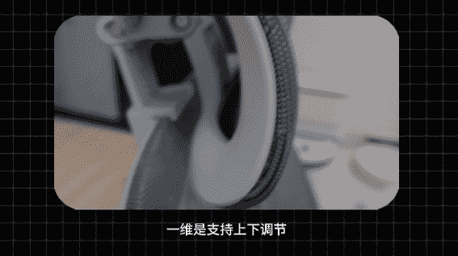

**02 文字**

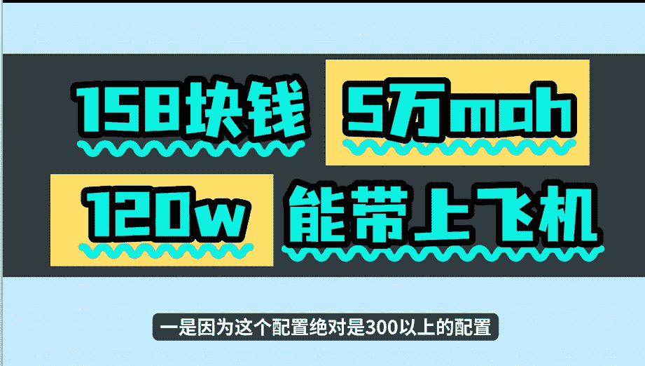

**03 商品视频**

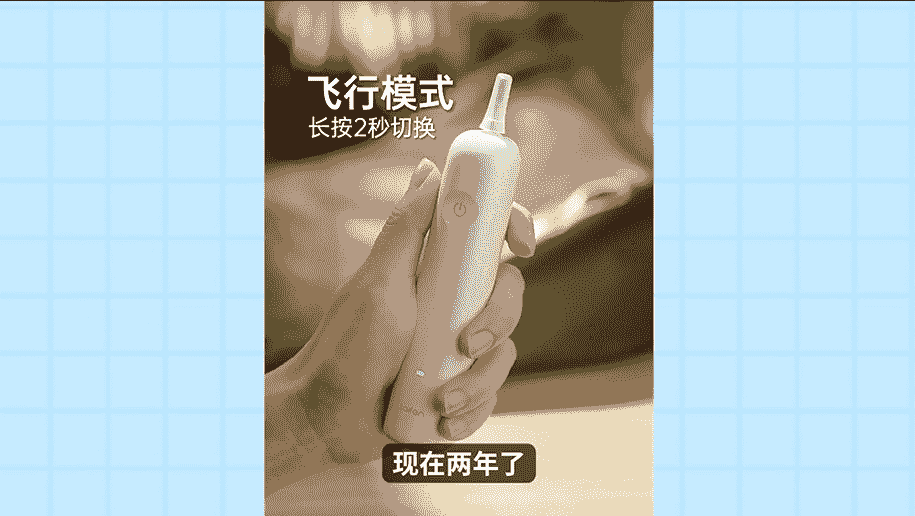

**04 图表**

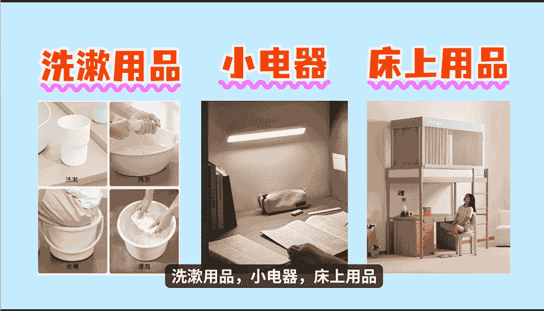

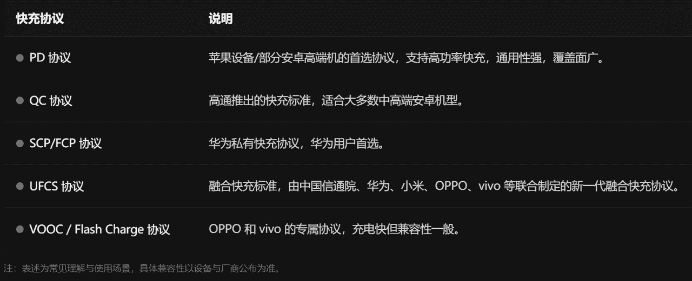

**05 表情包**

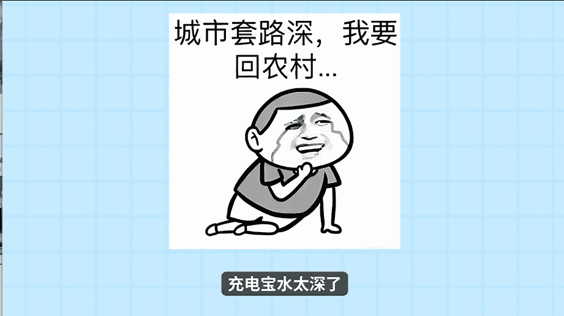

06 ppt（主要是在商品介绍部分用）

### 7. 稿定设计补充素材（60分钟）

#### **（1）做什么：除了商品视频和实拍，缺的一**切素材都用稿定设计补充（为了后面的剪辑）

#### （2）怎么做：图片（包括gif图）、文字一排版，背景调成透明

像这种动画，你要是自己在剪映里做也需要半个小时，但这个你在稿定设计里做图片只需要10分钟

做完图片拖到导轨加个入场就是质感牛逼的动画了

**#****动画效果：**

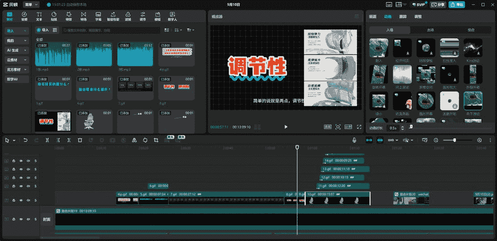

[演示效果.mp4](https://internal-api-drive-stream.feishu.cn/space/api/box/stream/download/all/CS7DbP4AioWD0SxVfh0cdOyEndc)

**#****图片效果：**

[02动图.mp4](https://internal-api-drive-stream.feishu.cn/space/api/box/stream/download/all/JacebVCffoYmSvxjYyec5NmznKb)

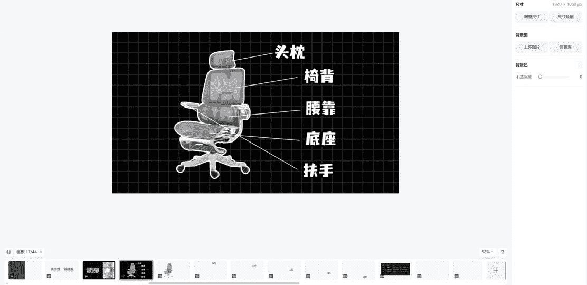

[01实验.mp4](https://internal-api-drive-stream.feishu.cn/space/api/box/stream/download/all/Avo9b3rGfo47ypx9SzncCDqRnBd)

### 8. 粗剪辑（全是ppt的那种，基本10分钟就行，复杂一点的差不多30来分钟）

#### **（1）做什么：素材一导入，铺音轨，****铺底片（动态背****景/人物口播），文稿对齐，**根据字幕配图片，部分需要听音频的才听一下

文稿对齐功能的位置：

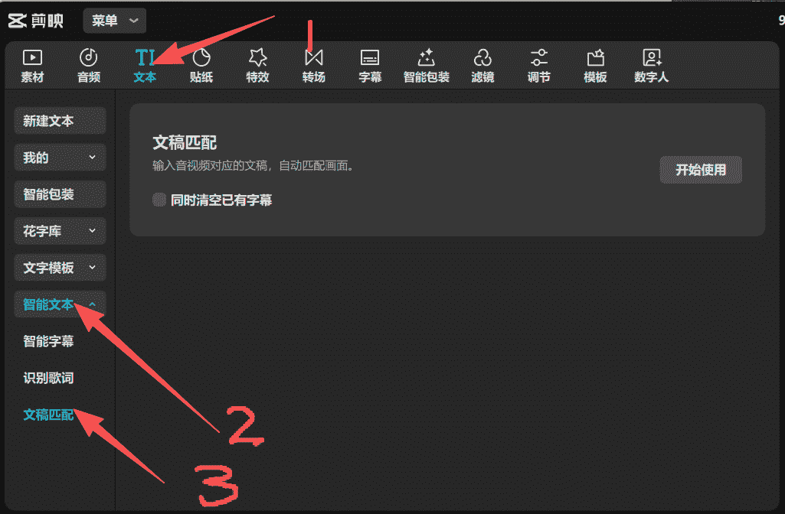

#### （2）比较复杂的粗剪辑的全过程录像如下

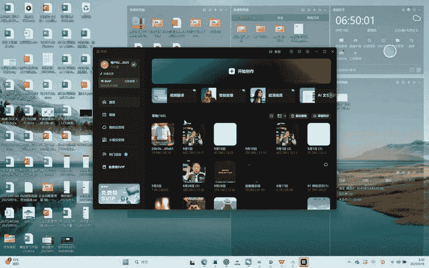

[粗剪辑素材.mp4](https://internal-api-drive-stream.feishu.cn/space/api/box/stream/download/all/BypvbgOOgoFrAQx02YlcY5xJn7f)

### 9. 补实拍、挑选之前收集的视频素材（40分钟）

#### **（1）做什么：**看看还有哪些空位置，补一下实拍（人露脸与物品实拍）、挑选之前收集的视频素材

也可以补充一些稿定设计能做的素材，主要是为了补空位，把画面填满，让作品完整

### 10. 精剪辑 （60分钟左右）

#### （1）做什么：加特效，加音效，把不通畅的地方搞通畅，把视频做完

#### （2）小技巧：标准化的特效制作（5分钟加完）

先主轨道加一个渐变转场，之后个别素材加个入场效果和出场效果即可，效果很高级。做起来几分钟的事

### 11. 做封面（30分钟）

#### （1）可以多看看别人的模板，进行替换

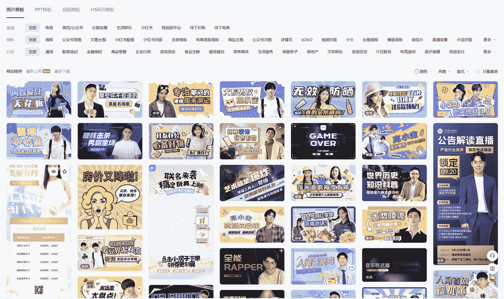

#### （2）b站平台的封面要做两个，一个16:9，一个4:3

### 12. 提前规划蓝链格式（20分钟）

**#****小技巧**：为了防止出错，一次合格，要提前写这个

挂蓝链时反正也能复制粘贴，速度特别快，也没多花时间，反而整体时间更快了

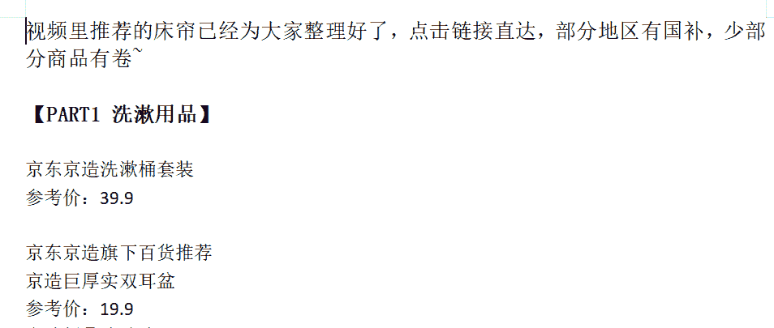

### 13. 发布视频，挂蓝链（40分钟）

这里是常规动作了

### 14. 素材归档（20分钟）

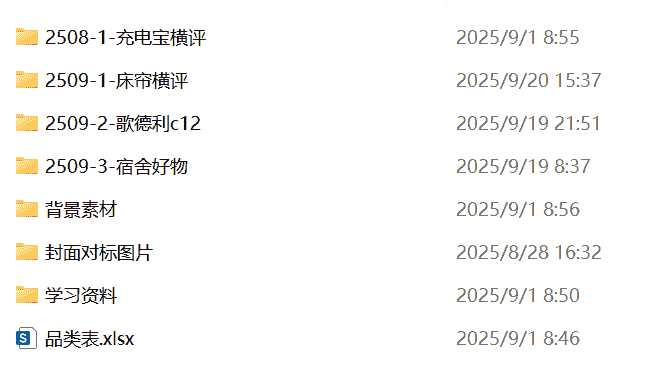

> 以上我把这套标准化生产系统模型把内容生产给大家拆得明明白白！

>

> 从选品、做 PPT 模板（套版批量用），到商品介绍、做稿、修稿录音频，再到划素材、使用稿定设计、粗剪辑、补实拍、精剪辑，最后做封面、规划蓝链格式、发布视频和素材归档，每一步都有时间规划和实操小技巧~~~

> 你只要把内容生产流程化、高效化了，新手跟着走也能很快上手～

# 四、你走的每一步，都算数

### **1、一个有**良好发展前景的事物的整体波动曲线符合函数中的正弦波模型

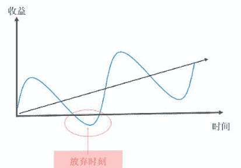

当收益跌破了你的容忍阈值，你就会选择放弃行动或者不得不退出行动，

从而无法获得后面的收益，得到一个不太理想的结果。

**我建议大家**不要在遇到挫折的时候，就退出朝阳赛道，

事物的发展一定是有拐点的，最容易倒下的就是黎明前的黑暗，拐点来临前的那一刻。

大多数人经常会等不及得到成果而中途退场，使之前的努力的价值无法兑现。

### 2、事物的发展存在着巨大的滞后现象。

生活就像是用一个有60秒时间延迟的热水器洗澡，而且你还不知道这60秒的存在。

过冷的时候拼命拧热，之后又必然过热，最后导致一会很热一会很冷。

现实中许多事情的滞后时间都相当长，这也就是为什么会有长尾流这个词

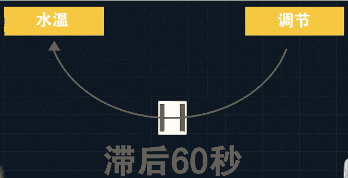

### 3、你走的每一步，都算数

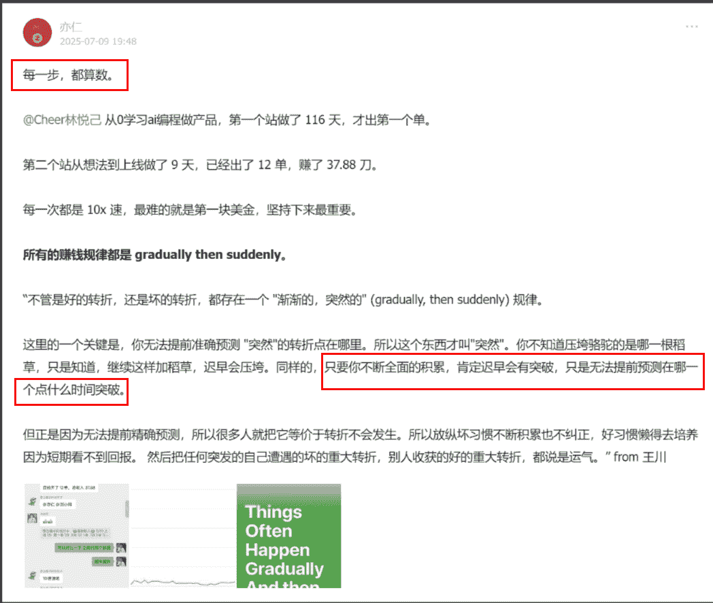

### 4、量变向质变的过度往往是一个指数函数

一开始发展极其缓慢，然后突然间就快的难以置信

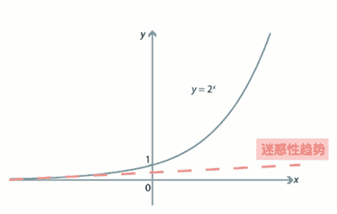

就像图里这个指数曲线，前期看着平平无奇，甚至会被 “迷惑性趋势” 骗到，觉得没啥变化。但一旦过了某个点，它就会 “蹭蹭” 往上冲，这就是量变积累到一定程度后，质变突然爆发的样子～

### 5、尾声

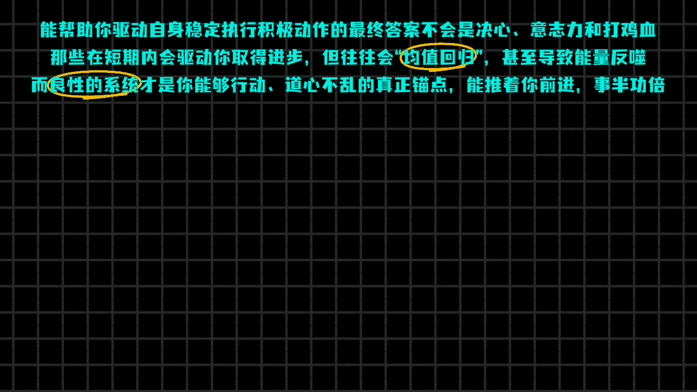

我从当初只想做个UP主，到意外跑通B站好物的系统化路径，这一路的前行让我明白：加入了星球后参加航海实战的过程中，日常我所做的看似零散的动作，看准了项目，只要用系统串联、用复利思维深耕，终会在某个节点迎来爆发。

你看我在做选品的差异化模型让我跳出同质化竞争，标准化生产系统把内容产出效率拉满，上面所展示到的那些关于发展曲线、滞后效应的认知，也在提醒我做项目时候“坚持的价值”。哪怕中途遇到流量异常订单，咱们也有申诉经验兜底。

别觉得现在的努力是 “慢动作”，就像指数函数的曲线，前期看似平缓的积累，每一步深耕，都是未来做好项目的伏笔，总会在某个瞬间迎来 “狂飙式” 突破。咱们在深海圈里打磨的选品模型、生产系统，还有对行业规律的认知，都是未来在年货节、618、下一个双 11 里 “抓到红利” 的资本！

期待我们都能在“当个UP主”的初心里，找到适合你的“系统玩法”的底气，把每一次创作、每一笔成交，都变成自己商业版图里的一块牢固拼图。