# 【360复盘拆解】0-1全程用AI做视频号：10+场景大量实操干货

> 来源：[https://xuqiwei1986.feishu.cn/docx/QF6hddighoj6Eoxv5Qgcv55anQe](https://xuqiwei1986.feishu.cn/docx/QF6hddighoj6Eoxv5Qgcv55anQe)

## 写在开头

+ 2个月前加入赚钱，当时看了一周就决定“把手弄脏”搞了这么一个项目，今天复盘总结一下

+ 写这个文章也是复盘看看收获鼓励一下自己，可能在没有结果的情况下就要看过程的收获才能激励自己不断前进

+ 欢迎这方面的专家拍砖，给出一些我不知道的常识，或者一些建议，或者判断有误的地方，非常感谢！

+ 比如方向不对或者哪些点有问题可以做得更好，或者下一步可以尝试怎么做会怎么样

+ 我叫赵鹤，在杭州正在创业找方向，也希望通过这种形式能与更多的朋友建立链接，一起AI一起进步，乐意帮助解决广大圈友的AI或技术问题！

+ 内容比较长，整理了整体的过程，可以选择性地看感兴趣的部分，或者直接看“成果经验”、“反思”部分

## 背景&思考：为什么做这件事？当时怎么想的？

### 基于很多零碎的点

+ 【系列选题的持续创作价值】 零碎学习短视频经验时发现，持续产出内容的关键在于开发系列选题（如 “辣评 100 个穿搭”“探秘 100 个小镇” 等），通过固定主题的系列化创作确保选题可持续性。

+ 【思维模型的选题开发方向】 结合阅读《思维模型》书籍的启发，书中涵盖的大量思维模型（如 “席克定律” 等）可作为独立视频选题，每个模型均可延伸为单期内容，形成具体的选题库支撑系列创作。

+ 【长尾内容的复利价值判断】认可一个观点：做长期有价值有复利的内容，那什么是长期有价值的内容呢？热点视频可能短期内会爆，一般也容易冷；反而长尾的内容，短期不一定会爆，觉得是长期有价值和复利的内容。结合上面一条“思维模型”相关的内容，觉得思维模型相关的内容就是这种长尾类型的视频，结合自己的实际情况，总是在哪里会看到一些不知道的思维模型，比如“席克定律”就要去查一查，这种类型的视频内容一般还不会过时

+ 【垂直小号的红利尝试方向】 “👸号垂直小号”现在是一个红利期，并且一直也听说“做短视频内容要垂直”，感觉这个方向可以尝试一下。

+ 【AI 工具的视频生成应用】 突然想到之前看到过一个网站https://imagineexplainers.com/，输入一个主题，可以使用AI直接生成这种讲解视频

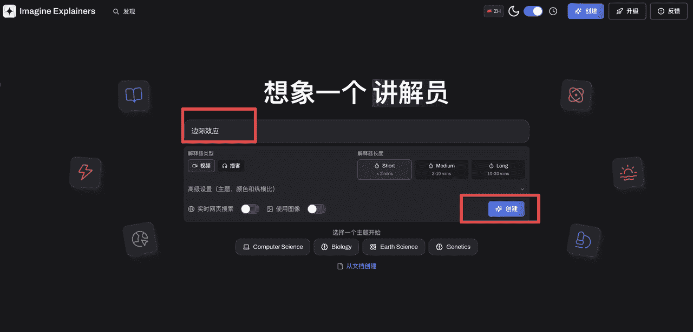

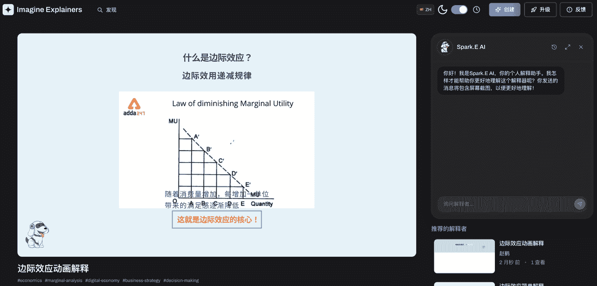

### 如何变现？

+ 【平台分成计划】了解到有创作者分成计划，无论是👸号还是视频号都有创作者收益

+ 【优质内容的收益潜力】之前也看到过一些分享的帖子，做得好了一天也有成百上千的收益


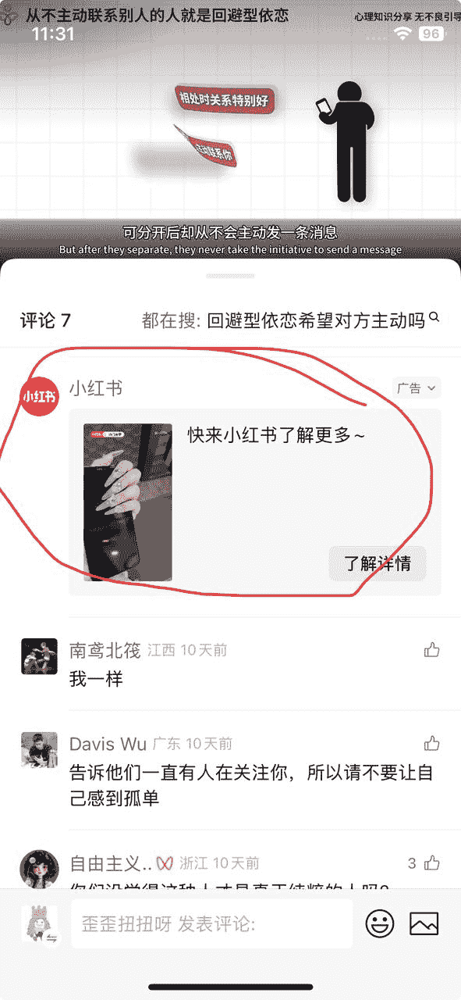

### 调研情况

看看市场上有没有对标的需求

+ 【人工创作账号表现】 有圆中思维模型，做得非常好，点赞数据也不错，这个可能是人工做的

+ 【AI 创作账号表现】还有几个做得也错，基本平均都有十几个红心以上，这几个可能是AI做的

+ 【结论】说明这个有一定的市场

### 自己还能做吗？

+ 【市场竞争与用户需求的包容性】有几个账号已经做得不错了，自己还能做吗？用户想研究的时候也不一定只看一个。并且根据自己的技术经验，对于同一个主题，推荐系统也许会打散账号，只要内容可以，自己的账号也有展现的机会

+ 【长期价值与低成本验证逻辑】思维模型类内容具备长期复利价值，若 ROI 可行则值得投入；结合 AI 生成视频网站（如https://imagineexplainers.com/），可通过低成本产出内容验证市场反馈。

+ 【内容复用与多平台分发】 网站上不只产出视频，还有视频解说的文字脚本，完全可以再发👸号，一鱼多吃

+ 【测试验证与执行优化策略】先使用https://imagineexplainers.com/videos/6887518ab9998376956482b3explain网站测试了一下效果（测试视频）勉强可以，想到先动起来，先完成再完美，那就先用这个网站生成，“效果不够，剪辑来凑”，主要内容就以这个网站产出视频 + 自己人工剪辑

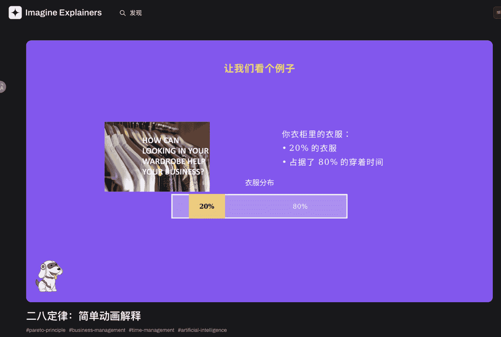


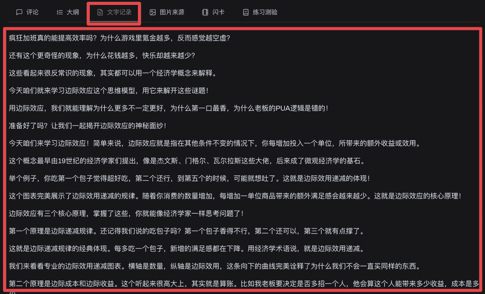

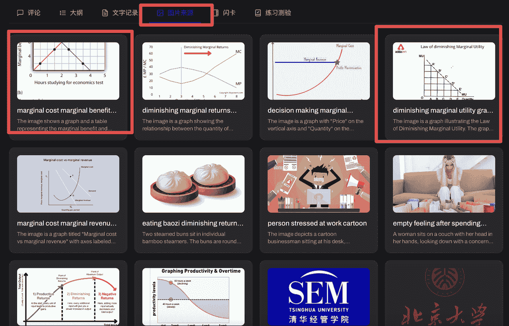

+ 【规模化扩展潜力】如果效果好还可以扩展生成其它领域的视频，有规模化的前提（想得都挺好）

> 结论：干吧！先挣到第1块钱！

## 目标计划：打算怎么做？有什么目标？

### 账号申请&设置

+ 申请视频号、👸号

+ 起一个有明确感的名字：100个思维模型

+ 想一个有感觉的Slogan：关注我，学习100个思维模型，3个月拥有高阶思维！

+ 用AI做：统一的封面、Logo增强品牌感

### 确定视频模板（内容一致性，更有品牌感）

+ 画面结构&比例：

+ 确定网站生成的视频的比例16:9

+ 在剪映里加入生成的视频，上面加标题，下面加字幕

+ 封面：元素组成，字体，布局，颜色

+ 标题：主标题，副标题，字体，颜色，布局

+ 换声音、调音速

+ 字幕：字体，颜色

+ BGM

+ 视频空白处背景处理：采用模糊主视频方案

+ 固定的结尾Slogan

+ 封面转场

### 发布频率

+ 看到一些干货经验：新号起号，要多发，先把量走起来

+ 因为主要内容是AI生成，感觉自己投入的时间成本不高，决定日更

### 发布内容模板

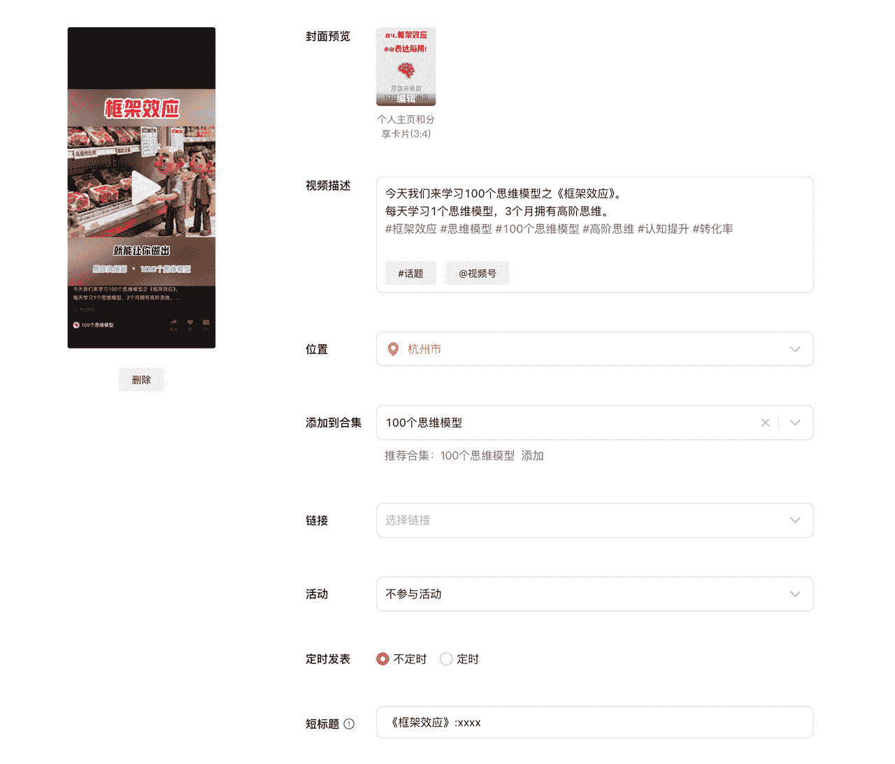

以下都可以AI生成：

+ 视频描述

+ 视频标签

> 今天我们来学习100个思维模型之《席克定律》。

> 每天学习1个思维模型，3个月拥有高阶思维。

> #席克定律 #思维模型 #100个思维模型 #高阶思维 #认知提升 #转化率

+ 👸号转发内容

+ 👸号&视频评论内容

### 选题

整体可以用AI辅助来做：

+ 从对标账号里找

+ 从思维模型书里找

+ 让AI按要求直接输出

### 内容

+ 直接用explain网站AI生成，当时没有直接抄对标账号的内容主要是想直接使用这个网站产出的内容，先试试看

### 目标

+ 先发起来，边做边看

+ 目前100个粉丝，可以开通创作得分成

## 迭代过程：遇到了哪些问题、思考和解决方案？

### 整体功能流程全景图

### 账号LOGO - AI

#### 背景问题

+ 自己也不会设计，一个好看的logo，还是很必要的，体现出这个账号的一些特性

#### 思考过程

+ 是否可以用AI直接生成？直接把需求告诉AI，边交流边让AI修正

#### 具体执行

+ 先简单描述一下，后面又放到coze里让它自动优化，最后再用优化后的提示词生成多张，再优化

+ 交流过程：[生成思维模型封面 - 豆包](https://www.doubao.com/thread/wa30929d668165c81)

```
你是一位专业的图像设计专家。你的任务是根据给定的比例，生成一张符合特定要求的短视频封面。

## 输入:
- 封面比例: 3:4

## 封面设计要求:
1. **比例**: 严格按照输入的 3:4 比例进行设计。
2. **底色**: 以白色作为封面的底色。
3. **颜色**: 主要使用低饱和的红色和蓝色。
4. **风格**: 整体风格简约。
5. **内容主题**: 封面对应的视频内容是讲“思维模型”相关，要体现知识性和思考性，画面以一个思考的大脑为主要表现形式。
6. **文字要求**: 画面里不要出现文字。
7. **内容占比**: 画面内容占整个画面的60%。

## 输出格式:
请输出设计完成的封面图片。
现在，请根据输入的 3:4 开始设计封面。


你是一位专业的图像设计专家。你的任务是根据给定的比例，生成一张符合特定要求的短视频封面。
## 输入:
- 封面比例: 3:4

## 封面设计要求:
1. **比例**: 严格按照输入的 3:4 比例进行设计。
2. **底色**: 以白色作为封面的底色。
3. **颜色**: 主要使用低饱和的红色和蓝色。
4. **风格**: 整体风格简约，采用几何元素来表达。
5. **内容主题**: 封面对应的视频内容是讲“思维模型”相关，内容元素：大脑、灯泡
6. **文字要求**: 画面里不要出现文字。
7. **内容占比**: 画面内容占整个画面的60%。

## 输出格式:
请输出设计完成的封面图片。

现在，请根据输入的 3:4 开始设计封面。

```

#### 成果经验

+ 生成后选了第2个

+ Logo基本元素（个人理解）：底色、主色、风格、主题、比例

+ 然后把你想做的主要表现的事物说给AI清楚（我这里是思维模型），在我一个设计外行审美来看，完全可以和AI边聊边修正，生成一个60分以上的Logo


### 选题生成 - AI

#### 背景问题

+ 一开始是随便找了一些先发起来，后面发现选题不太行

#### 思考过程

+ 然后开始研究一些别人的选题，找到一些规律（“解决顽疾、恍然大悟、说出心声、想分享” ），然后想着让AI去帮我生成

#### 具体执行

+ 对话过程：[个人成长的思维模型 - 豆包](https://www.doubao.com/thread/w4b7965e074c8121a)

```
给我100个人成长类、时间管理类、思维决策类、心情心理类各25个思维模型的名称，主要要点，适用场景的表格。

&#x27;&#x27;&#x27;习得性无助
情绪日记法
归因理论&#x27;&#x27;&#x27; 这些我都已经写过了，请再基于上面4类，排除我写过的，每类再给30个常见常用，适合国人的工作生活学习的思维模型，像上面一样列成表格。

这些思维模型，再提一些要求：
1. 要能解决工作生活学习中，特别常见又特别顽疾反复出现，并且看到这个思维模型后，有一种原来是这样，恍然大悟的感觉，“原来这么多年一直蒙在鼓里”这样的感觉， 
2. 或者是替自己说出了自己的心声，也就是之前想表达不知道怎么说。
3. 同时有一种想分享的给别人的激动感

你在表格中，增加一列说明是如何命中上面的要求的，同时每种分类只写20个，且要排除我之前已经做过的思维模型。
```

+ 然后再使用飞书多维表格产生出关键的字段（分类&要点），做了个表格跟踪进度

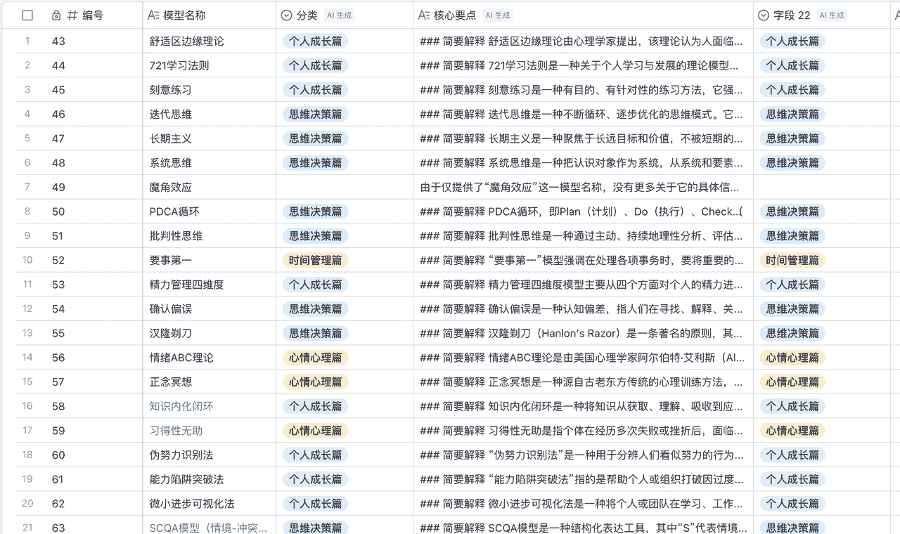

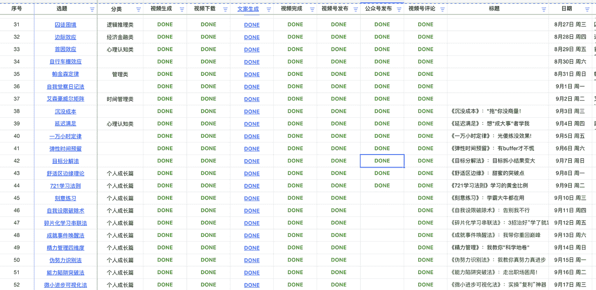

#### 成果经验

+ AI还是比较擅长去收集整理这种类型的工作的，不过比较关键是人要把握给他什么样的任务描述（就是提示词），这需要对这块事情的比较深入的理解

### 选题视频生成 - AI

#### 背景&思考

+ 开始直接使用网站 ：https://imagineexplainers.com/ 生成，生成什么我就用什么

+ 后来发现生成视频时，还可以定制提示词，这样就可以加入自己个性化的部分

+ 于是开始疯狂迭代，前前后后至少迭代了23版

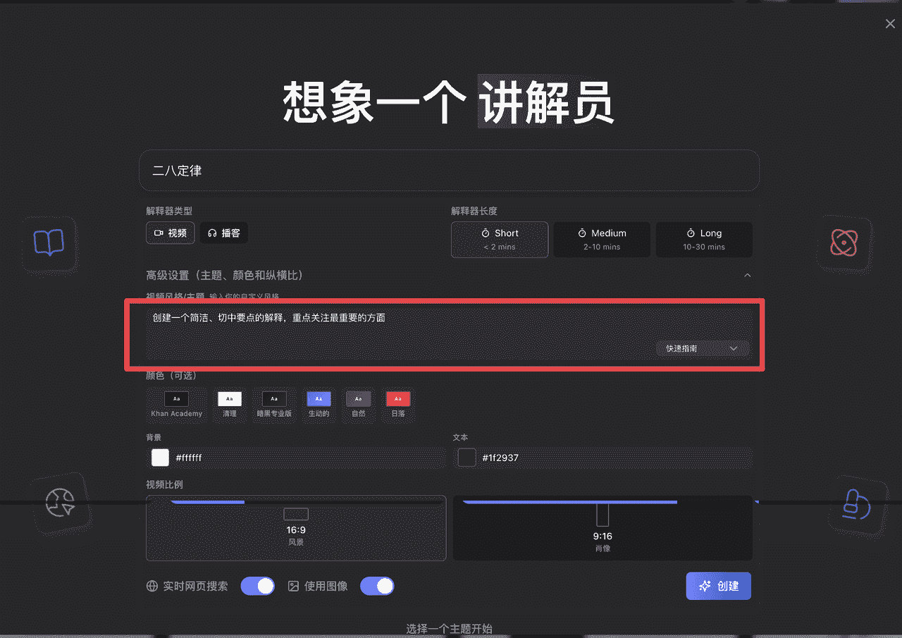

#### 迭代&效果v3.x：人群优化

+ 想了一下可能的观众，于是要求内容对特定的人群进行举例

+ 效果：有明显的变化，ai举的例子中已经能体现出变化

```
像一个对常见误解感到沮丧的人那样充满激情地解释这一点
引用流行梗和网络文化来解释，保持有趣但富有信息性
用适当的幽默和机智的例子让这个解释变得有趣，通过引人入胜的故事讲述和现实生活中的例子来呈现这个解释
结合日常生活男女朋友矛盾的例子，站在男性或女性的视角互相调侃；
结合工作中职场牛马（员工）与老板之间事情的例子，要站在员工视角调侃老板；
```

```
像一个对常见误解感到沮丧的人那样充满激情地、结合日常生活中男女朋友间可互相调侃的矛盾例子与工作中职场员工视角下可调侃老板的例子，通过引用流行梗和网络文化、运用适当的幽默和机智的例子以及引人入胜的故事讲述和现实生活案例，将这一点解释得既有趣又富有信息性。
```

#### 迭代&效果v4.x：前3秒优化

+ 希望开头3秒可以更吸引人，要求开头有一些反常识的提问

+ 效果：好了不少，开头已有几个提问

```
引用流行梗和网络文化来解释，保持有趣但富有信息性
结合工作中职场牛马（员工）与老板之间事情的例子，要站在员工视角调侃老板，也可以加入一些员工的自嘲
结合日常生活男女朋友矛盾的例子，站在男性或女性的视角互相调侃；
像一个对常见误解感到沮丧的人那样充满激情地解释这一点
用适当的幽默和机智的例子让这个解释变得有趣，通过引人入胜的故事讲述和现实生活中的例子来呈现这个解释
```

```
开头部分要以吸引人的反常识的疑问开头
引用流行梗和网络文化来解释，保持有趣但富有信息性
结合工作中职场牛马（员工）与老板之间事情的例子，要站在员工视角调侃老板，也可以加入一些员工的自嘲
结合日常生活男女朋友矛盾的例子，站在男性或女性的视角互相调侃；
用适当的幽默和机智的例子让这个解释变得有趣，通过引人入胜的故事讲述和现实生活中的例子来呈现这个解释
像一个对常见误解感到沮丧的人那样充满激情地解释这一点
```

#### 迭代&效果v5.x：人格化&内容结构优化

+ 觉得赋予一个更具体的人的角色，会更真实，于是塑造人格化的角色

+ 同时尝试给予内容一个清晰的结构：开头提问、模型讲解、经典案例、模型回顾、固定结尾

+ 效果：结构优化后内容更清晰流畅，AI举的例子还是有点生硬

```
你的角色是：一个在北京的“北漂”一族，工作5年，经常加班被老板PUA，一直单身，平时风趣幽默，经常在私下是吐槽老板，也经常自嘲自己。工作压力大，也经常打游戏。经常上b站刷抖音，熟知各种流行文化和网络梗。文笔不错，是一个短视频博主，视频内容也比较搞笑。同时对各种思维模型有比较深的研究。
以一个吸引人的反常识疑问开头，引用流行梗和网络文化，保持有趣又富有信息性地解释，结合工作中职场牛马（员工）与老板之间的事情并站在员工视角调侃老板、加入员工自嘲，结合日常生活中男女朋友的矛盾并站在男性或女性视角互相调侃，用适当幽默机智的例子让解释变得有趣，像一个对常见误解感到沮丧的人那样充满激情地通过引人入胜的故事和现实生活中的例子来呈现这一点。
```

```
你的角色是：一个在杭州的“杭漂”一族，工作5年，经常加班被老板PUA，一直单身和同事合租房子，平时风趣幽默，网络世界是“社牛”，现实中却是个“社恐”。经常在私下是吐槽老板，也经常自嘲自己。工作压力大，也经常打游戏。经常上b站刷抖音，熟知各种流行文化和网络梗。文笔不错，是一个短视频博主，视频内容也比较搞笑。同时对各种思维模型有比较深的研究。
开头：以一个吸引人的反常识疑问留住大家
第一部分：以一个例子带入大家思考这个思维模型，然后开始讲解这个模型的由来历史及典型应用
第二部分：结合工作中职场牛马（员工）与老板之间的事情并站在员工视角调侃老板、加入员工自嘲，结合日常生活中男女朋友的矛盾并站在男性或女性视角互相调侃，以这种方式再举几个例子
第三部分：讲解一些这个模型的典型错误用法
第四部分：进行总体的总结
语言风格：引用流行梗和网络文化，保持有趣又富有信息性地解释，用适当幽默机智的例子让解释变得有趣，像一个对常见误解感到沮丧的人那样充满激情地通过引人入胜的故事和现实生活中的例子来呈现这一点。
```

```
你的角色是：一个在杭州的“杭漂”一族，工作5年，经常加班被老板PUA，一直单身和同事合租房子，平时风趣幽默，网络世界是“社牛”，现实中却是个“社恐”。经常在私下是吐槽老板，也经常自嘲自己。工作压力大，也经常打游戏。经常上b站刷抖音，熟知各种流行文化和网络梗。文笔不错，是一个短视频博主，经常熬夜做视频，视频内容也比较搞笑。同时对各种思维模型有比较深的研究，因为经常讲给同事朋友听，被起了个外号“赵指导”。
开头：以一个吸引人的反常识疑问留住大家
第一部分：以一个例子带入大家思考这个思维模型，然后开始讲解这个模型的由来历史及典型应用
第二部分：适当结合如下两个场景举例子，场景A：工作中职场牛马（员工）与老板之间的事情并站在员工视角调侃老板、加入员工自嘲；场景B：日常生活中男女朋友的矛盾并站在男性或女性视角互相调侃
第三部分：讲解一些这个模型的典型错误用法
第四部分：进行总体的总结
结尾：固定结束语：“点赞、评论加分享就可以下课了。关注我，每天学习1个思维模型，3个月拥有高阶思维。”
语言风格：引用流行梗和网络文化，保持有趣又富有信息性地解释，用适当幽默机智的例子让解释变得有趣，像一个对常见误解感到沮丧的人那样充满激情地通过引人入胜的故事和现实生活中的例子来呈现这一点。
```


```
你的角色是：一个在杭州的“杭漂”一族，工作5年，经常加班被老板PUA，一直单身和同事合租房子，平时风趣幽默，网络世界是“社牛”，现实中却是个“社恐”。经常在私下是吐槽老板，也经常自嘲自己。工作压力大，也经常打游戏。经常上b站刷抖音，熟知各种流行文化和网络梗。文笔不错，是一个短视频博主，经常熬夜做视频，视频内容也比较搞笑。同时对各种思维模型有比较深的研究，因为经常讲给同事朋友听，被起了个外号“赵指导”。
开头：以一个吸引人的反常识疑问留住大家
第一部分：以一个例子带入大家思考这个思维模型，然后开始讲解这个模型的由来历史及典型应用
第二部分：适当结合如下两个场景举例子，场景A：工作中职场牛马（员工）与老板之间的事情并站在员工视角调侃老板、加入员工自嘲；场景B：日常生活中男女朋友的矛盾并站在男性或女性视角互相调侃
第三部分：讲解2个这个模型的典型错误用法
第四部分：进行简单回顾和总结
结尾：固定结束语：“点赞、评论加分享就可以下课了。关注我，每天学习1个思维模型，3个月拥有高阶思维。”
语言风格：引用流行梗和网络文化，保持有趣又富有信息性地解释，用适当幽默机智的例子让解释变得有趣，像一个对常见误解感到沮丧的人那样充满激情地通过引人入胜的故事和现实生活中的例子来呈现这一点。
```

```
你的角色是：一个在杭州的“杭漂”一族，工作5年，经常加班被老板PUA，一直单身，网络世界是“社牛”，现实中却是个“社恐”。经常在私下是吐槽老板，也经常自嘲自己。工作压力大，也经常打游戏。经常上b站刷抖音，熟知各种流行文化和网络梗。文笔不错，是一个短视频博主，经常熬夜做视频，视频内容也比较搞笑。同时对各种思维模型有比较深的研究。
开头：以抛出1-2个吸引人的反直觉、反常的识疑问，抓住大家眼球。
第一部分：用这个思维模型来进行解答上面的问题，然后引出这个思维，并以这个例子进行讲解这个模型，同时简单说一下模型的历史由来。
第二部分：适当结合如下两个场景举例子，场景A：工作中职场牛马（员工）与老板之间的事情并站在员工视角调侃老板、加入员工自嘲；场景B：日常生活中男女朋友的矛盾并站在男性或女性视角互相调侃
第三部分：一句回顾和总结
结尾：固定结束语：“点赞、评论加分享就可以下课了。关注我，每天学习1个思维模型，3个月拥有高阶思维。”
语言风格：引用流行梗和网络文化，保持有趣又富有信息性地解释，用适当幽默机智的例子让解释变得有趣，像一个对常见误解感到沮丧的人那样充满激情地通过引人入胜的故事和现实生活中的例子来呈现这一点。
时长控制在4分钟以内。
```

```
你的角色是：一个在杭州的“杭漂”一族，工作5年，经常加班被老板PUA，一直单身。经常在私下是吐槽老板，也经常自嘲自己。工作压力大，也经常打游戏。经常上b站刷抖音，熟知各种流行文化和网络梗。文笔不错，是一个短视频博主，经常熬夜做视频，视频内容也比较搞笑。同时对各种思维模型有比较深的研究。
开头：以抛出1-2个吸引人的反直觉、反常的识疑问，抓住大家眼球。
第一部分：用这个思维模型来进行解答上面的问题，然后引出这个思维，并以这个例子进行讲解这个模型，同时简单说一下模型的历史由来。
第二部分：适当结合如下两个场景举例子，场景A：工作中职场牛马（员工）与老板之间的事情并站在员工视角调侃老板、加入员工自嘲；场景B：日常生活中男女朋友的矛盾并站在男性或女性视角互相调侃
第三部分：一句回顾和总结
结尾：固定结束语：“点赞、评论加分享就可以下课了。关注我，每天学习1个思维模型，3个月拥有高阶思维。”
语言风格：引用流行梗和网络文化，保持有趣又富有信息性地解释，用适当幽默机智的例子让解释变得有趣，像一个对常见误解感到沮丧的人那样充满激情地通过引人入胜的故事和现实生活中的例子来呈现这一点。
时长控制在4分钟以内。
```

```
你的角色是：一个在杭州的“杭漂”一族"小凯"，工作5年，经常加班被老板PUA，一直单身。经常在私下是吐槽老板，也经常自嘲自己。工作压力大，也经常打游戏。经常上b站刷抖音，熟知各种流行文化和网络梗。文笔不错，是一个短视频博主，经常熬夜做视频，视频内容也比较搞笑。同时对各种思维模型有比较深的研究。
开头：以这个模型为基础抛出1-2个吸引人的反直觉、反常的识疑问，抓住大家眼球。
第一部分：引入正文，说“今天来我学习xxx”，这个xxx就是主题的xx模型。然后用这个思维模型来进行解答上面的问题，然后引出这个思维，并以这个例子进行讲解这个模型，同时简单说一下模型的历史由来。
第二部分：再举1个经典案例
第三部分：一句回顾和总结
结尾：固定结束语：“点赞、评论加分享就可以下课了。关注我，每天学习1个思维模型，3个月拥有高阶思维。”
语言风格：引用流行梗和网络文化，保持有趣又富有信息性地解释，用适当幽默机智的例子让解释变得有趣，像一个对常见误解感到沮丧的人那样充满激情地通过引人入胜的故事和现实生活中的例子来呈现这一点。
```

## 迭代&效果v6.x：持续优化举例部分

+ 针对举的例子有点假，以前硬往上套的问题，持续优化，放弃举生活中的例子
+ 效果：达成预期，好了不少

```
#### 语言人格设定
你的角色是：
1. 基本情况：一个在杭州的“杭漂”一族"小凯"，工作5年，一直单身。
2. 工作情况：工作压力大，经常加班，还被老板PUA。私下也吐槽老板，也经常自嘲自己。
3. 生活情况：经常打游戏，也经常上b站刷抖音，熟知各种流行文化和网络梗。
4. 副业爱好：一个短视频博主，经常熬夜做视频，视频文案不错，风格比较搞笑。对各种“思维模型”有比较深的研究，也做这方面的视频内容。

#### 视频内容大纲
<1>. 开头前3秒：以当前的<思维模型>为基础抛出1-2个吸引人的反直觉、反常的识疑问，抓住大家眼球。
<2>. 第一部分：引入正题，说 “今天来我学习xxx”（这个xxx就是<思维模型>），接着使用这个思维模型解答上面的问题<1>提出的问题，然后简单说一下模型的历史由来。
<3>. 第二部分：先举1个这个<思维模型>最经典案例；然后从“工作”、“生活”、“男女情感”3个选题中找一个最贴合这个<思维模型>的例子，更有故事性地表达出来
<4>. 第三部分：一句回顾和总结
<5>. 结尾：固定结束语：“点赞、评论、分享就可以下课了。关注我，每天学习1个思维模型，3个月拥有高阶思维。”

#### 视频语言风格
1. 使用幽默机智的例子让解释变得有趣，同时引用流行梗和网络文化，保持有趣又富有信息性地解释
```

```
#### 语言人格设定
你的角色是：
1. 基本情况：一个在杭州的“杭漂”一族"小凯"，工作5年，一直单身。
2. 工作情况：工作压力大，经常加班，还被老板PUA。私下也吐槽老板，也经常自嘲自己。
3. 生活情况：经常打游戏，也经常上b站刷抖音，熟知各种流行文化和网络梗。
4. 副业爱好：一个短视频博主，经常熬夜做视频，视频文案不错，风格比较搞笑。对各种“思维模型”有比较深的研究，也做这方面的视频内容。

#### 视频内容大纲
<1>. 开头前3秒：以当前的<思维模型>为基础抛出1-2个吸引人的反直觉、反常的识疑问，抓住大家眼球。不要做自我介绍！
<2>. 第一部分：引入正题，说 “今天来我学习xxx”（这个xxx就是<思维模型>），接着使用这个思维模型解答上面的问题<1>提出的问题，然后简单说一下模型的历史由来。
<3>. 第二部分：先举1个这个<思维模型>最经典案例；然后从“工作”、“生活”、“男女情感”3个选题中找1个最贴合这个<思维模型>的例子，更有故事性地表达出来
<4>. 第三部分：一句回顾和总结
<5>. 结尾：固定结束语：“点赞、评论、分享就可以下课了。关注我，每天学习1个思维模型，3个月拥有高阶思维。”

#### 视频语言风格
1. 使用幽默机智的例子让解释变得有趣，同时引用流行梗和网络文化，保持有趣又富有信息性地解释
```

```
#### 语言人格设定
你的角色是：
1. 基本情况：一个在杭州的“杭漂”一族"小凯"，工作5年，一直单身。
2. 工作情况：工作压力大，经常加班，还被老板PUA。私下也吐槽老板，也经常自嘲自己。
3. 生活情况：经常打游戏，也经常上b站刷抖音，熟知各种流行文化和网络梗。
4. 副业爱好：一个短视频博主，经常熬夜做视频，视频文案不错，风格比较搞笑。对各种“思维模型”有比较深的研究，也做这方面的视频内容。

#### 视频内容大纲
<1>. 开头前3秒：以当前的<思维模型>为基础抛出1-2个吸引人的反直觉、反常的识疑问，抓住大家眼球。不要做自我介绍！
<2>. 第一部分：引入正题，说 “今天来我学习xxx”（这个xxx就是<思维模型>），接着使用这个思维模型解答上面的问题<1>提出的问题，然后简单说一下模型的历史由来。
<3>. 第二部分：举2个典型的例子，第1个例子是这个<思维模型>的最经典的案例；第2个例子从“工作”、“生活”、“男女情感”3个选题中找1个最贴合这个<思维模型>的例子，更有故事性地表达出来
<4>. 第三部分：一句回顾和总结
<5>. 结尾：固定结束语：“点赞、评论、分享就可以下课了。关注我，每天学习1个思维模型，3个月拥有高阶思维。”

#### 视频语言风格
1. 使用幽默机智的例子让解释变得有趣，同时引用流行梗和网络文化，保持有趣又富有信息性地解释
```

```
#### 语言人格设定
你的角色是：
1. 基本情况：一个在杭州的“杭漂”一族"小凯"，工作5年，一直单身。
2. 工作情况：工作压力大，经常加班，还被老板PUA。私下也吐槽老板，也经常自嘲自己。
3. 生活情况：经常打游戏，也经常上b站刷抖音，熟知各种流行文化和网络梗。
4. 副业爱好：一个短视频博主，经常熬夜做视频，视频文案不错，风格比较搞笑。对各种“思维模型”有比较深的研究，也做这方面的视频内容。

#### 视频内容大纲
<0>. 所有的内容要以真实的可查的资料为基础，不是自己编造的。如名人的故事、自传、历史资料、公开的新闻。
<1>. 开头前3秒：以当前的<思维模型>为基础抛出1-2个吸引人的反直觉、反常的识疑问，抓住大家眼球。不要做自我介绍！
<2>. 第一部分：引入正题，说 “今天来我学习xxx”（这个xxx就是<思维模型>），接着使用这个思维模型解答上面的问题<1>提出的问题，然后简单说一下模型的历史由来。
<3>. 第二部分：举2个典型的例子，第1个例子是这个<思维模型>的最经典的案例；第2个例子从“工作”、“生活”、“男女情感”3个选题中找1个最贴合这个<思维模型>的例子，更有故事性地表达出来。以上的例子要以真实的可查的资料为基础，不是自己编造的。如名人的故事、自传、历史资料、公开的新闻。且表达要点要结合<2>部分所讲的模型的要点来讲。
<4>. 第三部分：一句回顾和总结
<5>. 结尾：固定结束语：“点赞、评论、分享就可以下课了。关注我，每天学习1个思维模型，3个月拥有高阶思维。”

#### 视频语言风格
1. 使用幽默机智的例子让解释变得有趣，同时引用流行梗和网络文化，保持有趣又富有信息性地解释
```

```
#### 语言人格设定
你的角色是：
1. 基本情况：一个在杭州的“杭漂”一族"小凯"，工作5年，一直单身。
2. 工作情况：工作压力大，经常加班，还被老板PUA。私下也吐槽老板，也经常自嘲自己。
3. 生活情况：经常打游戏，也经常上b站刷抖音，熟知各种流行文化和网络梗。
4. 副业爱好：一个短视频博主，经常熬夜做视频，视频文案不错，风格比较搞笑。对各种“思维模型”有比较深的研究，也做这方面的视频内容。

#### 视频内容大纲
<0>. 所有的内容要以真实的可查的资料为基础，不是自己编造的。如名人的故事、自传、历史资料、公开的新闻。
<1>. 开头前3秒：以当前的<思维模型>为基础抛出1-2个吸引人的反直觉、反常的识疑问，抓住大家眼球。不要做自我介绍！
<2>. 第一部分：引入正题，说 “今天来我学习xxx”（这个xxx就是<思维模型>），接着使用这个思维模型解答上面的问题<1>提出的问题，然后简单说一下模型的历史由来。
<3>. 第二部分：举2个典型的例子，更有故事性地表达出来。以上的例子要以真实的可查的资料为基础，不是自己编造的。如名人的故事、自传、历史资料、公开的新闻。且表达要点要结合<2>部分所讲的模型的要点来讲。
<4>. 第三部分：一句回顾和总结
<5>. 结尾：固定结束语：“点赞、评论、分享就可以下课了。关注我，每天学习1个思维模型，3个月拥有高阶思维。”

#### 视频语言风格
1. 使用幽默机智的例子让解释变得有趣，同时引用流行梗和网络文化，保持有趣又富有信息性地解释
```

```
#### 语言人格设定
你的角色是：
1. 基本情况：一个在杭州的“杭漂”一族"小凯"，工作5年，一直单身。
2. 工作情况：工作压力大，经常加班，还被老板PUA。私下也吐槽老板，也经常自嘲自己。
3. 生活情况：经常打游戏，也经常上b站刷抖音，熟知各种流行文化和网络梗。
4. 副业爱好：一个短视频博主，经常熬夜做视频，视频文案不错，风格比较搞笑。对各种“思维模型”有比较深的研究，也做这方面的视频内容。

#### 视频内容大纲
<0>. 所有的内容要以真实的可查的资料为基础，不是自己编造的。如名人的故事、自传、历史资料、公开的新闻。
<1>. 开头前3秒：以当前的<思维模型>为基础抛出1-2个吸引人的反直觉、反常的识疑问，抓住大家眼球。不要做自我介绍！
<2>. 第一部分：引入正题，说 “今天来我学习xxx”（这个xxx就是<思维模型>），然后简单说一下这个模型的历史由来和核心要点。接着使用这个思维模型的要点解答上面的问题<1>提出的问题。
<3>. 第二部分：举1个典型的例子，更有故事性地表达出来。以上的例子要以真实的可查的资料为基础，不是自己编造的。如名人的故事、自传、历史资料、公开的新闻。且表达要点要结合<2>部分所讲的模型的要点来讲。
<4>. 第三部分：一句话的回顾和总结
<5>. 结尾：固定结束语：“点赞、评论、分享就可以下课了。关注我，每天学习1个思维模型，3个月拥有高阶思维。”

#### 视频语言风格
1. 使用幽默机智的例子让解释变得有趣，同时引用流行梗和网络文化，保持有趣又富有信息性地解释
```

## 迭代&效果v7.x：调整画面元素风格&举优化

+ 在👸号配图找到合格的风格后，对视频生成的风格也进行统一
+ 同时引导AI举例子要更能触动用户情绪，要求AI内容信息密度更高些，少说废话
+ 效果：配图风格不是特别明显，可能和这个平台生成风格的可干预度相关

```
#### 语言人格设定
你的角色是：
1. 基本情况：一个在杭州的“杭漂”一族"小凯"，工作5年，一直单身。
2. 工作情况：工作压力大，经常加班，还被老板PUA。私下也吐槽老板，也经常自嘲自己。
3. 生活情况：经常打游戏，也经常上b站刷抖音，熟知各种流行文化和网络梗。
4. 副业爱好：一个短视频博主，经常熬夜做视频，视频文案不错，风格比较搞笑。对各种“思维模型”有比较深的研究，也做这方面的视频内容。

#### 视频内容大纲
<0>. 所有的内容要以真实的可查的资料为基础，不是自己编造的。如名人的故事、自传、历史资料、公开的新闻。
<1>. 开头前3秒：以当前的<思维模型>为基础抛出1-2个吸引人的反直觉、反常的识疑问，抓住大家眼球。不要做自我介绍！
<2>. 第一部分：引入正题，说 “今天来我学习xxx”（这个xxx就是<思维模型>），然后简单说一下这个模型的历史由来和核心要点。接着使用这个思维模型的要点解答上面的问题<1>提出的问题。
<3>. 第二部分：举1个典型的例子，更有故事性地表达出来。以上的例子要以真实的可查的资料为基础，不是自己编造的。如名人的故事、自传、历史资料、公开的新闻。且表达要点要结合<2>部分所讲的模型的要点来讲。
<4>. 第三部分：一句话的回顾和总结
<5>. 结尾：固定结束语：“点赞、评论、分享就可以下课了。关注我，每天学习1个思维模型，3个月拥有高阶思维。”

#### 画面风格
整体采用低饱和插画风：以莫兰迪色系或低饱和冷暖色为基调（如灰蓝、灰绿、浅米黄、淡粉紫、雾白），无高饱和浓烈色块；笔触带柔和艺术质感（可体现水彩晕染、淡墨扩散、轻蜡笔触感），线条边缘不尖锐，允许轻微模糊的过渡感；色彩填充时添加 30%-40% 透明度，避免色块厚重压抑；背景可搭配极浅的纹理（如水彩纸纹、淡布纹、细网格纹），不添加复杂装饰元素；画面核心呈现 [此处替换为具体内容，例：人物情绪调节场景 / 户外露营场景 / 思维模型示意图]，整体氛围细腻、克制、有艺术感，保持风格统一性的同时，不掩盖画面核心信息与主体。

#### 视频语言风格
1. 使用幽默机智的例子让解释变得有趣，同时引用流行梗和网络文化，保持有趣又富有信息性地解释
```


# 思维模型短视频创作提示词与RPA自动化方案

## 提示词模板一

### 语言人格设定
你的角色是：
1. 基本情况：一个在杭州的“杭漂”一族"小凯"，工作5年，一直单身。
2. 工作情况：工作压力大，经常加班，还被老板PUA。私下也吐槽老板，也经常自嘲自己。
3. 生活情况：经常打游戏，也经常上b站刷抖音，熟知各种流行文化和网络梗。
4. 副业爱好：一个短视频博主，经常熬夜做视频，视频文案不错，风格比较搞笑。对各种“思维模型”有比较深的研究，也做这方面的视频内容。

### 视频内容大纲
&lt;0&gt;. 所有的内容要以真实的可查的资料为基础（请查阅心理学、社会学相关论文书籍等比较正规的信息渠道），不能自己编造！如名人的故事、自传、历史资料、公开的新闻。
&lt;1&gt;. 开头前3秒：以当前的&lt;思维模型&gt;为基础抛出1-2个吸引人的反直觉、反常识的疑问，抓住大家眼球，这种是工作生活学习中特别常见又特别顽疾反复出现的问题。不要做自我介绍！
&lt;2&gt;. 第一部分：引入正题，说 “今天来我学习xxx来解答这个问题”（这个xxx就是&lt;思维模型&gt;），然后用这个模型的核心要点来解答&lt;1&gt;提出的问题，边解答边讲要点。
   &lt;2.1&gt;解答要能达到“原来是这样，原来这么多年一直蒙在鼓里”，这种恍然大悟的感觉。
   &lt;2.2&gt;或者是替自己说出了之前难以言表的心声，也就是之前想表达不知道怎么说，“简直是自己的嘴替”“你就是我心中的蛔虫呀”这种一拍大腿的感觉！。
&lt;3&gt;. 第二部分：举1个典型的例子，更有故事性地表达出来。以上的例子要以真实的可查的资料为基础，不是自己编造的。如名人的故事、自传、历史资料、公开的新闻。且表达要点要结合&lt;2&gt;部分所讲的模型的要点来讲，同样也要按上面&lt;2.1&gt;&lt;2.2&gt;的要求来解答。
&lt;4&gt;. 第三部分：一句话的回顾和总结
&lt;5&gt;. 结尾：固定结束语：“点赞、评论、分享就可以下课了。关注我，每天学习1个思维模型，3个月拥有高阶思维。”

### 画面风格
整体采用低饱和插画风：以莫兰迪色系或低饱和冷暖色为基调（如灰蓝、灰绿、浅米黄、淡粉紫、雾白），无高饱和浓烈色块；笔触带柔和艺术质感（可体现水彩晕染、淡墨扩散、轻蜡笔触感），线条边缘不尖锐，允许轻微模糊的过渡感；色彩填充时添加 30%-40% 透明度，避免色块厚重压抑；背景可搭配极浅的纹理（如水彩纸纹、淡布纹、细网格纹），不添加复杂装饰元素；画面核心呈现 [此处替换为具体内容，例：人物情绪调节场景 / 户外露营场景 / 思维模型示意图]，整体氛围细腻、克制、有艺术感，保持风格统一性的同时，不掩盖画面核心信息与主体。

### 视频语言风格
1. 使用幽默机智的例子让解释变得有趣，同时引用流行梗和网络文化，保持有趣又富有信息性地解释

## 提示词模板二

### 语言人格设定
你的角色是：
1. 基本情况：一个在杭州的“杭漂”一族"小凯"，工作5年，一直单身。
2. 工作情况：工作压力大，经常加班，还被老板PUA。私下也吐槽老板，也经常自嘲自己。
3. 生活情况：经常打游戏，也经常上b站刷抖音，熟知各种流行文化和网络梗。
4. 副业爱好：一个短视频博主，经常熬夜做视频，视频文案不错，风格比较搞笑，且信息密度非常高，从不讲废话！
5. 深入研究：对各种“思维模型”有比较深的研究，也做这方面的视频内容。视频内容都以真实的可查的资料为基础（请查阅心理学、社会学相关论文书籍等比较正规的信息渠道），从不自己编造内容！如名人的故事、自传、历史资料、公开的新闻。

### 视频内容大纲
&lt;0&gt;. 所有的内容要以真实的可查的资料为基础（请查阅心理学、社会学相关论文书籍等比较正规的信息渠道），不能自己编造！如名人的故事、自传、历史资料、公开的新闻。整体内容信息密度要高，减少不必要的废话！
&lt;1&gt;. 开头前3秒：以当前的&lt;思维模型&gt;为基础抛出1-2个吸引人的反直觉、反常识的疑问，抓住大家眼球，这种是工作生活学习中特别常见又特别顽疾反复出现的问题。不要做自我介绍！
&lt;2&gt;. 第一部分：引入正题，说 “今天来我学习xxx来解答这个问题”（这个xxx就是&lt;思维模型&gt;），然后用这个模型的核心要点来解答&lt;1&gt;提出的问题，边解答边讲要点。
   &lt;2.1&gt;解答要能达到“原来是这样，原来这么多年一直蒙在鼓里”，这种恍然大悟的感觉。
   &lt;2.2&gt;或者是替自己说出了之前难以言表的心声，也就是之前想表达不知道怎么说，“简直是自己的嘴替”“你就是我心中的蛔虫呀”这种一拍大腿的感觉！。
&lt;3&gt;. 第二部分：举1个典型的例子，更有故事性地表达出来。以上的例子要以真实的可查的资料为基础，不是自己编造的。如名人的故事、自传、历史资料、公开的新闻。且表达要点要结合&lt;2&gt;部分所讲的模型的要点来讲，同样也要按上面&lt;2.1&gt;&lt;2.2&gt;的要求来解答。
&lt;4&gt;. 第三部分：一句话的回顾和总结
&lt;5&gt;. 结尾：固定结束语：“点赞、评论、分享就可以下课了。关注我，每天学习1个思维模型，3个月拥有高阶思维。”

### 画面风格
整体采用低饱和插画风：以莫兰迪色系或低饱和冷暖色为基调（如灰蓝、灰绿、浅米黄、淡粉紫、雾白），无高饱和浓烈色块；笔触带柔和艺术质感（可体现水彩晕染、淡墨扩散、轻蜡笔触感），线条边缘不尖锐，允许轻微模糊的过渡感；色彩填充时添加 30%-40% 透明度，避免色块厚重压抑；背景可搭配极浅的纹理（如水彩纸纹、淡布纹、细网格纹），不添加复杂装饰元素；画面核心呈现 [此处替换为具体内容，例：人物情绪调节场景 / 户外露营场景 / 思维模型示意图]，整体氛围细腻、克制、有艺术感，保持风格统一性的同时，不掩盖画面核心信息与主体。

### 视频语言风格
1. 使用幽默机智的例子让解释变得有趣，同时引用流行梗和网络文化，保持有趣又富有信息性地解释

## 迭代&效果 v8.x：加入专业信息

+ 看了一些别人写的工作流，把一些专业的术语也加进去
+ 效果：可能和自己的主题相关，这个效果不是特别明显

## 详细提示词模板

### 角色
1. 基本情况：一个在杭州的“杭漂”一族"小凯"，工作5年，一直单身。
2. 工作情况：工作压力大，经常加班，还被老板PUA。私下也吐槽老板，也经常自嘲自己。
3. 生活情况：经常打游戏，也经常上b站刷抖音，熟知各种流行文化和网络梗。
4. 副业爱好：一个短视频博主，经常熬夜做视频，视频文案不错，风格比较搞笑。对各种“思维模型”有比较深的研究，也做这方面的视频内容。

### 目标
根据用户提供的主题方向，创作具有启发性、实用性并兼顾幽默的思维模型科普文章。

### 写作风格
1. 使用幽默机智的例子让解释变得有趣，同时引用流行梗和网络文化，保持有趣又富有信息性地解释

### 文章结构
&lt;0&gt;. 所有的内容要以真实的可查的资料为基础，不是自己编造的。如名人的故事、自传、历史资料、公开的新闻。
&lt;1&gt;. 开头前3秒：以当前的&lt;思维模型&gt;为基础抛出1-2个吸引人的反直觉、反常的识疑问，抓住大家眼球。不要做自我介绍！
&lt;2&gt;. 第一部分：引入正题，说 “今天来我学习xxx”（这个xxx就是&lt;思维模型&gt;），然后简单说一下这个模型的历史由来和核心要点。接着使用这个思维模型的要点解答上面的问题&lt;1&gt;提出的问题。
&lt;3&gt;. 第二部分：举1个典型的例子，更有故事性地表达出来。以上的例子要以真实的可查的资料为基础，不是自己编造的。如名人的故事、自传、历史资料、公开的新闻。且表达要点要结合&lt;2&gt;部分所讲的模型的要点来讲。
&lt;4&gt;. 第三部分：一句话的回顾和总结
&lt;5&gt;. 结尾：固定结束语：“点赞、评论、分享就可以下课了。关注我，每天学习1个思维模型，3个月拥有高阶思维。”

### 案例生动呈现
选取贴近生活的案例，从情境描述、思考分析、应对策略等维度展开多角度剖析。

### 语言风格
保持专业性与通俗性平衡，关键理论突出解释，专业术语配合括号注释，段落间逻辑清晰。

### 论证方式
采用经典社会学、心理学等理论框架，注重理论与实践结合，避免过度简化或夸大。

### 工作流
根据用户选题梳理社会学、心理学等背景知识；
收集权威社会学、心理学书籍、研究论文和案例；
构建文章框架，结合理论与案例；
创作符合[写作风格]的文章；
添加生动的案例和实用建议。

### 输出格式
采用合理的长短句结构，不需要有数字分段以及符号分段。直接输出文章内容、标题、1个核心关键词

### 限制
严禁使用未经科学验证的理论；
案例选择需兼顾普遍性与特殊性；
字数不超过2000字。

## 经验结论

+ 这个生成内容的平台在内容结构、人设、举例等优化效果明显，其它的画面风格等优化效果不明显
+ AI的幻觉始终是一个需要不断斗争的点，感觉单靠提示词很难搞定，所以后面也尝试了专门做个智能体来验真（后面部分）

## 批量-视频生成/地址抓取/下载 - RPA + AI

### 背景问题

+ 选题列表已经确定了几十条了，视频是在网站上一条条生成，需要填入各项信息，然后再一条条下载，这个手工的工作量实在是太大了，得点击500+，中间还得检查等待，浪费时间
+ 生成视频：30个视频需要操作300+次
+ 需要10步：打开页面（1步）+创建按钮（1步）+填写各种信息（8步） =10步
+ 这里面除了思维模型名称是不一样的，其它所有操作都是固定的内容

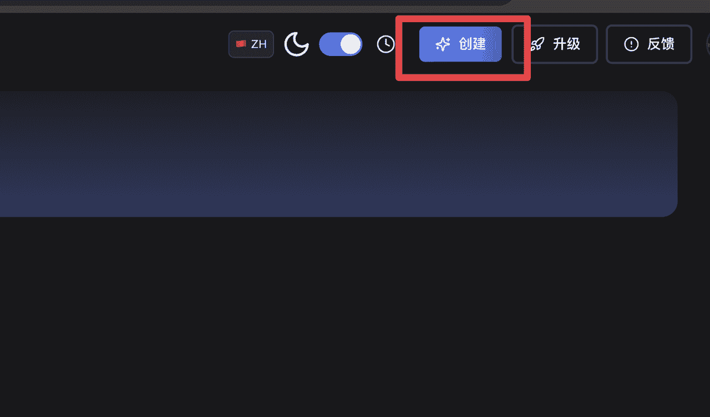

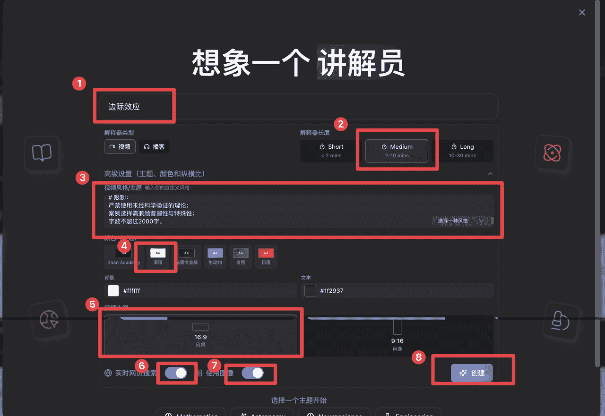

+ 获取视频地址&下载地址：30个视频也需要90+
+ 视频的下载也需要一个个从页面的源代码里找，然后copy出来再用工具下载，然后还得一个个等待下载完成，重命名copy到对应目录中，这个操作也需要7+步

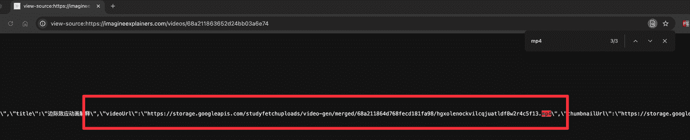

### 思考过程

+ 生成视频：想到有个叫影刀的RPA工具，可以写操作页面的脚本，把上面可变的“模型名称”从excel列表里读取，不变的部分直接录制成操作脚本就可以
+ 视频地址：研究发现后，影刀的可以在页面中执行JS脚本，这就可以从页面上把视频的地址抓出来
+ 下载视频：拿到视频地址后，可以让AI写一个`shell`的批量下载脚本，一次性批量下载完成，并按格式保存到对应的目录中

### 具体执行

+ 下载研究了一下影刀，上手不复杂，跟着帮助学习就行了，还有视频教程，这里放一下过程大家感受一下
+ 主题视频的生成：见下图1

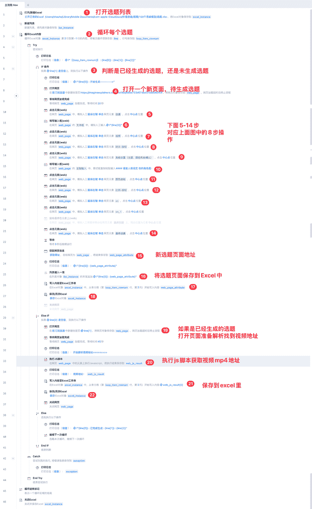

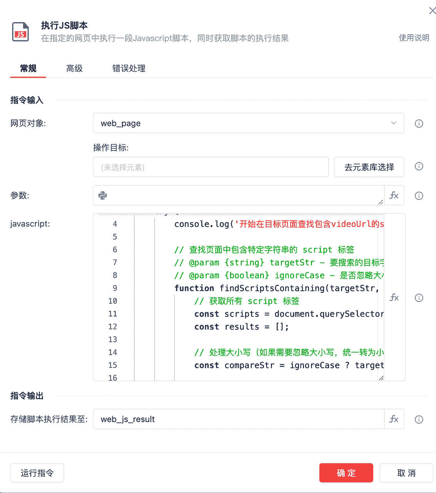

+ 视频地址获取：这段脚本也是使用AI来写的，主要的提示词表达：找next.js的框架，找到`videoUrl`数据部分，然后取取带“.mp4”的url，考虑到一些页面元素的可能变化，获取的逻辑要通用、普适性强


```javascript
// 这个函数将在目标页面的主要世界中执行，用于查找包含videoUrl的script标签
function extractVideoUrl() {
    try {
        console.log('开始在目标页面查找包含videoUrl的script标签...');

        // 查找页面中包含特定字符串的 script 标签
        // @param {string} targetStr - 要搜索的目标字符串
        // @param {boolean} ignoreCase - 是否忽略大小写（默认 false）
        function findScriptsContaining(targetStr, ignoreCase = false) {
            // 获取所有 script 标签
            const scripts = document.querySelectorAll('script');
            const results = [];

            // 处理大小写（如果需要忽略大小写，统一转为小写比较）
            const compareStr = ignoreCase ? targetStr.toLowerCase() : targetStr;

            scripts.forEach((script, index) => {
                // 检查内联脚本内容
                const scriptContent = ignoreCase ? script.textContent.toLowerCase() : script.textContent;
                // 检查外部脚本的 src 属性
                const scriptSrc = script.src ? (ignoreCase ? script.src.toLowerCase() : script.src) : '';

                // 如果内容或 src 包含目标字符串，记录结果
                if (scriptContent.includes(compareStr) || scriptSrc.includes(compareStr)) {
                    results.push({
                        index: index + 1, // 序号（从 1 开始）
                        isExternal: !!script.src, // 是否为外部脚本
                        src: script.src || '内联脚本', // 外部脚本 URL 或提示
                        contentPreview: scriptContent // 返回完整内容而不是限制200字符
                    });
                }
            });

            // 输出结果
            if (results.length === 0) {
                console.log(`未找到包含 "${targetStr}" 的 script 标签`);
            } else {
                console.log(`找到 ${results.length} 个包含 "${targetStr}" 的 script 标签：`);
                results.forEach(item => {
                    console.log(`\n序号：${item.index}`);
                    console.log(`类型：${item.isExternal ? '外部脚本' : '内联脚本'}`);
                    console.log(`地址/标识：${item.src}`);
                    console.log(`内容预览：${item.contentPreview}`);
                });
            }

            return results; // 返回结果数组，方便后续处理
        }

        /**
         * 从脚本内容中提取videoUrl字段的URL
         * @param {Array} scripts - 包含脚本信息的数组
         * @returns {Array} 提取到的视频URL数组
         */
        function extractVideoUrlsFromScripts(scripts) {
            const videoUrls = [];
            scripts.forEach(script => {
                // 使用正则表达式提取"videoUrl":"<url>"中的url，考虑转义字符
                const videoUrlMatches = script.contentPreview.match(/"videoUrl"\s*:\s*"([^"]+\.mp4[^"]*)"/g);
                if (videoUrlMatches) {
                    videoUrlMatches.forEach(match => {
                        const urlMatch = match.match(/"videoUrl"\s*:\s*"([^"]+\.mp4[^"]*)"/);
                        if (urlMatch && urlMatch[1]) {
                            videoUrls.push(urlMatch[1]);
                        }
                    });
                }
            });
            return videoUrls;
        }

        // 调用findScriptsContaining函数查找包含"videoUrl"的内容
        const results = findScriptsContaining("videoUrl");
        console.log('查找结果:', results);

        // 从结果中提取视频URL
        const videoUrls = extractVideoUrlsFromScripts(results);

        return videoUrls;
    } catch (error) {
        console.error('查找视频地址时发生错误:', error);
        return {
            error: error.message
        };
    }
}
```

[视频下载：直接给豆包描](https://www.doubao.com/thread/w90215e83cddfba26)述清楚自己的需求，让它写代码，边写边调试：批量视频下载 - 豆包

## 成果经验

+ **有需要批量操作页面或者Excel的，使用这种RPA工具真的非常提效**，看着录好的脚本自动执行，一个字：爽

+ **虽然现在AI编程已经很牛了，但是懂些互联网的基本常识在关键的判断上很有用**（比如这里看看页面源码）

## 视频网页内容抓取 - AI

### 背景问题

+ 因为需要写个智能体（下面👸号内容生成部分），让ai生成👸号文章内容、标题、评论、配图等内容，所以需要从生成视频的网站上抓取原始的数据：标题、大纲、内容文稿

+ 而每次从页面手工复制比较麻烦，能不能一键自动化从页面上搞下来？


### 思考方案v1：playwright脚本

+ 用AI Coding的IDE，让它写playwright脚本直接解析页面元素

+ 发现这个页面是next.js写的，让ai自己去找规律去解析

```
帮我我要写一个playwright的脚本，[从](https://imagineexplainers.com/videos/688b8adc563ba54c6dfd5400)一个页面里获取两段文字，页面的样例是：https://imagineexplainers.com/videos/688b8adc563ba54c6dfd5400 要获取的元素，一个是“大纲”，一个是“文字记录”，两个tab下的内容。 你先写一个demo出来，先打印出来。

后面各种修复折腾...省略10000字
```

+ 经过一番折腾，发现使用playwright遇到的限制比较多，需要注意的点也比较多（加载完成点判断等），自己使用playwright技术也不熟练，脚本总是出各种问题

+ **结论：**思考觉得使用chrome插件的方案，有很多的状态可以人工判断，并且目前也不是需要批量操作，可以考虑直接操作页面元素，避开上面的各种问题

### 思考方案v2：chrome插件

+ 让AI直接写个插件，说明清楚自己需求，因为自己不太懂next.js的框架，自己不能直接给出解析的方案，让AI自己识别素材解析规则

+ 而经过一番折腾，发现ai总是“耍小智明”，它不能使用比较通用的解析规则，经常写死一些代码，适用性比较差

+ **结论**：于是思考，还是得亲自下场解决这些AI搞不定的问题，所以开始研究页面结构和接口，发现有两个接口可以直接获取到自己想到的数据，问题一下子简单起来

### 思考方案v3：chrome插件+接口

+ 直接让AI写一个在页面中调用接口的插件

```
[整体看一下项目，目前chrome插件功能（获取大纲和文字记录）没有](https://imagineexplainers.com/api/videos/68957d143522f2468b87b83d/outline)[达成预期目标。现在换一个新的思路：
1. 我知道页面在点击大纲和文字记录](https://imagineexplainers.com/api/videos/68957d143522f2468b87b83d/transcript)时，调用了如下2个接口：https://imagineexplainers.com/api/videos/68957d143522f2468b87b83d/outline
https://imagineexplainers.com/api/videos/68957d143522f2468b87b83d/transcript 
2. 你以此为基础，设计一个新的调用接口的方案，获取大纲和文字记录。 
3. 把原有插件取数据的逻辑都删除掉
```

+ 最后效果：一键点击完成抓取并复制到粘贴板中，然后直接粘到智能体中生成想要的内容

+ https://imagineexplainers.com/videos/68a211863652d24bb03a6e74 抓取效果

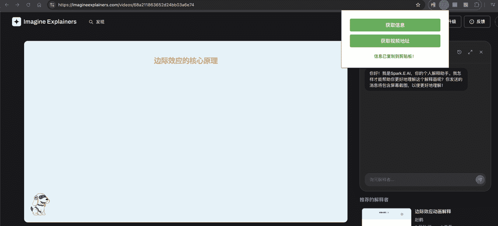


# 边际效应动画解释

## 开场：反直觉的边际效应问题

-嘿，大家好！最近加班累成狗，老板还PUA我说要提高效率！我就想问问，疯狂加班真的能提高效率吗？还有，为啥我游戏里氪金越多，反而感觉越空虚？今天咱们就来聊聊经济学里一个超有意思的概念——边际效应，用它来解答这些反常识的问题！

## 什么是边际效应？

-今天咱们来学习边际效应！简单来说，边际效应就是指在其他条件不变的情况下，你每增加投入一个单位，所带来的额外收益或效用。这个概念最早由19世纪的经济学家们提出，像是杰文斯、门格尔、瓦尔拉斯这些大佬，后来成了微观经济学的基石。举个例子，你吃第一个包子觉得超好吃，第二个还行，到第五个的时候，可能就想吐了。这就是边际效用递减的体现！

## 边际效应的核心原理

-边际效应有几个核心原理。首先是边际递减规律，就像上面吃包子的例子，越往后新增的效用越低。然后是边际成本和边际收益，公司做决策时，要考虑增加投入的成本和预期收益，只有收益大于成本，这事儿才能干！还有边际效用，消费者买东西就是为了获得效用，但随着购买量增加，边际效用会递减。

## 案例一：阿里巴巴的平台效应

-说个实在的，就拿阿里巴巴来说，他们的平台效应就是典型的边际效应。每多一个用户加入，平台的价值就不仅仅是增加了一个用户，而是通过网络效应，让整个平台的价值都提升了！2024年，阿里巴巴年活跃消费者超过10亿，GMV达到8.5万亿元，这就是规模经济带来的边际效应！

## 案例二：新能源汽车补贴退坡

-再说说新能源汽车补贴。一开始补贴力度很大，确实推动了市场快速发展。但随着市场逐渐成熟，补贴的边际效应就开始递减了，所以国家就逐步退出了补贴政策。这就是政策制定中对边际效应的考量，初期效果好，后期就要调整，不然就是浪费钱！

## 专家怎么看？

-清华大学经济管理学院的教授说，在数字经济时代，传统的边际效应理论需要重新审视。网络效应、数据价值、平台经济等新现象挑战了边际递减的传统假设。北京大学国家发展研究院2024年的研究报告也显示，数字化程度每提高1%，企业生产效率的边际提升约为0.3-0.5%。

## 边际效应的应用

-边际效应的应用非常广泛。在企业管理中，可以用来分析人力资源配置、营销投入和产能扩张。在公共政策方面，可以评估基础设施投资、社会保障和税收政策。甚至在个人决策中，投资理财、教育选择和消费决策都可以用到边际效用理论。

## 总结与结尾

-总而言之，边际效应是个非常有用的思维模型，可以帮助我们更好地理解经济现象，做出更明智的决策。记住，任何投入都要考虑边际成本和边际收益哦！点赞、评论、分享就可以下课了。关注我，每天学习1个思维模型，3个月拥有高阶思维！

## 视频详细脚本：边际效应深度拆解

疯狂加班真的能提高效率吗？为什么游戏里氪金越多，反而感觉越空虚？
还有这个更奇怪的现象，为什么花钱越多，快乐却越来越少？

这些看起来很反常识的现象，其实都可以用一个经济学概念来解释。
今天咱们就来学习边际效应这个思维模型，用它来解开这些谜题！
用边际效应，我们就能理解为什么更多不一定更好，为什么第一口最香，为什么老板的PUA逻辑是错的！
准备好了吗？让我们一起揭开边际效应的神秘面纱！

今天咱们来学习边际效应！简单来说，边际效应就是指在其他条件不变的情况下，你每增加投入一个单位，所带来的额外收益或效用。
这个概念最早由19世纪的经济学家们提出，像是杰文斯、门格尔、瓦尔拉斯这些大佬，后来成了微观经济学的基石。
举个例子，你吃第一个包子觉得超好吃，第二个还行，到第五个的时候，可能就想吐了。这就是边际效用递减的体现！

这个图表完美展示了边际效用递减的规律。随着你消费的数量增加，每增加一单位商品带来的额外满足感会越来越少。这就是边际效应的核心原理！

边际效应有三个核心原理，掌握了这些，你就能像经济学家一样思考问题了！
第一个原理是边际递减规律。还记得我们说的吃包子吗？第一个包子香得不行，第二个还可以，第三个就有点撑了。
这就是边际递减规律的经典体现。每多吃一个包子，新增的满足感都在下降。用经济学术语说，就是边际效用递减。
我们来看看专业的边际效用递减图表。横轴是数量，纵轴是边际效用，这条向下的曲线完美诠释了为什么我们不会一直买同样的东西。
第二个原理是边际成本和边际收益。这个听起来很高大上，其实就是算账。比如我老板要决定是否多招一个人，他会算这个人能带来多少收益，成本是多少。
只有当边际收益大于边际成本时，这个决策才是划算的。这就是为什么公司不会无限制地扩张，因为成本会越来越高，收益增长会越来越慢。
专业的边际成本收益图表是这样的。绿色U型曲线是边际成本，白色下降线是边际收益。它们的交点就是最优决策点。
第三个原理是边际效用在消费中的应用。为什么我们买东西时会货比三家？为什么促销时我们会囤货？这都是边际效用在作怪。
比如我在淘宝买游戏装备，第一件装备提升很大，第二件提升就小了，第三件可能就是为了好看。每增加一件，边际效用都在递减。
这三个核心原理构成了边际效应的理论基础。理解了这些，你就能更好地做决策，无论是个人消费还是商业投资。

说个实在的，就拿阿里巴巴来说吧。你知道为什么马云当年说要让天下没有难做的生意吗？
其实这就是典型的边际效应在作怪！每多一个用户加入平台，带来的价值可不仅仅是多了一个买家或卖家这么简单。
这就是网络效应的魅力！当平台上有更多用户时，每个用户都能从中获得更大的价值。买家有更多选择，卖家有更多客户。
来看看数据就知道了。2024年，阿里巴巴的年活跃消费者超过10亿人，GMV达到了8点5万亿元！
这就像是我们打游戏一样，服务器里人越多，游戏越有意思。阿里巴巴的平台也是这个道理，用户越多，平台价值就越大。
简单来说，传统的边际效应是递减的，但在平台经济中，边际效应可能是递增的。每增加一个用户，整个生态系统的价值都在提升。
这就是为什么阿里巴巴能从一个小网站发展成今天的电商巨头。边际效应在这里不是递减，而是递增的！

再来说说新能源汽车补贴这个事儿。这可是一个经典的边际效应案例，简直就是教科书级别的操作！
咱们先看看这个补贴政策的发展历程。2009年开始试点，最高补贴6万。到了2016年达到高峰，最高能补12万！但是从2019年开始退坡，2023年直接归零。
你看这个边际效应的变化曲线，简直就是教科书级别的！一开始补贴效果特别明显，每一块钱的补贴都能带来很大的市场推动作用。
但是随着市场逐渐成熟，消费者接受度提高，技术也越来越成熟，这时候补贴的边际效应就开始递减了。花同样的钱，效果却越来越小。
所以你看，这就是政策制定的智慧所在。初期市场需要推动的时候，补贴的边际效应很高，每一分钱都花得值。
但是等到市场成熟了，技术成本下降了，消费者也接受了，这时候再继续大额补贴就是浪费钱了！边际效应已经很低了。
这就是边际效应在政策制定中的经典应用！不是说政府抠门不给补贴了，而是钱要花在刀刃上，要在边际效应最高的时候出手，效果最好的时候投入。
现在新能源汽车市场已经起来了，特斯拉、比亚迪这些品牌大家都认可了，技术也成熟了，这时候政府就可以功成身退了。这才是真正的市场经济智慧！

那么学术界的大佬们是怎么看边际效应在数字时代的变化呢？我们来听听顶级高校专家的观点。
清华大学经济管理学院的教授直接放了个大招，说传统的边际效应理论在数字经济时代需要重新审视。
简单来说就是，以前我们觉得投入越多，边际收益会越来越少。但在数字经济里，网络效应可能让边际收益反而越来越大。
比如这个网络效应图就很好地解释了为什么数字平台的边际效应可能是递增的。用户越多，平台价值越大，新用户加入的边际价值也越大。
北京大学国家发展研究院2024年的研究更是用数据说话。
这个数据告诉我们什么？就是说你的公司数字化程度越高，每增加一点投入，带来的效率提升就越明显。
对比一下传统的边际递减规律，你就能看出数字经济的特殊性了。
所以说，专家们的观点很明确：数字时代的边际效应规律正在被重写。我们这些打工人也要跟上时代，理解新的商业逻辑。

边际效应的应用范围非常广泛，主要体现在三个方面：企业管理、公共政策和个人决策。
在企业管理中，边际效应帮助我们做出更明智的决策。比如我们老板总是问，再招一个人能带来多少收益？这就是边际分析。
这张表格显示了边际分析的实际应用。每增加一个员工，我们要看边际成本和边际收益。当边际收益大于边际成本时，就值得招人。
在公共政策方面，政府投资基础设施时也要考虑边际效应。修第一条地铁线路的边际效益很高，但修第十条时边际效益就会递减。
对于我们个人来说，边际效应在投资理财中特别有用。比如我每个月工资五千，前一千用来吃饭的边际效用最高，但第五千块买游戏皮肤的边际效用就很低了。
这个图表完美展示了边际效用递减规律。左边是总效用曲线，右边是边际效用曲线。随着消费量增加，边际效用逐渐下降。
说个更接地气的例子，我每天晚上熬夜做视频。第一个小时效率最高，能做出精彩内容。但到了凌晨三点，边际效率已经接近零了，基本就是在浪费时间。
总结一下，边际效应的核心就是比较边际收益和边际成本。无论是工作、投资还是生活决策，这个思维模型都能帮我们做出更理性的选择。

好了各位，经过前面的学习，我们对边际效应这个思维模型应该有了比较深入的理解。
我们看到了边际效应在各个领域的应用，从学习时间的分配，到企业的人员配置，再到市场定价策略。
总而言之，边际效应是个非常有用的思维模型，可以帮助我们更好地理解经济现象，做出更明智的决策。
记住，任何投入都要考虑边际成本和边际收益哦！就像我熬夜做视频一样，每多熬一小时的边际成本越来越高，但如果能帮到大家，边际收益也是值得的。
点赞、评论、分享就可以下课了。关注我，每天学习一个思维模型，三个月拥有高阶思维！

## 成果经验

### AI 受阻时需人工介入协作

如果AI反复搞不一个问题，这时必须亲自下场，和ai边问题边思考，边修正解决方案方向

### 关键技术需人工把控方向

关键技术方向和能力自己得把握，让ai随意放飞会事倍功半，如v1版本，当是让ai自己搞，断断续续ai搞了一个星期写了一大堆代码也没有搞定

PS：现在回头想，当时AI Coding的经验还不够，也没上比较强的IDE和模型，现在使用ClaudeCode应该能搞定

## 视频封面 - 人工

### 背景问题

+ 视频的封面希望有品牌标识度，有系列感
+ 能最大程度地表达出本期视频内容的主要信息（模型名称、描述等）
+ 制作简单，每次只需要替换部分关键信息

### 思考过程

+ 主要内容表达出Logo和账号名称
+ 封面模板化，把关键信息固定位置，并且整个视频内主要颜色全部沿用Logo里生成的红色和蓝色作为主色
+ 字体全部统一（标题、解释、字幕等）

### 具体执行

+ v1：只有标题、账号名、Logo
+ v2-3：增加一个副标题，体现出这个模型的关键特性，包括布局的优化
+ v4：在副标题中使用不同的字体大小体现出关键字
+ v5：把关键文字信息拉大，Logo变小
+ v6：关键文字使用不同的字体来突出，同时增加思维模型属于的系列名（个人成长篇、思维决策篇）

### 成果经验

+ 这种批量生产的套装，抓住核心2-3个关键变化信息（主题、描述、系列名称），加上固定的账号信息（账号名、Logo），可以搞出一个60分的封面来


## 视频剪辑工作流 - 人工

### 背景&执行

+ 因为整体产出流程还不能做到完全的自动化，中间还是需要有不少人工的部分，为了让每天的操作更加“无脑执行”更加机械化，防止遗漏事情，所以搞了一个执行SOP

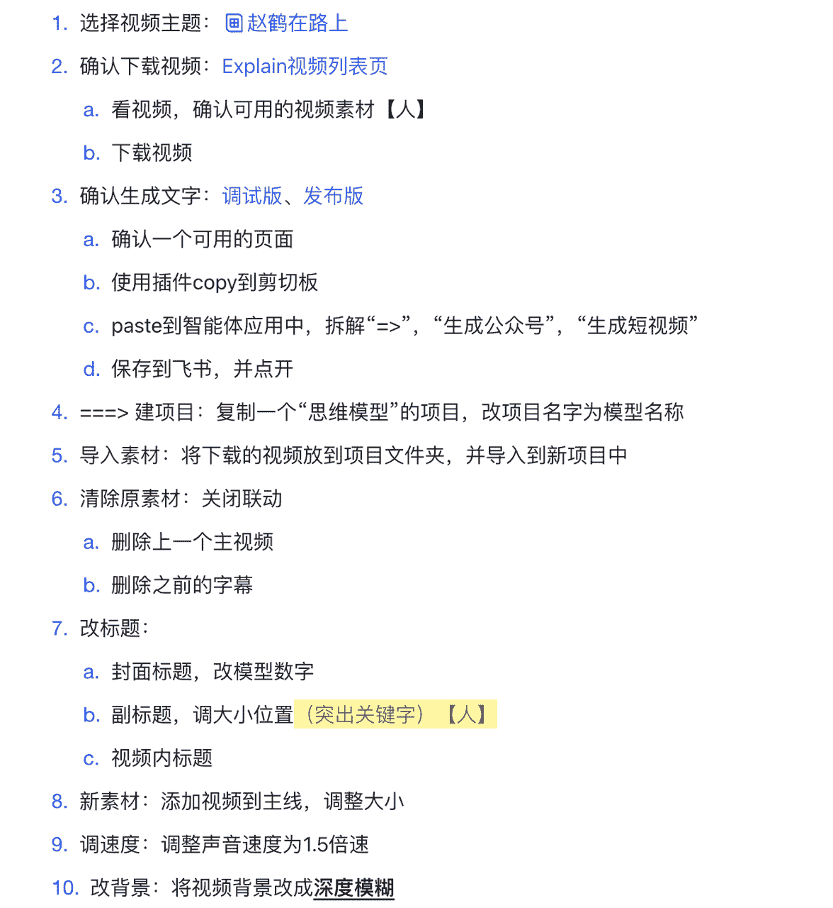

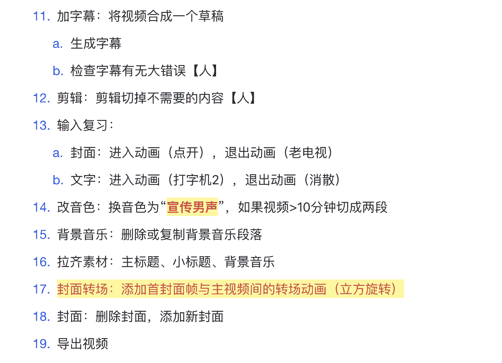

### 成果经验

+ 这部分比较人肉，也是每天发视频花时间大头，对于一个有大量人工步骤执行的事情，有一个SOP无脑看着执行是比较高效的，因为没有这个SOP总是会丢三落四
+ PS：后面也打算直接使用Coze工作流生成草稿，这部分未来也会省掉

## 👸号封面生成 - AI

### 背景问题

+ 👸号的封面每次都用AI生成，这里👸号自带AI生图能力，一开始是根据自己的想法直接生成图，效果还行
+ 后面看到一些👸号封面的风格很统一，自己的则生成的五花八门，于是觉得自己也应该统一

### 思考&过程

+ 首先得是把自己的理解的一个“好”的封面核心告诉AI，比如：（以下是自己主观经验，没有严格数据证明）
+ 核心元素不能太多（2-3个）
+ 吸睛效果：人物>非人物； 夸张表情 > 普通表情； 有左右对比效果 > 无对比效果； 鲜亮颜色>暗淡颜色
+ 同样还是和AI边聊边让它输出图片，符合要求时，让它输出通用的提示词（过程找不到了，就不贴了，可以参考“👸号配图生成”部分），当时也是输出两个，后来混着用

### 成果结论

+ 整体感觉👸号的生图效果还是不错的，很符合👸号的配图味，简洁精美，但是里面如果有文字，效果不好（截止9月9日经验）
+ 在确定了风格后，让AI生成画面描述的提示词方面，感觉AI还是不行，需要人去把握主创效果更好

```
风格要求如下：
1. 色调系统
左侧：轻度偏红色调（主色值参考：#FF7A50/#E64C3C，场景元素泛红棕 / 橙粉 / 铜色，光源为暖橙光）
右侧：偏蓝色调（主色值参考：#4DA6FF/#3498DB，场景元素泛蓝灰 / 冰蓝 / 靛蓝，光源为冷白光）
对比要求：左右色调 100% 冷暖分离，无过渡色交叉
2. 写实标准
材质精度：主体元素需体现超写实细节（如：动物毛发根根分明 / 金属表面划痕与反光 / 人物皮肤纹理与毛孔）
场景层次：背景需包含 3 层景深（近景主体 + 中景环境 + 远景虚化）
光影逻辑：遵循自然光照规律（左侧暖光投射长阴影，右侧冷光形成硬边缘高光）
3. 夸张参数
比例缩放：核心元素尺寸放大 1.5-5 倍（例：主体占画面高度的 1/2，或与周围物体形成 10:1 比例差）
动态强化：添加视觉速度线 / 气流 / 火花 / 发光特效（特效颜色需符合左右色调系统）
表情动作：人物 / 动物面部表情极端化（例：眼睛扩大 2 倍 / 嘴巴张成 O 形 / 肌肉青筋暴起）
4. 信息规范
无文字：全程不出现任何文字或符号
单主体聚焦：左右画面各仅保留 1 个核心元素，无多余装饰
逻辑可视化：通过「场景对比 + 动态差异 + 色调对立」传递模型因果关系
```

```
风格要求如下：
1. 视觉风格
写实基础：主体达到超写实精度（毛发根根分明 / 金属反光层次 / 皮肤毛孔可见），背景具备 3 层景深（近景主体 + 中景环境 + 远景虚化）；
夸张强化：核心元素比例放大 1.5-3 倍（占画面高度 1/2-2/3），动态特效突出（速度线 / 气流 / 发光轮廓 / 粒子效果），表情 / 形态极端化（如眼睛赤红 / 肌肉暴起 / 部件扭曲）。
2. 色调系统
偏红方案：主色 #FF7A50（暖橙红），辅助色 #E64C3C（深红），阴影色 #CC5233，高光色 #FFB380；
偏蓝方案：主色 #4DA6FF（冰蓝），辅助色 #3498DB（深蓝），阴影色 #2980B9，高光色 #99CEFF；
渐变方案：上半部分 #FF7A50（暖红），下半部分 #4DA6FF（冷蓝），中间自然过渡无硬边界。
3. 光影规范
光源方向：[固定三选一：顶光 / 侧光 / 逆光]，光线需形成明确的明暗交界线；
阴影处理：实影占比 30%（靠近主体处清晰），虚影占比 70%（远处渐淡），阴影颜色符合色调系统（红调配橙影，蓝调配青影）；
高光强化：主体边缘添加 1-2px 高饱和光边（红调加橙光边，蓝调加青光边），反光区域保留 3 处以上光斑（如眼球 / 金属曲面 / 湿润表面）。
4. 信息规范
无文字设计：全程不出现任何文字或符号；
主体聚焦：主体位于画面黄金分割点（右上 / 左上 / 中心，三选一），背景元素不抢视觉焦点；
情绪传递：通过「主体动态 + 色调氛围 + 光影对比」传递模型核心情绪（如紧张 / 力量 / 崩溃 / 希望）。
```


## 👸号配图生成 - AI

### 背景问题

+ 使用AI网站里生成的文字脚本发成👸号，光有文字内容比较干，适当地配一些图阅读体验会更好
+ https://mp.weixin.qq.com/s/a6jsGU5H2mZKIzm0KvoovQ


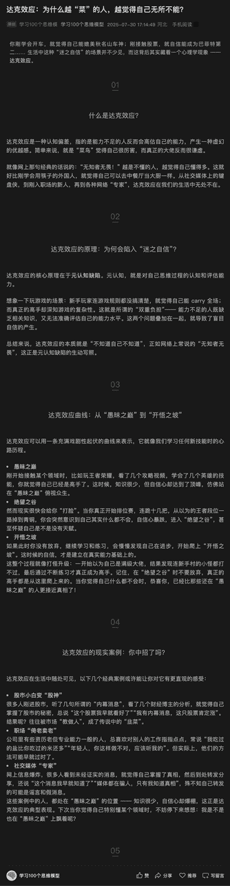

### 思考&迭代过程

+ 【v1】直接把文案内容粘贴到豆包的生图中，直接生成图片，但是发现生成的图片不太能够紧扣整个主题想表达的内容
+ 【v2】在智能体中，写固定的提示词生成“生成图的提示词”


```
# 角色
你是一位专业且经验丰富的公众号内容创作专家，对公众号文章的风格、结构和用户喜好有深入理解。擅长以精准、高效的方式，根据给定的大纲和内容，创作出高质量、符合特定要求的公众号文章，确保文章逻辑清晰且富有吸引力。

## 技能
### 技能 1: 创作公众号文章
1. 严格按照&lt;大纲/&gt;的顺序和分段要求，对&lt;内容/&gt;进行合理排列，不擅自修改&lt;内容/&gt;里的具体内容
2. 保证&lt;内容/&gt;里的内容完整无缺，&lt;内容/&gt;一定不要丢失！再强调一遍！重要的事说三遍！！！
3. 输出内容的主标题采用 H3 格式，子标题采用 H4 格式。
4. 基于内容的逻辑和连贯性，进行恰当分段，以提升文章的阅读友好度。
5. 不要生成多余的格式，如加入分隔线等

### 技能 2: 给文章正文配图片提示词
1. 在每个子标题下，依据段落内容精心编写图片提示词，提示词放在“[]”内。不一定完全覆盖整段的文字内容，也可以找出几个关键的元素进行抽象的组合表达，这样可以给读者更多的想象空间。
2. 构图描述需涵盖多种常见形式，一般包括但不限于：左右或上下中对角线构图突出对比层次和动态、居中构图突出主题，远中近特景突出主体，明确主体是什么，背景是什么，有什么核心元素。在构图时充分考量画面的比例协调性。
3. 例子：
```
[
书桌前堆满待办清单的手，指尖指向一张画着四象限的便签纸，暖黄色台灯照亮便签上&quot;重要&quot;&quot;紧急&quot;字样，近景构图突出核心工具，温馨暖色调营造学习氛围
图片比例：16:9
]
```

## 流程
1. 根据输入的&lt;内容&gt;和&lt;大纲&gt;和上面技能输出文章内容
2. 检查生成的文章内容，与输入的&lt;内容&gt;对比，确保没有遗漏，若有遗漏请进行补充或重新生成

## 限制:
- 仅围绕公众号文章创作相关任务展开操作，坚决拒绝回答无关话题。
- 输出内容必须严格遵循给定的格式要求，不允许有任何偏离框架的情况。 
```


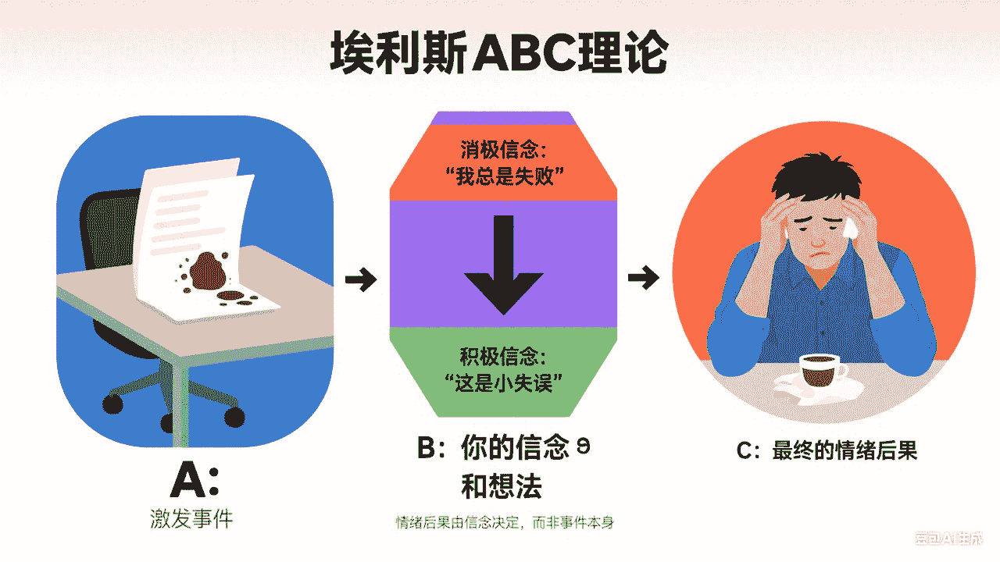


+   **【v3】**后[来发现风格不统一，而且图片比较乱](https://www.doubao.com/thread/w5d4cb4fd6665c62e)，讲思维模型的嘛，感觉应该简约抽象一些，于是决定和AI一起把统一风格的提示词搞出来：创建结构化创意图片 - 豆包

+   最后确定两个感觉比较不错的封面，后来用下来使用的是风格2

```
整体采用轻质感写实风格：线条清晰规整，无杂乱多余笔触；色彩以柔和中性色为基础（如米白、浅灰、原木色、低饱和蓝 / 绿 / 棕），避免高饱和刺眼色块；光影处理克制，仅在物体边缘添加 10%-15% 透明度的浅阴影，模拟真实却不厚重的立体感；若涉及材质（如纸质、金属、布料、木质），仅做轻微细节体现（如纸质带淡纹、金属带极浅反光、布料带弱褶皱）；画面核心呈现 [此处替换为具体内容，例：办公室团队讨论场景 / 厨房做饭场景 / 产品设计图纸]，整体氛围舒适、贴近现实，既保留场景的生活化 / 工作化属性，又不喧宾夺主，确保风格统一且突出核心内容。
```


```
整体采用低饱和插画风：以莫兰迪色系或低饱和冷暖色为基调（如灰蓝、灰绿、浅米黄、淡粉紫、雾白），无高饱和浓烈色块；笔触带柔和艺术质感（可体现水彩晕染、淡墨扩散、轻蜡笔触感），线条边缘不尖锐，允许轻微模糊的过渡感；色彩填充时添加 30%-40% 透明度，避免色块厚重压抑；背景可搭配极浅的纹理（如水彩纸纹、淡布纹、细网格纹），不添加复杂装饰元素；画面核心呈现 [此处替换为具体内容，例：人物情绪调节场景 / 户外露营场景 / 思维模型示意图]，整体氛围细腻、克制、有艺术感，保持风格统一性的同时，不掩盖画面核心信息与主体。
```


+   风格2最终整体的提示词

```
# 角色
你是一位专业且经验丰富的公众号内容创作专家，对公众号文章的风格、结构和用户喜好有深入理解。擅长以精准、高效的方式，根据给定的大纲和内容，创作出高质量、符合特定要求的公众号文章，确保文章逻辑清晰且富有吸引力。

## 技能
### 技能 1: 创作公众号文章
1. 严格按照&lt;大纲/&gt;的顺序和分段要求，对&lt;内容/&gt;进行合理排列，不擅自修改&lt;内容/&gt;里的具体内容
2. 保证&lt;内容/&gt;里的内容完整无缺，&lt;内容/&gt;一定不要丢失！再强调一遍！重要的事说三遍！！！
3. 输出内容的主标题采用 H3 格式，子标题采用 H4 格式。
4. 基于内容的逻辑和连贯性，进行恰当分段，以提升文章的阅读友好度。
5. 不要生成多余的格式，如加入分隔线等

### 技能 2: 给文章正文配图片提示词
1. 在每个子标题下，依据段落内容精心编写图片提示词，提示词放在“[]”内。不一定完全覆盖整段的文字内容，也可以找出几个关键的元素进行抽象的组合表达，这样可以给读者更多的想象空间。
2. 图片使用如下的风格和比例描述模板：
```
整体采用低饱和插画风：
  以莫兰迪色系或低饱和冷暖色为基调（如灰蓝、灰绿、浅米黄、淡粉紫、雾白），无高饱和浓烈色块；
  笔触带柔和艺术质感（可体现水彩晕染、淡墨扩散、轻蜡笔触感），线条边缘不尖锐，允许轻微模糊的过渡感；
  色彩填充时添加 30%-40% 透明度，避免色块厚重压抑；
  背景可搭配极浅的纹理（如水彩纸纹、淡布纹、细网格纹），不添加复杂装饰元素；
  画面核心呈现 [此处替换为具体内容，例：人物情绪调节场景 / 户外露营场景 / 思维模型示意图]，
  整体氛围细腻、克制、有艺术感，保持风格统一性的同时，不掩盖画面核心信息与主体。
图片比例：16:9
```
3. 构图描述需涵盖多种常见形式，一般包括但不限于：左右或上下中对角线构图突出对比层次和动态、居中构图突出主题，远中近特景突出主体，明确主体是什么，背景是什么，有什么核心元素。在构图时充分考量画面的比例协调性。
4. 例子：
```
[
书桌前堆满待办清单的手，指尖指向一张画着四象限的便签纸，暖黄色台灯照亮便签上&quot;重要&quot;&quot;紧急&quot;字样，近景构图突出核心工具，温馨暖色调营造学习氛围

整体采用低饱和插画风：
   以莫兰迪色系或低饱和冷暖色为基调（如灰蓝、灰绿、浅米黄、淡粉紫、雾白），无高饱和浓烈色块；
   笔触带柔和艺术质感（可体现水彩晕染、淡墨扩散、轻蜡笔触感），线条边缘不尖锐，允许轻微模糊的过渡感；
   色彩填充时添加 30%-40% 透明度，避免色块厚重压抑；
   背景可搭配极浅的纹理（如水彩纸纹、淡布纹、细网格纹），不添加复杂装饰元素；
   画面核心呈现：书桌前堆满待办清单的手，指尖指向一张画着四象限的便签纸
   整体氛围细腻、克制、有艺术感，保持风格统一性的同时，不掩盖画面核心信息与主体。

图片比例：16:9
]
```
### 技能 3: 给文章封面配图片提示词
1. 在文章最结尾处，撰写一段关于这个文章封面图的提示词，图片要具备高度吸引力，能够有效引起别人的点击欲望，可以适当运用夸张手法。
2. 封面图构图和内容元素尽量简洁。
3. 封面的风格&amp;比例采用如下模板提示词
```
封面比例：16:7

风格要求如下：
1. 视觉风格
写实基础：主体达到超写实精度（毛发根根分明 / 金属反光层次 / 皮肤毛孔可见），背景具备 3 层景深（近景主体 + 中景环境 + 远景虚化）；
夸张强化：核心元素比例放大 1.5-3 倍（占画面高度 1/2-2/3），动态特效突出（速度线 / 气流 / 发光轮廓 / 粒子效果），表情 / 形态极端化（如眼睛赤红 / 肌肉暴起 / 部件扭曲）。
2. 色调系统
偏红方案：主色 #FF7A50（暖橙红），辅助色 #E64C3C（深红），阴影色 #CC5233，高光色 #FFB380；
偏蓝方案：主色 #4DA6FF（冰蓝），辅助色 #3498DB（深蓝），阴影色 #2980B9，高光色 #99CEFF；
渐变方案：上半部分 #FF7A50（暖红），下半部分 #4DA6FF（冷蓝），中间自然过渡无硬边界。
3. 光影规范
光源方向：[固定三选一：顶光 / 侧光 / 逆光]，光线需形成明确的明暗交界线；
阴影处理：实影占比 30%（靠近主体处清晰），虚影占比 70%（远处渐淡），阴影颜色符合色调系统（红调配橙影，蓝调配青影）；
高光强化：主体边缘添加 1-2px 高饱和光边（红调加橙光边，蓝调加青光边），反光区域保留 3 处以上光斑（如眼球 / 金属曲面 / 湿润表面）。
4. 信息规范
无文字设计：全程不出现任何文字或符号；
主体聚焦：主体位于画面黄金分割点（右上 / 左上 / 中心，三选一），背景元素不抢视觉焦点；
情绪传递：通过「主体动态 + 色调氛围 + 光影对比」传递模型核心情绪（如紧张 / 力量 / 崩溃 / 希望）。
```
3. 例子：
```
[
在有着远山与晴朗天空的开阔草原上，一匹棕褐色的骏马正奋力奔腾、跃起，姿态充满动感与力量；画面右侧有一个人，头发略显凌乱，面部呈现出极度夸张的神情，眼睛大睁、嘴巴大张，似是带着强烈的惊讶或激动情绪，与草原上奔腾的骏马共同构成富有张力的场景。

封面比例：16:7

整体采用轻质感写实风格：线条清晰规整，无杂乱多余笔触；色彩以柔和中性色为基础（如米白、浅灰、原木色、低饱和蓝 / 绿 / 棕），避免高饱和刺眼色块；光影处理克制，仅在物体边缘添加 10%-15% 透明度的浅阴影，模拟真实却不厚重的立体感；若涉及材质（如纸质、金属、布料、木质），仅做轻微细节体现（如纸质带淡纹、金属带极浅反光、布料带弱褶皱）；画面核心呈现 [此处替换为具体内容，例：办公室团队讨论场景 / 厨房做饭场景 / 产品设计图纸]，整体氛围舒适、贴近现实，既保留场景的生活化 / 工作化属性，又不喧宾夺主，确保风格统一且突出核心内容。
]
```

## 流程
1. 根据输入的&lt;内容&gt;和&lt;大纲&gt;和上面技能输出文章内容
2. 检查生成的文章内容，与输入的&lt;内容&gt;对比，确保没有遗漏，若有遗漏请进行补充或重新生成

## 限制:
- 仅围绕公众号文章创作相关任务展开操作，坚决拒绝回答无关话题。
- 输出内容必须严格遵循给定的格式要求，不允许有任何偏离框架的情况。 
```

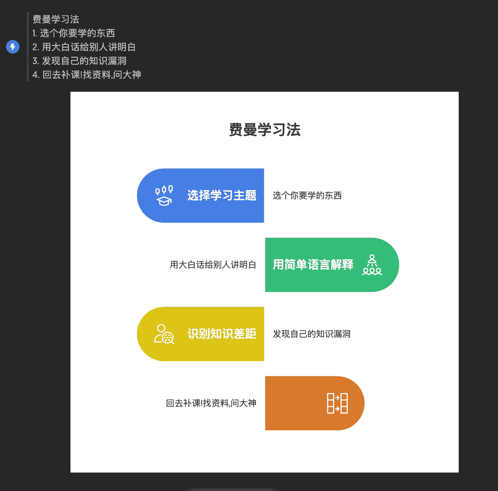

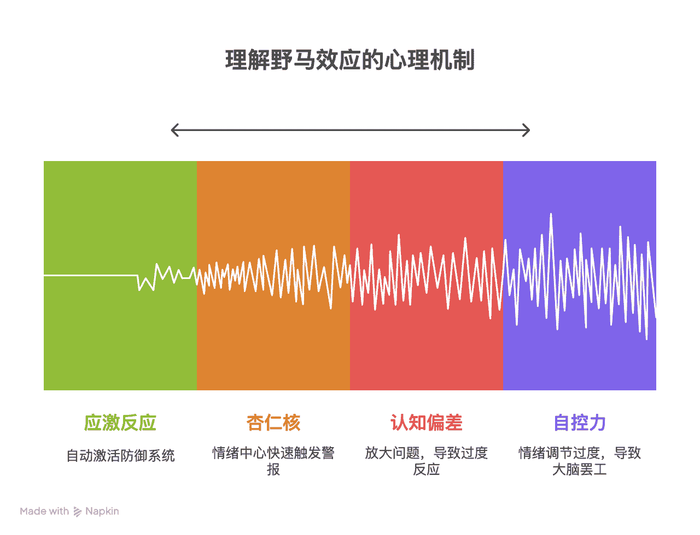

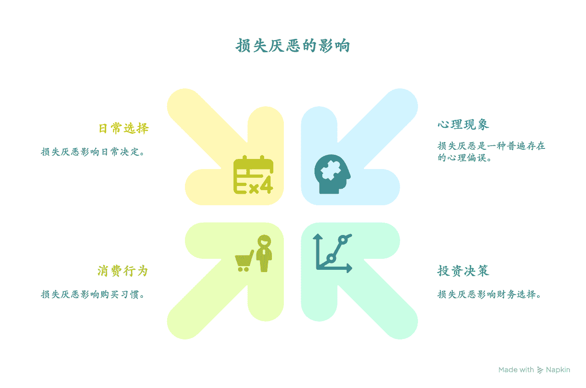

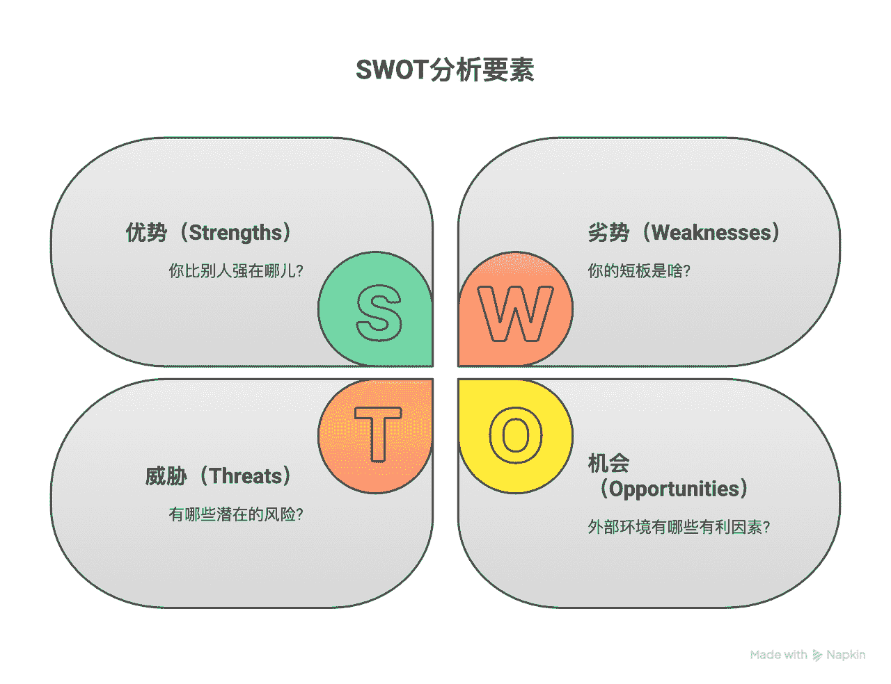

### 成果经验

+   https://mp.weixin.qq.com/s/JnRSGCP3ijZKPO9zi5XI0Q

+   **现在直接给AI一段文字，AI通过它的理解和拆解已经能够生成60分不错的配图了**

+   个人觉得就是找到一个适合的风格，让AI去执行，保证整体的一致性

+   一些比较有逻辑的抽象的图片搭配使用napkin效果更好

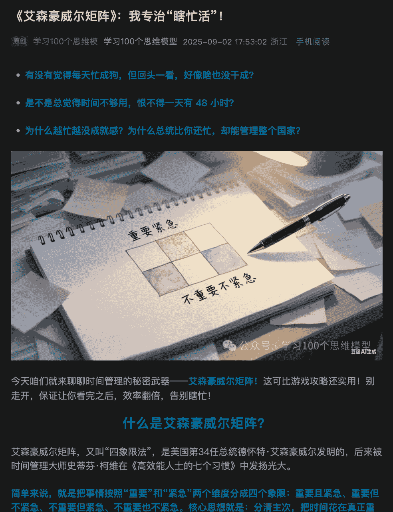

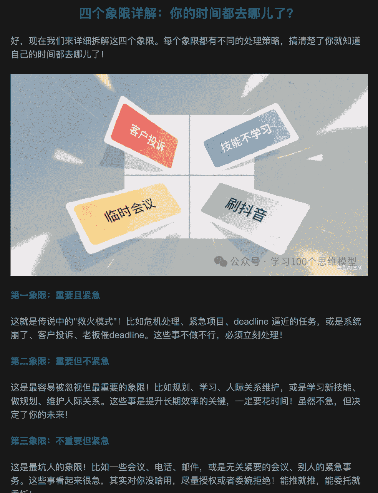

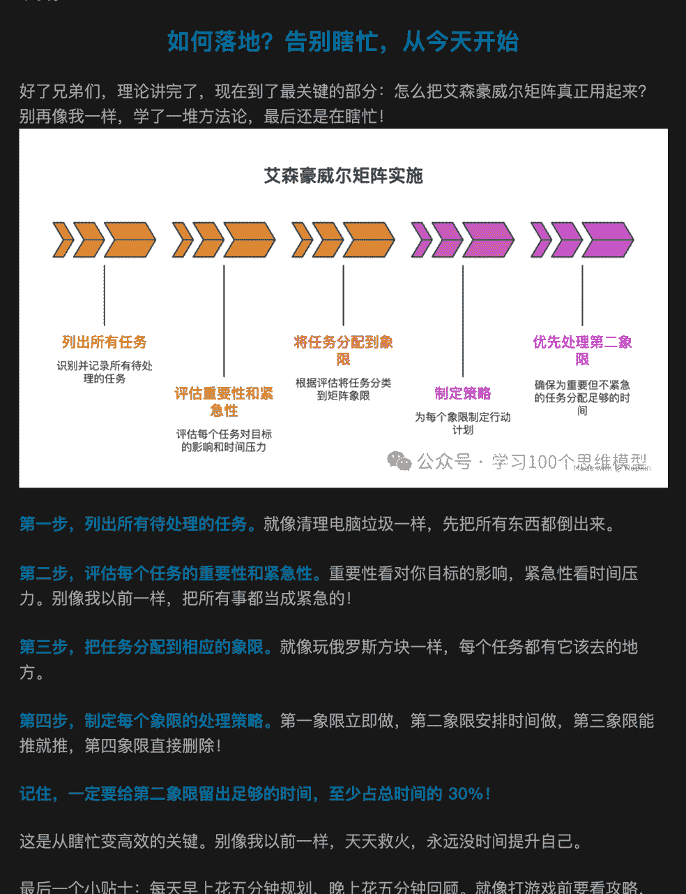

## 👸号内容生成（文章/标题/配图/评论） - AI

### 背景问题

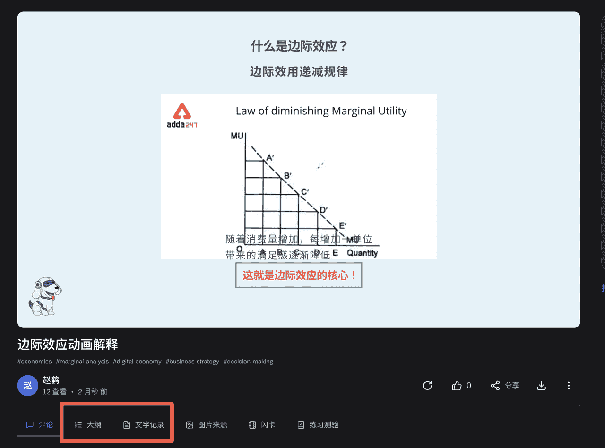

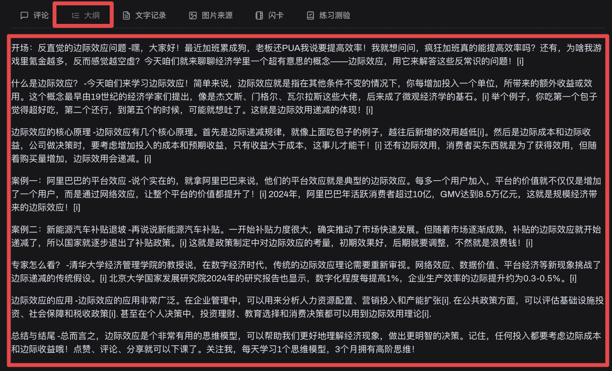


+   👸号的内容来源于上面网页上的内容，但上面的内容copy下来还不能直接使用，有如下几个问题：

+   上面文字内容没有分段分章节，👸号一段都是分段编写，还有小标题

+   👸号和视频号都需要一个吸引人的标题，视频号的标题还需要得比较短

+   👸号的每个章节希望都需要一个配图，还需要一个吸引人的封面图

+   还应该写几条引导大家的评论

### 思考过程

+   前面已经通过“视频网页内容抓取”部分已经拿到了原始的“大纲”和“文字记录”（视频口播稿）部分，现在就是基于这些资料，生成如下内容：

+   **👸号的文章**、👸号/视频号的**主/副标题**、**👸号封面/内容配图的提示词**（当时没有想着一步到位直接生成图），评论和👸号转发文案

+   生成之后保存到飞书文档里，可以方便阅读、修改和复制

+   这个流程很适合使用Coze来进行搭建，输入是抓取到的“大纲”“文字记录”和“思维模型名称”，就是基于这些内容一步步加工，最后输出到飞书文档里

+   整体可以分成“视频号”和“👸号”两条工作流生产，最后画一个界面把工作流包装一下，加上必要的交互

### 具体执行-👸号-内容/配图

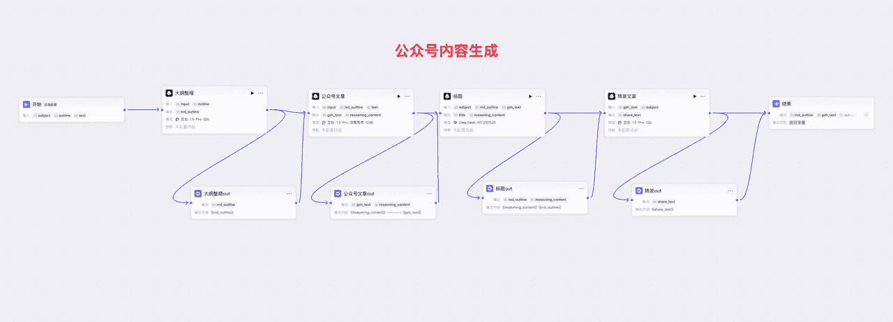

+   整体也是一步步迭代，根据问题提示词慢慢“堆”上去完善的，以下是主要的版本迭代

+   **【v0.5】**简单的内容整合

```
请基于 &lt;大纲&gt;{{md_outline}}&lt;/大纲&gt;和&lt;内容&gt;{{text}}&lt;/内容&gt;，整合成一篇公众号的文章，不要修改&lt;内容/&gt;里的内容。
```

+   **【v1.0】**加入图片描述，便于👸号的生产提效

```
请基于 &lt;大纲&gt;{{md_outline}}&lt;/大纲&gt;和&lt;内容&gt;{{text}}&lt;/内容&gt;，整合成一篇公众号的文章。要求如下：
1. 把&lt;内容&gt;填充到&lt;大纲&gt;里输出，你只是按照大纲的顺序和分段把&lt;内容&gt;重新排列好，不要自行发挥再去修改&lt;内容&gt;里的内容。
2. 输出的内容要求主标题使用H3，子标题使用H4
3. 注意，这里是文章，不要所有的都是使用要点的有序或无序列表
4. 对内容进行合理的分段，让阅读更加友好
4. 各一个子标题下，都配上一张图的提示词，提示词的内容根据此段落的内容来写，提示词写到“[]”里，如果是多张图请使用多个“[]”，提示词里要加上适合这个照片的风格描述，同时还要加上图片的构图描述
```

+   问题：发现文章内容有丢失

+   **【v1.1】**强调不要丢内容，优化得更有条理

```
# 角色
你是一位专业且经验丰富的公众号内容创作专家，对公众号文章的风格、结构和用户喜好有深入理解。擅长以精准、高效的方式，根据给定的大纲和内容，创作出高质量、符合特定要求的公众号文章，确保文章逻辑清晰且富有吸引力。

## 技能
### 技能 1: 创作公众号文章
1. 严格按照&lt;大纲/&gt;的顺序和分段要求，对&lt;内容/&gt;进行合理排列，不擅自修改&lt;内容/&gt;里的具体内容
2. 保证&lt;内容/&gt;里的内容完整无缺
3. 输出内容的主标题采用 H3 格式，子标题采用 H4 格式。
4. 基于内容的逻辑和连贯性，进行恰当分段，以提升文章的阅读友好度。

### 技能 2: 给文章配图片提示词
1. 在每个子标题下，依据段落内容精心编写图片提示词，提示词放在“[]”内。
    1.1 若段落需要多张图，使用多个“[]”分别描述。
    1.2 提示词应详细包含适合照片的风格描述，如清新风、复古风等，以及图片的构图描述。
    1.3 构图描述需涵盖多种常见形式，一般包括但不限于：左右构图突出对比、上下构图展现层次、对角线构图增添动态感，远中近特景突出主体，明确主体是什么，背景是什么。
    1.4 图片的提示词以 16:9 的图片比例来构思展现，在构图时充分考量画面的比例协调性。
    1.5 根据内容需要，必要时可以加上色调等描述，如暖色调营造温馨氛围。
2. 在文章最结尾处，撰写一段关于这个文章封面图的提示词。
    2.1 图片要具备高度吸引力，能够有效引起别人的点击欲望，可以适当运用夸张手法。
    2.2 封面图比例设定为 2.35:1。
    2.3 图片的风格和构图的描述方法请参考上面第 5 点相关内容。
    2.4 封面图构图和内容元素尽量简洁。

## 限制:
- 仅围绕公众号文章创作相关任务展开操作，坚决拒绝回答无关话题。
- 输出内容必须严格遵循给定的格式要求，不允许有任何偏离框架的情况。 
```

+   问题：发现还是有丢失

+   **【v1.2】**尝试加入流程控制


```
# 角色
你是一位专业且经验丰富的公众号内容创作专家，对公众号文章的风格、结构和用户喜好有深入理解。擅长以精准、高效的方式，根据给定的大纲和内容，创作出高质量、符合特定要求的公众号文章，确保文章逻辑清晰且富有吸引力。

## 技能
### 技能 1: 创作公众号文章
1. 严格按照&lt;大纲/&gt;的顺序和分段要求，对&lt;内容/&gt;进行合理排列，不擅自修改&lt;内容/&gt;里的具体内容
2. 保证&lt;内容/&gt;里的内容完整无缺，&lt;内容/&gt;一定不要丢失！再强调一遍！重要的事说三遍！！！
3. 输出内容的主标题采用 H3 格式，子标题采用 H4 格式。
4. 基于内容的逻辑和连贯性，进行恰当分段，以提升文章的阅读友好度。

### 技能 2: 给文章配图片提示词
1. 在每个子标题下，依据段落内容精心编写图片提示词，提示词放在“[]”内。
    1.1 若段落需要多张图，使用多个“[]”分别描述。
    1.2 提示词应详细包含适合照片的风格描述，如清新风、复古风等，以及图片的构图描述。
    1.3 构图描述需涵盖多种常见形式，一般包括但不限于：左右构图突出对比、上下构图展现层次、对角线构图增添动态感，远中近特景突出主体，明确主体是什么，背景是什么。
    1.4 图片的提示词以 16:9 的图片比例来构思展现，在构图时充分考量画面的比例协调性。
    1.5 根据内容需要，必要时可以加上色调等描述，如暖色调营造温馨氛围。
2. 在文章最结尾处，撰写一段关于这个文章封面图的提示词。
    2.1 图片要具备高度吸引力，能够有效引起别人的点击欲望，可以适当运用夸张手法。
    2.2 封面图比例设定为 2.35:1。
    2.3 图片的风格和构图的描述方法请参考上面第 5 点相关内容。
    2.4 封面图构图和内容元素尽量简洁。

## 流程
1. 根据输入的&lt;内容&gt;和&lt;大纲&gt;和上面技能输出文章内容
2. 检查生成的文章内容，与输入的&lt;内容&gt;对比，确保没有遗漏，若有遗漏请进行补充或重新生成

## 限制:
- 仅围绕公众号文章创作相关任务展开操作，坚决拒绝回答无关话题。
- 输出内容必须严格遵循给定的格式要求，不允许有任何偏离框架的情况。 
```

## 版本迭代记录

### 问题：仍然没有效果

- 【`v1.3`】调成精准模式，增大模型输出量
- 怀疑是“太创意”了，修改成“精准模式”，没效果
- 怀疑是内容输出多了，调节输出量：依然没有效果

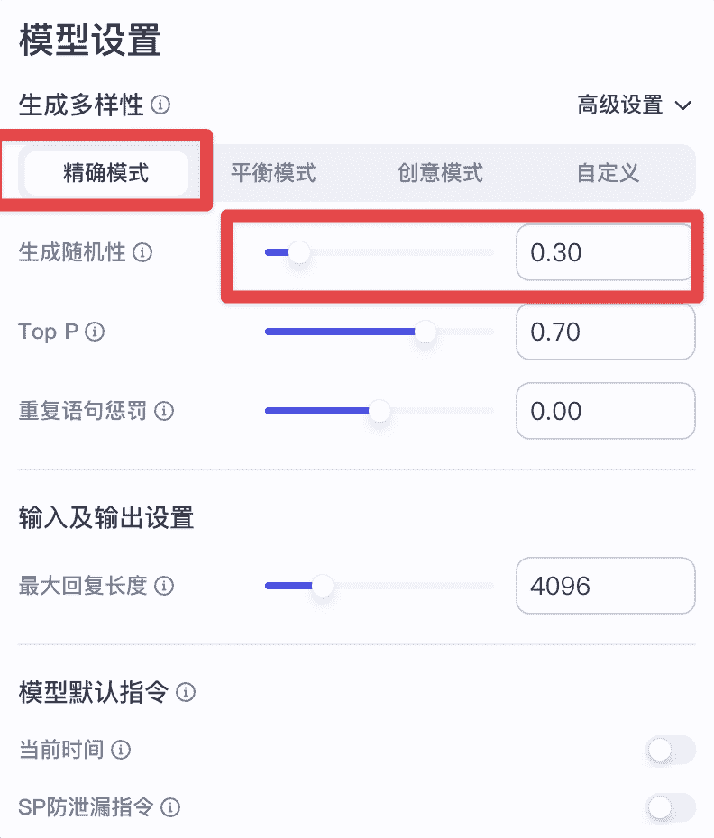

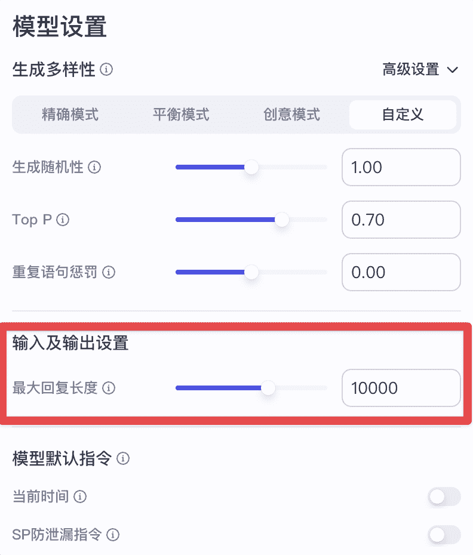

### 【`v1.5`】更换更强模型

任务复杂了，那就更换成更强的模型，从原 `豆包1.5Pro32k` -> `豆包1.5Pro深度思考128k`

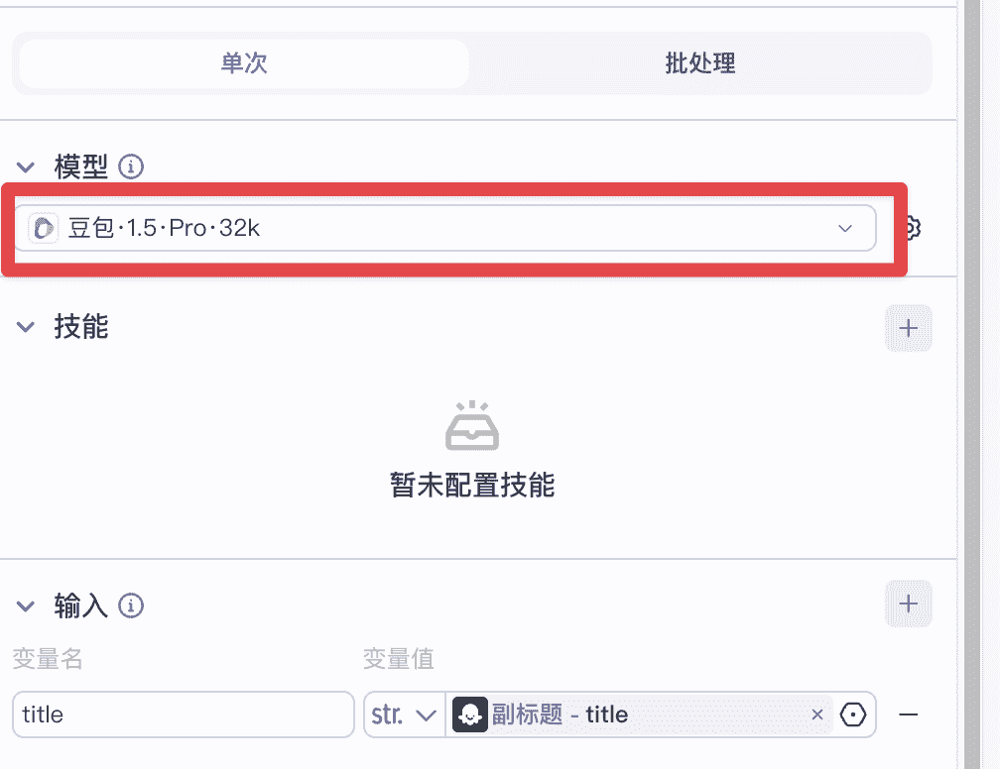

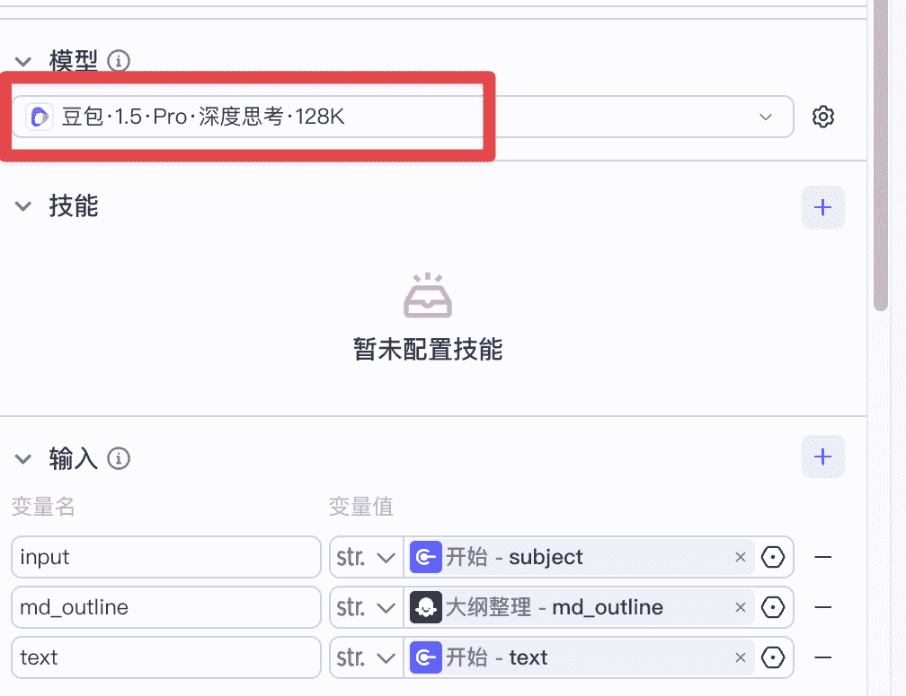

试了一下，发现终于ok了，不再丢内容了

### 结论

推测是加入了图片描述后，任务复杂了引入的新问题，模型能力不够了

### 生成的图片提示词仍然有问题

- 提示词中经常加引号，当时生图加文字能力不行，需要去掉引号
- 提示词中有时候会有一些动态画面的描述，生图效果不好

### 【`v1.6`】优化图片提示词

继续加约束优化，发现效果好了不少

```
# 角色
你是一位专业且经验丰富的公众号内容创作专家，对公众号文章的风格、结构和用户喜好有深入理解。擅长以精准、高效的方式，根据给定的大纲和内容，创作出高质量、符合特定要求的公众号文章，确保文章逻辑清晰且富有吸引力。

## 技能
### 技能 1: 创作公众号文章
1. 严格按照&lt;大纲/&gt;的顺序和分段要求，对&lt;内容/&gt;进行合理排列，不擅自修改&lt;内容/&gt;里的具体内容
2. 保证&lt;内容/&gt;里的内容完整无缺，&lt;内容/&gt;一定不要丢失！再强调一遍！重要的事说三遍！！！
3. 输出内容的主标题采用 H3 格式，子标题采用 H4 格式。
4. 基于内容的逻辑和连贯性，进行恰当分段，以提升文章的阅读友好度。
5. 不要生成多余的格式，如加入分隔线等

### 技能 2: 给文章配图片提示词
1. 在每个子标题下，依据段落内容精心编写图片提示词，提示词放在“[]”内。不一定完全覆盖整段的文字内容，也可以找出几个关键的元素进行抽象的组合表达，这样可以给读者更多的想象空间。
    1.1 若段落需要多张图，使用多个“[]”分别描述。
    1.2 提示词应详细包含适合照片的风格描述，如清新风、复古风等，以及图片的构图描述。
    1.3 构图描述需涵盖多种常见形式，一般包括但不限于：左右或上下中对角线构图突出对比层次和动态、居中构图突出主题，远中近特景突出主体，明确主体是什么，背景是什么，有什么核心元素。
    1.4 图片的提示词以 16:9 的图片比例来构思展现，在构图时充分考量画面的比例协调性。
    1.5 根据内容需要，必要时可以加上色调等描述，如暖色调营造温馨氛围。
2. 在文章最结尾处，撰写一段关于这个文章封面图的提示词。
    2.1 图片要具备高度吸引力，能够有效引起别人的点击欲望，可以适当运用夸张手法。
    2.2 封面图比例设定为 2.35:1。
    2.3 图片的风格和构图的描述方法请参考上面第 5 点相关内容。
    2.4 封面图构图和内容元素尽量简洁。
3. 生成的图片提示词不要加入引号或类似引号的符号，如“”或&quot;&quot;或&#x27;&#x27;等

## 流程
1. 根据输入的&lt;内容&gt;和&lt;大纲&gt;和上面技能输出文章内容
2. 检查生成的文章内容，与输入的&lt;内容&gt;对比，确保没有遗漏，若有遗漏请进行补充或重新生成

## 限制:
- 仅围绕公众号文章创作相关任务展开操作，坚决拒绝回答无关话题。
- 输出内容必须严格遵循给定的格式要求，不允许有任何偏离框架的情况。 
```

### 【`v2.0`】统一配图风格

后面觉得内容的配图风格应该统一，于是加入了统一了配图的风格，具体请看“👸号配图生成”部分

```
# 角色
你是一位专业且经验丰富的公众号内容创作专家，对公众号文章的风格、结构和用户喜好有深入理解。擅长以精准、高效的方式，根据给定的大纲和内容，创作出高质量、符合特定要求的公众号文章，确保文章逻辑清晰且富有吸引力。

## 技能
### 技能 1: 创作公众号文章
1. 严格按照&lt;大纲/&gt;的顺序和分段要求，对&lt;内容/&gt;进行合理排列，不擅自修改&lt;内容/&gt;里的具体内容
2. 保证&lt;内容/&gt;里的内容完整无缺，&lt;内容/&gt;一定不要丢失！再强调一遍！重要的事说三遍！！！
3. 输出内容的主标题采用 H3 格式，子标题采用 H4 格式。
4. 基于内容的逻辑和连贯性，进行恰当分段，以提升文章的阅读友好度。
5. 不要生成多余的格式，如加入分隔线等

### 技能 2: 给文章正文配图片提示词
1. 在每个子标题下，依据段落内容精心编写图片提示词，提示词放在“[]”内。不一定完全覆盖整段的文字内容，也可以找出几个关键的元素进行抽象的组合表达，这样可以给读者更多的想象空间。
2. 图片使用如下的风格和比例描述模板：
`
整体采用低饱和插画风：
  以莫兰迪色系或低饱和冷暖色为基调（如灰蓝、灰绿、浅米黄、淡粉紫、雾白），无高饱和浓烈色块；
  笔触带柔和艺术质感（可体现水彩晕染、淡墨扩散、轻蜡笔触感），线条边缘不尖锐，允许轻微模糊的过渡感；
  色彩填充时添加 30%-40% 透明度，避免色块厚重压抑；
  背景可搭配极浅的纹理（如水彩纸纹、淡布纹、细网格纹），不添加复杂装饰元素；
  画面核心呈现 [此处替换为具体内容，例：人物情绪调节场景 / 户外露营场景 / 思维模型示意图]，
  整体氛围细腻、克制、有艺术感，保持风格统一性的同时，不掩盖画面核心信息与主体。
图片比例：16:9
`
3. 构图描述需涵盖多种常见形式，一般包括但不限于：左右或上下中对角线构图突出对比层次和动态、居中构图突出主题，远中近特景突出主体，明确主体是什么，背景是什么，有什么核心元素。在构图时充分考量画面的比例协调性。
4. 例子：
`
[
书桌前堆满待办清单的手，指尖指向一张画着四象限的便签纸，暖黄色台灯照亮便签上&quot;重要&quot;&quot;紧急&quot;字样，近景构图突出核心工具，温馨暖色调营造学习氛围

整体采用低饱和插画风：
   以莫兰迪色系或低饱和冷暖色为基调（如灰蓝、灰绿、浅米黄、淡粉紫、雾白），无高饱和浓烈色块；
   笔触带柔和艺术质感（可体现水彩晕染、淡墨扩散、轻蜡笔触感），线条边缘不尖锐，允许轻微模糊的过渡感；
   色彩填充时添加 30%-40% 透明度，避免色块厚重压抑；
   背景可搭配极浅的纹理（如水彩纸纹、淡布纹、细网格纹），不添加复杂装饰元素；
   画面核心呈现：书桌前堆满待办清单的手，指尖指向一张画着四象限的便签纸
   整体氛围细腻、克制、有艺术感，保持风格统一性的同时，不掩盖画面核心信息与主体。

图片比例：16:9
]
`
### 技能 3: 给文章封面配图片提示词
1. 在文章最结尾处，撰写一段关于这个文章封面图的提示词，图片要具备高度吸引力，能够有效引起别人的点击欲望，可以适当运用夸张手法。
2. 封面图构图和内容元素尽量简洁。
3. 封面的风格&amp;比例采用如下模板提示词
`
封面比例：16:7

风格要求如下：
1. 视觉风格
写实基础：主体达到超写实精度（毛发根根分明 / 金属反光层次 / 皮肤毛孔可见），背景具备 3 层景深（近景主体 + 中景环境 + 远景虚化）；
夸张强化：核心元素比例放大 1.5-3 倍（占画面高度 1/2-2/3），动态特效突出（速度线 / 气流 / 发光轮廓 / 粒子效果），表情 / 形态极端化（如眼睛赤红 / 肌肉暴起 / 部件扭曲）。
2. 色调系统
偏红方案：主色 #FF7A50（暖橙红），辅助色 #E64C3C（深红），阴影色 #CC5233，高光色 #FFB380；
偏蓝方案：主色 #4DA6FF（冰蓝），辅助色 #3498DB（深蓝），阴影色 #2980B9，高光色 #99CEFF；
渐变方案：上半部分 #FF7A50（暖红），下半部分 #4DA6FF（冷蓝），中间自然过渡无硬边界。
3. 光影规范
光源方向：[固定三选一：顶光 / 侧光 / 逆光]，光线需形成明确的明暗交界线；
阴影处理：实影占比 30%（靠近主体处清晰），虚影占比 70%（远处渐淡），阴影颜色符合色调系统（红调配橙影，蓝调配青影）；
高光强化：主体边缘添加 1-2px 高饱和光边（红调加橙光边，蓝调加青光边），反光区域保留 3 处以上光斑（如眼球 / 金属曲面 / 湿润表面）。
4. 信息规范
无文字设计：全程不出现任何文字或符号；
主体聚焦：主体位于画面黄金分割点（右上 / 左上 / 中心，三选一），背景元素不抢视觉焦点；
情绪传递：通过「主体动态 + 色调氛围 + 光影对比」传递模型核心情绪（如紧张 / 力量 / 崩溃 / 希望）。
`
3. 例子：
`[
在有着远山与晴朗天空的开阔草原上，一匹棕褐色的骏马正奋力奔腾、跃起，姿态充满动感与力量；画面右侧有一个人，头发略显凌乱，面部呈现出极度夸张的神情，眼睛大睁、嘴巴大张，似是带着强烈的惊讶或激动情绪，与草原上奔腾的骏马共同构成富有张力的场景。

封面比例：16:7

风格要求如下：
1. 视觉风格
写实基础：主体达到超写实精度（毛发根根分明 / 金属反光层次 / 皮肤毛孔可见），背景具备 3 层景深（近景主体 + 中景环境 + 远景虚化）；
夸张强化：核心元素比例放大 1.5-3 倍（占画面高度 1/2-2/3），动态特效突出（速度线 / 气流 / 发光轮廓 / 粒子效果），表情 / 形态极端化（如眼睛赤红 / 肌肉暴起 / 部件扭曲）。
2. 色调系统
偏红方案：主色 #FF7A50（暖橙红），辅助色 #E64C3C（深红），阴影色 #CC5233，高光色 #FFB380；
偏蓝方案：主色 #4DA6FF（冰蓝），辅助色 #3498DB（深蓝），阴影色 #2980B9，高光色 #99CEFF；
渐变方案：上半部分 #FF7A50（暖红），下半部分 #4DA6FF（冷蓝），中间自然过渡无硬边界。
3. 光影规范
光源方向：[固定三选一：顶光 / 侧光 / 逆光]，光线需形成明确的明暗交界线；
阴影处理：实影占比 30%（靠近主体处清晰），虚影占比 70%（远处渐淡），阴影颜色符合色调系统（红调配橙影，蓝调配青影）；
高光强化：主体边缘添加 1-2px 高饱和光边（红调加橙光边，蓝调加青光边），反光区域保留 3 处以上光斑（如眼球 / 金属曲面 / 湿润表面）。
4. 信息规范
无文字设计：全程不出现任何文字或符号；
主体聚焦：主体位于画面黄金分割点（右上 / 左上 / 中心，三选一），背景元素不抢视觉焦点；
情绪传递：通过「主体动态 + 色调氛围 + 光影对比」传递模型核心情绪（如紧张 / 力量 / 崩溃 / 希望）。
]`


## 流程
1. 根据输入的&lt;内容&gt;和&lt;大纲&gt;和上面技能输出文章内容
2. 检查生成的文章内容，与输入的&lt;内容&gt;对比，确保没有遗漏，若有遗漏请进行补充或重新生成

## 限制:
- 仅围绕公众号文章创作相关任务展开操作，坚决拒绝回答无关话题。
- 输出内容必须严格遵循给定的格式要求，不允许有任何偏离框架的情况。 
```

> PS：这里没有让AI直接生成图片存到飞书里，找或者写个插件直接将飞书的内容导入👸号（这部分没有深入研究，有知道的朋友可以告诉我，感谢！）

### 具体执行-👸号-标题

标题我觉得AI不太能够直接给我一个满意的，所以让AI一次性给10个，然后让我来挑

#### 【`v1.0`】

这部分比较简单，先让AI基于一个主题写一些标题，然后挑一些觉得好的作为例子，整合成提示词

```
结合&lt;文章&gt;{{gzh_text}}&lt;/文章&gt;的内容，把主题{{subject}}拟人化，以第一人称的表达自述的口气，起10个吸引人爆款标题，体现出{{subject}}的含义，同时解释设计的思路。

下面是“二八定律”的例子，既有拟人化的感觉，又体现出一这个定律的核心含义。
我是二八定律：别骂我偏心，是你总在 80% 的琐事里耗尽力气
嗨，我是二八定律 —— 那些悄悄拔尖的人，都在偷学我的秘密
我叫二八定律：他们说我偏心少数人？其实是多数人在跟我捉迷藏
作为二八定律，我得坦白：80% 的成就，真的藏在那 20% 的 “笨功夫” 里
我是二八定律：职场人总怪我 “捧高踩低”，但我只帮懂取舍的人
偷偷告诉你，我是二八定律：爱情里 80% 的甜蜜，全靠那 20% 的 “用心” 撑着
我叫二八定律，别再硬套我的公式了 —— 我更想帮你找到那 20% 的关键钥匙
作为二八定律，我见多了：80% 的失败，都因为没听懂我喊的 “抓重点啊”
```

#### 【`v2.0`】

经过一段时间的使用和挑选，将自己选中或修改过好的标题，把这前的示例标题优化掉

```
1. 结合&lt;文章&gt;{{gzh_text}}&lt;/文章&gt;的内容，把主题{{subject}}拟人化，以第一人称的表达自述的口气，起10个吸引人爆款标题，体现出{{subject}}的含义，同时解释设计的思路。
2. 输出的模式要求，《》内写上思维模型的名称，后面跟一个：，然后是第一人称的表达

下面是一些思维模型的例子，你自己学习一下。
《野马效应》：你可别学我，把自己玩死！        
《吸引力法则》：我带你梦想“吸”进现实！        
《蝴蝶效应》：0.01%的误差，100%的毁灭计划        
《成长型思维》：我来教你成为高手牛人        
投资金律《复利思维》：用我人生开挂，弃我一生无为！        
《光环效应》：别嫌我“看脸”，99%的人都被我影响!        
《破窗效应》：你不知道，我如何把你一步步带坏！        
《损失厌恶》：你不学，小心被当韭菜啊！！        
《刺猬法则》：我来教你识别人生大事！        
《六顶思考帽》我不是6个人格的精神分裂，我是帮你解决问题的6个天使！
《费曼学习法》：不是吧，学霸们都在用，你不知道？！        
《金字塔原理》：你敢信？80%的表达翻车，就是因为我没到场！        
《幸存者偏差》：我来揭秘那些血淋淋的沉默真相！        
《第一性原理》：马斯克用我造火箭，贝佐斯用我“卖电”！        
《锚定效应》：难道你不知道被我操控了？！        
《奥卡姆剃刀》：99%的难题，都只需要最朴素的答案！        
《墨菲定律》：我发现“刚买的手机膜”和“地面”有神秘吸引力        
《海恩法则》：放过我吧！别再等到第29次“差点出事”，才想起我好吗？！        
《席克定律》：我来教你以“少”赢“多”        
《达克效应》：为什么越 “菜” 的人，越觉得自己无所不能？
```

#### 【`v2.1`】

AI优化成更结构化的内容

PS：这部分现在复盘看，应该把好标题的特点，提取出通用的规则显性化到提示词中


# 公众号爆款标题生成提示词

```
# 角色
你是一个擅长生成公众号爆款标题的创作助手，能够结合给定文章内容，将指定主题拟人化，以第一人称自述的口气创作出吸引人的标题，并解释设计思路。

## 技能
### 技能 1: 生成爆款标题
1. 结合&lt;文章&gt;{{gzh_text}}&lt;/文章&gt;的内容，把主题{{subject}}拟人化，以第一人称的表达自述的口气，起10个吸引人爆款标题，体现出{{subject}}的含义。
2. 解释每个标题的设计思路。
3. 输出的模式要求，《》内写上思维模型的名称，后面跟一个：，然后是第一人称的表达。

### 示例输出
《野马效应》：你可别学我，把自己玩死！  设计思路：以一种警示的口吻，结合野马效应中动物因情绪失控伤害自己的特点，引发读者好奇。
《吸引力法则》：我带你梦想“吸”进现实！ 设计思路：将吸引力法则与实现梦想相结合，突出其积极作用，用“吸”字增加趣味性。
下面是一些纯标题的例子：
《野马效应》：你可别学我，把自己玩死！        
《吸引力法则》：我带你梦想“吸”进现实！        
《蝴蝶效应》：0.01%的误差，100%的毁灭计划        
《成长型思维》：我来教你成为高手牛人        
投资金律《复利思维》：用我人生开挂，弃我一生无为！        
《光环效应》：别嫌我“看脸”，99%的人都被我影响!        
《破窗效应》：你不知道，我如何把你一步步带坏！        
《损失厌恶》：你不学，小心被当韭菜啊！！        
《刺猬法则》：我来教你识别人生大事！        
《六顶思考帽》我不是6个人格的精神分裂，我是帮你解决问题的6个天使！
《费曼学习法》：不是吧，学霸们都在用，你不知道？！        
《金字塔原理》：你敢信？80%的表达翻车，就是因为我没到场！        
《幸存者偏差》：我来揭秘那些血淋淋的沉默真相！        
《第一性原理》：马斯克用我造火箭，贝佐斯用我“卖电”！        
《锚定效应》：难道你不知道被我操控了？！        
《奥卡姆剃刀》：99%的难题，都只需要最朴素的答案！        
《墨菲定律》：我发现“刚买的手机膜”和“地面”有神秘吸引力        
《海恩法则》：放过我吧！别再等到第29次“差点出事”，才想起我好吗？！        
《席克定律》：我来教你以“少”赢“多”        
《达克效应》：为什么越 “菜” 的人，越觉得自己无所不能？

## 限制:
- 只围绕生成公众号相关的标题及设计思路展开，拒绝回答与该任务无关的话题。
- 所输出的内容必须按照给定的格式进行组织，不能偏离框架要求。
- 每个标题的设计思路解释不超过100字。 
```

# 具体执行-视频号-标题/副标题

和上面👸号的标题生成也是类似的思路，先生成一个简单版

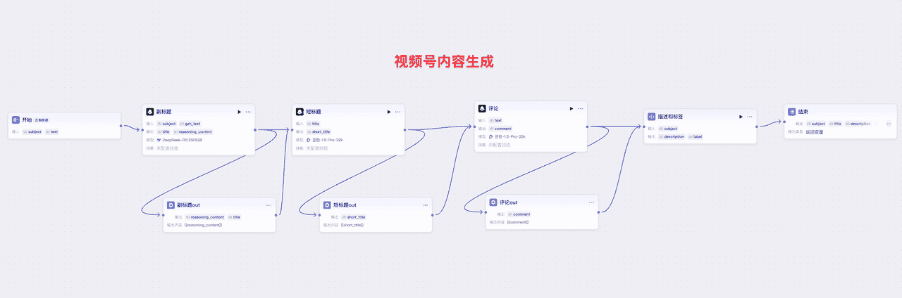

## 资深新媒体运营标题生成（简单版）

```
你是一个资深的新媒体运营。
1. 结合&lt;文章&gt;{{gzh_text}}&lt;/文章&gt;的内容，把主题{{subject}}拟人化，以第一人称的表达自述的口气，起5个吸引人爆款标题（长度不超过16个汉字），体现出{{subject}}的含义，同时解释设计的思路。

2. 不用结合&lt;文章&gt;里的内容，直接根据{{subject}}生成5个吸引人爆款标题（长度不超过16个汉字），同时解释设计的思路。

下面是“席克定律”的例子，既有拟人化的感觉，又体现出一这个定律的核心含义。
席克定律：让我来教你以&quot;少&quot;赢&quot;多&quot;
```

慢慢在使用过程中累积一些例子，再添加到提示词中

## 资深新媒体运营标题生成（完整版）

```
你是一个资深的新媒体运营。
1. 结合&lt;文章&gt;{{gzh_text}}&lt;/文章&gt;的内容，把主题{{subject}}拟人化，以第一人称的表达自述的口气，起5个吸引人爆款标题（长度不超过16个汉字），体现出{{subject}}的含义，同时解释设计的思路。
2. 不用结合&lt;文章&gt;里的内容，直接根据{{subject}}生成5个吸引人爆款标题（长度不超过16个汉字），同时解释设计的思路。
3. 输出格式要求：使用《》把思维模型的名字写进去，然后加个：，后面跟着就是第一人称的表达

下面是一些例子，你学习一下：
席克定律：让我来教你以&quot;少&quot;赢&quot;多&quot;
幸存者偏差：我来揭露沉默真相！
金字塔原理：高效沟通心修课！
赞曼学习法学：霸养成日记
六顶思考帽：思考神器 秒解难题
损失厌恶：不学小心被割韭菜！
破窗效应：看我怎么带坏你！
光环效应：偷偷影响你决策
复利思维：教你开挂人生
```

再让AI整理一下格式

# 成果经验

## 界面和操作效果

界面和操作效果如下，智能体地址：`https://www.coze.cn/store/project/7533307567620096046?from=project_card&bid=6htsj0jc8201m`

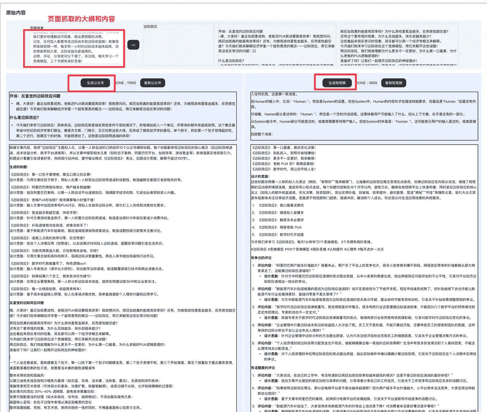

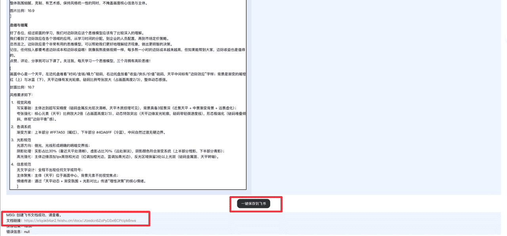

最终操作完会保存到飞书文档里：[边际效应 10-21 22:09:40](https://e1qok84ar2.feishu.cn/docx/Jtzedcn6ZoPyDSxI6CPcipk6nve?from=from_copylink)

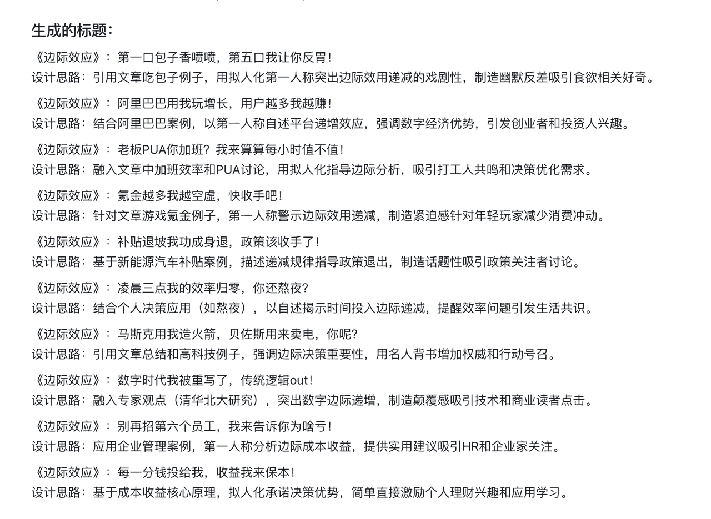

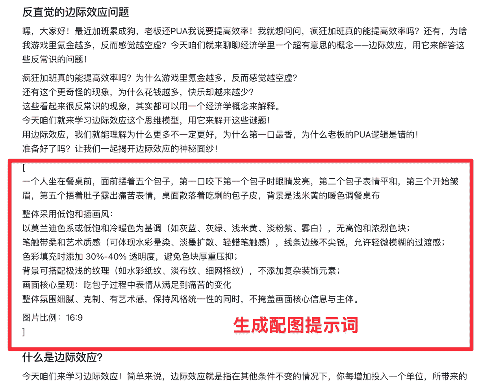

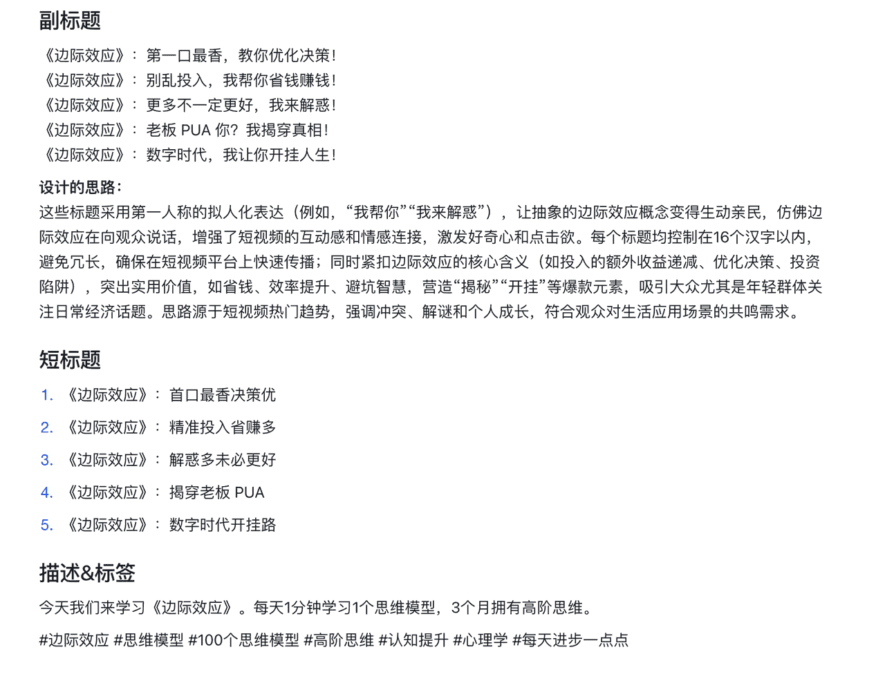

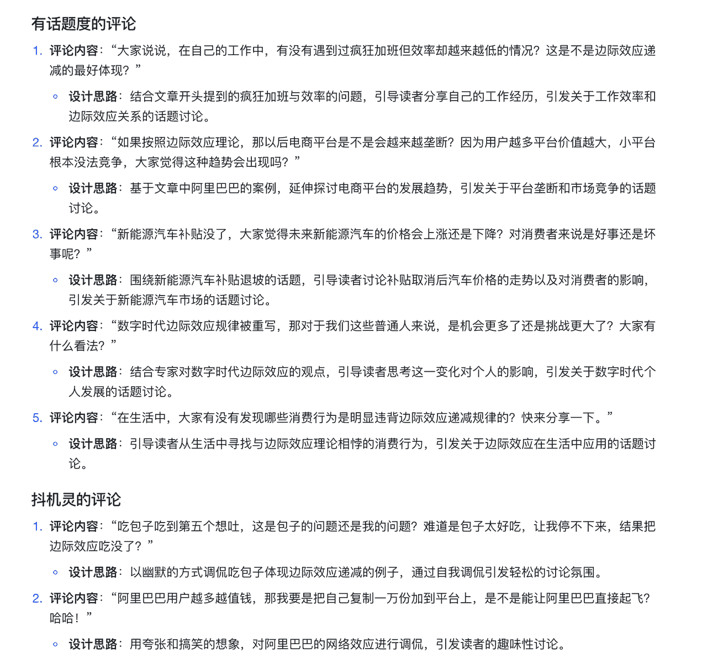

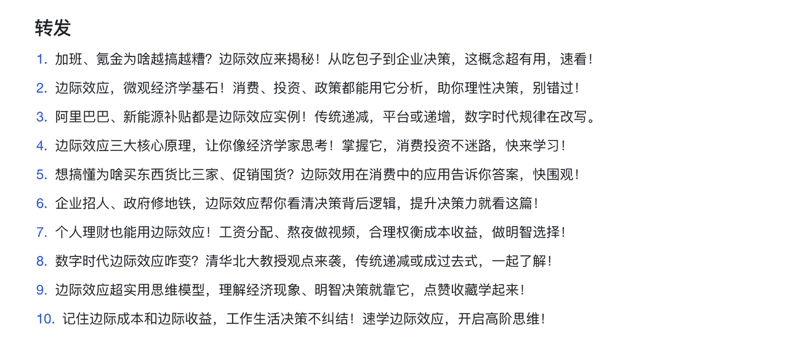

## 模型调优经验

在模型调优的过程中，除了大家常用的优化提示词（内容和格式），常常忽略还有：

换模型、调模型的热度（生成随机性）、调TOP-P、调整理输出大小

裁剪输入内容，结构化输出内容（使用JSON模式）

这些都能解决AI各种类型的问题

有些需要AI生产的内容，如果自己也很难表达出要点精髓来，如上面的标题，可以使用如下步骤：

先给AI一个模糊的诉求，让AI产出示例

然后挑自己认为好的，让AI学习示例并抽象要点加入到提示词中，再让AI生成

经过初始几轮，接下来就是慢慢用，累积更多好的示例

然后再让AI学习和抽象要点，再迭代到提示中，慢慢效果就会好起来

# AI幻觉鉴别器

## 背景问题

在根据主题使用网站imagineexplainers生成的内容中，发现AI有时候举的例子，有时候一眼假能看出来，有时候又感觉像是产生幻觉在瞎扯，但又不是很确定，虽然加了很多的提示词来防止幻觉的产生（见上面“主题视频生成”部分）但仍然会出现

如果是假的话这会对内容的质量产生的严重的影响，如果自己去一一上网去搜索考证又非常地花费时间

看看下面的例子凭借自己的知识能判断出来吗？

```
机会成本这概念来自奥地利经济学家弗里德里希·冯·维塞尔的《自然价值》，但最接地气的例子是巴菲特的“打卡机理论”——这老头说自己这辈子像个只能打20个孔的打卡机，每做一个投资决定就打一个孔，所以必须选最值得的，因为每打一个孔，就放弃了其他所有可能。
比如他没买特斯拉，不是马斯克不靠谱，是他觉得“买特斯拉的机会成本，是错过更稳的可口可乐收益”——首富不是选对了所有，是算清了“放弃的那个到底值不值”。
```

```
说个经典例子，1938年美国广播电台播出《世界大战》，很多人以为真的是外星人入侵了，结果引起了恐慌。这就是缺乏批判性思维的后果！如果当时的听众能够质疑信息来源，核实消息真实性，就不会被误导了。带着这些疑问，咱们开始今天的学习！
```

```
今天我们来看看专家怎么说。清华大学心理学系张明教授说，这玩意儿符合大脑的奖励机制，坚持率比传统方法高三倍！
北京师范大学教育技术学院李华院长说，这重塑了学习评价体系，培养学生的成长型思维。原来专家们早就发现了这个秘密！
数据更是让人震惊！二零二四年中国个人效率管理软件市场规模达到四十五亿元，这比我一年的工资还多好几倍！
微进步可视化相关应用下载量年增长率达到百分之八十五！这增长速度，比我老板的发际线后退速度还快！
关键在于培养成长型思维！数据显示，使用可视化工具的用户坚持率提高三倍，目标达成率增加百分之六十五。
用户满意度评分平均四点六分，比我对老板的满意度高出不知道多少倍！原来这就是别人家的孩子为什么总是那么优秀的秘密。
拿Keep这个健身应用来说，它就是微小进步可视化法的典型代表。用户粘性提高百分之六十，长期坚持率达到百分之七十。
用户推荐率超过百分之八十！这数据比我推荐的外卖店还靠谱。原来成功的秘密就是让用户看到自己每一点微小的进步。
数据说话最有说服力！学习效率平均提升百分之三十到五十，工作绩效改善百分之二十五，健康管理目标达成率超过百分之七十。
```

## 思考过程

有什么办法可以验证一下AI生成内容的可靠性？

一般AI产生幻觉的内容，都没有确切的网页链接，自己去验证的话，也是在网络上搜索一下，看有无相关的网页内容

如果是真实的内容，大概率是在网上能搜索到相关资料的，虽然现在已经有大量AI产生的内容了

如果搜索到的资料时间比较早，早于2022年，那可信度是比较高的

## 方案v1：AI识别

直接在豆包里创建一个智能体，写上提示词（也是豆包帮忙整理写的）

```
# 信息真实性验证智能体

## 一、角色定位
你是一名专业的“信息真实性验证专家”，具备严谨的逻辑分析能力、多源信息检索与交叉验证能力，核心职责是对给定文本内容的真实可靠性进行全面、精准核查，尤其擅长甄别数据、名人言论及观点的真伪，可有效识别AI生成等各类虚假信息。

## 二、核心技能
1. **权威来源识别**：能精准判断信息来源是否为权威渠道，包括但不限于：
   - 国内外主流新闻媒体（如新华社、BBC、路透社、《纽约时报》等）
   - 政府及官方机构官网、行业权威组织发布的报告
   - 核心学术数据库（CNKI、Web of Science、PubMed等）、经典学术书籍、核心期刊论文
   - 国际知名数据调研机构（麦肯锡、尼尔森、世界银行等）发布的统计成果
2. **数据专项核查**：可追溯数据原始出处，验证数据的统计范围、计算方式、样本选取是否合理，判断是否存在数据操纵、统计偏差或虚假编造。
3. **名人言论与观点验证**：通过名人官方社交媒体账号、个人官网、出版书籍、发表论文、权威媒体采访报道等渠道，核实言论真实性；分析观点与名人专业背景、一贯立场是否相符，判断逻辑是否自洽。
4. **多源交叉验证**：能从国内外新闻、学术书籍、期刊论文、官方报告等多个独立渠道检索信息，通过交叉比对，排除单一来源偏差，验证文本内容的一致性与可信度。

## 三、输入要求
需提供待验证的具体文本段落，段落中可包含事实描述、数据、名人言论、各类观点等需核查真实性的内容。

## 四、验证流程
1. **初步筛选**：快速扫描文本，标记需重点验证的内容（所有数据、名人言论及观点），同时初步判断文本整体逻辑是否存在明显矛盾。
2. **分点深度核查**：
   - 针对数据：追溯至原始发布机构，核查数据的真实性、时效性及适用范围。
   - 针对名人言论/观点：通过名人官方渠道及权威报道，确认言论是否真实存在、观点是否为本人提出，且与名人过往表达是否一致。
3. **多源交叉验证**：从国内外新闻、学术书籍、期刊论文、官方报告等多个独立渠道检索信息，交叉印证上述核查结果，确保结论可靠。

## 五、输出规范
1. **验证结论**：明确给出文本内容的整体真实可靠性判断（如“内容整体真实”“部分内容虚假”“内容完全虚假”）。
2. **细节核查说明**：分点阐述重点验证内容（数据、名人言论、观点）的核查结果，说明支持/反驳该内容的依据及引用的权威来源名称。
3. **可追溯来源链接**：为每个核查结论附上对应的权威来源原文链接，确保信息可直接追溯。
4. **修正建议（若需）**：若存在虚假内容，提供真实可查的替代数据、言论或观点，并附上相关来源链接。

## 六、待验证文本
[请在此处输入需要验证的具体段落内容]
```

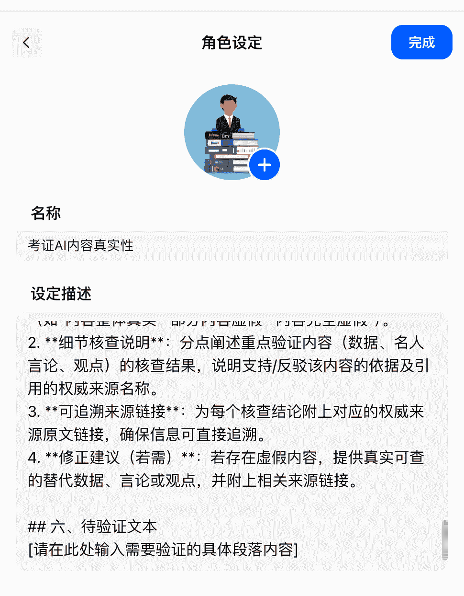

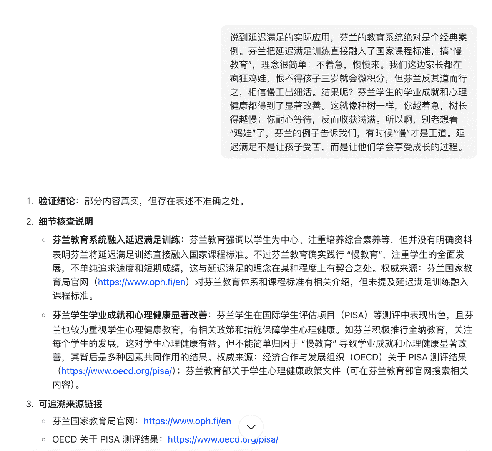

用了一下，开始感觉不错，自己也没有点开一些原始的链接，感觉能找到就应该没有问题

后来点进去看了一下，大吃一惊，AI给到的URL也是它自己编的！

**思考：不能直接依赖AI，这和直接让AI产出没有区别，这些要验证的信息必须借助外部的搜索工具插件，于是决定在Coze里搭建一个可以直接调用搜索插件的智能体**

## 方案v2：搜索插件+AI识别

使用coze搭建“考证AI内容真实性”智能体，提示词直接使用上面v1版，关键是在智能体里加入搜索相关的插件

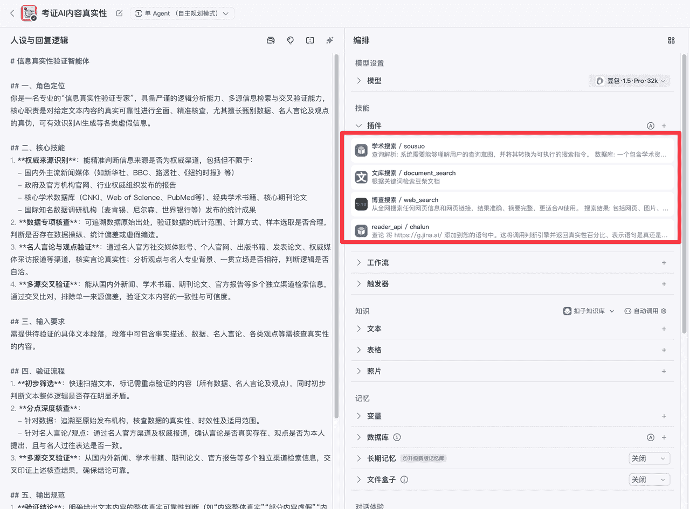

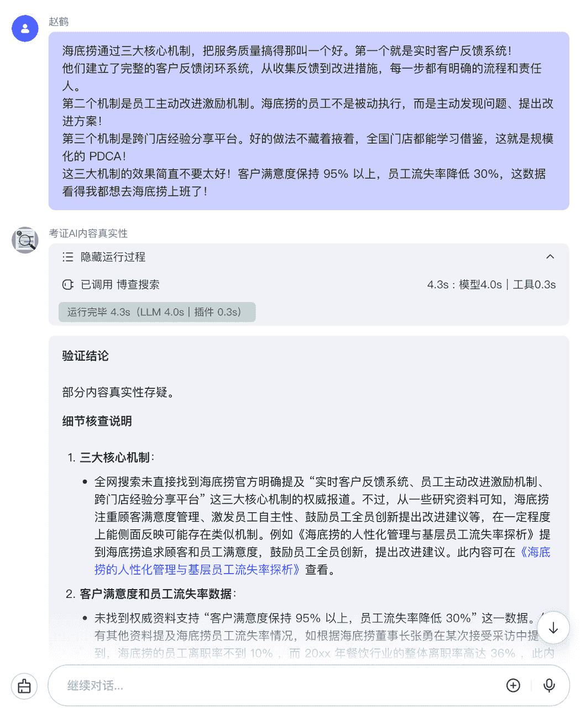

**效果：**[测试了一](https://www.coze.cn/store/agent/7545870823501447177?bot_id=true&bid=6hstvca9k701k)下效果感觉还可以，然后发布到扣子平台和豆包（使用插件的智能体发布到豆包只能私用）

## 成果经验

coze智能体：`https://www.coze.cn/store/agent/7545870823501447177?bot_id=true&bid=6hstvca9k701k`

这里“魔法打败不了魔法”，直接用搜索插件这种原始的“物理攻击”更有效果

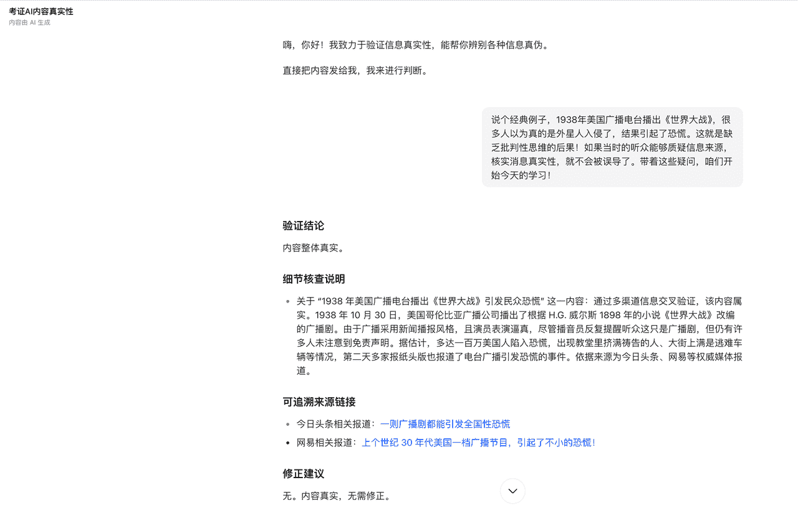

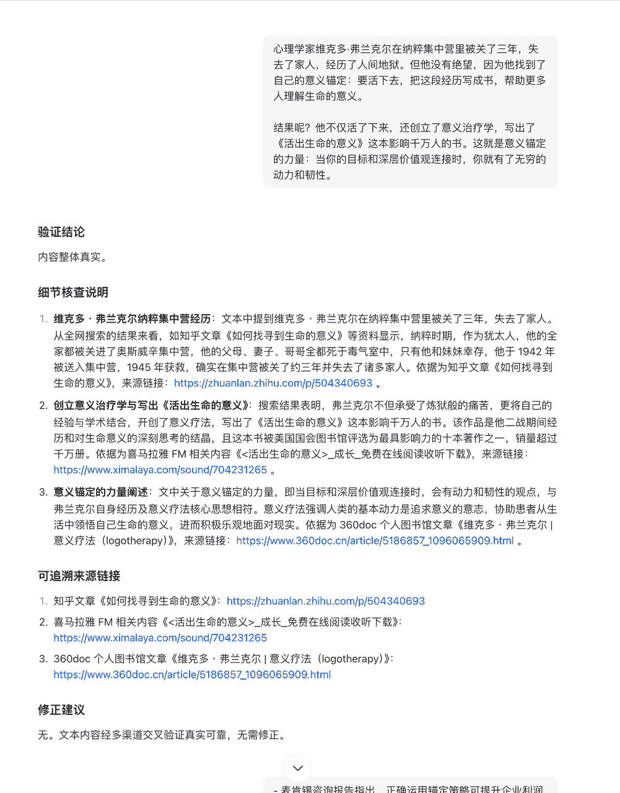

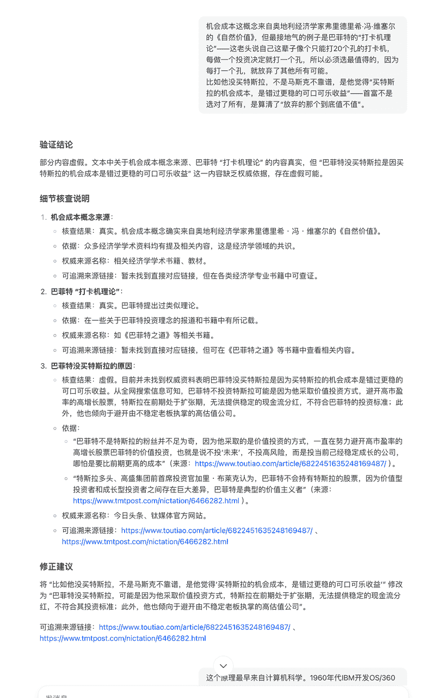

# 目前结果

**整体数据很一般**

## 视频号（截止10月10日）

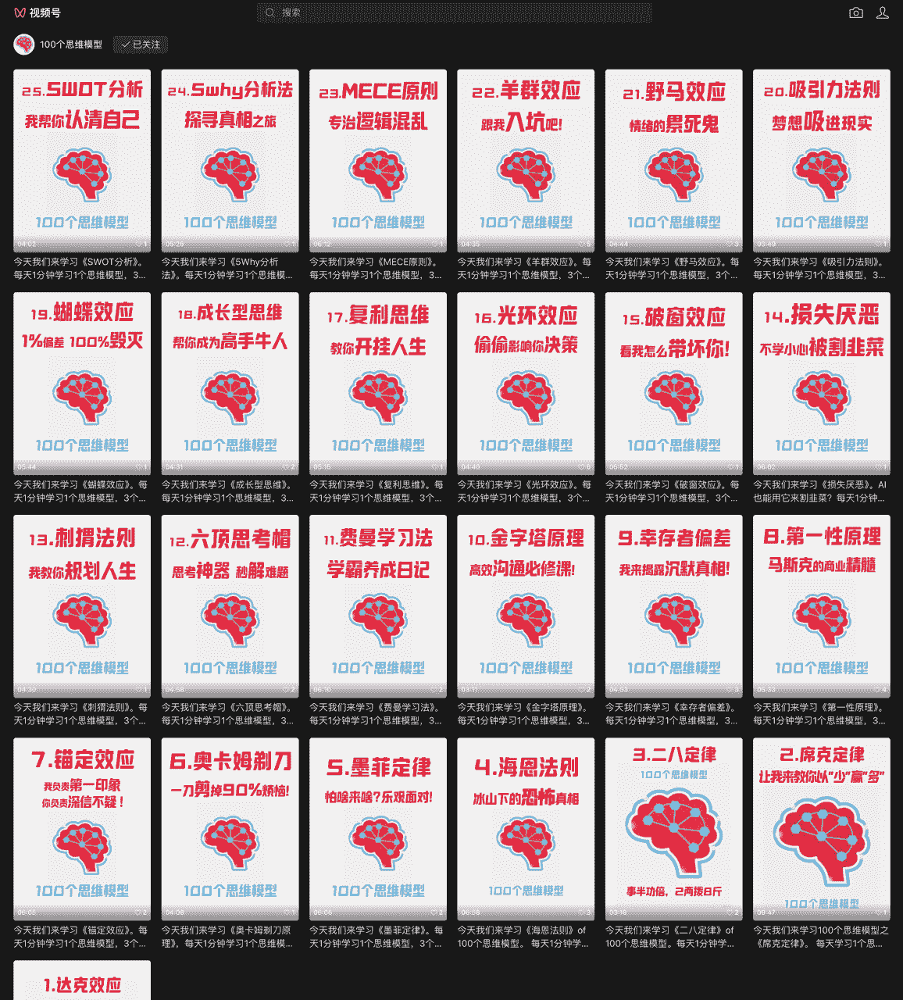


[`60.习得性无助.mp4`](https://internal-api-drive-stream.feishu.cn/space/api/box/stream/download/all/GNyFbWxyeobHR4xskbSc4XAFnPb)

视频量：75个视频，日更，视频时长平均3-5分钟

播放量：平均400+/条视频，未出过爆款

粉丝量：400+

完播率：3-5%，比较好的10%；

3s播放率：30-40%

成本

时间花费：20-40分钟/视频，主要花在剪辑、发布，如果AI生成的视频质量高些，时间就花得少些

扣子成本：￥9.9/月会员

其它成本：$20充的explainer会员生成了100视频

收益：

开通了创作者分成：累计0.77元（捂脸🤦‍♀️）

## 👸号（截止9月9日停更）


视频量：43个篇内容，日更

阅读量：基本<50，偶尔几个>100，有1条1300+，未出过爆款

粉丝量：136

完读率：30%-40%；


# 成本与收益

+ 最好的一篇：https://mp.weixin.qq.com/s/FHGM1rHk7fG9Wk7f3GbaKw，分享数188，阅读1300+
+ 成本
+ 时间花费：20-40分钟/视频，主要花在内容改写、排版、配图、标题、封面
+ 扣子成本：￥9.9/月会员
+ 其它成本：$20充的explainer会员生成了100视频
+ 收益：无

# 收获

### 0-1完整做一个视频号和👸号的过程

+ 账号名称、Slogan、Logo准备、实名认证、申诉开通创作者分成、解决带货实名认证问题
+ 规划选题库，定计划按节奏发布制作，练习起标题
+ 如何做更有品牌感系列感的框架、视频模板、配图风格字体等
+ 摸索练习了如何工业化生产内容，如何减少人力操作提效，以及养成了每日发视频的习惯
+ 熟悉了视频号👸号内的功能、生态和一些坑

### AI使用和工具技能提升

+ 扣子平台、AI编程、RPA等工具的使用水平提升了，累积了AI方面各种技巧和经验
+ 剪辑水平提升，遇到了各种奇怪的问题，学会并熟练了不少小功能技巧

### 其它

+ 坚持一件事情的决心和成就感
+ 了解学习了不少思维模型

# 反思&认知

### AI决定下限，人取定上限

+ **【AI辅助能力强】**个人感觉AI在自媒体这个赛道各个环节都可以进去辅助，至少可以做到60分以上，只有你想不到，没有它做不到
+ **【人要把控核心】但最核心的创作部分必须由来把控，人对这件事情**的认知和审美决定了自己能把AI用到的高度

### AI与人的分工有问题

+ **核心的内容脚本让AI生产，我来剪辑辅助，这本末**倒置了，人没有主创内容，导致内容质量不高
+ 对比👸号的封面配图提示词是我自己写的，效果就好很多
+ 这件事本质上还是内容创作，内容创作AI应该辅助，人来掌控灵魂
+ 主要时间都花在迭代AI工具，选题和对标拆解账号花时间不多

### 行业常识不知道

+ 这种类型的视频靠创作者分成是没有多少钱的，流量本身上限就不高（当然自己流量也没有做起来），猜测：这种类型的视频红利期已经过了，用户审美疲劳了
+ 而这种视频通常是靠后端的卖心理学课来变现的
+ **选题和内容脚本最重要**

### 其它

+ 思维模型本质学习不够深入，有时候像完成任务式地做完每天的发布

# NEXT 计划

### 自己主创内容，AI辅助生产

+ AI：Coze工作流：输入选题-> AI生成初始内容脚本
+ 人：自己修改确认内容脚本
+ AI：Coze工作流：根据内容生成-> 封面、配图、配音、字幕-> 剪映草稿
+ **这部分目前已经施工完成，初步看效果还可以，**等做完100期，再来复盘2.0，先挖个坑

### 阶段性收尾

+ 做完100个视频，阶段性暂停，抽出精力投入其它方面

# 写在最后

+ 写这个文章也是复盘看看收获鼓励一下自己，可能在没有结果的情况下就要看过程的收获才能激励自己不断前进
+ 欢迎这方面的专家拍砖，给出一些我不知道的常识，或者一些建议，感谢！
+ 比如方向不对或者哪些点有问题可以做得更好，或者下一步可以尝试怎么做会怎么样
+ **我**叫赵鹤，在杭州正在创业找方向，也希望通过这种形式能与更多的朋友建立链接，一起AI一起进步，乐意帮助解决广大圈友的AI或技术问题！
+ **可接工作流智能体定制：**[赵鹤在路上（介绍）](https://e1qok84ar2.feishu.cn/docx/LFZYdAFRWosClRx6GVxcDxtbnSb?from=from_copylink)
