# 21岁ai超级个体变现50w的底层逻辑（可复制）

> 来源：[https://xuqiwei1986.feishu.cn/docx/LUbkdZPTwo1MQkxeWijcr60RnKb](https://xuqiwei1986.feishu.cn/docx/LUbkdZPTwo1MQkxeWijcr60RnKb)

# 前言：

圈友们好呀，见字如面。

我是枕棠，今年21岁，今年本科刚毕业，也是赚钱三年级生。

这是我在赚钱的第三篇帖子，这篇文章主要想和大家聊一下《我从0~1做副业变现50w+的底层逻辑》。

和大家分享一下，我过去两年多时间，一边上学，是如何做副业做到这样的成绩的（因为我没有合伙人也不做分销，所以收入基本都是纯利。）

坦白来讲，在过去挺长的一段时间里，我依旧受限于完美主义，不敢来写一篇帖子来分享。

因为我总是觉得自己相比赚到百万的前辈们，还有很多的不足之处。

直到我来到北京，高频参加了很多线下聚会后，大家似乎都很好奇“我为什么这么年轻，却还有一个不错的成绩”，催促着我马上组局去分享。

于是因为盛情难违背，就和飞掌柜一起组了一场30+人的线下聚会，分享了我做项目的底层心法，发现大家的反馈都特别好。

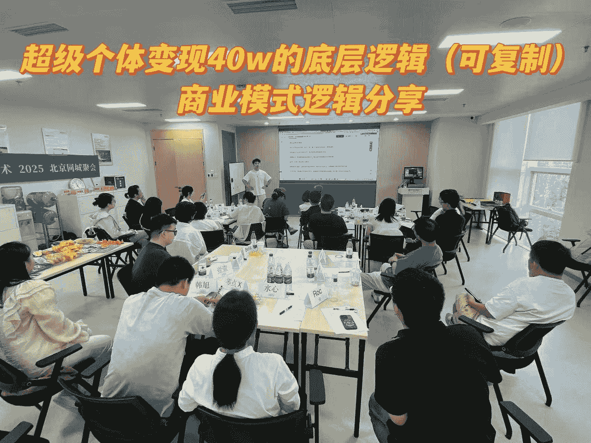

后来又在戴哥的推荐下，去听了航海补给站，我才真正确定。

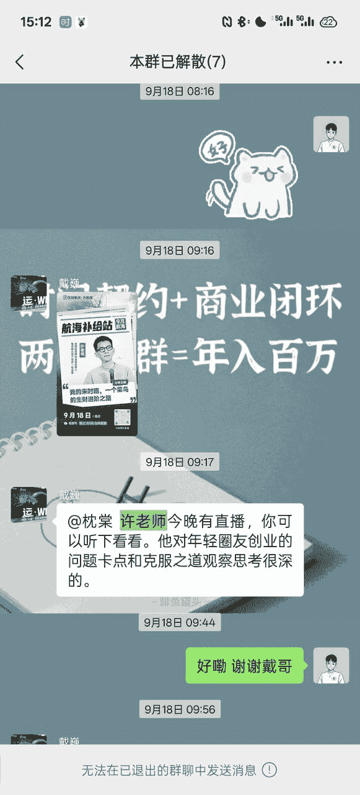

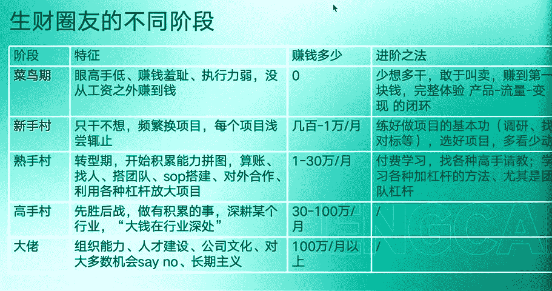

#### 每个项目从0~100的每个阶段都有一些底层逻辑需要学习。

#### 而我所能分享的，就是菜鸟期，新手村，再到熟手村的整个经验。

#### 对于还没年入百万的圈友来说，应该会有一些帮助。

于是我就用了近两月的时间，精心打磨出了这篇帖子，总计19000字。

本文会聊到我这两年多的搞钱经历实践得出的，以及和很多副业赚到六位数以上朋友交流总结出的，关于赚钱的底层心法。

包括但不限于，如何找到适合自己的项目，如何赚到第一个1万元，如何把副业变成事业，获得稳定的收入？

从副业小白开始，到年入百万的整个历程中，所需要的心法，思维，认知，都会有讲到。

以下是本贴目录，话不多说，我们直接开始：

# 本帖目录：

#### 零.枕棠的赚钱历程概述

#### 一.起步篇：找到适合自己的天选项目？

#### 二.实践篇: 如何赚到1块钱，从空谈者变为创业者？

#### 三.上升篇：如何突破瓶颈，月入过万？

#### 四.维系篇：如何让副业成为事业，稳定年入20w

#### 五.未来篇：年入百万的路

>

# 零.我的搞钱历程。

最开始的板块，和大家简单聊一下我赚钱的几个阶段的故事。

大家可以简单读读，可能就能知道后面的那些心法和底层逻辑到底是怎么总结出来的了。

或者也可以直接跳到正文部分，电脑端打开左边有目录。

## 1.985线上民工，赚到人生第1块钱。

## 理想破灭，绝地求生

>

> 在高中，在漫长的蹉跎与挑战后，我回家自学一年，成为了高中这几年唯一的985。

>

> 高考完的那个暑假，我对未来充满着期待，因为自幼学到的东西都告诉我，

>

> “只要考上985，就能成为人上人，就能够成功”

>

> 但是上了大学之后，我发现并不是这样的，情况比我想象的要糟，乃至于让我一度陷入绝望。

>

> 长期来看，就业环境越来越差，本科出去工资上万都难，读研读博时间又太长。

>

> **短**期来看，身边的同学都是985，而且阅历谈吐都远超农村的我，之前唯一的技能做题能力，在此时也根本不值一提。

>

> 而同时作为一个上大学之前连本省都没出过的人来说，大城市的一切都是那么乱花渐欲迷人眼。

>

> 很多东西都想买，海底捞想吃，大商场想逛，游戏想充，成长课程想学。

>

> 但一个月1200的生活费，总是让我畏畏缩缩，乃至于会有一点自卑与内耗。

>

> 于是对于当时的我来说，上了大学后最想做的事情。

>

> **除了学习，便是赚钱。**

>

> **学习是本分，赚钱是渴望。**

## 初识赚钱

>

> 那我靠什么赚钱呢？想过很多方式：服务员，快递分拣，收银员。

> 

> 想去试，不过都没去。

>

> 一是因为脱不下孔乙己的长袍，二是因为从大一就很多课没有时间往返。

> 

> 但也许是有些运气。

>

> 2021年10月，在网上知识付费时认识了一个朋友。

> 

> 她说想让我给她的弟弟做线上家教，一节课60，一个小时。

>

> **这应该是我第一次**靠自己赚钱，一周上两个小时，备课5个小时左右，一周可以赚120。

>

> 尝到甜头了，想赚更多钱，但是没有方法。因为线上家教很难找，能找到这个纯属巧合。

>

> 而线下的家教我又不想去做，还要消耗大量的时间最路上，最重要的补课的时薪并没有什么增长空间。

>

> 最重要的是，这个东西似乎身边同学都能做，一点都不酷。（是的，当时年轻，很喜欢考虑酷不酷）

>

> 于是我就去找其他的赚钱方法了，去找一个更高大上，能赚更多钱的赚钱方式。

## 初识互联网生意，赚到第一块钱

>

> 当我在不断搜集信息，不断探索新的赚钱项目的时候。

>

> 很巧，看到我们学校的交流群里，有很多人在找人代做视频。

>

> 我仔细研究了一下，发现是有一个选修课要剪辑视频作为作业，每个学生都要剪，但是很多人都不会剪视频。

>

> 虽然当时的我也不会剪视频，不过好在我的学习能力还不错，于是我就用几天时间自学了基础了剪辑，开始接单，然后一边剪辑视频一边学习。

>

> 最后差不多在两个月的时间，一共接了几十单，然后赚了几千块。

>

> 说来很好玩的一个点是，当时这门课有小一半的视频都是同一个剪辑风格，因为都是我剪的。（手动狗头）

>

> 当时也是第一次感知到，原来技能这个东西是有价值的。

>

> 而且他的门槛可能并不高，就像剪辑，虽然看起来高大上，但初步的剪辑可以很快的就能学会。

>

> 而在后来，也是通过剪辑，我拥有了一些参与项目的机会，当时有幸给成甲老师剪辑了一些切片视频，发布在了他的视频号上。

>

> 这就是我初步的搞钱思路了，那个时候我差不多刚大一，能够通过这些兼职过的挺滋润了，而且学业还继续保持着前5%，拿着奖学金。

## 2.知识付费，第一次月入过万

## 一颗种子的萌芽

>

> 不过慢慢的慢慢的，很快我觉得不满意了。

>

> 因为家教和剪辑哪怕在做的最努力的时候，一个月也就赚个3000+。

>

> 我会想

>

> **“再怎么说我好歹也是个985呢，努努力大学毕业找个工作**也能月入过万，总不能一辈子赚这个钱吧，”

>

> 什么剪辑和家教，无非就是线上民工和线下民工罢了。

>

> 而如果现在赚的钱上限很低，那似乎没有什么长久投入的价值啊，和那些搬砖的也没什么区别。

>

> 但你说让我真的要去做点什么，其实我心里是不知道的。

>

> 于是学业之外，我主动断了兼职，开始沉下心来思考未来的路。

>

> 以及还看了一些书，而真正让我找到未来的路的，或者决定做自媒体的，是这两本书：《财富自由之路》&《纳瓦尔宝典》。

>

> 他们当时带给我最震撼的观点是：

>

> **我的商业模式是有问题，时间只出售了一份，**而且一点杠杆都没加，都是在苦哈哈的赚钱。

>

> 于是我开始想：

>

> 有没有什么方式，可以让我“一份时间出售多次”？

>

> 碰巧，哪怕不是很有钱。

>

> 我依旧有知识付费的习惯，购买了很多的课程，加入了很多的社群。

>

> 那个时候，我感觉课程的主理人们都好厉害。

>

> 他们在对着很多人表达，他们在挥斥方遒。

>

> 他们似乎也没有很忙，但是他们赚了很多钱。

>

> 于是在某一天在听课的时候，我突然意识到：

>

> 我是不是也可以做自媒体呢？

>

> 那些年入百万的博主，似乎也没有三头六臂。

>

> **他们能做，我为什么不行呢？**

>

> 于是，从此刻开始。

>

> 我决定正式去做自媒体，去写内容。

>

决定做自媒体了，那要从哪里开始呢？

看了很多博主的介绍，大家都建议先从公开写作开始。

但我要讲什么方向，写什么，做什么赛道的自媒体呢？

高考似乎是个不错的方向，但当时的我依旧停留在高考的创伤中，每次梦见回到高三都会惊醒一身冷汗，实在没法去讲。（现在可以了，也在考虑开第二赛道）

但也许是自幼是做题家的经历，我遇见问题第一反应都是去看书解惑，当时大一大二差不多读了一百多本书。

同时，我也在一边上学，试错过蛮多的模式。

做过打卡的自习室：

做过读书的共读会：

做过写作社群：

> 最后在我复盘的时候，我发现我对**个人成长和商业赚钱**是感兴趣的，也是最想讲的东西。

>

> 但对于赚钱，那会我完全是个新兵蛋子，根本没有任何能讲的。

>

> 而对于个人成长，我的确可以写一写，讲一讲，但个人成长相关的太多了：

>

> 学习方法，写作，表达，时间管理，目标管理......

>

> 琳琅满目，应接不暇，实在挑不出来该写哪个，所以只能每个都写一写。

直到2022年10月，我参加了一个线上的实习，大概带领了几十个小伙伴一起去帮一个ip做一些杂活。

**然后突然有一天有一个组员发消息**和我说“棠哥，你的效率为什么这么高啊？”

我当时愣了一下，然后说“**啊，我效率很高吗，没有吧”**

然后和他们深度的聊完之后，发现好像的确是这样呀。

我一天可以工作10个小时，但很多人一天只能专注工作三四个小时，然后我就在工作群内部做了一个分享。

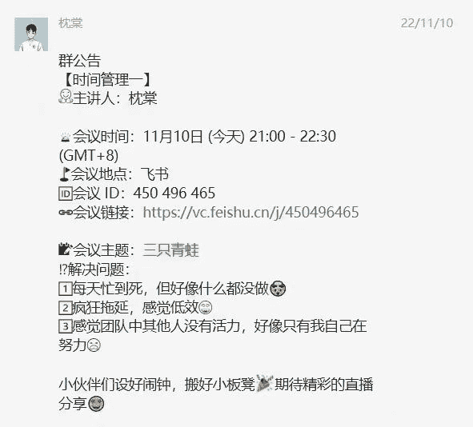

然后你猜怎么着？

那天分享完之后，反馈直接爆炸，有非常多的小伙伴都说，我讲的太好了。

也是因为这次提问，这些夸奖，我才发现原来我效率这么高，原来我时间管理这么厉害。

于是后续我就把当时那节课当做最开始的基础，看了很多课，很多书，学了很多课程制作的方法论。

**终于，在2023年1月，在前辈的点拨下，我推出了自己的**第一门课程——《时间契约·人生管理课》。

**这门课一**经开售，就有几十个朋友选择了加入，这是我第一次日入过千。

恰好，这个时候有个前辈找我做时间管理私**教，还有**收到一些拜年的红包，这是我第一次月入过万。

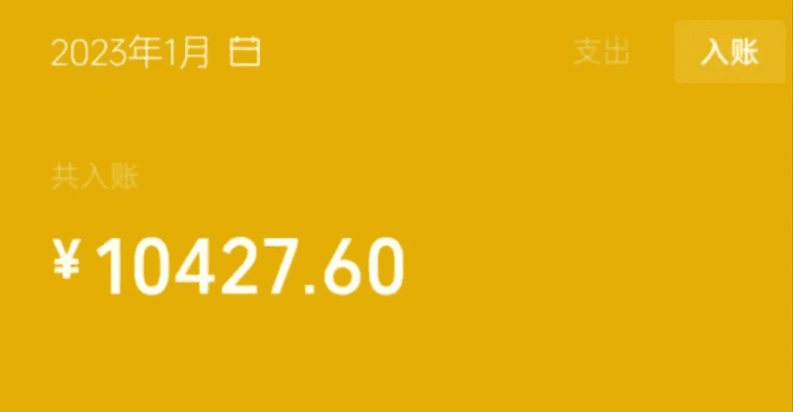

而2023年1月，我也时常把他当做我正式开始自媒体创业的起点。

## 但其实说实话，其实当时我陷入了很重一个纠结之中：保研or创业

在我刚刚月入过万的时候，我的绩点成绩还是很不错的，不说第一第二，但保研985还是绰绰有余的。

但当时我心里也很清楚，如果我想保研的话，那接下来一定需要非常卷，创业基本也不用做了。

我想了想，还是决定继续创业，学业的话兼顾便好。

至于原因，我的朋友也问过我：

> 那是一个23年4月的一个晚上，

>

> 她很不理解的说：“**为啥要这么急着赚钱啊，你才大二**”

>

> 我说：“**为了自由和底气**”

或者说只是因为年少轻狂，

只是因为：船停在港口最安全，但那不是造船的意义。

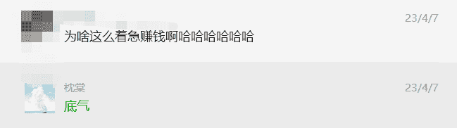

## 3.深耕两年+，赚了50w。

于是，我正式拉开了创业的帷幕。

当时的我，应该是完全想不到的，我居然能够在大学毕业的时候，赚到半百的收入。

书接上文，在我推出了我的时间管理课后，我一直在思考一个问题

**“我这个赛道能做大吗？”**

“**我这个赛道能做高客单吗？**”

这些问题一直久久环绕在我的脑海中，直到2023年6月，在很多学员的催促下，我试探性的推出了时间管理私教服务。

单价3000+，首期只收5个人，首发即爆满。

这是我第一次感受到，什么是收钱收到手软，可能只在一两天时间里，我就赚到了1w+。

这个时候，我知道了：

**时间管理这个赛道是能赚钱的，之前不能赚钱只是因**为我的商业能力不足，我没有抓到核心矛盾。

于是我便决定，继续深耕时间管理赛道。

毕竟既然这个赛道能赚到钱，那我没有什么不做的理由。

抱着这样的念头，在2023年7月的哪个暑假，我大二转向大三的哪个暑假。

我沉下心来看了几十本时间管理的书，也基本上把市面上时间管理的课都看了一遍。

也是那个时候我才知道：

**原来人生管理没有那么简单，时间管理，目标管理，**精力心力管理，加在一起才能真正解决问题。

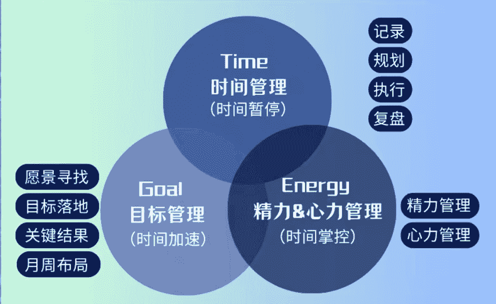

也许是时间会奖励每一个努力的人，在9月的时候，我还有幸选上的时间管理航海的教练。

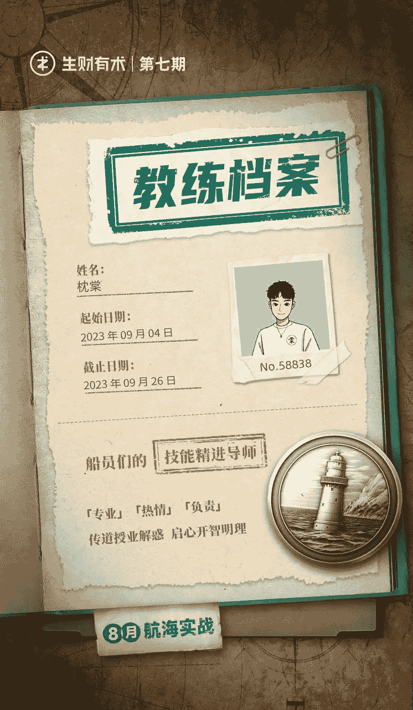

当时，刚开始自媒体创业的我，收到了如此之大的认可后，实在是兴奋无比。

于是在2023年10月，我翘了一个月课，全心全力搞事业。

我正式推出了我的长期社群——时间茶馆，并完成第三期时间管理私教的招募。

**也是在这**个时候，我达到事业上一个小顶峰，月入5w。

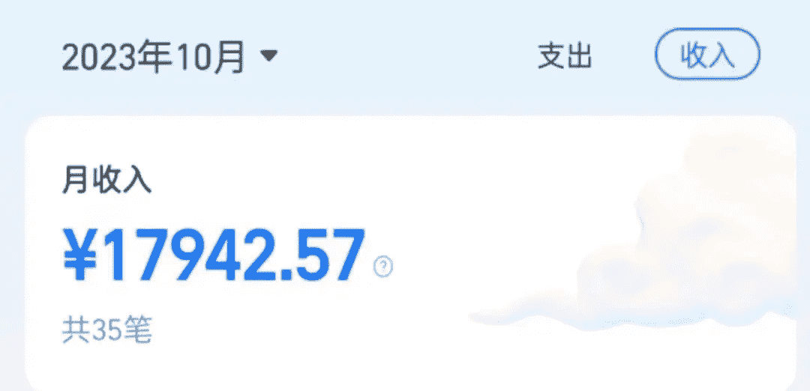

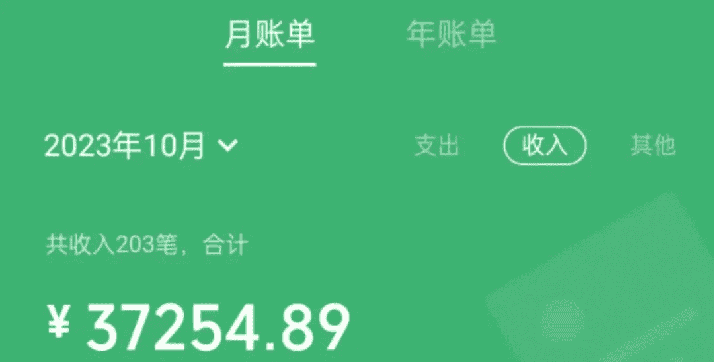

因为那个月的收入还算不错，于是当时本来打算去大厂实习的我，都完全放弃了实习，决定深耕我的事业，类似的发售，后来也复制了几次。

后来时间来到了2024年1月，我的年度社群时间茶馆突破了200人。

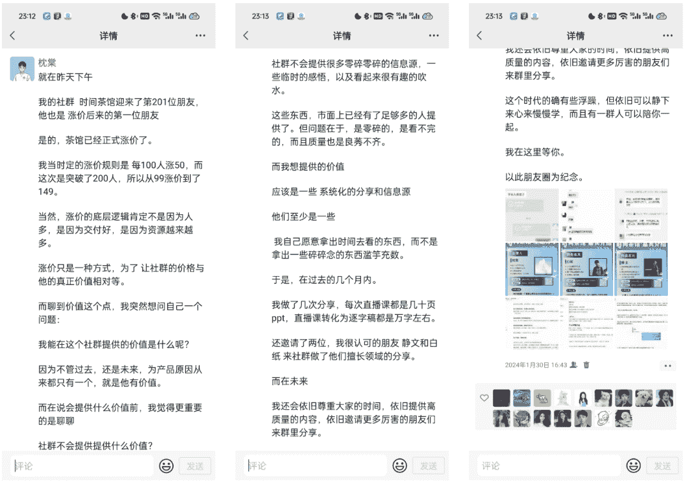

#### 于是乎，我的创业第一年便正式收官，成功赚到了10w+。

>

> 我一向习惯把我的生日当做一年的结束，写了一条总结性的朋友圈（现在看来很是矫情hh）

>

> 当然生日本身不是庆祝的理由，但一年努力拿到的结果很适合找一个节点庆祝一下。

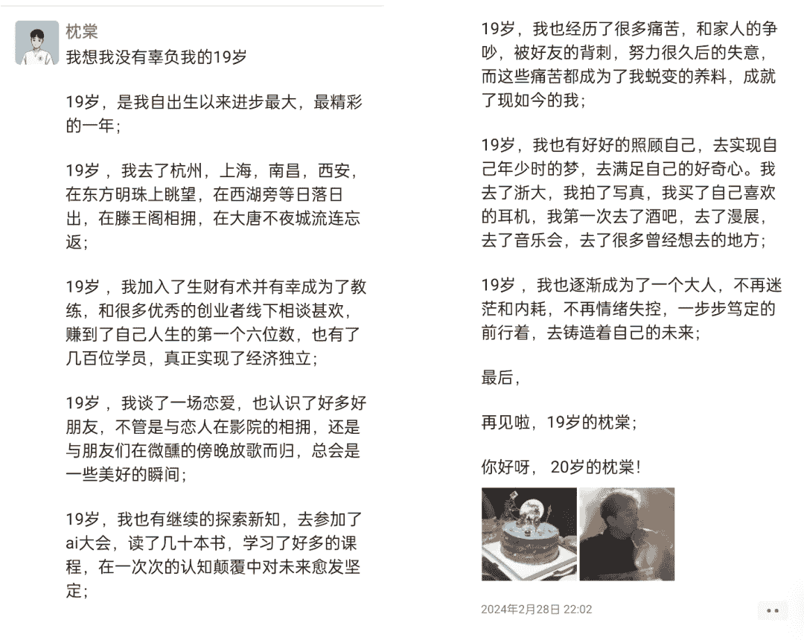

也是在那个时候，我开始认真且正式的复盘我赚到钱的这一年，然后思考未来的战略，想要找到未来做事的方法。

不复盘不知道，一复盘吓一跳。

我发现，我的整个自媒体闭环问题都很大。

**流量，定位，产品，转化，每一环都**有很大的优化空间，新的一年要给他优化掉。

## 于是怀着这样的想法，我正式进入了我自媒体创业的第二年。

**先是流量上，**

我尝试去做了📕，花了大几千买了📕私教，是做了10w+爆款，是涨了1000+粉丝，也引来了一些流量，算是正式跑通了公域引流的闭环。

也混了一些圈子，买了很多社群，在🛰️群里发光发热，但私域人数的增加一直比较稳定。

**而后是定位和产品上，**

在我正式做了一年多自媒体后，我发现我对商业似乎有了很多不错的认知，之前无心插柳带的一些学员，也成功赚到了属于自己的四位数，五位数。

之前能力受限只能做时间管理，现在我可以做我最感兴趣的赛道——商业了。

于是，我的商业闭环线，应运而生。

我做了商业闭环营，还做了商业闭环私教，带领我的学员去成为我，去做他们的自媒体ip，

而这条线带给我的收益，会是时间管理线的两倍，也有很多学员成功年入六位数。（要么说赚钱就要去离钱更近的地方呢）

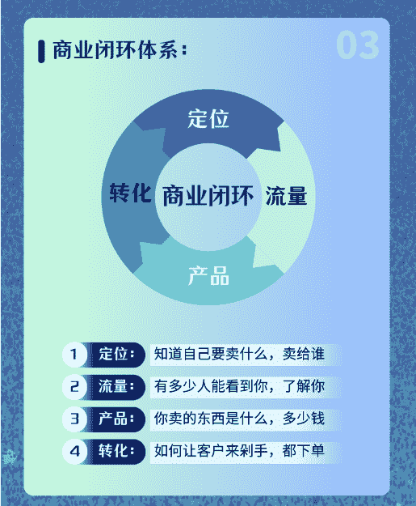

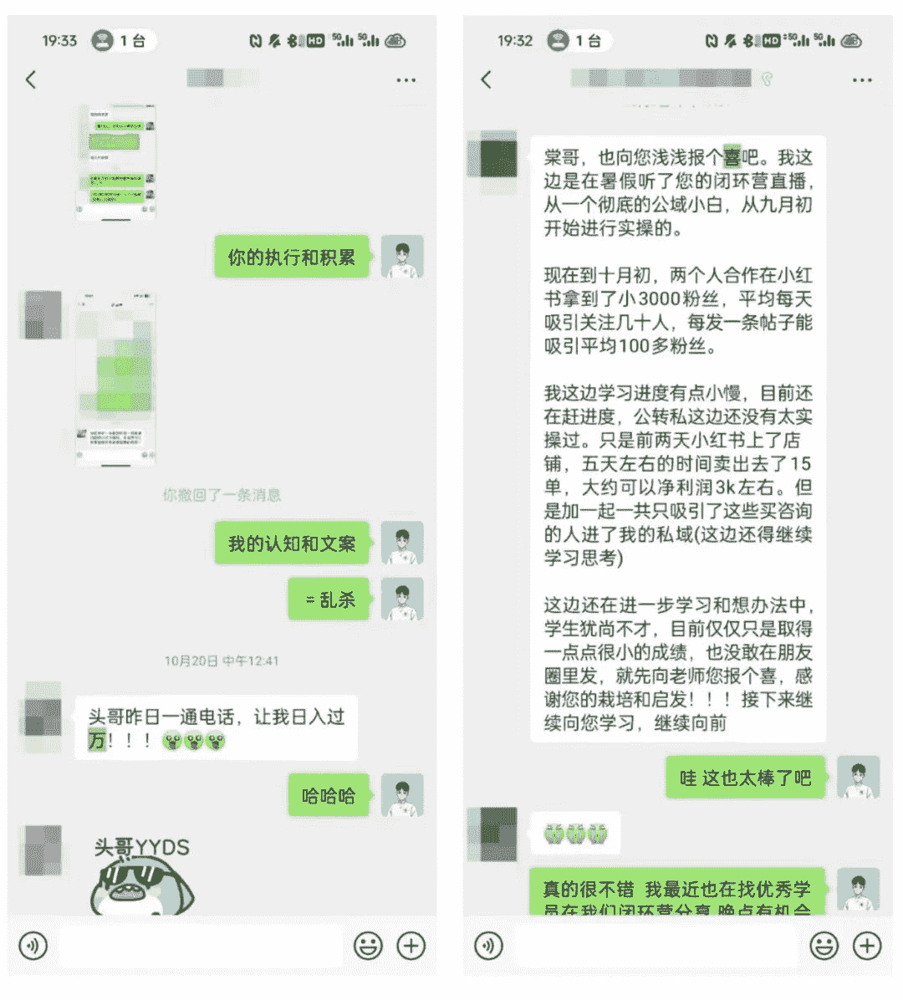

**最后是转化上,**

天知道一个自拍都不敢怎么发的人，是怎么鼓起勇气开始直播的。

但是做自媒体直播真的很重要，那就咬牙也要上。

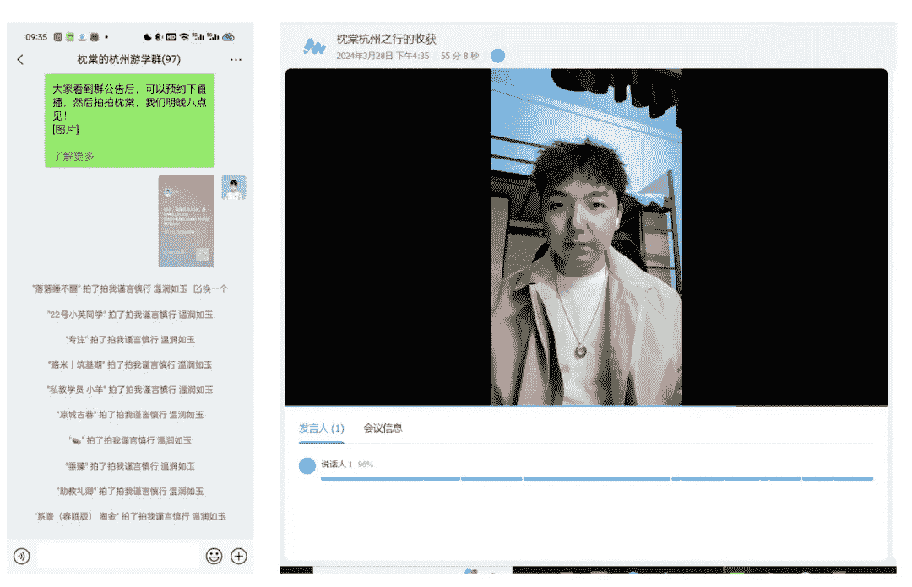

做了很多的尝试，然后在2025年1月，我21岁的结尾，我又做了一件集大成的事情。

做了我人生中第一次的公开课，

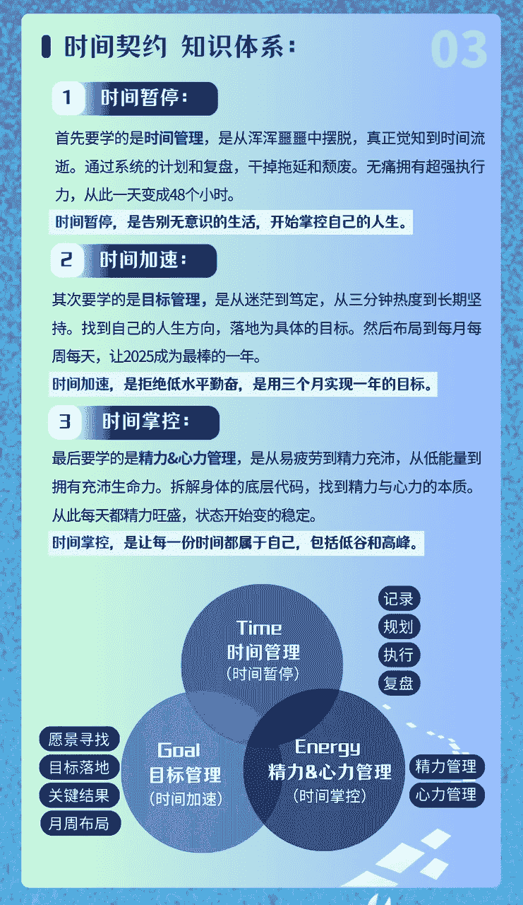

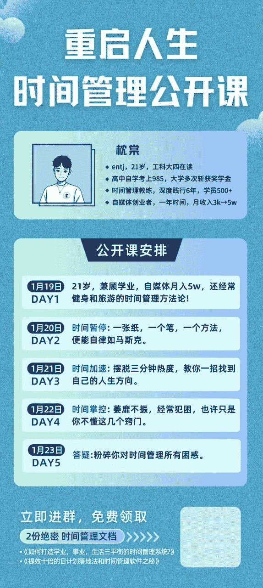

**也是因为这次公开课吧，我20岁自媒体的收入，赚了20万+，相**比去年近乎翻倍，算又是一个阶段性的成果。

一如既往，是新的一岁，是新的一年的生日，我又写了一条总结的朋友圈。

于是时间来到了在2025年2月28日，我的21岁生日后，我重新做了我的年度规划后。

我发现我在定位，产品，转化，都已经做的不错了，再高不说，80分肯定是有了。

但还有一个最核心的问题没有攻克，那就是—流量。

我的后端产品和转化都已经非常稳定了，我只要有稳定的流量，我就能有稳定收入，

我的流量能翻几倍，我的收入也就能翻几倍。

> 所以我给我的**21岁**定了一个主旋律，那就是——**流量，要好好的去搞流量。**

>

> 在3月4月忙了其他很重要的事情后，从5月开始我便开始认真的搞流量了。

>

> 于是5月我先去更新了多半个月📕，6月又开始做👸号。

>

> 值得一提的是，不知道是buff还是什么，今年的流量的确不错，写一篇爆一篇，且每篇都有精准的流量。

>

> 在我7月，8月开始上班最忙的时候，也没有停止，一直有人在不断的加我的好友。

>

> 也算得益于此，最近几个月哪怕没有做发售，没有做新品，只是单纯的发朋友圈，每个月的收入也来到了五位数。

直到9月底的时候，我正式算了算账，

到目前为止，总量来看，直接2025年9月，总收入在50w+

从成长速度来看，从第一年的10w+，第二年的20w+，再到今年可以预计的至少30w+。

因为一直把他当做副业在做，所以这个收入，我自己感觉还是挺满意的。

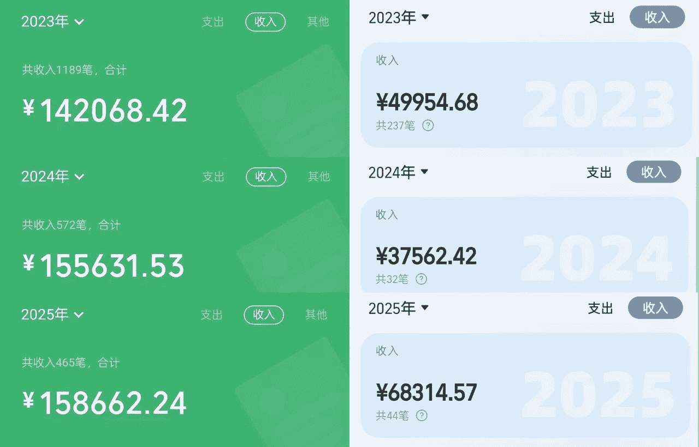

## 4.人生新的阶段，ai超级个体。

而在2025年之后，其实还有一段新的故事，一段其他的独特的故事。

在2025年2月之前，我是从未打算上班的，因为我很喜欢自由。

从大三开始的规划就是，毕业一边自由职业一边全国旅居，而且一边读大学一边就能赚几十万，我对我的未来实在是充满了信心。

#### 于是正当我乐呵呵回家过年的时候，deepseek突然爆火。

>

> 一时之间，我关注的很多博主都开始“危言耸听”，

>

> 都开始说：ai会替代自媒体的创作者，会替代知识付费。

>

> 说会完全代替内容创作者我是不相信的，不过ai日新月异的发展，的确让我很是慌张。

>

> 我开始担心：**我会落伍于这个时代的ai发展。**

>

> 而哪个时候，我蜷缩在长春的校园里，唯一学习ai的方法就是上网。

于是带着巨大的焦虑，在3月，我去了趟杭州。

去参加了ai大会，看了一下厉害的人们都是怎么用ai的，

当时的很多用法，的的确确完全震撼了我。

ai居然可以真正批量生成图文，并且真的可以用来实用获客了。

于是思考了一下，我最终决定还是去找个工作。

不为赚钱，只是想参与一个更大系统的运转，去学习一些东西。

当然最重要的还是，去看看那些十亿级别的大公司，时代的弄潮儿，到底是怎么用ai的。

也就是说，因为ai，我决定去找个班上了。

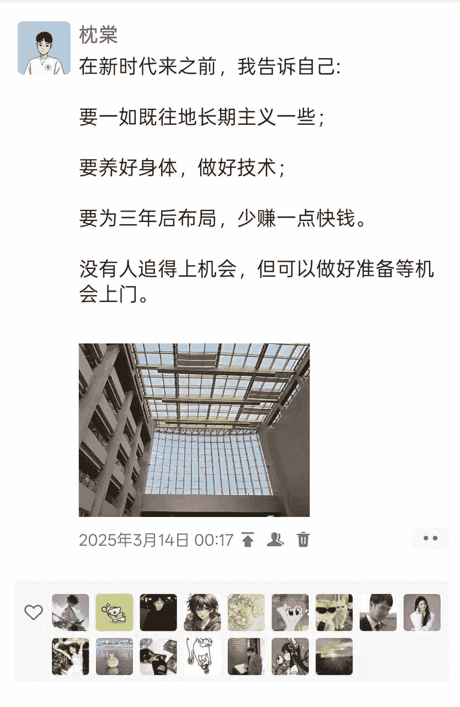

于是3月4月，我停止了自媒体，全力在找工作，以及写我的毕业论文。

也许是功夫不负有心人，或者我大学有锻炼出一些不错的底层能力，也许我专门抽时间好好学了一下求职。

**我拿到了好几个中大厂的offe**r，大多都满足我的标准：薪资不菲，ai产品，一线城市。

最终我在一堆offer中，选择了一个ai独角兽的ai产品经理的工作。

因为我始终记得我上班的原因，是为了学东西。

## 80天的职场体验

>

> 6月20号左右毕业，7月1日我就迫不及待的入职了这家公司。

>

> **因为我真的太好奇了，我太想学东西了，我太想知道上班是**什么感觉了，ai真正的落地是什么样子了。

>

> 故事的开始总是那样的美好，

>

> 刚开始上班的时候，她的确满足我对工作很多的期待。

>

> **能和很多人认识，能参与进一个巨大的系统，能有很多见识的增**长，合作方都是什么荣耀，华为，📕的。

>

> 同样，和我的预期一样，也学到了很多东西：

>

> **知**道了这么大的公司也是靠一个个sop运转的，知道了自研的ai大模型是怎么运行，变量又是怎么设计的，以及更多更多.......

>

> 但也有确实很是痛苦的细节：

>

> 清晨九点灵感正盛，却只能中断写作去上班；

>

> 没有任何原因，被领导辱骂；

>

> 上班高峰挤进公交，只为准时打卡上班；

>

> 无数次无效开会到22:00，才能下班回家，到家已是精疲力竭。

>

> 每天都像一颗毫无特色的螺丝钉，死死嵌在重复性流程中。

>

>

> 而且最重要的是，主业时间是副业的2倍多，收入却没有副业高，总觉得这钱赚的很是窝囊。

>

> 而这些其实我都可以忍受，

>

> 直到，时间来到了9月中旬，那个时候我已经上了两个月班。

>

> 我慢慢觉得，似乎在这个岗位，我开始学不到任何东西了。

>

> 以及，

>

> 领导派给我的活越来越多，并且无数的暗示威胁我必须要每天加班，不然就考虑实习期过不了吧。

>

> 于是我仔细斟酌了一下：

>

> 当时来这里，好像本身就是为了学习，为了自身更好的发展。

>

> 而既然这个工作，无法带给我什么成长了，却还死死的侵占着我的时间。

>

> **他让我没有自由去过自己想过的生活，**他让我没有时间去读书去成长，去学习ai。

>

> 他已经不再是帮助我的平台，而变成了我的枷锁。

>

> **于是，我裸辞了。**

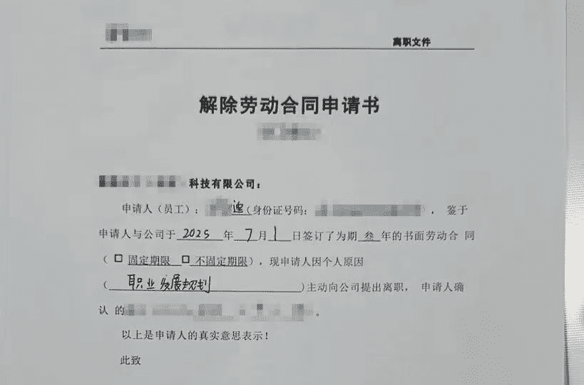

而关于未来呢，是否会回去上班继续学东西，坦白来说，我并不确定。

**但有一点我**是能够确定的，我会一直深耕“ip+Ai”

前者来获得复利，后者来系统提效。

去成为一个ai超级个体，过上自由且富有的生活。

等有了比较充裕的现金流和认知了，25岁左右了，可能读个研出个国，再去做新的创业。

是的，不管如何，我的未来一定会创业。

因为：

**有的鸟，是笼子关不住的。**

她的每一根羽毛，都闪耀着自由的光辉。

——————————————————————————分割线——————————————————————————————————

好，这差不多就是我全部的搞钱故事了，接下来是文章的正题部分，来和大家聊一聊不同阶段赚钱的具体认知。

左边已经分好了目录，处于不同阶段的朋友可以直接点击跳转阅读。

当然更建议全文完整阅读。

因为虽然每个阶段都有它的心法，但前面的心法大概率后面也是有用的，很多道理都是是贯穿始终的。

# **一.起步篇：如何找到天选项目？**

## **1.扩充真实的信息。**

挑项目，本质上就是在做决策。

决策的本质是什么？就是决定未来一段时间，你的时间、精力和金钱要投在哪个方向上。

那决策最重要的点是什么？

答案就是：**足够正确、全面的信息**。

## 所以说，如何找到适合自己的项目呢？

>

> 最重要的一定是，你得**全面**的收集项目，先知道有那些项目可以选，保证最适合你的项目是在你所搜集到的选项之中的。

>

> **其次**呢，你要保证你收集到的信息是正确的，不要对一个黄昏赛道吭哧吭哧几年，才发现原来走错了路。

>

> 这里有两个关键点，**正确和全面。**

>

> **全面**其实很好解决，我们只需要去互联网上，或者加入赚钱，翻翻小组，翻翻航海手册，就知道现在市面上有那些项目比较好了。

>

> 但**正确**就很难解决了，因为现在互联网上项目数据的造假太常见了，常常乱花渐欲迷人眼。

那怎么办呢？

我觉得有一个原则特别重要：“默认所有数据都是错的，默认所有逻辑都是对的。”（之前好像在星球里看到的，具体谁写的忘记了）

简单来说就是，当我们看到一个项目，一个项目的经验分享的时候。

不要相信他们的数据截图，而是去思考他背后的底层逻辑。

你去看这个项目：

+   他是怎么引流的？如何规避风险的？

+   他是怎么转化的？朋友圈结构是什么？私聊有sop吗？

+   他的后端是否可持续？产品结构是怎么设计的

一定要记得，项目是否能跑通的底层逻辑，要比她能赚多少钱更重要。

然后再进一步，如果你真的想知道一个项目能有多少的收益。

你可以在以上的基础上，去看看他的粉丝量级，估量一下她的引流，看看他的朋友圈，猜一下转化率，自己去思考计算他的收入，这样得到的数据才是真实可信的。

# 获取真实信息的邪修方法

>

> 然后关于获取正确的信息，而还有一个独特的心法分享给大家：

>

> 找项目的时候，要多去线下沟通，多参加赚钱聚会。

>

> 中国人都是比较内敛，在很多时候，很多东西，在线上我们会不好意思问，或者对方也不好说的太清楚。

>

> 比如““这个项目适合小白吗？利润空间大吗？哪个老师怎么样”。

>

> 但在线下就完全不一样了，线下的交流，往往会更加真诚，更加直接。

>

> 我的经验是：

>

> 只要你有礼貌、真诚，在线下请对方吃顿饭，或者参加赚钱聚会，或者付费约个咨询，基本上都能得到比较实在的答案。

>

> **因为线上打字会留痕，有些话不方便明说**，而线下是“朋友场”，对方会更愿意敞开。

在枕棠我做项目的过程中，其实有的时候会非常焦虑，特别是看见了一些同龄人或者说圈友拿到很大的成绩的时候。

这个时候唯一能够消解我的焦虑的方法：

就是去参加线下活动，和他们实打实去一对一的聊天。

然后就会发现，大多数的结果不可复制，是因为运气，因为独特的优势，而那些可以复制的，都要沉下心来日拱一卒。

久而久之心态就能平稳下来，然后开始安心去做自己的事情了。

## 或者说线下的交流更多是在“**祛魅**”。

>

> 未曾见面之前，看见那些大佬，我总会猜想他们有多厉害，是否三头六臂还是什么。

>

> 但见到之后才会发现，他们可能只是认知高一点，细节上有独特的经验，很高的执行力，以及花了挺久的时间。

>

> **祛魅所带来的意义，便在于不再去追寻那个不存在的答案，而会去**重视那些最基础的东西，比如说执行和复盘。

## 2.选红海，别选蓝海

第二个点，我想讲的是——对于小白来说，选蓝海往往是最大的骗局。

我承认，蓝海项目整体的确有很高的上限。只要你踩对了，哪怕只做一年，都有可能成名，甚至百万收入。

但问题在于：蓝海几乎没人探索过，没有成熟教程，失败的概率极大。

就像哥伦布开辟新航线，虽然他发现了新大陆，但路上多少人死在了大海上？

而红海呢？反而被很多人嫌弃“竞争太激烈”。

但我觉得，这恰恰是红海最大的优势：做的人多，说明路子是跑得通的，可以有很多可以抄的。

甚至可以说，在红海里，你一天能借鉴一套打法不重样，大火的美妆国学这些赛道，只是抄爆款就能抄很久。

**所以也许你发现，我这里和你讨**论红海vs蓝海，并不是在和你讨论竞争激烈 vs. 机会稀缺。

而是在和你讨论 "**你能不能走一条确定性更高的路**。"

因为对于小白来说，最重要的不是能赚多少钱，而是能多快赚到第一块钱。

第一块钱赚到，你才会有信心去走后面的路。

# 一个有趣的例子

>

> 前段时间，我有个朋友问我，她到底要做什么生意？

>

> 一个是她干姐姐在做的求职陪跑，能手把手教她，

>

> 一个是她最近在看好的ai代写项目，感觉很有潜力。

>

> 他当时问了我很多东西，说喜欢和擅长，那个更有市场空间什么的。

>

> 我只回了他一个点，你是一个小白呀，这个时候拿到自己的第一笔变现才是最重要，那个能更细致的教你就选哪个。

>

> 最后她听了话，在她姐姐的指导下，跑通了整个求职陪跑的闭环，上个月旺季已经月入过万了。

>

> 最核心的原因就在于：他的姐姐会毫无保留的告诉她，关于这个项目所有的核心的信息。

>

> 当然，最后还要结合你自己的偏好和天赋点去判断。

>

> 比如：

+   这个项目的整体利润率和回报率如何？

+   你是否喜欢做这件事？

+   你的性格和天赋点是否契合？

>

> 这也是下一个点要聊的。

## 3.选择你所羡慕的，而非你所嫉妒的

关于找适合自己的项目，这应该是我最想讲的一个点，也是我自己交过学费、亏了差不多六位数才换来的经验。

很多人都会问，关于选择适合自己的项目：选项目到底是选自己擅长的，还是选自己喜欢的，还是选有市场需求的？

市面上会有一种“标准答案”：最好是这三者的重合点，就像下图一样。

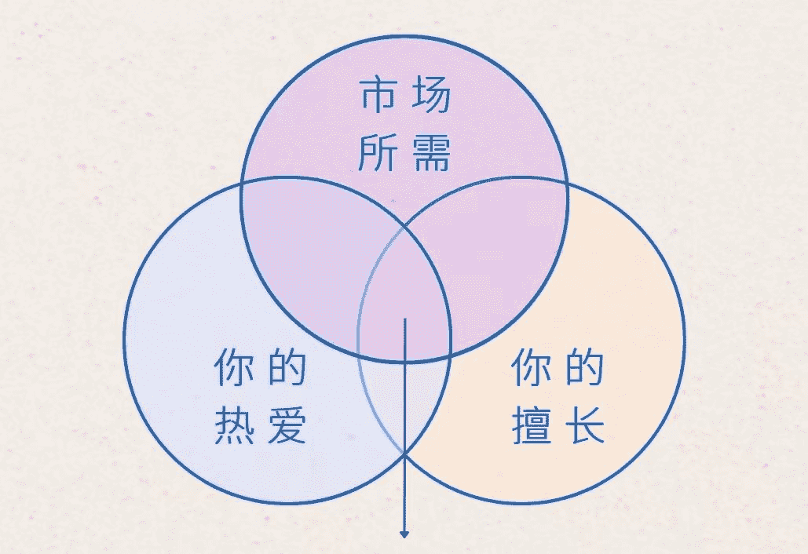

可问题在于，这三个维度往往互相分离，会真的很难重合。

而且更难受的事情，对于大多数认知有限的普通人来说。

其实很难分辨出：自己真的喜欢什么，真的擅长什么，以及市场到底需要什么。

所以这个模型，在很多时候，就是一个正确的废话。

我也为此苦恼了很久，直到最后我终于想明白了。

**与其纠结喜欢还是擅****长**，不如去选择你所羡慕而非嫉妒的项目。

## **什么是羡慕而非嫉妒的项目呢？**

>

> 你看着这个主理人赚钱，你是想要成为和他一样的人，获得和他一样能力，认知，和生活状态，这是羡慕。

>

> 你看着这个主理人赚钱，觉得他德不配位，觉得他吃枣药丸，觉得赚他那个钱的损耗远大于钱本身，这是嫉妒。

所以，羡慕的项目才是你应该选择的方向。

你会羡慕一个人所做着的项目，一个人的生活状态，意味着，他的禀赋价值观是和你相似的，他的项目大概率呢也是适合你的。

同时呢，他能够出现在你的眼界中，说明他做这个项目已经功成名就了，这个项目的可行性自然不必多说。

而且最重要的事情是，做这件事情的过程中，你的心力会得到增益和补充，而不是一味的消耗。

在我的价值观里，有这样的一段话。

#### 任何一个有价值的结果，都需要漫长的探索，和克服一个个负反馈，一次次失败后又爬起。

#### 这个时候，如果有一个东西能够给我们心力上的补益，那将是无比难得的事情。

所以找项目请一定去找，**羡慕而非嫉妒的项目，**这才是能长久的项目。

虽然聊了这么多，但可能还是会有一点抽象，接下来和大家举几个实际的例子。

比如，有人喜欢知识付费这种“起步慢，但长期复利”的赛道；也有人偏好平台红利型的“短平快”项目。

不同的性格、不同的天赋点，注定选择也不同。

再比如，有的人就喜欢大的流量，喜欢几万人看他直播；有的人却喜欢安安静静的交付和美誉度。

对前者来说，爆量是一种快乐；对后者来说，哪怕只有几百个用户，但能收到一篇几百字的小作文式反馈，反而是最大的满足。

两种选择也没有对错，只是个人倾向不同。

# 二.实践篇：如何赚到1块钱，从空谈者变为创业者？

创业者和空谈者的区别，是你有没有跑通一个闭环，赚到打工之外的第1块钱。

## 1.世界是一个巨大的草台班子。

在赚钱里面，有很多的好项目，也有很多人找到了适合自己的项目。

但始终迈不出第一步，他们报名了一个又一个航海，看了一个又一个手册，但就是没有实践出好的内容。

原因就在于，他们始终没有开始实践。

我聊过很多朋友，发现他们最大的问题其实就在执行力，他们一直觉得：

项目好复杂，赚钱的人都好厉害，我不配。

但真的是这样吗？

想想你在上大学之前，进公司之前，你是不是也觉得那里面的人都很厉害，做的事情都很高大上？

结果真正进去了，发现也就那样。

> 事实上所有的副业项目也都是，

>

> 哪些高大上的📕博主，可能只是一个个图片，一个个文字在模板的堆砌。

>

> 哪些客单很高的ai代写，可能只是复制同行的文案，然后二本装自己是清华博士。

>

> 所以别被吓住了，世界就是一个巨大的草台班子。

>

> 如果你真要说“我不行”，也请等你试过、失败了再说，而不是一开始就给自己找借口。

>

> “自己不行”这句话，还是等失败了再讲更合理一点。

## 2.在有成绩之前，保持空杯心态

我做知识付费这么久，最怕的一类学员就是：

什么都没做出来，就开始自以为是，开始挑课程毛病。

一上来就说：“我觉得……我以为……你的课有问题。”

我倒不是说你不能质疑，而是你至少得先实践出点成绩，或者一定的经验，再来谈你的思考。

如果一开始就开始挑刺，那我几乎是完全可以预判，他是这个课程学习后效果最差的人之一。

这也是在这里想和大家聊的：

**不管是学习新课，还是做一个新项目，在进入一个新**领域的时候，最重要的，就是保持空杯心态。

为什么呢？

**因为如果我们没做过一件事情，没拿到过什么成绩，那我**们对这件事情的经验和看法大概率是错误的。

于是这个时候我们最好去做两件事情，

1.先听已经拿到结果的人怎么做。

2.一比一模仿他们的路径。

当然，我也不是说你永远要听话，独立思考能力一直很重要。

倘若你和我一样主体性很强，经常觉得自己很厉害，不想照搬，那也没问题。

**可以给自己设置一个实践周期，在多久的一**个时间里没拿到结果，就老老实实回来听话。

在这段时间里，如果我们跑不出结果，那就老老实实回来，按照成熟的方法去做。

我甚至觉得这比空杯心态是更好的做法，虽然看起来拉长的战线，却能更加稳定的拿到结果。

原因在于：没有人一直是对的，没有人是100%对的

只是相比新手来说，前辈在新领域里踩过坑，他们的正确率远远高于我们。

但世界是一个巨大的草台班子，前辈也可能在哪里乱说一通。

所以——空杯心态也很重要，独立思考也很重要。

不过不管怎么说，我们追求的都是正确的事情，都是真理。

## 3.接纳失败，去成为那个不惧风雨的前行者。

事实上，很多时候，我们不得不承认一件事情。

哪怕我们很认真的学习了，我们真的很努力的去做了，还有很大可能会失败

因为副业本身就是一件成功率很低的事情，特别是在经济下行这个时代，就业环境一年比一年差，互联网上的生意也越来越白热化。

当然说这些，并不是为了给大家泼冷水，而是想和大家说：

认清现实，然后依然选择热爱世界，比虚妄的幻想要持久得多。

自然，还有两个很重要的心法分享给大家。

## 心法1：任何一个有价值的结果，都是在大量失败中磨出来的。

>

> 马斯克有个“10%理论”，是说：

>

> 大多数人之所以失败，是因为尝试得太少。

>

> 如果你愿意在一件事上尝试十次以上，成功的概率就会大幅提高。

>

> 但现实是，大部分人连十次机会都不给自己。

>

> 和大家举一个很真实的例子，就是我减肥的例子。

>

> 因为减肥一直是学业事业外的复线，所**以迭代的速度慢，但最后也拿**到了一点结果：从190斤减肥到了150斤

>

> 我减肥的历程大概是这样的：

>

+   190斤的时候，我尝试过早上晨跑 → 失败，根本起不来。

+   尝试过下午跑步 → 失败，每次跑完就报复性饮食，反而胖了。

+   尝试过控制饮食 → 失败，根本分不清高低热量，对量级没概念，一不小心吃多。

+   尝试过16+8轻断食 → 成功，从190掉到175。

+   再次尝试控制饮食 → 还是失败，依旧搞不清热量问题。

+   尝试过健身私教 → 失败，我讨厌被强制要求，觉得太痛苦，减完体重又反弹。

+   最后我选择了生活化饮食+自由训练 → 成功，从175掉到150。

>

> 你看，这里面失败比成功多得多。

>

> 但我就是不放弃，反正也不是特别重要的课题嘛，就投入时间慢慢试错试错，然后就成功了。

>

> 但也正是这些反复的失败让我，学会了健身，也懂得了正确饮食的方法论，学会和自己的身体沟通。

>

> 最终才找到了适合自己的减肥方法，成功瘦了下来。

## 心法2：世界上没有失败，不是得到，就是学到。

>

> 有一个很重要的心法就是，

>

> **这个世界是没有失败的，要么你成功拿到结果，要么你没有拿到**结果，却可以复盘失败的经验，让自己进化。

>

> 就像是打游戏一样，很多我们打一个副本打不过，但人物等级技能一样会增长，多练一练，熟悉一下操作，下次就能打过去了。

>

> 而当我们有了这个思维后，我们就能得出一个很好玩的结论：

>

> 本质上，这个世界上没有**失败者和成功者**，只有这样两种人：

>

+   一种是懦弱的停滞者，遇到阻力就停下；

>

+   一种是不惧风雨的前行者，明白失败只是过程的一部分，不断向前。

>

> 而你想成为哪种人呢？

# 三.上升篇：如何赚到第一个1w，把副业变成事业？

聊完赚到第一块钱所需要的勇气，我们来聊聊如何把1块钱变成1w块，真正把副业变成事业。

## 1.持续专注，不下牌桌。

最近和很多在新手期的朋友都聊了聊，发现大多都遇到一个卡点

“我做了这个项目，赚了一点小钱，然后换下一个项目，又赚了一点小钱。跑来跑去，最后加起来不到一万。”

为什么会这样？

我想可能是因为很多人一辈子都沉溺于舒适区中。

很多人都假设，自己没赚到钱是项目的问题。

其实包括我自己，在我的产出和预期不匹配，我以前也会这样想：“知识付费不行”“自媒体太卷”“时间管理这破赛道没前途”。

真的是赛道的问题吗？

我后来才明白，不是。

**如果说你真的到了百万、千万的级别**，那时候当然要看整个市场容量、人口基数。

**但在我们现在这个阶段，其实根本没到那个层面**。平台里就是万千之水，而你只需要取一瓢。

所以很多时候，如果我们连月入过万都没做到，其实只有一个原因。

那就是，做的有效行为不够多，投入的时间不够多。

那怎么办呢？

其实就是八个字:**持续专注，不下牌桌**

**持续专注**的意思是，对着一个大项目，一直花时间，一直认真去做，

**不下牌桌**的意思是，不断实践，不断去思考优化的方法，哪怕筹码小一点，也不要停止出牌。

而最本质的点其实在于，我们一直在优化，一直在突破舒适区，在不断的成长。

收入量级的突破一定是需要某些能力的，是每个项目都需要的。

## 2.要学会抓核心矛盾。

如果你之前已经能够通过某些项目赚到1块钱，那你必然也能通过这个项目赚到1w块钱。

赚到一块钱，是满足了一个人的小需求。

赚到1w块，是满足了更多人更深的需求。

你能够卖出1块钱的简历模板，就能卖300块的简历的修改，也就能卖3000的求职私教陪跑。

**而从赚一块钱到能够**月赚1w块，最关键的点就在于：要学会抓核心矛盾。

当你赚到第一块钱，其实证明了一件事：

**你能独立跑通一个商业闭环。**

但这并不意味着你真的懂这个业务模式。

你能赚到这个钱，只是因为有人告诉要一些固定性的动作，然后你做了，有一点点的运气，所以你赚到钱了。

但这个时候，只要市场一变动，你就乱了，不知道发力点在哪里，然后就开始混乱和焦虑，大多人赚到一旦小钱就换项目的原因就是这个。

而如果想要赚到一个还不错的收入，至少是月入过万的收入，我觉得至少是要对这个生意有一定的理解，要比较清楚的知道这个生意的核心矛盾是什么。

**最怕的就是困在舒适区里面，做着自己早**就能做好的事情，然后用“天道酬勤”骗自己

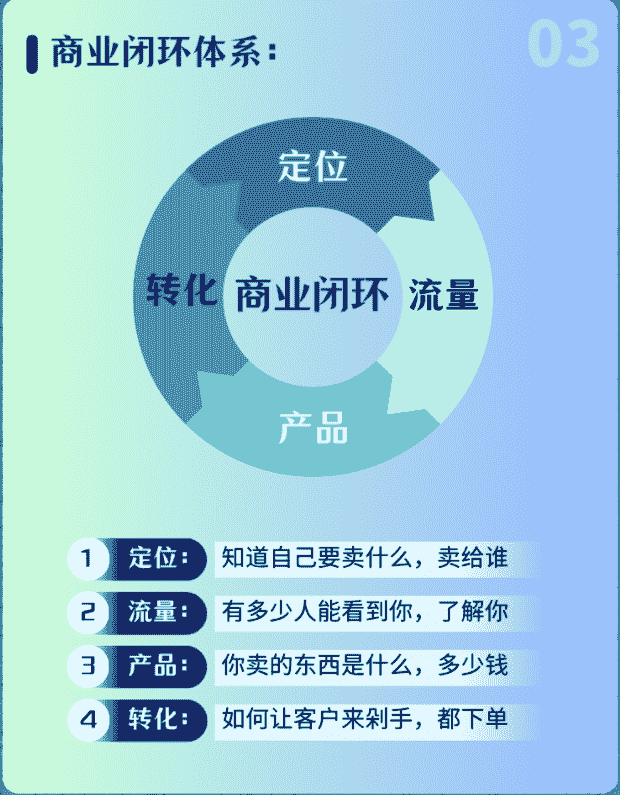

> **举个例子，拿知识付费来**说，其实最核心的矛盾有两个：“知识”和  “流量”

>

> 他们两个大概来自于这样的体系中：

>

> 知识付费=知识+付费=**知识体系**+商业闭环

>

> 知识体系=对于某个人群某个需求，一套成体系可以落地的方案

>

> 商业闭环=定位+**流量**+产品+转化

>

**知识体系之所以是核心矛盾的原因是，这是一整个生意建立的基**石，知识付费知识付费，先有知识再有付费。

而如果你连一个能帮到别人的技能、方法论都没有，那发朋友圈、做分销有用吗？无非就是隔靴搔痒，赚个几百几千，很快别人就不理你了。

这核心矛盾，大多数做知识付费的人都犯过这个错误，他们不去学习迭代认知，只是单纯的发很多朋友圈什么的，然后就导致观点逐渐没有新意，用户逐渐对他失望，然后慢慢就做不下去了。

流量之所以是核心矛盾的原因是，没有流量就没有一切。

哪怕你的产品再好，你的转化再好，但只要没有流量，就是没有收入，就是无法验证和迭代，也几乎无法扩大。

而流量上的核心矛盾，其实是我犯的最大的错误，我虽然做了知识付费快三年了，但到了第三年的时候，我才深刻意识到了“流量”的重要性，

前两年，我一直在优化我的产品体系，优化我的转化，口碑和续购率转化率都很不错，可惜的是，因为流量一般，所以我的收入上涨特别的缓慢，直到我今年4月才慢慢调整了过来，说来都是泪啊。

[三年时间，从自卑的985做题家，到知识付费月入5w ](https://p3ak6osfed.feishu.cn/wiki/CipHwziGAiB1npkPZjucKOK5n6b?from=from_copylink)多知识付费相关的细节，我之前帖子写过全流程方法论，点击直达：

> 对于一个完整的商业闭环来说，流量，产品，转化都是其中的一部分。

>

> 而到了最后，所有板块的增长和突破，都是要靠我们的时间去突破的。

>

> 但不同板块重要性不同，投入时间和资源的roi也就不同。

>

> 简单来说就是：

>

> 时间放在不同的地方，所能获得的收益是不一样的。

>

> 如果我们能够找到核心矛盾，集中时间和精力去猛攻。

>

> 那么最终的收益会让我们很是满意，可能我们很快就能赚到一万块。

>

> 但如果说我们一直在次要矛盾上磨，没有什么正反馈，归因逻辑又回到老路子：

>

> “是不是项目不行？是不是我不行？”

>

> 其实都不是，只是你没抓对核心矛盾而已，一旦抓住了，突破是一定的事情。

>

> 所以请记住，如果你要做一个项目，那请先去找到并攻克核心矛盾。

>

> 核心矛盾可以自己分析，也可以找已经懂得的人学习。

## 3.独立思考后做决定，果断付费

写这个版块前先叠个甲，写的时候，我更多是作为一个知识付费的购买者存在的，而非作为一个知识付费的出售者。

的的确确，在我过去的成长历程中，购买他人的各种产品，进行知识付费，对我的成长造成了很大的帮助。

下面是我部分的知识付费统计：

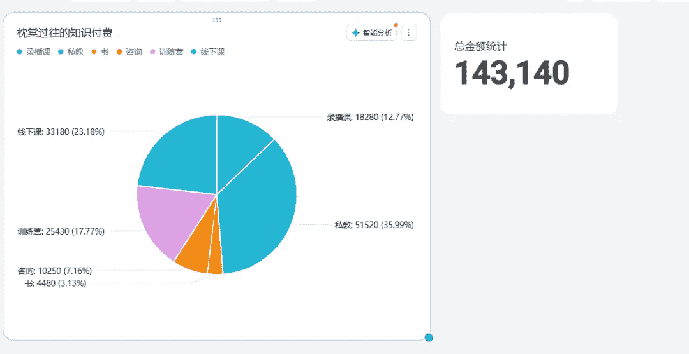

那到底为什么要知识付费呢，我觉得可以有很多原因。

**但最**核心的原因其实只有两个字，那就是——人性

既是我们自己的人性，也是别人的人性。

### 人性之一：沉没成本

>

> 人只会真正重视自己花了大量时间、金钱投入的东西。

>

> 举个很让人痛心的例子，

>

> 为什么有很多女孩哪怕自己的丈夫出轨，家暴，都不会选择离婚。

>

> 其实就是因为她在这段关系投入了数十年的时间，已经有了孩子，沉没成本太高了。

>

> 而人性不只有负面效应，还可以利用，还可以让他有正面作用。

>

> 说实话，我们很多时候的确很难坚定地选择某个项目。

>

> 专注的道理大家都知道，但实际上的专注却很难。

>

> 那怎么办呢？

>

> 我们可以用理性去说服自己，用反馈去喂养自己。

>

> 但问题在于，理性是会波动，做项目的正反馈也总来的很慢。

>

> 而这个时候有一个很好的方法：

>

> 就是让自己付出沉没成本，也就是知识付费。

>

> 比如我自己，每个月都会固定花3000到1万块去买课，为什么呢？

>

> 一是为了保证自己的认知在不断增长，二是为了沉没成本让自己不得以思考和迭代。

>

> 当你花了这笔钱的时候，你就会逼自己认真去做，

>

> 想着“钱都花了，总得回本吧”，这就是人性。

>

> 同时你会发现，为什么在我们赚钱里，做副业的成功率比外界高？

>

> 为什么航海期总是容易比别的时间更容易出结果？

>

> 信息是一方面，更重要的是：

>

> **大家都交了钱，哪怕只是3000块，都是一定程**度上的破釜沉舟，都会让人逼着自己往下走。

>

> 所以，如果你想在一个赛道上坚定地赚到一万块，不妨给自己一些沉没成本——找个老师，报个课，逼自己破釜沉舟。

### 人性之二：偏袒之心

>

> 人性还有另一面，就是偏袒。

>

> 我们再利他，也不可能把所有“独门绝技”免费告诉所有人。

>

> 就像我，很多最核心的细节，我往往会优先讲给自己的内部学员，过段时间再对外讲。

>

> 同样地，当我给我的老师付了高价，他也会告诉我一些绝招，那些我自己摸索几年都不一定能想到的东西。

>

> 我们会很努力的做到利他，但所有人都会有偏袒之心，这是人性。

>

> “饿死师父，撑死徒弟”的现象到处都是，所以真正的传授，往往只会发生在信任关系里。

>

> 知识付费的价值，是少走弯路，是快速掌握一个项目的核心矛盾。

>

### 最后提醒：一定要买实践家的产品

>

> 最后一个提醒：买产品的时候，一定要买实践家的产品，而不是理论家的产品。

>

> 如何辨别他是不是实践家呢？

>

> 很简单，你先看看这个老师：

>

+   他自己有没有成绩？

+   他写的内容是不是能打动人？

+   他做的产品是不是跑得通？

>

> 千万别信那种“带你月入过万，不成功全额退款”的广告，因为创业本来就是有风险的，可能第二天你再点开，就会发现他的🛰️已经变成一个红色感叹号。

>

> 而且我最近也有感觉到，知识付费市场有点“劣币驱逐良币”的感觉。

>

> 有好多来找我学习的学员，可能都被割过0~3次。

>

> 事实上，哪怕是我，也曾经买过很多没有价值的产品，花了大几千，结果博主只在群里转发自己的公开直播........

>

> 所以在付费之前，还请认真分析，去买一个实战家的产品。

>

> 当然，不管怎么说。

>

> 知识付费的的确确是一个非常好的成长方式，

>

> **他能买来沉没成本后的专注，买来可以节省几年**时间的信息差，买来一条更快到达终点的路。

>

> 而在读这篇的帖子的大家，也是知识付费一起加入了赚钱，才有幸遇到。

# 四.维系篇：如何稳定年入20w+，摆脱看天吃饭？

## 1.去建立系统和sop。

今年是我做自媒体的第三年，虽然收入在不断的增长，但依旧有一个很明显的感知：

生意真的越来越难做了，而且经常提心吊胆，担心朝不保夕。

熟悉我的朋友可能知道，我是一个风险偏好比较低的人。

所以过去的这段时间里，我一直想：

能否有一个东西帮我稳定的赚到钱？

大概思考挣扎了很久，我终于在去年得到了答案。

不过在具体聊之前，我想先和你聊一下很好玩的现象：

> **我发现很多**人，包括之前的自己，其实做生意的状态都像是看天吃饭。

>

> **凭借自己的灵感，能力高低去做事，高峰期还好**说，但在低谷期基本上没有什么收益和增长。

>

> 尤其是知识付费，更是可以粗暴地分成两类人：

> 

> 第一种**是灵感型创作**者，第二种**是系统型创作**者。

>

> **不巧，本人之**前就是一个很牛逼的“灵感型创作者”。

>

> **我写出来**的东西很有灵气，读的人也觉得不错，但问题是——产量太低，更新量总是上不来。

>

> 想过很多办法，但几乎都没用，灵感这个东西，就是那么随机，难以捉摸。

>

> **而一旦没有灵感和内容，不但写不出内容，我还会感觉到**心情不好，然后朋友圈转化也都不想去做了。

>

> 这个问题一直困扰我很久，甚至很长一段时间，我都不敢去和我的朋友讲自己所做的事业。

>

> 因为我打心里觉得“我做的事情是不稳定的，这个事业是难长久的”

>

> 直到后来我慢慢解决了这个问题，拿到了一个结果：

>

> 只要我愿意投入时间，每个月都能获得五位数及以上的收益。

>

> 那我做了什么事情呢？

>

> 其实就是搭建了sop，成为了一个系统型创作者。

那什么是 SOP呢？

**SOP，全称 Standard Operating** Procedure，也就是标准化流程。

说白了，就是把那些靠感觉、靠灵感、靠临场发挥的事情，拆解成有标准、有节奏、有产出的系统。

这么说可能有点抽象，举几个例子。

我之前经常失眠，总是躺在床上才开始难受和焦虑。于是我搭建了睡眠的sop，而后睡眠质量开始稳定。

+   **睡眠 SOP**：白天运动晒太阳 →不喝咖啡因饮料→ 晚上准时停工 → 睡前足浴冥想放松 → 稳定时间上床入睡。

之前有好友加我，或者有流量进入我的账号，但收入也还是不稳定。但当我构建sop后，每个月的转化率都有了保证。

+   **新加好友转化 SOP**：前端筛选 → 见面礼建立好感 → 打标签 → 朋友圈陪伴 → 发售转化。

包括在我研究时间管理之前，也很难稳定推进自己的目标，很难拿到一些成绩，直到后来我想要的每个目标基本都能实现。

+   **长期目标推进 SOP**：筛选愿景 → SMART 确定目标 → OKR 拆解落地 → 布局到每月/每周→和每天计划挂钩→定期复盘

或者我最近在做垂直小号，为了提高我的写作效率，我也试着去拆解了sop，肉眼可见的提高了1.5倍的效率。

> SOP 的意义在哪里？我觉得主要是两个。

>

1.  **确定性拿结果，极大降低风险**。

>

> 不用再靠运气，而是靠系统能拿到一些结果。

>

> 创业本质上就是一个**概率游戏**。既然是概率游戏，那我们就需要用 SOP 和系统去对抗概率，而不是天天靠灵感和鸡血。

>

1.  **把有限的精力放在最重要的事情上**。

>

> sop的本质就是，固定 90% 的行为 + 10% 的主观能动性，很多行为交给 SOP 固定下来，就能降低非常多的“决策成本”，直接执行就好。

>

> 比如说如果想治疗睡眠，我不需要多想，我只需要按照sop一步步去执行就好了。

>

> 然后把有限的心力放在最重要的板块上，力求去博得一个更大的收益。

有了这样认知后，基本上后来做每一件事情，我都会试着去建立sop，把整个执行的步骤都固定下来。

**因此，对我来说，只要能拿到一次结果，那就**有很大的可能性，可以重复的多次拿到结果。

## 2.要学会算账

如果想要稳定六位数的收入，首先要学会算账。

很多人做知识付费，或者做内容创业，容易掉进一个坑——我们太喜欢写，太喜欢表达，太像一个“语文老师”。

写东西的时候很爽，交付的时候很有成就感，但问题是收入总是起不来。

真正要把收入做稳定，就得像一个**数学老师**，要学会算账，要学会操盘。

> 月收入 = 月流量 ✖️ 转化率 ✖️ 产品价格。

+   **月流量** = 总投入时间 ✖️ 内容产出效率 ✖️ 单篇内容引流数。

+   **转化率** = 朋友圈转化 + 发售（直播）转化 + 私聊转化。

+   **产品** = 引流品收入 + 拳头品收入 + 利润品收入。

其实每个环节的成绩，都是可以通过统计量化出来的。

只要把每一个环节确定化，补足短板，延长长板，收入自然就能稳定增长。

或者说，赚钱从来都可以是一件**确定性的事情**。

只是很多人没算过账，总觉得是赛道的问题、平台的问题，最后怪东怪西。

当然，如果你现在还没到五位数，其实不用太早去纠结数据。

这个阶段靠一腔热情猛冲就行，先把闭环跑通，赚到第一笔钱，再来算账也不迟。

另外提醒一点，永远不要做交付周期两年以上的产品。

我见过最惨的小白案例，就是花了几百块招学员，结果卖了个“七年合伙人”。

交付根本交不掉，最后不是退钱就是被骂，直接退圈。

这一点本质上来说，就是完全没有算明白账，只计算了营销的成本，完全没有计算交付的时间成本。

999块的七年合伙人，也就是说每年只能赚130左右，搬砖都比这个赚的多呀。

## 3.要利用杠杆

当你开始追求更高收入的时候，就一定要懂得用杠杆。

因为他是典型的“一份时间，多份收益”

## 1.资产杠杆

>

> 所谓资产杠杆，就是那些可以**低成本多次使用**的东西。

> 

> 比如我今天讲的这篇文章，他最早来自于我的线下分享，我还把他作为一场发售的内容讲了一下，而同时它每个版块都能当做一篇文章的主体部分。

>

> 或者说，我觉得互联网时代，一人公司最好的一点就是：

>

> **我们能够通过各种方便的sass工具，像飞书，n**otion，来系统性沉淀自己的知识资产。

>

> 我做过的很多课程，写做很多文档，整理过的很多sop，可能做的时候是几年前，但可以一直用到现在。

## 2.人力杠杆

>

> 第二个就是人力杠杆，我对人力杠杆的理解就是：

>

> 把自己做起来roi不高的事情外包出去。

>

+   我的海报，永远是让设计师做的，因为我自己审美比较一般。

+   我的排版，以前也是外包做的，现在有了 SOP，我五分钟就能解决。

+   最近我还在招募助理，把运营交出去，因为我自己更喜欢做内容。

>

> 简单来说，就是**只做自己擅长的事情**。

>

> 杠杆的意义就是**让 1+1＞2**。

>

> 用好资产杠杆和人力杠杆，你才能从单打独斗走向稳定增长。

而除了这两个杠杆外，其实还有更多的杠杆，比如说媒体杠杆，代码杠杆。

不过这些我并没有特别大的洞见，就不在此处班门弄斧了，感兴趣的朋友可以自行了解。

# 五.未来篇 ：那条去百万的路上

## 1.永远谦卑，不断学习

说实话，这一点是我和很多年入百万的前辈聊过之后，反复被提醒的。

也是我自己踩过坑、交过学费才真正悟到的。

我曾经犯过一个很大的错误。

>

> 大二的时候，我第一次月入过万，整个人不可一世。

>

> 那段时间我成绩一落千丈，有一门课只考了60.2分，这是我这辈子唯一一次险些挂科。

>

> **当时别人**问我为什么能赚钱，我的回答只有三个字：我牛逼。

>

> 至于哪里牛逼？

>

> 我自己也说不清楚，只不过是有点年少得志的猖狂，不知天地为何物了。

>

> 那段，每天不是想着出去玩，就是想着旅游，完全不知道什么叫节制和学习。

>

> 直到后来，积攒的私域流量耗尽了，成绩也下滑了。

>

> 残酷的现实给了我一巴掌，我才意识到，必须去做新的事情，必须去重新学习。

>

> 然后一直谦卑，偶尔自傲然后继续敲打自己，才慢慢走到了现在。

而这一路走来，我看到过太多人，躺在功劳簿上吃老本。

毕业三四年了，还在聊自己大学时的奖学金；

甚至有人四十多岁了，👸号自我介绍里还写着“中考时成绩全县第一”。

我并不是看不起他们，但在我看来，这是很悲哀的。

你曾经的辉煌一旦成为了遮羞布，就说明这二十年其实是白过的。

或者说，我现在有一个特别核心的价值观。

> **我们永远都有东西可以学习**。

>

> 学优秀者的理性，也学愚蠢者的乐观。

>

> 我以前不理解，为什么有人愿意向年幼者学习，后来才懂：

> 

> 我们从来没有向某个人低头，折服我们的只是真理本身。

>

> 随着时代的发展，我们做生意所需要的认知和能力，必须不断迭代。

>

> 学如逆水行舟，不进则退；赚钱也是如此。

## 2.做时间的朋友。

###

> 需要承认的一个事实是，那些能够稳定年入百万的人，大多都需要5~10年的积累。

>

> 理想的情况下，做自己的事业需要5年，上班打工需要10年。

>

> 一开始我不愿意认他，每一个一夜成名的案例都会成为我做梦和着急的理由。

>

> 但最后我开始理解，开始尊重，因为抛开那些运气好的，那些天选之子。

>

> 我们普通人能够安安稳稳的实现年入百万，实现阶级跃迁，已经是不容易的一件事。

>

> 如果要实现这些目标：

>

> 那就需要十年如一日的学习，实践和迭代。

>

> 学习：要一直摄入新的信息，高质量的信息。

>

> 坚持：要不下牌桌，持续去做哪些难而正确的事情。

>

> 迭代：每年每月都去复盘，保证不会走错路。

以上就是本次分享的全部内容，

每年9月，我都会动笔写一篇文章，发在赚钱，作为对过去一年自己的总结和复盘。

至今是已经是第三年了，

> 第一年的时候，我刚刚起步在时间管理航海做了教练，

> 第二年的时候，我事业有了起色，多次月入5w。

> 第三年的时候，也就是现在，从大学毕业，成为了我曾经向往的超级个体。

> 而关于第四年，会发生什么，很是期待。

感谢赚钱中学到的一切，也感谢大家的时间。

感谢阅读，一起龙哥盟~