# B 站好物红包 + 投流玩法操盘：双11期间23天GMV破千万，利润7万！

> 来源：[https://xuqiwei1986.feishu.cn/docx/YnSadAUXqoETu9xWmVTc0FABnsd](https://xuqiwei1986.feishu.cn/docx/YnSadAUXqoETu9xWmVTc0FABnsd)

在双 **11** 营销大战中，B 站流量生态暗藏很多的机遇。这篇复盘里聚焦 “红包 + 投流”组合玩法 ，拆解我如何在 23 天内实现 GMV 破千万、利润 7 万的实战逻辑，所有策略均基于 B 站底层流量逻辑设计，为品牌 / 创作者提供可复制的增长路径，堪称商业机密！！！本文档基本上是11月2号在深海圈直播文档的基础上增加和修改了一些内容，核心的东西都在，文档里依然有残留我直播文档中对深海圈同学们说的内容，看的时候你们也可以代入你们也是B站好物深海圈的一员。

# 本文档所有内容都基于红包加投流这个玩法！！！！但是底层的B站流量逻辑是通用的！！！！

话不多说，还是老规矩，先上战绩。

**战绩详情**

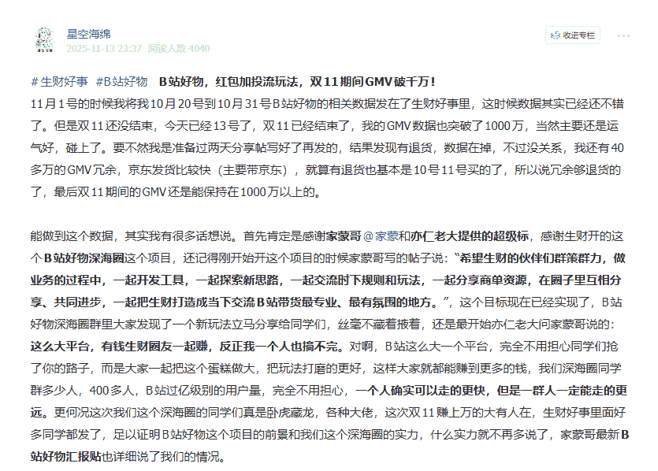

【赚钱好事！B站好物，红包加投流玩法，双11期间GMV破千万!】

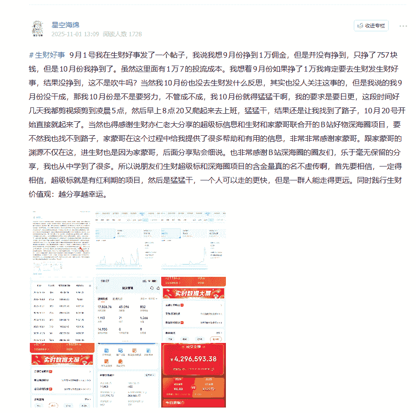

【一个人可以走的更快，但一群人能走得更远】

# 前言：为什么分享出来？

我也是偶然间才发现的这个玩法，我10月20号起自己亲自在这边验证了10来天的实践认证，感觉效果还是挺好的，操作的逻辑简单粗暴。

那么可能有人要问，我为什么要把这么好的玩法分享出来，不自己闷声发大财呢？

首先这10几天我一边验证一边也赚了一些，其次是我很感谢家蒙哥和赚钱。

首先是家蒙哥，我之前一直在小宇宙里面听家蒙哥和阿宅的【亏钱指南】播客，一期没落下，全部听完了，从里[面也学到了很多东西，然](https://xkhm.net/post/%E7%94%9F%E8%B4%A2%E6%9C%89%E6%9C%AF%E7%A4%BE%E7%BE%A4%E8%B0%83%E7%A0%94/)后我就发现一点，好多分享的嘉宾都[是赚钱的，于是我](https://xkhm.net/post/%E8%BF%87%E5%BE%80%E5%89%AF%E4%B8%9A%E8%B5%9A%E9%92%B1%E5%AE%9E%E8%B7%B5/)就去调研了一下赚钱，当时还写了一个调研相关的文章 龙哥盟值不值得加入？，后面又复盘了我过往的赚钱经历 过往副业赚钱实践 ，总结就是过往副业并没赚到钱，然后赚钱是值得加入的平台。

下面是我当时调研出来的结论，我需要的是一个赚钱的社区氛围，我之前经常逛推特，我希望推特推荐流能给我营造一个这样的氛围，可惜未能如愿，推特给不了，加了赚钱之后我就很少逛推特了。

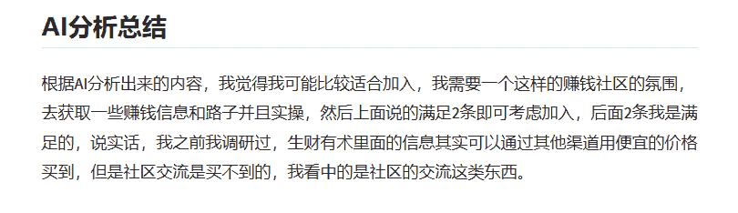

那我怎么发现家蒙哥的【亏钱指南】这个播客的呢？

因为我也想做副业，也想在工作之外挣点外快，但是我本身是程序员，上班非常忙，不过工作时可同时听播客和写代码，然后应该是搜赚钱相关的播客，机缘巧合下搜到了家蒙哥和阿宅的【亏钱指南】，发现非常有含金量，内容干货满满极具价值，就一期不落全部听完了。

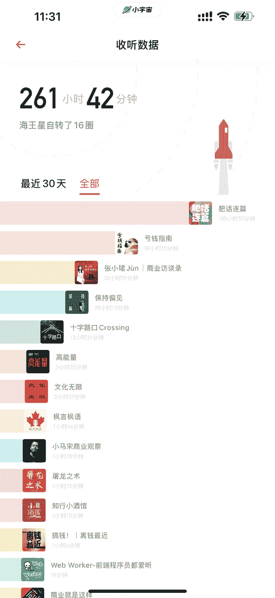

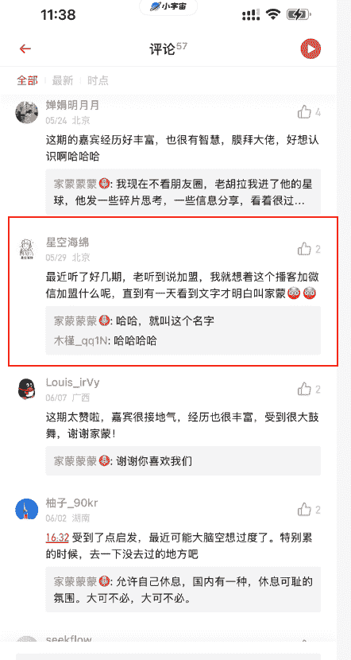

我是今年7月4号正式加入赚钱的，截止（11月15号）也就4**个月左右**，属于赚钱新人了。这里要感谢一下邀请我加入的推特玩币圈的大哥@清水哥。我最初是在推特上留意到他的推广信息，随后主动添加了他，因赚钱有邀请返点机制，通过他的邀请可降低门票成本。清水哥将他获得的返点全额转给了我，他纯粹是为了推广赚钱，这份慷慨让我十分感激。加入赚钱前有个7天的试用期内，我在试用的时候就留意到龙哥老大发的“B站好物"这个超级标,为我后续的探索埋下了伏笔。

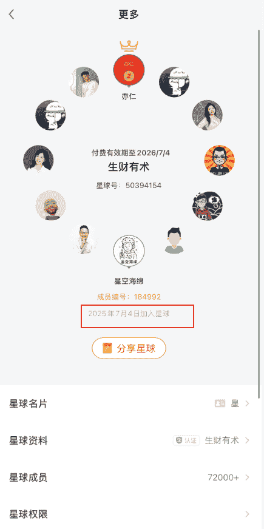

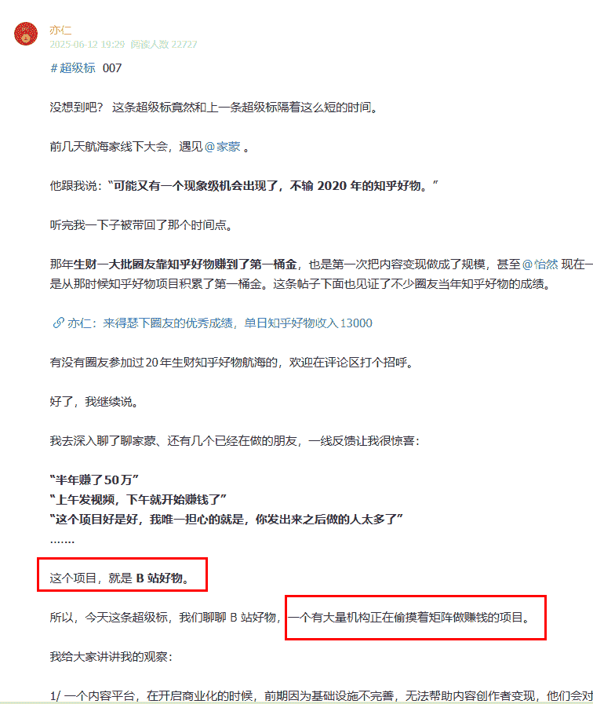

# 1.玩法价值：为什么要做红包 + 投流？

1.  **流量红利**：B 站用户年轻、消费力强，双 11 期间红包玩法自带话题性，易引发互动传播；投流则能精准撬动算法推荐，放大流量效果。

1.  ROI 可控 ：通过红包刺激转化、投流定向人群，可实现成本与收益的精细化调控，本案例已验证利润空间。

1.  **长期资产**：玩法沉淀的内容、粉丝可转化为品牌长效运营资产，而非单一促销行为。

我本身做过B站视频，也是B站老用户，正好也积累了1000多粉丝，天然的适合这个项目，我就开始投身其中。7月3号我发了第一个视频，制作的很粗糙，因为没人指导，我也不会，就自己瞎摸索。

后面发现了好价线报这条路子，然后加开始做这个路子的视频，**做到7月20号，我**[**基本摸透了线报的玩法，还在赚钱**](https://wx.zsxq.com/group/1824528822/topic/5125811812848254)发布了一篇《B 站好物悬赏带货实践分享》的帖子，内容是半个月成交金额破万，这篇帖子还被加精了。然后我一直坚持做线报类视频，但是做线报类视频并没有让我赚到钱，但是这段经历和做的那些线报视频，也给我的红包投流这条路子铺了路，这一点后面会详细说明。

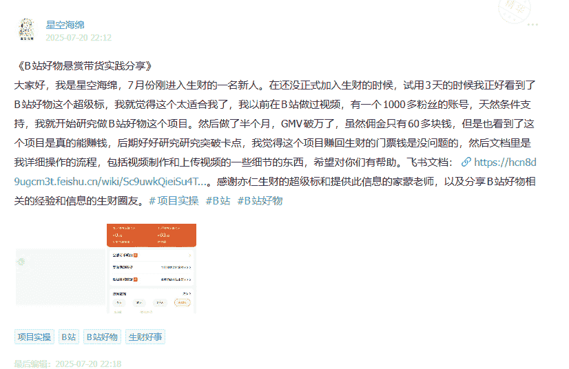

参加的深海圈之前，我就一直坚持发线报类视频，但是一直没赚到钱，中间8月份的时候我也跟赚钱的圈友小源认识了，我俩聊下来达成共识：线报类内容局限性大，真人出镜流才是更优选择，毕竟这种形式能支持投流放大。后来家蒙哥开了B站深海圈的课程，我们第一时间报了名，当时就觉得，靠这门课挣回学费肯定不成问题。

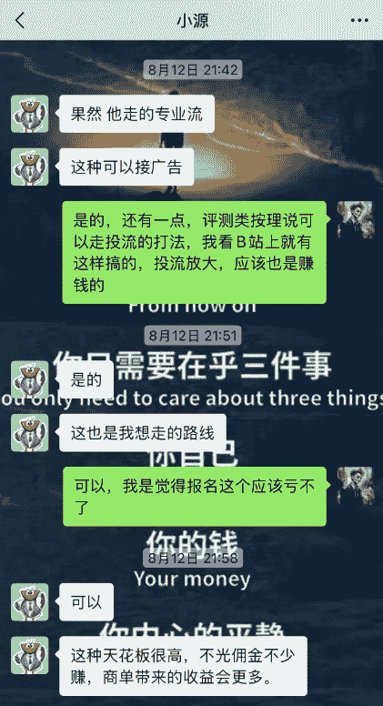

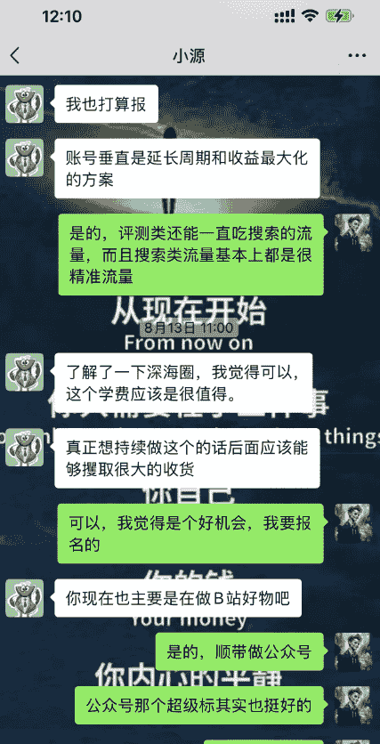

报名之后就是跟着家蒙哥系统学习做B站好物真人出镜流的实操方法，学完9月份发了第一个真人出镜流视频，

之后便一边继续更新线报类内容，一边深耕真人出镜流。这段时间虽然没[赚到](https://wx.zsxq.com/group/1824528822/topic/8854558544558552)太多钱，但积累的经验都很有价值，后面会详细说。9 月 1 号我还在赚钱发了篇帖子，当时给自己定的目标是：9 月份靠这两类内容挣到 1 万佣金。

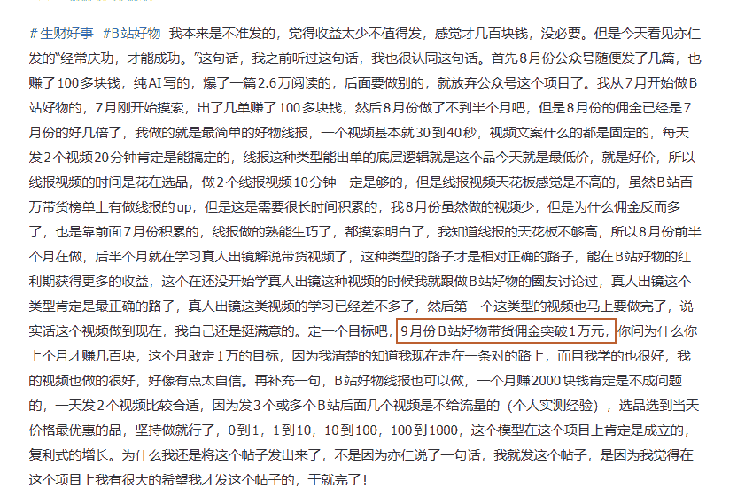

哈哈哈~~事与愿违但是9月份最后只挣了757块钱。

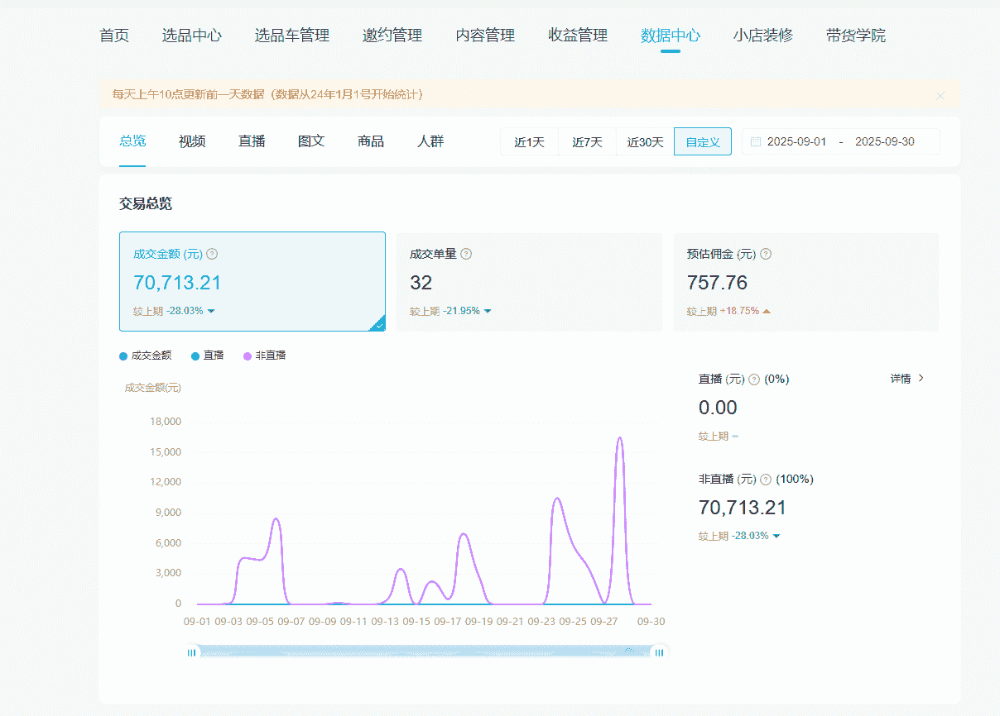

最终 9 月只挣了757块钱，这是重点——

当初在赚钱发帖立誓要赚 1 万佣金，还想着要是达成目标，肯定要去赚钱好事板块报喜，结果没挣到，这不是吹牛吗？

当然我10月份也没去赚钱发贴反思，其实想来也没人关注这事的，但自己心里有数：9月份没干成，那我10月份是不是要努力，不管成不成，我给自己定了日更目标：我10月份就猛猛发线报类视频和真人出镜类视频双轨并行。

那段时间是真拼， 好几天我都剪视频剪到凌晨5点，然后早上8点20又爬起来去上班，猛猛干，完全是连轴转的状态。10月20号那天，我也要更新，但是线报类视频没有好的低价产品，没办法发，就在B站找灵感，发现一个双11攻略类视频，我就也做了一个，跟做线报类视频差不多，就是截几张图，然后箭头指一下，这个视频做完发布已经是凌晨2点多了。

没想到白天起来一看，这条视频流量特别好，我就想着投流试试，之前家蒙哥开直播跟我们说过，投流投蓝链点击，这里也非常感谢家蒙哥给我们说的这个信息，我就去投蓝链点击，结果投流效果超出预期，我就一直往里面投钱。正好这天是京东的大促，运气也站在了我这边，订单哐哐往外出，这天白天我投的300块钱就回本了。

晚上8点大促开始，直接开启疯狂爆单模式，然后我就疯狂投钱，一开始还挺舍不得，心里嘀咕少投 300 块不就多赚 300 块吗？但转念一想，这种机会说不定这辈子都遇不上几次，凭运气来的红利，谁能保证下次还能有？想起之前看英雄联盟 LCK 比赛里，有个职业选手说的那句话：“我必须考虑这会不会是我此生仅有的机会”。幸好这话没说死，后面 10 月 30 号又迎来了一波大爆单。

> **风险提示**：

> 为什么刚开始我发现这个路子的时候不立马分享出来，因为这个路子有个核心原因：投流是需要成本的，也就是操作不当有可能会亏本，我刚摸索这个方法的前几天，其实一直没跑正收益，最近（指11月2号直播那天）才跑出比较好的效果。

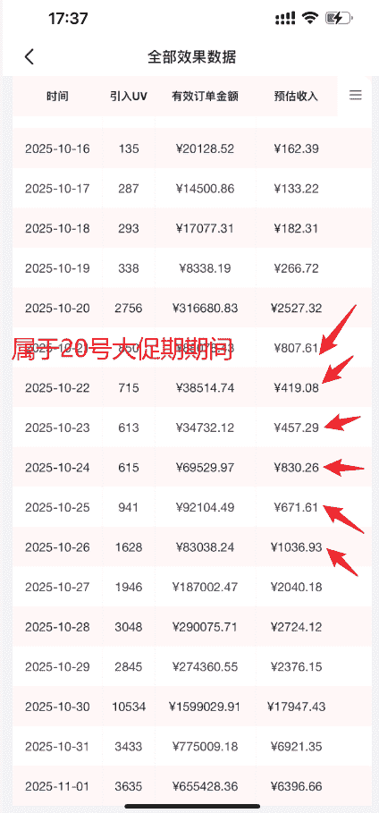

我不能保证你们能跑出我这个效果，所以说有风险，你们需要注意，如果你们觉得这个风险有点高，那你们就可以听听这次直播，你们只要一直做B站，那今晚直播对你依然有用，因为你总有一天会接触到投流，投流的底层逻辑是不变的，万变不离其宗。

特别想借这个机会感谢几位圈友 —— 十方、书野还有小源。从一开始做 B 站好物带货，我就和小源认识了，平时不管是思路还是实操技巧，他都毫无保留地跟我分享。十方和书野也一样，总能把自己的干货拿出来带着大家在群里交流，我真的收获太多了。

大家都这么敞亮，我肯定不能闷声发大财，有钱就得一起赚嘛！

说实话，没有赚钱这个平台，没有家蒙哥的课程，没有深海圈的氛围，我根本找不到这个变现路子，更赚不到这些钱。所以现在跑通了，必须第一时间把经验同步给大家～

# 2.红包加投流玩法怎么玩？

我在前言里写下“堪称商业机密”，核心是我认准这套玩法的硬实力——逻辑简单直接、落地效果扎实、天花板足够高，关键的是具备完整可复制性。效果不用我多说了，文中附的数据已经直观呈现，这里还是必须先泼一盆冷水：投流有成本就必然存在亏损可能，我没法保证每个人都能做出同等效果，能做的就是把自己摸索的全流程经验毫无保留地拆解。如果承受不了投流成本，更建议从自然流玩法起步。

**之所以愿意把这样的玩法分享出来**：

一是心怀感恩——赚钱和家蒙哥当初把“B站好物”的关键信息传递给我们，而B站流量池足够大，完全容得下大家同台赚钱；

二是自己有底气——10月20号发现玩法后，我用10天时间摸索成熟并赚到了收益，已经验证了玩法的可行性；

三是相信规则——后续还有十几天的红利期（红包活动截至11月14号），谁能接住机会全凭自身本事，我只负责把“渔”交给大家。

补充两个关键信息：之前预判11月9号晚8点到11号晚24点是爆发期，后续数据证明更猛的是30号晚的大促节点，但9-11号的三天持续转化也很可观；选择带京东链路，是因为京东的数码家电品类受众与B站用户高度契合，天然容易冲高GMV，并且平台本身有额外奖励加持。下面展示的数据，是11月2号截取的双11前面阶段的运营数据成果。

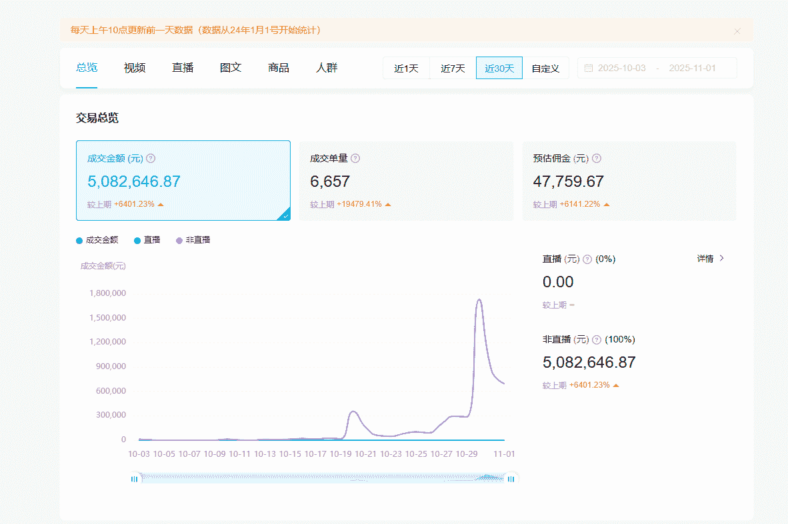

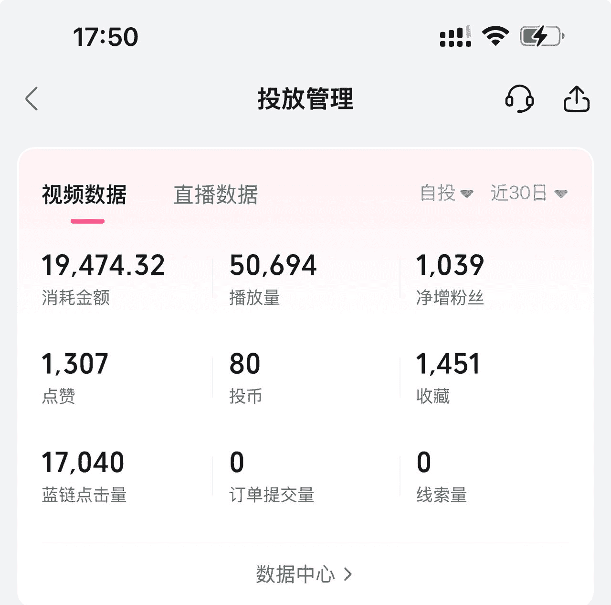

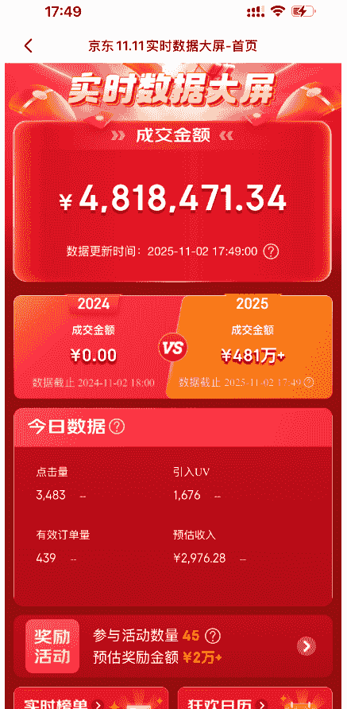

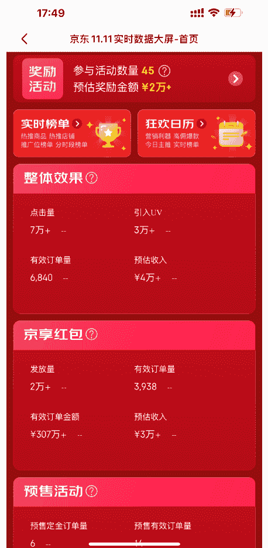

### 再次提醒，投流有成本，有亏本的可能，投流需谨慎。

>

> 跟大家说句掏心窝的话：我最担心到时候我分享出去你们玩亏了，觉得我藏着掖着，不愿意把某些点告诉你们（所以你们实操有亏了，不要来指责，我是已经跑通了）但是我真没有这么做——

> 你们有任何问题都可以问我，我会告诉你们，后台什么的直播的时候也都可以给你们看了，藏着掖着我就不分享，我也就不花时间写文档和直播了，我直接多发多做几个视频投流去冲千万GMV那不香吗？

## 2.1 这玩法怎么玩？

这个玩法的核心特别直接：发布双 11 红包攻略视频，视频内容的核心就是引导用户点击视频里的红包链接 ——

**只要用户点了链接，佣**金就直接锁定了，红包是先发先锁的逻辑。后续不管他什么时候下单，你都能拿到对应佣金，大家做了这么久B站好物应该都懂（补充：淘客类项目都是让用户点击或者输入某个口令买东西，就能拿到返点。）一个底层逻辑。

> **红包的 “霸道属性”**

> **红包非常的霸道，就是只要用户领了你的红包，他去平台购物，不管是买**什么，你都能锁他买的东西的佣金。这也是这套红包加投流玩法非常逆天的点，万物可锁！

这个底层逻辑很简单：你发的红包越多，赚的肯定就越多，特别是大促开始的时候，大家疯狂买，那你的GMV和佣金都会疯狂涨，也就是说你前几天发的红包被人领了没使用，大促开始的时候买你照样能锁到他的佣金。尤其是大促节点，大家集中下单时，你的 GMV 和佣金会跟着疯狂上涨。哪怕前几天发的红包用户领了没立刻用，等大促正式启动（比如 9 号晚上 8 点）再下单，你照样能锁定佣金 —— 就像 6、7、8 号领了红包的用户，9 号大促下单，佣金还是算你的。

有个关键的成本算法要跟大家说清：不能简单按 “必火推广消费多少钱 - 当天赚多少钱” 来算盈亏。也就是说这里有个成本算法，这个成本算法不是说今天必火（B站商业推广系统）消费多少钱，我赚多少钱，一减就是今天挣的，必火消费买的蓝链点击领了红包可能过几天买你还能赚佣金，赚多少钱，有些人会取消单子，过两天会少一些，总体上如果打平，后面大促来了也还能赚，这个逻辑应该没问题，反正发越多红包，就会卖的越多，特别9号前几天，6，7，8，比如6号有人领了你的红包，他9号晚上8点大促开始的时候买东西，你依然能锁到他买的产品的佣金

**提醒一下**：红包锁定的整体佣金率大概是 1%，会有小幅波动但差别不大。比如你锁定的用户后续产生 20 万 GMV，到手佣金大概在 2000 元左右，大家可以根据这个数据规划投流和红包发放的力度～

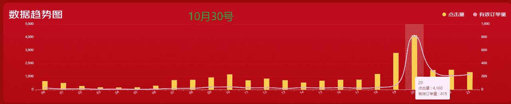

## 2.2 视频怎么做

首先找对标，去B站搜索关键词双11攻略，排在前面的数据好的你们都可以选择对标，当然你们自己有想法也可以，也可以研究测试，还有10几天呢。这里提一下虽然之前我做线报流视频没赚到钱，但是线报流视频给我做红包流视频铺了路。

就是我的视频文案开始说的：**你****看我之前做了这么多线报视频，买****到低价，不好**意思，我就是最专业的，视频在我主页你可以自己去查证，这是不是增加了你的可信度。这就叫过往的经历都有意义，都是积累。赚钱的人很喜欢发的一个表情包说：我不会失败，因为我要么成功，要么学到东西。确实是这样。

视频形式真的很简单，大家去看对标就知道了，很简单，如果[《B站好物悬赏带货实践分享》：半个月成交金额破万](https://hcn8d9ugcm3t.feishu.cn/wiki/Sc9uwkQieiSu4TkvkhvcM60EnPh?from=from_copylink)做跟我一样的视频，可以参考我之前写的   这篇文章，完全跟做好价线报一样的操作，剪映截几张图，录个屏，用箭头指一下就可以了。非常简单，这个部分就不多说，应该比你们平常做的视频简单很多。

就是一句话其实**你可以不用很专业，但是你要看**起来很专业。视频展现出来的东西要让用户觉得你非常专业，你对双11规则和攻略非常熟，跟着你视频操作我就能买到最低价，还有最最最核心的一点就是，让他觉得你评论区那个红包超级有用，一定要去领，比如文案，低价第一步，先领红包再下单。

> 这里有一点提醒，视频还是要有质量的，看上面的对标，视频长度最好不低于3分钟，后面我会详细说，这个会影响视频的权重，权重就会影响投流的成本。

## 2.3 标题

视频标题怎么取，你们可以参考搜索排名靠前的对标账号的。也可以自己借助AI让AI帮你取名。

## 2.4 封面

我是用固定模板生成一张图，然后给GPT，让GPT给生成一张图，我封面图就是这么来的，提示词：

> **帮我做一个B站视频封面，优化一下这张图，简洁大气，字与背景对比鲜明**一点，吸引眼球让人想要点击，让这张图更好看一点，这是一张海报，背景优化的好看一点

**#****投喂给AI的原图**：

**#展示****效果：**

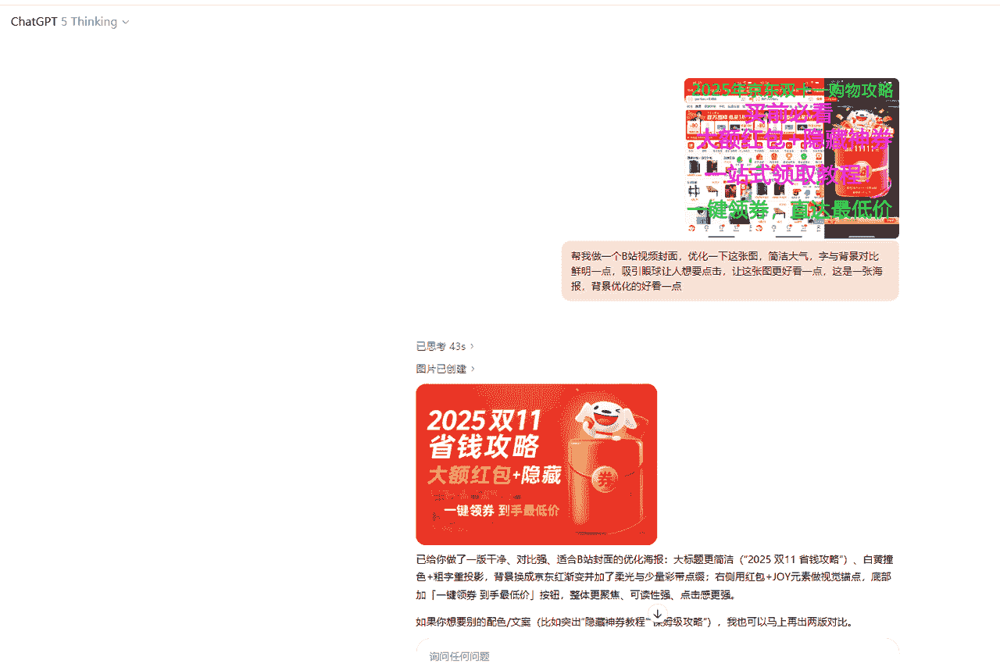

非红包流视频也可以用这个方法，效果挺好的，这应该是以前有个同学在群里分享的，我根据我的需求修改了一下，也感谢这位同学，#提示词：

> **帮我做**一个B站视频封面，优化一下这张图，要科技感，简洁大气，吸引眼球让人想要点击，尺寸不变，依然是1200*900，让这张图更好看一点，这是一张海报，不要改变我的图片大小，图片大小为宽1200px，高900px。背景优化的好看一点，背景优化的好看一点，背景优化的好看一点

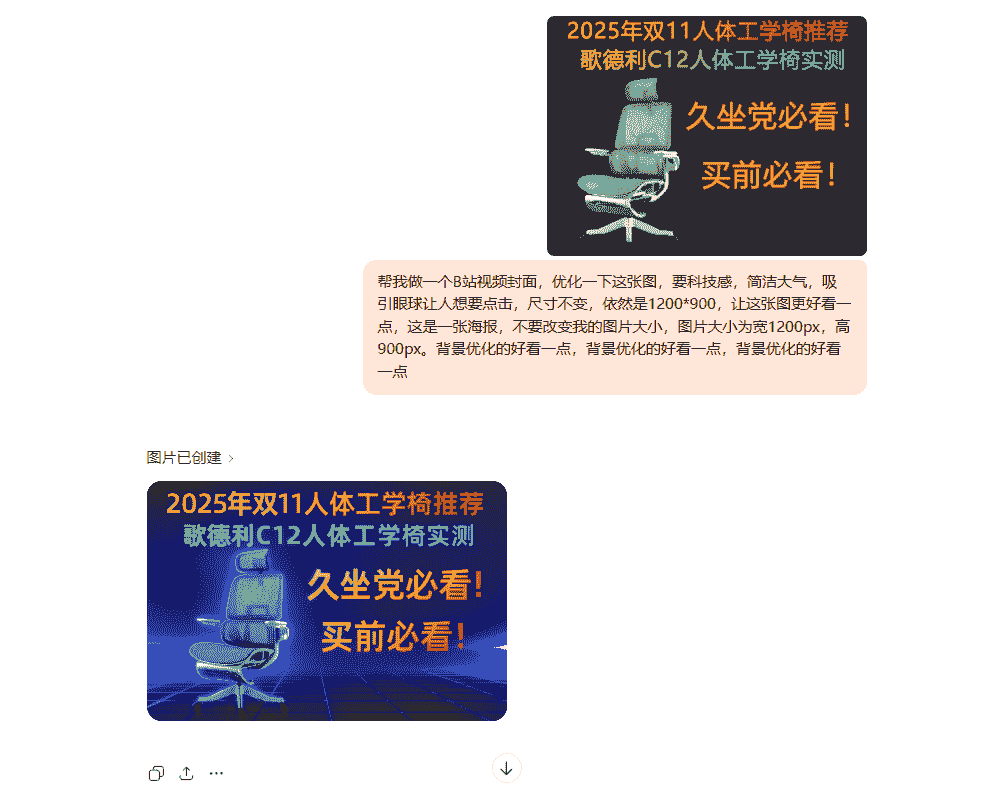

**#源头文件**

[写字.psd](https://internal-api-drive-stream.feishu.cn/space/api/box/stream/download/all/Q0pRb7e9qou1X5x3HMQcGYIbn3f)

不会用PS的你们也可以考虑，直接拿这些图让AI去给你生成，把字改成你想要的字。

## 2.5 蓝链

[蓝链挂载](https://ifklqj4jaz.feishu.cn/docx/VEnIdYhJaoUz8hx9STLcQdL7nhd?spm_id_from=888.107924.b_4d6330545a6e4833596f64.1)是基础操作（不熟悉的可以看B站官方教程），核心技巧：红包链接必须放在最前面，20个蓝链名额里，除了红包和主会场链接，可以挂热门数码产品，剩余位置优先挂苹果、小米等热门数码产品——这是我近期最近才研究出来的。

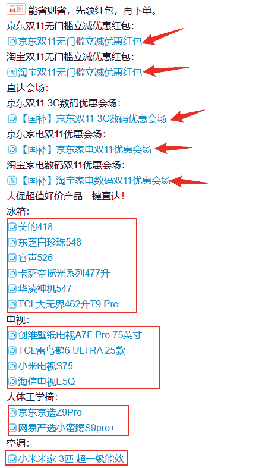

刚开始我试过挂深海圈官方资料包的高佣产品，转化效果并不好；换成热销数码品后明显改善，因为热销卖的好，这类产品受众广、销量基数大，用户点击后成交概率更高。

**这里还有个增效小细节**：如果有往期发布的优质视频，还可以把你觉得你以前做的好的视频再做一个评论，挂评论区，因为这个视频你投流了，有流量，别人也会点你原来做过的挂评论区的视频，点你这些视频的蓝链是直接锁产品的，这样你同样投流的钱是不是就买进来更多的可能，这就是之前做的那些好物推荐分析视频也是有用的。

起码证明往期的好物推荐、攻略类视频，能直接证明你作为“数码/攻略类UP主”的专业性，让用户更信任你的推荐，转化逻辑也更顺。

## 2.6 评论、弹幕维护

负面评论和弹幕一定要立马删掉，防止后续有人在评论区一直回复负面评论，抱团了就不好了。就像公司裁员为什么喜欢一个一个的单独谈，一起谈能谈好吗？

一个道理，我刚开始第一个视频不**管正面负面的我全删掉，正面**的你想回就回，想多挣点就回，带蓝链，评论区点击率也很高的，基本问的都是一些热门数码产品，其他看见的人也会点。在我评论区问的都是哪个商品最低价是多少，因为我视频里说了我是做好价线报的，然后这个获取底价网站是 https://www.lsjgcx.com/ 这个，手机也可以操作，🛰️小程序叫:历史价格查询。

## 2.7 投流

### 玩法核心：投流操盘全攻略（重中之重）

1.  **基础投流（日常的玩法）**

+   首发必投：首先视频发完之后，立马挂一个300的蓝链点击的必火，抢占初始流量

+   次日追投：次日早晨追加 500 元放心投，放心投也是投蓝链点击

✅ 注：若 “必火” 中不显示 “放心投”，直接咨询 B 站客服解决

+   复投原则：消耗完了视频效果好立**马再投。这是平常的玩法。除**了放心投，其他的普通蓝链点击是不能设置价格的，单个蓝链的价格在2块以内都可以接受，超过2块（注意这个成本，超过会亏本的），这个视频可能质量有问题，不要再投这个视频了，这套逻辑我一会会专门补充详细讲。

1.  拆解我的大促爆发期玩法（11 月 9 号节点）

11月9号晚上凌晨的时候去京东双11主会场的页面截图或者录屏做好视频之后，也是上面一样的流程，但是到了下午5点6点，你也可以更早，你要有钱可以一天都投300的蓝链点击（注意控制成本，提醒，投流有成本，有亏本风险），这个来的效果块，白天领了红包，晚上别人买了你也是锁到佣金的，根据我这几天的经验，300的蓝链点击一般不到1小时就消耗没了，特别晚上7点8点9点，流量非常大，消耗的非常快，如果这段时间你想流量更大，一个视频可以投多个300的蓝链点击（注意控制成本，提醒，投流有成本，有亏本风险），但是我没试过，你们可以研究测试。效果好（这个是指你京粉的有效订单金额和预估收入一直在涨）的话从下午5点到6点一直投到晚上12点，效果好可以多投点。然后那天凌晨的视频你们可以发多个，多个一起跑一起投可以进更多的流量，比如你前几天发的视频效果好也可以一起投，都投300的蓝链点击，非大促时间节点就投500的放心投，蓝链点击，一个蓝链的价格可以设置在1块到1块5之间。

**核心**就是从B站买流量，让用户点击红包蓝链你锁佣，大促前你发的红包越多，大促开始你的GMV和佣金就涨的越快。当然这里面你们也可以研究更好的玩法，我目前是没发现，我觉得必火现在这个效果挺不错的。或者研究研究这条链路上还能放大的点，肯定有的，这条链路的天花板很高，而且放大也很容易，无非是每天多发几个攻略视频，多个视频同时投流，但是一个号这样干可能效果不好，一个号一天最多发2条比较好，有多个号可以多个号同时操作，效果肯定比1个号好，这里面还有很多可以摸索和研究的点，我也是最近才摸索明白一点。

#### 实测佐证 & 风险提醒

+   我 10 月 20 号发现到至今（11 月 2 号）已发放 2 万 + 红包，验证玩法闭环；

+   ⚠️ 核心提醒：投流有成本就有亏本风险，所有策略需结合自身成本承受能力测试后再落地。

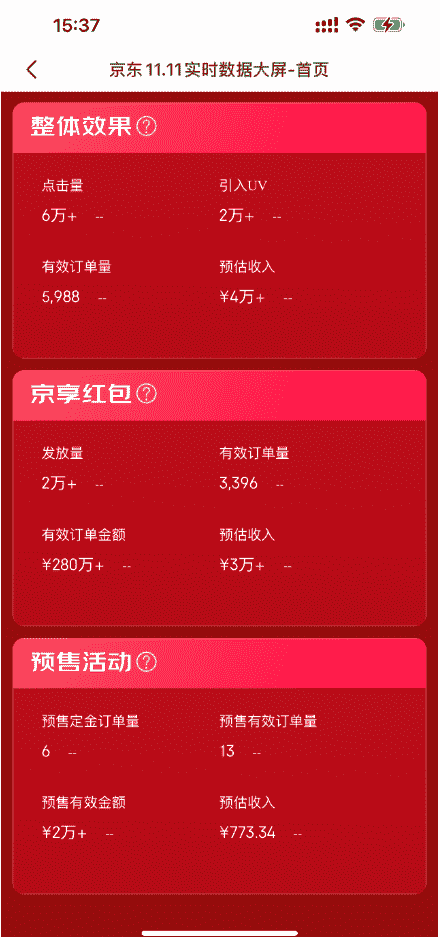

# 3.红包加投流核心底层逻辑

## 3.1 B站流量机制底层逻辑（重点）

当你从**B站发了**一个新视频，比如是早上8点发的，那么在8点到9点这一个小时（也可能是几个小时）内发的这些视频会进同一个流量池，这里面数据好（三连，分享、完播率、评论、弹幕等指标）的视频后续肯定会得到更多的流量，因为系统会认为你是优质视频，把你推给更多的用户，这就是很多自媒体平台所谓叫"赛马机制"的流量逻辑，👸号推流应该也是这套逻辑。补充一个点，视频的长度有没有可能在算数据的时候占一个权重呢，根据和一些同学的交流来看很有可能。

那么投流在上面这个过程中起到了什么作用呢？

投流简而言之就是会将你的视频推给更多精准的用户去评判，如果质量高那么你的数据就会更好，在你发布时间的这个流量池里面你就会排到更前面，后续你就会得到更多流量，比如你凌晨发布的视频，投了300的蓝链点击，得到了一个不错得数据效果，你这300消费完了，没有投流了，系统后面还是会给你自然流的，这个从我这边的效果来看这个逻辑是成立的。

那么问题来了，既然大家都在一个流量池，投流会给你的视频增加更多的机会，那么对其他视频而言是不是会不公平，系统会不会给投流的视频在同样的数据效果下给投流的视频在系统里打折，比如你是投流的在系统里数据效果是100分，人家跑自然流的打分是70分，后续你俩得到的自然流是一样的，也就是你们在同一个流量池里排的位置是一样的，那也就是投流的数据效果打了7折，因为给了你更多的机会。

这个我不知道，我只是猜测会不会对自然流用户有这种效果补偿机制，用来维持整体视频的质量，要不然用户全看到的是广告，那就拉低用户体验。(这个逻辑基本是成立的，不过更细的可能是自然流和投流的是跑两个流量池，最后合并到一个流量池去计算效果分数，后续再决定推多少自然流。)

所以说投流除了投放心投可以设置蓝链价格，例如1块钱1个蓝链，其他不可以设置价格的，肯定是跟你的视频质量是挂钩的，这个我敢肯定，你视频质量好，平台肯定能给你推给更多精准用户，这样滚雪球，肯定是越投越好，平台知道效果好，肯定也愿意给你推，你也会再投入更多，这个逻辑大家肯定都懂。

关于新视频发布启动的思考（这是我11月10号左右测试发现的），还有一种操作，那就是新视频发布后先通过必火系统投播放量和互动量，等这个跑上去，再去投蓝链点击，这就相当于你的冷启动阶段会启动得更快，因为你获得的机会更多了，只要你视频质量没问题，那你们肯定会在赛马机制里面遥遥领先，掌握了这一点只要你视频质量没问题，你基本上每个视频都能跑出来。

我的底层逻辑是这样，所以我才觉得这套方法能跑出来是有理论支撑的，是可以复制的。

参考文章：B站视频流量规则与避坑指南（2025年3月更新版）

## 3.2 关于投流成本的思考

**两种投流工具的核心定位**

+   **300 元普通蓝链点击：**短期流量引爆器

投流的成本逻辑是300的普通蓝链点击就是拉短时间流量的，300的普通蓝链成本是跟视频质量挂钩的，这个是肯定的

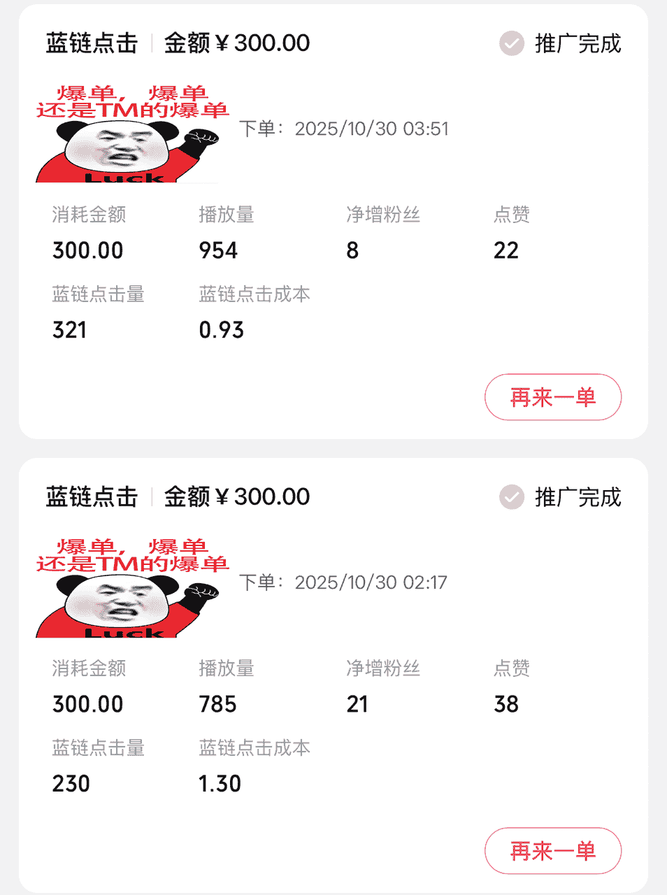

+   **500 元放心投**：成本控制器

500的放心投是控制成本的， 如果想控制成本，新视频发布后就直接挂500的放心投，蓝链价格设置1块钱，也就是500块钱买500个蓝链点击，你说500个蓝链点击（基本点的都是红包）在双11期间赚不了500佣金，那我是不信的。冷启动只挂500放心投的缺点是启动会更慢。

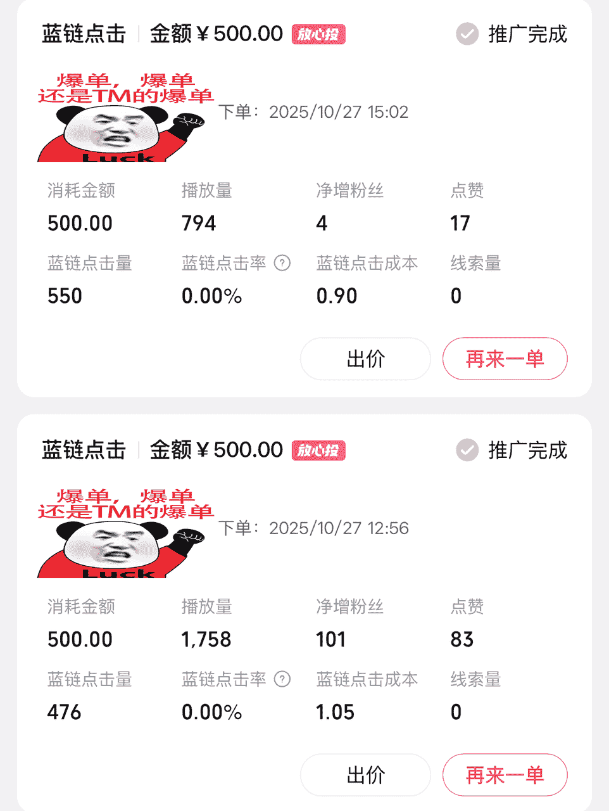

挂300的启动肯定会更快。那么什么时候投300的呢，你说大促期间我想今天多卖点GMV，我之前这个视频投的效果也很好，那么你就可以挂着500的放心投，再同时挂着300的蓝链点击，一起跑，这样你是不是就能跑出更多的流量出来，当然成本是提高了，自然你的收益也会提高。也就是说投流我们本质上是可以控制流量大小的。

说到最后，**投流本质上是一个放大器**，你视频数据好那么投流效果自然好，视频数据不好系统推的费劲，系统就会收你更多的成本，甚至是500的放心投根本跑不动，系统最后宁愿给你退钱加赔偿，那么这个视频你就不用投了，视频质量大概是有些问题的。还有一点可以说明视频质量的问题，那就是你会涨很多粉丝，那么你就知道你的视频肯定是对用户有用的，对用户有用那就是系统里的优质视频，系统会给你流量的。

> 我们赚钱的本质是 “流量变现”，而这套玩法做到了三点关键：流量大小可控制、成本可调控、红利期可复用。10 月 20 日至今（11 月 2 日）我经过了10 多天的实践，到最后11月11号结束已跑出千万 GMV 验证可行性。

> 建议先从 “300 元普通蓝链 + 500 元放心投” 起步（亲测跑通），再结合自身经验优化

> —— 欢迎大家交流补充，一起把链路打磨更完善。

这是我的一些思考，有些是根据我的实践效果反推出来的，有些可能有点不对，但整体逻辑应该是对的。如果能跑通，效果不用我多说，这次双11期间跑出1000万+的GMV就是效果，绝对是值得玩的玩法。

当然可能你们以前也会有其他方面的经验，对相应的点有不同的思考，可以发散，可以自己探索，我的建议是就跑300的普通蓝链点击和500的放心投蓝链点击，因为这条路我是跑通验证过的，其他的我后面也会慢慢验证；

根据你自己的实践和你的思考，应该能明白这整体的红包加投流的底层逻辑了，实在真跑不通，我也没办法了，我也只有这么多经验了，我从10月20号到今天（11月2号）我也只摸索了10多天，还有一些东西可能是我还没注意摸索到的，是有可能的，这只能大家自己摸索交流了

有对应经验或者哪里不对的都可**以交流讨论，这样这整条链路就会跑的更好，这次双11过去了，后面还有年货节，年货节也有红**包活动，还有明年618，618也有红包活动，这个玩法估计还能玩好几次。即使不玩红包，想一直做平台最后想放大，还是会接触投流的，这也算积累投流经验了。投流其实是一个商业价值非常大的玩法，我们本质上就是通过流量变现赚钱，流量大小你都能控制了，再研究好控制成本（这是重点），而且还是红利期的项目，你告诉我怎么能不赚钱呢？

# 4.红包流其他玩法

类似带货榜单上的第3名，第15名，第24名，他们是玩的动态发红包，也是投流的，具体投的起飞和必火不知道，我刷到过这种，也是猛猛投流。

其他的玩法你们也可以多探索，红包应该还是能玩很多花样的。然后榜单的其他人你们也可以研究，每个月的这个榜单还是值得好好研究的，总有一些邪修的人冲上榜单。

# 5.风险点

+   **重要的**事反复说，投流需要成本，也就是说有可能会亏钱，我不能保证投流效果，我只能把我怎么玩的以及我摸索到的所有经验告诉你们，承受不了成本的还是建议走自然流玩法，源神之前直播教的那套自然流玩法也非常厉害，源神那个小组3个人这次也都上榜了，所以自然流玩法也可以。

+   **为什么我说我幸运，而且这种投流的玩法很多人摸索不出来的，因为需要成本，人都是厌恶亏损的，所以能探索出来这种玩法的人应该很少，恰好我2**0号那天一投就出效果了，后面再框框往里面砸钱，真是纯属运气好，刚开始这里真的是纯属运气好，后面就是慢慢摸索迭代打法放大做的更好了。所以说好的开始，是成功的一半。

# 6.双11之后没红包了怎么玩

玩法没有标准答案，大家完全可以灵活选择 —— 继续沿用之前熟悉的模式、尝试源神流，或是顺着红包思路做国补攻略都可行。B 站上有不少同类对标内容，直接搜索就能参考借鉴。

我觉得这套流程其实通用性很强，现在红包活动期间跑通了，后续年货节、618这类节点也能直接复用。你们也可以自己去探索更牛的玩法，鼓励大家大胆探索更创新的玩法，说不定能挖出更高效的路径

首先请一定要明确的是，这绝对是个值得投入的红利期项目，我的数据大家也看见了，只是一个起点，还有很大优化空间，肯定还可以更好。群里很多同学都在闷头深耕，做得相当出色，看昨天赚钱好事里就有好几位同学赚了几万，还有不少没公开分享的案例。

只要相信这个项目是好项目红利期项目，坚信项目的潜力，愿意沉下心去试、去干，慢慢就能找到适配自己的节奏和方法，肯定能拿到想要的结果～

### 以上就是这次玩法分享的全部内容啦～

>

> 核心点：做好双 11 攻略视频，通过投流放大曝光，发放更多红包福利，最终锁定更多佣金收益。

>

> 加入赚钱一直很认同一句话：一个人可以走得更快，但一群人才能走得更远。特别感谢家蒙哥和赚钱，搭建了 B 站好物项目深海圈这个优质平台，让我们能在这里相遇、交流、共同成长

>

> **未来也希望我**们继续践行赚钱 “越分享越幸运，真诚，利他。” 的赚钱价值观，带着真诚之心，彼此利他，在这个项目里一起拿到更好的结果～

# 7.实践补充

这部分是11月16号写的，也就是双11之后，大量的同学实操之后。首先我没想到的点是刚开始我直播后跑出来的同学很少，足以证明我刚开始一次就跑出来运气是有多么的好，所以我一直强调运气好，但是能抓住这次机会也是基于我之前的积累。

同学们刚开始没跑起来的原因基本上有两个，一个是视频质量不过关，第二个是一下子冲进去的同学太多了，给平均成本一下子干上去了，跑到2块以下比较难了。但是后续几天，特别是在接近11月9号大促马上要开始的时候好多同学跑出来，所以这个玩法可能还得结合我这个文档，自己跑一下，找一下感觉，多试几次才能跑起来。

其实我有一个误判，在直播前**我觉得这套玩法简直就是捡钱**，因为1块钱1个蓝链点击基本上是包赚的，11月2号分享的这天之前，10月20号到11月1号我已经挣了4万（佣金加奖励）了，所以我觉得真是捡钱，我真的挣不过来，让别人挣不如让同学们进来挣点，殊不知是我运气太好，但是后续还是有一些同学是通过这个玩法赚到钱的，没赚到钱的起码也看见了红包流的恐怖之处，只要发出去了红包，后台是不是订单量就少不了，什么都可以锁。亏钱的同学其实不用觉得是自己做的不好，其实投流的第一课就应该是亏钱。

后续其实看同学们跑出来的不多，我也很着急，我一边在群里发我每天的数据安抚同学们，一边也找同学借了一个小号去跑，数据如下：

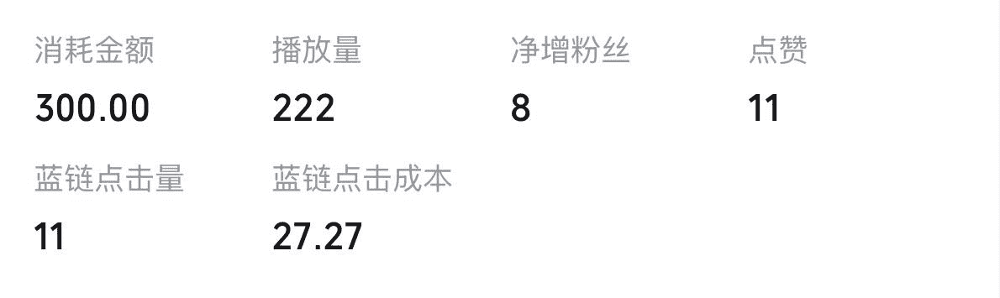

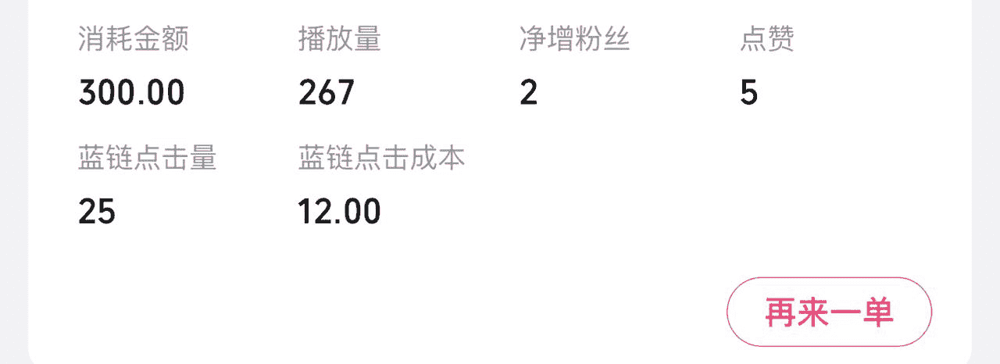

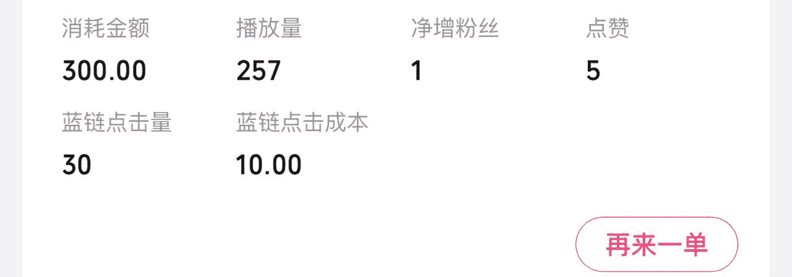

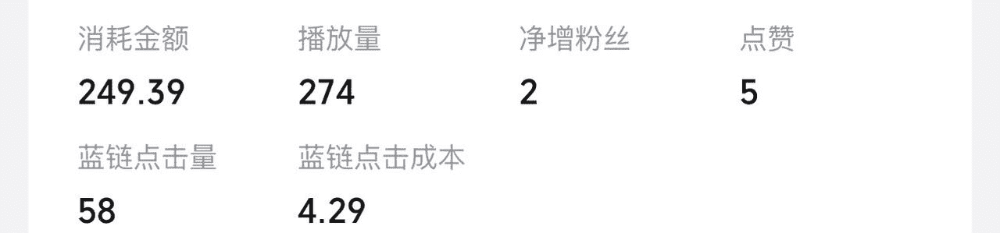

这是我11月6号跑的小号一个新视频的数据，你看我第一次跑到了单个蓝链点击27元，这都不知道亏到哪去了，最后我觉得我视频肯定质量没问题啊，我继续跑，最后跑到4块多，4块多也是亏本的，单个蓝链点击在2块以下才能赚钱，后续这个视频我又跑了一两次，始终在4块左右，成本根本下不去，总共跑了差不多1500块钱左右，没跑出来。

你问我为什么不跑放心投，因为放心投设置1块多根本跑不动，所以我跑的是普通必火，不能设置单个蓝链价格的。到这时候我明白了当初我真的就是运气好，一下就跑出来了，所以我也一直强调我运气好，这也是事实，并不是谦虚。

到这里我理解了为什么好多同学跑不出来了，后面我继续研究和看后续其他同学的总结，我猜可能是进来的同学太多了，提高了成本，另一点就是视频同质化太严重了，太多这种视频了，所以才跑不出来。后面有些同学跑出来，想的办法是降低视频同质化，视频做的差异化一些，跑出来了。当然后续还有同学研究出来了泛流量的跑法，可惜时间晚了，早点研究出来绝对也能挣一笔，泛流量红包发放量真的是特别惊人，而且成本低，5毛就能发一个红包。

# 8.总结

总结一下，这套玩法其实对于淘客类项目都有启发。你只要能找到一个能锁大量商品的媒介，这个媒介可以是红包、可以是会场，也可以是密令，又或是其他的东西，然后通过投流将这个媒介发给大量用户，只要用户领了，在一定时间内购物，不论是买什么商品你都能拿佣金，你只要控制好投流的成本，靠堆量去赚钱，肯定是个好的玩法。可以通过这点拓宽思路，有同学玩国补会场或口令其实也是这个逻辑。

**后面有同学**说**年货节（年货节也有红包）**一定要大干一场，我一直的提醒就是控制好成本，控制好成本，控制好**成本。还有就是之前有句话说的**是：凭运气赚到的钱最终可能会凭实力亏回去。所以对于我来说我肯定会相当注意的。再说我通过我和同学们的实践感受很深的一点，投流这东西很看人的魄力和运气。还有人永远赚不到自己认知之外的钱。

最后再说一点，玩投流就要有亏本的心理准备，风险通常是与收益共存的。

下面两句话共勉——

### 只要我们相信，我们终将会成功（PS：鸡汤还是香的）。

