# 一篇可以帮你摆脱当前『困境』的文章

> 来源：[https://xuqiwei1986.feishu.cn/docx/EMqVdC2F8oFlgHxJEHTcYlphnph](https://xuqiwei1986.feishu.cn/docx/EMqVdC2F8oFlgHxJEHTcYlphnph)

> 生财有术是一个交流赚钱的庞大圈子，在这个圈子当中有优秀的个体，创业者，IP

> 同样，也有很多处于迷茫和焦虑的赚钱新手

>

> 今天想针对这些可能是新手的朋友，写下这篇内容

> **全文约1万1千字，阅读需要15分钟的时间，谢谢你把**时间花在我这里，也希望能够对你有所帮助。

我在9月接触到了生财的小鱼姐，当时和小鱼沟通到了关于生财有术在转化方面遇到的一些情况

生财一直在做的事情，是只筛选，不教育

对自己有想法做出改变的，可以加入生财

对自己的项目想要放大的，可以加入生财

对自己现状感到不满的，可以加入生财

……

但也有这么一些人，期望通过生财有术的前沿信息，让自己的生活发生改变

**可航海也参与，人也链接了，对很多事**情依然处于没有办法做到或者拿到结果的状态

我是做成长型IP的，我的朋友圈里聚集了不少这样的人

我开始思考，项目是对的，方法是对的，为什么结果却总是会有这么大的偏差？

在9月份，我发起了一个非常简单的项目测试

希望把已经成功的项目结果，复制给小白

希望通过这样的方式让小白意识到『前沿信息』的真正用处

但相信大家都能知道这个东西的后果：失败了

**在复盘了**失败的核心因素之后，我提炼了真正困扰『赚钱新手』的核心原因：生活状态

**如果困扰你的问题，有以下几种，希**望这篇内容能够帮助你，真正去用好生财有术

1、对未来感到迷茫焦虑，没有确定性的方向也找不到确定性的方向

2、对收入感到焦虑和没有安全感，希望能有适合自己的副业路径

3、对创业有较高的兴趣，希望在未来能做属于自己的企业或者个体公司

4、对自由有较高追求，希望能不上班找到适合自己的自由职业路径

——————————————————————————————

对很多做项目或者短期没有拿到结果的新手来说，常见有一个很大的问题就是：间接性踌躇满志，持续性混吃等死

比如你今天看到了一个课程或者鸡血视频，想着要从现在开始改变自己的生活，但稍微持续一段时间之后就很容易放弃，甚至觉得躺平摆烂才是自己的终局；然后又在某个夜深人静的时候突然又打上鸡血以此反复

长此以往之后，我们就很容易陷入到焦虑和迷茫的人生周期当中，在这种状态下，人是很难有真正的进步和改善的，更严重一些的，还会导致怀疑人生和抑郁的可能

而我们大部分时间的焦虑和迷茫，其实都源自于『我无法对现有生活做出实际干预和改变』

**这种状态和心理**不仅对工作赚钱、创业以及做副业有影响，还会打乱我们正常的生活状态

对这样的情况做干预和改变的第一步，就是先理解『为什么我无法做到』

**我会希望你思考几个问题：**

1、你认识的人里，有没有你觉得TA特别聪明的人？

2、你认识的人里，有没有你觉得TA特别懒的人？

3、你认识的人里，有没有你觉得TA特别高情商的人？

4、你认识的人里，有没有你觉得TA特别笨的人？

……

稍微思考1-2分钟，在脑子里是否能浮现出对应的人选？

如果你想到了对应的人选，你能否回答另外一个问题

为什么你会觉得TA在这些事情上，很特别？

我猜你会回忆到某些场景当中

比如从小学习就很厉害，长大了工作也有所成就

比如从小就不爱干活，朋友圈也经常抱怨生活辛苦，爱躺平

比如工作时经常能看到TA很圆滑的能和各个领导交流

比如……

但你会发现，其实你所想的那个TA，并不是因为

**某一次聪明？**

**某一次笨？**

**某一次懒？**

**某一次情商高？**

**而被你回忆起来**

是因为他长期或重复的一个特质，让你觉得TA是这样的人

回到我们自己身上，我们之所以一直没有办法突破现有的瓶颈去赚钱，做副业，创业

也和我们【长期】或【重复】的特质有关

**我们的特质，决定我们的生活状态**，我们的生活状态才是导致很多阻碍的根源性问题

**所以首先认识第一个重点：**

赚钱这件事本身，是可以通过学习掌握的，你之所以之前没有办法赚到钱

**很大原因是因为你当前本**身就不处在【能赚钱的生活状态里】

同样的，像减肥/健身/恋爱/婚姻……各种事项如果不顺利，也都是这样的原因

现在我们知道了问题在哪里，就可以有方向的去解决这个问题

我们只需要让自己处在一个能赚钱的生活状态里就可以了

**那么我们就要倒推**一下，生活状态既然是由我们长期和重复的特质决定的，那这种特质是由什么组成的？

长期和重复，我们有一个非常客观的词可以解释：『习惯』

+   你长期抽烟，是一种习惯

+   你很容易逃避困难的任务，是一种习惯

+   你每天睡前不刷半小时短视频就睡不着，也是一种习惯

而习惯导致的动作，就是我们提到的『特质』

+   你长期抽烟；烟民是你的特质

+   你很容易逃避；拖延症是你的特质

+   你爱刷短视频不爱动；躺平摆烂可能就是你的特质

好像例子有点感觉，但很抽象，你还是无法理解特质是什么？

我们来尝试让特质更加具象化一些，看看特质到底是怎么组成的？

要理解特质，我们就需要更深入去理解习惯的构成

一个习惯的诞生，从根源上拆分，会有3个部分

我们用【赚不到钱】这个特质来举个例子

**第一，你是怎么想的？**

比如：看到别人赚钱

+   想法：割韭菜的/运气好/有关系/有资源

+   想法：我能研究下具体路径吗？

比如：遇到一个可能是机会的机会

+   想法：失败了怎么办？我做不好亏了怎么办？这个课买了没用咋办？

+   想法：哪个环节我能做？起步的话要怎么做？

**第二，你是怎么做的？**

下班回家后，你的习惯是躺在沙发上刷手机，还是打开电脑做点有价值的事？

+   做法：平时你的习惯是睡到中午，还是会去链接一些比你厉害的人？

+   做法：你的钱是习惯性花在吃喝玩乐上，还是习惯性投资去买书、看课、学习？

**第三，你是怎么感觉的？**

遇到未知的时候，你会有点兴奋和好奇，还是害怕和焦虑？

+   被人拒绝或者说了几句后，你的感受是【挫败和丢人】还是【有点不爽，但想想怎么改进】

+   赚到第一笔小钱时，你习惯感受的是【就这么点，没意思】，还是【可以，踏出第一步！】

现在，我们再来看看你身上【赚不到钱】这个特质：

+   **想法习惯：**可能总是“我不行”、“这太难了”、“现在入场太晚了”

+   **做法习惯：**可能是“一直想，从不做”，或者“做事三分钟热度，遇到困难就放弃”

+   **感觉习惯：**可能是“对风险极度恐惧”，或者“对短期反馈极度依赖”，一做没立刻看到结果就难受

所以如果你现在能够理解习惯的三个要素，你大概率能说的清楚，自己以前为什么一直失败了

我们就要开始去拆解失败和增加自己的成功率

————————————————————————————————

我花了一些时间，看了很多生财里面大佬们写的【来时路文章】

**他们大部分人去对增加成功率做的其实并不是**【找到好的项目】而是【思考的方式变化了】

这就是一个大部分人的误区，很多人一直在追求和尝试的

都是改变做法；希望自己能有更强的执行力，有更确定性的路径

其实如果不是系统性的改变整体特质，你所追求的【做法习惯】只是其中的三分之一

而且你会很大概率因为感受和想法没有发生变化，这个做法习惯也无法有效持续

自然就不太可能做到真正能改变生活状态的地步

要踏入能赚钱的第一步，首先要从想法习惯开始去理解自己整个关于赚钱的路径

大部分人除开薪资之外，赚钱路径是这样的：

**我们把它关键节点拿出来看一看**

1.  我想赚钱

1.  我需要有一个能赚到钱的项目/方法

1.  我找到了X个看上去还不错的项目和方法，评估要做哪个还是都做

1.  开始尝试

1.  有结果/没有结果

1.  结束

其实这个路径本身没有正确和错误的说法，也有很多人是按照这个路径去完成的

**但真正完成和没有完成，**差别可能就在每个路径节点当中，我们的习惯不同所导致的动作和心态不同

**1、我想赚钱**

**想法习惯：**我很缺钱，我需要钱，大部分时间是焦虑驱动

**做法习惯：**网上搜索副业/搞钱/信息差等，试图找到一个只有自己和少部分看得到其他人看不到的项目信息

**感受习惯：**习惯感受焦虑和迫切，短期主义会让你无法确实做好路径规划

2、我需要有一个能赚到钱的项目/方法

**想法习惯：**我自己是因为没有好的信息/项目/方法，所以赚不到钱

**做法习惯：**我去其他地方也搜索一下看看这个项目靠不靠谱，有没有数据，有没有案例，问问知道的人

**感受习惯：**我对好的理解就是我要看得懂而且这个还能赚钱而且这个还要低门槛能做而且最好马上就有钱进账

3、我找到了X个看上去还不错的项目和方法，评估要做哪个还是都做

**想法习惯：**我要先找到一个最优解，选错的话就是浪费时间和精力甚至还有金钱

**做法习惯：**开始看评测，问别人，觉得信息不足无法很好做出决策

**感受习惯：**比起实践更喜欢脑子评估的过程，因为评估本身意味着拥有【选择权】，拥有选择权意味着还拥有【可能性】，比起做起来的不确定性，很多人会更享受这种不确定性前的犹豫状态里

**4、开始尝试**

**想法习惯：**我还没有完全准备好，先随便做着试一下，如果成了在花更多时间

**做法习惯：**先做个3-4天，然后开始出现“随机事件”耽误自己的进程，比如突然加班，比如突然要应酬，比如突然约打游戏

**感受习惯：**习惯经历从踌躇满志到躺平等死的过程，兴奋感会被挫折感和怀疑快速击碎，开始怀疑项目可行性和自己的决策

**5、有结果**

**想法习惯：**低估和否定，费了很大的力气就干了这么点出来

**做法习惯：**从不进行复盘和放大想法的规划，要么满足要么停滞

**感受习惯：**习惯性的觉得索然无味，不如发传单的声音在脑海里回荡

**没结果**

**想法习惯：**外部归因，这垃圾项目我早怀疑是不是割韭菜的，又被骗了

**做法习惯：**直接放弃，或者开始进入情绪内耗，不进行复盘失败原因归因

**感受习惯：**挫败和自我怀疑，我还是老实先上班吧

**6、结束**

**想法习惯：**形成自我证实路径【搞副业不适合我，做短期项目不适合我，我执行力不弱但运气不行】

**做法习惯：**累积因无法达成赚钱目标的焦虑，直到达到下一次临界点时从节点1重新开始

**感受习惯：**习惯感受【解脱感】和【无力感】，为下一次路径各个节点积累更多心理阻力

**虽然不太完整，但这就是大部分普通人在尝试**副业或者说除开工作之外赚钱的全部流程闭环

除此之外，所有涉及到想法到计划到落地的内容均可以分成这六个步骤

减肥/健身/戒烟/执行

> 所有计划性的东西，都可以划分成：

> 1、我想做到/得到/变成……

> 2、我需要资源/认知/计划/方法/项目……

> 3、我的评估和决策……

> 4、我的执行……

> 5、结果情况……

> 6、结束情况……

然后如果一个失败的循环结束，我们就很容易进入下一个失败循环

仔细看就会发现，其实导致我们最后放弃的，一般会在3个地方：

+   **节点3的无限纠结**

+   **节点4的执行脆弱**

+   **节点5的错误归因**

节点1、2、6并不是我们赚不到钱的真正原因

**这三个节点更多像是你赚不到钱而****导致的“症状”****，不是你赚不到钱的****核心“病根”**

**让我们用看病的比喻来理解：**

+   **节点1（我想赚钱）：**好比你觉得“我头疼”。这只是告诉你身体不适，但没告诉你是因为感冒、失眠还是脑瘤

+   **节点2（找项目/方法）：**好比你去“网上搜偏方”。这是在处理症状，头疼就吃止疼药，但没解决根本病因

+   **节点6（结束）：**好比“药吃完了，头还疼，你放弃了”。这是治疗失败的结果

真正的病根，**藏在节点3、4、5的****“习惯路径”****里**

———————————————————————

下面我们来拆解为什么节点1、2、6只是表象：

**节点一：我想赚钱**

能来听课的人，谁不想？我们想赚钱，只是我们的欲望，而不是能力

大家都会想赚钱，这个想法本身没有任何的竞争力，也不会给我们带来任何的结果

在这里面我们大部分人的核心问题，在于思维惯性从来没有被打破过

你在公司里拿薪水，一直以来的模式都是【领导吩咐我干啥我就干啥】然后到了时间钱自动到账

你并没有意识到你在这个过程当中创造了什么样的价值而拿到的钱

**你现在的想**赚钱，大部分是因为生活压力或者经济压力而导致的焦虑性想法

所以在节点一，我们要做到的是将【焦虑驱动】转变成【价值交换】驱动

**具体怎么转并不是靠想通的，而是在节点3/4/**5的路径里面，通过一个个里程碑建立而成的

**节点二：找项目/方法**

很大一部分人会有一种信念：我失败是因为我没有找到好的项目/方法

但实际上我们内心深处都明白，世界上不会存在这样的项目

任何一个公开的、能赚钱的项目，都同时有成功者和失败者；差距不在于项目本身

**而在于执行项目的**人及其习惯系统，也就是决策、执行、复盘三者的习惯不同

所以我们要明白一个基础的事情，任何方法论和任何项目指导手册，都只不过是在帮助你提升成功率，而并非直接让你成功

**那么提升成功率的关键，就并不是节点**二本身，而在节点3/4/5的关键卡点里面

**节点六：结束**

每一次失败之后，很多人会找我说林哥我感觉我确实不太适合这个项目/我最近时间不太行

我很少会去安慰和回复，大部分时间就会说个好的，辛苦，下次努力

很多人在项目的失败和结束之后，会有否定全盘的那种情绪，实际上结束所代表的可能是一张病危通知书

而真正的死因早在前面你的决策犹豫、执行脆弱、复盘错误时就已经注定了的

**所以这篇文章核心目的就在这里，没有**人更了解你，没有人比你更适合做自己的医生

节点1/2/6，是我们需要理解和看透的陷阱，并不是我们真正要发力的点，他们之所以会对你产生困扰

核心还在我们的主战场，节点3/4/5上面

—————————————————————————————————

**那意识到以后，我们怎么去攻克****3/4/5**

节点三：我找到了X个看上去还不错的项目和方法，评估要做哪个还是都做

在生财里面，最不缺的就是赚钱的机会和项目推荐

大家也都听过选择大于努力，也都知道这句话其实很真实

如果我在15年去做短视频……

如果我在08年去做淘宝……

如果我在XX的时候去做XXX……

本质上，评估也好，选择也好，指向的都是我们的【决策能力】

我们之所以会习惯性的去看测评，看很多**人写的项目书，都**是为了让我们能拥有更多的信息源和信息内容，去帮助我们更快更准确的做出选择

生财有术第一个能给到你帮助的地方，就在于它的信息源无比精准且有效

可是，你依然没有办法用好这个信息源

问题出在：我们大部分人的决策系统都很依赖于曾经和过往的【经验】

比如：

你靠近火源，会被烫伤，或者烫到

所以你以后知道，火源不能离得太近

你看到新闻经常有煤气泄漏引发火灾

所以你会注意使用燃气问题

如果你现在是一个婴儿，你并不知道火很危险，你也并不懂燃气的危害

这些过往的很多经验，对于我们去做新的挑战会带来非常大的局限性

比如你可能是老师，你懂高阶数学，但你完全不懂自媒体

比如你可能是设计师，你懂设计心理学，但你完全不懂营销和销售

比如你可能是销售，你懂转化和破冰，但你完全不懂产品设计

比如你可能是主播，你懂聊天和表达，但你完全不懂投流规则

……

一旦涉及到超过我们以往积累经验的时候，就好像成了瞎子一样，一直在盲人摸象

**这也导致了很多**人没有做成功副业和系统复盘能力构建的时候，无法有效去判断一个项目的核心可行性和决策优劣

**面对这一个情况，有且仅有的一个核心，就是锻炼自己的**决策能力，让自己做出的决策更加清晰和有效

决策能力的提升，需要两个关键点：

1、是对信息的敏感度和提炼能力

2、是对决策能力本身的观察和持续提升

信息的敏感度和提炼能力没有捷径，只能靠不断的实践和尝试来提升，你可以选择加入一个好的社群，或者好的团队，社群中的伙伴，团队中的领路人，都可以成为你信息源和信息祛魅有帮助的贵人

**“现在知道怎么利用生财了吗？”**

而第二个对决策能力的观察和提升，是需要明白决策的三个核心要素：

深度/宽度/高度

然后在每个不同的维度上面去理解自己的决策质量，而非拍脑袋和纯靠经验进行

**在2023年的时候，我就尝试拆解过『**有效决策』，并且依靠这个玩意赚了20多万

但我在教这个东西的时候发现，光讲决策能力，没有商业意识和赚钱逻辑也无法真正派上用场

所以针对决策之前，我们也要明白很多赚钱和项目的基本原理

比如一个事情到底能不能做，你怎么样快速的判断？

一个项目如果去做，你可能会失败在什么地方？花多少钱？

想从头开始做个公司要怎么做？第一步是什么第二步是什么？

赚钱虽然不难，但是想系统的提升赚钱能力是一个长期且持续性的事

如果只是把一些无意义的大家都懂的信息碎片拼凑在一起给到你，那只是信息堆砌，而不是有深度的能构建你元认知的知识

所以从你想真正赚钱开始，你就无法停下学习的脚步

关于更多决策和相关的信息内容，我有整理好的曾经的文档，有需要的伙伴可以喊我发你

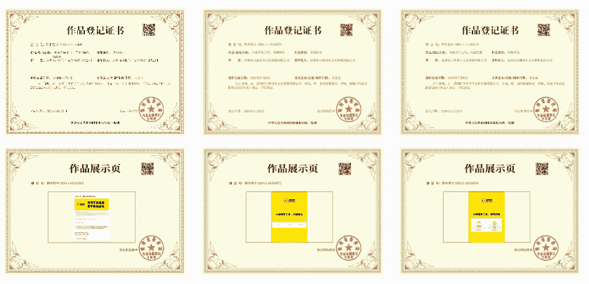

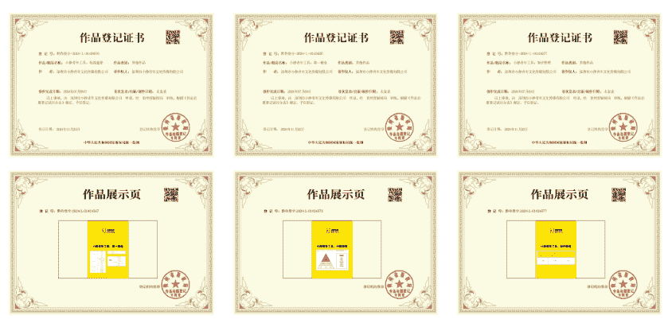

当你明白决策能力对赚钱的影响非常重大之后，你能够做到低成本去改变和赚钱相关决策习惯的方法就有以下几种：

1.  **学习有效决策**

1.  **加入高质量的社群**

1.  掌握更多相关认知：原理/知识/方法/逻辑

1.  **认识相关的有经验的人**

1.  **按照自己的想法进行大量实践**

以上内容的前4点都可以在生财当中找到，同时也推荐大家多阅读相关的书籍，比如和自己领域当中有关的书籍，每一本优秀的书其实都是一次和作者的高效对话，你能够在里面发现很多作者的决策逻辑和经验，从而快速提升自己的认知，掌握更多有用信息辅助你的决策能力

—————————————————————————————————

说完节点三，我们就进入到最多人选择的节点四：执行力脆弱板块

**节点四：开始尝试**

执行力其实不靠意志，因为当你把执行力和意志力挂钩的时候，执行力就会变成你的精力能量条

玩过游戏的可能都知道，你操作的人物释放技能是需要消耗能量条的，并且还有很长的技能冷却时间

如果你把执行力和意志力挂钩，那么就成为了一种消耗品，靠消耗品去坚持一件事等于没有坚持

所以对执行力这一块，在你没有完全转变思维逻辑之前，我们最好的做法是明确一种设计路径

让这个消耗品消耗在应该被消耗的地方，也就是设计一个让我们更省力的流程

我们先看看以前我们在做项目时候的执行力路径是怎么样的

【想法】隔壁的二狗做小红书挣了2万，我比他帅还比他会说话，我也要做红薯

【原始计划】看了林哥的内容方法论，我决定了要日更，先花5天时间写30条图文

【真实执行路径】

1.  Day 1 晚上：终于下班了，好累，先刷会儿视频犒劳自己，10点再开始写。-> 刷到12点，想着“明天周末，早点起来写也一样”

1.  Day 2 早上：10点了，睡多一会就起来，11点30，起来先看吃啥，吃晚饭开始写；吃饱以后休息下，晚上在开始吧

1.  Day 2 晚上：打开文档，面对空白页。第一篇写什么才能爆呢？我看了很多对标内容，但是感觉好像都可以写，但是又好像不是很容易爆的样子，想了半小时，毫无头绪，压力巨大。转而开始刷别人的爆款找灵感，刷了两小时，更焦虑了。“算了，今晚先找对标，明天状态好再写。”

1.  Day 3：已经开始有点逃避打开文档了，因为一打开就伴随着“我写不出来”的挫败感

1.  Day 5：一条都没写出来。内心OS：“日更太难了，我可能不是这块料，还是林哥和二狗子牛逼。” -> 宣告失败

**看出问题了吗？**

你在整个执行链路里，意志力一直花在几个特定的地方：

+   克服疲惫

+   做出决策（写什么）

+   应对恐惧（怕写不好）

整个执行路径，每一步都是高阻力、高消耗的烂路

如果我们看一下二狗的路线，可能是这样的：

二狗做的是穿搭推荐的内容，最开始做的原因是因为他自己觉得穿衣服不好看，在小红书上学习，收藏了很多相关的内容

1.  有一天二狗自己上班的时候发现自己穿搭被人说好看了，很开心，回到家对着镜子自拍，发了自己的第一条小红书

1.  第一条小红书发出去之后没有多少观看，但是100个浏览里有5个点赞，1个评论问他要链接的

1.  二狗意识到100个人里就有1个人会问，如果播放到1000呢？10000呢？

1.  于是二狗开始把自己以前收藏的相关内容开始进行学习，每天因为工作很忙，基本二狗每天只有晚上九点到十点一个小时去研究相关的对标，每天研究一个并且模仿着一个做自己的内容

1.  持续一周的日更时间之后，二狗的浏览量开始往200走了，二狗开始学习更多内容相关的方法论以及封面的制作和探索

1.  又过了一个月时间之后，二狗的浏览量最高能浮动到1000了，而在这个过程出了一条非常大的爆款，足足3万观看1000点赞，涨粉400

……

我们来看二狗的执行链路是怎么样的？

+   第一步很无脑，**没有决策消耗**

+   每天固定时间节点制作，**能量消耗低**

+   不关注写的好，**而关注开始**

整个执行链路里，其实你会发现二狗的决策能量消耗的非常小，单纯是因为有一个问题所以需要怎么做这样的思考链路，就很像滑滑梯一样，阻力很低，而且能够顺畅的往下走

**他**在不自觉的过程当中，环绕自己的兴趣，设计构思了一条舒服的执行路径，整个过程是享受为主，而非对抗形式，也非有人去强迫他一定要完成什么事件

所以我们能够有一个简单的结论，关于执行力弱，想要去改变，并非在意志力上加码，而是在路径上做出改动

> 比如还是拿做小红书这件事情来举例，首先要明确自己的『目标』整个目标在过程当中并不是一成不变的，就好像二狗一样，他最开始只是因为被夸了所以发了一条日常分享

>

+   这个**『分享』**或许是他第一次的目标

+   当他发现有人需要的时候，他想试试能**不能让更多人**看；就需要方法论和对标学习，『对标学习』就是第二次目标

+   **学习完以后他发现每天**日更需要把自己的时间节奏规划好；『精力分配保证日更』就是第三次目标

+   **当开始有爆款**之后，就开始涉及到怎么样让自己的变现流程跑通；『引流路径』就是第四次目标

>

> 这一件事情看上去核心的目的是**『通过小红书赚钱』**但实际上这个目标是**路径闭环的结果**

>

> **那么对于我们的指导意义就在于，**如果你想要达成一个具象的目标，你就需要走一条你不曾走过的路径

> **也就是构思一个非常具象化的计划**

>

**具象计划的规划方法如下：**

1、清晰列出你的每一天时间节奏，按照小时进行划分

2、根据你的大体目标，拆分出涉及到的具体事项

3、根据具体事项，分配到你的时间节奏当中

4、严格按照你自己的时间节奏进行执行

5、按照自己的节奏设置最短测试单位；比如7天；21天；30天；90天

每个人都会有属于自己的管理方案

如果你没有画面感，或者没有做过类似的尝试，也可以直接参考下面我自己的路径

首先列出自己的周时间表，发现自己每天冗余的时间段

根据冗余时间，制定自己的具体事项安排

如**果自己安排的时间计划**临时有事，就很容易会涉及到改动计划，而一旦改动和延后计划则会严重增加计划执行风险，所以建议自己的时间节奏按照30分钟进行规划

比如我虽然列出来21-22点是找素材/编辑图文，但实际实践过程当中，我只会在这个时间段花30分钟时间进行处理

计划是为了自己服务的，而不是为了让自己进行对抗找空子的，所以尽可能让自己处于一种舒服的状态里

比如可以周一周四才做事，也可以周二周五在做事，也可以周一到周五都做周六日休息

自己的计划，一定是根据自己的时间冗余来安排必要事项的推进

—————————————————————————————————

讲完节点4，到了节点5，也是我们习惯构建的最后一个逻辑：复盘

复盘是一个非常重要的并且贯穿我们整**个人生的事情，我们大部**分人的成长都是经过多次复盘之后的具象体现

没有复盘就不会有成长，只不过每个人的复盘方式方法不同，具体体现也不同

有的人倾向自我对话

有的人倾向书面复盘

有的人倾向数据复盘

有的人倾向直觉复盘

有的人倾向随缘复盘

……

不论任何种类的复盘，复盘和计划一样，都是针对自己的一种管理方式

所以做复盘，也需要用科学的方式**让自己以舒服的状态去做**

大部分人第一次接触复盘是在读书时期，一道题你做错了，但你不知道为什么错

经过老师的解释和优秀同学的答案分享，你明白了这道题你错在了哪里，你记住了

这就是一次系统性的复盘

我们参考读书时期，复盘可以概括出两个核心要素：

**1、做对了什么？**

**2、做错了什么？**

而书面复盘，数据复盘，直觉复盘，其实都只是对这两个核心要素的展开解释而已

是否做出展开解释，要结合你自己的复盘习惯和节奏进行，我个人比较推荐的是尽可能展开的全面一些

**在这里你也可以去生财的精华帖里面，**看到很多大佬在做项目的复盘内容，进行思考

我比较推荐的几篇精华帖：

1、【啊懂】https://scys.com/articleDetail/xq_topic/4842484825848448

2、【Gary】https://scys.com/articleDetail/xq_topic/8852145814528182

3、【小挣青年】https://scys.com/articleDetail/xq_topic/4845218512525218

4、【阿甜】https://scys.com/articleDetail/xq_topic/2858455114488151

**上面几篇文章我都很喜欢，不仅有项目的复盘路径**，更有他们在这个过程当中认知和思想的改变

**当然还有更多优秀的帖子，大家可以自己在**生财里挖掘，也可以在这条内容下方评论出来

————————————————————————

很多人做复盘的时候总会喜欢围绕客观因素开始，把自己的主观原因降低，从而避免失败带来的自我否定和挫折感

但当你全面的展开，你自己的视角就会更广，从而更容易分析自身问题，而不会把问题甩在客观因素上

所以我建议在开始复盘之前，优先考虑自身因素，再去判断客观原因

|  | **做对了什么？** | **做错了什么？** |
| --- | --- | --- |
| **有结果时** | 可复制的经验是什么？ | 潜在的隐患是什么？ |
| **没结果时** | 值得鼓励的尝试是什么？ | 需要改正的错误是什么？ |

当你列出来的时候，就做好了复盘的前期准备工作，也就是要素的分解

接下来一步就要到对要素做具象的路径表达

但一般到这个时候，你会发现，其实如果按照你自己以往的书写习惯，会很难真正写出有意义的复盘

也就是缺乏一个系统能说明白『做对了什么』和『做错了什么』的基础框架

在这一点上，每个人对事情的理解和吸收是不同的，这也是为什么每个人进步速度不一样的核心原因

那框架性的复盘学习涉及到很多种不同的模型和方法，我这里推荐新手使用『剥洋葱复盘法』

洋葱是一个我很喜欢的食物，它有三个部分构成

**分别是皮，肉还有芯**

我们的复盘其实就可以以洋葱为例，分成三层，分别由外到内

皮：外向层——发生了什么？

肉：模式层——为什么会发生？

芯：迭代层——接下来怎么办？

我们将最开始复盘的前期准备的内容，就可以按照填空题一样，顺序填入这个方法当中：

**外向层关键问题：**

1.  目标回顾：我最初设定的目标是什么？（要具体，例如“发布3篇笔记”而非“做好小红书”）

1.  实际结果：实际发生了什么？用数据说话（如：发布了1篇，涨粉10个，收到2个负面评论）。

1.  过程轨迹：我具体做了哪些动作？时间线是怎样的？

1.  关键决策点：在哪个时刻，我做出了一个重要的选择（比如：选择了A主题而不是B主题；决定今天不更新）？

**模式层关键问题：**

1.  **想法习惯（思维模式）：**

+   当______发生时，我脑子里第一个冒出来的想法是什么？

+   这个想法是帮助了我，还是限制了我？

+   例如：当数据不好时，我习惯性地想：“这个平台没流量了。” → 这是一个限制性思维，让我停止了优化。

1.  **做法习惯（行为模式）：**

+   我的哪个具体动作直接导致了（好/坏）的结果？

+   这个动作是我的常态吗？——回答“是，我经常这样”。

+   例如：我习惯性地在写作前刷1小时手机找灵感 → 这个动作消耗了精力，导致无法动笔。

1.  **感受习惯（情绪模式）：**

+   在整个过程中，我最强烈的情绪是什么（焦虑、兴奋、挫败）？

+   我是如何应对这种情绪的？是被它控制，还是管理了它？

+   例如：面对负面评论，我习惯性地感到羞耻和愤怒，然后一整天不想打开App。

**迭代层关键问题：**

1.  **认知迭代：**基于第二层的发现，我需要停止相信哪个旧想法？需要开始相信哪个新想法？

+   例如：停止相信“我必须准备好才能开始”。开始相信“烂开始，好结果”。

1.  **行动迭代：**我可以设计一个什么样的新动作，来替代那个无效的旧动作？

+   例如：用“立刻写一个垃圾初稿”来代替“刷手机找灵感”。

1.  **能量迭代：**当下次那种负面情绪再出现时，我的“应急方案”是什么？

+   例如：当焦虑时，我会立刻做3个深呼吸，然后问自己：“现在，我能做的最小一步是什么？”

整个逻辑看上去很复杂，实际制作起来的时候不会超过20分钟，因为基本上都是你已经准备好的内容进行排序和重组而已，例如我们以小红书失败为例

**第一层：事件层**

**目标：**本周发布3篇图文笔记。

**结果：**只发布了1篇，数据平平，涨粉5个。

**过程：**周一计划，周二找灵感刷了2小时手机后放弃，周三逃避，周四焦虑，周五赶工出一篇。

**关键决策点：**周二晚上，选择用刷手机代替直接动笔。

**第二层：模式层**

**想法习惯：**当要动笔时，我想“必须找找灵感，不然写不出来”。这让我陷入了“准备陷阱”。

**做法习惯：**我习惯性地一有压力就打开娱乐App，这个动作让我从困难任务中逃离。

**感受习惯：**面对空白文档，我习惯性地感到焦虑和压力，然后通过刷手机来获得即时放松。

**第三层：迭代层**

**认知迭代：**停止相信“需要灵感才能创作”。开始相信“行动本身会带来灵感”。

**行动迭代：**设计新动作——打开文档后，立刻计时写作15分钟，不许评判，只求写完。

**能量迭代：**当感到写作焦虑时，我的应急方案是站起来喝口水，然后回来执行“15分钟计时写作”。

很多人听到这里的时候会觉得做不做复盘和自己没有什么太多的关系

如果你有这样的念头，我建议你先暂停思考一下自己为什么会有这样的想法

是不是因为你从来不会对自己所做所为进行复盘？

是不是因为你在节点四执行的时候就已经中途结束了？

所有一切的不具备复盘价值的行为，分析来分析去大家都心知肚明是自己的问题

**所以你觉得没有关系，是因为复盘是成为不普通人的入**门门槛，也是你想要去做到赚钱的最基本领域

**只有完整的尝试过你才会明白自己为**什么一直处于长期没有办法成长的生活状态里

而以上的一切搞明白，才是刚刚开始，上面的所有内容都只为了让你发现自己曾经过去的习惯是怎么样的，以及你的迷茫形成核心的原因是什么

我们可以尝试围绕自己的职场/社交/项目/创业/自媒体等以往经验，尝试性的做一次复盘，这个复盘会是你打破迷茫和成长的第一步尝试

而长期复盘，就可以在我们的打卡群里面进行尝试，把自己的经验和实践记录进行复盘写出

这也是打卡群真正核心的意义所在，而非无意义的日记流水

我和小鱼老师在9月抓的一批人测试项目的时候，这个是他们最开始的分析和复盘

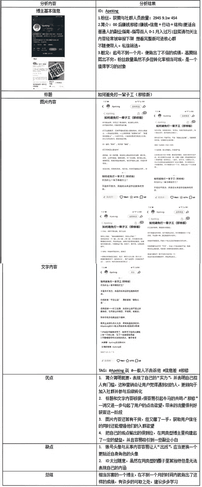

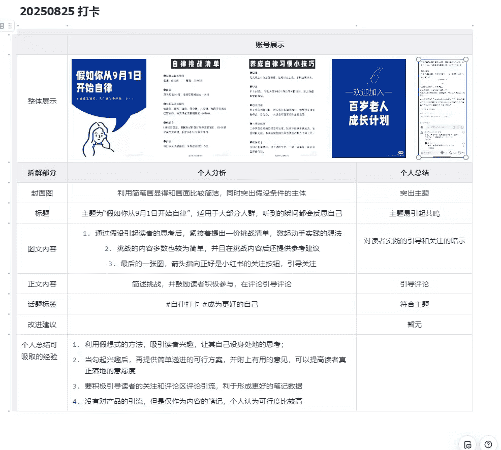

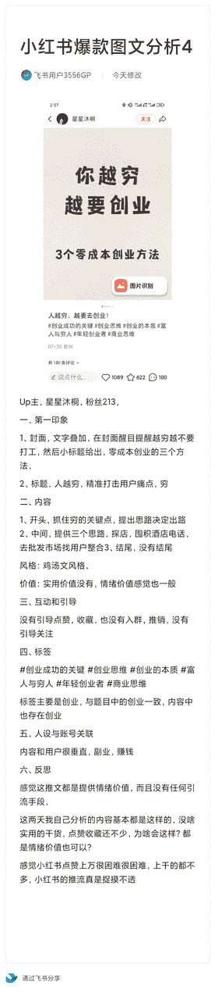

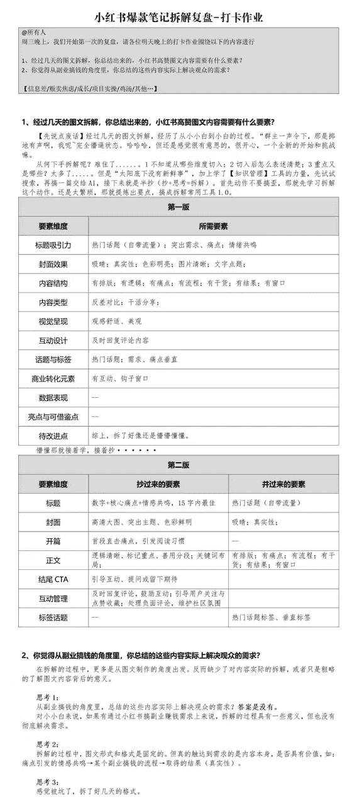

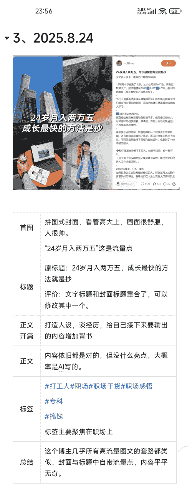

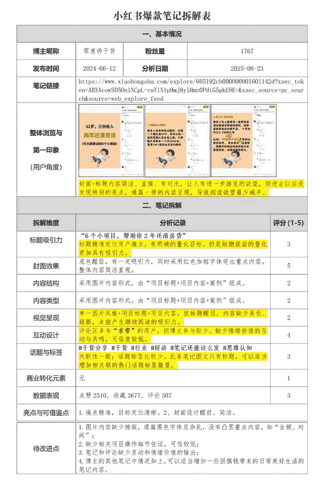

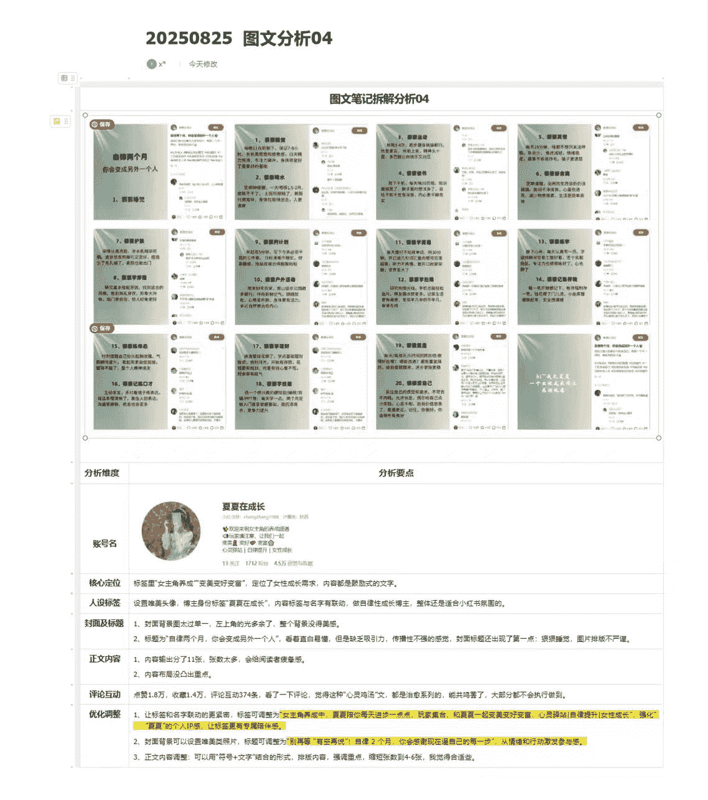

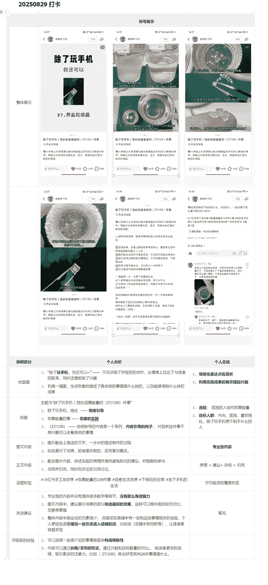

——————————————————————————————————————

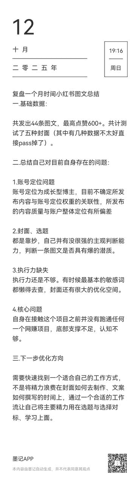

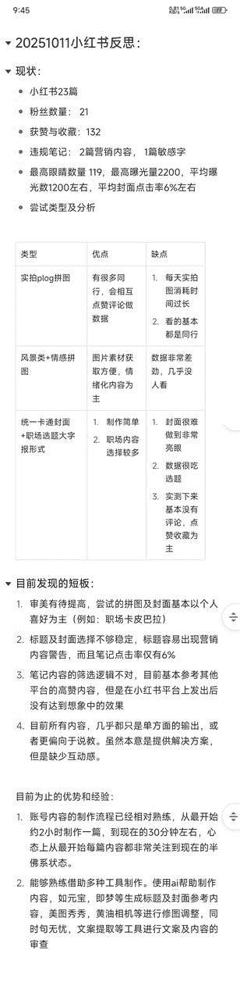

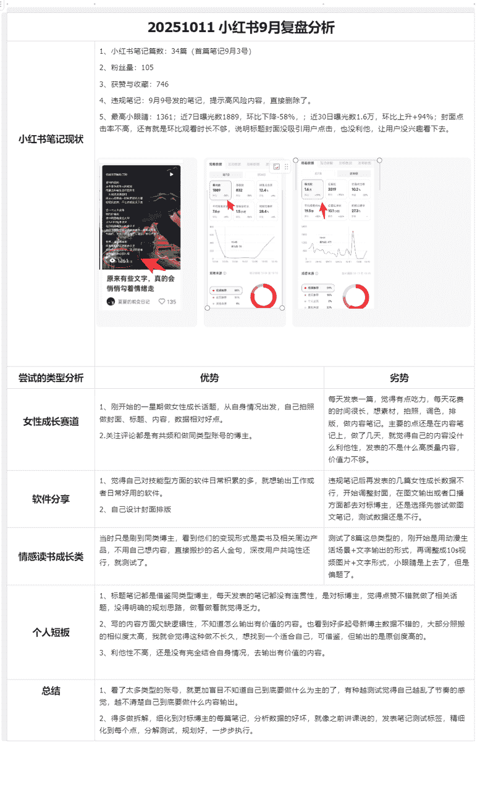

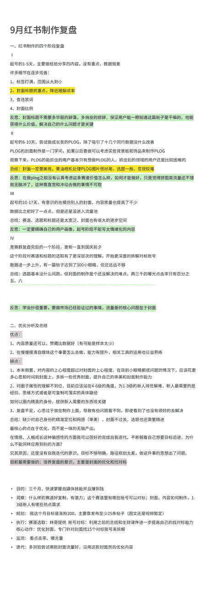

——————————————————————————————————————

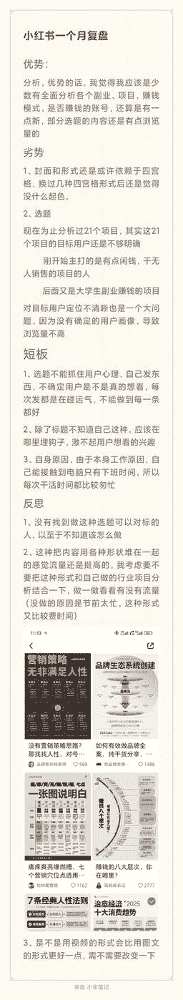

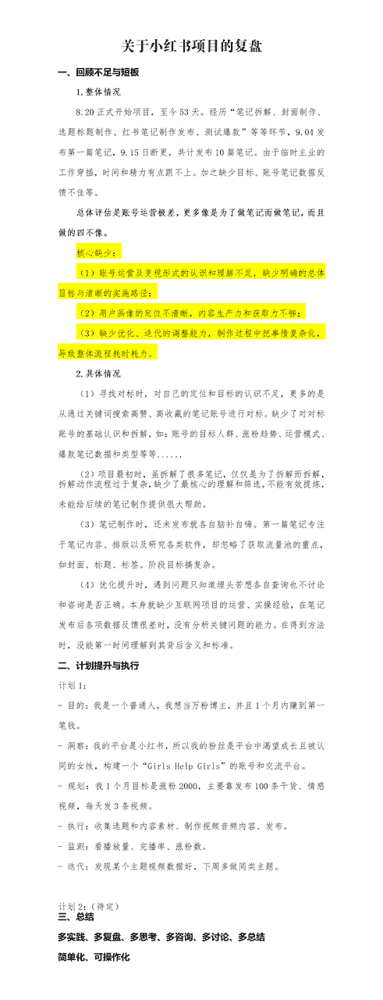

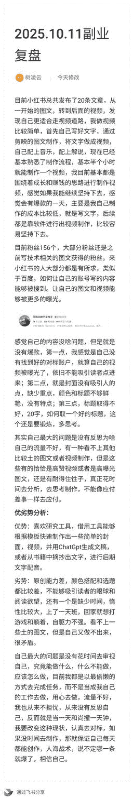

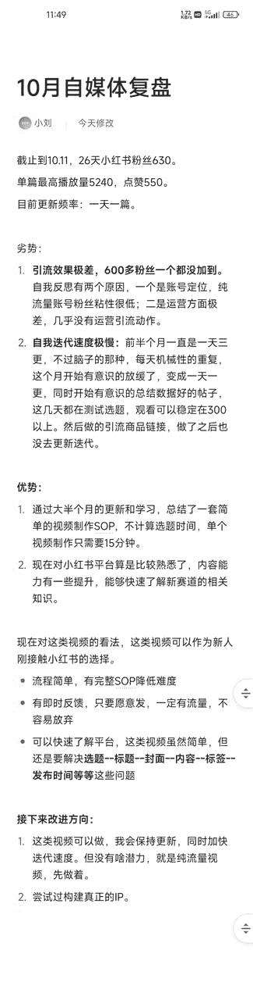

这个是他们第二个月根据复盘做的内容拆解和计划

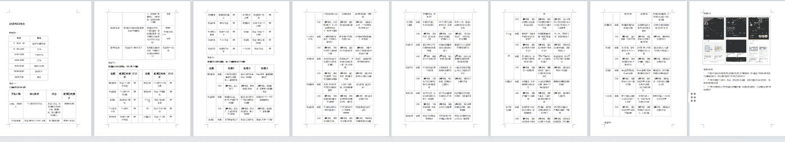

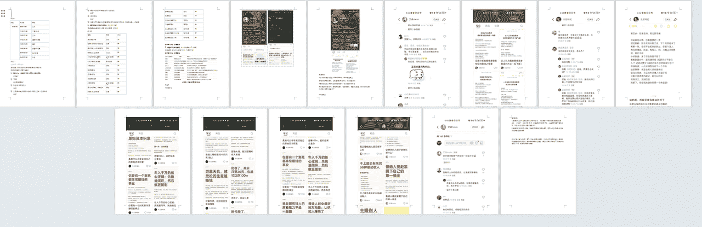

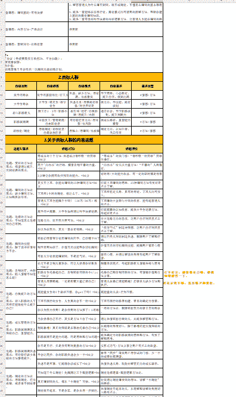

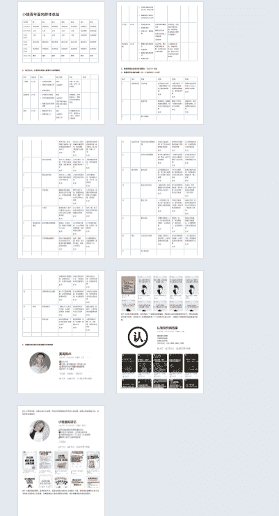

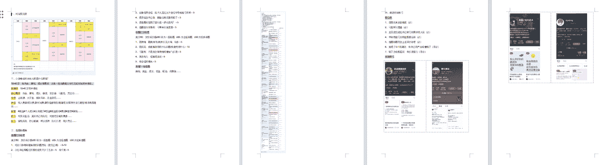

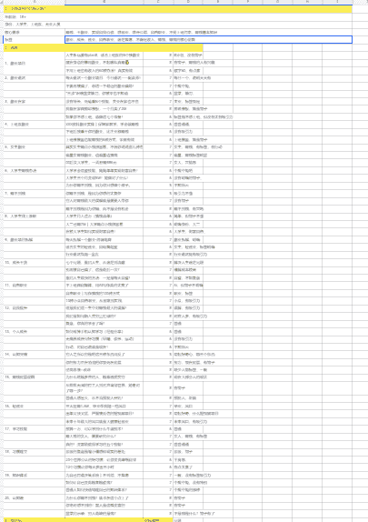

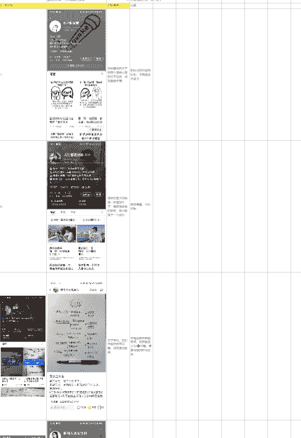

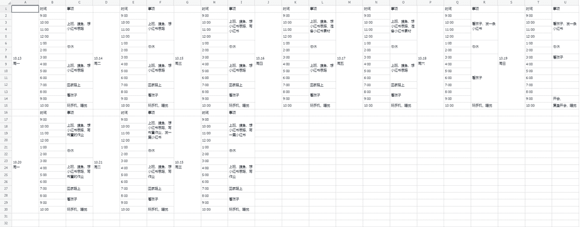

现在迈入到第二个月，说实话，离真正拿到结果还很远，但对他们自己而言的意义在于

在做小红书这件事上，他们知道自己怎么样离结果更近了

复盘是很辛苦的，但我们复盘的本质，是为了让自己更好的积累经验

从而更好的发现自己是怎么样的人，如何管理和运营自己

**借用纳瓦尔的一段话：**

没有人在做你自己这件事儿上打败你，你要找到一件事儿，对你来说像在玩儿，对别人来说，却像是在干活。

别人看你在努力工作，你自己却感觉轻松愉快，像是在玩耍。

你为了美、为了创作本身、为了心流满足感。

越是顺从你的本性去做事儿，竞争就越少，你靠做自己摆脱了竞争，你越真实，越没有人能跟你比。

你要找到那个你做起来毫不费力、别人又刚好需要、而且可以规模化的东西，把它变成一项产品，

这会变成你天生适配的工作，他不会让你感到劳累，它会像游戏一样，让你乐此不疲。

把人生当作一次搜索任务，去寻找最需要你的人，最适合你的工作，最适合你居住和生长的环境，

在选择如此丰富的世界中，最大的错误就是过早承诺。

——————————————————————

希望各位所有生财伙伴，在生财里面都能够有所收获，有所改变

**一起真正的，生财有术**