# 从月入3元到单月过万：我在深海圈|B站好物赛道实战通关指南

> 来源：[https://xuqiwei1986.feishu.cn/docx/KqFsdmZaAoTOgvxmcACcDmcanlf](https://xuqiwei1986.feishu.cn/docx/KqFsdmZaAoTOgvxmcACcDmcanlf)

大家好！我是米娅。今年8月参加了深海圈|B站 好物带货的航海，今天在这里，是带着我在B站好物赛道实打实的实战经历——从第一个月仅挣3块钱，到第二个月500元的小突破，再到第三个月抓住诀窍直接实现月入过万（包括带货佣金和商单），总GMV冲到35万，把一个高佣金品类做到爆单的完整历程，跟大家做一次深度拆解。

不少人可能都会觉得，"月入过万"听起来像是那种遥不可及的成功学案例，我想先跟大家交个底：我就是一个最普通的上班族，没有所谓的资源背景，也不是什么内容创作天才，在开始做的时候，连镜头都不敢直面。我经历过的纠结、内耗、失误，在座的每一位正在搞钱路上摸索的人大概率都遇到过。

在刚刚经历的这次双11，我靠着一个品类挣到了真金白银，也让我留下了一个遗憾——单一品类GMV排位赛，差一点点就能上榜，错失了3000元的额外奖励。这个失误我会重点复盘，因为它比成功经验更值钱。

今天这篇分享，我不想讲那些空泛的大道理，就把我踩过的坑、摸到的诀窍、悟到的底层逻辑，一字一句地讲给大家听，希望能给想做项目还在迷茫的兄弟姐妹们一点鼓励，更希望能成为大家做项目时的一份实战参考。

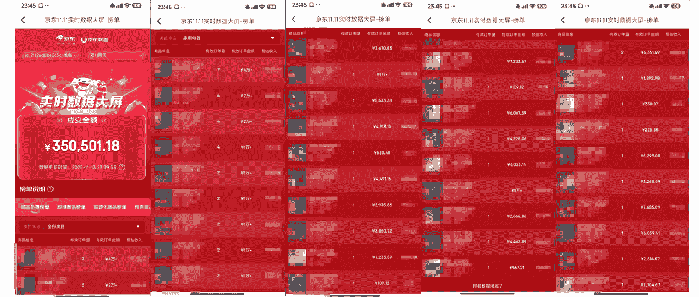

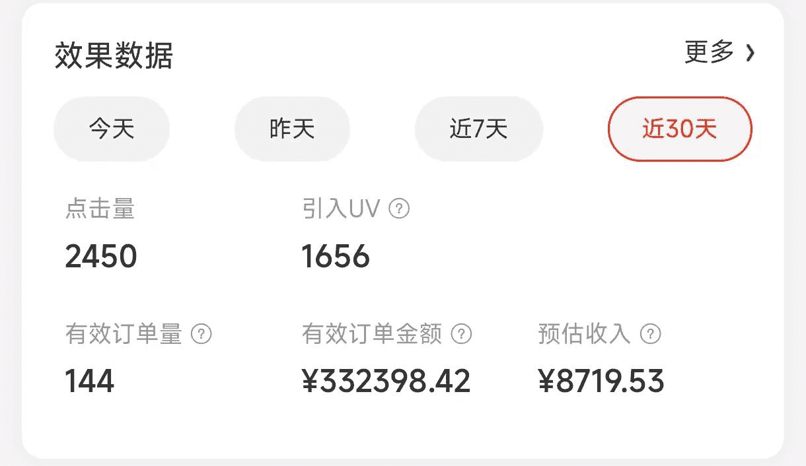

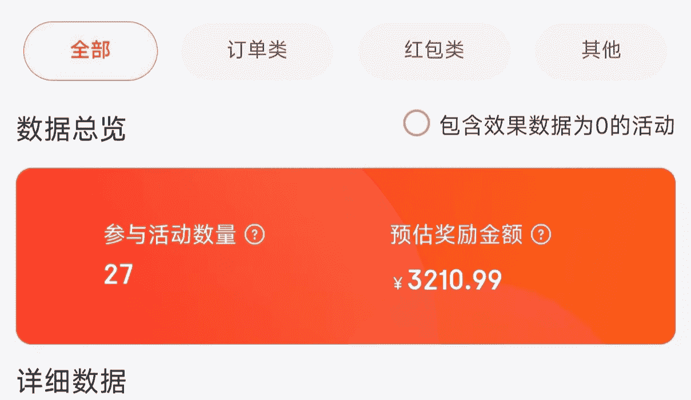

# 一、寻找项目前的迷茫：每个普通人都曾在"选项目"里打转

在聊B站好物赛道之前，我想先跟大家聊聊我之前的状态，我知道这一定是很多人的通病——项目太多，选择恐惧，越选越迷茫。那时候我天天泡在赚钱社群里，看着里面五花八门的项目，从自媒体到实体副业，从线上课程、线下组局到资源对接，每一个看起来都很诱人，但每一个都不敢轻易下手。

我记得那时候最纠结的几个问题，现在想起来都觉得很真实：

到底是流量重要还是运营重要？

那些看起来只能挣点小钱的项目，值得我投入大量时间吗？

万一我全力以赴做了，最后却没拿到结果怎么办？

~~~

这些问题不是我一个人的胡思乱想，而是每一个想靠副业搞钱的人都会反复纠结的点。

我很有耐心的在赚钱的潜水，关注龙哥大大的言论，我觉得他的言论就是赚钱的风向标。

我始终有一个执念：我不相信自己一直会这样，觉得自己差的只是一个合适的机会，一个能让我所有积累都爆发出来的"好机会"。所以即使在迷茫期，我没有躺平——

每天都会在赚钱星球和社群里潜水，认真看龙哥大大的每一条分享，因为我知道，真正的赚钱风向标，往往就藏在这些有结果的人的言论里。

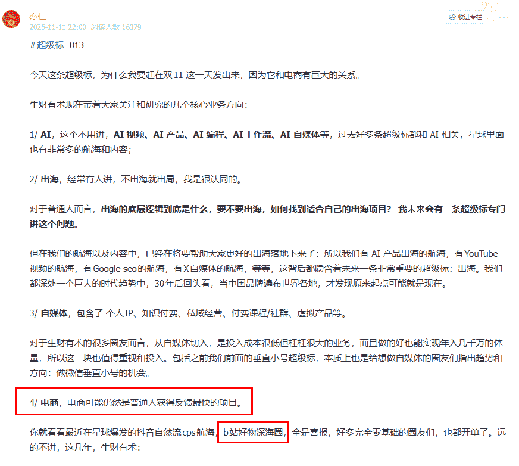

https://t.zsxq.com/L93ww

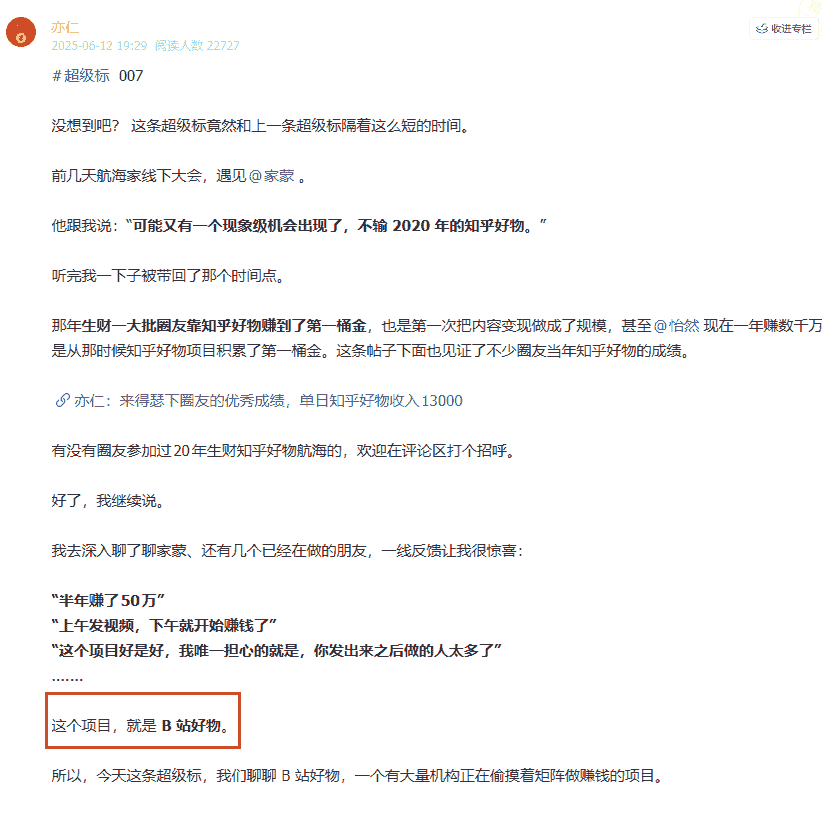

https://t.zsxq.com/sEIVd

潜水了大半年，也参加了几次的航海实战，我慢慢想通了几个道理，这些道理后来成了我破局的关键：

**第一**，小钱也是钱，不要嫌弃收益少，每一分赚来的钱都是对能力的验证，赚几十块就能多喝杯奶茶，赚几百块就能给家人买份小礼物，积少才能成多；

**第二****，**不要总想着赚快钱，这个时代早就没有一夜暴富的神话了，所有能赚大钱的人，都是在某个领域深耕了3-5年的人，在龙哥盟的星球里 这样的圈友不计其数；

**第三**，能力不是靠想出来的，是靠做出来的，与其纠结自己能力不够，不如先下场实战，在实战的过程中补全自己的能力版图。

**这里我必须跟大家重点聊一个很多人**都会陷入的误区：到底是"先闷头干，执行到底"还是"先调研清楚，再下场动手"？

我以前也觉得这两句话是矛盾的，直到赚钱社群发了一篇专门解析这个问题的文章，我才彻底想明白——这根本不是二选一的问题，而是"仰望星空"和"脚踏实地"的结合。这两个是基于不同的维度，在不同的背景说出来的话。大家看到大佬说出来的金句千万要注意下它的背景。（我记得赚钱还专门写过一篇帖子发到👸号上，专门去解析这两句话）

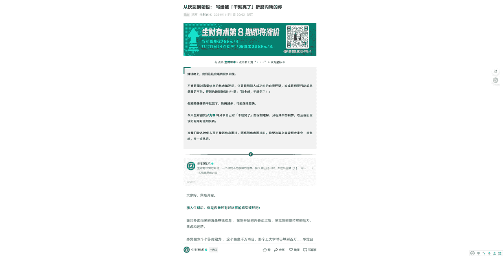

不要闷头干不看路，比如随便抓一个项目就死磕，连这个项目的上限、下限、盈利逻辑都搞不清楚，最后很可能是白费力气；但你也不能只看路不迈步，天天调研这个调研那个，把所有资料都收集齐了，却始终不敢迈出第一步，最后只能看着别人赚钱。

> 要么成功要么成长。在搞钱路上坚持，迟早你也会起飞。不要放弃，不下牌桌你就有机会。

那时候我给自己定了一个方法：调研可以花3天，但3天之后必须下场动手，哪怕只做一个最简单的版本。因为我知道，搞钱路上最大的敌人不是失败，而是"不下牌桌"——只要你还在尝试，就总有机会；一旦你放弃了，就彻底没机会了。分享一个我常年用的这个壁纸，经常在我内耗的时候不经意推我一把

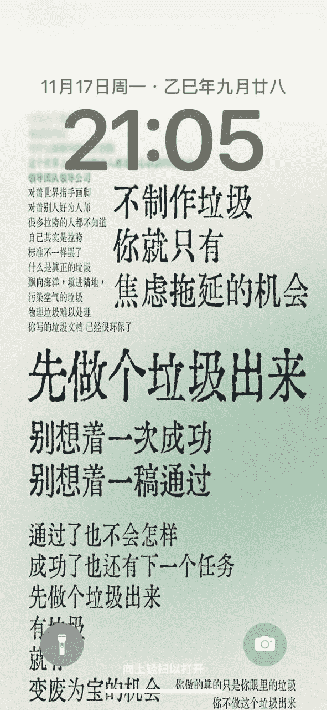

**我保持的这个**方法和心态，为我后来进入B站好物赛道打下了最重要的基础——选择大于努力

# 二、选对赛道：为什么是B站好物，而不是其他？

我想通这些道理之后，就开始有意识地寻找适合自己的赛道。我当时有一个明确的筛选标准：转化路径要短，离钱要近，最好不用跟客户一对一沟通，因为我之前踩过一个大坑。

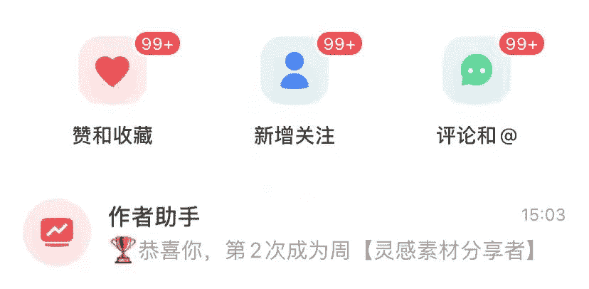

我之前在📕做职场咨询，既要发笔记引流，还要跟客户沟通需求，还要做后端的咨询交付（我做的职场咨询类）白天主业要忙碌，整个人分身乏术。有好几次笔记爆了，一下子涌进来几十上百个咨询客户，我一个人根本承接不过来，又找不到合适的合作伙伴，最后那些流量就全浪费了，钱没赚到多少，还把自己搞得身心俱疲。所以我当时就下定决心，再选项目，一定要选"轻运营"的，把精力集中在一个环节上。

转折点龙哥大大发了B站好物超级标的信息，我一下子就眼前一亮。我当时就觉得，这个项目太适合我了——

**转**化路径极短，核心就两个环节：搞流量+带货变现，不用跟客户沟通，不用做后端交付，卖出去就能拿到佣金；另外我是B站五六年的老用户了，对这个平台的调性、用户喜好、内容规则都非常熟悉，不用重新去适应一个新平台；B站的平台环境非常友好，限制比较少，不会像有些平台那样，动不动就限流、违规，对于新手来说容错率很高。

更重要的是，B站好物赛道**有双条变现路径**：既能靠带货赚佣金，又能接品牌商单，相当于给收入上了双保险。大家都知道，做自媒体最怕的就是"一条路走到黑"，万一某个变现方式不行了，整个账号就废了。但B站这个赛道不一样，带货不行还有商单，商单少的时候还有佣金，东边不亮西边亮，抗风险能力很强。

不过刚**开始的时候，我**也走了一段弯路。那时候圈子里的前辈都在做好价类视频，就是那种AI配音、加些素材拼接的视频，制作起来很快，但我做了几个之后就觉得特别别扭——这种视频质量太低了，完全不符合我对内容的要求，而且同质化特别严重，很难做出差异化。就在我纠结要不要放弃的时候，家蒙哥的深海圈出现了，彻底给我打开了新世界的大门。

深海圈主打的是"PPT横评+真人露脸"的视频形式，这种形式一下子就戳中了我：既能通过PPT展示专业的参数、对比信息，又能通过真人露脸增加信任感，还能加入很多创意内容，灵活性特别强。我当时就觉得，这个形式就是我要找的——既有专业性，又有个人特色，还能跟那些同质化的内容拉开差距。

所以这里想跟大家说，选赛道不是看别人赚不赚钱，而是看这个赛道是不是真的适合你。我之所以能在B站好物赛道做起来，核心就是三个点：

> 第一，赛道符合我的需求（轻运营、转化短）；

> 第二，我对平台足够熟悉（五六年老用户）；

> 第三，内容形式契合我的理念（专业+个人特色）

三个点缺一不可，也是大家选赛道时可以参考的核心标准——流量就是钱

# 三、选品策略：从"纠结到爆单"，我只抓了两个核心原则

深海圈分享的 PPT 横评 + 真人露脸视频形式，我特别喜欢 —— 它能容纳很多创意，灵活性也超强。为了达成家蒙哥定下的 “一个月 5 个视频” 目标，我当时就一头扎进去猛干。

刚开始做的时候，我就遇到了第一个大难题——露脸恐惧症。我对着镜头说话的时候，声音发抖，表情僵硬，镜头前表现很别扭，不知道该怎么跟观众互动；那时候也不会在视频里穿插素材，整个视频除了人脸部分就是ppt部分，家蒙老师视频点评后我清晰地意识到，用这样的呈现方式让内容显得枯燥又乏味。

初期遇到了这种情况时，我想跟所有新手说一句：千万不要内耗！不要想着一定要做到完美再发视频，先做出来一个"垃圾作品"也没关系，关键是先把它发出去。我当时就是这样，第一个视频拍了整整一下午，自己看了都觉得尴尬，但还是硬着头皮发了。发出去之后，我再根据圈友们的反馈一点点改进——比如说"ppt排版有问题"，我就去调整排版；圈友说"说话太生硬了"，我就对着镜子反复练习，把脚本背熟，直到能自然地讲出来。就这样，到第三个视频的时候，我就已经能熟练地完成拍摄了。这里我也忍不住的要夸一夸这次深海圈里的群氛围，船员们互帮互助的答疑，那些经验丰富的前辈们更是毫无保留地分享他们的实战经验与避坑指南。

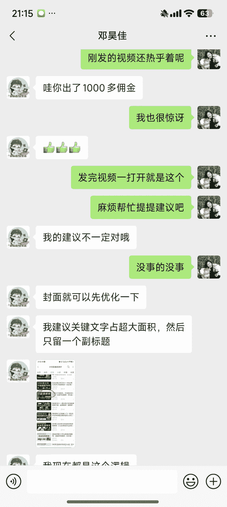

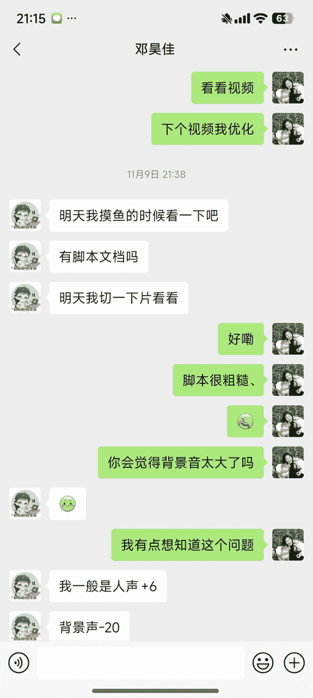

抱着这个心态，我边做边改，而整个过程中，最耗时的其实是选品 ——

和很多圈友一样，我也在 “带什么” 这件事上纠结了很久，相信很多做带货的兄弟姐妹们都有过这种感受：打开选品平台，琳琅满目的商品，不知道该带哪个，既怕选的品没人买，又怕选的品佣金太低，赚不到钱。我当时也跟圈子里的很多人一样，每天花好几个小时在选品上，越选越纠结。

但我一直坚持一个原则：**要做就做高客单价、高佣金的品。这类品虽**然出单难度高，但一旦成交，收益就很可观。

确定方向后，我在京东联盟里地毯式筛选，把能想到的相关品类都扒了一遍。选品思路上，我和大家不太一样：很多人会找 B 站竞争弱的品，但我更倾向于选热门款。一个品能成为热门、有那么多人发视频，背后一定有人赚到了钱，也必然有它的核心优势和市场需求。

后来我索性停下来，不再盲目地看商品，而是给自己定了两个核心选品原则，正是这两个原则，让我找到了那个能爆单的高佣金品类。

## 原则一：只做高客单价、高佣金的品类

我当时就想通了一个道理：带货不是靠走量就能赚钱的，尤其是对于我们这种新手账号，流量有限，与其带100个低客单价、低佣金的品，赚那几块钱的佣金，不如集中精力带一个高客单价、高佣金的品，哪怕一个月只出几单，赚的钱也比前者多。

比如我当时看了很多日用品，客单价几十块，佣金只有5%-10%，就算卖100单，佣金也才几百块。但我后来选的那个品类，客单价大几千块，佣金能达到2-3%，卖一单就能赚几百块，卖10单就是几千块，这个收益差距是巨大的。

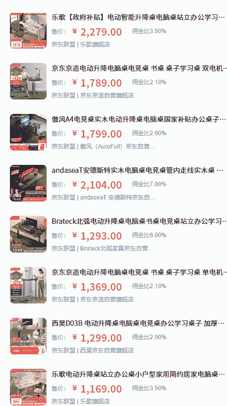

可能有人会说，高客单价的品不好出单啊。确实存在的现象高客单价的品决策周期更长，对信任度的要求更高，正因为如此，它的竞争才不会像日用品那么激烈，一旦观众信任你，复购和转介绍的概率也更高。更重要的是，高客单价的品往往有更深厚的内容可挖，比如参数、性能、使用场景、对比测评等，这正好契合我们深海圈里"PPT横评+真人露脸"的专业内容形式。

## 原则二：不找"竞争弱"的品，只找"有爆款基因"的品

当时圈子里很多人都在找"竞争弱"的小众品，觉得这样更容易起号，但我反其道而行之——我专门找那些已经有很多人在做的热门品。我当时的逻辑很简单：一个品能成为热门，被很多人追捧，说明它一定有市场需求，一定有人靠它赚到了钱，这就省去了我验证市场的环节。那些没人做的小众品，可能确实竞争小，但也有可能根本没人买，我们花了大量精力去做内容，最后却发现没有需求，那才是真的浪费时间。

找热门品不是盲目跟风，而是要"挖透它的玄妙之处"。我当时选定一个热门品类之后，就开始了疯狂的学习——上知乎查专业测评，去📕看用户反馈，用AI整理行业报告，把这个品类的核心参数、优缺点、适用人群、竞品差异都摸得一清二楚。

刚开始的时候确实很难，光笔记就记了好几本，但等到我做第二个视频的时候，我就已经能熟练地讲解产品了，甚至能说出一些行业内的专业细节，这就让我的视频显得特别专业，观众的信任度自然就上来了。

这里还有一个关键操作：当我确定这个品有爆款潜力之后，我就不再换品了，而是把所有精力都集中在这个品类上，做垂直深耕。我当时的想法是，与其做10个品类的"泛测评"，不如做1个品类的"专家"。观众想到这个品类，第一个就想到我的账号，这样才能形成壁垒。

选**定**品之后，我就开启了 “恶补模式”，一开始确实很吃力，但等到出第二个视频时，已经能信手拈来了。而且我一直坚持一个理念：一旦发现好品，就深耕垂直赛道，集中火力打爆它 —— 不断复刻爆款视频里的核心亮点，把这个品的潜力挖到极致。

**事实证明这个思路是对的**——我围绕这个品类做了一系列视频，从基础入门到深度测评，从参数对比到使用技巧，慢慢就积累了一批精准的粉丝——他们都是对这个品类有需求的人，转化率特别高。而且因为内容垂直，平台也会给我的账号打上精准的标签，推送的流量也越来越精准，形成了良性循环。

# 四、内容破局：从"没人看"到"爆单"，我踩对了这三个关键点

选对品之后，内容就成了爆单的关键。我刚开始做"PPT横评+真人露脸"视频的时候，数据并不好，播放量一直在几百徘徊，出单也很少。我当时就分析原因，发现问题出在内容形式上——这种正式的专业测评视频，虽然专业，但太死板了，很多想吐槽的点没法说，而且遇到新机发布、好价通知这种时效性强的内容，根本来不及做精致的PPT，等视频做出来，热点早就过去了。

就在我纠结的时候，我关注了一个百万粉的账号"斤斤计较的包子"，他的视频形式给了我很大的启发——拿着手机对着电脑屏幕或者实物直接讲解，不用精致的PPT，不用刻意的脚本，想到什么就说什么，反而显得特别真实、接地气。我当时就想，我能不能也用这种形式做补充内容？

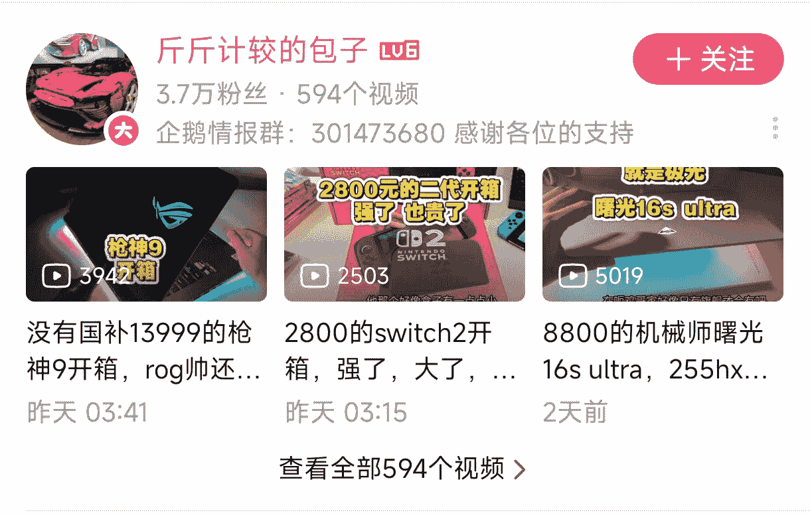

于是我立马拍了一个新品快讯视频，没有做PPT，就是拿着手机对着新品的官网，边看参数边讲解，还加入了自己的吐槽和看法，然后把它归到了"快讯"这个视频合集里。没想到这个视频发出去之后，播放量直接破千，还出了好几单！这让我一下子找到了方向。

后来我才知道，这种形式叫"录播流"，是源神流的一种，核心就是"快、真、准"——

发布快，抓住时效性；内容真，拉近和观众的距离；卖点准，直击用户需求。但当时我没考虑那么多，我只知道这种形式能解决我的痛点，而且观众很喜欢。

复盘之后我就总结出了三个让内容破局的关键点，这三个点也是我后来能稳定出单的核心原因。

## 关键点一：用"双账号布局"解决"专业"和"时效"的矛盾

刚开始做"录播流"视频的时候，我有一个顾虑：这种接地气的吐槽视频，会不会影响品牌方对我的认知？毕竟品牌商找商单的时候，更倾向于专业、精致的账号形象，如果我的账号里既有精致的PPT测评，又有粗糙的录播吐槽，品牌方可能会觉得我的账号定位不清晰，不敢找我合作。

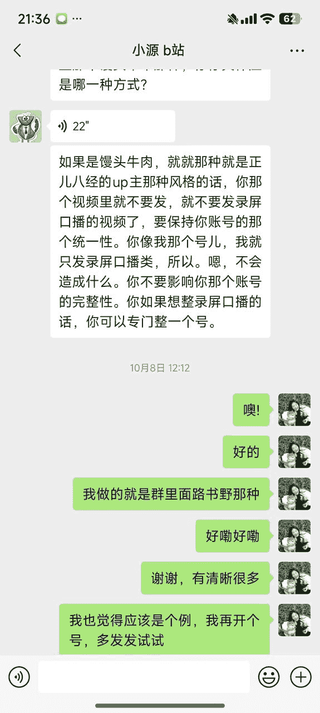

我当时就把这个困惑跟圈子里的大佬说了，大佬给了我一个关键建议：开两个号，做内容拆分。这个建议一下子就点醒了我。我立马注册了一个小号，把"录播流"的快讯、吐槽、好价通知等内容都放在小号上，大号则专注于"PPT横评+真人露脸"的专业测评内容。

这样做的好处太明显了：大号走"专业专家"路线，主攻品牌商单和深度转化，建立账号的专业壁垒；小号走"接地气福利官"路线，主攻时效性内容和流量引流，快速积累精准粉丝。而且两个账号可以互相导流——大号的粉丝想了解最新的好价信息，我就引导他们去小号；小号的粉丝想做深度了解，自然会去大号看专业测评。

这个双账号布局，让我彻底解决了"专业"和"时效"的矛盾，两个账号的收益也形成了互补。后来双11的时候，大号靠专业测评接了好几笔商单，小号靠好价通知爆了好几个视频，佣金收入直接翻倍。

## 关键点二：把"粉丝评论"当成最好的选题库

很多做内容的人都会纠结选题，但我从来没有这个烦恼，因为我的选题库全来自粉丝评论。我一直坚信一个道理：每一条评论都是一个需求，每一个问题都是一个选题。

比如有粉丝在评论区问"这个品和XX竞品比哪个更好？"，我就会做一期详细的对比测评视频；

有粉丝问"什么时候会降价啊？"，我就会做一期好价预测和蹲点攻略；

甚至有粉丝吐槽"这个品的XX功能不好用"，我就会做一期视频，专门讲解这个功能的正确使用方法，或者分析这个功能的优缺点。

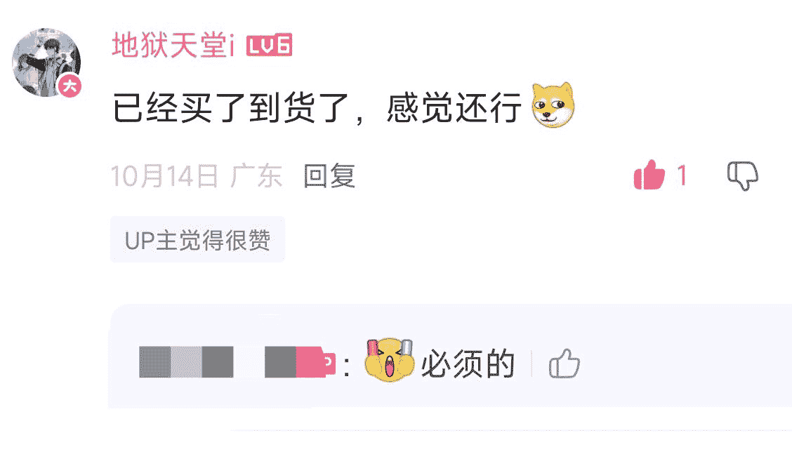

这样做出来的内容，天然就符合观众的需求，播放量和转化率肯定不会差。而且通过回复评论，我还能和粉丝建立深度连接，让粉丝觉得我不是一个冷冰冰的带货博主，而是一个能解决他们问题的"自己人"。信任一旦建立起来，出单就是水到渠成的事。

我记得有一次，一个粉丝在评论区问我某个型号的产品有没有优惠，我当时查了一下，发现京东有一个限时优惠券，我就立马做了一个小号视频，告诉大家怎么领券，还附上了购买链接。那个视频当天播放量就大几千，直接带了48单，佣金赚了八千八百块。这就是把粉丝需求转化为内容的威力。

## 关键点三：学会"借势"，把"黑子"变成流量催化剂

做内容难免会遇到黑子，我刚开始爆单的时候，评论区就出现了一些故意唱反调的人，不认同我的观点，嘲讽我。我当时特别紧张，怕影响其他观众的判断，就一条条删评论，但根本删不完，反而搞得自己心力交瘁。

后来我索性不删了，没想到出现了一个意想不到的情况：很多我的认同我观点的人站出来帮我说话，跟黑子辩论。

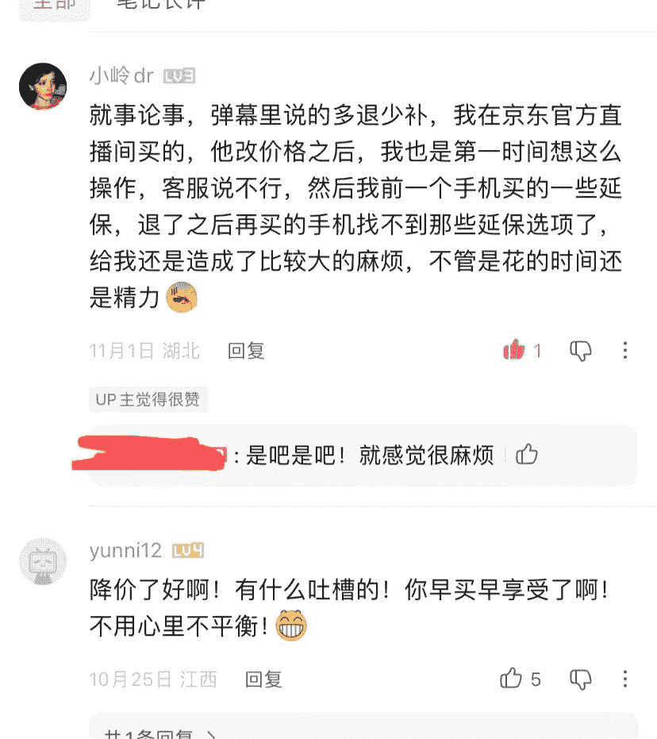

这一下我就乐了，我发现这根本不是危机，而是机会。

粉丝和黑子的辩论，会让评论区的互动量飙升，而互动量是平台判定视频质量的重要指标，互动量越高，平台给的流量就越多；只要不是一边倒的言论，反而让观众会有自主的思考，前期删一删，等到后期流量起来了，弹幕评论数量多起来了没有必要删，他们吵的越厉害我其实渔翁得利。

从那之后，我就学会了**"借势"**——遇到黑子的时候，我不跟他们争论，不好的言论直接删或者引导粉丝互动。这样既节省了我的精力，又能让评论区保持活跃，还能提升转化率，简直是一举三得。但是评论区维护还是非常重要的，正面评论还是要占绝大多数的，注意好这个度。

这里想跟大家说，做内容不要怕有负面声音，只要你的内容是真实的、专业的，就一定有粉丝愿意为你站台。有时候，负面声音反而能成为流量的催化剂，关键是看你怎么引导。

# 五、双11实战：爆单的关键操作和拍断大腿的失误

聊完了平时的运营，再跟大家重点聊聊双11的实战经历，因为双11是带货赛道的"黄金期"，能不能抓住这个机会，直接决定了一个季度的收益。我这次双11能实现爆单，靠的是提前布局，而错失上榜机会，则是因为一个低级失误，希望大家能从我的经历里学到经验，避开坑。

## 双11爆单的核心操作：提前1-2周"铺内容"，锁定精准流量

做带货的都知道，一个视频的流量爆发需要1-2天的时间，而双11的优惠活动往往是限时的，如果等到活动开始再发视频，等视频有流量的时候，活动可能已经结束了。所以双11的关键在于"提前布局"。

我当时的计划是，在双11正式开始前1-2周，就集中发布一批"预热视频"。这些视频不直接推链接，而是做"种草内容"——比如"双11值得入手的XX品类清单"、"XX产品双11历史低价预测"、"双11买XX品类避坑指南"等。这些内容的目的是提前锁定那些有购买需求的精准粉丝，让他们记住我的账号，等到活动开始的时候，再发"拔草视频"，直接附上购买链接。

比如我当时做了一个"XX品类双11避坑指南"的视频，提前10天发布，视频里我详细分析了这个品类的常见坑、值得入手的型号，以及双11可能的优惠力度。这个视频提前积累了大量的播放和收藏，很多粉丝在评论区问"什么时候发购买链接"、"到时候会提醒我们吗"。等到双11活动开始的前一天，我发了一个小号视频，告诉大家优惠已经上线，附上了领券链接，当天就爆单了。

除了提前铺内容，我还做了一个操作：把所有商单和佣金产品做了"时间规划表"。双11期间内容更新频率很高，我怕自己忙乱中出错，就列了一个详细的表格，每天几点发大号视频，几点发小号视频，发什么内容，推什么产品，商单视频和佣金视频怎么穿插，都安排得明明白白。这样即使每天只睡3-4个小时，也能保证内容按时发布，不会错过任何一个流量节点。

那段时间确实特别累，白天要上班，晚上要拍视频、剪视频，有时候剪到凌晨三四点，早上七点又要起来上班。但每天早上一睁眼，打开京粉看到佣金收入的时候，就觉得所有的累都值了。双11结束的时候，我算了一下，光是佣金就破万了，加上商单收入，直接实现了月入过万的目标。

## 拍断大腿的失误：只关注佣金，忽略了GMV的重要性

虽然双11的收益不错，但我复盘的时候，发现了一个让我特别后悔的失误——因为这个失误，我错失了3000元的榜单奖励，更错失了一个提升账号等级的机会。

事情是这样的：当时京东联盟有一个单一品类GMV排位赛，上榜的博主能拿到3000元的现金奖励，而且上榜之后，账号的权重会提升，后续能拿到更多的资源扶持。我当时主攻的那个品类，佣金很高，我一门心思只关注"到手佣金"，觉得"我一个小博主，GMV肯定上不了榜，不如多赚点佣金实在"。所以在双11最后几天，我没有去冲GMV，反而因为觉得收益不错，有点飘飘然，放松了内容更新的频率。

结果双11结束后，我算了一下自己的单品GMV，发现我离上榜只差了一点点！就因为最后几天没有全力冲刺，我错过了这个机会。后来我跟圈子里的大佬聊起这件事，大佬跟我说了一句话，让我彻底醒悟："做带货，短期看佣金，长期看GMV。GMV不仅能帮你拿榜单奖励，更能让平台和品牌方看到你的带货能力，后续的资源、商单报价都会不一样。"

我后来仔细想了想，确实是这样。比如我之前接商单，品牌方问的第一个问题就是"你之前带过类似产品吗？GMV多少？"。GMV是衡量带货能力最直接的指标，比佣金更有说服力。而且如果我能上榜，拿到那3000元奖励是小事，更重要的是能获得平台的官方背书，后续的流量扶持、活动报名都会更有优势。

这个失误给我敲响了警钟，我也总结了两个教训，给大家做借鉴引以为戒：

**第一，做项目的时候，不能只看眼前的利益，要关注长期的**价值，比如GMV、账号权重、粉丝质量等；

**第**二，任何活动之前，一定要把规则研究透，比如榜单的评选标准、奖励机制等，提前做好规划，不要等到结束了才追悔莫及。

# 六、搞钱的底层逻辑：相信的力量和主动创造机会

聊完了具体的操作和失误，最后我想跟大家聊聊搞钱的底层逻辑。

我从月入3元到月入过万，靠的不仅仅是选对了赛道、做对了内容，更重要的是把握了两个心态层面的东西——相信的力量和主动创造机会。

1.  **相信的力量**

我刚开始做B站好物的时候，第一个月只赚了3块钱，很多人遇到这种情况可能就放弃了，但我没有。因为我心里一直有一个信念：我一定能做起来。那时候我心力不足的时候，就会去看龙哥大大发的"赚钱咒语"，就会去看圈子里前辈的成功案例，告诉自己"他们能做到，我也能做到"。

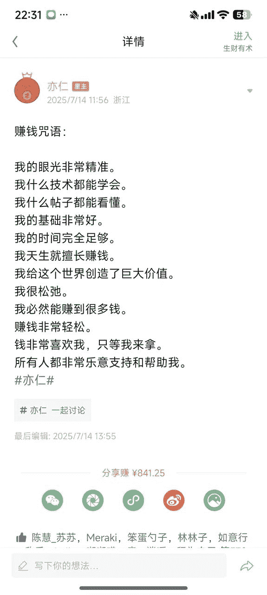

这种信念不是盲目自信，而是基于我对赛道的判断、对自己的认知。我知道我选的赛道是对的，我知道我做的内容是有价值的，我只是需要一点时间积累。就像种地一样，你播下种子之后，不可能第二天就收获，你需要浇水、施肥、除草，然后耐心等待。搞钱也是一样，所有的成功都不是一蹴而就的，都是长期积累的结果。

1.  **主动创造机会**

很多人说"机会是留给有准备的人的"，但我觉得更准确的是"机会是留给主动创造机会的人的"。

我能进入B站好物赛道，不是因为机会主动找上门，而是因为我一直在赚钱星球和社群潜水学习，一直在寻找适合自己的赛道；

我能遇到深海圈，不是因为运气好，而是因为我一直在关注星球圈子里的动态，主动链接前辈；

我能做双账号布局，不是因为我天生就会，而是因为我遇到问题之后，主动去问大佬、找解决方案。

搞钱路上，没有人会把机会送到你手上，你需要自己去发现、去争取、去创造。

比如你看到一个好的赛道，不要只观望，要主动下场试；

你遇到一个厉害的前辈，不要只崇拜，要主动去请教；

你发现一个问题，不要只抱怨，要主动去解决

主动出击，才能抓住那些隐藏的机会，为自己创造机会

# 七、未来规划和给大家的建议

未来我会继续深耕B站好物赛道，一方面优化双账号的内容体系，大号往"深度测评+品牌合作"的方向走，小号往"社群运营+私域转化"的方向走，把粉丝沉淀到私域里，提升复购率；另一方面，我会拓展更多的高佣金品类，形成"多品类矩阵"，降低单一品类的风险。

非常的开心参加了这次的深海圈|B站项目，我也会把我自己的经验避坑整理出来，帮助更多圈子**里的兄弟**姐妹们，因为我知道，一个人赚钱不算厉害，一群人赚钱才是真的厉害。赚钱社群的理念就是"成人达己"，我希望能把这个理念传递下去。

> 经历了实战经历，我给正在搞钱路上的兄弟姐妹们提4点建议，希望能帮到大家：

>

1.  选赛道要"精准匹配"，不要盲目跟风：先明确自己的优势（比如熟悉哪个平台、有什么技能）和需求（比如想赚快钱还是长期钱、能投入多少时间），再去选赛道，不要看到别人赚了钱就跟风做，适合别人的不一定适合你。

>

1.  做内容要"先完成再完美"，不要内耗：新手最容易犯的错就是追求完美，迟迟不敢发内容。其实第一版内容不完美没关系，发出去之后根据反馈慢慢优化，比停留在原地强一百倍。

>

1.  做项目要"关注长期价值"，不要只看眼前利益：除了佣金、收入这些短期收益，更要关注账号权重、粉丝质量、行业资源这些长期价值，这些东西才是你能持续赚钱的底气。

>

1.  遇到问题要"主动链接"，不要闭门造车：搞钱路上难免会遇到难题，这时候不要自己憋着，要主动去问圈子里的前辈、找同行交流，很多时候别人一句话就能点醒你，深海圈|B站的氛围实在太好了

我想跟大家说：我能从月入3元做到月入过万，你也可以达成；

搞钱路上没有捷径，但有方法；没有天生的高手，只有后天的努力；

只要你选对赛道、找对方法、保持信念、主动出击，迟早会迎来自己的爆发期。

接下来我要备战下一轮大促了，也希望大家能在自己的赛道上取得好成绩。让我们一起猛猛搞钱，一起成长！谢谢大家！