# B站好物从0到GMV50W，创意流开创者

> 来源：[https://xuqiwei1986.feishu.cn/docx/Xz07dVWHNo5DZsxHhvScoBvKnQg](https://xuqiwei1986.feishu.cn/docx/Xz07dVWHNo5DZsxHhvScoBvKnQg)

大家好，我是Dustin，可以叫我蛋蛋，深海圈的大家都叫我蛋哥，甚至有人叫蛋总了，受宠若惊

我是8月参加的B站好物深海圈，从8月27日发出第一个视频，一直到双十一，一共21条视频，拿到了一些结果（比起大佬，真的只是一点点小结果）于是决定来复盘一下，B站好物我是如何从0到50W GMV的

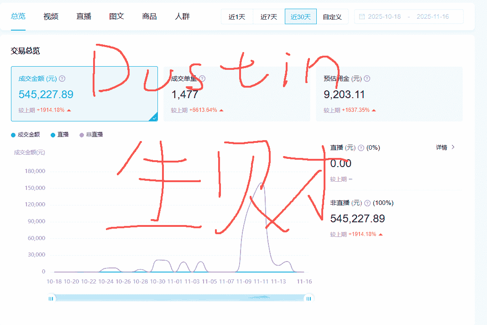

我的心里其实一直有一个声音想放弃，我是相信B站好物超级标的，但我曾一度不相信这超级标适合我。

一度认为我做不出好成绩，赚不到钱。

最后在教练和圈友的带动下，发现我还是能赚到钱的，虽然不多，但也算是跑通了，而且能接到商单

啊？哪里不多了，蛋哥你真够凡尔赛的，等复盘完看到下面的商单收益就知道原来已经赚了蛮多了，再加上佣金，其实把深海圈和赚钱的门票钱全都赚回来了，接下来只会赚得更多

好了，没忍住瞎bb了一段，进入正题吧

## 玩法介绍

B站有很多种玩法，我目前知道的 深海圈的大家玩到的有这么几种

### 1、专业横评流

找一个选题，再选出一堆产品，做好ppt，前面先来点铺垫，比如选购指南、攻略等，然后再一页页的列出每个产品参数讲解，这是家蒙教练在开营4天高强度教学里无保留教给我们的流派

### 2、录屏口播流

手机录屏，对着产品详情页讲解，一天发多条，由 @小源 圈友分享的另一种流派，我们管他叫源神，如果想学习的话可以看源神的帖子或者直接找他链接，他人超好的！而且非常乐于分享！

### 3、红包攻略流

深海圈里 @星空海绵 圈友研究出来的，也是我目前已知的唯一GMV破千万的大佬，我们管他叫星神，星神在验证了这个玩法是真能赚钱之后，第一时间直播分享给大家，太感动了！不过是大促才能玩的，目前这玩法只在深海圈有分享，不过在我写稿时候得知星神也在写复盘贴了，大家可以去他那看！

### 4、创意流

也是大促才能玩，我开创的，目前亏了，但当时是大促的倒数第二天才发现的，下次一定能赚，下一波大促，我有预感会有人靠这个方法赚到一笔

## 专业流的个人经验

我先来说一下我从0到1是怎么做的吧，我一开始就是玩专业流的，家蒙教练高强度连上4天直播课以后，我就开始了制作第一期视频了，简单评价就是：“一坨屎”

你如果到赚钱看帖子，特别是那些教新人入门的，一般都能见到的一句话是“先完成再完美”

这一次也一样，家蒙教练也希望我们不论质量好坏，先发再说

于是我管它做的好不好呢，我先把基本的该做的东西做出来，先发出去再说，万一“这坨屎”也能赚到钱呢，反正又不说只能发一个视频，有什么问题等下一个视频再解决，一定不要给自己设限，EGO一定要降低，降低你的个人标准，放弃你的完美主义，做出来！发出来！很好！你成功地迈出了第一步！你离成功很近了！

后来我经过家蒙教练的作业点评，以及观察带货榜单up主，也是一点一点的在优化，再经过 @鹿书野 圈友的分享，也逐渐摸索出一套做视频的流程，但依然有很大的优化空间

### 1、工具推荐和拍摄方案展示

首先是一些工具

1、详情页下载图片（浏览器插件）

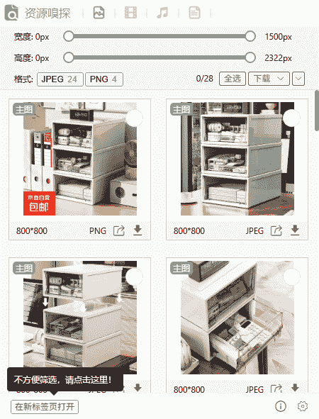

2、详情页下载视频（浏览器插件）

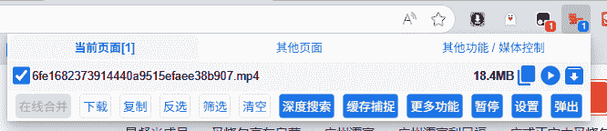

3、提词器

`https://cueprompter.com/`

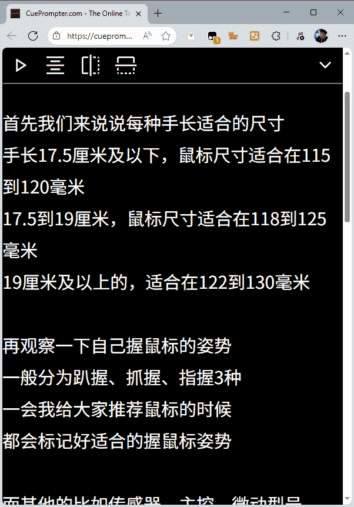

到这里有小伙伴会问了，你怎么用网站的提词器呢

这就要跟我的拍摄环境有关了，我以前有做过抖音书单号，这是以前用的支架，然后就是麦克风是有线的，是我之前玩游戏时候用的，不打算再买个无线麦克风，就索性坐电脑前拍了，于是我的拍摄方案就是这么的简单又粗糙

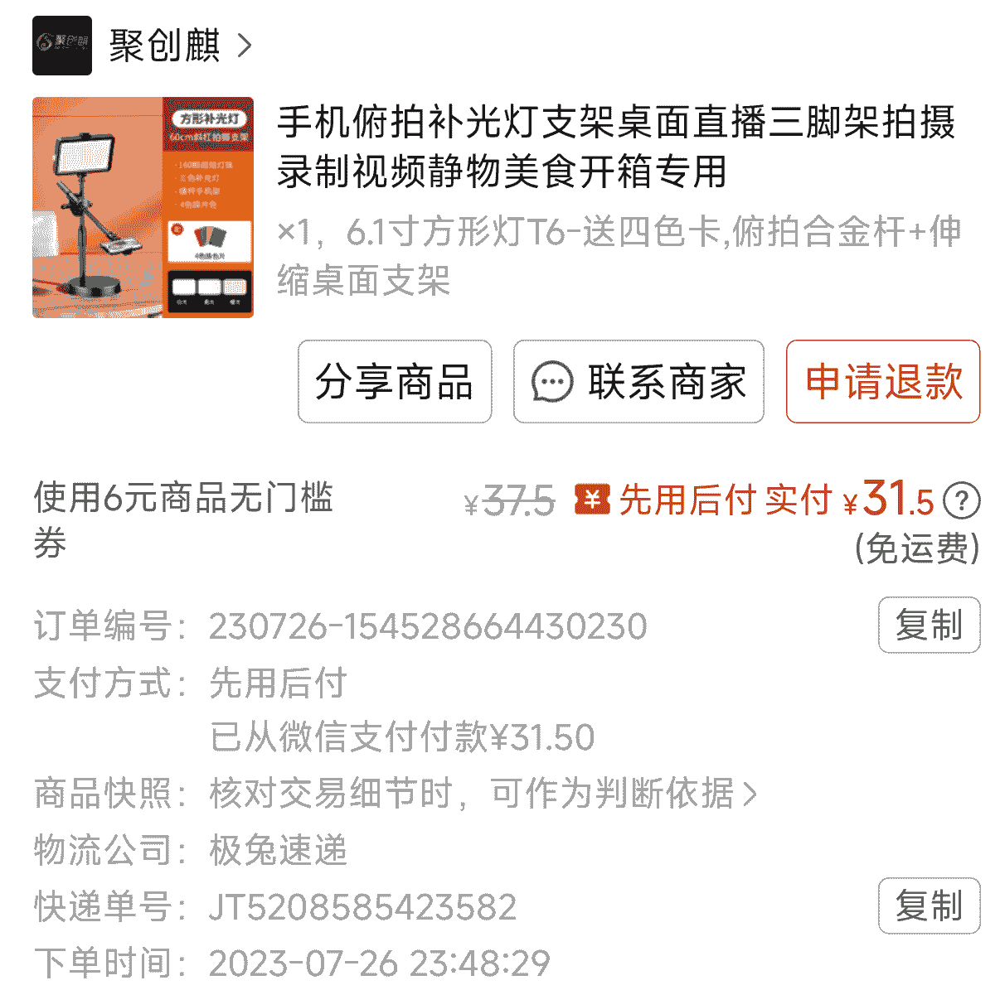

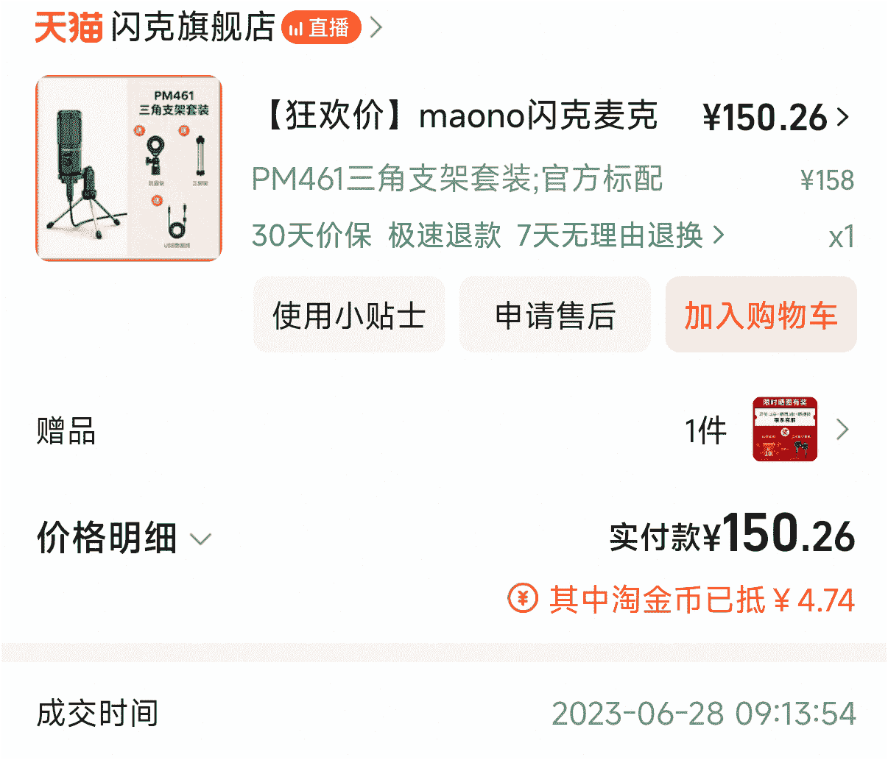

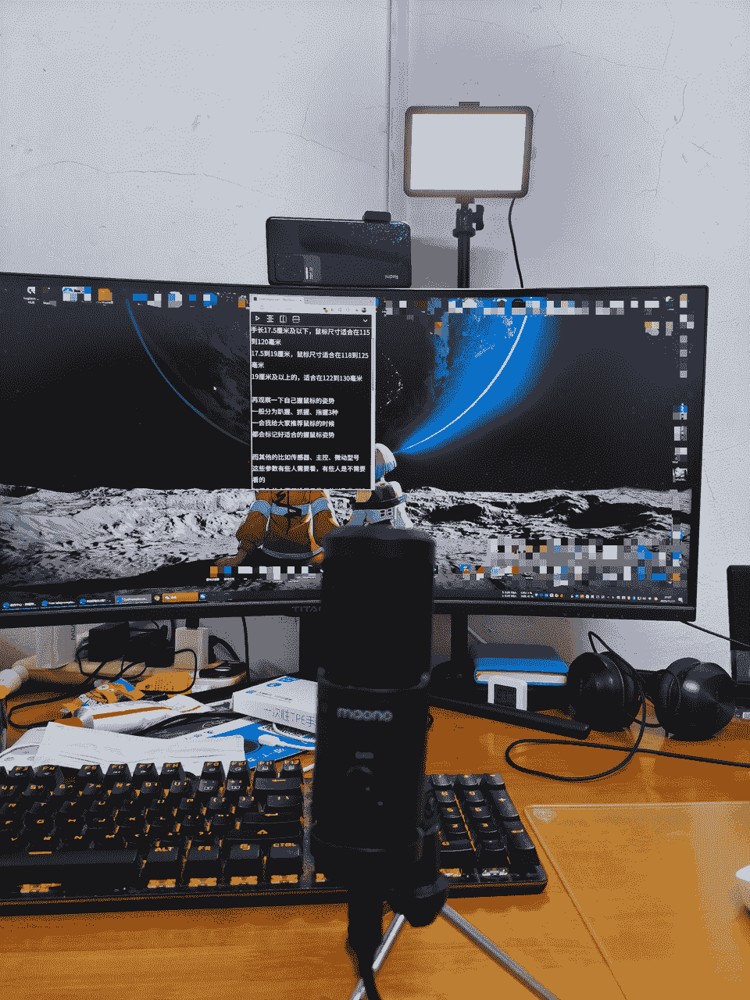

那么怎么看镜头呢，怎么看录的对不对呢

这就有点意思了，我用的是红米手机，可以用小米电脑管家直接看手机画面

> 对了，如果你的电脑不是小米电脑，是没办法直接安装这个小米电脑管家的，我也是这样，当然有解决办法

> 这里有一份破解的安装包，有需要的圈友可以自取，解压出来，安装好管家以后，把`wtsapi32.dll`文件放到

> `C:\Program Files\MI\XiaomiPCManager\5.3.0.328`

> 这个目录下就可以打开使用了

[`小米电脑管家5.3.zip`](https://internal-api-drive-stream.feishu.cn/space/api/box/stream/download/all/Ew0RbJXVYoEwIjx6erXcyKqqnIg)

于是我手机用来录画面，电脑打开剪映录音，解决手机麦克风录制效果差的问题，于是我的电脑界面大概就是这样，有一个镜头，有一个录音器，再有一个提词器，开拍！

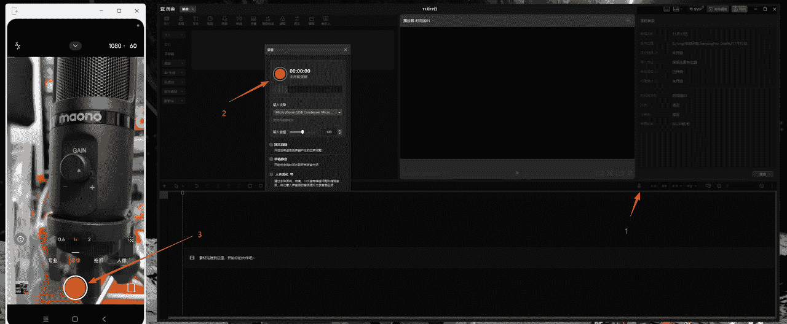

拍完以后只要把手机的视频放剪映里，对齐一下刚刚录音的音频，再把手机视频里的声音去除，就可以开始正常的剪辑了

这只是刚确认好拍摄方案，在打怪副本里这充其量只是个小兵，接下来你要面对的第一个BOSS是选品

### 2、选品

一开始我选品是怎么选的你们知道吗，家蒙教练给我们开了高佣计划，我一眼看中这个创维电视的定向，好高的佣金啊，好香啊，这要是出单得多开心啊，于是就这么选了里面的所有品（不止截图里这点），现在回看的话，我的评价是：我是傻逼

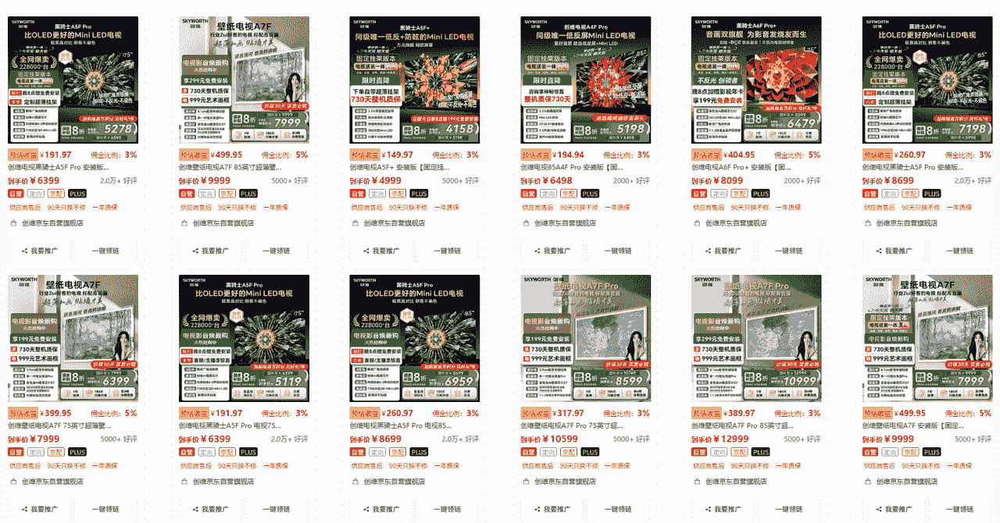

我居然每个尺寸每个型号都讲一遍，就是比如说，一个A7F电视，我75寸讲一遍，等会85寸又讲一遍，100寸又讲一遍，哇 真的是累死了当时，活该我累，就不该这么做，更好的方案其实是选定一个尺寸，然后根据这个尺寸去把每个型号都只讲一遍，这已经足够了，不然像我第一个视频这样，废话连篇，根本看不下去，所以这视频也是很成功的一单没出

说完我的失败经验，说一下现在是怎么选品的，现在我直接找对标，对标视频里有什么产品，我就抄下来，截图发给豆包，告诉他我要这些参数汇总到表格里，然后自己去查一下佣金是多少，再决定想做哪些，这就是

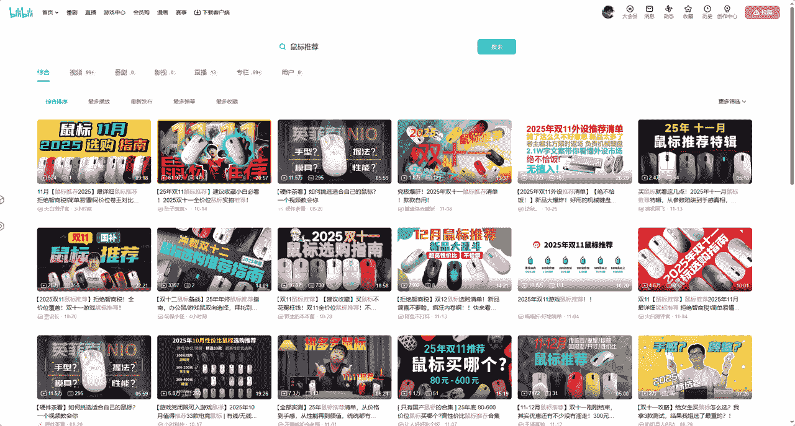

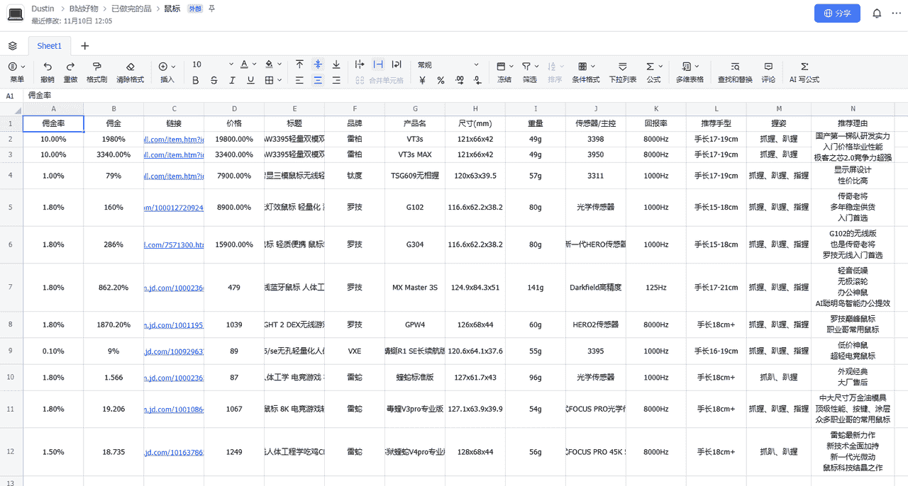

其实可以做自动化找佣金的，手动有点浪费时间，等我有空了去研究下影刀

很好，第一位BOSS我们已经有简单的办法打败了，接下来登场的第二位BOSS是

### 3、脚本

很多圈友被脚本困扰已久啊，俺也一样！我写的脚本太烂了，于是我决定，还是找对标，但是被人发现抄袭怎么办，没关系！先找行业里成熟的表达做参考，再结合自己的内容结构去重塑。平台上像知乎这种地方，优质回答特别多，我也经常去那里找灵感、找切入点！然后丢给AI洗稿，提示词很简单

> 提示词：以上是带货文章，我现在是一名B站带货UP主，想要参考这篇文章写一条视频的脚本，你帮我优化一下，要口语化！要专业化！遇到术语或过于专业的名词最好有一段解释让观众能听懂！

不过后来我也尝试找了一些B站带货大佬的视频，把字幕下载下来，然后丢给豆包只保留文本，再丢给GPT帮忙写脚本，其实用claude更好，只是我习惯用GPT了，大家可以试试claude

字幕下载网站：`https://www.kedou.life/caption/subtitle/bilibili`

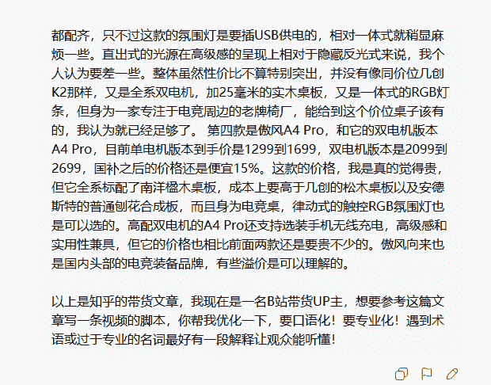

于是乎，我们的脚本就这么出来了，我们再根据自己的风格，去修改，调整，改成你能读的顺口的稿子

接下来就是第三位BOSS

### 4、拍摄

我就是按上面展示的拍摄方案去拍的，如果你知道我账号的话，就知道我离镜头会有点近，这截图是我视频最底部的画面

关键是我坐太远了我的麦克风线没那么长啊，害，所以未来有可能还是会买个无线麦克风的，毕竟这有线的麦克风有点限制我了，离镜头远点，把整个上半身展示出来，视频效果会更好，所以这里别学我，这里我的方案是错的！

这里最大的困难点，是很多人害怕的口播，比如看镜头不自然，说话结巴，面对镜头面瘫之类的，我是曾经做过抖音书单号，还有视频号，所以有拍过类似的口播画面，但也就2条，或许我有一个天赋就是出镜自然吧

我有一个方法，不知道有没有用，就是把我的手机，当做一只小黄鸭，你问为什么是小黄鸭？因为我主业是程序员，做程序员的都知道，当代码走不通的时候，或者不知道为什么出现问题时候，你就需要一只小黄鸭了，你要对着代码，一句句跟小黄鸭说，这句代码什么意思，这段代码走了什么逻辑干了什么，诶，聊着聊着你就会发现问题了

为什么拍口播要把手机当小黄鸭呢，因为你要把它当一个人畜无害的朋友，当作愿意一直倾听你bb的好朋友，你可以先告诉它，“我费尽心思做了这篇购买指南，你给我好好听一下，听完你记得去买嗷，不买就不跟你做朋友了”

然后开始对着脚本一句句的念，时不时的带上一点手的动作，就像真的在跟朋友聊天一样

当然，如果你还是实在做不到的话，没关系的啦，咱们还有源神流，不需要出镜就可以GMV百万，牛不牛逼，找源神学去吧，我没玩过，我就不教了嘿嘿

你很牛逼，听我说，你真的很牛逼，不要妄自菲薄，能走到这的你，已经比90%的人强了！

你现在已经打完前面很多难打的BOSS了，现在到最后一个BOSS

### 5、剪辑

剪辑其实有太多太多细节可以抠了，如果想卷细节，是根本卷不完的，所以适度就好，简单高效有用就好，一定要想办法给自己做一套模板化的剪辑流程出来

我一开始给自己做的视频设了太高标准，抄的对标视频实现的效果太好，导致剪辑工作量太大了，一个10分钟的视频，真的是要命了，下图就是其中一条，一堆关键帧，累死

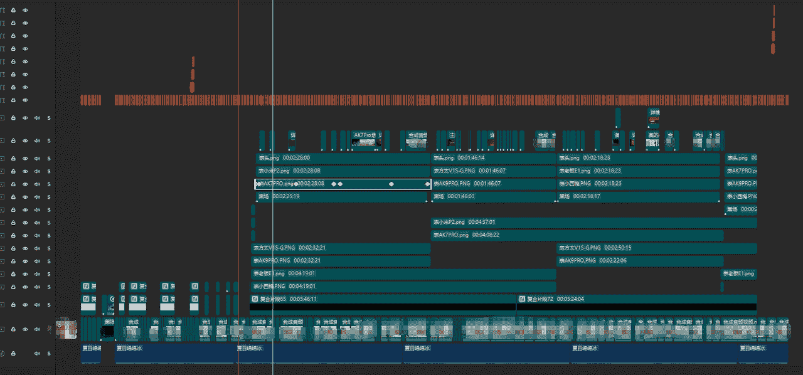

后来我决定放低标准，搞一个简单的ppt，再放一下详情图轮播一下，有视频就放视频在商品介绍那，一下子轻松多了

而且我现在拍摄，只拍前面的讲解部分和最后的结束部分，中间的产品详细介绍部分，我都直接不拍了，直接用麦克风录音，减轻了很多工作量，下面这张截图

1、主轨道是我的铺垫部分+录音+结尾部分

2、往上第一条轨道是背景，有一个纯黑色的背景会高级一些，再加一点点动态，这也是深海圈圈友分享的方法，我也放在这给大家学习。`https://www.bilibili.com/video/BV1JNQLYjEzy`

3、再往上第二条轨道就是产品ppt了，这个ppt怎么做的呢，是根据@鹿书野圈友分享的稿定设计做的，非常方便，只需要做一个设计模板出来，接下来导入参数，就可以批量套版，批量生成你要的图，具体如何操作可以看看他的帖子，这里只简单说下思路

4、再往上第三条轨道就是去每个产品详情页下载的图片和视频了，只需要放在ppt的展示产品那个框里，时不时切换一个图，切一个视频，就可以了，非常非常简单，对比之前的剪辑工作量简直太舒服了

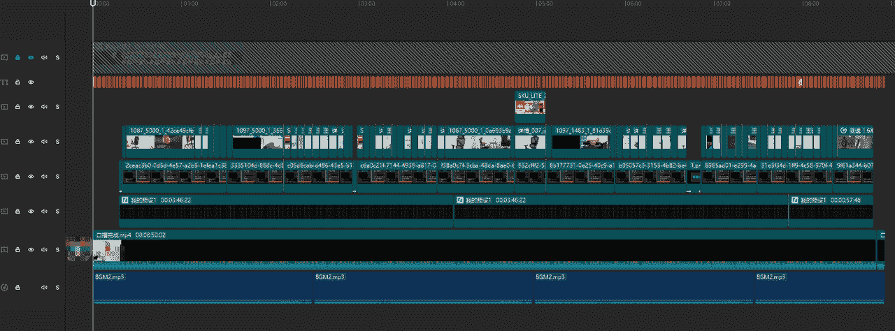

> 记住，字体、BGM要找无版权的，或者可商用的，保险一点，素材的话，其实很难找到无版权的，除非自己拍，所以这个只能说尽可能避免，或者让AI生成也是一个好办法。而商品详情页的素材就可以放心的用了，我们用他素材帮他带货，他还得谢谢我们呢

> 如果对剪辑的基础也不是很懂，建议大家去看看赚钱往期航海里的剪辑课

### 6、发布

终于，你成功打败了所有BOSS，现在可以领取这个副本的通关奖励了！

你要是问我封面、标题、标签这些怎么解决，我只能回答你，看对标，对标标题怎么写，你就怎么写，多找几个对标，融合一下标题就行了。标签也是一样的

封面就比较难搞，但是Lynn圈友分享了一个方法，用AI出图就行了，找一张你觉得不错的封面图，让AI修改文字，或者直接文字生图也行

接下来就只需要发布了，然后最好简单运营一下数据，看能否撬动自然流的启动，这里具体怎么运营不好说，反正就是让播放、点赞、投币、评论都好看点

恭喜你！通关！领取到了奖励！就是你成功地放下了一张鱼钩，接下来有多少鱼进入你的口袋，我们不用太关注，只需要接着去下一个副本，复盘上一个副本自己认为可以优化的点，继续撒下下一张渔网，持之以恒，一定成功！

## 创意流教学

那天是11月8日，我日更了4天了，我真的累了，我好佩服那些日更大佬，我要躺下歇会了，久违的打开了半个月没开过的抖音，打算刷几分钟就睡觉

引入眼帘的是猫猫视频，真可爱啊，我喜欢猫猫~

往下滑，第二条视频，我给你们看看，看完我笑了，笑的很大声，还好家里没人哈哈哈哈哈

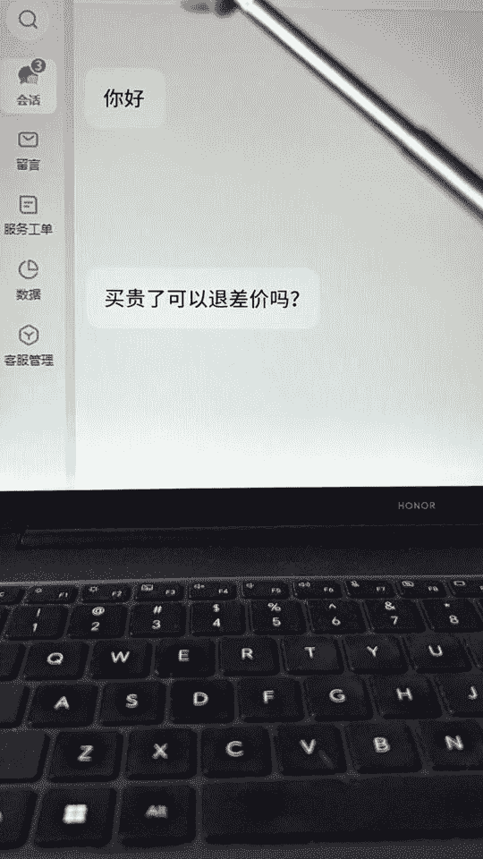

[`敲屏幕视频.mp4`](https://internal-api-drive-stream.feishu.cn/space/api/box/stream/download/all/ZLbDbJWjQo3wqrx9I96cD1XmnCh)

然后我的脑子开始蹦跶了，这玩意儿能不能丢B站里试试，我能不能引导大家忍不住点我评论区的红包啊？

于是困意全无，直接起来，打开了我的🛰️和小号，开始假聊天，拿根手指棍子录视频（这也是以前玩抖音书单号时候买的）

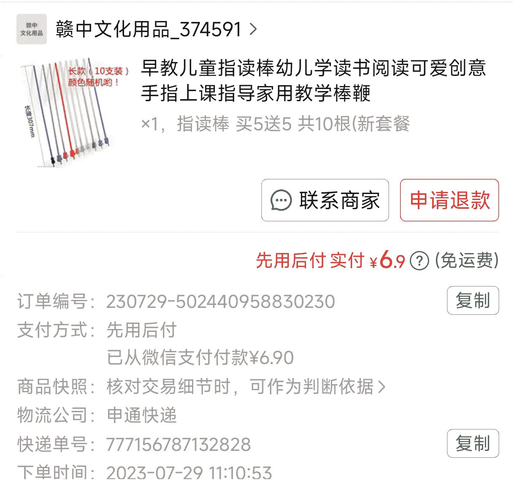

结果视频怎么样，深海圈的大家都知道了，投流蓝链成本只需要1元内，创下2000+在看的记录，我甚至怀疑我当时截图时候不是在看数最多的时候，然后是最终20W的播放，这条视频太爆了

发现爆了以后我也是第一时间同步到群里，想让小伙伴们也喝一口汤，后面的投流实时情况我也都发在群里分享给大家一起参考，那一天下午 群里充满了欢乐的气息哈哈哈哈，实在是视频太搞笑了，也是真的太爆了

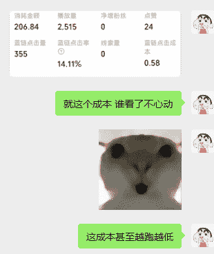

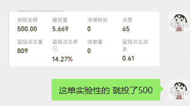

不过这只是视频的结果，那佣金的结果呢，其实不太尽人意，我亏了5k，投流1.5W，佣金1W

单看佣金其实是亏的，但他一条视频为我打下了50W的GMV，我拿去谈商单，谈2000稿费的商单都毫无压力你们知道吗，这就是底气！只有高GMV才能带来的底气！这在之前是根本不敢想的啊哥们

其实后面我的蓝链成本一直在0.55左右，如果我更早的发现并发出这条视频，肯定是赚的

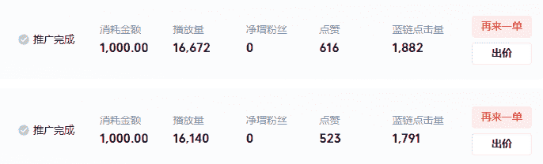

我已经有思路了，下一次有红包的大促，还会尝试玩创意流，在控制好成本的前提下，想办法做到更大的利润，如果有什么想交流的也可以来找我呀，期待与你的思想碰撞！

## 如何第一时间获得正反馈

走源神流，也就是录屏口播流派，这是目前已知的最快获得正反馈的玩法，也是很多圈友马上能克服畏难情绪的玩法

为什么？

因为它相比专业流没有那么难！

专业流你要：选品——找产品参数——写脚本——拍视频——找素材——剪视频

每一步都能把一部分人卡住，但是录屏口播流，你只需要找好品，然后不熟练的可以写个稿子，熟练的可以直接打开你的手机录制，一顿输出的讲，讲出产品的好，讲出产品的坏，讲出这个时间买这个产品是真的值！那观众就愿意点进去蓝链看看

当然这只是一开始可以这么做，但至少你可以很快的开始做了，你可以迈出第一步了！迈出第一步真的非常重要！

接下来你就只需要学习大佬们是怎么做到更好的，再优化自己的流程和脚本，你一定能成功

> 虽然说比专业流简单，但你不要觉得他天花板低，要知道百万榜单上有好几个就是这种流派的，千万榜也有人在。只是看你到底能做到哪一步而已

我知道我知道，或许你会说那些赚大钱的都是运气好的，有很多人都赚得很少

但你知道吗，只要你有足够的执行力，你绝对能赚到大钱！

我们深海圈有一个很鲜明的例子，@陈去野

在11月2日星神加急给我们直播分享玩法以后，她当晚开始行动，之前迟迟没有行动，就是因为专业流要花费大量的时间，正反馈的时间也有点长。

而她仅靠录屏口播流+星神流的玩法，双十一GMV做到了京东90.5W 淘宝49.6W。这个成绩，谁敢说B站好物不是个好项目？

但你知道她做了什么吗，单日最高产出9条视频，这是个离谱的数字，这是个过分离谱的执行力，这谁又不佩服呢，付出了这么多，世界也给回了她足够强的正反馈，也给了深海圈圈友们震撼的一击

> 所以啊，要干啊，这真的是个好项目啊，别观望了啊，求你们了快来赚钱吧

## 如何放大

最终的归宿我认为还是专业流，也就是家蒙教练一开始带大家入门的玩法

为什么？

因为不仅有佣金收入，还有商单！

给大家看看我的收益表格

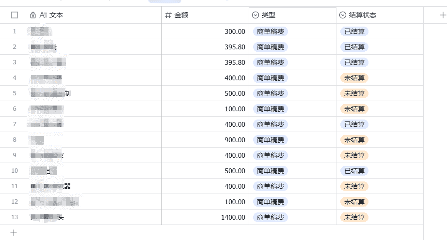

现在才做了3个月，通过教练拉的商单+自己找上门的商单+圈友推荐的商单

纯商单收益就有6200了，这还不包括品牌方送我的那些产品，目前收到最贵的产品是1300+的椅子

这还只是3个月！再过3个月，我手上只会有更多的号，会有更多的商单给我挑选

家蒙教练说过一句话：

大家一定要有星辰大海啊！要知道我们才刚刚开始，未来还有上万的商单等着砸到我们脸上，一定不要离开牌桌，一定不要下场，我非常想看到有人突然来一句“我接到上万商单了！”，这将带给所有人无限的动力！（还有羡慕羡慕羡慕羡慕羡慕羡慕羡慕羡慕）

# 未来规划

我和另一位圈友已经在尝试合作，做了一个新号，目前新号发的第一个视频佣金已经4000+，当然也得益于这是双十一期间，具体是谁以及哪个号暂时不打算公开，这条视频的评论也已经来到了300多条

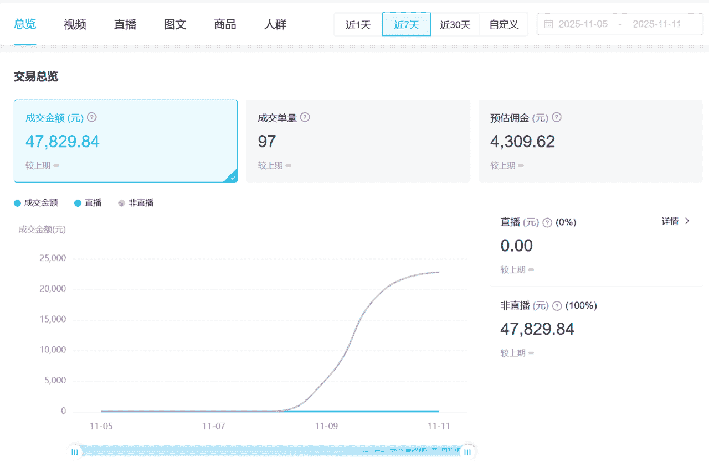

其实也主要得益于他的内容能力是真的强，我对脚本和视频质感方面的能力很欠缺，并没有很好的引导观众下单，做了3个月了，我发现我有的只有执行力和.... 或许真的只有执行力这个优点了... 深海圈的各位都说我帅 颜值加分好带货，离谱哈哈哈哈，我并不觉得自己帅，我到现在都认为我的视频能出单是运气好。

但现在不一样了，我有了一个内容能力很强的伙伴，未来我的账号也会用上他那边的素材、脚本、剪辑，内容质感提上来了，剩下的就是执行！趁现在B站好物入局的人还不多，趁现在竞争还不强，一定要快速的行动起来！

再往后的话，我们计划通过共用素材、脚本、选品，验证内容出单率，再多开几个号，跟着龙哥老大最新的超级标“垂直小店”思路走，每个号专门做垂直品类，或者说垂直人群，通过优秀的视频质量拿到佣金，再通过出色的GMV吸引来商单，只接符合账号的商单，只做2k以上稿费的商单

# 结语

最后送大家一句话，这是在我们B站好物深海圈广为流传的一句话

“我不会失败，因为我要么成功，要么学到东西”

最近好像还多了一句，从星神开始到后来圈友们也很爱说的

“我必须考虑这会不会是我此生仅有的机会”

加油干吧大伙，这就是一次难得的机会！

1. 入局人少
2. 平台规则超开放（同一个ip设备不管你登几个号都可以，比起其他平台你就说爽不爽）
3. 平台人群消费能力强

以上三点不论是哪一点我都认为能作为是一个蓝海赛道的理由，更何况三点齐聚在一个地方。

这就是本次分享的全部了，我是炟斯汀，你可以叫我蛋蛋

感谢阅读，祝大家发财，祝大家一起龙哥盟
