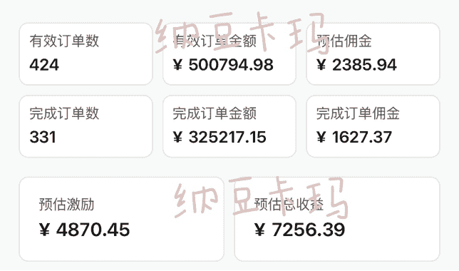
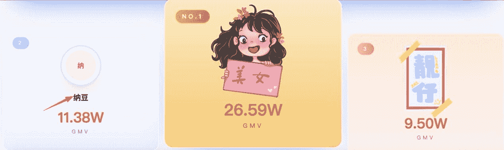
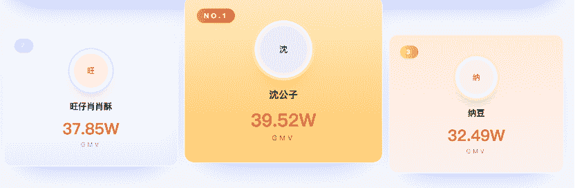
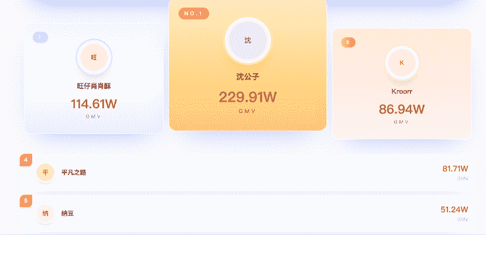

# 抖音自然流CPS 16天GMV破50W：绝对执行力让我成为那个幸运的人

> 来源：[https://xuqiwei1986.feishu.cn/docx/MCfodaphVoGVxAxIc5FcEccZn5f](https://xuqiwei1986.feishu.cn/docx/MCfodaphVoGVxAxIc5FcEccZn5f)

# 引言

16天，3个抖音账号，81条视频，GMV 50万。

这是我加入赚钱以来第一次全情投入的航海项目，也是第一次真正把执行力榨干。

对我来说已经不是一次普通的航海，更像是一次自我重启。

让我学会放下完美、拥抱执行，也重新找到了做内容的热情。

（PS：正文部分在第三章，想看项目经验的可以直接跳过前两part哈～）

# 一、关于我是谁

大家好，我是纳豆。93年摩羯，Base深圳，前金融人，目前正在探索自由职业的INFJ。

# 二、我与赚钱的故事

我是20年加入龙哥盟的老圈友了，说起和赚钱的渊源要追溯到很久以前。

还记得是读研期间接触到@stormzhang 张哥的👸号，跟着张哥学了不少安卓开发的东西，做了一些产品demo，现在回想对秋招乃至后面的职业选择都有很大的影响和帮助。

后来又通过张哥接触到曹大，盗坤哥，明白老师等等，时间久了，除了技术，也慢慢接触到一些商业、搞钱方面的信息。后来又不知道过了多久，了解到赚钱这个搞钱大本营。当时的我初入职场，迫切想提升自己，加了不少社群，赚钱也是其中之一。

20-21年的时候，赚钱对我来说就像一个搜索引擎，但我几乎只会做信息检索，最多就是拿一些外面能难接触到的信息出来作为社交货币，和身边的朋友同事交流，好像我懂很多的样子。除此之外，真正的助益似乎就是在那时给自己种下了一颗希望的种子。

22-23年，我面临职场转型，也是工作压力最大的一年。很多节假日的常规休息都无法保证，更无暇顾及工作以外的其他事，甚至会经常把工作情绪带回家。这两年我没有时间和精力再去关注外面的动态，曾经那个琳琅满目的商业世界似乎也离我越来越远。

直至24年，工作的第五年，我越来越清楚自己不想一辈子打工，赚多少钱对我来说不是最重要的，但留在职场我已经能看到自己未来10-15年的样子，我很清楚那不是我想要的。那个时候我还没有很清楚自己想要什么，但我很清楚自己不想要什么。于是我和家人商量，一边寻求职场外的第二曲线，一边找好时机离职。

于是第一站我就选择了回到赚钱，重新开始关注社群动态，试水一些副业项目。

事情当然没有那么顺利。一开始我急于求成，每次航海都会至少报名2个项目，加上同时期也在外面学习短视频IP操盘手的课程，结果自然没什么参与度，所有航海几乎都以机械式打卡拿回保证金为目标草草收尾。

终于到了2025年，我和公司提出了离职，开始尝试自由职业，以短视频IP操盘手作为起点。起初的进展还比较顺利。我在半年内先后做了几个项目，全网做了千万流量，赛道涉及青少年教育、实体加盟、银行培训、身心灵疗愈等等。到了后期，作为运营负责人已经开始带着兼职团队在生产内容了，一切都发展得很快。但是我却又一次主动停下了，因为我对这个事没有热情，我也不想一直给别人做账号，更不想带什么团队。我想清楚了，我想要做超级个体。

时间来到25年的5月，离职手续终于办妥。我选择回家休息一段时间。在家休息的时候，我集中精力在赚钱里继续寻找适合自己的项目。这时我开始对选项目有了一些标准和要求。同期航海里，我会选择一个短期能快速带来正反馈的项目+一个可以长期做有累积效应的项目，我觉得这样会更好坚持。

于是6月航海起航，我选择了视频号分成+📕虚拟。由于之前做短视频操盘手的经验，视频号很快就跑通了，甚至还教会了我50多岁的老爸，虽然没赚多少钱，但是老爸像打开了新世界，开始对我放弃稳定工作探索自由职业这事也慢慢接受了。📕虚拟没跑通，因为一开始就给自己上了挺大难度搞半原创，发了20-30条笔记没出单就放弃了。这时在家里也休息了差不多1个月，刚好有一些剪辑的工作找上来，于是开始边接剪辑边看其他项目。

没多久我又关注到了📕电商（蓝海），因为我发现，21年跟着坤哥学习淘宝蓝海时认识的银河老板在赚钱做📕电商的教练！哈哈感觉很奇妙，兜兜转转这些年接触到的人最后都在赚钱重聚了！我仔细看了一遍📕电商的航海手册，又听了直播回放，觉得这事还是可以干，上限很高，入局不难，而且我自己就是📕的深度用户，网感也有。然后就开始链接银河老板，说起来前几年加的🛰️还是第一次主动聊天哈哈哈。

📕电商这个事我其实曾经尝试过，最早在24年就报过几次📕的航海，有百货和女装。但那时太急躁，根本没有坚持完一个项目。印象里就是电商太复杂了，要开店、上架商品、写笔记、当客服、搞售后，一整个大劝退。但这次决定要做之后，静下心来跟着航海手册一步一步操作下来，觉得也没啥，都是自己吓自己。所以大概从7月开始到现在，📕电商在慢慢做，中间换过两个品，有出单但还没有爆单，还在打磨细节，打算继续深耕！

中间还有一个无心插柳的小插曲，就是7月的外卖航海，当时龙哥发了超级标，说这个项目有手就行，执行力拉满就能有不错的结果。正好我当时📕做得也不温不火，剪辑兼职也不怎么忙，就索性花点时间试试这个，没想到为后面的抖音自然流CPS打下了基础。

至此到了25年的3季度，经历了前期的种种探索，我基本上锁定了后续主要的项目方向：就是要把我的内容能力和流量能力放大，去做内容电商和自媒体。同期我开始运营自己的📕IP账号和👸号，边学边做。

10月抖音自然流CPS这艘船来得很突然，但又很适合我！恰好能结合我之前做短视频和外卖CPS的经验。在这之前，我正在发愁我的📕店铺运营了3个月一直不太理想，该如何调整，想着要不就趁双十一之前换个品类。这时候看到@怡然 教练发帖。

在这篇帖子之前，我对她的印象大概是一个很厉害的年轻创业者，其他都比较模糊。但是这篇帖子真的炸到我了，让我立刻决定报名！有两个印象非常深刻的细节点：

第一个是拆解脚本的表格。做过内容营销的自然知道这个表的含金量！看到这张表我就知道这个项目必成，能做到这个颗粒度的拆解和还原，根本没有失败的可能。那时候还不认识海宇教练哈哈，通过航海也见识到了海宇教练的专业和细心。

另一个细节是劝退的几类人。其中一类是“双十一有其他项目在跑的，请先保证你已有项目的专注。” 这一点我还真思考了半天，我应该算其他项目在跑的，只不过没怎么跑起来。那就不影响！先抓住机会先干再说！

至此终于开启了正文部分：抖音自然流CPS项目的经验分享。

# 三、抖音自然流CPS项目复盘

航海16天，个人运营3个抖音账号，期间共发布81条视频，破万爆款3条。

累计GMV 50万，佣金约7k+。

我把这16天的航海周期按照数据表现分成了五个阶段：预热期、摸索期、增长期、低谷期、爬坡期。

## **（一）预热期：账号准备（约**3-5**天）**

从mini航海招募贴发布到航海正式开始这段时间，我做了3件事。

1、项目调研：顺着之前做外卖推客的资源网，获取了数码&国补CPS项目相关的最新消息。这里其实因为外卖这个项目是跟着黄老板团队做的，所以在他们那里也获取到了最新的资讯。包括听了免费的直播分享，了解市面上的主流团队是什么样的打法，项目预期前景等等。

2、账号准备：准备好3个账号，做好养号动作，包括发测流视频、模拟真人使用习惯等，同时开始刷优质对标（近期低粉爆款）。

3、素材库搭建：拉自己的小号🛰️建群，把刷到的一些不错的对标视频转发进来，方便后续使用。这个阶段找的对标主要是真人口播。

至此对项目逻辑、同行水平、视频拍剪难度、脚本结构等等均有了大致了解。

## **（二）摸索期：稳定增长（约**4-6**天）**

总体来说，这一阶段我主要在熟悉规则、测内容模板和探索内容方向。

航海开始，我确认了3个账号的内容分工：1个真人口播，2个曼波体（表情包混剪）。

**内容策略上：由于这一阶段距离**双十一还有两周左右，所以主要围绕国补、苹果17高单价爆品展开。

口播账号：初次尝试还比较青涩，没法要求太多，先发先干再说，去模仿我能模仿的对标。

那怎么找合适的对标？

数据上不多说了，就是“近期”、“低粉“、”爆款“三大主要原则。

风格上我会排除那些个人特色非常鲜明的对标，比如：表现力夸张的口播类型、每天文案不变，改个日期直接读稿的类型，以及一些假消息吸引眼球的类型。做成项目的前提是自己要不别扭，这一点很重要。

我会选择一些相对理性、逻辑清晰、有信息更新、不需要太多情绪表现的对标类型。但同时会注意，“近期”、“低粉“、”爆款“这三个原则尽可能都满足，否则需要做适应性调整。

比如：我发现一个对标的脚本很好，但是对方已经是万粉博主了，视频是近期爆款。那这个脚本我就大概率不能直接参考，而是提取部份关键信息之后和低粉爆款的脚本做结合。

口播我是第一次尝试，之前都是给别人做拍剪，亲自上手感受是完全不同。现在再去看第一条口播，还是能把自己逗笑，真的很青涩。不过觉得自己还挺牛的，跨出这一步不容易。

曼波：复制对标的文案，用豆包改动10%左右，然后换成自己的推广码直接用。这一阶段做得还比较粗糙。

**阶段小结：**

1、视频数量：每天平均发布视频4条-6条，1-2条口播，其余曼波。

2、播放量：平均处于3位数，口播和曼波账号表现持平。

3、阶段性成绩：航海第6天GMV达到10万。

4、收益拆解：该阶段订单量不高，主推高单价单品，多为苹果17所贡献。

激励：佣金 = 5:1。（苹果17佣金较低，为GMV的0.1%，但叠加大促政策，激励为GMV的1%，所以贡献还不错。）

虽然播放量不高，但转化效果还可以。决定锁定单品+数码会场，稳扎稳打，持续优化内容，为后续阶段打好基础。

## **（三）增长期：迅速爆发（约**3-5**天）**

航海第11天，我的GMV突破了30万。这一阶段，我出了两条万+爆款视频：都是曼波体，内容和国补相关。

通过对自己的账号进行复盘，我有3点发现：

1、口播和曼波比，曼波更容易出爆款

听了安老板的直播之后，发现了自己的口播存在着诸多问题，一时又很难完全修正过来，所以我决定放缓口播视频的制作频率，向曼波倾斜。

2、曼波体里，国补类的视频更容易爆

国补这个事的信息差太大了，甚至找不到一个官方信息汇集入口。线上线下、各个省市、地区的政策都不一样，而且受老百姓关注度极高。那这里面就有太多的选题可以做了。可以做全国的，可以做地区的，发布时间点卡着当地抢国补的前1-2天，大概率发的视频就会有不错的流量。

3、做好评论区，能让你的视频一爆再爆

出现爆款的第一征兆，就是评论区会短时间内出现大量留言，这时候要做的事情就是第一时间进行维护。

维护评论区的两大原则：

（1）负面的评论直接删，比如：“骗人的”、“引流的””等等。

（2）询问的评论尽量去回复，不清楚的就回得模糊点，慢慢拉扯，通过互动把评论区热度拉起来。其实很多信息在平台都能查到的，就把自己当成客服，官方套话谁不会说？这时候做好互动大概率可以把这条视频权重拉高，推向更大的流量池。毕竟我们是个流量变现的项目，流量就是金钱！

**阶段小结：**

1、视频数量：发布节奏与前期持平。平均发布视频4条-6条，1-2条口播，其余曼波。

2、播放量：曼波2条破w，口播流量略微下滑。

3、阶段性成绩：航海第11天GMV达到30万。

4、收益拆解：该阶段随着视频流量爆发，GMV增长较快，订单类型更多样。激励：佣金 = 2:1。

至此短短10天左右，数据层面积累了一定的正反馈，加上教练直播时给出了更多方向，于是决定加大强度大干一场！

一方面，曼波开始堆更多素材，继续丰富内容形式；另一方面，降低口播发布频率，主攻爆款单品，保持更新即可。

## **（四）低谷期：流量低迷（约**3-4**天）**

然而事情总是不会那么顺利……30w+大关卡了我整整4天！不知情的小伙伴还以为我躺平了。殊不知伴随着我的大力不出奇迹，视频播放量和GMV反而开始骤减，连之前爆款的评论区都不再活跃了，客服纳豆已离线。

这阶段我每天产出视频数量大概在8-12条，其中曼波占8-10条，一个账号一天最多发布4-5条。

这样的情况持续了3-4天，我分析出了以下几点可能的原因：

1、做了一些半原创内容，偏离了经典的爆款结构。

2、发布数量过多，单条视频质量不足。

3、双十一临近，内容策略调整不及时，没有跟上热点。

这个时候已经来到了9号前夕，马上到达双十一狂欢巅峰，所以我必须赶快采取行动。

针对上述可能原因，我做了**三个关键动作：**

1、复制前期爆款：提高流量获取的确定性，爆过的视频大概率还会再爆，尤其是自己做过的内容，会更有体感。

2、重视口播：这个阶段察觉到很多同行开始团队化运营曼波体账号了，内容开始同质化严重，做数据的痕迹也很明显。于是我调整状态，打算优化口播内容，均分曼波和口播账号的投入。

3、换号：有一个做曼波的抖音老号前期做的其他项目，我怀疑内容有点杂，于是赶在9号前弄了张新手机卡，花两天养号，同步更新内容。

**阶段小结：**

1、视频数量：每天平均发布视频8条-12条，8-10条曼波，其余口播；

2、播放量：下滑明显，最低10几，最高300多；

3、阶段性成绩：航海第14天GMV还晃荡还在30w+。（PS：心情不太好，没有截图。。。）

4、收益拆解：该阶段视频数据表现低迷，零零散散出了一些小单。激励：佣金 约为 1:1。

受到流量下滑，GMV增长停滞的影响，难免有一点灰心，但还是给自己默默打气，按照新方向继续做视频！

（毕竟排行榜天天在那挂着，我不能认输啊啊啊！）

## **（五）爬坡期：再次爆发（**2-3**天）**

通过9号的内容策略调整，终于在11.10-11.11这两天，也就是航海的第15-16天，我的GMV接连突破了40w和50w！

我认为起到决定性因素的是：**复制前期爆款（国补类）。**这条视频的二次复制给我带来了整个账号的第3条爆款。虽然只是小爆（1w+），但却让我的账号在关键时刻起死回生。

其次是口播的投入。在做了20多条口播之后，我明显感受到自己的情绪和表达更生动了、与观众的链接建立起来了，甚至可以像聊天一样去输出内容了。反馈在数据上也是有所提升。

最后是曼波类视频也进行了调整，开始化繁为简，不再堆砌大量素材，而是突出核心信息。前期大量找素材、每天截最新的会场图，各种去追求素材的清晰度，现在想来都是把力气用错了地方。

至于换号这个动作，以2-3天的视角来看并没有很大的改善，后续会再观察。

**阶段小结：**

1、视频数量：恢复每天平均发布视频4条-6条，口播和曼波均分；

2、播放量：口播恢复到3位数，曼波1条破w，几条破千。

3、阶段性成绩：航海第16天（双十一当天）GMV突破50w+。

4、收益拆解：该阶段视频数据再次增长，出的单基本都是高单价数码产品。激励：佣金 约为 2:1。

至此，我的抖音自然流CPS航海16天航行日志5个阶段基本复盘完成，现在回忆起来还是很有感触。

心情也像坐过山车一样跌宕起伏。起初正反馈来得太快，惊诧于这个项目的爆发力；中期数据持续增长，预期不断提高（中途甚至给自己定了100W GMV的目标哈哈！）；后期流量低谷，想尽办法挽回，最后通过调整策略，数据终于有所起色。

过程中也曾沾沾自喜，也曾羡慕别人，但好在始终没有停下自己的脚步。这一整个过程本想让AI帮忙整理，但尝试过后，发现它实在无法准确表达我的情绪变化。所以全文手敲，以完整表述并记录项目执行的全过程。

**总结几个项目要点：**

1、视频发布与内容迭代：保持稳定输出和日常复盘。每日观察视频表现，如播放量、完播率、评论互动等关键数据，及时记录并分析。

2、快速决策执行：日常复盘的好处在于及时发现问题，发现问题后要思考背后的原因，随之做出相应决策。比如我在流量低谷期的三大关键动作：复制爆款、重拾口播、快速换号等，及时挽救了我的账号。

3、视频制作方面：一条视频包含的要素无非这几个，封面、标题、标签、脚本、BGM、音效（BGM和音效在这个项目里似乎不那么重要），个人认为这个项目里的重要性排序：脚本=封面>标题=标签。甚至口播类的视频，连表现力都没那么重要。

4、信息呈现化繁为简：到项目后期一个很明显的体感是，尤其曼波视频，千万不要堆砌大量素材，重要的就传递几点：情绪、核心利益点、行动指令。

5、其他方面：首先整个周期我的打法都是比较明确的，就是要尽量拿高激励，所以苹果17作为一个高单价爆品，我全程都在推，每天都会发新的推广视频。其次是国补资讯、双十一攻略等内容。最后，我用的是密令词推广，没有使用口令词复制转发的形式，一方面是做外卖推广时用过口令形式没有爆过视频，另一方面还是为了锁住激励。这个因人而异，大家可以选择更适合自己的做法。

双11虽然暂时告一段落，但抖音自然流是个值得长期投入的项目，机会和玩法都有很多，值得去探索和深耕。双12的脚步已经不远，在这个空档期我会着重去做三件事：

（1）定好口播账号和曼波账号的定位：口播账号提升视频质量，打造成垂直IP数码账号；曼波账号测试内容模板，打造稳定出单的内容模板（国补、3C数码等），可长期复用；

（2）将周期内发布的所有内容选题进行盘点，拿出数据表现好、有潜力的内容选题进行二轮测试，最终留下优质内容模板进行日常更新；

（3）根据账号定位，优化账号四件套（名字、头像、简介、背景图），删除/隐藏低质、低播放视频，测试出合适的内容模版后统一视频风格。

# 四、给接下来即将登船圈友们的建议

1、全勤投入，只报一条船

如果你非常想把这个项目做成，那就集中精力，每天保质保量完成任务。不要分散注意力，否则大概率只能浅尝辄止。（有经验或者时间充裕的可以自行判断）

2、保持复盘与迭代

每天认真复盘打卡，分析数据、流量变化、用户反馈等，找到问题背后的原因并及时调整策略，持续进行优化。

3、执行力优先于完美

保持在场，持续行动。先执行再优化，避免纠结完美。

4、专注核心内容和策略

任何项目执行起来都有诸多细节，抓主要矛盾和核心策略，不要纠结内耗。

5、保持信心，尊重运气因素

短视频存在运气成分，每个账号基因不同，爆款可能靠运气或数量堆出来，但持续投入、保持复盘和优化，仍有很大机会取得成果。

# 五、写在最后

现在回过头来，突然发现个有意思的点，自己对mini航海一直有个误区。

mini = 小，似乎不太厉害的样子，门槛和天花板不太高的样子，更适合新手试炼的样子。

但项目做到现在，我反而觉得mini航海的强度很大、节奏很快、需要大量执行、高频复盘、迅速迭代，但同时也能在短期内拿到极强的正反馈！

所以，还是要感谢自己的持续行动，让我最终遇到了这次航海。感谢@怡然@海宇 两位神仙教练的专业指导和有温度的教学，让我觉得这个项目还不错，甚至未来还可以继续做；感谢@土豆@雯雯 两位助教的贴心服务和陪伴！

感谢@龙哥盟@龙哥 一直致力于给更多圈友提供合适的项目和更多可能性！

希望自己能够保持思考，持续进步，未来我们继续一起龙哥盟！