# 新手一个月，TK小店从0到过万美金的GMV成交额经验分享

> 来源：[https://xuqiwei1986.feishu.cn/docx/SFW8d03jqoqMHPxoDrJcpfFBnmA](https://xuqiwei1986.feishu.cn/docx/SFW8d03jqoqMHPxoDrJcpfFBnmA)

## **前言**

上篇文章写到自己在今年3月被大厂裁员之后，开始琢磨tiktok的变现的路径，于是2个月打通链路，2天自己搭建了独立站，开始了边野播边变现的过程，相应的文章大家可以在这里进行查看详情。

[保姆级从0到1做tiktok经验分享，从tiktok直播引流到独立站的成交方式](https://oktm46nqfx.feishu.cn/docx/ZgtNdUYaGol4yuxjJXQcG1IRn2f)

本文更像是我后面的续集。

可做过野播之后，发现也遇到了瓶颈，就是tiktok平台不让这么干下去了，主要的表现方式就是在直播的时候一直在弹不允许的弹窗，如下图

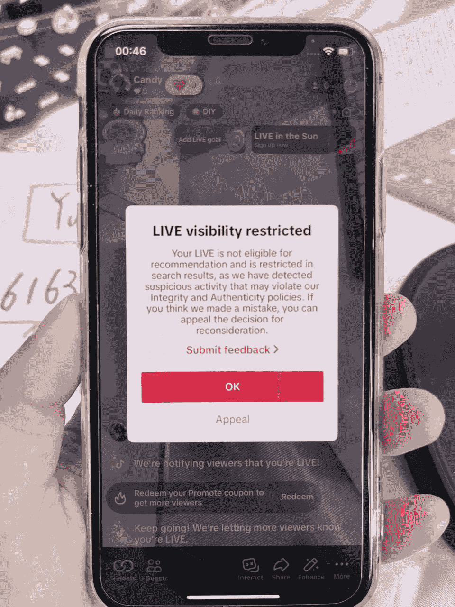

这个弹窗让我觉得始终得做个TK官方的小店才能合规运营，才能做大做强，于是将重点从TK的野播转为TK小店的运营。（现在想来也是当时没有想到这个问题的解决方法，就是把首页的独立站链接和WA的联系方式要去掉）

而开了TK小店后又遇到一些困难。之前我是做高质量的珠宝的，客单价高，等量上去之后，发现自己没资金囤货，同时，珠宝这个东西它不是标品（每个天然的石头都有瑕疵），导致一些不太懂货的顾客会退货或者投诉，所以想着换换品试试。

结果，就在我换品的时候，等来了我的明星学员C哥，时间点简直完美。（这一点也让我找到自己的优势原来是做操盘手）

## **一、成果分享**

### **1.1 数据分享**

先来说说这C哥的战果如何。

新品类是从8.24号开始上架销售的，9月30日最近28天的成交额如下图

扣除一些取消的订单，商品有效的交易总额是在10327.52美刀

然后再看看11月8日在首页显示的战绩（很多数据现在店铺老板也不太愿意分享了）

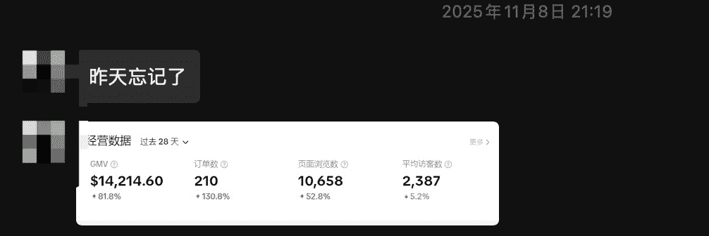

放大一下给大家看看

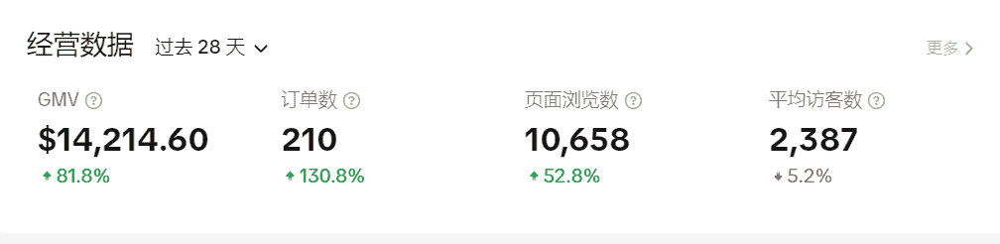

## **二、直播经验分享**

### **2.1 出单量占比**

先说结论：在所有的订单中，这个店铺直播订单量占比80%，视频加商品卡约占20%

这跟现在TikTok平台整体的出单量不太符合。

如下是deepseek所罗列出来的：

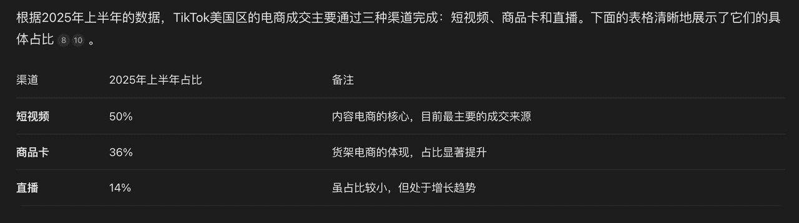

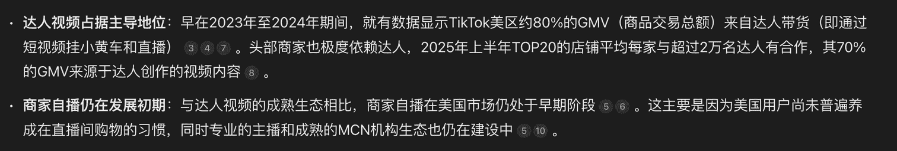

也就是说整个TikTok平台整体上：50%订单量是短视频出的，这50%的视频又有70%短视频是达人拍的，商家只剩30%的拍摄量，直播只占整体订单量的14%

但是我们的店铺直播出单量占80%（大体看下面这个半截图），那么是怎么做到的？

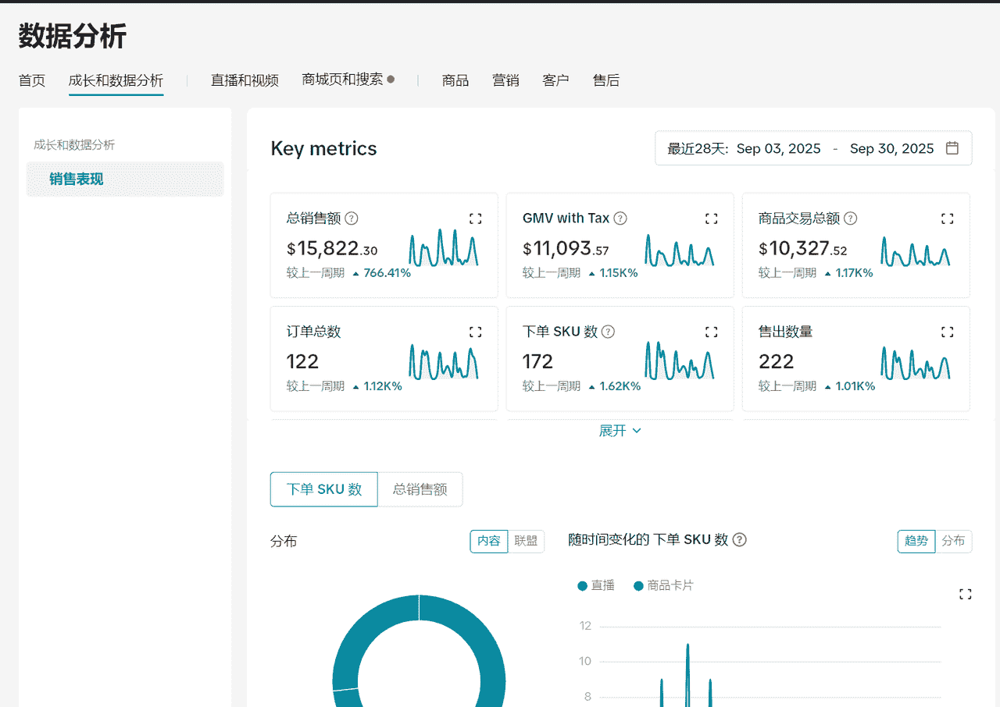

店铺做直播，其实是被逼的，因为我们的品是盲盒类产品，绝大部分的顾客是要在直播间让主播拆盒子后发给顾客的。有的顾客会拆了之后，发现不是他想要的品，会继续再买一个拆，所以，直播间的成交量就很大。

那么介于这个特性后，必须做好直播间。

### **2.2 如何找主播**

做美区直播间，最好是自己能会英语，店铺主C哥原本也是留学生（后来我发现他之前也是一个行业的大🐂），英语不错，but他是个i人，对他来说用很甜美或者夸张的语气去直播简直是折磨。同时，直播间也需要一个运营，进行控场，那他就当运营开始控场了，后来验证这个方法也不错。

那主播该怎么找？

因为C哥他是能找到一些渠道去找留学生，然后我们就在母语为英语的留学生中找了几个主播来试试，大概七八个主播里面能筛选出一个还行的。费用的话，比找会英语的中国人要低很多。一般这样的兼职主播，是要包吃的，来回路费也会要包。

但是其中也遇到一些问题，比方，有的主播就是拿到工资就走，也不跟你打个招呼说下个月不做了，直接就是消失，导致我们要断播几天去找主播。老外的思维是跟我们国内不太一样的，在责任心上你还真看不出来。他们边界感也很强，如果中途她来了，但是我们的直播设备出现问题播不了，有的人是会直接走的，工钱也不能少。

### **2.3 直播间转化方法研究**

#### **2.3.1 直播时间段**

在直播时间上，我们会1天播2场，从国内上午9点播到中午12点，然后晚上8点播到凌晨12点半。刚开始是一周播4天，到现在的一周6天。主播人数也从1个人变成了2个人。在这个期间，C哥也作为运营一直陪着，老板亲自下场干！

9月份请了1个主播，销量直接过万美金，10月份放了9天假，加上之前的1个老主播领了工资跑路了，重新培训新主播，销量跟9月份持平。

#### **2.3.2 直播场地和设备**

直播场地面积大约20平米，分为3个区域：直播区域、货品区域、打包区域，全在这样一个小小的工作室里面。

灯具设备就一个大的主灯，再加2个辅灯，某宝买约四五百人民币，再加一个可随意调节角度的手机支架，也大概一两百。直播的桌子为2.1x1.2m的尺寸。

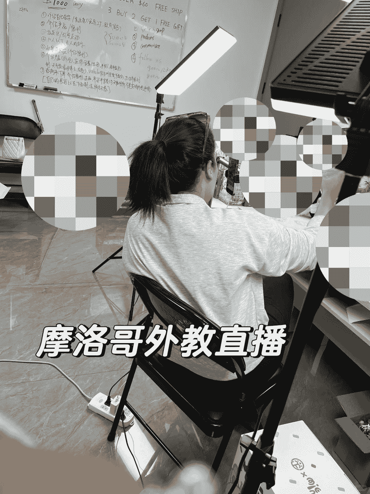

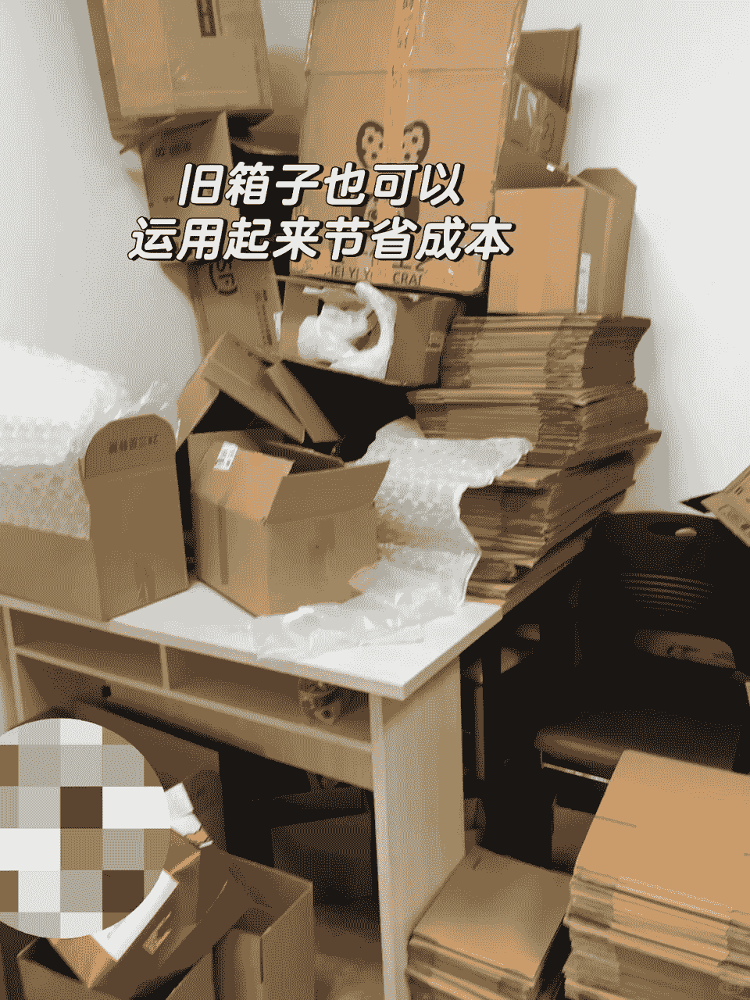

少量囤了一些货，价值约1万多，再加上一些打包盒和气泡纸的购置，也在百元左右。没有大手笔，直接就开干。

#### **2.3.3 直播转化逻辑**

最重要的是直播的转化逻辑，给大家上一个黑板报。这个是他给主播做的培训。

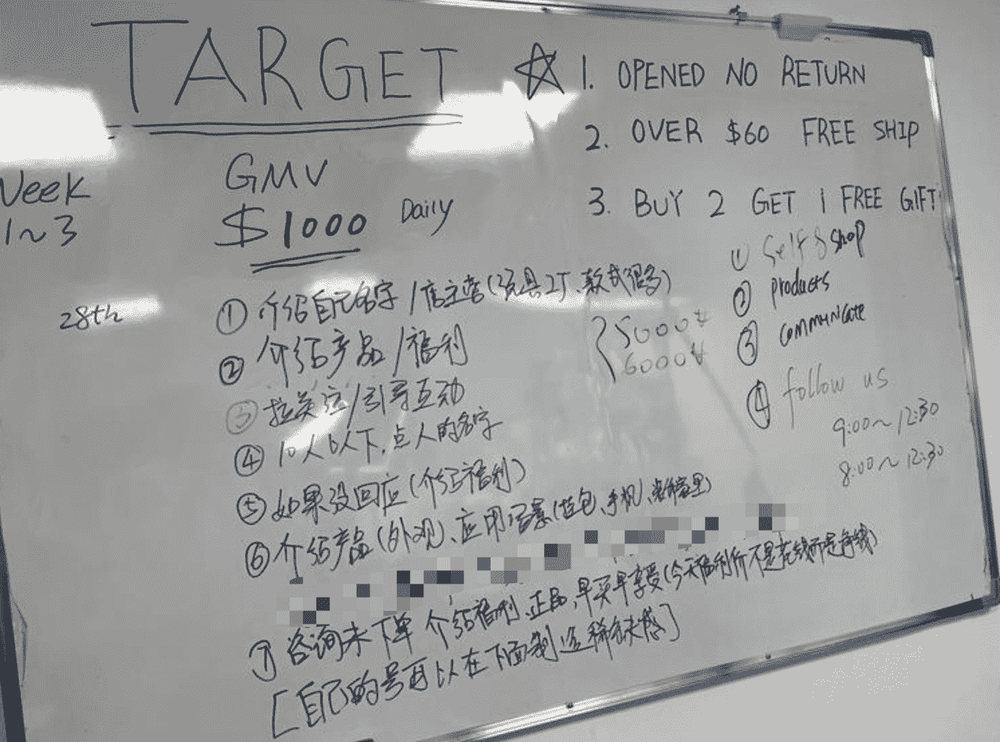

看下C哥他的逻辑，首先给自己店铺设了几个利益点：福利产品、限时折扣、地道的聊天式交流（主播带有卡哇伊的声调），用他的话说，就是你一定要想象一下手机屏幕后面的顾客，他/她现在是一个什么样的状态，需要的是什么。

具体的方法，大家好好看上面这个黑板报，接触过直播的人都懂。

卖盲盒产品就是提供的情绪价值，那么在我们直播间， 同样的，展现产品细节的可爱之处、运用聊天而不是促销的方式进行售卖，是直播间成功的核心。举个例子，C哥说，有个顾客在直播间说刚下班之类的话，这个时候他会让主播不讲产品，直接跟他聊些轻松的话题，让对方感受舒服和被关爱到，后来这个顾客就成了直播间的常客。

直播间平时在线人数也差不多在10人左右，最高峰30+人。所以真的不需要几百几千人在线的，个位数在线也能赚点小钱。

每天的GMV在500刀左右（2场），单场成交量如下

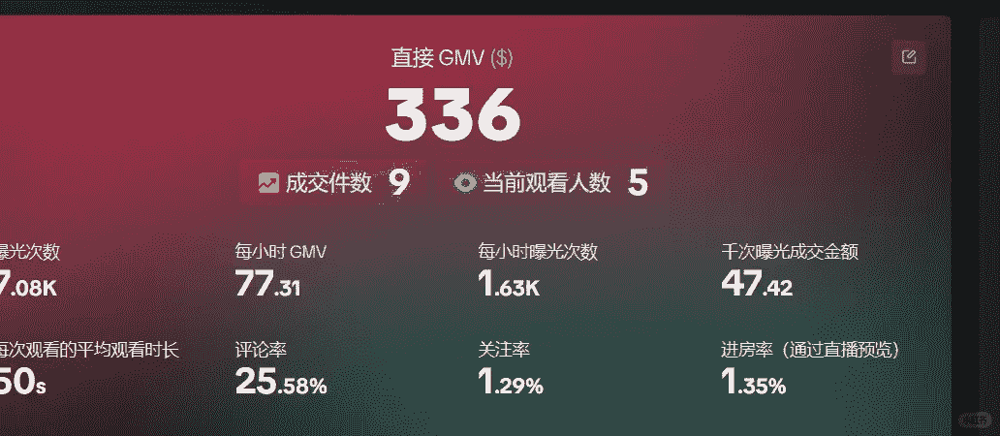

## **三、短视频经验分享**

现阶段，美区的tiktok短视频，内卷程度其实是不一的，比方厨房小物件，会稍微卷一点。但是整体上跟国内比起来真的不怎么卷，用户更喜欢实拍的感觉。拿我们盲盒产品为例，竞对拍的火的视频也就是拆盒子，拆完之后拍产品细节，然后就没有，什么场景运用啊等等都没有，用心做真的可以做起来。

### **3.1 更新短视频的频率**

我自己发短视频是完全从0播放量起来的，到后面稳定在1000左右，而这位C哥，也稳定在七八百，但他拍出了大几千的播放量。如下图置顶的几个视频分别是1950、1602、7133

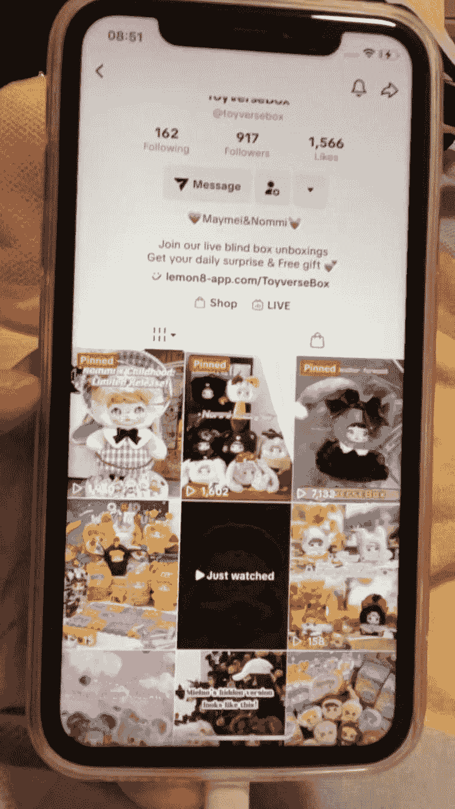

日更是常态，一天2-3更也会存在。很多人抱怨短视频播放量不超过100，一看，一个月原来总共才更新4条，这个怎么说呢，有人成功是真的有原因的。

但如果要保持日更的话，至少要安排半个人力专门做这个，比方我们这个店铺是老板娘在自己拍自己剪辑的。

### **3.2 如何找爆款视频**

短视频的核心是找到爆款模板，那么作为新人，前期应该如何找到这些爆款呢？

答案就是去爬虫网站去搜，其中fastmosshttps://www.fastmoss.com/和出海匠https://www.chuhaijiang.com/tiktok/dashboard比较有名。我个人更推荐出海匠。

以口红为例，让我们看看爆款视频是如何可以模仿出来的

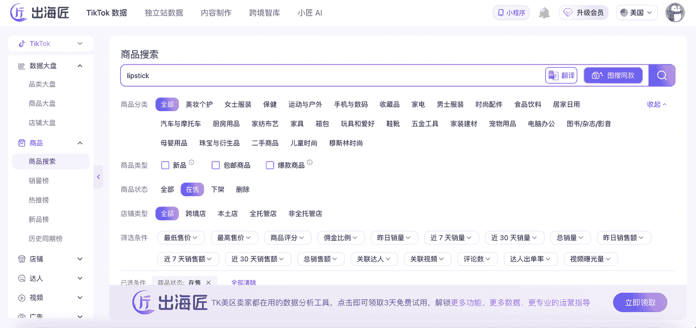

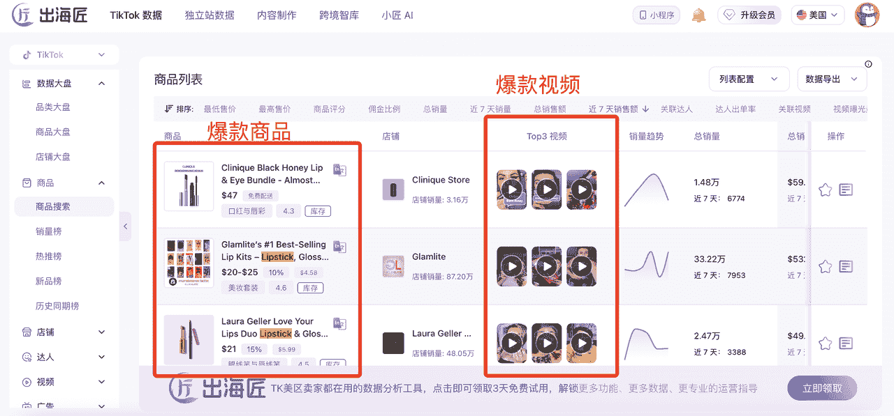

我们可以看到有爆款商品，以及爆款商品下的爆款视频。点击单个商品来到商品详情页，我们可以看到单个视频更多信息。

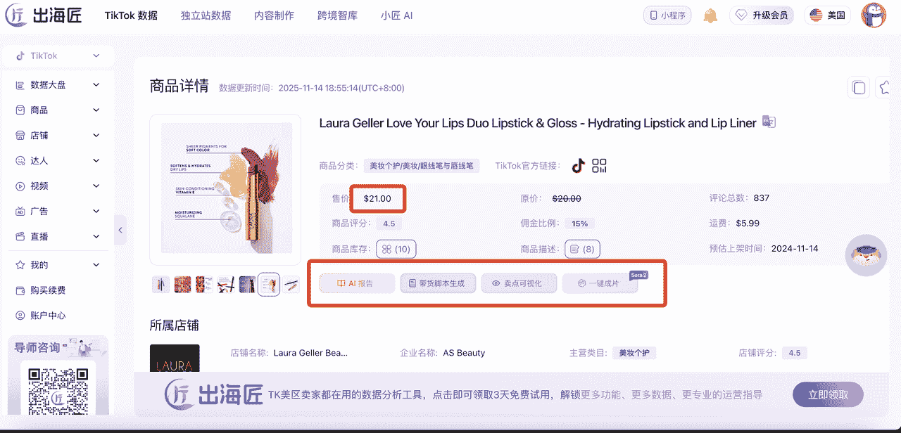

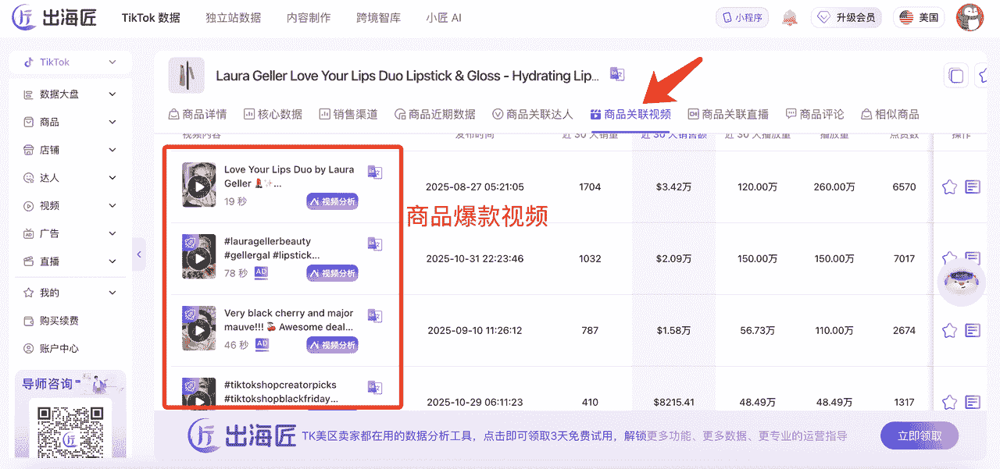

### **3.2 如何仿拍爆款视频**

爆款视频出来了，我们是不是就可以像国内一样下载，然后混剪进行搬运？NO,NO,NO，tiktok现在打击混剪和搬运非常非常严厉，动不动就封号，最好的办法还是仿照爆款视频的模板自己实拍。怎么做？还是运用出海匠。

它针对单个视频可以给出这个视频的更多功能，如下图

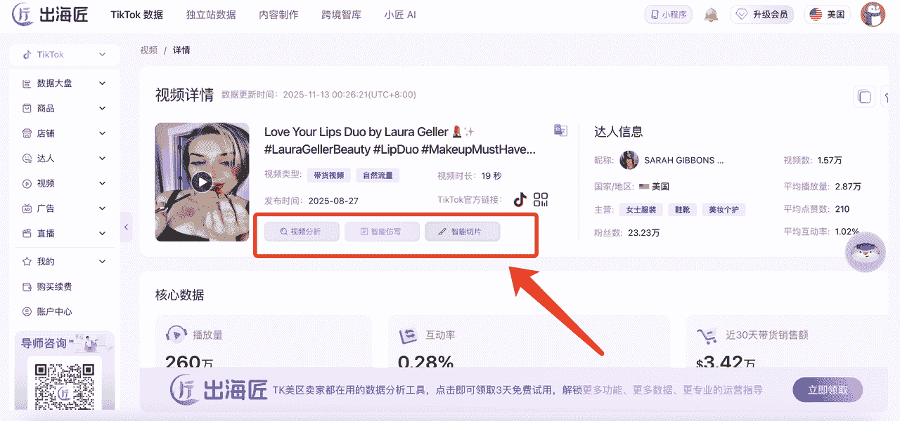

AI已经强大到可以自动进行视频分析，拆解脚本，智能仿写等等。除了“智能切片”这个功能是需要企业版的，其它专业版的，在某鱼上几十块就可以买到会员。

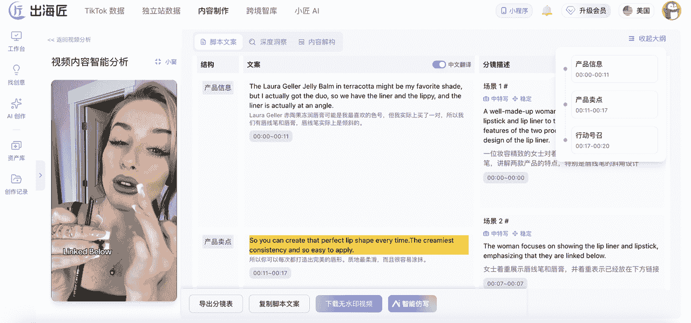

对的，AI已经喂饭喂到这种程度了。其实我觉得国外的短视频内容比国内竞争实在是小太多了，完全可以试试看。

## **四、如何选品**

这里我为什么要说下选品，因为上面案例中的C哥，能够成功，很大一部分原因是来自于他的选品。他的选品属于他自己的渠道信息来的，知道在tiktok上卖的比较好的品。

“七分靠选品三分靠运营”这句话不是白说的。

我先说这几个月的感受：能够做起来的，基本上是本身能在tiktok爆起来的品，最好的方法就是打听身边谁做了什么赚到钱了。

但基于我们有很多同学完全不知道怎么选品，我将一些基础的知识也分享给大家。

但它单独拿出来呢比较抽象，范围也很广，每个人都有自己的思路，现在介绍几类我自己的思路给大家。

总体分为两个大类，一类是选品策略（侧重于自己完全没有方向如何挖掘到可以试卖的品），另一个就是选品工具（侧重于自己有大致的类目方向如何细挖到自己想卖的品）。

### **4.1 选品策略**

TK热门的类目包括：

|  | **子类目** | **子类目** | **子类目** | **子类目** |
| --- | --- | --- | --- | --- |
| **大快消行业** | 美妆个护 | 食品饮料 |  |  |
| **时尚行业** | 配饰 | 服装 | 珠宝（定向邀约） | 假发（美区有点饱和） |
| **家居百货** | 母婴亲子 | 生活方式 |  |  |
| **3C数码** | 手机配件 | 小家电 |  |  |

还有更多类目可以参考出海匠的类目图（这个网站我们稍后会介绍）

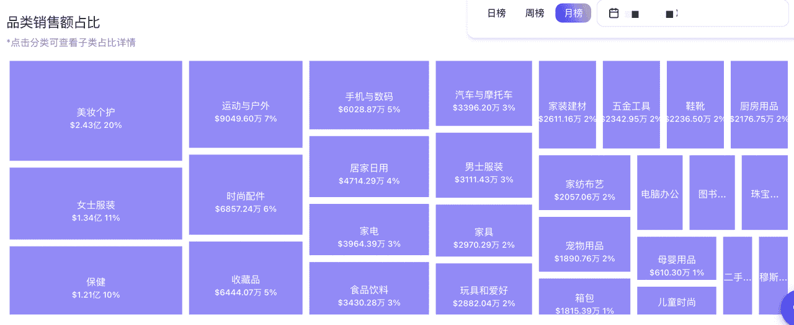

然后我们选品第一个要问自己的，就是咱们要做哪个行业，如果是纯小白一般不知道卖什么类目。

我个人觉得基础的门槛包含如下几个方面：

① 这个品你自己是用户，最好是狂热爱好者；

② 你了不了解这个行业，自己能不能根据这个行业去拍一些短视频的内容；

新手卖家别逞能，避开高门槛的，土豪随意。

| **产品特性** | **不能选的原因** |
| --- | --- |
| 易碎品尽量避免 | 减少运输相关的问题 |
| 不会贬值的商品 | 避免选择随时间贬值的产品，例如电子产品 |
| 避免季节性商品 | 季节过了容易滞销，例如凉鞋、羽绒服 |
| 体积小的商品 | 尽量选择能够装进一个鞋盒大小尺寸的商品，体积太大运输上会额外收费 |
| 不易定价的商品即非标品 | 难以定价的商品有更多的灵活定价的空间，相对来说利润更好控制 |
| 价格范围 | 20到200美元之间，大多数消费者愿意在线购买的价格范围，现在美区的用户被国内商家卷到平均客单价在20+刀的水平 |
| 合规性 | 最最最重要的一点是，了解当地产品的进口的法律法规，哪些东西不能卖 |
| 广告价格 | 广告价格竞争过于激烈会导致获客成本过高 |

#### **4.1.1 亚马逊热卖品**

如果前期不知道卖什么类目和什么品，可以先参考一些大的电商平台，寻找已经被验证过很热卖的品，比方说亚马逊。

亚马逊查看爆品的方法，如下：

① 点开官网https://www.amazon.com/，将收货地址切换为漂亮国。

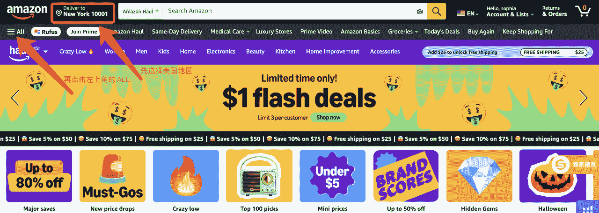

②点击左上角“All”中的“Best Sellers”

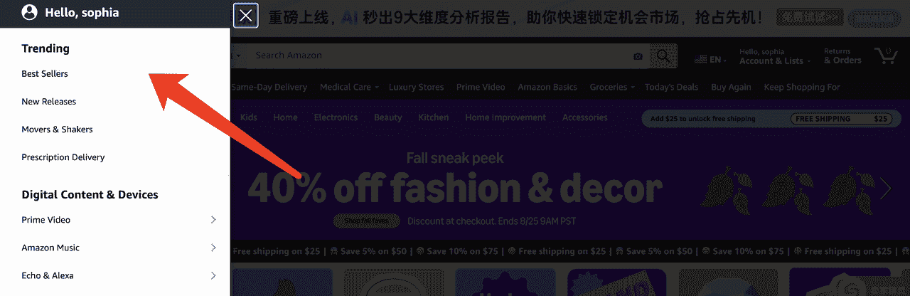

③ 查看列表中的产品，你也可以切换类目进行查看，同时图中潜力品“New Releases”也可以做参考。

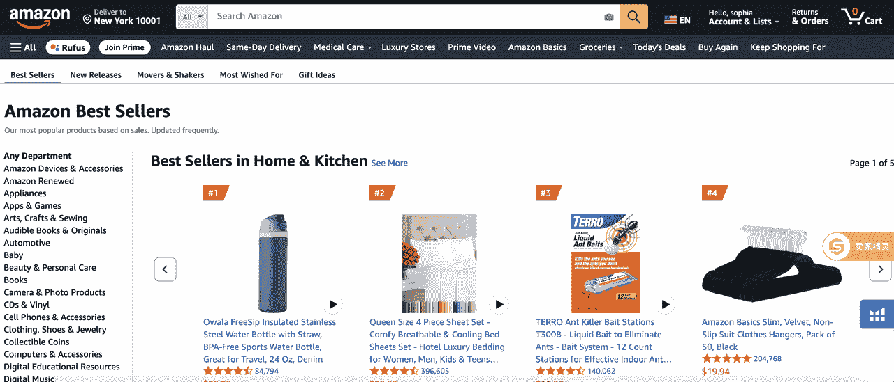

目的就是通过看这些爆品，给自己灵感，问自己这些产品我想不想做，能不能做，有想法后再去国内找货源，搬运到TK上。

这样的平台除了国外的，国内的一些某宝的销量排行榜也可以试试，都会有些灵感。

#### 4.1.2 TK商家后台的工具使用

这一部分内容是我9月份自己整理的，后台现在11月份tiktok商家后台已经经历过1次改版，但功能点大差不差，只是操作的位置变了些，大家注意这个点。

除了外站，如果你开了TK小店，它的后台也有选品工具可以查看。这边的功能特点是，平台将自己想要的品呈现给我们看，会更加直接。

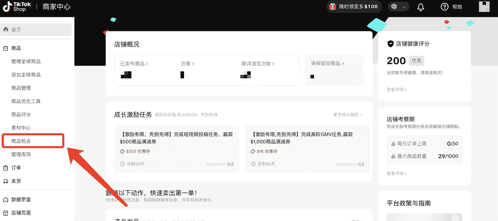

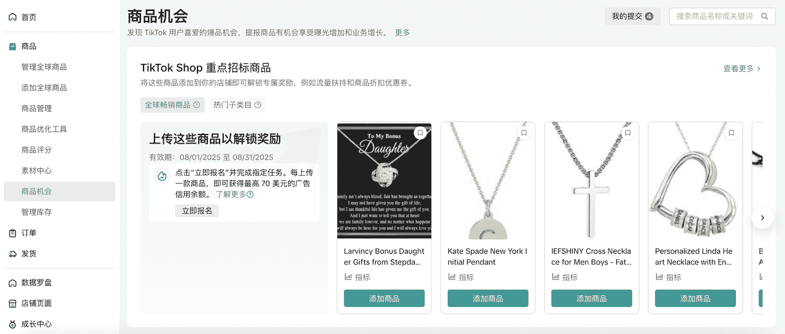

在商品机会里面，发布的都是平台需要的商品，紧缺，且有流量扶持。

如果想要查看更仔细，可以在“商品机会”-“查看更多”里面还有热门子类目，去细分自己的品类。

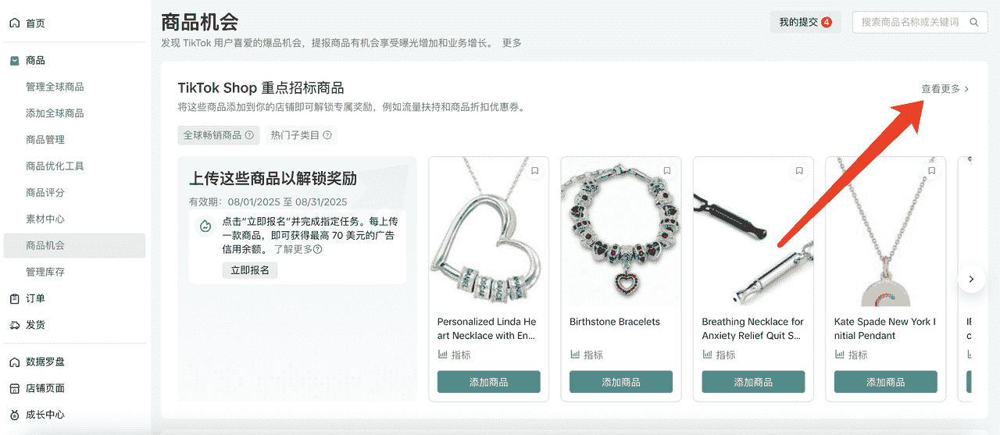

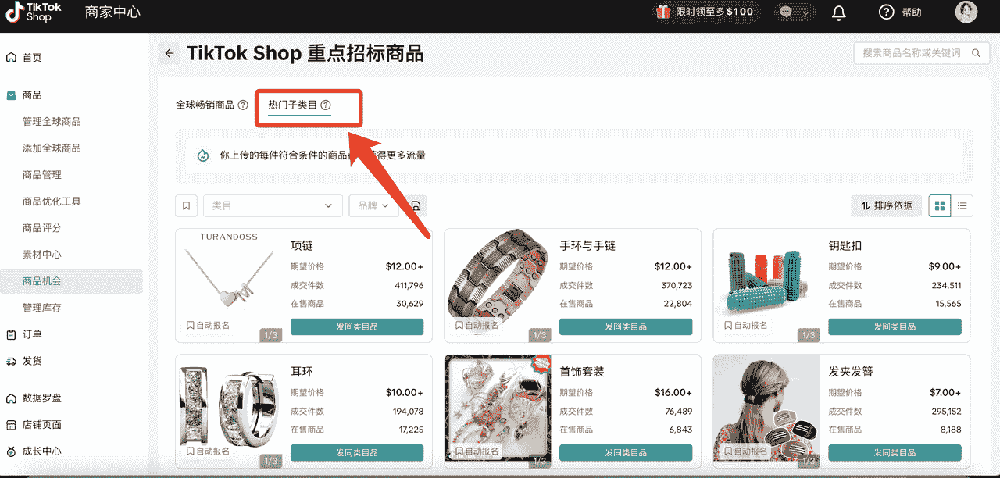

产品的关键词选择，其中热门、飙升、高潜力的产品都是可供选择的范围以内。

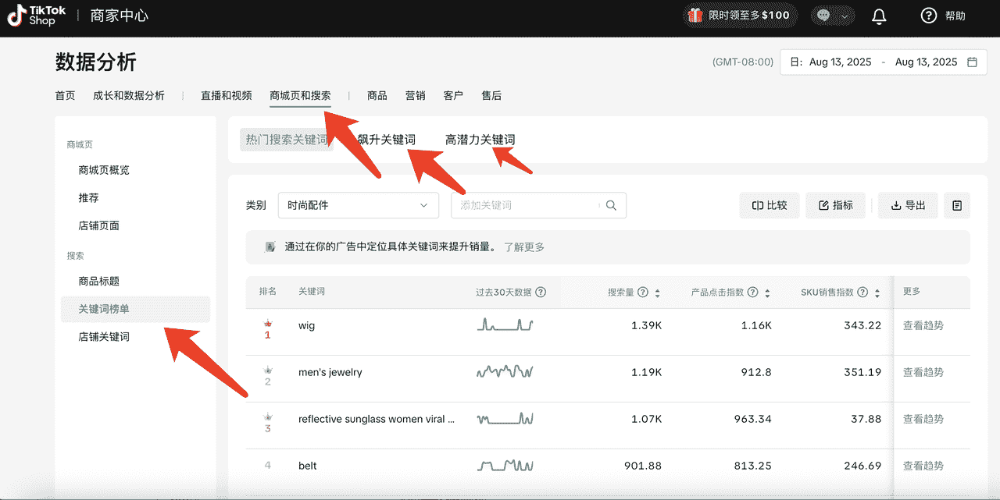

#### 4.1.3 TK APP本身的运用

如果没有开通TK小店，可以使用TK的APP去查看一些信息。APP本身会根据你账号的标签，进行推荐一些内容。

有2个方法可以使用：

① 看热搜榜，点开首页的搜索栏之后，下面会有猜你喜欢的内容，如下图的“You may like”，这些是跟你账号品类（你平时发的视频、浏览、点赞、收藏等记录进行整体统计）相关的标签。可以点进去看。

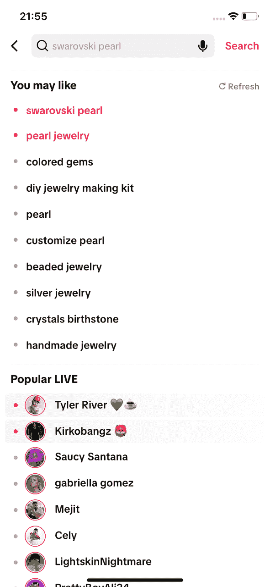

② 刷自然流，在视频的地步，点击创作者用的相关标签，就可以得到同类商品热门的标签以及相关标签下的热门视频和产品，看哪些卖的好，以及如何拍摄视频进行带货。

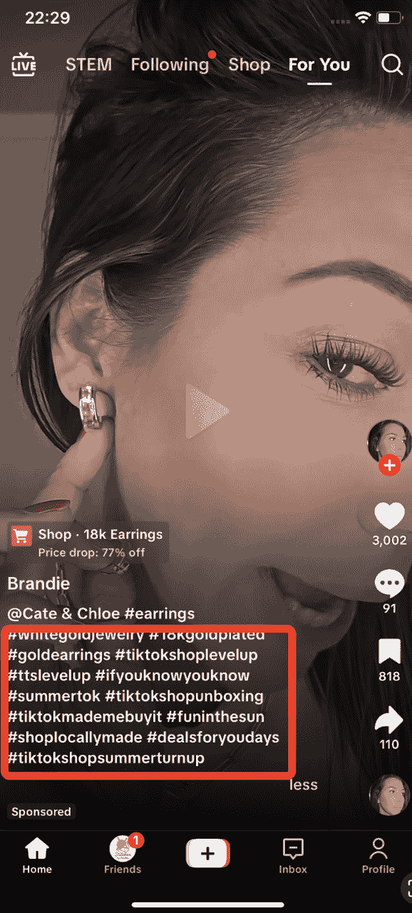

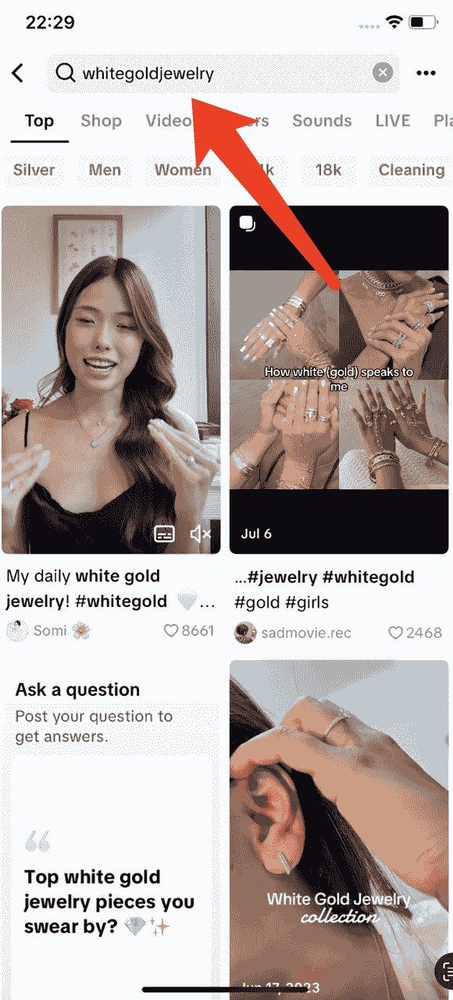

### **4.2 选品工具**

刚才我们说的是小白完全不知道选什么品可以用一些比较范的方法，但如果我们自己知道卖什么品，那就可以借助一些第三方平台进行细致化我们的选品。

这些主要这要帮我们解决几个问题：

① 我手上有品，但不知道在TK上受不受欢迎销量如何，相应的竞品长什么样，同品类下热卖品是什么，我能不能改善？

② 我确定了品之后，我该如何做宣传，是自己拍还是达人拍，相应品的热门视频长什么样？

以及一些其它强大的AI功能帮我们提效。（这块我就不着重讲了）

这里又用上我们刚才说的两个平台。

#### **4.2.1 Fastmoss**

fastmoss算是知名度很高的TK第三方数据分析网站https://www.fastmoss.com/

如果想直接进入数据分析，就直接点这个链接https://www.fastmoss.com/zh/dashboard

这个网站怎么用呢？

① 点击“商品搜索”输入商品的关键字，点击搜索按钮就可以了。

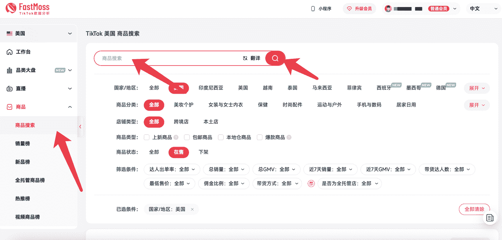

以手机支架Phone stand为例，我们输入后会出现如下图

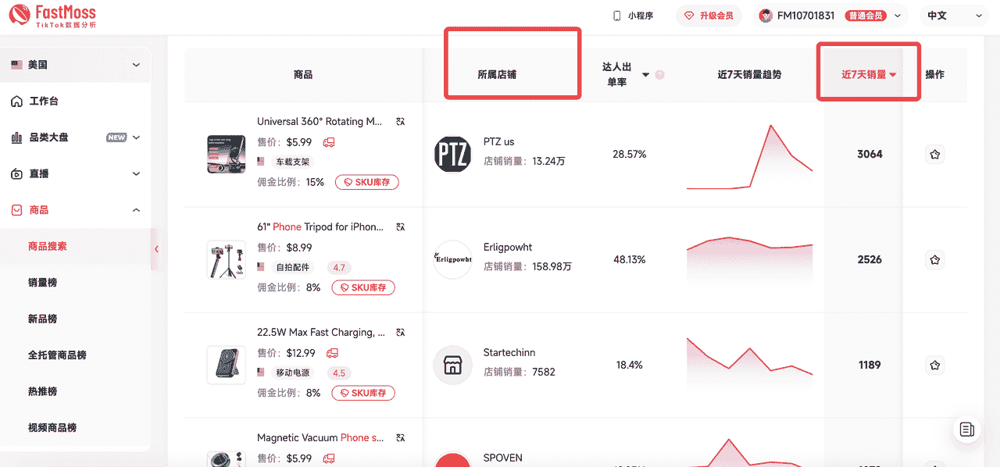

我们可以看到它最近的销量，以及相关店铺、达人出单率等等的数据。比方说排名前三的都是家用手机支架，并非车载，所以我们能否优先考虑家用手机支架。

再比如，有的手机支架达人出单率达到48.13%，那么咱们得有一半的重点要放在找达人身上，让他们帮我们分销。有的达人出单率低，我们就将更多精力放在自己身上，自己卖等等。

重点是，根据搜索出来的数据，细化你的运营方案。

所以，咱们需要做的就是提炼出咱们自己产品的名称、品类、卖点等等关键词，去进行搜，找找现在平台热卖的品有哪些，自己能否跟，以及如何将自己手上的品去卖爆。

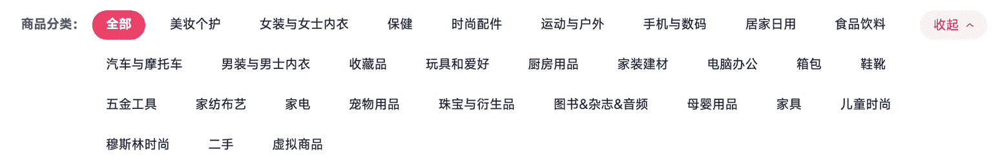

作为新手，也可以用这个平台进行选品。

具体选品方法是什么：以下2个里面选择一个做法就可以

① 确定一个自己感兴趣以及数据证明比较好做的类目，然后在这个类目里面选择3个品，然后去试，不行就换；

② 选择3个感兴趣的类目，每个类目里面选择1个品，然后去试，不行就换；

然后在fastmoss里面选这个品排名靠前1-3页的去卖，越靠前越好。

怎么判断不行？我个人的经验是2周以内，每天发3条视频挂车去卖，1单都没卖出去，那就大概率不行。如果没有开TK小店挂不了车，那就看短视频的浏览量，20条视频以内没有过千浏览量的，换！

那什么是好品，就是要找到商家很菜，但是他能卖爆的品。怎么评判商家很菜？先看他的店铺，是不是什么品都上的杂货铺，发的视频也不多，画面点赞收藏都很少，但是能卖爆品出来，那恭喜你，捡到漏了。

需要注意的是，漂亮国跟国内一样，也喜欢过节，特别是下半年，万圣节、圣诞节、元旦，还有黑五（虽然不是节日）都是自己营销的热点。如果供应链跟得上，就跟节日元素。

相关费用：新注册的时候会送几天试用（具体几天忘了），过了试用期，某宝上有几十块一个月的服务。

#### **4.2.2 出海匠**

出海匠也是第三方数据平台https://www.chuhaijiang.com/tiktok/dashboard

我更喜欢的是他们这个行业看板，对于新手来说，能直观看到哪个行业成交量比较大，卖得比较好。

以及在自己没有选品思路的时候可以去根据某个品类深入到第3层级。

以选香水为例，依次点击去后如下图“美妆个护”-“香水”-“女士香水”。

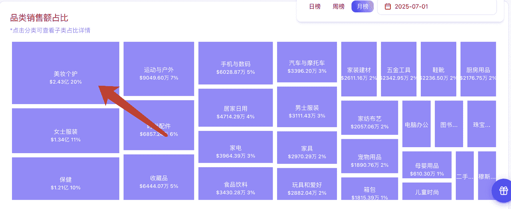

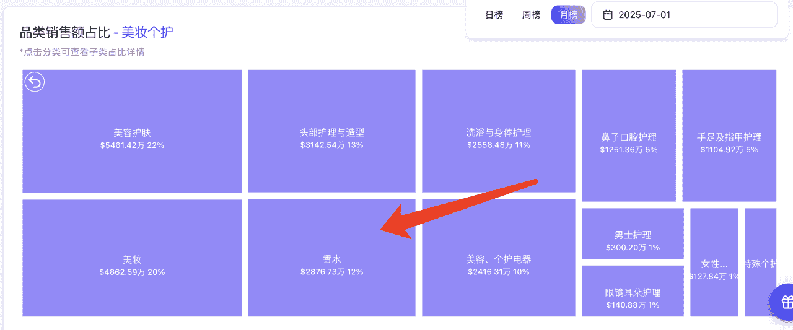

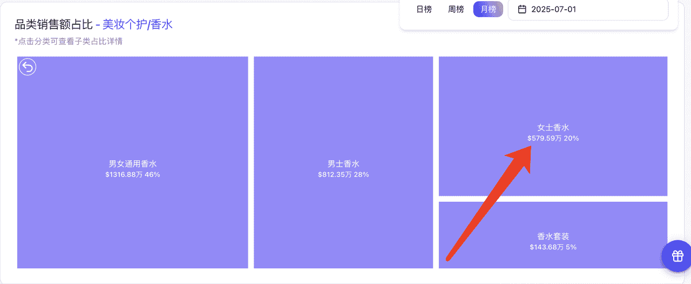

它的作用就是，当我们只知道我们要做的大类目后，可以协助我们进行下一步的决策，细化到第三层级的子类目。

当然，如果大家觉得细化到第三层级还不够，那么需要结合网站的搜索功能进行进一步细分。

搜索女士香水Ladies perfume后，进入排行榜，然后看排行榜前2页的搜索结果

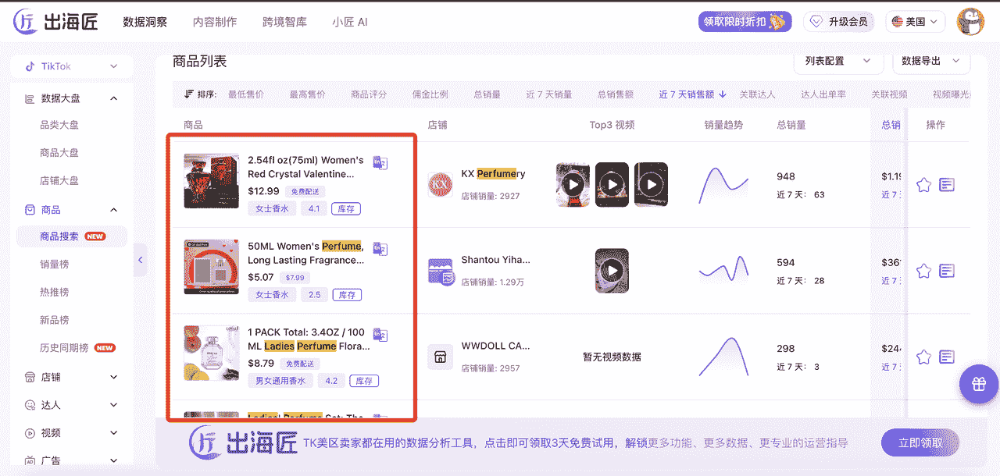

再进一步分析，这个香水为什么火，我能不能卖。就会落实到具体的一个产品上。

其它的功能和fastmoss大同小异，区别不是很大。新手能试用几天的时间。

选品，到这里就分享完毕了。目的是给迷茫中的同学们一些灵感，后续熟练了，每个人都会形成自己独特的选品方法，本人只是抛砖引玉，做个初级引导。

## **五、闭坑指南**

说起跨境电商，坑有好多好多，这里我先说说几个典型的。

### **5.1 不合规会封店**

TK是真的会封店，9月份的时候，我们基本上都是从国内发货，因为成本低，我们也知道平台会封，结果真没想到这件事来得这么快。跨境店也是不允许国内发货的。

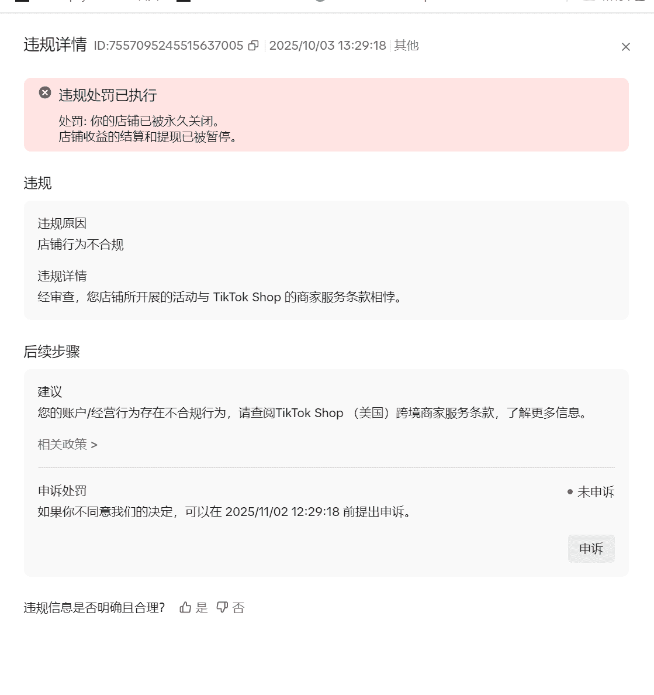

毫无征兆，就是有一天打开店铺，发现被封了，也不说具体原因，这跟亚马逊很相似。

后来也解封了，怎么解的呢，花了几百块找了个专门的服务商解的，成功概率60-70%，对流量也没什么影响。

那你可能会说，谁叫你们从国内发的，但主要是当时我们研究的几个竞对一个月几十万刀的销量都是从国内发的（直播间问的），所以就试试看。后来，我们了解到，从国内发货要抖音S56.亚马逊千万大商才可以申请直邮的方式从国内发货，竞对可能走的是这个路子。

### **5.2 有些类目是要开白的**

什么叫开白？就是上传资质开通白名单。比如玩具类目，有很多是小朋友玩的，小零件什么的比较危险，那么对这个类目就管控很严格，需要上传一些资质。否则你上传了商品就是审核不通过，根本没法卖。

但国内商家基本是不具备这些，就算到1688上面找供应商也不一定会有，那么你就需要找人开白，这些需要到某鱼和某书上搜。

一般费用的话看类目大小，200-1000之间不等，平均三四百，大概这样价格相差不大。

### **5.3 美区全面切官方面单**

10月27号起，美区全面切官方面单，这样就意味着从国内发货更难了，现在也想到一些办法进行解决，就是找个货代公司提供美区官方验证过的中转仓库进行解决，有了订单之后先从供货商把货寄到货代，再从货代寄到海外仓，最后从海外仓寄到顾客手上。如果超时，因为使用的是官方面单，暂时不会让商家承担后果。

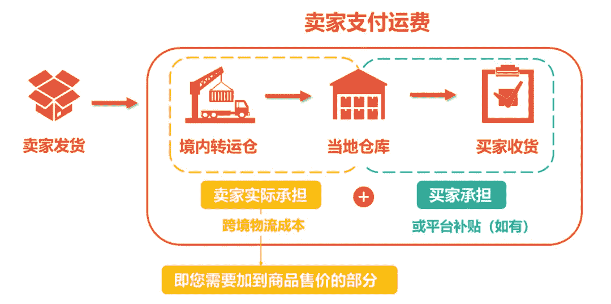

但这个事情实在是不能做多，只能作为新店测品，想要稳定还是要做海外仓。

### 5.4 10月份跨境电商全面开始收税

对的，不仅是跨境电商、国内电商都开始收税。意味着所有的成本都要给会计进行记账（个体户和公司级别都要缴纳），包括进货成本、物流成本、人员工资等等，再按利润进行收税，300W以下的利润收税5个点，300W以上是25个点，这个我就不展开讲了。

但这个事吧，还是有点突然，以前走出去的物流和进货都是个人卡号划出去的，开不了公司的票，都没法记账，也算是再财务规划上吃一堑长一智吧。

## **六、后期探索**

从10月份起，因为美区的发货政策改变，我也开始探索了海外仓的做法，现在已经完全打通了海外仓的整条链路，期间也踩了不少坑，过几个月再来跟大家分享正儿八经的海外仓的玩法和效果。

还提一下，欧洲那边红利正起来，比美区的流量要好，后面再一起说吧。

最后，这位C哥也托我问问谁对他的店铺感兴趣，可以出售。（实在是受人所托发一句）