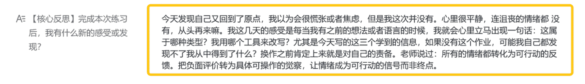
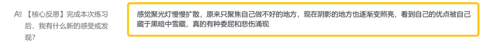
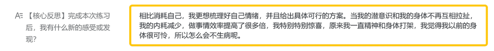
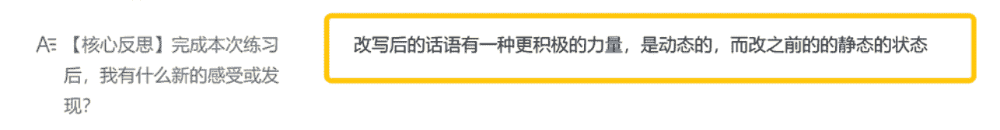
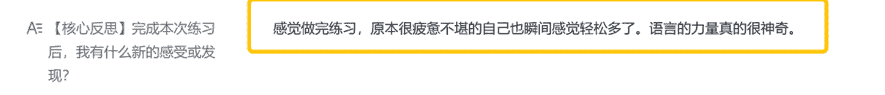
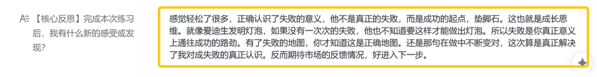
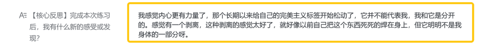
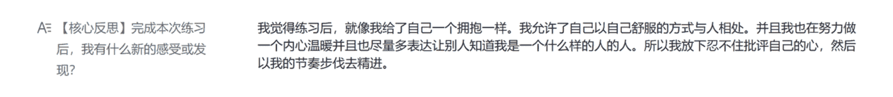
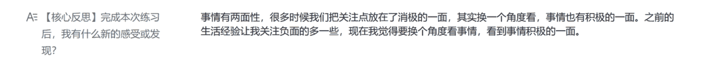
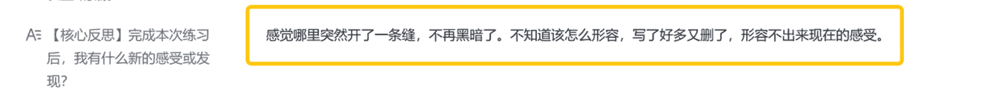

# 8大类66条搞钱限制性思维改写｜来自心力mini航海全员的礼物

> 来源：[https://xuqiwei1986.feishu.cn/docx/Zplrd1FBNonIlvxPXQAcyFMnnyf](https://xuqiwei1986.feishu.cn/docx/Zplrd1FBNonIlvxPXQAcyFMnnyf)

# 第一部分：这份"礼物"的由来

大家好，我是石神马。

刚刚过去的21天，我作为教练及领航员，陪伴【心力内驱系统重塑】Mini航海的全体船员，走过了一段从"看见"到"成为"的内在旅程。

在昨晚的靠岸仪式上，我分享了我们这次航海的设计逻辑：

1.  **先"整合内在冲突"**：帮大家看见潜意识的"刹车"，释放100%的原生执行力；

1.  **再"重塑成长思维"**：切换思维系统，把意识中的自我设限，改写成具有成长性的延展；

1.  **最后"激活源动力"**：找到真正驱动自己的燃料，让行动可持续；

这是一个环环相扣、搭建"心力地基"的过程。

让我们都感到惊喜和触动的是，在整个航程中，我看到了太多船员，在亲手挖掘出自己内在的"冲突性假设"后，通过简单的刻意练习，亲手打破了困扰自己多年的局限性思维。

他们切身地感受到了那种**"松动感"**，看到了成长型思维为自己**打开的全新视野**。

**在这次mini航海**中，我们**总共收集**了800余份航海日志，其中有230份，是学员们在深夜里，对自己挖掘出的"限制性信念"所做的深度觉察和刻意改写。

当我（和助教团队）在阅读这些作业时，我们被深深震撼了。

**我们发现，在创业和搞钱这个圈子里，困住**我们的限制性思维，竟然有如此强烈的共性！

在征得船员们的支持和授权后，我决定把这份"内部资料"整理出来，作为【心力内驱系统重塑】mini航海，送给赚钱圈友的一份礼物。

我们从这230份真实的作业中，提炼出了8大类共性"限制性语言"，并附上了船员们自己的"成长型改写"。有些地方，我也补充了我的改写视角。

你会在这些案例中，感受到一种"被看见"和"被松动"的力量。

坦白说，这只是【心力内驱系统重塑】mini航海中的一个练习环节，它甚至不是最核心的"内在系统地图绘制法"（挖掘内在冲突信念）。

但它就像一个切片，清晰地展示了——当你开始"真诚地面对自己"并"刻意练习"时，改变会发生得有多快。

以下，让我们一起感受在这次mini航海中的惊喜成长。

# 第二部分：8大类"搞钱"限制性思维改写

（注：以下"限制性思维"及"船员重塑视角"，均来自【心力内驱系统重塑】mini航海学员的真实作业，已获授权）

## 一、"自我设限"的思维（我就是不行）

1.  限制性思维： "我就是个不擅长销售的人，我做不了 IP。"

+   船员"重塑"视角： "我还不擅长销售，我正在学习如何销售和表达。"

+   石神马改写： 把'我'和'销售'解绑。'销售'只是一个可以练习的技能，不代表'我'不行。我先从一个最小可行性动作（MVA）开始，比如'先发一条朋友圈'。

1.  限制性思维： "我天生不是做生意的料。"

+   船员"重塑"视角： "我正在学习做项目，积累商业经验。"

+   石神马改写： 允许自己'还不是'。将这个信念拆解为具体的能力项：我缺的是流量能力？还是产品能力？我先从一个最小的项目开始，跑通第一个'MVP'，积累'手感'。

1.  限制性思维： "我没什么拿得出手的，我没有价值。"

+   船员"重塑"视角： "我一定有我的价值，我先梳理一下我的经历，找到我的优势。"

+   石神马改写： '价值'不等于'成就'。我先通过'情绪观察日记'（手册工具），看看我内在真正热爱和在乎的是什么，那是价值的源头。

1.  限制性思维： "我就是个很内向的人。"

+   船员"重塑"视角： "我只是在某些场合不习惯主动表达，我正在练习更从容地表达自己。"

1.  限制性思维： "我就是个拖延的人。"

+   船员"重塑"视角： "我正在/还在练习更高效地启动任务。"

+   石神马改写： '拖延'只是结果，不是原因。我先放下'拖延'的标签，用"内在系统地图绘制法"（手册工具）去觉察，我'不想动'背后的情绪和'冲突性假设'是什么。

1.  限制性思维： "我就是个很懒的人。"

+   船员"重塑"视角： "我只是需要休息，或者我还没找到真正想做的事。"

1.  限制性思维： "我就是个 xxx 的人。"

+   船员"重塑"视角： "我正在练习..."

+   石神马改写： 我先用'动词'（我正在做...）替换'名词'（我是...）。'我是'是终点，'我正在'是起点。

1.  限制性思维： "我就是做不到。"

+   船员"重塑"视角： "我'还'做不到，我正在寻找方法。"

1.  限制性思维： "我就是不行。"

+   船员"重塑"视角： "我还没找到方法。" / "我能从这次'不行'中学到什么？"

1.  限制性思维： "我就是不配。"

+   船员"重塑"视角： "我值得拥有。"

+   石神马改写： 先不去评判'配不配'，我先去'做'。用行动的结果，来改写这个信念。

## 二、"害怕失败/评价"的思维（我怕做错）

1.  限制性思维： "如果我发的内容没人看，那也太丢脸了。"

+   船员"重塑"视角： "我发内容的目的是为了记录和迭代，别人的反馈只是数据，不是对我的评判。"

1.  限制性思维： "万一我搞砸了怎么办？还是再等等。"

+   船员"重塑"视角： "我先试试看，搞砸了也是一种数据，我能从中学会如何改进。"

+   石神马改写： 把'搞砸'这个词，替换成'做一次压力测试'。我先投入10%的资源做个测试，看看会发生什么。

1.  限制性思维： "我怕做错。"

+   船员"重塑"视角： "我能从这次试错中学到什么？"

1.  限制性思维： "我怕被别人评价/嘲笑。"

+   船员"重塑"视角： "别人的评价是别人的事，我的成长是我的事。我为我的成长负责。"

+   石神马改写： 我先去链接那些能给我正向反馈和真实建议的人，主动选择我的信息及反馈来源。

1.  限制性思维： "这个事太难了。"

+   船员"重塑"视角： "这件事很有挑战，我需要什么资源来攻克它？"

1.  限制性思维： "我怕行动了也没有好结果。"

+   船员"重塑"视角： "行动本身就是一种结果，过程中的经验和反馈也是宝贵的收获。"

1.  限制性思维： "如果我没做好，别人就会看不起我。"

+   船员"重塑"视角： "我的价值不需要别人的'看得起'来证明。我专注于把事情做好。"

+   石神马改写： 我先用"内在系统地图绘制法"（手册工具）拆解一下，为什么我需要别人的'看得起'？这个'冲突性假设'是什么？

## 三、"完美主义"的思维（我还没准备好）

1.  限制性思维： "我必须等所有东西都完美了，才能推出我的产品。"

+   船员"重塑"视角： "我先推出一个60分的版本，在市场反馈中快速迭代到80分。"

+   石神马改写： 用'完成'替代'完美'。拥抱'MVP'（最小可行产品）心态，先上线，再优化。

1.  限制性思维： "我今天状态不好，等我状态好了再开始。"

+   船员"重塑"视角： "我接受我今天的状态。我只做10分钟，先'启动'起来。"

+   石神马改写： 正因为状态不好，我更要做点什么来改变这个状态。我先完成一个最小的动作，比如打开文档、写下标题。

1.  限制性思维： "我必须非常努力/拼命，才能..."

+   船员"重塑"视角： "我可以用更聪明、更高效的方式来达成目标。"

1.  限制性思维： "我应该 xxx（一个很高的标准）。"

+   船员"重塑"视角： "我先做到 xxx（一个60分的标准），再逐步提高。"

1.  限制性思维： "我还不够好。"

+   船员"重塑"视角： "我已经足够好了，我可以现在就开始。"

1.  限制性思维： "我必须把所有细节都想清楚才能开始。"

+   船员"重塑"视角： "我先行动，在行动中思考，在反馈中调整。"

1.  限制性思维： "我必须做到最好。"

+   船员"重塑"视角： "我先做到'完成'，再追求'更好'。"

1.  限制性思维： "我需要更多的准备/信息/资源。"

+   船员"重塑"视角： "我已经拥有足够的资源来启动第一步了。"

## 四、"外部归因/受害者心态"的思维（都是TA的错）

1.  限制性思维： "都是因为市场不好/平台限流，我才做不起来。"

+   船员"重塑"视角： "市场环境是我无法控制的，我能控制的是我的行动。我能做点什么来适应这个变化？"

+   石神马改写： 区分什么是'可控的'（我的行动、我的策略）和'不可控的'（市场环境）。把抱怨的精力，用来研究，在当前环境下我能做的最小改变是什么。

1.  限制性思维： "如果不是因为我老板/家庭/孩子，我早就..."

+   船员"重塑"视角： "我为我自己的选择负责。在现有的条件下，我能做的最小改变是什么？"

1.  限制性思维： "我没时间。"

+   船员"重塑"视角： "我每天可以挤出10分钟来做这件事。时间是创造出来的。"

+   石神马改写： 我把'没时间'翻译成'这件事的优先级还不够高'。那我如何提高它的优先级？或者，我是否可以每天只花1%的时间（14分钟）来推进它？

1.  限制性思维： "为什么总是我遇到这种倒霉事？"

+   船员"重塑"视角： "这次经历想教会我什么？"

1.  限制性思维： "我运气太差了。"

+   船员"重塑"视角： "运气是暂时的，我能做的是提升我的能力和概率。"

1.  限制性思维： "这不公平。"

+   船员"重塑"视角： "世界本就不公平。我能做的是在我的牌局里，打出最好的牌。"

## 五、"二元对立/绝对化"的思维（非黑即白）

1.  限制性思维： "我到底该选 A 还是 B？选错了就全完了。"

+   船员"重塑"视角： "A和B各有优劣。我先分析一下哪个在当下更适合我，或者有没有A+B的第三种可能？"

+   石神马改写： 世界是连续谱系，不是二元对立。我先用最小成本测试A，同时观察B，保持灵活性。

1.  限制性思维： "这个事必须这么做，没有别的办法。"

+   船员"重塑"视角： "我还可以找到至少三种解决办法。"

1.  限制性思维： "我永远/从来 xxx。"

+   船员"重塑"视角： "我'过去'常常 xxx，我'现在'开始尝试 xxx。"

1.  限制性思维： "这个项目要么大成，要么就是彻底失败。"

+   船员"重塑"视角： "即使项目没成功，我也收获了经验和教训，这是过程中的成功。"

1.  限制性思维： "这个世界上只有一种正确的答案。"

+   船员"重塑"视角： "每个问题都有多种解法，我来探索最适合我的那一种。"

1.  限制性思维： "不是朋友就是敌人。"

+   船员"重塑"视角： "大多数人是处在中间地带的，我可以和不同的人保持不同距离的友好关系。"

1.  限制性思维： "我必须 xxx，否则就 xxx。"

+   船员"重塑"视角： "我'想要' xxx，如果做不到，我也'允许' xxx 发生，并从中调整。"

## 六、"比较/嫉妒"的思维（别人比我好）

1.  限制性思维： "别人都做得那么好，我好焦虑。"

+   船员"重塑"视角： "我用'羡慕'替代'焦虑'。我羡慕他的什么？我能从他身上学到什么？"

+   石神马改写： 把'比较'的镜头拉回到'自己'身上。我今天的行动是否比昨天有0.1%的进步？如果是，我就值得肯定。

1.  限制性思维： "他只是运气好/有背景，我再怎么努力也追不上。"

+   船员"重塑"视角： "我无法控制别人的起点，但我能控制自己的努力过程。我专注于我能做的。"

1.  限制性思维： "我好嫉妒他。"

+   船员"重塑"视角： "嫉妒的情绪在提醒我，我也渴望得到那个东西。我如何通过自己的行动去获取它？"

1.  限制性思维： "我不如别人。"

+   船员"重塑"视角： "我在我的时区里，我专注于我自己的成长路径。"

1.  限制性思维： "我做得太慢了，别人都跑前面去了。"

+   船员"重塑"视角： "慢有慢的节奏，也许我能走得更稳。我保持我的节奏。"

1.  限制性思维： "别人的成功让我感到威胁/压力。"

+   船员"重塑"视角： "别人的成功证明了这条路是可行的，这给了我信心。"

## 七、"金钱/配得感"的思维（我不配）

1.  限制性思维： "我这个产品/服务好像不值那么多钱，报价的时候没底气。"

+   船员"重塑"视角： "我的价值由我定义。我提供的服务解决了客户的真实问题，它值这个价。"

+   石神马改写： 我先找到一个认可我价值的客户，完成第一笔'高价'成交。这个'手感'会重塑我的配得感。

1.  限制性思维： "赚钱是辛苦的，轻松赚钱是不道德的。"

+   船员"重塑"视角： "赚钱的本质是价值交换，与辛不辛苦无关。"

+   石神马改写： 我允许自己用'聪明'的方式，去创造价值和获取回报。

1.  限制性思维： "我必须非常努力/拼命才能赚到钱。"

+   船员"重塑"视角： "我可以通过搭建系统、运用杠杆来更高效地赚钱。"

1.  限制性思维： "谈钱很可耻/俗气。"

+   船员"重塑"视角： "谈钱是专业的表现，是对我价值的捍卫。"

1.  限制性思维： "我害怕赚到很多钱，我hold不住。"

+   船员"重塑"视角： "我正在学习如何管理和驾驭财富，我配得上更好的。"

1.  限制性思维： "我不好意思跟别人要钱。"

+   船员"重塑"视角： "我提供了价值，收费是理所应当的。"

1.  限制性思维： "有钱人都是xxxx（负面标签）。"

+   船员"重塑"视角： "有很多有钱人也在创造巨大的社会价值，我也可以成为那样的人。"

1.  限制性思维： "我不能比我的家人/朋友赚得更多。"

+   船员"重塑"视角： "我赚得更多，也能更好地帮助和支持他们。"

1.  限制性思维： "我花钱有负罪感。"

+   船员"重塑"视角： "金钱是流动的能量，我值得用它来犒劳自己，享受生活。"

1.  限制性思维： "我只能赚辛苦钱。"

+   船员"重塑"视角： "我正在探索能带来'睡后收入'的模式。"

1.  限制性思维： "我必须节省，不能乱花钱。"

+   船员"重塑"视角： "我更应该思考如何提升我的赚钱能力，而不是仅仅节省。"

1.  限制性思维： "我这个收费是不是太高了？"

+   船员"重塑"视角： "我的收费是基于我能提供的独特价值。"

## 八、"关系/链接"的思维（我不敢）

1.  限制性思维： "我必须独自搞定所有事，求助别人很丢脸。"

+   船员"重塑"视角： "链接也是一种能力。我主动求助，是为了更快地解决问题，实现共赢。"

+   石神马改写： 我先尝试发起一次'最小可行性求助'，看看会发生什么。把求助看作是一次'链接测试'。

1.  限制性思维： "大佬都那么忙，我一个小白去链接，肯定会打扰别人。"

+   船员"重塑"视角： "我先准备好有价值的问题，真诚地提问，链接本身就是一种积极的行动。"

+   石神马改写： 我无法替大佬决定我是否'打扰'。我能做的，是尊重他的时间，并清晰地展示我的思考和价值。链接的'发起权'在我手里。

1.  限制性思维： "我没有什么价值可以跟别人交换。"

+   船员"重塑"视角： "我的认真、我的提问、我的情绪价值也是一种价值。我先从'利他'开始。"

1.  限制性思维： "我害怕被拒绝。"

+   船员"重塑"视角： "被拒绝是链接中的正常现象，这只是一个数据点，不代表对我的否定。"

1.  限制性思维： "我必须等价交换。"

+   船员"重塑"视角： "价值交换可以是长期的，我可以先接受帮助，未来再以其他方式回报。"

1.  限制性思维： "我害怕冲突，所以总是妥协。"

+   船员"重塑"视角： "健康的冲突是为了更好地解决问题。我正在练习清晰地表达我的底线和需求。"

1.  限制性思维： "我必须照顾所有人的情绪。"

+   船员"重塑"视角： "我先照顾好我自己的情绪和需求，我无法对所有人的情绪负责。"

1.  限制性思维： "我不敢在群里发言。"

+   船员"重塑"视角： "我先从发一个'表情包'或'收到'开始，练习我的'存在感'。"

1.  限制性思维： "我害怕别人不喜欢我。"

+   船员"重塑"视角： "我不需要所有人都喜欢我，我更需要的是做我自己。"

1.  限制性思维： "我的人脉很差。"

+   船员"重塑"视角： "我正在通过每一次真诚的链接，逐步构建我的人脉网络。"

# 第三部分：礼物，只是一个起点

看完这些真实的改写，你有什么感觉？

是不是在很多条"限制性思维"里，都看到了自己的影子？

是不是在船员们的"重塑"视角中，感觉到了一种松动和启发？

这，就是"看见"和"共振"的力量。

作为教练及领航员，我分享这些，内心是极其触动和自豪的。

我为我的船员们感到骄傲——他们在短短21天里，敢于如此真诚地撕开自己的限制，并刻意练习新的可能，这是他们必然的成长。

同时，我也想通过这份"礼物"，让更多的伙伴们看到两件事：

第一，这些限制性思维是多么普遍。

你不是一个人在卡住。我们都在被相似的信念所困。

**第二，改变是多么具体。**

改变，不是一句空洞的口号，而是从"改写你的一句话"开始的。

我相信，即便你没有参加这次航海，当你读到这些来自同路人的真实觉察、新的视角和可能性时，你的内心深处也已经种下了种子。

也许你以为只是在浏览，但这些"啊哈"时刻的碎片，这些"原来还可以这样想"的启发，会轻轻在你的潜意识里留下印记。

**在未来某个你卡住的瞬间，它或许会生根发芽，帮你**松动那块坚硬的土壤，让你多一个人生选择。

这份"成长型思维"的练习，成果惊人，但它只是我们【心力内驱系统重塑】搭建过程中的一环。

好在，因为**它足够直观，足够有冲击力，哪怕仅仅只**是改写本身，也能让阅读过的圈友们立刻受益。这也是我推动这次内容分享的初心。

我们希望这份"共创"的礼物，能给你带来一些新的启发和力量。

也愿龙哥盟的每一位圈友，都能在"搞钱"这条路上，不断打破自己的局限，用成长型思维，去书写属于你自己的、持续不断的人生"跃迁"故事。

如果你觉得还不过瘾，可以看看我的心力主题文章👇

《两个搞钱真相，带你重启100%执行力和源源不断心力》

《成长型思维，才是真正的高天花板搞钱逻辑》