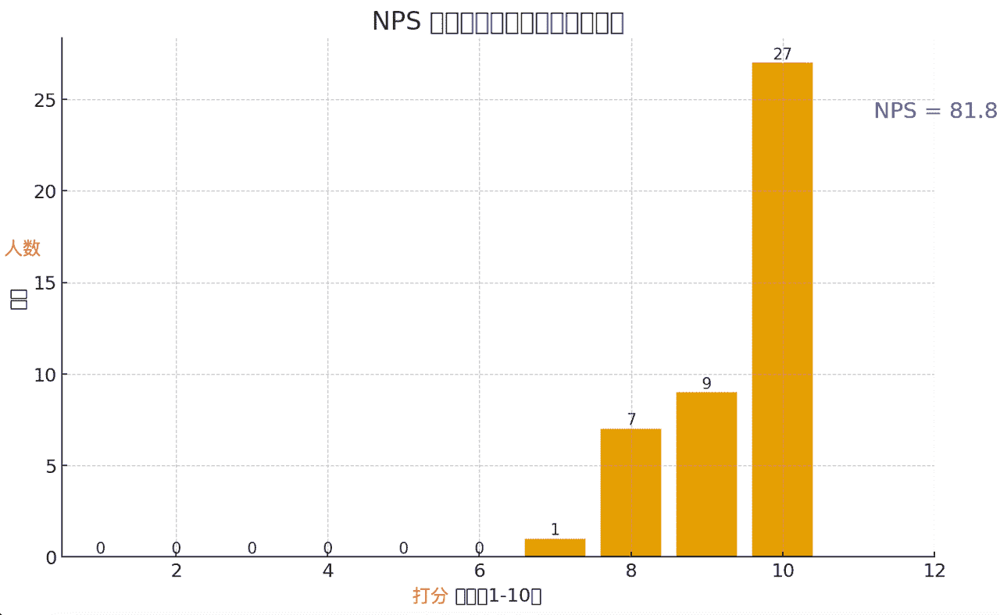
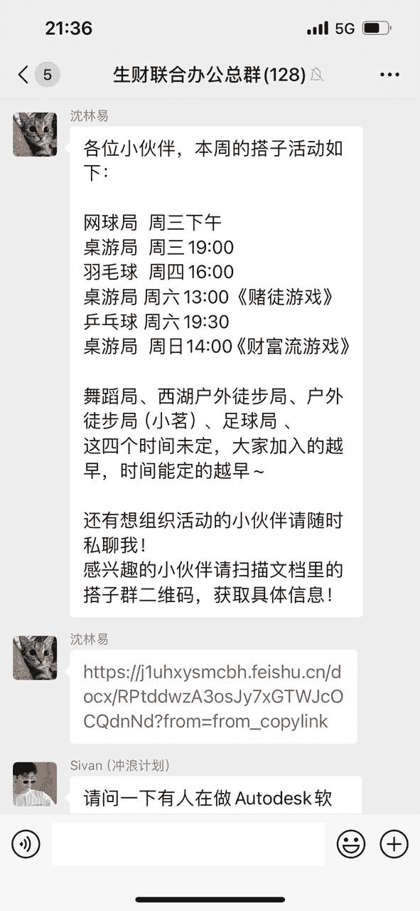
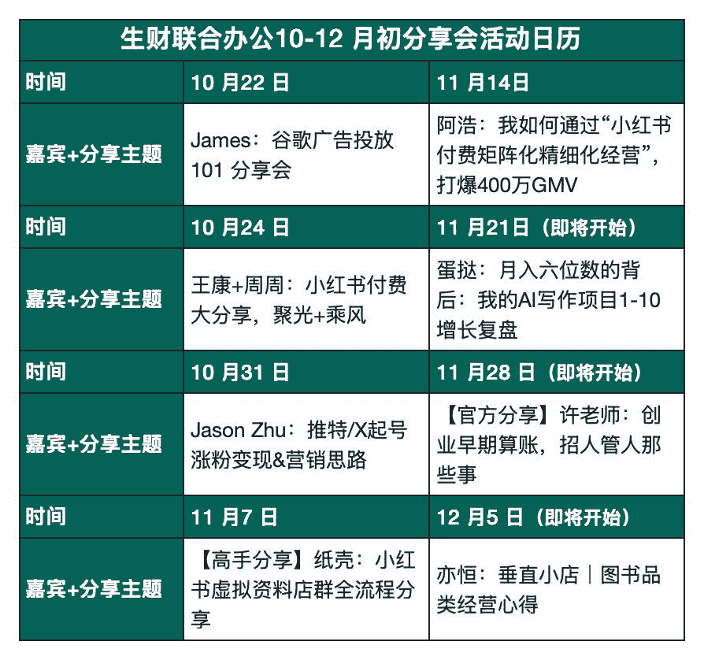
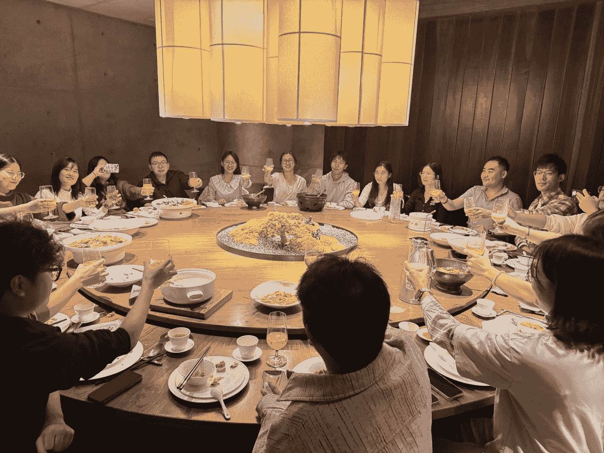

# 赚钱联合办公空间外地第一站（深圳站）正式开启招募

> 来源：[https://xuqiwei1986.feishu.cn/docx/SPhpd3TuNoOJ4qx9JYPcWMdhnCe](https://xuqiwei1986.feishu.cn/docx/SPhpd3TuNoOJ4qx9JYPcWMdhnCe)

上周五发完“赚钱联合办公空间（深圳站）即将开启” 的预热帖https://t.zsxq.com/4k7JR 后，我第一次感受到了深圳圈友的热情，左烨紫 和我说，深圳圈友已经摩拳擦掌准备开始抢报名了，还有的圈友今天一天打开赚钱刷了又刷，生怕错过，甚至于今天晚上群里已经有深圳圈友去场地踩过点了，太深圳速度了，果然龙哥老大把联合办公外地第一站选在深圳，这个决策太英明了。我的感觉就像，联合办公的干柴撞上了深圳圈友的搞钱烈火，一点就着，星星之火要始燎原了。太期待我们把这个联合办公空间打造成全国标杆了！

废话不多说，我相信很多圈友已经等不及了，那我就先把招募表单放在前面（报名表单直达：https://scys.com/form/z27Vz1hc）

表单里也提供了一些基本介绍，着急的朋友可以直接去抢报，不着急的朋友听我慢慢唠，我来给大家阶段性汇报下我们联合办公的进展和下一步规划。

之前的帖子我提到，杭州的联合办公余杭分站是在做试点，等这个试点跑通了，我们就会开启外地分站，那答案显而易见，我们判断联合办公的这次试点基本跑通了。帖子里我提到，我们试点的核心假设就是 联合办公的留存率、满意度能不能达到我们的预期。虽然我们能在星球感受到大家对于外地联合办公的期待和呼唤，只要放开招募，来的人应该不会少，但是我们对这份信任还是看得很重，所以必须把 “联合办公”这个“产品”打造到一定的程度，我们才敢把它推向更多的圈友。圈友们越是信任我们，我们越是不能让他们失望，这也是赚钱一以贯之的做事风格。

那么杭州联合办公空间这一个多月下来，跑得怎么样呢？不谦虚地说，我们做得很不错。

下面和大家同步一下数据

在11月9日，联合办公正式开启一个月整的时候，我们做了一次 NPS 调研问卷，最终回收了 44份表单，整体的nps值在 81.8分，一般nps超过60分就是很不错的分数，这次能超过80分，还是给了我们非常大的信心。

这里面，参加了搭子群10次以上的，nps更是打出了 94分的高分。

在nps问卷里，我们也调研了大家来联合办公的主要需求，主要是找人交流，提升执行力，参加分享活动，同时我们也问了大家来了一个月的收获，大家反馈收获最多的也是这些。

嗯，我感觉联合办公初步做到了  PMF ，也就是 product-market fit，我们的产品的一些机制设计，和圈友的需求，契合上了。

（说到这里顺便提一句，杭州的联合办公虽然扩增了8个工位，现在有56个，但也马上要没了，后面会进入排队模式）

接下来说说联合办公背后的运营机制。

在联合办公这个产品上，我们设计了很多好玩的机制。

第一个机制是“搭子群”，在联合办公一段时间后，我发现很多伙伴变成了合伙人，或者开始业务合作，比如 易芝和杨一合作📕出海业务，瑞思白和富百 合作n8n工作流的项目，而建立这个合作的前提是 大家互补，且对互相知根知底，合得来，所以我们要创造让大家高频交流的场景，搭子群就应运而生了，大家在日常的 运动、娱乐局中 一起交朋友，顺便聊聊项目，岂不快哉。

联合办公现在有 十多个搭子群，最火的是“别独自聚餐”，我们鼓励每个伙伴每顿饭都要约一些圈友一起吃饭，既然都来了联合办公了，那就不能再“独自吃饭”了，事实上很多合作的起点都是来自于 “弱关系”，而不是你很熟的“强关系”。这个群每天都能看到大家的吃饭打卡，大家相约一起吃饭，仿佛是认识很多年的朋友，这也许是独属于赚钱圈友的默契。

除了聚餐群，我们还有 羽毛球群，网球群，乒乓球群，健身群，跳舞群，养生群，桌游群，户外徒步群，各种活动应接不暇。我们有个口号，在联合办公要 work hard，play hard，有些圈友每天都参加活动，最后给自己定了个死规矩，一周不能参加活动不能超过 5次；还有多年的老圈友，说在联合办公一个月，参加的局比自己之前5年参加的线下局还多。这种线下的强链接是联合办公非常强的魅力，我们会继续发挥这个优势。

第二个机制是“每周创业分享”，除了日常轻松愉快的交流局外，我们还有每周五固定的“烧脑”分享局。作为创业者来说，每天都会面临无数的问题，大一点的业务方向、怎么放大、招人管人问题，小一点的注册公司、补贴申请这些鸡零狗碎，这些问题以前上班时可以推给领导、老板去解决，而创业时，都得自己独自面对。然而，这些困扰你很久的问题，很多时候，答案就在另一个人身上。你碰到的，是别人已经解决过的。所以我们会邀请 已入驻伙伴、外部高手、赚钱官方每周进行主题分享（一般一个月四次分享，包含2次内部伙伴分享，1次外部高手分享，1次官方针对创业各种问题的分享），你可以从分享中学习到 做项目的思路，矩阵号怎么管理，投流怎么优化，怎么招到第一个员工，怎么用AI来优化自己的业务流程，等等。其实，我们分享的主题，基本聚焦在一个词 “杠杆”，怎么加杠杆，加矩阵杠杆，投流杠杆，人力杠杆，技术杠杆，让你的项目在0-1跑通后更好地放大。

下面是杭州联合办公的分享日历图，大家可以看看感受一下。

第三个机制是 “共创机制”，刚刚我们提到的搭子群、分享，包括每个入驻者我们都会有一次“面试”沟通，这些机制之所以能运转得很良好，要非常感谢我们的志愿者团队，大家在这里不仅是入驻者，更是空间的建设者。每一个申请者，会有已入驻的、和你业务相近的“学长”和你沟通项目，同时给你介绍联合办公的情况，人还没来，你在联合办公就有一个人脉节点了，进入联合办公后，有 “生活委员” 跟你沟通入驻的细节，有“活动委员”和搭子群群主每周发起和组织活动，促进你和大家交流，有“学习委员” 邀约和组织每周的分享，这些工作都是由我们的志愿者团队一起完成的，正是有这些共创者的努力，我们的联合办公空间才做得越来越好。

（联合办公志愿者团队聚餐）

除了搭子群、每周分享、共创团队这些比较成熟的机制，我们还有一些其他机制，比如要每周更新自己的项目进展文档，有积分体系，这些机制还在不断迭代中，这里就不赘述了。

最后说一下联合办公的愿景

对于赚钱来说，联合办公空间这个小业务算是跑通了MVP，接下来按照10X放大的原则，我们会在全国各地开更多的联合办公空间，深圳站落地了，接下来广州站、上海站、北京站也不远了，评论区大家提到的 武汉站、成都站、厦门站，圈友有需求的城市我们都会考虑和评估，甚至于，我个人很想去大理也开一个，想象一下在四季如春的大理一边旅居一边和赚钱圈友一起办公的场景，然后赚钱圈友可以春天在杭州，夏天到大理，冬天到广深，全国旅居办公，这样的场景是不是很吸引人.

除了做广，我们还会持续做深做透，我们观察到来联合办公空间的圈友很多都处于业务1-10放大的过程，正在从一个准创业者转变成一个公司老板，从一个个体创业者朝工作室努力，这里面会碰到很多创业方面共性的问题，而我们有机会提炼出一些分享、课程、方法论、提供一些指导甚至陪跑，帮助这些赚钱创业者，让他们能少走弯路。同时，赚钱也有很多拿到创业大结果的高手，比如M叔，他们也非常愿意去认识、帮助年轻人，我们会和更多这样的创业大咖来合作。

最后的最后，是一些常见问题答疑

1、具体的地点在哪？

在深圳市南山区科技园科技南十二路28号康佳研发大厦A区18楼 Wework 办公空间内，1号线高新园地铁站

3、有多少工位？

总共有 52个工位，我们会按照申请顺序安排面试，按照过往60%-70%通过率来看，前80份申请表应该都不用担心，后续的会进入排队模式，如果人超过非常多，我们也会考虑再增加多一些工位

3、工位费多少钱？

为了照顾更多的圈友，我们的工位费定在 每个工位 1565元/月，或者 1颗碎片+300元现金兑换，这个价格我们都感觉太超值了，同期Wework 对外的工位是 1800元起/月

4、工位费是按月交吗？

一个月一交，不足一个月的按月计算。

5、对于申请者有什么要求？

有自己在做的业务的创业者，人积极主动，具体可以搜索“联合办公”，以前的帖子有提到，每一个申请者我们都会约一次项目沟通，具体要求也可以和“面试官”交流，沟通结束后评估通过，我们会发邀请函