# 【小红书免600开店方法】首次揭秘--生财杭州联合空间线下分享文稿

> 来源：[https://xuqiwei1986.feishu.cn/docx/DBsud6RkJoA8HFxjtdHc0NgvnXf](https://xuqiwei1986.feishu.cn/docx/DBsud6RkJoA8HFxjtdHc0NgvnXf)

大家好，我是纸壳，上周五在生财杭州联合办公空间，做了一场小红书虚拟资料店群玩法的线下分享， 真没想到现场来了这么多圈友，还有专门从上海赶过来的，生财线下的氛围实在是太顶了！！从下午 3 点一直聊到晚上 9 点，聊到嗓子冒烟都停不下来，贴几张现场照片给大家感受下这份热情～

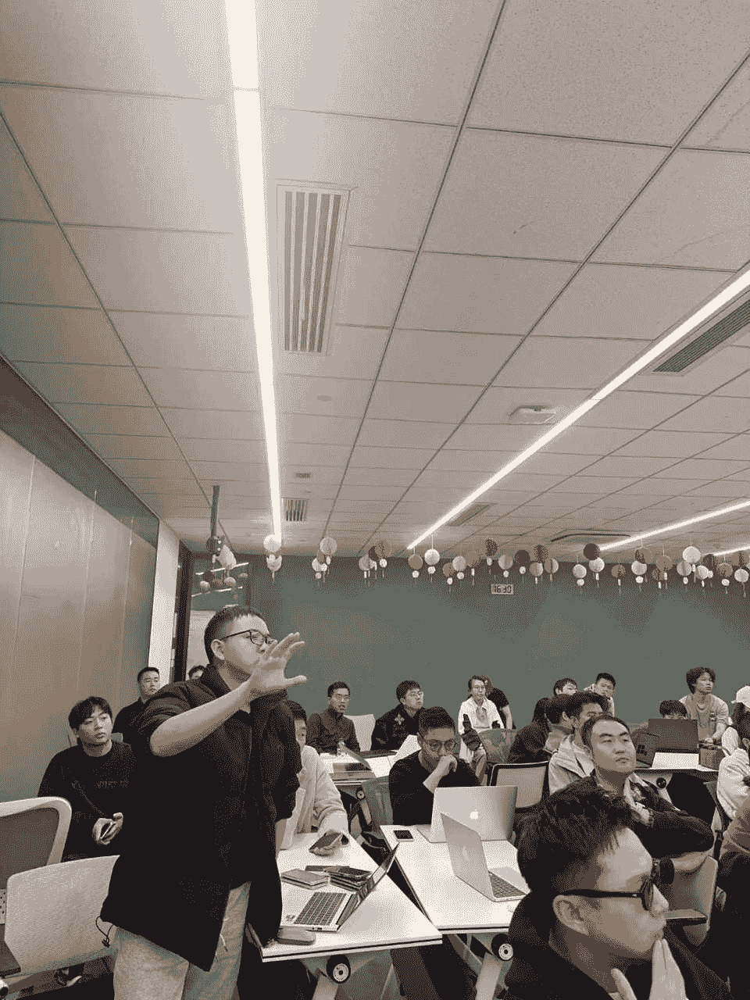

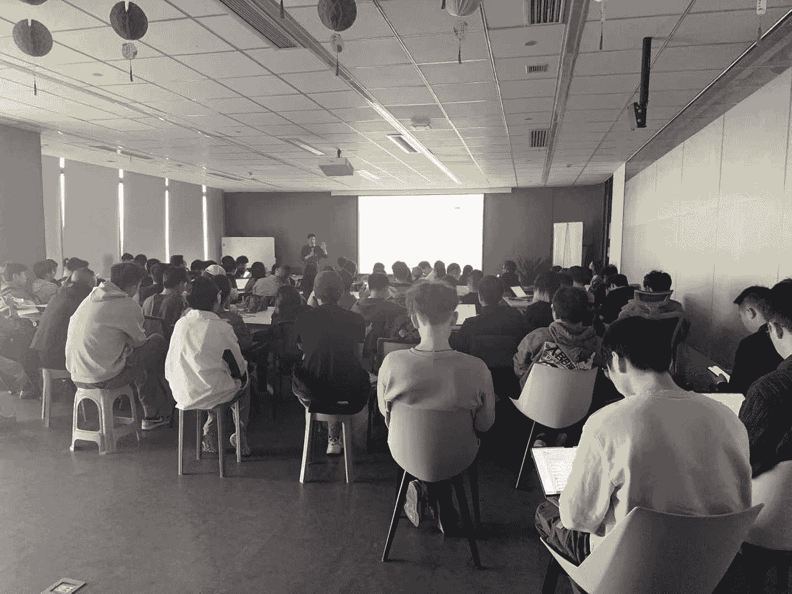

为**了不辜负大家的期**待，这次分享我也是把很多压箱底的干货都掏了出来，很多都是之前没公开过的不传之秘，尤其是 “免600无限开店” 的方法（没想到周末就有同行把这个方法挂网上收费代开了）

分享结束后，不仅收到了很多圈友的正向反馈，我自身的能量也得到了滋养，毫不夸张的说，和生财的年轻圈友们在一起，让我也获得了很多充能，回来之后每天干劲十足，能量满满！

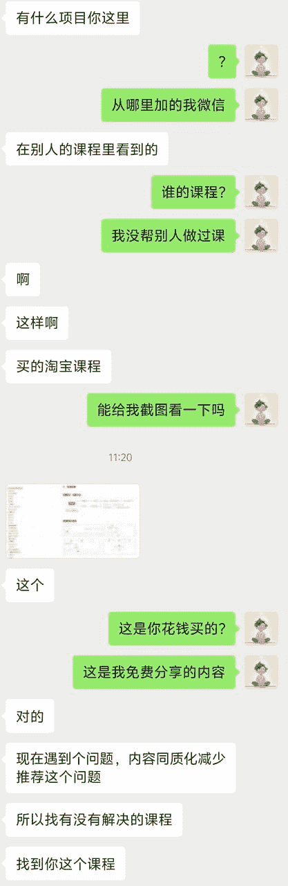

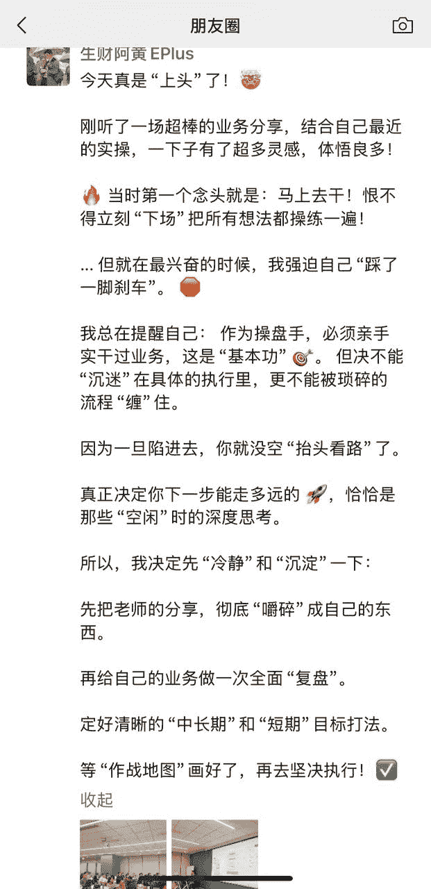

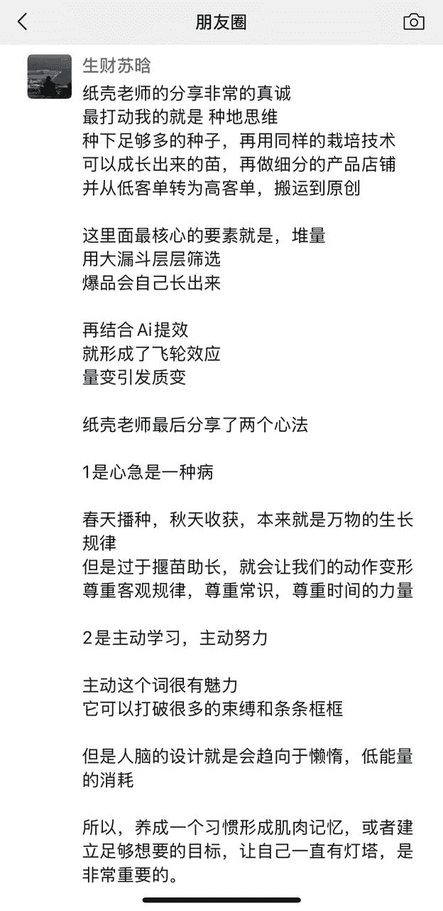

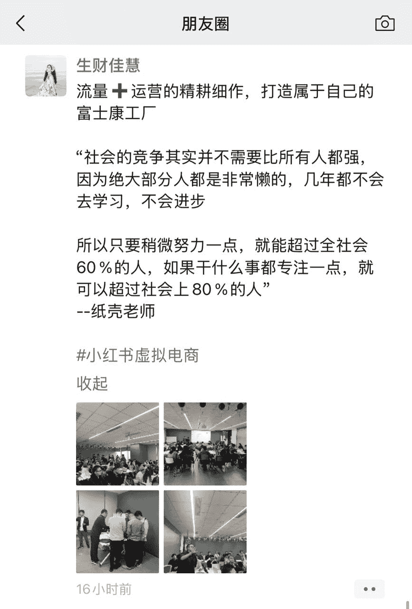

今天把完整的文稿整理补充好，毫无保留地分享给大家

# 一、项目介绍

## 1.选择红虚的原因

> 确定性强 、可批量复制 、稳定合规、有门槛

在讲实操之前，先分享了我们选项目的 4 个标准，这 4 个标准是我们踩过无数坑后总结的，也是小团队生存的关键

### **确定性强**

大家可能看过我以前的帖子，我之前做过视频号、抖音、小红书同城等很多短平快项目，最大的痛点就是 “波动性强”，可能某个爆品让你赚一笔，但下一个爆品没跟上，就只能归零，反复折腾，做的心力憔悴

小团队和个体没足够资本扛波动，所以一定要做确定性强的项目，只要干了活，就一定要能拿到钱，我了解到咱们现场很多小伙伴，都是小团队或者是个体，所以这个地方我觉得还是有必要给大家讲一讲，提醒一下，小团队一定要把生存放在第一位，把确定性放在第一位

虚拟资料这个项目，我们当时入场的时候就是 100% 的成功率，只要是来一个号，上一批产品，发完笔记， 3 天左右就开始出单，然后基本上每个号每天 2 - 5 单，甚至更多，而且不管加多少号，这个效果都能复制，确定性非常强

现在虽然竞争比之前大，但方法也在升级，用对方法确定性依然很强，这是第一个点确定性强

### **可批量复制**

这个点其实它包含两层意思，第一个，可以批量复制，说明这个项目可以做成标准化流程，不用靠个人能力，能够标准化，是项目放大的基础

另一层意思就是既然它能大批量地复制，说明它的市场容量足够大，天花板够高，能支撑小团队做大

小红书虚拟资料的流程简单到 “傻子都能上手”，从选品到出单全是可复制的动作，完全符合这个标准

### **稳定合规**

之前做的很多项目，都是对抗平台，今天能做，明天可能就被封，永远在归零。而稳定合规的项目才能形成复利，你积累的品、账号权重、运营经验，都会成为后续的优势

这个项目最开始做的时候也有一些不合规的地方，但我们后来全改成了符合平台规则的操作，至今几十家店没出过合规问题

### **有门槛或者说有壁垒**

一开始我以为这个项目没门槛，谁都能做，但做到一定规模才发现，壁垒藏在 “积累” 里

这种积累型的项目，我从 1 积累到 100 需要一年，那新入局的人他从 1 积累到 100 大概率也需要这么长的时间，甚至更久。这是第一个时间上的壁垒

第二个是形成规模效应之后，规模也会形成壁垒，这个项目就是靠大量铺品，跑出来一些出单品，那我们的品是 100 万级的，新入局的人，只有 1 千，1 万的品，竞争根本不在一个维度

### 总结

小红书虚拟资料项目完全符合这四个标准，所以就决定做这个，这个地方我再稍微多讲一点

在没有这套标准之前，我选项目全靠 “脑子一热”，都是没有经过科学的方法去选择判断的，听其他人讲这个项目好，或是从哪个途径知道有这么个项目，或是手头没有任何项目，哎，正好就出现了这么一项目，然后就进去做了，结果就是反复归零

**选择大于努**力，大家都知道这句话，但是大部分人做项目的时候，都没有把 “选择” 这个点真的放在心上，或者是真的下功夫。在我看来，前期选择要付出的努力，甚至要高于后期执行所付出的努力

前期选得好了，后边执行就会更轻松。真正的 “选择”，是要调研清楚：项目靠什么成功？路径是什么？需要什么能力？符不符合自己的状态，等等等等

这些都搞清楚了之后，才确定要不要做这个项目，那后边成功的几率就会大很多，因为你已经知其全貌，知道这是一个能打赢的战场

但是如果没有经过这些，盲目入局大概率就会像我之前一样，不停的归零，最后留下一句 “这个项目不行”，但实际上有没有可能不是项目的问题，是从一开始就进入了不该进入的战场，成为炮灰也是理所当然的

所以我希望，当然大家可能现在手头都已经有项目了，如果未来要选择新项目的话，不要着急，静下心来，用一套科学的方法去选，一定要选好了在做

## 2.项目流程

> 开店---选品、上品---制作笔记、发布笔记---乘风投放---出单发货

选好了项目之后，正式进入实操，小红书这个项目的流程很简单，先开一个店，然后从淘宝选品，把产品上架到小红书，然后制作笔记，发笔记，然后投流微付费，之后就等出单发货

流程非常非常简单，基本上所有电商项目都是这么个流程，无非是做笔记还是做视频的一个区别

## 3.项目现状

### 原始模式

> **纯杂货铺无脑铺货（内卷严重）**

说一下目前这个项目的现状，我们最开始做的时候就是无脑铺货，那会做的人相对较少，直接从淘宝把商品批量上传到小红书，之后笔记图片直接用商品的主图，笔记的内容就是通用话术，直接就发布了，这样的内容就能出单，因为那会做的人少，所以当时的效果非常好

到现在已经开始比较内卷了，上面写的内卷严重，其实还没到特别严重的那种程度。现在用无脑铺货的方式依然有效，依然能出单，我们部分老店还在用这种模式测新品

但是如果一直是处在无脑铺货这个低水平重复的阶段，量必然会越来越小，越来越缩，实际上所有的项目，包括淘宝，包括其他的项目都有这个过程，从无脑铺货要开始慢慢的升级

### 最新模式

> 从杂货铺转向细分高客单（蓝海一片）

那我们现在最新的模式就是从杂货铺转向了细分高客单，在无脑铺货这个模式开始出现下滑的时候，好多同行应对的方法就是降价

我们从淘宝上采购资料的成本是一毛钱甚至一分钱，贵的话可能是一块两块，上架到小红书卖18、 19 甚至 20 多。这个毛利还是很高的，也可以说是纯利

但是内卷了之后，好多同行的对策就是降价，从18、 19 降到 9 块 9，9 块 9 不行，再降到 4 块 9，4 块9不行，降到 1 块 9 ，所以就导致了更加内卷

那我们的策略是从杂货铺往细分的高客单转，我们不往下打，太卷了，我们卷不过全平台这么多同行，我们就往上走，现在类似于当年的淘宝蓝海，可能大家有了解过淘宝蓝海这个项目，找到细分高客单产品，竞争少、利润高，出单特别香

我们现在的客单能做到 90 多，出单跟那些18、 19 的效果是差不多，一个号一天出个两三单，如果大家有在做这个的，可以尝试一下，效果还是不错的，但是必须要在选品上下功夫

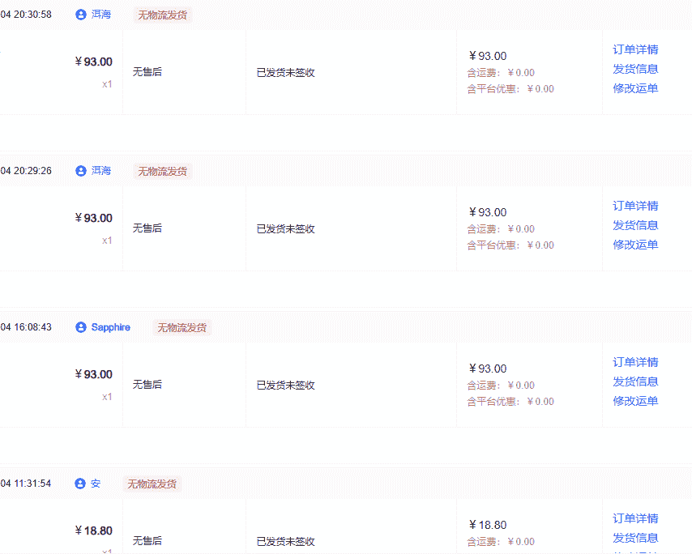

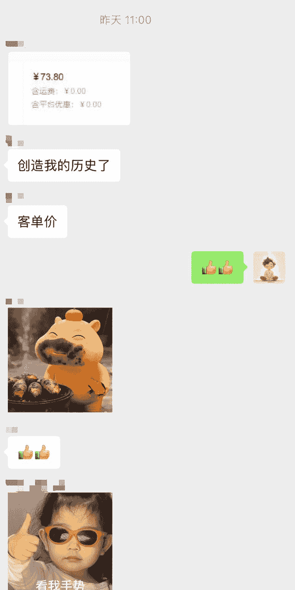

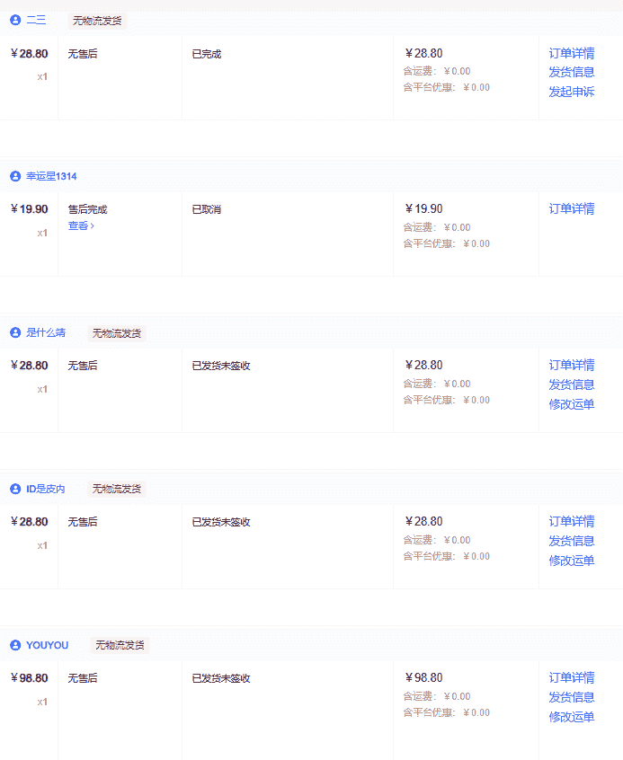

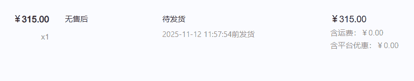

## 4.项目底层逻辑

### 通过大量上品测品，筛选和积累足够多的出单品和需求

然后说一下这个项目的底层逻辑，这个项目的本质是 “以测代选”，就是通过大量上品，这个倒三角顶端，然后往下筛出能出单的品，再沉淀出持续出单的爆品，最后把爆品做精细化和原创

比如这是一个店，有 500 ~ 600 个品，最后筛出来 10 个爆品，几十家店就能沉淀出几百个爆品，这是最赚钱的状态

### **种地模式 VS 打猎模式**

我把我们的模式叫种地模式，开一个店，就是圈一块地，上品就是撒种子，发笔记、投流就是浇水施肥，让爆品自然生长。从最上面一层筛选到最底层的爆品，这个过程可能需要两三个月甚至更久，但沉淀出来的爆品是 “有根” 的

因为这个过程中它一直在出单，你会逐渐了解它为什么爆，还能延伸出更多的同类品，了解用户的需求，有了对需求的了解，就可以做原创品，或者更细分的高客单产品

目前还有一种模式是做精品店，精品店主要的选品方式是跟品，刷到同行的爆品就跟风上架，然后笔记发一段时间，发现别人能爆你不爆，因为人家的爆品，可能是提前布局了很久、刷了单，或者赶上了特定节点，那你直接跟品就没有这些沉淀，自然很难爆起来

我把这种模式叫打猎模式，就是可能今天出去打着一只兔子，就吃一顿饱饭，打不到的话就饿肚子，不确定性很强

我们种地模式筛选到最后的这些爆品，把它做成原创品，做精细化，其实也是成了那种精品模式，但不是跟风，而是把 “地里长出来的爆品” 做精，爆率更高、确定性更强

### 农场主模式+富士康模式，标准化种地

一个店就是一块地。好，我现在哐哐哐，搞上 100 个店，就是农场主，但是光有地不行，地多了，人管不过来，用自动化工具、标准化流程管理这 100 个店，就是 “线上富士康”

**农场主+富士康=标准化种地**

虽然听起来很土，但是它就是管用。现在很多人做项目，包括看抖音上好多博主讲项目，做的都是天花乱坠高大上，但是一问营收，不挣钱。所以我们不追求高大上，接地气能赚钱就行，我们的目标是盈利，不是做 “看起来厉害” 的项目

### 在规则内做事，把精力放在更重要的事情上，而不是对抗平台

+   **天灾难避，人祸可免**

+   平台不让引私域--就**不做**

+   平台不让同质化--就**做原创**

+   平台要求实名--就**全部实名**

然后还有一个很重要的一个事，就是刚才说的稳定合规，在规则内做事

好多小伙伴找到我的时候问用不用做IP隔离，我说我们现在几十家店都没有做 IP 隔离，上次来这听大周老师游学课的时候，他讲了他们之前有几百个账号，用尽各种各样的方式做隔离做区分，但该废号还是废号，也就是说 IP 隔离这个事，以我们的能力是根本没法和平台对抗的，平台只要想查你，想搞你，你必死

那我们为什么不做 IP 隔离？因为平台不让做的事我都不做，平台允许的事我才做。平台不让我们引私域，我们不做；平台不让同质化，我们就搞原创；平台要求实名，好，我们所有的账号全部实名

平台要求做的，就听话照做，所以到现在我们几十家店都在一个 IP 下，至今没废一个号。完全在合规的范围内做事，平台没有理由找你麻烦，所以也不需要在什么 IP 隔离这种事上浪费精力，可以把时间和精力放在更重要的事情上

**所以关于这件事，上**面写了一句话，天灾难避，人祸可免。比如说像 K12 那种整个行业覆灭的天灾，我们避免不了，但是不要自己给自己找事，不要自己去创造人祸，这是也是给大家的一个提醒

# 二、项目准备

## 1.无限开店方法（首次揭秘）

很多人以为开店要花 600 元，或者只能开几个店，其实我们已经找到 “免费无限开店” 的方法

先给不太了解这个项目的人讲一下，首先你需要有一个手机号，然后拿这个手机号去注册一个小红书账号，注册完账号之后，如果只用它来刷笔记或者娱乐，那就不需要实名

但是如果想要带货的话，现在平台要求所有带货号必须实名，那就要去实名，这个可以找任何人实名，家人、朋友，找兼职、找宝妈、找号商都可以，但是每个人只能实名一个账号，就是你实名过a账号，就不能再实名b账号了

然后有了实名之后，就可以去开店了，到千帆，直接用小红书扫码就能登录

如果你想开个人店，**不管是谁实名的账号，开店的信息都写你，**就可以成功开店，每人可以开 4 个个人店

也可以用营业执照开个体店，也是**先**找别人实名之后，再来开个体店，用你的执照开，每张执照可以开四个体店，每个人可以用两张执照，也就是可以开 8 个个体店

这种开店是不用花那个 600 块钱的，到这已经是免费了，试想同行开一个店没赚钱先花600，我们是0成本，从起跑线就赢了

但是这 4 个个人店 + 8 个个体店，一共才 12 个店，跟无限开店还差得好远，是吧？

那我们怎么无限开店？**这 4 个个人店可以升级成个体店，升级成个体店之后，个人店的名额又给你空出来** 4 个，然后可以再开 4 个个人店，然后再升级，又空出来 4 个，然后无限循环，明白什么意思吧？

这个方法不仅适用于虚拟资料店，所有小红书电商店铺都能用

## 2.免费升级专业号

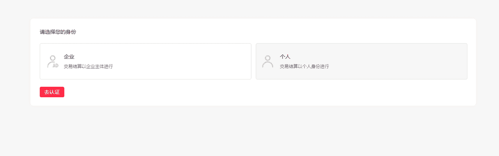

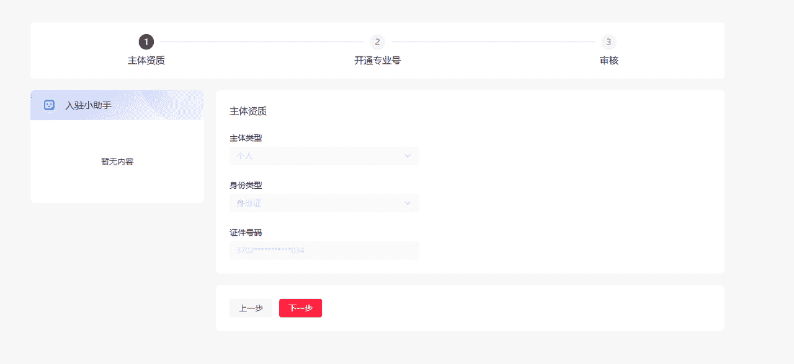

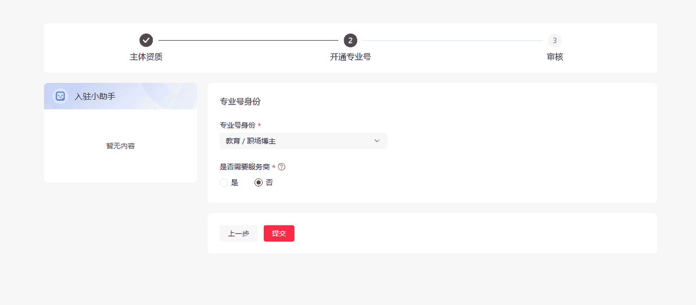

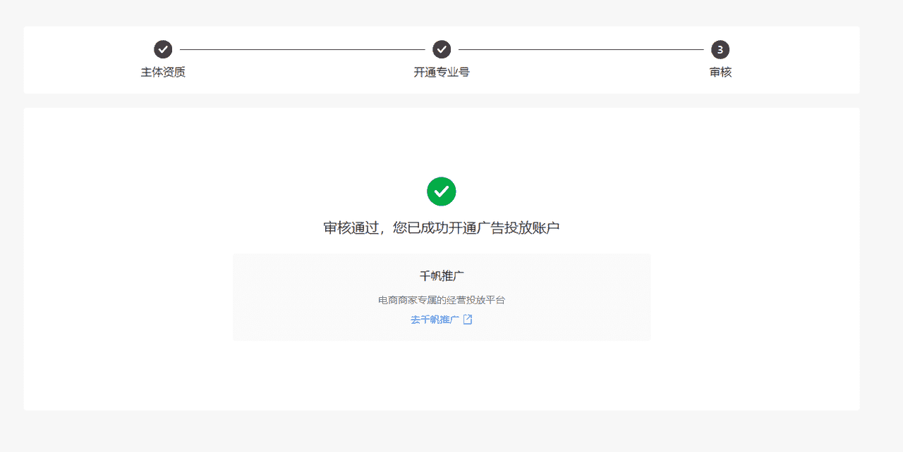

个体店开乘风推广或者发笔记的时候要求升级专业号，直接升级也是需要花600

在乘风推广的时候选个人，别选企业，然后下一页不用写，直接下一步。第三页选教育或者职场博主，提交就可以成功开通投放账户。也是免费的，如果你第一步的时候选企业就得交 600 块钱

一个店省 600 元，10 个店就是 6000 元，这都是纯利润～

看到这值不值得大家点个赞

# 三、选品及上品

## 1.选品方法

好，到这我们就已经开好店了，开店后的设置，那些太细了，在这就不展开讲了，默认大家都已经了解这些内容了，不了解的可以去看我以前的帖子，都写过

### 淘宝选品（种地）

> 根据关键字和品去淘宝搜索，选择图片质量高的店铺点进去，看店铺整体质量

> 选品关键词：人事制度、财务模板、活动策划、运营模板、仓库管理等

+   开好店之后我们就进入到选品，刚才也讲了，就是拿着一些关键词去淘宝上找品，以前我们是不看整体质量的，就是随便上，现在也开始逐渐地提升这个纯杂货铺的选品质量了

+   那这些关键词就不说了，这就很简单，如果你要实操的话，就随便找一个词拿着上去找，然后会出现好多好多的淘宝店，就从这些淘宝店里头去上品，直接搬到小红书就行了，然后这是淘宝选品

### 红书跟品（打猎）

> [小红书数据分析系统](https://sph.shucaigang.cn/web/web/xiaohongshu/products.html?cate_id=117&parent_id=114)

> [野马数据](https://yemashuju.com/web/)

> 刷同行

+   另一种方式是小红书的跟品，直接跟同行的品，重点是要找到同行的品，那我们圈友有提供两个系统，直接可以看同行的这些数据，一个是这个分析系统，还有一个是这个野马数据。这里就不带大家看了，大家理解一下意思。

+   再就是刷同行，基本上就是这两种方式。

### 精品和堆量不冲突，精品更应该堆量

关于这个地方再讲一下，好多人都有一个误区，就是觉得我做精品就意味着我就应该量小，比如说做精品笔记，一天可能只能做出来两篇， 3 篇，最多 5 篇

但**做精品和堆量它不冲突，做精品只意**味着你的笔记的质量高，但是不意味着数量少。它俩完全不冲突，这个是一个误区

整个项目的逻辑就是需要用大量去堆，做了精品更应该堆量，它只是有难度，只是比普通选品做量的难度会高一些，但这并不是不做堆量的理由

我们要做的是把做精品的步骤拆分到足够简单，做成标准化，然后借助工具或者各种各样的方法，让精品也能够量产

## 2.选品标准

1.  **画面整洁清晰，内容较新**

然后看一下选品标准这些，画面整洁，这个是会有一定的影响，小红书还是一个比较吃颜值的平台，画面好看，用户就更容易点进去看

然后内容较新的话，这个确实很重要，如果你的品上面写的2012、2013，用户绝对不会看的，也绝对不会买的，所以内容尽量选择新一点

1.  **样式统一、价格较高**

再就是样式统一的话，可以让整个店看起来更正规，提升信任感，但是这个也是锦上添花，不是核心

再一个价格较高的，这个是我们后加的一个选品标准，因为大部分同行现在还在做那种0.1、 0.01 的品，我们就做那种 10 块以上，甚至二三十、四五十的品，采购价高的品，做的同行相对就少、竞争小，能卖高客单

这种品其实有很多，只不过大家一开始都在做杂货铺，选的都是价格很低的品，会形成误区觉得虚拟资料都不值钱，或者高客单的虚拟品很少，其实高客单的虚拟品的数量，远远超出我们的认知

1.  **老店铺，销量高**

再一个就是选老店和销量高的，这个主要是为了规避版权，如果这个店他已经卖了很长时间了，而且他的销量还挺高，那大概率他店里的这些品就没有版权的风险，可以放心搬

这**是几个选品标准**，但这些不是唯一的，也不是最好的，这些只是参考，做久了会有自己的体感，重点还是 “量”，用规模覆盖误差

## 3.禁选品类

然后一些不能上的品类，涉及到平台不允许的事情，碰都不要碰，避免封号

+   医疗美容：近期平台明确禁止

+   合同及其他资质类：需要律师资质，无资质必违规

+   小说、影视作品等强版权：强版权，封号严重

+   涉及国家、政治：标题含 “红色”“政党” 等词都不行

+   其他：荐股类、带讲师机构名、用 APP 交付的、带激活码的、直播课交付，这些都是不能做的

## 4.热门类目

推荐几个热门类目，这是我们跑出来比较好的一些类目

1.  话术类：线下的销售话术，比如说汽车、保险等等这些线下销售话术；线上的直播话术，那这个面太广了，什么都可以卖，我们卖过玉石的直播话术，卖过鸡蛋的直播话术，卖过沙发的，反正各种各样的直播话术，因为现在做直播的人挺多的，这个需求还是可以的

1.  小语种：韩语 TOPIK、对外汉语 HSK、各种方言，上海话、温州话，还有越南语、西班牙语，这些都是越细分越能做高客单，真正需要的人就是很精准，卖高客单他也要

1.  儿童类：是一个超级大类目，这里边那些学科类的非常卷，但是你避开那些学科，比如少儿编程、乐高社团的、一些课件、还有教育案例，这些都是竞争没那么激烈，但是还能出单，有需求的一些类目

1.  年终汇报、年会策划：到年底了，需求量大

1.  女性成长、婚姻经营、情感挽回：这几个类目，在小红书卖得也挺好

1.  其他高需求类：育儿食谱、健康管理、宠物美容、小吃配方、幼小衔接、小升初、初升高

1.  本地房价报告等高客单

> 核心逻辑：干系越大价值越高，理解了这个点，就能做好高客单

+   本地房价报告这个品，很多人都想不到，就是没想到这种东西，它能卖特别高的价格，卖 299 都能出单

+   因为不管是买房的还是卖房的，他们一个成交就是上百万甚至大几百万的价格，它的干系太大了，精准地了解这个市场行情，是不是他现在最需要的内容，那你卖个几百块钱，你也别大几百了，你就99、69，用户是愿意下单的

+   因为干系越大价值越高，包括我们有一个品，是做企业退税的资料，我们卖的客单价就很高，那也有很多人下单，因为退税这个事他干系比较大，相对于后边产生的价值，前面买资料这几十块钱不值一提

+   这些词，你直接拿着去搜，或者后边加个资料什么的，就能找到很多很多品。但还是那句话，不要在很明面上搜出来的品，就拿去用，面上的品已经有很多人用了

+   往细分了去挖，这个也是拉开大家选品差距的一个点，有的人就浮于表面，有的人就能深进去，找到更多更好的品，更精准的细分的品，那他选出来的品就更容易出单，那人家做得好，是真下功夫了，不是浮于表面的

## 5.高客单真香选品

> 细分类目、样式统一、内容丰富、原价高

> 做的人少、竞争小、敢挂高价就有人敢买

> 案例：shop116651242.taobao.com

然后给大家举一个例子，高客单选品，就是尽量找那种细分类目，样式尽量统一，内容丰富详实，原价高。这种品做的人少，所以它竞争就要小

这是一个卖小吃配方的，就这种品，有做过的肯定知道，在杂货铺里边很多很多这样的品，都是 0.1、0.01 这样卖的，所以大家默认就觉得这种品的价值不高，就会拿它当特别低价的品在做

但是我们就把这种品上架，你看它卖58、38，我们加上 15 块钱，或者加 10 块钱，甚至原价上架。因为我们出单之后只有第一单需要采购，后边的再出单就没有成本了，我可以用原价卖第一单，我不挣钱，后边的就纯挣了嘛。

好，上架之后就是，像这种品只要你敢挂高价就有人敢买，甚至同行挂 0.01 用户不要，用户觉得他那个便宜资料可能是垃圾，他就来买这贵的

小红书真是个宝藏平台，这是给大家举个例子，总之就是高客单现在真的很香

## 6.三种批量上品法

三种上品的方法，黑鲸鱼和红麒麟是两个第三方的软件，这些涉及到具体的执行，这里就简单讲一下他们的优缺点，不了解怎么用的去看我之前的帖子

1.  **黑鲸鱼**

+   黑鲸鱼需要先在淘宝上开一个自己的淘宝店，然后用黑鲸鱼把别人店铺里的品，先搬运到自己的淘宝店，然后再从自己的淘宝店给小红书店铺一个授权，就可以从淘宝店搬品到小红书了

+   它的优点是这种方式相对比较稳定，不会出现很多错误或者是上架不成功的问题

+   缺点就是淘宝是在打压这种搬品行为的，因为它扒品的时候需要登录一个淘宝号，所以它会废这个号，但也不是真的废，就是限制你这个淘宝号查看商品详情一天，那你今天用不了了，你可以换一个号，或者 24 小时之后再搬。

+   然后再一个就是它需要开一个淘宝店中转，多一个步骤，比较繁琐，这是黑鲸鱼的优缺点

1.  **红麒麟**

+   红麒麟是另一个软件，这个软件不需要开淘宝店，可以直接从别人的淘宝店，搬运到我们的小红书店铺，不需要中转所以相对简捷。缺点就是它不稳定，经常出现上品失败的情况

1.  **工作流**

+   第三种方式，就是自己用影刀搭一个工作流。工作流的方式就是直接在淘宝页面上模拟人工，把商品主图还有商品标题还有价格都下载下来，然后另一头再写一个工作流，用模拟人工上传的方式，上传到小红书店铺

+   这个方式的优点是它不需要开淘宝店，直接就能上到小红书，而且它免费

+   缺点也是搬品的过程会封淘宝号一天

我们现在是三种方法混搭着上，黑鲸鱼和红麒麟在淘宝能搜到，有现成教程，包括市面上还有其他好多种软件都可以用，这些不重要，只要能上品就够了

# 四、笔记制作及发布

## 1.批量制作笔记文案

好，上好品之后就要制作笔记，最早这个项目都是手搓的笔记，笔记图片用商品的主图，笔记的标题用商品的标题，笔记的正文是一段通用话术，后来主要是图片部分，大家都这么做，造成非常多的同质化

那我们现在是通过软件批量制作原创图片，然后笔记文案直接用AI生成，给大家演示一下，以前用的是豆包，生成效率也很高，最近又找到了更好的方式

**实操演示（见**[告别低水平重复！做好小红书虚拟项目的核心：持续迭代、打怪升级](https://md8vbz6pkh.feishu.cn/docx/VfSYdufjtoT49jxleBmcip8cngf)**5-2）**

我之前帖子写过，就是这种技术上的进步，大家不需要非得追求到最前端，够用就行，它只是帮我们提效，把占据我们精力的重复性工作替代掉，让我们能省出时间和精力放到更重要的事情上，核心还是要把选品、运营这些做好

## 2.批量制作原创图片

然后有了笔记文案了，我们再去做原创图片

图片制作我之前帖子里讲过一个是美图秀秀的批处理，那个软件是免费的，但是它那个边框什么的很少，所以大家都用的话还是效果会很差一些

后来我们又有一个稿定设计 + 工作流，就是我们在稿定设计提前做一套模板，然后批量替换文案的位置，就相当于生成了无数的原创的图片，因为这张图确实是原创的，只不过每个图的标题有区别

**实操演示（见**[小红书虚拟资料店群进阶玩法--如何做到稳定出单](https://md8vbz6pkh.feishu.cn/docx/UfCHdJPAmo85Y0x2wXvczZ1EnTb?302from=wiki)**2-3-2）**

大部分虚拟资料的产品图，其实就是纯文字，那这种模板就已经够用了，我们的核心是做量，只需要用这种批量替换就可以了

这样我们就有了它的原创图片和原创文案，已经能规避大部分违规，还能提升平台推荐权重，只需要再批量的发布就 ok 了

## 3.批量发布笔记

那我们批量发布这部分，也已经用工作流做成了自动化，这个演示一下笔记发布

**工作流演示（见**[【全程自动化】的小红书虚拟项目到底是怎么做的（附代码）](https://md8vbz6pkh.feishu.cn/docx/SflKdlT1PorNZhxRQ6CcZIrRnVW?302from=wiki)**4-2-2.1）**

这个就是批量发布笔记，这种笔记发出来，跟手搓的笔记没有任何区别。现在这些自动化工具已经是 “基础建设”，能帮你省时间放大，但选品和图片质量才是核心，别本末倒置，只顾着自动化，忽略了出单的关键。

# 五、乘风投放

## 1.投放逻辑

+   主要作用:提升出单概率、增加笔记曝光、关注数、提升账号权重

+   方法：每天发完笔记建计划，每条计划30篇笔记，每天充值10元

+   小赌怡情大赌伤身，小额投放是锦上添花，不能当做核心因素

+   后期做细分高客单和原创精品的时候可以适当提高投放比例

发完笔记之后，我们就要给它做一些投放，好多人对于投放的理解是错的

投放只是锦上添花，真正影响账号出单的核心是选品，然后其他的还有账号权重、笔记权重这些内容，但如果都是新账号的话，它们之间是没有权重上的区别的，那差距就在选品上。如果品选得不好，给它投再多的钱，可能只是扔钱，品选得好了，用投放能带来更大的收益

但是这个模式不是以投放为主，有很多朋友做这个项目呢，跑一段时间之后发现效果不好，然后就开始把希望寄托于付费上，哐哐往里投钱，结果越投越亏，最后就说这个项目真垃圾，实际上可能从一开始选品那块就出问题了

所以我们投放的逻辑就是主要是用来提升出单的概率，然后增加笔记曝光，主要是用来提升账号的权重的

我们现在是每天给每个号充值 10 块钱，然后这 10 块钱花完花不完都不充了，不管出不出单也都不充了，但是大概率每个号充 10 块钱，都能出个一单，甚至出两单，那就相当于偷鸡， 10 块钱换 18 或者换28，换多少都是赚的。换不到也能提升账号权重，不亏

换到了就揣兜里就行了，明天再来，绝不恋战。所以说投放这个事一定要理智，小赌怡情，大赌伤身，小额投放是锦上添花，不能当做核心因素

这是当前杂货铺的投放逻辑，然后后续我们现在不是在做，高客单和原创的精品吗，到这一步品的质量已经有一些提升了，那我们可以适当的提高一些投放比例，但依然要见好就收，或者说不见兔子不撒鹰，今天投放出单挣钱了，那就多投一点，投放没出单也是不投了

就是我们这些方法一定要接地气，就是抠抠搜搜，千万别大手大脚，我们不配，好，这是投放的逻辑

## 2.操作流程

+   每天发完笔记后，给发布的笔记创建投放计划

+   每条计划选 30 篇笔记，计划可以用数字递增命名

+   设置出价 2-4、关闭直播快投、选择匀速投放或加速投放

**（详细步骤见**[【全程自动化】的小红书虚拟项目到底是怎么做的（附代码）](https://md8vbz6pkh.feishu.cn/docx/SflKdlT1PorNZhxRQ6CcZIrRnVW?302from=wiki)**5-1-1.1）**

# 六、运营细节及升级方向

## 1.出单品优化

+   优化详情图，用资料截图替换带水印或不清晰的详情图

+   优化封面图，用原创首图替换封面图

+   能够有效规避版权风险

一般来说新账号 3 天左右就能出单，最差的号 7 天之内也能出单，出完单之后，如果你的选品都在线的话，它会有一个扶持期，大概两个星期到一个月之内，持续发笔记，每天都能出单，当然主要还是看选品。像我们这种这么粗糙的运营都能出单的品，说明还是很有需求的，我们就可以给它做一些优化

首先优化它商品详情的图片，因为我们搬运的好多品，它的图片里边都带一些水印之类的，既然已经出单了，我们就已经有了它的资料了，对吧？去资料里边截一些图，把对应商品的详情图换成资料里的截图，这就优化了商品详情图

然后如果它的首图带着原店铺的 logo 或者标识之类的，可以用我们设计的图片给它替换掉，其实这样替换后相当于这个品就是一个原创品了，只不过我们的资料还是人家原来的资料，但是你优化了详情图和封面图之后，基本上就能极大概率地规避所有的版权风险

## 2.二轮操作

+   第一轮500个品，发2-3遍笔记，不出单的品调价到9.9-4.9，不再发笔记，观察1-2个月

+   然后再上500个品，继续给新品和出单的老品发笔记

+   循环

好，再一个就是二轮的操作

刚才我们说的是上 500-600 个品，然后每个品每天发 30 篇笔记。比如说 600 个品， 每天发 30 篇笔记，可能 20 天就发完一圈了， 发完之后怎么做？

如果这批品的出单效果还行，给它们再发一遍这种笔记，相当于又需要 20 天，发两遍之后，如果这批品效果还行，再发一遍

三遍之后这批品里不出单的品，我们再给他一次机会。给什么机会，把它们批量改价，改成 9 块 9 或者 4 块9，然后就不给它发笔记了，就在这扔着。如果它后续能自然流出单，我们就相当于白捡，可以再把它拖回来再继续运营

如果扔了一个月或者两个月它还不出单，这批品就淘汰掉了，就批量下架，就删掉了

除了这个动作，500个品发完三遍笔记之后，可以给这个店再上 500 个品，重复之前的流程， 发 2 ~ 3 遍笔记，然后这整个过程中会持续沉淀爆品，店铺权重和出单率会越来越高

好，这是二轮的操作

## 3.原创品

+   杂货铺模式能出多单的爆品，说明需求非常强，可以进行精细化运营

+   首先做成原创首图和详情图，做精致卖高客单

+   全网收集资料+AI整理，做出原创资料内容

+   反向输出--淘宝、多多、闲鱼

+   单平台的红利必会结束，而多渠道的红利才刚刚开始

在我们沉淀出大爆品之后，就可以把它做成真正的原创品，摆脱搬运依赖

其实在上面修改了它的详情图和封面图之后，就已经算是一个伪原创或者半原创的品了，只不过资料还不是原创的，对吧？

但是像这种爆品，用这么垃圾的运营都能出的爆品，说明它的需求是非常非常强的，我们就给它进行精细化的运营

首先就是做成纯原创，做得精致一点，设计一套好看的模版图，因为小红书这个平台确实吃颜值，把它做得好看一点、精致一点，就能卖更高客单

然后去全网搜这个品的所有的资料，把能搜到或者能买到的所有资料，全都整合到一起，扔给 AI，让 AI 整理成一套逻辑完整的原创资料

有了这一套完整的原创产品，既有原创的图片，原创的详情图，还有原创的资料，不仅可以在小红书上卖，还可以反向输出到淘宝、拼多多、闲鱼，还有其他的各种平台都可以做

项目的进化路径，从原始无脑搬运，慢慢开始到细分的高客单，到一些爆品的原创，再反向到其他的平台，所以说这个项目的扩展性或者成长路径还是挺高的

单平台的红利必会结束，但是多渠道的红利才刚刚开始，这是我们做原创品的一些思路

## 4.项目核心

+   **选品**、账号权重、笔记权重、堆量

+   以测带选，重筛选轻培养

+   **持续迭代**，打怪升级，黑帮大佬洗白记，从草莽到庙堂

+   目前主要精力转向细分高客单和原创，杂货铺模式已经是非常标准化的流程，每天跑工作流就行了

最后说一下这个**项目的核心，就是选品 + 迭代**，然后还有账号权重、笔记权重以及堆量，但是这两个权重是咱们初期无法控制的，堆量属于项目的基础操作，前期我们能控制的就是选品

我们现在也带了很多人在做这个项目，能够很直观的感觉到，大家拉开差距的主要点就在选品上，当然如果你的账号权重有差异的话，也会有一些影响，比如说你要是有一些千粉的老号，用千粉老号直接做，它的效果会比纯新号的效果好一些，这就是账号权重的影响

但如果你真要做店群的话，没有那么多千粉老号，那就是考验选品，然后现在选品的理念其实也不算纯选，是以测代选，通过大规模地上品，去测、去跑，让爆品自己长出来，我们再给它做一些精细化的运营

整个过程从最早的纯搬运、无脑上品，到最后开始慢慢的升级，一直到原创品，多渠道。这个过程就像是电影里边黑帮大佬，一开始打打杀杀，后来慢慢洗白，从草莽到庙堂的过程，持续迭代才能不被淘汰

现在杂货铺的模式已经非常标准化，成为我们的基本盘，不需要投入太多的精力，每天就执行工作流就行了。现在主要的精力放在细分高客单和原创品上面。但是大部分同行还是在做纯杂货铺的搬运动作，如果你能一直领先同行半步，甚至一步，那拿到更好的结果是必然的事情

## 5.新手常犯的几个错误

最后说几个新手常犯的错误。这个太统一了，就是做成的人特点可能各不相同，但是新手容易犯的错误真是非常非常一致

### 第一个就是理想化

上来就想做完美，上来就抠细节。项目的核心是选品和堆量，但新手总在那细节，这个图怎么改更好？文案要不要再优化？，因为他想走完美路径，不想踩坑，他觉得这样是比较快的方式

所以遇到坑之后，就会直接来问答案，然后拿着答案把这个坑绕过去了，下一次遇到另一个坑，又绕过去。可能这几个坑表象都不太一样，但是实际上底层逻辑是同一个坑，所以从他绕过第一个坑开始，后边每一个坑他都需要绕

本来是一条直线的事，它绕来绕去，可能同时一起赛跑的人已经跑到 100 米，他才绕到第 10 米，因为他把直线变成了曲线，所以理想化，上来就要做完美这个事，是一个很大的陷阱

不光是做这个项目，做其他项目也是，我以前也会经常犯这种错误，就是小心翼翼不敢犯错，总想着这个事也要做好，那个事也做好，但是忽略了最核心的那个点，如果你把核心的点忽略了，其他细枝末节做得再完美也没有用，这是第一个常犯的错误

**先完成再完美，先堆量再优化**

### 第二个是无效努力

还是刚才那个走直线的例子，有的人做项目你告诉他一个方向，然后指明一条路径，他知道这个方向就能通，然后他就会一路蹭蹭蹭直接趟过去，中间遇到坑直接就撵过去了

遇到解决不了的问题再问，带着他的理解和尝试，拿到解决方案后，下次再遇到这样的问题，就不会再卡壳，他会继续直通

他是走直线的，一路趟过去的，这是主动努力的人做项目的状态

另一种被动努力或者说无效努力，就是遇到阻碍了，问题的核心是a，但是解决 a 需要动脑子，或者做其他需要跳出舒适区的努力，他就会在细枝末节的地方使劲努力，这就是无效的努力

然后用 “我努力了” 来安慰自己，就是我也想办法了，但是超出我能力了，所以没有解决不是我的问题。实际上不是超出他的能力了，是超出他的舒适区

这种无效努力，大概率也做不成任何项目

### 第三个是急于求成

像这种项目它是需要积累的，你看一个店 500 个品，是一个倒金字塔下来，第一轮笔记就得发 20 天，发三轮笔记就得 60 天，这是前 500 个品，发完3遍笔记，再上 500 品又要 60 天

你可以拿它当一个非常长期的项目，淘宝上这种虚拟资料已经持续了好多年了，所以说这个项目如果没有那种特别严重的天灾，大概率上是可以一直做的，无非就是一直迭代，一直优化方法

这个过程是如此的长，有的人就非得把一个长期项目，当一个短平快的项目做，这种就是不尊重时间，也不尊重经验。该一年盖成的房子，非要 3 个月盖起来，注定不会有好结果

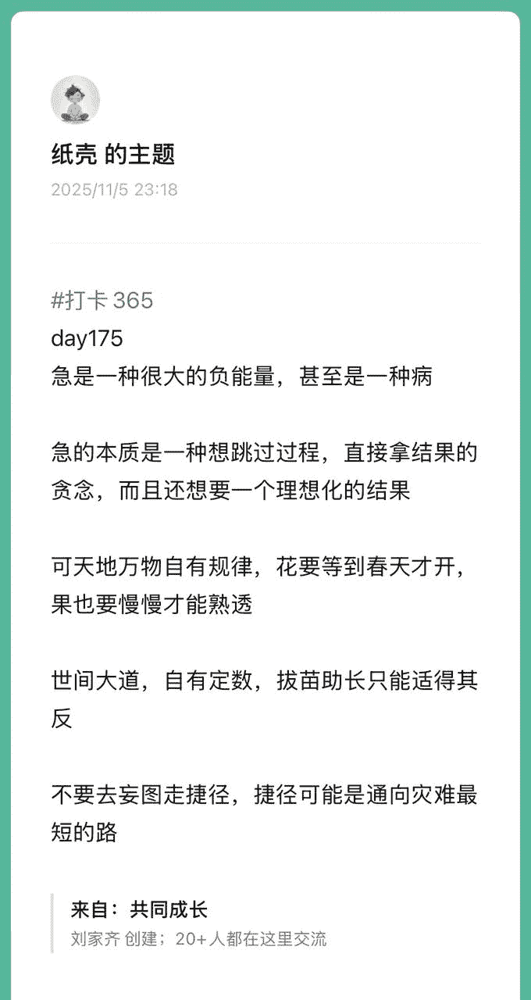

# 七、答圈友问

## 1、需不需要开通教育类资质

不需要。小红书对电子资料包类目扩容后，之前需要教育类资质的品，现在都能上到电子资料包，已经好几个月没出现类目违规问题。

## 2、这样的方式发笔记用不用考虑发布时间

不需要。平台没规定发布时间，推荐流量的 “最佳发布时间” 本身就是玄学，不是出单的核心

我们走的是搜索流量，用户有需求才会搜，和发布时间没关系，与其纠结什么时候发，不如多上几个品、多做几张原创图

其实如果是走推荐流量的话，几点发也是玄学，就是它不是影响你这篇笔记有没有流量的核心因素，这种东西太细枝末节了，如果你是关注这些点，那可能有点使劲使偏了

包括发布间隔时间，平台也没有规定，我们就默认就不需要间隔

## 3、你们一个电脑里面登多少个账号

最多 15 个，这个也是有依据的。千帆客户端最多支持登录 15 个账号，那我们就默认平台允许这一台电脑最多登录 15 个号，严格遵守，至今没出现账号关联问题

## 4、大批量发笔记，会不会影响流量？会不会限流

不会。只要账号没有明确的限流提示，就没有被限流。笔记没有流量是因为它本身就不应该有流量，我们这么大批量地做这种笔记，凭什么每天还得给你 1 千 5 千的流量

我们就是靠堆量，靠每个笔记的一点点流量来做这件事情，本身挂车笔记就是流量少，然后再加上量那么大，没有流量是正常，而且我们走的是搜索流量，也不是那种推荐流量

只要平台没有明确禁止批量发笔记，就放心做