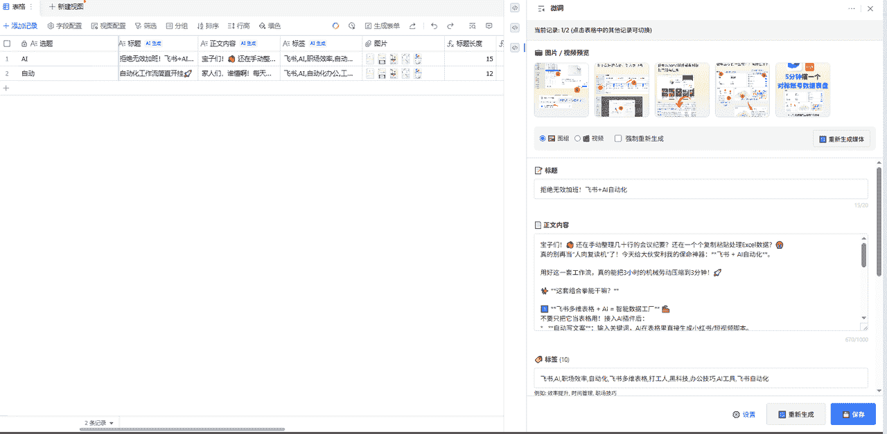
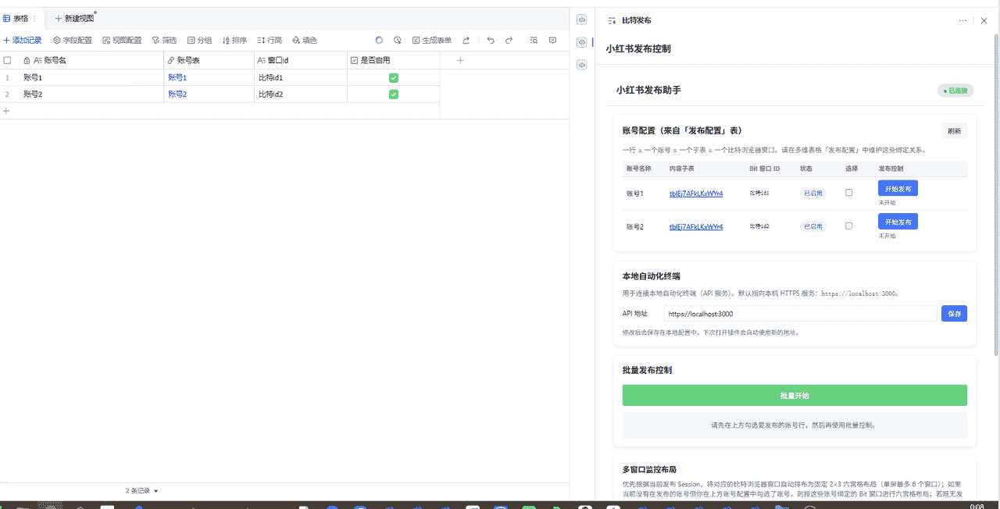
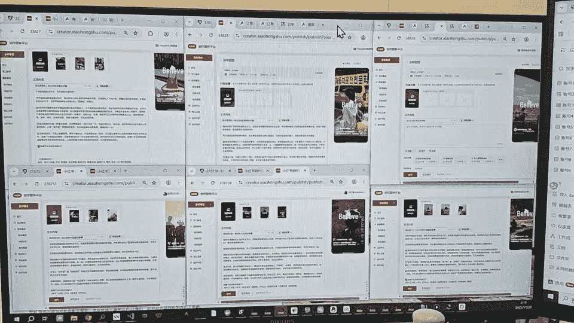
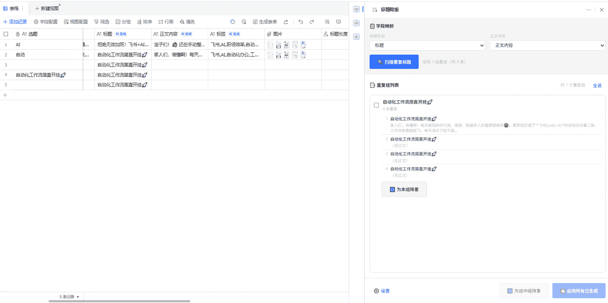
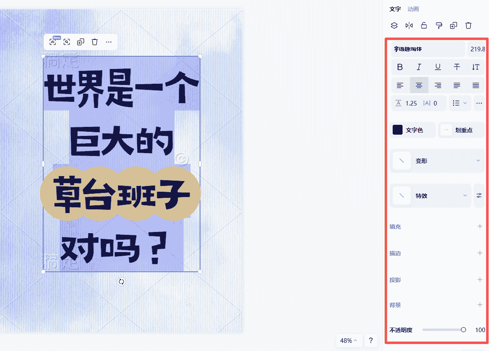
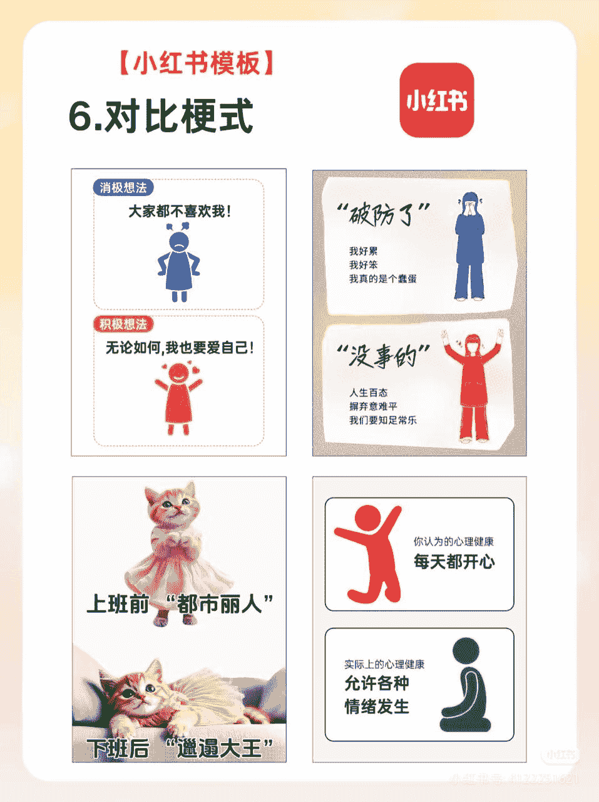
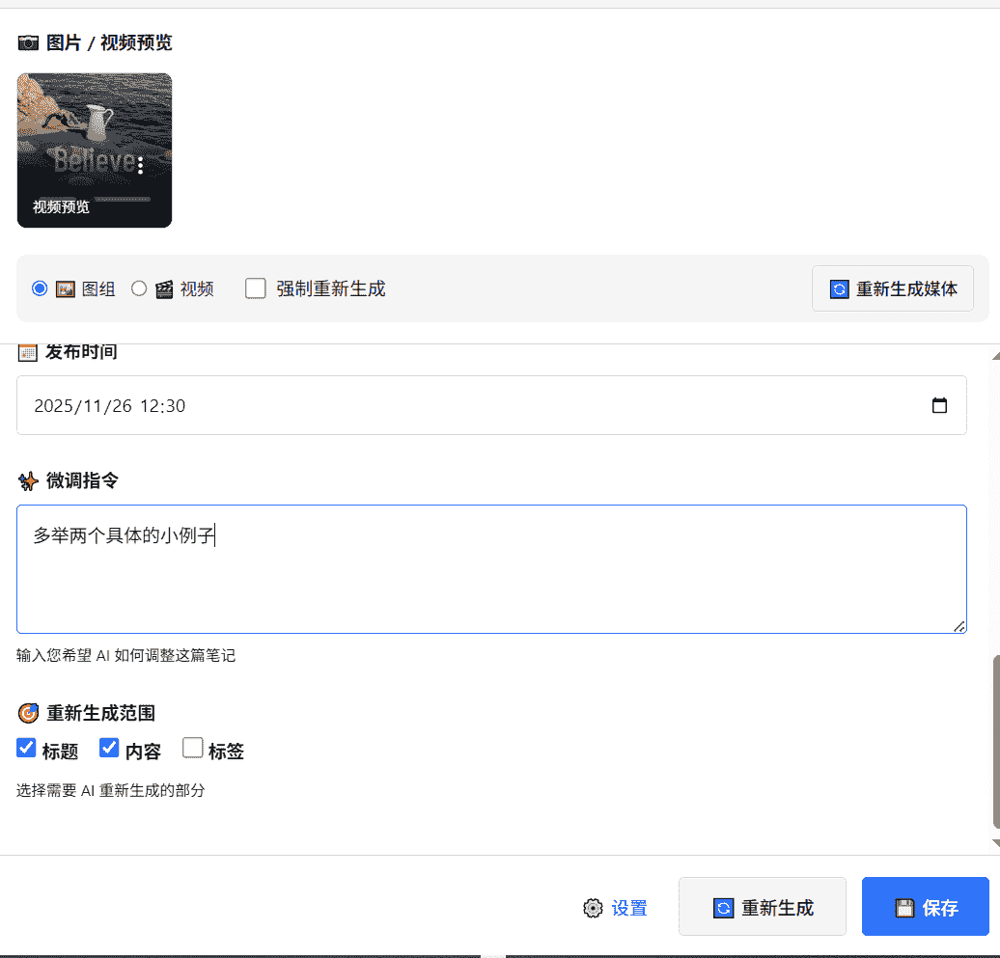

# 「AI工作流定制服务商」超级标实战：5天搭起📕全自动获客工作流，我如何用飞书多维表格插件+Ai编程做到的

> 来源：[https://xuqiwei1986.feishu.cn/docx/NVIWdFNxNotK8yxYNtic4eIxnwf](https://xuqiwei1986.feishu.cn/docx/NVIWdFNxNotK8yxYNtic4eIxnwf)

> 各位圈友好，我是乔川。目前正常驻赚钱2.0联合办公空间

> 前段时间看到龙哥老大提出「AI 工作流定制服务商」这个超级标，我才意识到：这不就是我这一年来一直在折腾的事儿吗？

> 七月起盘的闲鱼ai代写，一条 5 分钟的内容被压到一条 30 秒，日发从 20 条涨到 50 条，当月变现约 2w；

> 本月起盘📕，帮助一位联合空间伙伴用飞书搭了一套全自动获客系统，第一单服务费就回了 1w。

> 这篇文章想分享给大家的是：怎么用飞书多维表格插件 + AI 编程工具Augment，快速搭出一套「内容生成 → 排期 → 发布」的生产级工作流。不需要会写代码，但得愿意动手试。

> 如果你每天也被「写内容、排期、复制粘贴」这些机械活拖着，或者对「AI 工作流」这个方向有点兴趣，希望这篇能给你一些直接能上手的方法。

> 今天这篇，不只是案例复盘，而是把我怎么用飞书当「通用脚手架」、怎么一条线一条线拆出来、以及中间踩过的坑，尽量讲清楚。

> 希望能帮你少走 90% 的弯路，既能看懂思路，也敢迈出第一步。

## 文章总览：这篇主要想跟你聊四件事

+ 第 1 部分：我怎么从拼多多ai导流客服、闲鱼「实验田」，一路走到现在这条「AI 工作流定制服务商」的路上
+ **第 2 部分**：帮助赚钱办公空间的伙伴搭建📕矩阵系统，从赛博中医问诊到第一阶段交付的完整过程
+ 第 3 部分：飞书多维表 + 边栏插件 + 自动组图/组视频模块的整体架构和搭建方法（不贴代码，只讲思路和坑）
+ 第 4–6 部分：我踩过的典型坑、新手第一周可以怎么做、谁适合/不适合往「AI 工作流定制服务商」这个方向走

# 一、我是怎么一步步走到这条路上的

## 1.1 拼多多AI导流客服：第一次体会到「拆流程」的威力

那时候帮一个做拼多多的老板搞私域拉新。大家聊到 AI，一般想到的是「能不能帮客服回得快一点」。

但我坐在客服后台里，脑子想的是另一件事：这个人从第一句问到下单，中间到底走了一条什么路？

我就拿本子开始画这条路：

进线第一句问什么？哪一步算真有意向？哪一步直接引导加微？哪些问法没戏、哪些问法是机会？

画清楚之后，我才让 AI 进场——把整条路径拆成几个关键节点，每个节点交给 AI 写话术、整理 FAQ，人只负责看住「判断节点」和「成交节点」。

用 AI 编程工具花了一个月，把流程敲成一套客服辅助系统。上线后：导流率从 15% 拉到 30%，后端 388 客单成交率翻了一倍。

那一刻我第一次直观感受到：只要愿意把一条线拆细，AI 就不只是「帮忙打字」，它就会成为一根撬动导流率、转化率这些关键指标的杠杆。

## 1.2 闲鱼 AI 代写：把「一人公司」的前端交给飞书

今年 7 月入局闲鱼 AI 代写，白天写内容、晚上写脚本。

一开始全靠手工：素材复制到 Gemini 写文案 → 传到手机 → 复制排版发出去。一条内容至少花5 分钟，一天极限 20 条。同时跟超过 3 个单，前端重复劳动就把我拖垮了。

晚上 11 点，手机里还有一堆「待发」草稿，那种心慌特别具体：第二天醒来，这些活还是得一条条干完。我很讨厌把时间放在这种没效率的事情上，太浪费了。

但因为偶然，我开始把飞书当成「工作流试验田」：

- 采集工具获取的信息自动同步到飞书多维表；
- 用表排好「哪条内容发、发到哪、什么时候发」；
- AI 承担「从素材到文案」这一步；
- 在飞书里点一下，内容对接自动化工具，排队发给不同账号。

这一试，就一发不可收拾

我折腾完之后：每篇内容从 5 分钟压到 30 秒，日发从 20 条涨到 50 条，同时跟进的单从 3 个抬到 5 个。当月变现约 2w。

如果没有这条工作流托着，我大概率熬到半夜就把这个项目砍了。

而到现在我之所以死磕飞书自动化，很关键的一个原因就是：它对我来说是一个通用脚手架。

只要把这一层脚手架搭好——数据进来、规则跑起来、再抛给 AI 处理——后面不管是闲鱼、📕，还是别的业务线，只要业务需求说得清楚，我都能在这个脚手架上很快落下一个能跑的项目。

# 二、案例：帮赚钱线下2.0空间的伙伴搭📕矩阵获客系统

闲鱼这条线跑通之后，我就开始琢磨一个问题：这套东西能不能搬到别人业务里？

正好我刚好来到了赚钱线下 2.0 空间，遇到一个做知识付费的圈友。线下聊了聊各自在做的事，她一听我是做流量出身的，还在折腾 AI 工作流，就问能不能帮她也搞一套。

## 2.1 她的困境：产品线有了，但流量跟不上

她做知识付费方向，产品线已经搭好了，但问题是前端流量跟不上。

她当时的痛点很具体：

1. 内容产能瓶颈：一个人做📕，每天发一条就是极限，想打矩阵号根本没精力
2. 重复劳动太多：每条笔记从找素材、写文案、做图、发布，全靠手工
3. 流量不能断：她说了一句话让我印象很深——「我们命脉就是流量，流量不能断，必须一直要进人」

这个痛点我太熟悉了，跟我之前做闲鱼遇到的问题一模一样。

## 2.2 需要一个「赛博中医」，对项目进行「望闻问切」

第一次当面聊了快两个小时，我那会儿干的事，其实更像一场赛博中医问诊：

不是先推我能做什么，而是顺着她整条业务链路，把那些明显低效的环节一处处「望闻问切」。

等这轮「诊断」做完，再把业务流程画到飞书里，哪里该保留手工、哪里适合交给自动化和 AI，对症开药方这件事就清晰多了。

其实她之前也刷到过不少「AI 工作流」的案例，但都停在「看别人怎么秀」这一层。真正卡住她的，不是愿不愿意花钱，而是根本不知道自己这门生意可以拆成什么样，哪些地方适合让 AI 接手。

画完之后，需求就很明确了：

前端（流量获取）：

- 批量生成📕图文/视频笔记
- 素材批量采集（📕 + Instagram 的图片视频）
- 自动发布到📕多个账号

后端（用户运营）：

- 社群自动化运营（每日发送指引内容）
- 私域触达自动化

## 2.3 第一阶段：先把「内容生产 → 发布」这条线打通

我们约定分两个阶段做，第一阶段先聚焦前端流量：

多维表格（`O808bPdrhaIHWssk8j3cQVfJnud_tbl1kiV0GCdIknv2`）

第一阶段里，最核心的就是笔记生成+自动组图/组视频模块。

因为内容是决定流量的关键要素

技术方案，我采用是飞书多维表格 + AI 工作流，因为我在做闲鱼跑通过这条线，只是换了场景为📕而已。

核心无非是

1. 采集工具把素材同步到飞书多维表
2. 根据选题字段触发自动组图/组视频模块，批量生产好看的图和视频，并回写到飞书
3. AI 根据素材和选题自动生成符合调性的文案
4. 发布侧边栏一键触发发布流程

自动组图/组视频的细节我在 3.1 里会展开讲一遍，这里你只要先知道：它是把「设计师手工抠图」这一整段，变成可以被系统托管的流水线。

## 2.4 系统跑起来之后

两周时间，第一阶段交付。她开始用这套系统跑矩阵号。

对她来说，这次合作就是用一张服务费账单，换来一整套能跑起来的📕矩阵系统：

- 以前一天发 1 条是极限，现在可以同时管理10多个账号，一个账号发50篇都没有问题
- 内容生产从「每条都从头想」变成「AI 先出一版，我改一改」
- 脑子终于能腾出来想后端转化的事了

对我来说，这算是正式以「AI 工作流定制服务商」这个身份，接下的第一个完整项目：

- 验证了这套方法确实可以复用到不同业务场景
- 第一次完整走完「需求梳理 → 方案设计 → 开发交付 → 培训上手」的全流程

讲完这个案例，你可能会想知道：这套工作流到底怎么搭？下面我把核心架构和搭建方法拆开讲。

# 三、我是如何搭建这套工作流的

这一部分是整篇文章的重点：怎么用飞书 + augment，搭一套「内容生成 → 排期 → 发布」的工作流。

前面说到，我把飞书当成一个通用脚手架，这一部分其实就是把这个脚手架长什么样、怎么搭、以后怎么在上面反复落业务，拆开给你看。

Augment是我深度体验cursor，Claude code，codex等一众ai编程工具后，用的最舒服，也是最适合我的ai编程工具，得益于其一骑绝尘的上下文引擎，在复杂的业务项目场景下，它能够游刃有余地陪伴你完成需求确定，再到开发落地的一整套流程。

在不知道从何开始之前，请先整理一份你的业务链路，然后描述当前链路下最低效的环节，最后补上一句：请帮助我想办法用自动化和ai化解决它。

当然，如果还是不知道如何问，可以参考我这个提问模板（你只要把业务场景和低效环节换成自己的）：

```
「我在做小红书好物带货，现在的链路是：每天手动找 10–20 个商品 → 手动整理卖点 → 自己写文案 → 做九宫格图 → 复制到小红书发出去。  
最浪费时间的是文案撰写和排期发布这两步。
我想用飞书多维表当中枢，把商品、文案、图片、发布时间都放在一张表里。
请你帮我设计一套『内容生成 → 排期 → 发布』的工作流：包括表结构、关键字段、需要哪些自动化节点，以及需要你帮我写哪些脚本，优先解决文案生成和多账号排期这两个环节。
```

augment与你多轮对话的过程中，会自然将你的业务语言翻译为技术语言，钉住ai自动化工作流的负责边界。在你确认无误后，它会帮你一步一步地规划具体实现路径，最后执行编码来帮助你实现。

所以，在接下来的案例讲解中，我会侧重向你展示，我是怎么样拆业务提效板块的。参考我的方式，让augment辅助你拆解，你就迈出搭建自己的ai工作流的第一步了。

先说整体架构，再一步步讲怎么做。

## 3.1 这套东西在飞书里到底长什么样

因为有了闲鱼那边那条线跑顺的经验，我来的第一件事，就是把📕这条线也「搬进飞书」。

最后落地下来，其实就两张多维表格，把所有零散的信息都收进来。

### 视频\图文内容表（完整内容请从左往右滑动👇）

多维表格（`tblUzeGWkoSUWlaX`）

### 完整内容请从左往右滑动👆

### 发布表

多维表格（`tbl6lYwlWSb4t6XF`）

这块其实是整个工作流里最通用、也最值得你照抄的部分，

+ 一张「内容表」：不管你发闲鱼、📕还是👸号，本质都是在管理一条条内容，所以结构尽量统一（标题 / 正文 / 媒体 / 标签 / 状态 / 计划时间）。
+ 一张「配置表」：把「发到哪里」和「谁来发」这类信息独立出来，后面要加平台、加账号，只动配置，不动内容。
+ 状态字段要能反映流转：比如「待生成 / 待审核 / 待发布 / 已发布 / 发布失败」，方便你在任意时刻知道每条内容卡在哪一步。

表本身就当数据库用，有了之后，我每天真正打交道最多的，其实是接下来介绍的主题：边栏插件。

## 3.2 台前：飞书插件

一个负责在飞书里直接「看和改」内容；

一个负责多账号一起发；

一个负责把相似文案做降重。

我之所以将其拆为以上三个插件，其实就是把业务层面，「人要干的事」拆成了三个模块：

一块专心「看和改内容」——保证每条内容在发出去之前是舒服的；

一块专心「排期和发车」——多账号、多平台的节奏都在这儿控制；

一块专门处理「降重和风险」——避免内容在平台侧看起来太重复。

在使用augment开发时，我会将自己总结的以上三个业务模块投喂给它，它会负责帮我把每一个模块的需求拆到原子级，并匹配对应技术栈，查找相关文档去探寻实现方式。多轮对话后，augment进入编码实现。最终呈现为以下三个插件:

### 微调侧边栏

打开之后，上面一整块就是当前这条笔记的图 / 视频预览，下面是标题、正文、标签、商品id、发布时间这些字段。

我一般的用法是：先让 AI 出一版，再在这里顺手把不顺眼的地方改掉；如果整体风格不对，就在「微调指令」里敲一句话，比如「标题再口语一点」「正文再具体点」，点一下按钮让它重来。但是搭建方法



### 发布侧边栏

更像一个「发车台」。

一行就是一个账号，后面绑着内容子表ID和比特浏览器的窗口ID。

我勾上今天要跑的账号，点一下「批量开始」，本地的自动化终端就会使用`playwright`，并发控制对应的比特浏览器窗口发文。

浏览器窗口可以一键排成 2×3 的六宫格，一眼能看到 6 个号的状态，有没有卡、有没有报错，都在这一块。



这里我随手拍了一段小视频，让你直观感受下「多账号同步发」的那一刻。



[20251128-021124.mp4](https://internal-api-drive-stream.feishu.cn/space/api/box/stream/download/all/EJMlbR5yuo5PeYxoilKc8EjWnNb)

### 降重侧边栏

在我觉得「这几篇标题有点像」的时候，我会打开用一下，一键把标题重新洗一遍，避免在平台查重。



## 3.3 台后：内容工厂

除边栏插件之外，站在台前的工作流，我们还有藏在台后工作流

这是一块很多人容易忽略，但对老板特别有价值的——自动组图 / 组视频的内容工厂。

有些客户会有自己的一套模板，比如九宫格拼图、统一风格的视频。正常做法是设计师一张张抠图、排版，我这边的做法是：让飞书的「选题」字段来驱动整套流水线。

在飞书里新建一条记录，填上选题，系统会自动去本地的素材库里把对应文件夹的图拉出来，按事先约定好的规则（几行几列、多大字号、什么颜色）拼成几张九宫格图，或者生成一小段视频，最后把生成好的文件自动传回这张表。

至于规则从何来，如何制定，我们可以尝试在稿定设计中复现出这个模板，然后把模板中的以上相关参数复制下来。参数即规则。



生成视频同理，只要能够总结出这个视频的模板中的参数，就可以用批量套版的思维进行流水线生产。

把我们获取到的模板参数，投喂给augment，并只需补充问一个问题：

```
如何在这个模板相关参数的基础上来批量套版？我需要怎么做
```

augment会帮你搞定。

市面常见的爆款模板，都可以按这个思路来流水线生产。



前几天，这位和我合作的伙伴，突然想加一个新的视频模板，我当时就在线下空间的工位上，与 augment边聊边写，让augment帮忙总结了视频的公式与参数，把骨架搭出来，半个小时左右就跑通了一个可以批量生产新模板的脚本。

后面她那一批内容，就全是靠这套流水线搞定的。

这个流程图也是用augment口喷做出来的

从我们见第一面聊定合作，在到这套边栏插件 + 自动组图模块能稳定跑起来，前后大概也就5 天时间。

中间大量的体力活，其实我都是丢给 augment做的：我用中文描述清楚「飞书里这一列对应哪个字段、本地哪个文件夹是素材、生成完之后要传回哪一列」，遇到报错就把报错信息贴回去，让它帮我来改代码。

## 3.4 真正用起来，是一种什么感觉

整套下来，使用体验更多是在「看」和「点」，而不是在那儿一条条手搓，其实每天就做三件事：

1. 铺数据：把今天要用到的素材、选题、商品信息丢进表里；
2. 审数据：在一个集中界面里，把 AI 给的结果挑一挑、改一改，关键节点留人看一眼；
3. 触发动作：在固定的时间点，手动点一下「发车」，让自动化系统去跑剩下的流程。

所以落到每天，其实就是很生活化的几个动作。

早上坐到工位，先把昨天采集好的素材丢进内容表里，对应好选题、挂上商品。

这一步做完，再顺手点开右侧的微调侧边栏，让 AI 先把标题、正文和标签都跑一版出来——十几秒的事。

AI 给的东西不可能次次都完美，我的习惯是边看边改：

哪句不舒服就直接在飞书里改掉；如果整篇都「味道不对」，就在下面的微调输入框里打几句人话，比如「语气更生活一点」「别太鸡汤」「多举两个具体的小例子」，再点一下重生成。



这一轮下来，一条内容基本就定型了。

中午前后，我会把今天以及未来一星期要发的内容大致挑一挑，顺手在同一张表里把发布时间也排一下，哪个号什么时候发，一眼就能看明白。

这时候所有东西都还只是在飞书里排队，真正「露脸」是在发布侧边栏那一刻。

临近发笔记的点，我打开发布侧边栏，勾上今天要跑的几个账号，点「批量开始」。

桌面上六个比特浏览器窗口自动排成六宫格，一边滚日志一边发。哪一个账号卡住、哪一个发完了，我坐在椅子上就能看出来，不用一只手拿手机、一只手复制粘贴。

中间如果哪条内容有临时调整，也不用满世界找草稿，直接回到飞书里改那一行，边栏里刷新一下，就能重新发。

简单动动手指，一个星期的内容就都搞定了

## 3.5 亲测这条线真正省下了什么

如果只看数字，很直观：

以前一条内容，从素材到发出去，保守算要 5 分钟，一天极限也就 20 条，再多整个人是绷着的。

现在这套东西跑起来之后，一条内容大概是这样的节奏：AI 生成十秒，自己检查和微调二十秒，最后发出去三十秒，一共 1 分钟左右。

一天发 50 条 不再是硬撑，而是一个比较舒服的上限，同时还能稳稳地在后端跟着客户。

但对我来说，更关键的变化不是「快了多少」，而是那种心态上的松弛感。

以前晚上十一二点，看着手机里一堆「待发」草稿，会有一种很具体的心慌：

这些活明天起来还在，你不干，它就在那里瞪着你。

而现在更多是在飞书里看一眼「今天这条线走到哪了」：


素材有没有进来、AI 有没有跑完、审核有没有过、哪些号已经排好队、还有哪些在等。

脑子从「一条条赶工」变成「盯住几处关键节点」，那种「被业务推着走」的感觉，就慢慢消下去了。

---

# 四、我踩过的坑和避坑建议

聊完怎么搭，再聊聊我踩过的坑。搭这套工作流的过程中，我踩了不少坑，这里说三个最典型：

## 坑一：只停在「玩工具」

一开始我也是到处看工作流案例，这个试试、那个玩玩，感觉很爽。但回头一看，生意没变，时间倒是花了不少。

**避坑建议**：从你正在做的业务线入手，不要为了学工具而学工具。我现在的原则是：如果一个工作流不能直接省掉我每天的某个动作，就先不折腾。

## 坑二：一上来就想「100% 全自动」

闲鱼那条线，我一开始想做成「素材进来→自动生成→自动发布」全流程无人值守。结果 AI 生成的内容偶尔有问题（事实错误、违规词），直接发出去就出事了。

**避坑建议**：关键节点留人看一眼。「AI 生成 + 人工审核 + 点击确认后才发布」，这个流程虽然多一步，但省心很多。

## 坑三：场景铺太开

有段时间我同时折腾闲鱼、📕、抖音、社群，每个场景做一点点，最后手里一堆「七十分的半成品」，没有一个能真正拿出去用。

**避坑建议**：先把一个场景打穿，再复制到下一个。我现在就聚焦在「内容生成→发布」这个场景，其他的先放一放。

---

# 五、新手第一周可以做什么

如果你想从零开始试试这套方法，第一周可以这样安排：

Day 1-2：先建一张飞书多维表

把你手上正在做的业务线画进去。核心字段参考第三部分的设计，不用一次搞太复杂，比如你是做📕电商的话，就先把「标题、正文、标签、图片、状态、计划发布时间」这几个基础字段加上就行。

多维表格（`O808bPdrhaIHWssk8j3cQVfJnud_tbldKECSiMU1m9Z1`）

**Day 3-4：手动填、手动发**

用这张表排 3 天的内容，每一步都手动操作。目的是感受一下：哪些动作是「每天都在重复」的。这个阶段别急着加自动化，先把流程跑熟。

**Day 5-7：写一个最小脚本**

挑一个最烦的动作（比如「从素材生成文案」），打开 Augment 或 Cursor，用中文描述你的需求：

> 我需要一个脚本：读取飞书多维表里的一条记录，把商品信息发给 Gemini，让它生成一版文案，再把结果写回这条记录。

AI 会辅助你生成代码，遇到报错就把错误信息贴回去让它改。不用自己查文档，第一周能跑通一个最小脚本就算胜利。

---

# 六、适合谁 / 不适合谁

**适合**：

- 已经在跑业务，每天被「写内容、复制粘贴、手动发布」这些机械活拖着的人

- 不排斥折腾脚本，愿意花时间和 AI 编程工具磨合的人

- 能接受「先给自己用，跑顺了再考虑对外」的人

**不适合**：

- 手上没有业务线，只是觉得「工作流」这个概念很酷的人

- 期待一上来就 100% 全自动、不用人管的人

- 对飞书、API、脚本这些东西有天然抗拒的人

---

# 写在最后

## 回头看，我做的最对的一件事

没有一上来就想着「做成产品卖给别人」，而是先在自己身上跑通。

闲鱼那条线是完全自己跑的——素材怎么进、文案怎么生成、怎么排期、怎么发布，每个节点我都亲手操作过几百遍。这种「被折磨出来的理解」，是后来能把方法讲清楚的底气。

如果只是看了几个教程、玩了几个 Demo，根本不可能知道「真正卡在哪一步」。

干中学，这是最有效的方式。

回头看，我现在做的事情，其实就是把这套「干中学」的方法打包成服务：

**先在**自己业务里把一条线拆透，先把自己从重复低效的工作中解救出来，再用同一套脚手架，帮别人的业务再跑通这一条线，让更多人从重复低效的工作中解放出来——这就是我理解的「AI 工作流定制服务商」

## 如果让我重来一次

我大概会更早做一件事：不是急着学更多工具，而是先选一条自己已经在做的业务线，把三个节点画清楚——哪里输入、哪里加工、哪里输出。

然后圈定每天重复的动作有哪些，挑最烦的那一两步，用 AI 和自动化去补位。不用担心投入太多，花的基本只有时间。哪怕只做到「从五分钟一件，变成三十秒一件」，就已经是不小的成绩了——这也是最能驱动自己做下去的正反馈。

等那一小段工作流，真的在自己身上跑通跑顺了，再去看怎么样把它复制给别人。

等到你见有人遇到同样的问题的时候，你就会突然发现:

你手里那套已经跑通的路径，就是最适合你卖的产品。

---

我是乔川，一个02年的ai提效探索者，目前正在赚钱线下2.0空间办公。期待与各位同频的伙伴与前辈们深度链接。

如果你也是📕/闲鱼/抖音等平台获客的创业者，正被繁琐流程困扰；或者对飞书工作流搭建感兴趣想学习，欢迎通过鱼丸联系我，随时交流。
