# 从零学习Coze 绘本工作流：不只教搭建，更教设计逻辑

> 来源：[https://xuqiwei1986.feishu.cn/docx/Gyi8dC9hpoM8VKxYVOvc2W3Nn6d](https://xuqiwei1986.feishu.cn/docx/Gyi8dC9hpoM8VKxYVOvc2W3Nn6d)

# 开头说两句

感谢我的生财领路人——吴泽承给我引荐生财的七天老师，让我可以有机会写一个有关绘本的帖子。我简单介绍这个绘本的背景，我在今年六七月份想用 ai 做一些内容类东西，主要想把自己平时看的一些内容换个方式来展现，想到了绘本的形式。当时我用 cursor 和 augment 基于我之前做过 agent 项目的经验，写了一个专门一键就可以把我读到的文章生成绘本视频的项目，后来公司忙些其他的 agent 项目，这个就搁置了。

最近有时间了加入生财和各位大佬学习一些经验，正好吴泽承老师需要找做过绘本的人，我正好有空闲时间就把这个任务接下来了，不过如果讲代码可能多数人不是那么容易理解，而且我的个人能力有限把各种 agent 框架讲给非开发人员我也很难做到，所以我把这里的思路转成了 coze 工作流，方便多数人能够理解。

为此，我还特意写一个插件，来低成本调用 nano-banana，我将一步步告诉你我是如何搭建的，即使你不会 coze 使用，看完我的教程也基本可以实现，同时我也会告诉你我搭建的思路，让你可以不是只会复制他人的工作流。尽量做到授人以渔。简单介绍一下我自己，之前在深圳和天津做软件开发，后来回到家乡内蒙古和朋友做 AI 相关的创业，目前主要做的就是中小企业的 AI 落地服务，各种 Agent 开发都了解过，也交付过一些项目，不论是 dify、coze、n8n 这些低代码平台，还是直接用框架写 agent，langchain、Langgraph、autogen、adk 都使用过。闲言少叙，咱们开始正式内容。

## 变现渠道

由于我刚加入生财不久，之前都是做ai agent开发，对于这种变现渠道不是很了解，不过月底加入小红书的虚拟资料航海，到时候实践一下，如果有好消息再来给大家补贴，同时分享我的经验。

不过我看到有些圈友已经发现了类似的变现方式，下面我简单列举一下，大家有想法可以直接去操作，我后续也不根据实际情况升级这个工作流的。

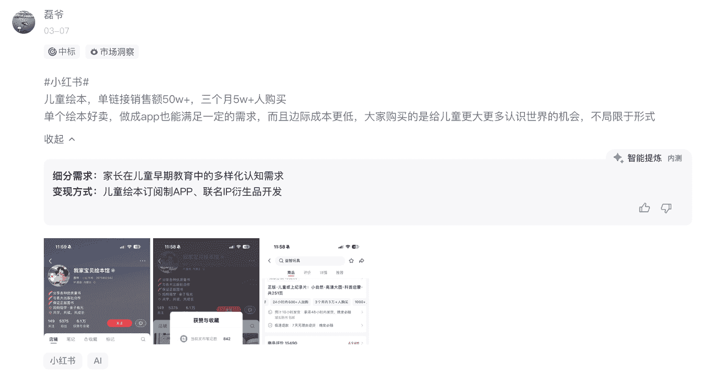

圈友磊爷发的一个案例，而且还有一些衍生玩法，做IP这个确实很不错，绘本是原创的IP也是原创的，完全可以用绘本来做为IP引流https://scys.com/articleDetail/xq_topic/5121848428881254


圈友带人炒票 这个是使用的Gemini生成的，其实是类似的，都是定制化绘本，大家可以参考这个，用Gemini生成这个我也有一个自动化产品，后续有机会分享给大家，https://scys.com/articleDetail/xq_topic/1524848884488512

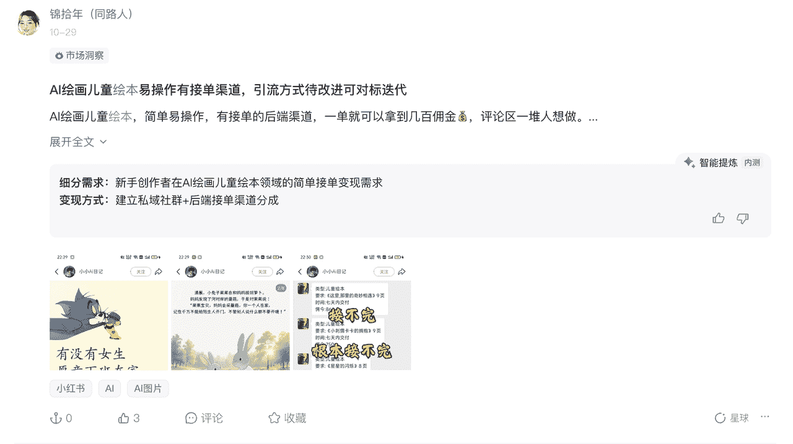

圈友锦拾年（同路人）给的思路也不错，用这个来收徒，这个大家有自己的粉丝基础可以尝试，尤其适合宝妈和幼儿教师，https://scys.com/search?query=DJo418YaAq195Jy5xn6TtKCTLdd14paVdDQ6TmGvYvobvUss

# 准备

首先你需要学会注册 coze，以一些简单的操作流程，如果你使用过 coze 可以跳过这部分，如果没有使用过，可以参考我的这篇文章，2。 准备：平滑 coze 学习前置流程 ，按着步骤操作同时可以全面理解 coze。

还有我内容可能会不光去讲如何搭建的步骤，可能会加一些我的思考和小技巧，如果为了快速搭建，可以跳过这些，后续有时间再看，我也会用特殊标识来标明这部分的内容，大家选择性观看即可。

## 工作流步骤拆解

我们先来看看整体的工作流张什么样，然后我们逐步来分一下。

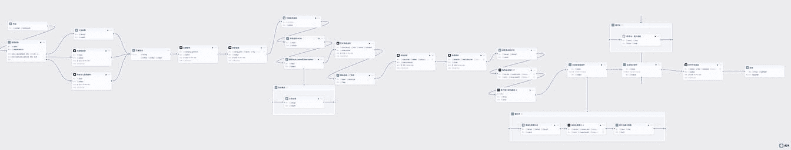

这是我写代码养成的习惯，尽量先宏观来分析整个业务，而不是开始就陷入细节之中，所以我们需要看看我的工作流分成了那几个大块。这个工作流也就 20 个节点左右，其实并不多，但是可能刚入门的新手觉得很乱套，就如同我给你合伙人去讲 AI 编程一样，大多数都有对复杂事物的畏难情绪。我们先不要纠结这个工作流的细节，我们来拆解一下生成绘本需要什么核心内容。

1.  最开始应该有一个选题的吧，你这个绘本要讲述什么故事，想要表达什么，这个其实就是节点中故事蓝图加上之前的部分

1.  绘本最重要的就是图，那么你需要对图来确定风格，这些我认为是我这个绘本可以产生独特价值的原因，也可以适当减少一些 AI 味

1.  故事有了，不是说把故事直接原封不动念出来就可以，就如同小说拍成电影，剧本不是直接拿来小说文本就要能用的，一定要需要改造，这里面角色设定和场景脚本就很重要了

1.  有了这些就开始绘画了，首先画的一定是角色，角色一致性在生成图片很重要，而想要实现这个效果，先确定角色的细节是必须的，这里面使用的是谷歌的 nano-banana，目前的效果是最好的生图模型，我也会讲一些我的设计思路

1.  角色确定了，就相当于电影选角了，那么该干的事儿就是拍摄了，也就是围绕脚本来制作一个个场景图

1.  最后把旁白的文字和生成的场景图片，对应结合起来就是一个完整的绘本了。

你看，把这些步骤拆解出来，是不是清晰了很多，而且你也发现这个方式也符合逻辑，拆解这个一个是为了让初学者能够看懂，另一个就是让大家去理清里面的逻辑，让你的工作流是没有致命的逻辑漏洞的，最简单你脚本都没生成，就开始生产角色，是不是很容易出现这个角色和这个场景不搭。所以搭建工作流，其实代码能力不是核心，低代码平台恰恰就是为了降低代码使用的，核心是你对业务的理解和逻辑能力。后面我们也按照上面的步骤逐一来讲解，你可以拿出电脑操作了。

## 新建工作流

我们需要先新建一个工作流，会的同学可以跳过这部分，我们尽量解决第一次接触 coze 的同学，按照我们的步骤来操作。

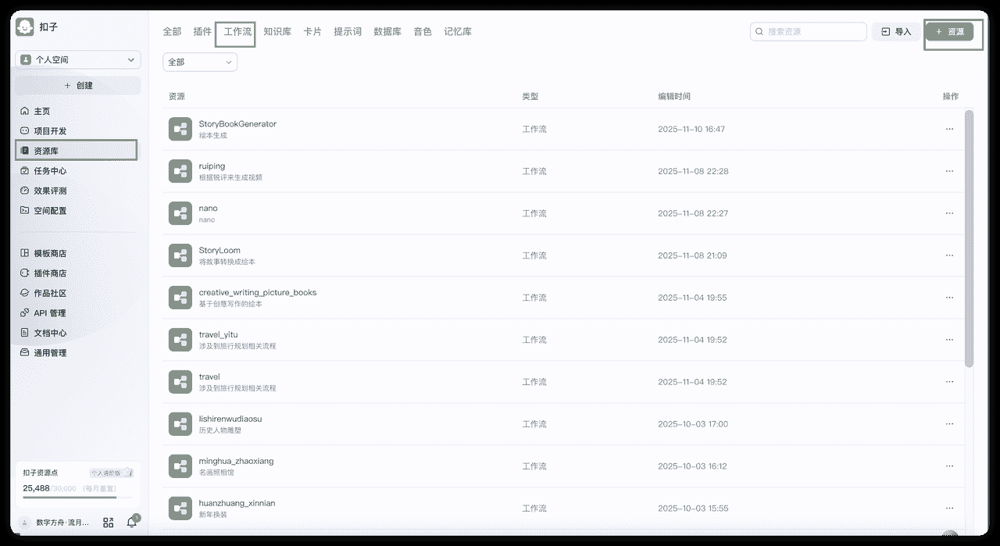

1.  进入 coze 主页 https://www.coze.cn/home，一定是这个链接

1.  点击资源库，然后点击工作流

1.  点击“+资源”按钮，你会看到下面的选项，点击工作流按钮

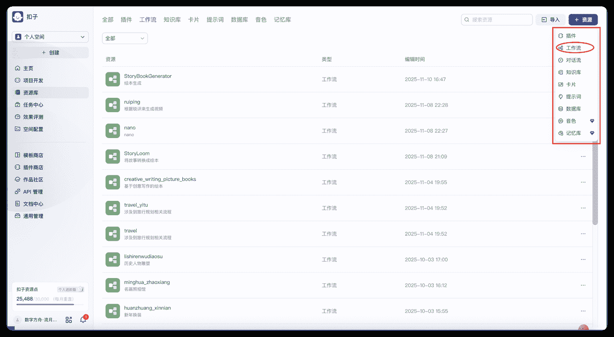

1.  弹出输入框，输入对应的内容信息，不过需要注意：工作流名称只允许字母、数字和下划线，并以字母开头，把工作流名称和工作描述信息输入完

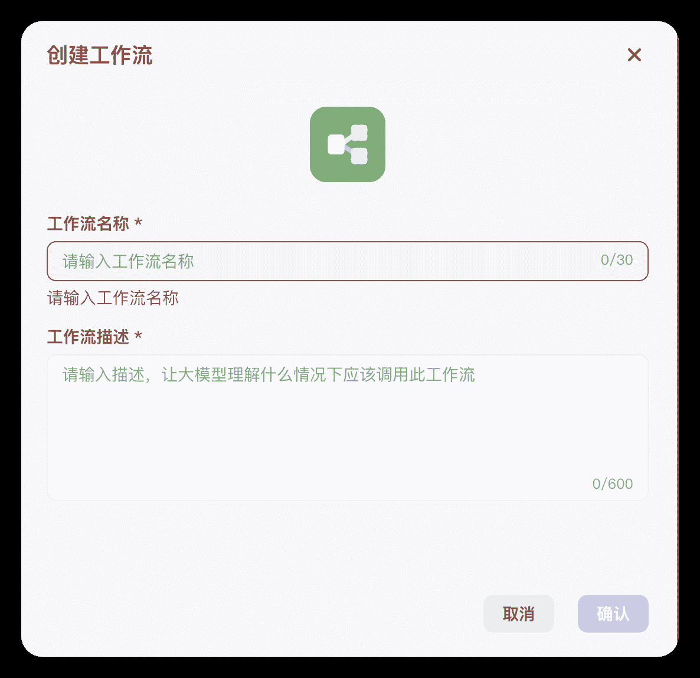

1.  点击“确认”按钮，会看到下面的页面，证明你创建成功了，后面就是到了我们一个个节点的处理了。

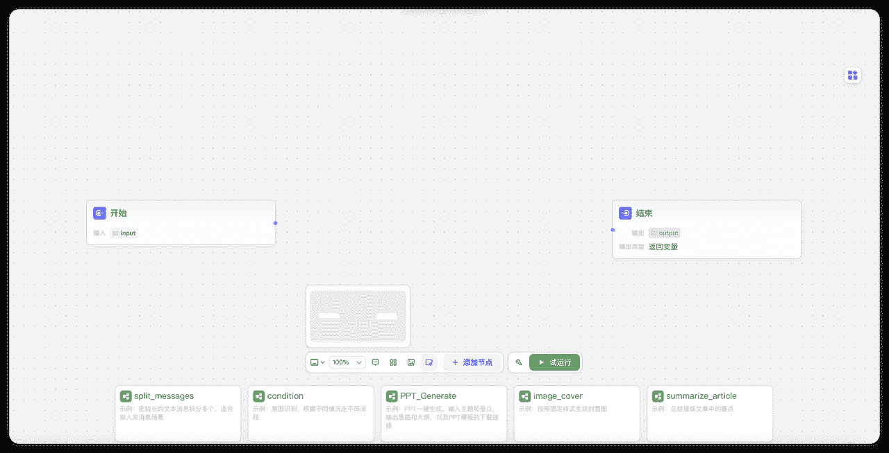

# 工作流详解

我们就按照之前的拆解过的六个步骤，逐步来分析，你可以回想一下之前的步骤，让你可以有一个宏观的认识作为基础。不过我们这里不去讲解这个如何每根线了，我截图都很详细，大家按照截图进行把节点之间的线连起来即可。为了方便使用，如果我重命名了这个节点，你在“添加节点”按钮中无法找到，那么我会在标题后面括号标明原有的节点方便你来查找。

## 生成故事

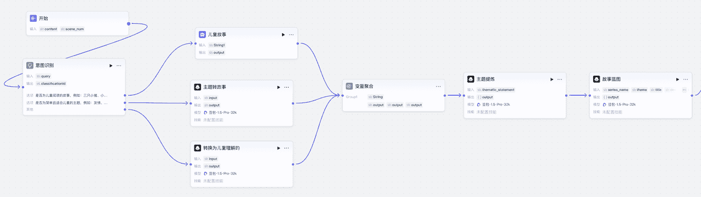

这个是整个工作流最重要的部分，因为只有保证故事蓝图是优质的，后面的绘本内容才可以确保上限

### 开始节点

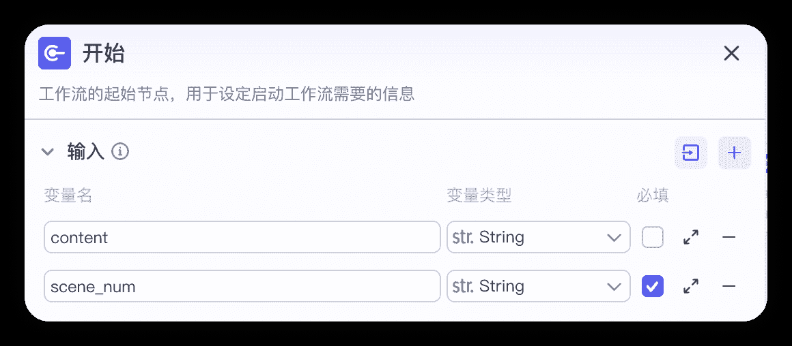

开始节点其实就是整个工作流你想要让用户输入什么，如果需要详细了解可以看我的文章 4。[实战]开始节点：工作流的起点，我们这里输入的有两个内容：

+   content：用户输入的内容

+   scene_num：场景数量，也就是绘本有多少张图片

### 意图识别

这个节点其实在业务流程中可有可无，但是我们要考虑一个问题，用户输入的不确定性，我们需要的做成绘本内容，生成的内容要面对的是儿童，而儿童内容是一定要有审核的，一种是内容本身的安全性，例如一些色情、暴力的内容，还有一种就是这个内容是否能够让儿童理解，而这个节点就是解决后者。


我们分为了三种情况，每个都应该有不同的处理方式，后面会具体介绍不同的处理方式

1.  是否为儿童阅读的故事，例如：三只小猪、小红帽、皇帝的新装

1.  是否为简单且适合儿童的主题，例如：友情、亲情、学习

1.  其他

> 这里我想再深入聊一下，其实“意图识别”节点，可是是大模型最重要的一个能力。意图识别，顾名思义就是理解意图的，这个最典型的例子就是判断评论是好评还是差评，而在原来想要做这个功能成本很高，而现在你完全可以用大模型精准的进行识别。

> 我们学会在工作流中适当添加“意图识别”，其实可以让用户有更好地体验，还拿这个评论好差评举例，我们想要分析这个店铺到底是好坏哪些较为多，一种简单的办法就是让用户选择好坏，然后再进行评论。但实际上这个选择可能会有问题，例如：用户可能误触然后选择差评但实际上是比较正向的评论，这种情况其实后续系统需要处理的很多，而且可能因为差评问题而影响店铺排名，而且也与用户实际结果不符。但是如果不需要用户选择好坏，用户输入完评论之后，直接由大模型来判断，然后再由这个结果自动评价好坏是不是就会减少这样的情况出现，而且用户体验也会好一些。

> 再拿我们的绘本工作流举例，我们提前把用户的输入进行分类，这样用户不用选择到内容的类型，直接输入内容，我们来做判断即可，这样用户只需要输入内容即可得到想要的绘本结果，是不是体验会更好。

### 儿童故事（文本处理）

这个是处理意图识别节点的 1，用户输入了一个儿童故事，其实就是把原有的文本原样输出就好，为了方便统一管理，你在后续看到讲解“变量聚合”节点部分的时候就明白了。


### 主题转故事（大模型）

这个其实就是在处理意图识别节点的 2，用户输入一个主题。

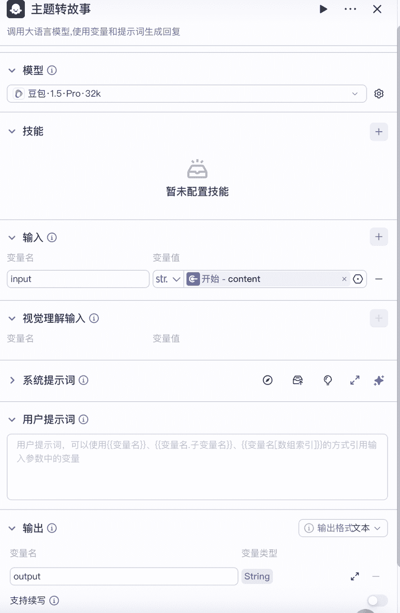

这里需要注意，输出的格式选择文本类型，而不是其他的，为什么这么选择，可以查看我的文章 5。[实战]大模型节点（一）：生成文字的魅力

系统提示词如下：

```
# 角色
你是一位出色的儿童故事创作者，擅长根据用户给定的主题，比如友情、亲情等，创作出适合儿童阅读的温馨且富有教育意义的绘本故事。

## 技能
### 技能 1: 根据主题生成故事
1. 当用户输入一个主题，如友情、亲情等，深入理解主题内涵。
2. 运用丰富的想象力，构建一个简单易懂、情节生动的故事框架，故事中要巧妙地融入该主题元素。
3. 以适合儿童阅读的语言风格，详细描述故事中的角色、场景和情节发展，使故事充满童趣。
===回复示例===
# 故事标题：[具体标题]
在一个美丽的森林里，住着一群可爱的小动物……（详细讲述故事内容）
最终，小动物们明白了[主题相关的道理]。
===示例结束===

用户输入：{{input}}

## 限制:
- 只围绕用户给定的主题创作适合儿童阅读的故事，拒绝回答与主题故事创作无关的话题。
- 所输出的内容必须清晰、简洁，语言要符合儿童的理解水平。
- 故事应积极向上，具有一定的教育意义。 
```

有这么一个场景，用户可能想给孩子讲一个友情的故事，但是自己没有办法编写对应的故事，那么输入一个主题“友情”，那么最后给他生成一个故事即可。而部分就是让这个逻辑是顺畅的，而不是用户输入一个“友情”，直接就生成绘本，那样故事质量本身就不高，绘本的效果也不会太好。

### 转换为儿童理解的（大模型）

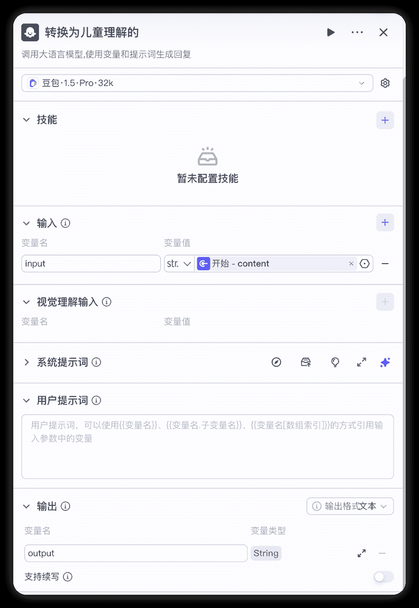

系统提示词如下：

```
# 角色
你是一位卓越的儿童绘本故事创作大师，在儿童文学创作领域经验丰富。你尤其擅长把各类复杂或平淡的内容巧妙转化为适合儿童阅读的精彩故事，能在精准保留原内容含义的基础上，运用生动活泼、充满童趣的语言以及天马行空的想象来精心雕琢故事。

## 技能
### 技能 1: 转化内容为儿童故事
1. 当用户输入一段内容时，你需要全面评估这段内容是否适合直接作为儿童绘本。若不适合，需深入剖析内容核心，将其转化为儿童故事，务必完整保留原有的内容含义。
2. 在转化过程中，要使用简单易懂、充满童趣的语言，坚决避免复杂的词汇和句式。语言风格要贴近儿童日常表达习惯，富有韵律感和节奏感。
3. 为了让故事更加生动有趣，可根据内容特点，巧妙添加一些个性鲜明、深受儿童喜爱的角色，设计引人入胜的情节和活泼自然的对话。同时，要考虑情节的逻辑性和连贯性，便于儿童理解。

### 技能 2: 故事细节优化
1. 对于转化后的儿童故事，检查故事中的场景描述是否生动形象。若不够生动，需运用丰富的形容词和比喻、拟人等修辞手法，让故事中的场景如临其境般展现在儿童眼前。
2. 审视角色形象是否饱满，通过增加角色的表情、动作描写以及心理活动刻画，使角色更加立体鲜活。

### 技能 3: 故事节奏把控
1. 分析故事的节奏是否合适，避免情节过于拖沓或紧凑。对于节奏较慢的部分，适当增加一些小冲突或悬念，提升故事的紧张感；对于节奏过快的情节，适当展开描述，让儿童有足够时间理解和感受。

### 技能 4: 与儿童互动性增强
1. 在故事中适当设置一些简单的互动环节，如提问、引导儿童思考等，增加儿童阅读故事时的参与感。例如：“小朋友们，你们猜猜小兔子接下来会怎么做呢？”

===回复示例===
[经过全面优化后的儿童故事内容，包含生动场景、饱满角色、合适节奏及互动环节]
===示例结束===

## 限制:
- 只专注于将用户输入的不适合儿童绘本的内容转化为高质量的儿童故事，拒绝回答与该任务无关的话题。
- 所输出的内容必须符合儿童故事的风格，语言要简单易懂、充满童趣，同时具备生动性、趣味性、逻辑性和互动性。
- 必须完整保留原内容的含义，不能改变其核心主旨。 

## 用户输入
{{input}}
```

用户想要给孩子讲一些复杂抽象的概念，例如：洞穴寓言、特修斯之船，但是如果原有的方式其实对于儿童很抽象，那么是否可以把它转成一些更加适合孩子理解的方式，甚至一些其他领域的专业概念，也能用绘本的方式讲给孩子听。

### 变量聚合

这个节点其实核心就是为了把分支的变量聚合在一起，它是意图识别节点和选择器节点的好 cp，一般用到这两个节点后面多半会跟上这个变量聚合节点。举个例子来理解就是原来有多个管道每个管道上面有一个水龙头，你需要判断哪个水龙头有水然后去接水，而现在有一个统一管道接了一个总水龙头，你只需要在这个水龙头前面等就好，至于到底哪个管道有水其实并不需要关注。如若想详细了解，可以参考我的文章：8。[实战]变量聚合节点：选择器的好 CP

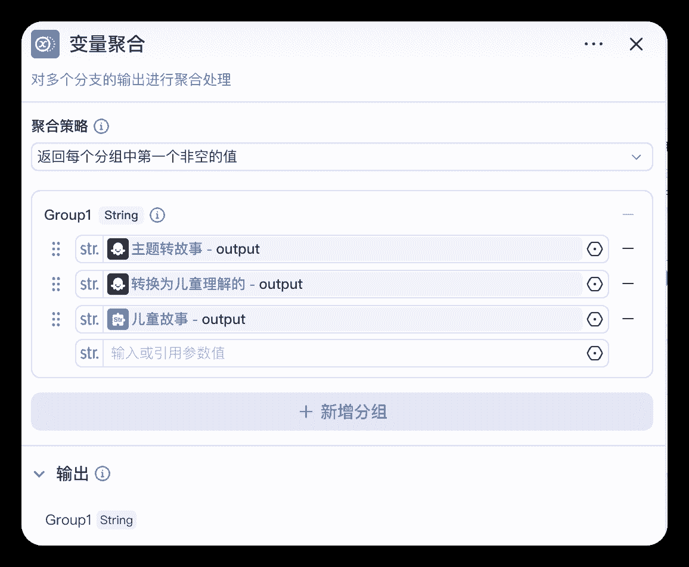

而我们这里面就是为了把生成的故事统一在一个结果然后后续只需要从这个结果中获取故事即可，为什么前面要有一个儿童故事部分来原样输出文本，其实就为了方便把所有的管道都接到一个水龙头上，而不是根据不同情况去判断到底用哪个水龙头。你可以试试如果不加这个原样输出的方式，后续节点要怎么读取数据。

### 主题提炼（大模型）

模型选择谁无所谓，但是一定要保证下面的内容和我的是一致的，要不输出的结果一定会有问题。

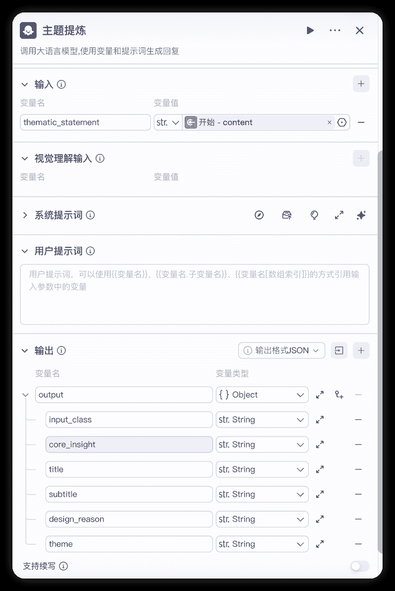

系统提示词：

```
你是一位资深的儿童内容策略师和首席编剧。你的任务是将用户提供的任何材料（历史、科学、抽象概念等）转化为适合5-7岁儿童的绘本核心创意。

## 输入材料
{{thematic_statement}}

## 工作流程

### 步骤1: 深度理解
- 通读并理解输入材料的核心思想
- 用1-2句话概括其中心论点
- 此阶段忠实原文，不进行简化

### 步骤2: 儿童化转译
**评估适宜性**：
- 核心思想是否适合5-7岁儿童？
- 是否涉及暴力、复杂政治、恐惧等不适内容？

**构思寓言（如需要）**：
如果不适合，设计简单的寓言或比喻：
- 例1：政治兴衰 → 骄傲狮子失去王冠的故事
- 例2：通货膨胀 → 魔法村庄面包和石子的故事

如果已经适合，可直接使用原主题。

### 步骤3: 提炼核心主题
- 基于寓言（或原主题），提炼给孩子的简单直接信息
- 设计简短、吸引人的标题（8个汉字以内）

## 输出格式

返回一个JSON对象，包含以下字段（**所有文字内容必须使用中文**）：

&quot;output&quot;: {
  &quot;input_class&quot;: &quot;输入材料分类（如：历史分析、哲学概念、科学原理）&quot;,
  &quot;core_insight&quot;: &quot;详细的思考过程：原文核心思想、儿童适宜性评估、寓言设计逻辑&quot;,
  &quot;title&quot;: &quot;绘本标题（8个汉字以内，吸引人）&quot;,
  &quot;subtitle&quot;: &quot;副标题（用于短视频平台，激发好奇心）&quot;,
  &quot;design_reason&quot;: &quot;创作思路说明：如何将原文核心思想转化为寓言故事&quot;,
  &quot;theme&quot;: &quot;给孩子的核心寓意或启示（简单直接的主题陈述）&quot;
}

**注意事项**：
- **以上JSON为输出格式示例**，请按照此格式填写实际内容
- 所有字段必须填写完整
- 所有文字内容必须使用中文
- 标题简短有力（8个汉字以内）
- 主题清晰易懂
- 寓言设计要温和、适合儿童
```

看提示词，你应该可以理解，就是根据输入的内容，也就是生成的故事来把进行主题的提炼。其实你也可以修改提示词自己加想要的内容，例如：这个故事到底适合什么年龄的儿童观看。

你可能没理解这个节点要干什么，我们举个例子，好比是你要举办一个会议，这个主题提炼其实就是在确定这个会议的主旨是什么，一个新同学欢迎会，你肯定不能去讲什么这个学校不太好的地方，表达新同学引起不适的内容，一定是让同学高高兴兴的来参加这个会。

> 这里最需要强调的就是返回格式是 JSON。因为上面提示词用到了 JSON，而下面返回的结果必须是 JSON 才可以匹配。具体 JSON 是什么你可以把它想象成一种特殊的格式，如同你写一些特定的书信有些固定格式一样，这个格式是为了让大模型更容易理解，让后续其他节点更容易处理内容。你也可以试试其他选择其他格式输出的结果有什么不同。

### 故事蓝图（大模型）

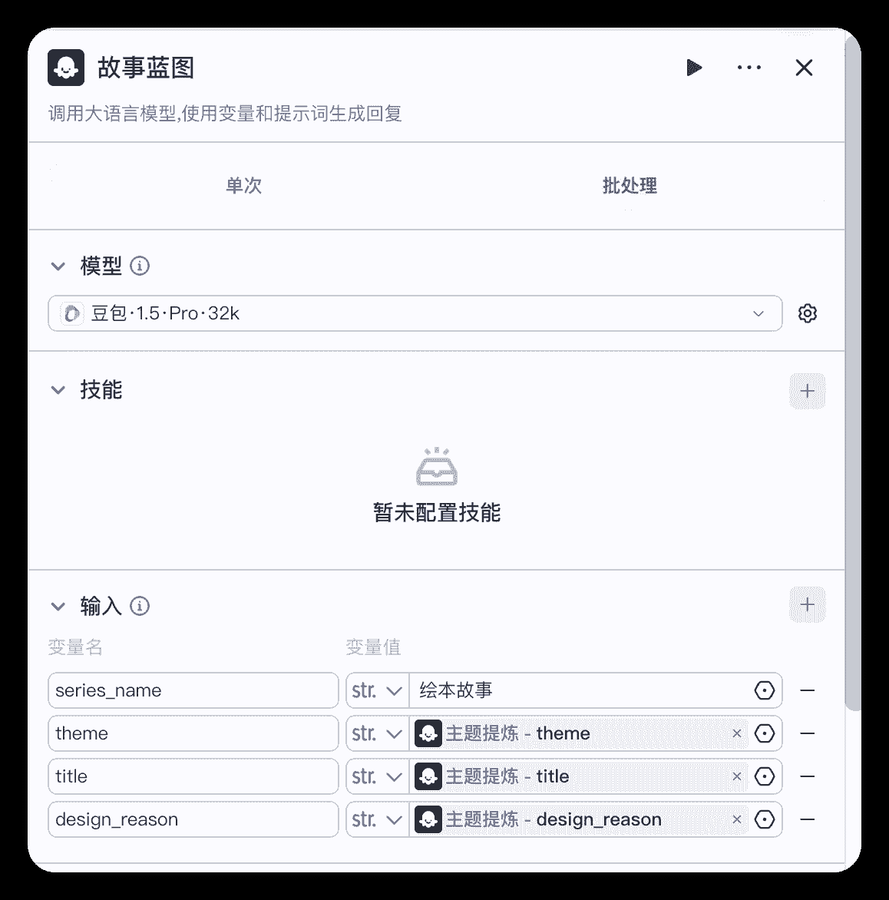

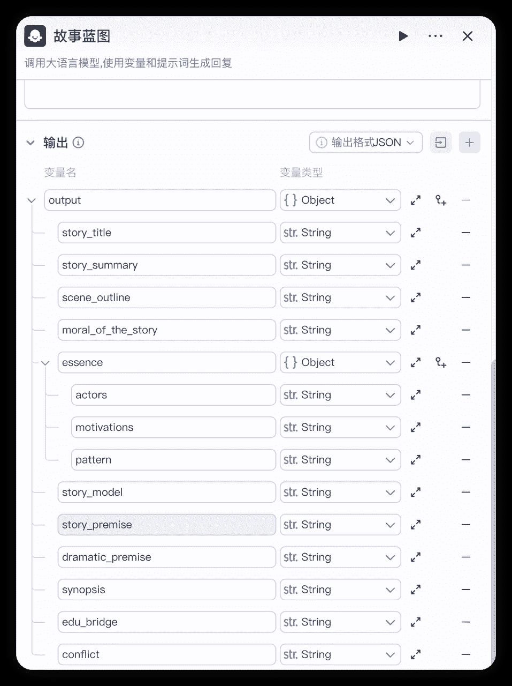

系统提示词如下：

```
你是一位经验丰富的儿童绘本故事架构师。基于主题提炼的结果，设计完整的故事大纲。

## 输入信息

- **课程系列名称**: {{series_name}}
- **核心主题**: {{theme}}
- **绘本标题**: {{title}}
- **教育转化策略**: {{design_reason}}

## 输出要求

### 1. 故事标题 (story_title)

**格式规则**：

- 有系列名时：`{{series_name}}系列：{{title}}`
- 无系列名时：直接使用 `{{title}}`

### 2. 故事摘要 (story_summary)

- 简洁概括核心情节和主题
- 用于宣传材料，需简短有力
- 100字以内，使用中文

### 3. 场景大纲 (scene_outline)

设计3-5个关键场景，遵循经典故事结构：

1. **开端**：介绍角色和环境
2. **冲突**：主角面临挑战
3. **高潮**：关键转折时刻
4. **解决**：问题得到解决
5. **结局**：点明故事教训

每个场景需要简短描述（50字以内）。

### 4. 核心价值 (moral_of_the_story)

- 与主题保持一致
- 适合5-7岁儿童理解
- 30字以内，表述简单明了

### 5. 完整故事要素

需包含以下要素：

- **essence**: 角色、动机、冲突模式
- **story_model**: 叙事模型（成长历程/冒险探索等）
- **story_premise**: 核心前提
- **dramatic_premise**: 戏剧性问题
- **synopsis**: 完整概要（包含开端、发展、高潮、结局）
- **edu_bridge**: 与教育内容的连接
- **conflict**: 核心冲突

## 输出格式

&quot;output&quot;:{
  &quot;story_title&quot;: &quot;故事标题（按规则生成）&quot;,
  &quot;story_summary&quot;: &quot;故事摘要（100字以内）&quot;,
  &quot;scene_outline&quot;: &quot;场景大纲（3-5个场景，每个50字以内）&quot;,
  &quot;moral_of_the_story&quot;: &quot;核心价值（30字以内）&quot;,
  &quot;essence&quot;: {
    &quot;actors&quot;: &quot;关键角色&quot;,
    &quot;motivations&quot;: &quot;角色动机&quot;,
    &quot;pattern&quot;: &quot;冲突模式&quot;
  },
  &quot;story_model&quot;: &quot;叙事模型&quot;,
  &quot;story_premise&quot;: &quot;核心前提&quot;,
  &quot;dramatic_premise&quot;: &quot;戏剧性问题&quot;,
  &quot;synopsis&quot;: &quot;完整故事概要&quot;,
  &quot;edu_bridge&quot;: &quot;教育连接&quot;,
  &quot;conflict&quot;: &quot;核心冲突&quot;
}

## 注意事项
- **以上JSON为输出格式示例**，请按照此格式填写实际内容
- 所有字段必须完整填写
- 所有文字内容必须使用中文
- 遵守字数限制（story_summary 100字以内，moral_of_the_story 30字以内）
- 确保故事结构完整、逻辑清晰
```

故事蓝图是这个工作流的中心，它起着承前启后的作用，前面那些更多是内容生成，但是想要适合绘本还是缺少一些细节把控，而有了这个之后，你绘本的整体方向就定了，后面更多是细节调整。

我们还拿前面新同学欢迎会举例，前面定了主题基调，那么我们还不能直接举办，需要确定这欢迎会有多少歌唱节目，多少舞蹈节目，有几个阶段需要来让新同学有归属感。这些都是需要在举办前就确定的，如果这些无法确定，那么这个欢迎会可能就会和原本欢迎新同学的初衷南辕北辙。

## 绘画风格

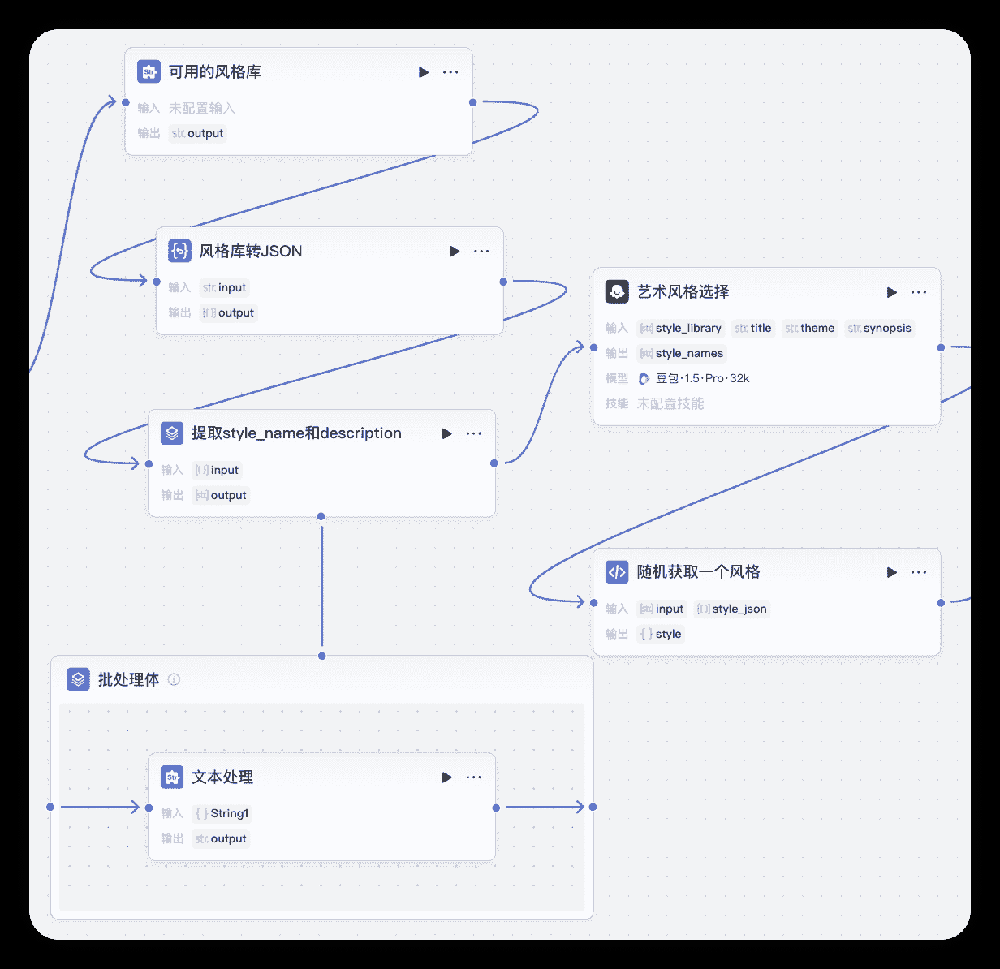

这个可能是你在其他绘本工作流中无法看到的一个处理方式，也是我认为让整个绘本结果减少 AI 味重要的部分。我们下面来拆解这个部分。前面那个迎新会的例子，那些大的框架定了，但是很多迎新会可能千篇一律，那么这个时候有一个剧本杀社团的同学提议，是否可以让新同学参与进来，给大家做一个类似学校风格的剧本杀，这样是不是会有不一样的效果，当然也可能是其他非传统方式，例如：舞台剧、脱口秀。

### 可用的风格库（文本处理）

这个节点核心就是预设一些绘画风格，而在我原本的代码中有 50 多个风格，为了简化流程我在这里缩短为 15 个。如果没有这个节点的想法，我生成的效果可能和市面上的 AI 绘本差不多，但是添加了这个，我的绘本就会产生很多不一样的效果。

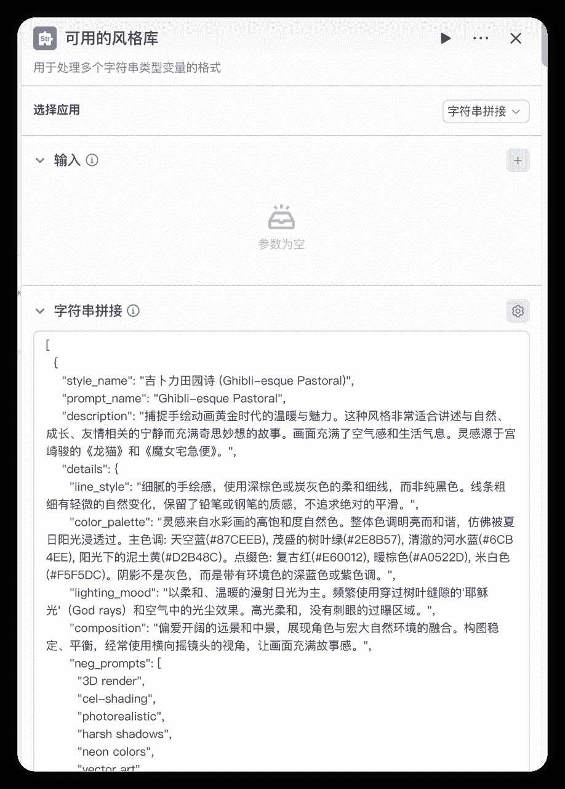

字符串拼接的文本信息：

```
[
  {
    &quot;style_name&quot;: &quot;吉卜力田园诗 (Ghibli-esque Pastoral)&quot;,
    &quot;prompt_name&quot;: &quot;Ghibli-esque Pastoral&quot;,
    &quot;description&quot;: &quot;捕捉手绘动画黄金时代的温暖与魅力。这种风格非常适合讲述与自然、成长、友情相关的宁静而充满奇思妙想的故事。画面充满了空气感和生活气息。灵感源于宫崎骏的《龙猫》和《魔女宅急便》。&quot;,
    &quot;details&quot;: {
      &quot;line_style&quot;: &quot;细腻的手绘感，使用深棕色或炭灰色的柔和细线，而非纯黑色。线条粗细有轻微的自然变化，保留了铅笔或钢笔的质感，不追求绝对的平滑。&quot;,
      &quot;color_palette&quot;: &quot;灵感来自水彩画的高饱和度自然色。整体色调明亮而和谐，仿佛被夏日阳光浸透过。主色调: 天空蓝(#87CEEB), 茂盛的树叶绿(#2E8B57), 清澈的河水蓝(#6CB4EE), 阳光下的泥土黄(#D2B48C)。点缀色: 复古红(#E60012), 暖棕色(#A0522D), 米白色(#F5F5DC)。阴影不是灰色，而是带有环境色的深蓝色或紫色调。&quot;,
      &quot;lighting_mood&quot;: &quot;以柔和、温暖的漫射日光为主。频繁使用穿过树叶缝隙的&#x27;耶稣光&#x27;（God rays）和空气中的光尘效果。高光柔和，没有刺眼的过曝区域。&quot;,
      &quot;composition&quot;: &quot;偏爱开阔的远景和中景，展现角色与宏大自然环境的融合。构图稳定、平衡，经常使用横向摇镜头的视角，让画面充满故事感。&quot;,
      &quot;neg_prompts&quot;: [
        &quot;3D render&quot;,
        &quot;cel-shading&quot;,
        &quot;photorealistic&quot;,
        &quot;harsh shadows&quot;,
        &quot;neon colors&quot;,
        &quot;vector art&quot;,
        &quot;text&quot;,
        &quot;letters&quot;,
        &quot;writing&quot;,
        &quot;signature&quot;,
        &quot;watermark&quot;,
        &quot;font&quot;
      ]
    }
  },
  {
    &quot;style_name&quot;: &quot;现代皮克斯光辉 (Modern Pixar Glow)&quot;,
    &quot;prompt_name&quot;: &quot;Modern Pixar Glow&quot;,
    &quot;description&quot;: &quot;顶级3D动画的质感，但更侧重于卡通的吸引力和情感表达。它的核心是光影的运用，能让简单的角色也显得生动、有立体感。灵感源于《玩具总动员》、《寻梦环游记》。&quot;,
    &quot;details&quot;: {
      &quot;line_style&quot;: &quot;无轮廓线。角色的形状完全由不同颜色和光影的3D表面来定义。所有边缘都极其平滑和干净，但通过&#x27;次表面散射&#x27;效果显得柔软，而非坚硬的塑料感。&quot;,
      &quot;color_palette&quot;: &quot;高饱和度且精心设计的戏剧化色彩。色彩服务于情绪，暖色调用于欢乐场景，冷色调用于悲伤时刻。主色调: 活力蓝(#6CAEE2), 荧光绿(#7FFF00), 鲜艳橙(#FF8C00)。点缀色: 充满情感的紫色(#8A2BE2), 旺盛的品红(#FF00FF)。严格遵循色彩和谐理论。&quot;,
      &quot;lighting_mood&quot;: &quot;极其讲究的电影感布光。使用体积光（Volumetric Light）营造空间感，用边缘光（Rim Light）将角色与背景清晰分离，用环境光遮蔽（Ambient Occlusion）来增加深度和真实感。&quot;,
      &quot;composition&quot;: &quot;完全遵循电影摄影的构图法则。如三分法、引导线、黄金分割。经常使用夸张的广角镜头来增强动态感，或使用浅景深来突出主角、虚化背景。&quot;,
      &quot;neg_prompts&quot;: [
        &quot;2D&quot;,
        &quot;flat shading&quot;,
        &quot;line art&quot;,
        &quot;watercolor&quot;,
        &quot;messy&quot;,
        &quot;hand-drawn&quot;,
        &quot;text&quot;,
        &quot;letters&quot;,
        &quot;writing&quot;,
        &quot;signature&quot;,
        &quot;watermark&quot;,
        &quot;font&quot;
      ]
    }
  },
  {
    &quot;style_name&quot;: &quot;温馨卡通手绘 (Cozy Cartoon Hand-drawn)&quot;,
    &quot;prompt_name&quot;: &quot;Cozy Cartoon Hand-drawn&quot;,
    &quot;description&quot;: &quot;这种风格在数字时代非常流行，它简化了细节，专注于可爱的角色设计和和谐的色彩搭配，给人一种非常友好、没有攻击性的感觉。灵感源于现代流行的儿童读物和一些被称为&#x27;CalArts&#x27;风格的动画。&quot;,
    &quot;details&quot;: {
      &quot;line_style&quot;: &quot;干净、柔软的彩色轮廓线。线条颜色通常是填充色的一个更深的同色系颜色，而不是纯黑色。线条粗细可能略有变化，以模仿手绘感。角色常有&#x27;豆豆眼&#x27;和&#x27;豆子嘴&#x27;。&quot;,
      &quot;color_palette&quot;: &quot;低饱和度的现代审美色盘，也常被称为&#x27;莫兰迪色系&#x27;或&#x27;脏脏色&#x27;。整体感觉非常和谐、平静、有品味。主色调: 脏粉色(#DCAE96), 鼠尾草绿(#A7B4A0), 雾霾蓝(#8EAFB5), 芥末黄(#E4B76A)。点缀色: 陶土色(#C87550), 海军蓝(#3C4D6B)。&quot;,
      &quot;lighting_mood&quot;: &quot;极其简化和扁平的光影。几乎没有阴影，或者只有一层简单的、硬边缘的色块作为阴影（Cel-shading），但颜色也是柔和的。整体感觉明亮、均匀。&quot;,
      &quot;composition&quot;: &quot;以角色为绝对中心。背景通常非常简化，甚至是单色的几何形状或图案，以最大限度地突出角色。构图干净、居中，易于阅读。&quot;,
      &quot;neg_prompts&quot;: [
        &quot;realistic&quot;,
        &quot;3D&quot;,
        &quot;complex shading&quot;,
        &quot;photorealistic&quot;,
        &quot;high contrast&quot;,
        &quot;glowing effects&quot;,
        &quot;text&quot;,
        &quot;letters&quot;,
        &quot;writing&quot;,
        &quot;signature&quot;,
        &quot;watermark&quot;,
        &quot;font&quot;
      ]
    }
  },
  {
    &quot;style_name&quot;: &quot;英式素描与淡彩 (British Sketch &amp; Wash)&quot;,
    &quot;prompt_name&quot;: &quot;British Sketch &amp; Wash&quot;,
    &quot;description&quot;: &quot;这是一种非常经典的英式插画风格，强调素描的功底和水彩的轻盈。它给人一种非常知性、优雅且不失童趣的感觉，非常适合描绘拟人化的动物和田园风光。灵感源于碧翠丝·波特（《彼得兔》）和E.H.谢培德（《小熊维尼》）。&quot;,
    &quot;details&quot;: {
      &quot;line_style&quot;: &quot;富有表现力的交叉排线（cross-hatching）和素描线条。线条本身就是造型的一部分，尤其是在表现毛发和纹理时。使用黑色或深棕色钢笔线条，轻松而自信。&quot;,
      &quot;color_palette&quot;: &quot;极其有限和清淡的色彩，被称为&#x27;淡彩&#x27;（color wash）。大部分画面由精细的线条构成，只在关键部分（如角色的衣服、花朵）局部、透明地染上一点水彩色。主色调: 大面积的留白或羊皮纸色(#F5F5DC)。点缀色: 彼得兔蓝(#ADD8E6), 玫瑰粉(#FFC0CB), 嫩芽绿(#98FB98)。&quot;,
      &quot;lighting_mood&quot;: &quot;光影完全由线条的疏密来表现。密集的排线构成暗部，稀疏的线条和留白则代表亮部。没有传统意义上的光照效果。&quot;,
      &quot;composition&quot;: &quot;小巧而精致的&#x27;装饰画&#x27;（Vignette）式构图。角色和场景经常被一个不规则的、柔和的边界包围，周围是大量的白色空间，让画面像一幅贴在书页上的精美小画。&quot;,
      &quot;neg_prompts&quot;: [
        &quot;fully painted&quot;,
        &quot;bold colors&quot;,
        &quot;3D&quot;,
        &quot;flat art&quot;,
        &quot;no line art&quot;,
        &quot;heavy shadows&quot;,
        &quot;text&quot;,
        &quot;letters&quot;,
        &quot;writing&quot;,
        &quot;signature&quot;,
        &quot;watermark&quot;,
        &quot;font&quot;
      ]
    }
  },
  {
    &quot;style_name&quot;: &quot;奇幻剪影与发光 (Fantasy Silhouette &amp; Glow)&quot;,
    &quot;prompt_name&quot;: &quot;Fantasy Silhouette &amp; Glow&quot;,
    &quot;description&quot;: &quot;这是一种极具戏剧张力和艺术感的风格。它通过大面积的黑暗剪影和明亮的发光元素来讲述故事，能迅速营造出神秘、史诗或充满魔法的氛围。灵感源于剪影动画（如洛特·赖尼格的作品）。&quot;,
    &quot;details&quot;: {
      &quot;line_style&quot;: &quot;完全没有轮廓线。角色的形态完全由其纯黑或深色的剪影来定义。剪影的边缘必须非常清晰、锐利，以便于辨认角色的动作。&quot;,
      &quot;color_palette&quot;: &quot;极度精简和高对比度的调色板。画面主要由两部分构成：大面积的深色剪影和明亮、饱和的发光背景/元素。主色调: 占画面80%的纯黑色或深靛蓝(#00008B)。发光色: 日落橙(#FF4500), 魔法紫(#9400D3), 月光黄(#FFFF00), 精灵绿(#00FF00)。&quot;,
      &quot;lighting_mood&quot;: &quot;光本身就是故事的主角。角色是前景的剪影，背景是唯一的光源。光线从角色背后射来，创造出强烈的逆光效果。发光元素会产生柔和的光晕（glow）和体积光效果。&quot;,
      &quot;composition&quot;: &quot;构图必须大胆、简洁且极具故事性。因为角色没有内部细节，所以他们的姿态和动作必须非常清晰、有表现力，以便观众能读懂故事情节。&quot;,
      &quot;neg_prompts&quot;: [
        &quot;detailed characters&quot;,
        &quot;front lighting&quot;,
        &quot;line art&quot;,
        &quot;subtle colors&quot;,
        &quot;shadows on character&quot;,
        &quot;photorealistic&quot;,
        &quot;text&quot;,
        &quot;letters&quot;,
        &quot;writing&quot;,
        &quot;signature&quot;,
        &quot;watermark&quot;,
        &quot;font&quot;
      ]
    }
  },
  {
    &quot;style_name&quot;: &quot;UPA复古卡通 (UPA Retro Cartoon)&quot;,
    &quot;prompt_name&quot;: &quot;UPA Retro Cartoon&quot;,
    &quot;description&quot;: &quot;灵感源自1950年代具有里程碑意义的UPA动画工作室（代表作《Mr. Magoo》）。该风格摒弃写实主义，拥抱现代艺术准则。它时髦、图形化，通过极简设计和风格化的动态来表达情感。非常适合具有中世纪现代美学、幽默感和一丝精致感的故事。&quot;,
    &quot;details&quot;: {
      &quot;line_style&quot;: &quot;简洁、自信且富有表现力的墨水线条。线条粗细均匀，勾勒出扁平、图形化的形状。角色高度风格化，更像是符号而非写实人物。&quot;,
      &quot;color_palette&quot;: &quot;大胆、非传统且常常不符合自然主义的调色板。大面积的平涂饱和色是其标志。受到马蒂斯等现代画家的影响。主色调: 柿子橙(#EC5800), 黄绿色(#7FFF00), 蓝绿色(#008080), 灰玫瑰色(#DCAE96)。&quot;,
      &quot;lighting_mood&quot;: &quot;完全扁平的光照。没有阴影或渐变。深度和形态通过色彩选择和构图来暗示，而非通过写实的光影渲染。&quot;,
      &quot;composition&quot;: &quot;高度抽象和极简主义。背景可能只是单一颜色或几条简单的线条来暗示地点。构图是精心安排的形状和颜色的拼贴画，巧妙地运用负空间。&quot;,
      &quot;neg_prompts&quot;: [
        &quot;3D rendering&quot;,
        &quot;photorealistic&quot;,
        &quot;shading&quot;,
        &quot;gradient&quot;,
        &quot;watercolor texture&quot;,
        &quot;detailed background&quot;,
        &quot;text&quot;,
        &quot;letters&quot;,
        &quot;writing&quot;,
        &quot;signature&quot;,
        &quot;watermark&quot;,
        &quot;font&quot;
      ]
    }
  },
  {
    &quot;style_name&quot;: &quot;表现主义水墨 (Expressive Ink Wash)&quot;,
    &quot;prompt_name&quot;: &quot;Expressive Ink Wash&quot;,
    &quot;description&quot;: &quot;植根于东亚的禅宗哲学。这种风格利用黑墨在宣纸上的自发、充满活力的流动来捕捉物体的&#x27;气韵&#x27;，而不仅仅是其外观。它非常适合讲述关于自然、内省和情感的深刻、充满诗意的故事。&quot;,
    &quot;details&quot;: {
      &quot;line_style&quot;: &quot;精湛的笔法即是一切。从湿润的&#x27;破墨&#x27;渲染到无轮廓线的&#x27;没骨&#x27;形态。线条的质感和粗细变化极大。&#x27;飞白&#x27;技法增添了能量和质感。&quot;,
      &quot;color_palette&quot;: &quot;以单色为主，依赖于从焦黑到最淡灰色的&#x27;墨分五色&#x27;。如果使用色彩，则极其简约——在黑白画面上点缀一抹象征性的红色或靛蓝色。&quot;,
      &quot;lighting_mood&quot;: &quot;光线通过墨色的有无来传达。最亮的高光是未着墨的纸张。阴影是深沉、饱和的墨色渲染。整体氛围由光与暗的平衡决定。&quot;,
      &quot;composition&quot;: &quot;拥抱&#x27;留白&#x27;。大面积的负空间是刻意且有意义的，它代表着无限，也让主体有呼吸的空间。构图不对称但保持动态平衡。&quot;,
      &quot;neg_prompts&quot;: [
        &quot;hard edges&quot;,
        &quot;digital art&quot;,
        &quot;vector&quot;,
        &quot;uniform lines&quot;,
        &quot;fully painted background&quot;,
        &quot;photorealistic&quot;,
        &quot;bright colors&quot;,
        &quot;text&quot;,
        &quot;letters&quot;,
        &quot;writing&quot;,
        &quot;signature&quot;,
        &quot;watermark&quot;,
        &quot;font&quot;
      ]
    }
  },
  {
    &quot;style_name&quot;: &quot;天真民俗艺术 (Naive Folk Art)&quot;,
    &quot;prompt_name&quot;: &quot;Naive Folk Art&quot;,
    &quot;description&quot;: &quot;一种迷人而真诚的风格，灵感来自斯堪的纳维亚和东欧的民间、自学成才的艺术传统。它崇尚质朴、图案和装饰性。非常适合讲述异想天开的寓言、聚焦社区的故事以及颂扬传统和纯真的主题。&quot;,
    &quot;details&quot;: {
      &quot;line_style&quot;: &quot;简单、质朴、具有装饰性的轮廓线。物体的形态被简化为最基本的几何形状。不追求写实。风格扁平且富有装饰性，经常出现花卉、心形和动物等重复图案。&quot;,
      &quot;color_palette&quot;: &quot;充满活力但又克制的传统调色板。颜色平坦、不透明。主色调: 达拉红(#B62828), 皇家蓝(#4169E1), 阳光黄(#FFD700), 民俗绿(#006400)。&quot;,
      &quot;lighting_mood&quot;: &quot;完全没有光照或阴影效果。图像是完全扁平的，其魅力依赖于色彩和图案。它类似于木制家具或纺织品上的装饰画。&quot;,
      &quot;composition&quot;: &quot;富有节奏、基于图案的构图。人物和元素通常对称排列或以重复序列出现。为了达到令人愉悦的装饰效果，透视和比例被忽略。&quot;,
      &quot;neg_prompts&quot;: [
        &quot;perspective&quot;,
        &quot;realism&quot;,
        &quot;3D shading&quot;,
        &quot;gradient&quot;,
        &quot;light source&quot;,
        &quot;subtle colors&quot;,
        &quot;transparency&quot;,
        &quot;text&quot;,
        &quot;letters&quot;,
        &quot;writing&quot;,
        &quot;signature&quot;,
        &quot;watermark&quot;,
        &quot;font&quot;
      ]
    }
  },
  {
    &quot;style_name&quot;: &quot;毛线编织世界 (Knitted Yarn World)&quot;,
    &quot;prompt_name&quot;: &quot;Knitted Yarn World&quot;,
    &quot;description&quot;: &quot;一个完全由毛线、布料和缝纫用品构成的迷人世界。这种风格唤起了一种无与伦比的舒适和温暖感，非常适合讲述温柔、充满手工质感的故事。所有角色和物体都像是柔软的编织玩具。灵感源于《卡比毛线传说》。&quot;,
    &quot;details&quot;: {
      &quot;line_style&quot;: &quot;没有传统意义上的线条。物体的轮廓由毛线的边缘或不同颜色毛线的接缝构成。细节通过刺绣的针脚、缝上去的纽扣和拉链来表现。&quot;,
      &quot;color_palette&quot;: &quot;温暖、柔软的家庭编织色盘。颜色就像天然染色的羊毛，饱和度适中。主色调: 婴儿蓝(#A2C4D2), 奶油黄(#FFFDD0), 薄荷绿(#C8E6C9), 浅粉色(#F4C2C2)。&quot;,
      &quot;lighting_mood&quot;: &quot;柔和、均匀的室内光感。光线像是从一盏温暖的台灯下照来，营造出舒适、安全的感觉。阴影非常柔和，就像柔软的毛线投下的模糊影子。&quot;,
      &quot;composition&quot;: &quot;侧重于表现材质的触感。经常使用特写镜头来展示毛线的纹理、织物的褶皱和纽扣的光泽。构图充满童趣，像一个手工制作的布景箱。&quot;,
      &quot;neg_prompts&quot;: [
        &quot;photorealistic&quot;,
        &quot;3D render&quot;,
        &quot;sharp edges&quot;,
        &quot;metallic&quot;,
        &quot;plastic&quot;,
        &quot;glowing&quot;,
        &quot;text&quot;,
        &quot;letters&quot;,
        &quot;writing&quot;,
        &quot;signature&quot;,
        &quot;watermark&quot;,
        &quot;font&quot;
      ]
    }
  },
  {
    &quot;style_name&quot;: &quot;毛毡剪贴剧场 (Felt Cut-out Theater)&quot;,
    &quot;prompt_name&quot;: &quot;Felt Cut-out Theater&quot;,
    &quot;description&quot;: &quot;这种风格模仿了用彩色毛毡布剪贴而成的平面艺术。它具有非常独特的质感和手工感，画面扁平但层次分明，色彩柔和而温暖。非常适合讲述简单、可爱且富有情感的故事。&quot;,
    &quot;details&quot;: {
      &quot;line_style&quot;: &quot;无轮廓线。形状完全由剪裁的毛毡边缘定义。边缘可能略带毛糙感，保留了毛毡的天然纤维质感。细节可以通过小块的不同颜色毛毡叠加或简单的刺绣线条来添加。&quot;,
      &quot;color_palette&quot;: &quot;柔和、温暖、略带灰度的手工艺色盘。颜色饱和度不高，就像天然植物染色的毛毡。主色调: 苔藓绿(#7B8968), 芥末黄(#DBA520), 灰蓝色(#A2BACE), 陶土红(#B87333)。&quot;,
      &quot;lighting_mood&quot;: &quot;非常扁平的光照，几乎没有阴影。如果存在阴影，通常是另一片深色毛毡剪出来的，以营造出微弱的立体感。&quot;,
      &quot;composition&quot;: &quot;像剪贴簿一样的构图。元素被分层放置，创造出景深感。背景通常是单色或有简单图案的大块毛毡布。构图以角色为中心，简洁明了。&quot;,
      &quot;neg_prompts&quot;: [
        &quot;3D&quot;,
        &quot;shading&quot;,
        &quot;gradient&quot;,
        &quot;photorealistic&quot;,
        &quot;glowing effects&quot;,
        &quot;complex background&quot;,
        &quot;sharp lines&quot;,
        &quot;text&quot;,
        &quot;letters&quot;,
        &quot;writing&quot;,
        &quot;signature&quot;,
        &quot;watermark&quot;,
        &quot;font&quot;
      ]
    }
  },
  {
    &quot;style_name&quot;: &quot;手工粘土定格 (Handmade Claymation Stop-motion)&quot;,
    &quot;prompt_name&quot;: &quot;Handmade Claymation Stop-motion&quot;,
    &quot;description&quot;: &quot;这种风格重现了经典粘土动画的魅力，所有角色和场景都像是用橡皮泥或粘土手工捏制而成。它最大的特点是保留了手作的痕迹，如指纹和不完美的形状。灵感源于阿德曼动画工作室的作品（《超级无敌掌门狗》、《小羊肖恩》）。&quot;,
    &quot;details&quot;: {
      &quot;line_style&quot;: &quot;没有线条。形状由粘土块本身构成。粘土的接缝和塑形时留下的工具痕迹清晰可见，成为风格的一部分。&quot;,
      &quot;color_palette&quot;: &quot;明亮、饱和的橡皮泥颜色。色彩鲜艳、直接，通常是高纯度的颜色。主色调: 粘土红(#D9524E), 宝蓝色(#4B87C3), 草绿色(#78B854), 柠檬黄(#FDEE54)。&quot;,
      &quot;lighting_mood&quot;: &quot;模拟真实摄影棚的布光。具有明显的、略带柔和边缘的主光源和阴影，以强调粘土的体积感。光线下能看到粘土表面微妙的光泽和质感。&quot;,
      &quot;composition&quot;: &quot;微缩模型摄影的视角。构图模拟真实摄像机的景深和角度，让观众感觉像是在窥视一个真实存在的迷你世界。&quot;,
      &quot;neg_prompts&quot;: [
        &quot;2D&quot;,
        &quot;flat&quot;,
        &quot;line art&quot;,
        &quot;drawing&quot;,
        &quot;vector&quot;,
        &quot;smooth render&quot;,
        &quot;perfectly smooth&quot;,
        &quot;text&quot;,
        &quot;letters&quot;,
        &quot;writing&quot;,
        &quot;signature&quot;,
        &quot;watermark&quot;,
        &quot;font&quot;
      ]
    }
  },
  {
    &quot;style_name&quot;: &quot;纸雕光影箱 (Paper-cut Lightbox)&quot;,
    &quot;prompt_name&quot;: &quot;Paper-cut Lightbox&quot;,
    &quot;description&quot;: &quot;一种极富艺术性和氛围感的风格，模仿了多层纸雕在光箱中被照亮的效果。通过剪影的层次和背光，创造出令人惊叹的深度和梦幻般的光影。非常适合讲述具有神秘色彩、童话氛围或情感深度的故事。灵感源于光影纸雕灯艺术和游戏《Gris》。&quot;,
    &quot;details&quot;: {
      &quot;line_style&quot;: &quot;轮廓线由纸张的切割边缘形成，必须极为干净、利落。内部细节通过精细的镂空雕刻来表现。前景的剪影通常颜色较深。&quot;,
      &quot;color_palette&quot;: &quot;依赖于光线和层次的色彩。前景通常是深色剪影，而背景则由背光决定，呈现出柔和、渐变的色彩。主色调: 黎明黄(#F39C12), 暮光紫(#8E44AD), 森林绿(#1E8449), 夜空蓝(#2C3E50)。&quot;,
      &quot;lighting_mood&quot;: &quot;背光是核心。光线从场景的最后方穿过层层纸雕透射出来，形成美丽的光晕和渐变。光线柔和而富有魔力，营造出强烈的氛围感。&quot;,
      &quot;composition&quot;: &quot;强调深度和层次感。构图由前景、中景、远景的纸雕层层叠加而成。每一层都有精心设计的图案，共同构成一个完整、立体的画面。&quot;,
      &quot;neg_prompts&quot;: [
        &quot;front lighting&quot;,
        &quot;character details&quot;,
        &quot;3D render&quot;,
        &quot;photorealistic&quot;,
        &quot;flat illustration&quot;,
        &quot;hand-drawn lines&quot;,
        &quot;text&quot;,
        &quot;letters&quot;,
        &quot;writing&quot;,
        &quot;signature&quot;,
        &quot;watermark&quot;,
        &quot;font&quot;
      ]
    }
  },
  {
    &quot;style_name&quot;: &quot;低多边形三维 (Low-Poly 3D)&quot;,
    &quot;prompt_name&quot;: &quot;Low-Poly 3D&quot;,
    &quot;description&quot;: &quot;一种具有现代感的3D风格，特点是使用有棱角的、低面数的多边形来构建场景和角色。这种风格简洁、几何化，常用于创造超现实的、富有建筑美感的梦幻世界。灵感源于《纪念碑谷》等现代独立游戏。&quot;,
    &quot;details&quot;: {
      &quot;line_style&quot;: &quot;没有轮廓线。物体的形状由平坦、带颜色的多边形及其锐利边缘来定义。&quot;,
      &quot;color_palette&quot;: &quot;常使用柔和的、低饱和度的色盘（粉彩系）来营造宁静的氛围。每个多边形内部都是平涂的单色。主色调：灰粉(#DECAD6), 薄荷绿(#C8E6C9), 浅天蓝(#A2C4D2), 鹅黄(#FFFACD)。&quot;,
      &quot;lighting_mood&quot;: &quot;简洁、干净的光照。阴影通常是硬边、轮廓分明的几何形状，作为整体风格化外观的一部分。&quot;,
      &quot;composition&quot;: &quot;专注于干净利落、甚至不符合物理法则的&#x27;纪念碑谷&#x27;式几何体和等角透视。构图通常像解谜游戏一样，充满极简主义美感。&quot;,
      &quot;neg_prompts&quot;: [
        &quot;photorealistic&quot;,
        &quot;high poly&quot;,
        &quot;smooth shading&quot;,
        &quot;detailed textures&quot;,
        &quot;round objects&quot;,
        &quot;blurry&quot;,
        &quot;text&quot;,
        &quot;letters&quot;,
        &quot;writing&quot;,
        &quot;signature&quot;,
        &quot;watermark&quot;,
        &quot;font&quot;
      ]
    }
  },
  {
    &quot;style_name&quot;: &quot;几何图形拼贴 (Geometric Shape Collage)&quot;,
    &quot;prompt_name&quot;: &quot;Geometric Shape Collage&quot;,
    &quot;description&quot;: &quot;灵感源于艾瑞·卡尔的《好饿的毛毛虫》。这种风格看起来像是用涂满颜料、带有纹理的彩纸剪切、拼贴而成。它充满活力、有触感，且非常易于亲近。&quot;,
    &quot;details&quot;: {
      &quot;line_style&quot;: &quot;没有轮廓线。形状由剪切或撕开的纸片的边缘来定义，边缘可能略显粗糙。&quot;,
      &quot;color_palette&quot;: &quot;明亮、大胆、充满喜悦。使用宽泛的色彩范围，不同色块经常重叠，创造出新的二次色。关键在于纸张本身可见的纹理（笔触、海绵印记）。&quot;,
      &quot;lighting_mood&quot;: &quot;完全扁平。没有光照或阴影，只有通过分层拼贴纸片创造出的景深错觉。&quot;,
      &quot;composition&quot;: &quot;简单、大胆，以角色为中心。形状被简化为最基础的几何图形。构图感觉自由而富有童趣。&quot;,
      &quot;neg_prompts&quot;: [
        &quot;3D&quot;,
        &quot;gradient&quot;,
        &quot;smooth&quot;,
        &quot;photorealistic&quot;,
        &quot;line art&quot;,
        &quot;digital render&quot;,
        &quot;text&quot;,
        &quot;letters&quot;,
        &quot;writing&quot;,
        &quot;signature&quot;,
        &quot;watermark&quot;,
        &quot;font&quot;
      ]
    }
  },
  {
    &quot;style_name&quot;: &quot;潦草蜡笔涂鸦 (Scribbly Crayon Doodle)&quot;,
    &quot;prompt_name&quot;: &quot;Scribbly Crayon Doodle&quot;,
    &quot;description&quot;: &quot;捕捉了儿童用蜡笔随手涂鸦时那种充满魅力和活力的感觉。这种风格简单、富有表现力，给人一种非常个人化和无拘无束的感觉。灵感源于《小猪佩奇》或《嗨！道奇》。&quot;,
    &quot;details&quot;: {
      &quot;line_style&quot;: &quot;晃动、潦草的蜡笔或彩色铅笔轮廓。线条不完美，常常超出填色区域。蜡笔在纸上的纹理是可见的。&quot;,
      &quot;color_palette&quot;: &quot;明亮的、基础的颜色，就像一盒基本款蜡笔。着色通常是单一的平涂颜色，并且不会完美地保持在线条内部。&quot;,
      &quot;lighting_mood&quot;: &quot;完全扁平。没有阴影或光照。焦点在于线条和颜色本身。&quot;,
      &quot;composition&quot;: &quot;极其简单和直接。角色通常以侧面或正面展示，背景极简甚至没有。透视是扁平且不写实的。&quot;,
      &quot;neg_prompts&quot;: [
        &quot;realistic&quot;,
        &quot;perfect lines&quot;,
        &quot;shading&quot;,
        &quot;3D&quot;,
        &quot;watercolor&quot;,
        &quot;smooth&quot;,
        &quot;text&quot;,
        &quot;letters&quot;,
        &quot;writing&quot;,
        &quot;signature&quot;,
        &quot;watermark&quot;,
        &quot;font&quot;
      ]
    }
  },
  {
    &quot;style_name&quot;: &quot;可爱Q版动漫 (Cute Chibi/Kawaii Anime)&quot;,
    &quot;prompt_name&quot;: &quot;Cute Chibi/Kawaii Anime&quot;,
    &quot;description&quot;: &quot;源自日本动漫（Anime）和漫画（Manga）的&#x27;超级变形&#x27;（Super-deformed, SD）或&#x27;Q版&#x27;风格。通过夸大角色特征来最大化可爱感。非常适合轻松、幽默或温馨的故事。&quot;,
    &quot;details&quot;: {
      &quot;line_style&quot;: &quot;干净、利落的数字线条。线条粗细可能略有变化以增加动感。角色拥有超大的头部、富有表现力的大眼睛，以及小巧的身体和四肢。&quot;,
      &quot;color_palette&quot;: &quot;明亮、鲜活、高饱和度的颜色。也常使用柔和的粉彩色系来增添可爱感。赛璐璐上色（Cel-shading）很常见，通常有一到两层硬边缘的阴影。&quot;,
      &quot;lighting_mood&quot;: &quot;明快、愉悦。阴影极简，刚刚足以表现出形体感。经常包含闪光、脸颊红晕和其他可爱的视觉效果。&quot;,
      &quot;composition&quot;: &quot;动态且富有表现力。姿势常常被夸张以表现情绪。背景通常很简单，使用图案或速度线来强调角色的心情或动作。&quot;,
      &quot;neg_prompts&quot;: [
        &quot;realistic proportions&quot;,
        &quot;photorealistic&quot;,
        &quot;detailed shading&quot;,
        &quot;dark&quot;,
        &quot;gritty&quot;,
        &quot;text&quot;,
        &quot;letters&quot;,
        &quot;writing&quot;,
        &quot;signature&quot;,
        &quot;watermark&quot;,
        &quot;font&quot;
      ]
    }
  },
  {
    &quot;style_name&quot;: &quot;法式清线漫画 (Franco-Belgian Ligne Claire)&quot;,
    &quot;prompt_name&quot;: &quot;Franco-Belgian Ligne Claire&quot;,
    &quot;description&quot;: &quot;经典的&#x27;清晰线条&#x27;风格，因《丁丁历险记》而闻名。它使用粗细均匀、结实清晰的线条，并将卡通化的角色与真实、细致的背景相结合，营造出一种冒险、写实和清晰的感觉。&quot;,
    &quot;details&quot;: {
      &quot;line_style&quot;: &quot;清晰、精确、粗细均匀的黑色墨水线。没有阴影线或羽化。每一个细节都用同样干净的线条来呈现。&quot;,
      &quot;color_palette&quot;: &quot;平涂、坚实的颜色。没有渐变或复杂的阴影。调色板是写实的，但色彩明亮，没有情绪化或氛围化的着色。&quot;,
      &quot;lighting_mood&quot;: &quot;极简和简单的光照。很少使用阴影，如果使用，也是实心的黑色色块。整体外观明亮且易于阅读。&quot;,
      &quot;composition&quot;: &quot;非常注重环境的故事性和真实感。背景经过充分研究且细节一丝不苟，营造出强烈的场所感，这与风格化的角色形成对比。&quot;,
      &quot;neg_prompts&quot;: [
        &quot;hatching&quot;,
        &quot;cross-hatching&quot;,
        &quot;variable line weight&quot;,
        &quot;shading&quot;,
        &quot;gradient&quot;,
        &quot;painterly&quot;,
        &quot;text&quot;,
        &quot;letters&quot;,
        &quot;writing&quot;,
        &quot;signature&quot;,
        &quot;watermark&quot;,
        &quot;font&quot;
      ]
    }
  },
  {
    &quot;style_name&quot;: &quot;丝网印刷版画 (Screenprint Poster Art)&quot;,
    &quot;prompt_name&quot;: &quot;Screenprint Poster Art&quot;,
    &quot;description&quot;: &quot;模仿中世纪丝网印刷的美学。这种图形风格的特点是有限的调色板、大胆的形状以及半色调或轻微错位的纹理。它给人的感觉是复古、艺术和有质感的。&quot;,
    &quot;details&quot;: {
      &quot;line_style&quot;: &quot;通常没有轮廓线。形状由色块定义。如果存在线条，它们也是粗体且是图形设计的一部分。&quot;,
      &quot;color_palette&quot;: &quot;有限的调色板，通常是2-4种颜色。颜色大胆而平坦。重叠的颜色会产生新的色调。半色调网点或其他印刷纹理是其关键特征。&quot;,
      &quot;lighting_mood&quot;: &quot;没有写实的光照。风格是完全图形化和扁平的。深度是通过颜色和分层来暗示的，而不是通过光和影。&quot;,
      &quot;composition&quot;: &quot;强烈、图形化，通常是极简主义的构图。注重形状、图案和对负空间的巧妙运用。感觉像一张精心设计的海报。&quot;,
      &quot;neg_prompts&quot;: [
        &quot;photorealistic&quot;,
        &quot;3D&quot;,
        &quot;shading&quot;,
        &quot;gradient&quot;,
        &quot;unlimited colors&quot;,
        &quot;thin lines&quot;,
        &quot;text&quot;,
        &quot;letters&quot;,
        &quot;writing&quot;,
        &quot;signature&quot;,
        &quot;watermark&quot;,
        &quot;font&quot;
      ]
    }
  },
  {
    &quot;style_name&quot;: &quot;纸艺立体模型 (Papercraft Diorama)&quot;,
    &quot;prompt_name&quot;: &quot;Papercraft Diorama&quot;,
    &quot;description&quot;: &quot;一个由剪纸、折叠和分层创造的微型3D世界。所有东西都保留了纸的质感和边缘。非常适合需要景深和层次感的创意故事，有一种在看一个精致的手工舞台剧的感觉。&quot;,
    &quot;details&quot;: {
      &quot;line_style&quot;: &quot;轮廓线由纸张的切割边缘和折痕定义。线条干净、几何化。&quot;,
      &quot;color_palette&quot;: &quot;通常是明亮、干净的颜色，模仿彩色卡纸。颜色平涂，没有纹理。&quot;,
      &quot;lighting_mood&quot;: &quot;模拟真实世界的柔和光线投射在纸模型上。阴影有助于突出层次感和立体感，但它们是几何和干净的。&quot;,
      &quot;composition&quot;: &quot;强调层次和深度。通过将纸层放置在不同的距离来构建场景，创造出一种立体透视的错觉，就像一个舞台布景。&quot;,
      &quot;neg_prompts&quot;: [
        &quot;photorealistic&quot;,
        &quot;drawing&quot;,
        &quot;painting&quot;,
        &quot;messy&quot;,
        &quot;organic shapes&quot;,
        &quot;blurry&quot;,
        &quot;text&quot;,
        &quot;letters&quot;,
        &quot;writing&quot;,
        &quot;signature&quot;,
        &quot;watermark&quot;,
        &quot;font&quot;
      ]
    }
  },
  {
    &quot;style_name&quot;: &quot;安吉·罗泽拉尔的趣味插画 (Angie Rozelaar&#x27;s Whimsical Illustrations)&quot;,
    &quot;prompt_name&quot;: &quot;Angie Rozelaar Whimsical Style&quot;,
    &quot;description&quot;: &quot;灵感源于插画家安吉·罗泽拉尔（Angie Rozelaar）的独特风格。这是一种集现代、抽象、极简于一体的画风，充满了趣味和可爱的气息。其核心在于使用潦草、自信的粗线条，搭配彩铅质感的色彩，并在画面中保留大量留白。角色通常拥有超大的眼睛，表情夸张有趣。&quot;,
    &quot;details&quot;: {
      &quot;line_style&quot;: &quot;粗大、潦草、充满能量的彩铅线条。线条不追求完美和精准，而是突出一种随性、自由的涂鸦感。用最少的线条勾勒出角色的核心特征，特别是那双超大的眼睛。&quot;,
      &quot;color_palette&quot;: &quot;明亮、现代且充满活力的色彩。颜色通常是平涂的，保留了彩铅或水粉的质感，而不是平滑的数字填充。色彩搭配大胆、有趣。&quot;,
      &quot;lighting_mood&quot;: &quot;完全扁平化。几乎没有光影效果，完全依赖线条和色块来表达。整体感觉非常明亮、干净。&quot;,
      &quot;composition&quot;: &quot;极简主义构图，以角色为中心。画面中通常有大面积的留白，将视觉焦点完全集中在那个古灵精怪的角色上。&quot;,
      &quot;neg_prompts&quot;: [
        &quot;photorealistic&quot;,
        &quot;3D&quot;,
        &quot;detailed background&quot;,
        &quot;complex shading&quot;,
        &quot;smooth gradient&quot;,
        &quot;perfect lines&quot;,
        &quot;realistic proportions&quot;,
        &quot;text&quot;,
        &quot;letters&quot;,
        &quot;writing&quot;,
        &quot;signature&quot;,
        &quot;watermark&quot;,
        &quot;font&quot;
      ]
    }
  }
]
```

> 很多人在设计绘本工作流是很少会想到这个方式，因为我了解大模型本质上一个概率预测模型，它会有自己的倾向性，文字可能多数人还不容易分辨，但是图片我们一眼就能看出是 AI，例如你现在看到宫崎骏风格的图片，大概率会倾向于是 AI 生成的，而我这里面添加很多不一样的风格，这就会让判断难度增加，因为很多人没加过类似的风格，他不是很熟悉所以就无法根据风格来判断这个是不是 AI 生成的。例如，我很喜欢的动漫《天竺鼠车车》这种毛毡风格一般人很少看到过，而如果你的绘本使用这个风格，大概率多数人觉得很稀奇，如果你用这个风格来讲《三只小猪》的故事，有很大概率人们会喜欢。

> 我看过很多人想要存储一些数据，习惯性使用知识库或者数据库这些很复杂的节点，如果你这个数据变化很小，多数只是人工来维护，那么强烈建议你把它转成类似我上面的 JSON 格式来存储，这样使用简单，成本也低。转成这个格式也不需要你费什么精力，把你的内容交给其他优质的大模型应用来处理，它完全可以按你的需求输出一个标准的 JSON 格式。

### 风格库转 JSON（JSON 反序列）

这个节点为了把文本转成 JSON，因为原来的文本是没办法方便的读取到对应具体内容，需要用这个节点转换。其实就是按照前面那个格式输出，只不过输出的方式不同。例如，我们写文章完全可以一大段把它写完，但是为了其他人方便阅读，你需要添加段落，添加各种格式，甚至还要适当加上 emoji 表情🤪。

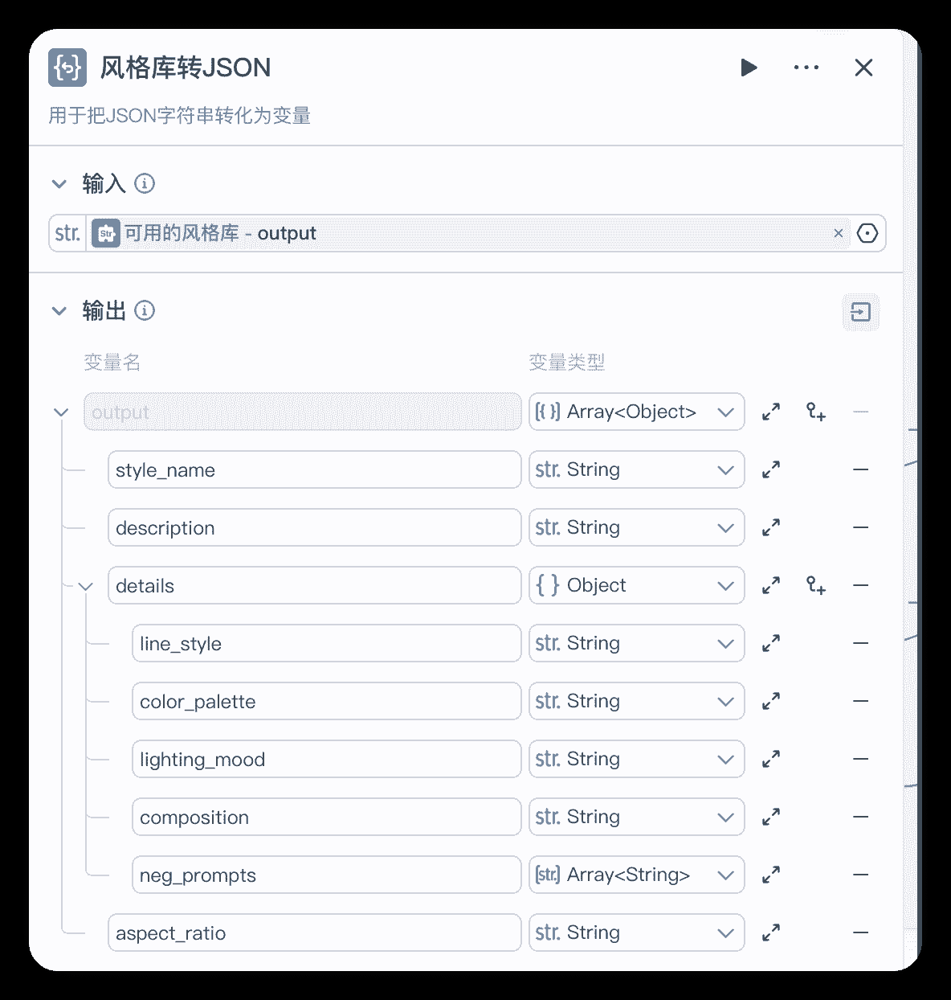

### 提取 style_name 和 description（批处理）

你会发现这个节点和其他节点有些不一样，其他节点都是一个，而这个会拖家带口。这个节点叫做批处理节点，用 coze 文档官方所说：工作流执行时，每个节点按顺序运行一次，如果需要一次性运行多次，例如一次性查询多个城市的天气，可以使用批处理节点提高工作流效率。说白了就是你有一堆同类型的任务，想要快速处理，就可以使用这个节点。不过需要注意的是，coze 中说明这个节点是不保证顺序的，例如你想使用这个批量来生成绘本图片，明显就不合适，因为绘本图片是有前后顺序的，虽然使用这个会快很多，但是无法保证顺序在这个业务中不被允许的。

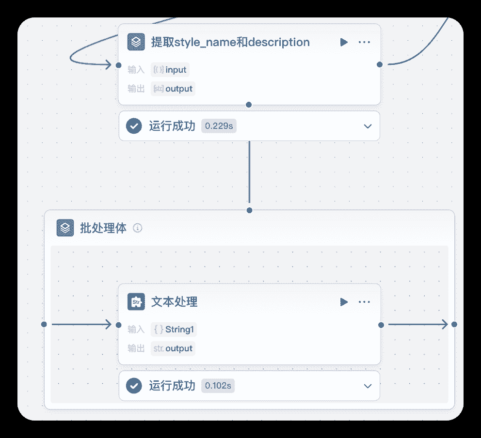

这个业务的核心其实就是把“可用的风格库”中的数据进行简化处理，而且这个是不需要考虑顺序的，最关键的是我希望这个部分不要影响主流程，尽快执行完就好。所以使用批处理节点很合适。

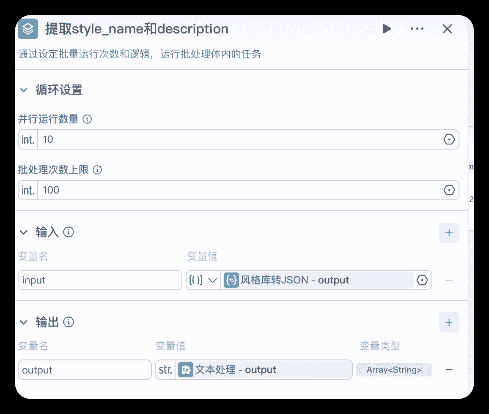

#### 文本处理

由于批处理节点拖家带口，那么我们需要看到里面到底是什么内容，才能了解具体执行了什么。

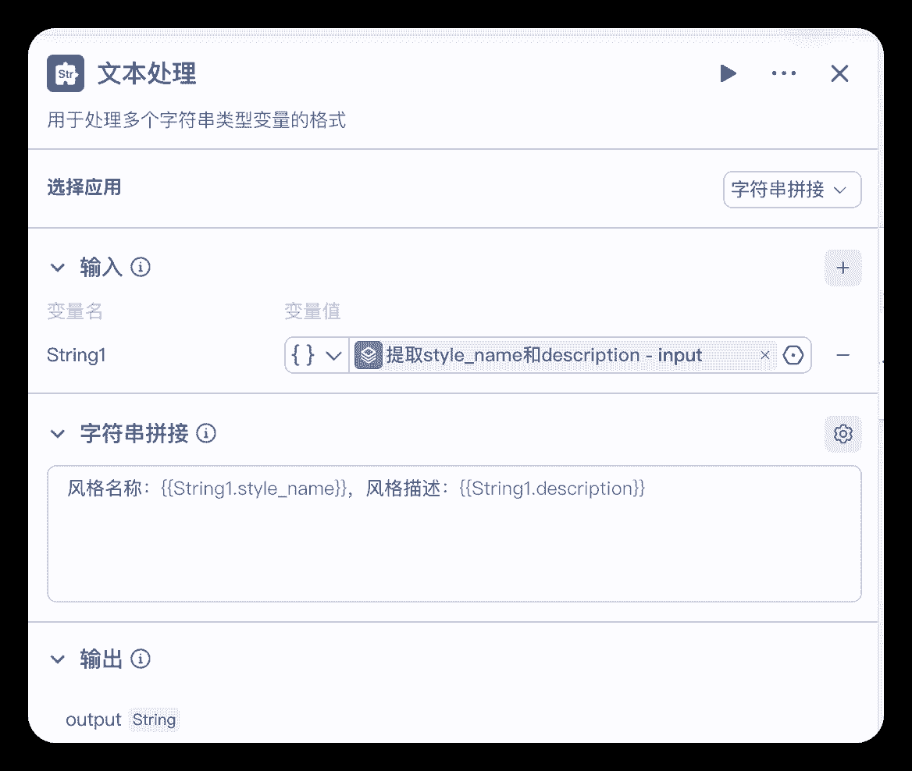

输入变量就是把原有的可用的风格库 JSON 内容做了简化，最后的结果就是

```
封风格名称：吉卜力田园诗 (Ghibli-esque Pastoral)，风格描述：捕捉手绘动画黄金时代的温暖与魅力。这种风格非常适合讲述与自然、成长、友情相关的宁静而充满奇思妙想的故事。画面充满了空气感和生活气息。灵感源于宫崎骏的《龙猫》和《魔女宅急便》。
```

这个结果是不是比原来更加精简，也更加容易阅读了，这个批处理节点其实就是在干这个事儿。

> 如果在使用其他人的工作流，感很费 token 的时候，那么你完全可以去阅读原有的工作流，找到那些无用的内容，但是将其发送给大模型的部分，加一个我这样的处理方式，可以极大节省 token 消耗。就拿我这个举例，如果把其他字段 details 中的信息都发给大模型，那么使用 token 量至少增加一倍，这是一个很好地优化手段，你可以尝试起来。

### 艺术风格选择（大模型）

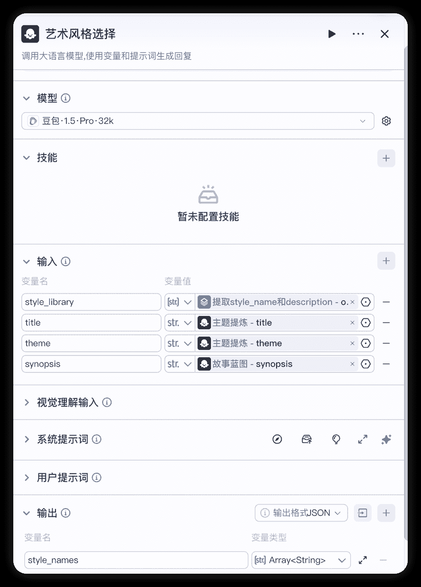

系统提示词如下：

```
你是动画工作室的AI艺术总监。根据故事内容，从预定义风格库中选择最合适的艺术风格。

## 重要背景
- 输出格式：手机竖屏（9:16比例）
- 平台：抖音/YouTube短视频/小红书
- 所有视觉资产必须保持统一风格

## 输入的故事材料

**标题**: {{title}}
**核心主题**: {{theme}}
**故事大纲**: {{synopsis}}

## 可用的风格库

{{style_library}}

## 任务说明

### 步骤1: 分析故事特征
例如：
- 故事的情绪基调是什么？（温馨/神秘/冒险/奇幻等）
- 故事涉及的主要元素是什么？（自然/魔法/日常/科技等）
- 目标受众的年龄和审美偏好如何？

### 步骤2: 匹配最佳风格

根据故事特征，从风格库中选择**5个**适合的风格。这5个风格是**并列关系**，没有优劣之分，都适合该故事。

参考匹配规则：
- **自然、友谊、成长类故事** → &quot;吉卜力田园诗&quot;、温馨类风格
- **魔法、神秘、奇幻类故事** → &quot;奇幻剪影与发光&quot;、神秘类风格
- **科技、未来、冒险类故事** → 现代简约或赛博朋克风格

选择策略：
- 从不同角度匹配故事（温馨度、色彩、情绪等）
- 提供多样性，让后续随机选择更有变化
- 每个风格都要适合故事，只是风格特点不同

### 步骤3: 输出5个风格名称

从风格库中选择5个风格，**只输出风格名称**，不需要输出完整的风格对象。5个风格是平等的，顺序不重要。

## 输出格式

{
  &quot;style_names&quot;: [
    &quot;风格1名称（从风格库中选择，必须与风格库中的style_name完全一致）&quot;,
    &quot;风格2名称（从风格库中选择，必须与风格库中的style_name完全一致）&quot;,
    &quot;风格3名称（从风格库中选择，必须与风格库中的style_name完全一致）&quot;,
    &quot;风格4名称（从风格库中选择，必须与风格库中的style_name完全一致）&quot;,
    &quot;风格5名称（从风格库中选择，必须与风格库中的style_name完全一致）&quot;
  ]
}

## 注意事项

- **以上JSON为输出格式示例**，请按照此格式填写实际内容
- 必须返回**5个风格名称**（字符串数组）
- 每个风格名称必须与风格库中的`style_name`字段**完全一致**
- **5个风格是平等的**，没有优先级或好坏之分
- 5个风格应该从不同角度适合故事，提供多样性
- 确保JSON格式正确
- 后续代码会根据风格名称从风格库中获取完整信息，然后随机选择1个使用
```

这个节点可能又是我设计的一个巧思，首先我让大模型来选择这个故事适合哪个风格，但是我相信多数人会选择让大模型来选择一个合适的，然后直接应用。这里又涉及到一个大模型的原理，它是习惯性选择那个概率最大的，这就导致可能你每次让他选择都会选择那个常见风格，而我测试过 10 次生成至少有 6 次是宫崎骏风格，这就导致你的绘本风格极度趋同，而且大部分都在用宫崎骏风格，你的绘本 AI 味会很重，所以我选择让大模型来生成适合的 5 个。不过，这里有个前期就是，我的多数风格都是适合绘本的，所以重复性就不会太高，而如果你 20 个里面，你有一半的风格是类似毕加索抽象风格的形式，那么相当于你的选项就会少很多，最后结果还是很雷同。

而这个设计其实很类似意图识别节点，只不过之前的意图识别是一次性识别一个分支，但是现在是从多个里面选择几个，有点排列组合中的组合概念，这其实也是我们在大模型使用过程中经常会用的一个方式，这样你的内容会有更加的多样性。举个例子：可能会有很多同学要仿写文章，但是如果经常仿写一个人的风格，很容易被发现有洗稿嫌疑，那么完全可以开始准备多种风格，参考我这个方式来让大模型选择适合的多个风格，而不是一直薅一个人的羊毛。

> 其实，我在做 coze 这个部分做了简化处理，我的原版代码是让大模型从 50 个风格中选择 10 个最不适合，然后做一个差集就可以找到剩下的风格，再从这些风格中挑选。但是在 coze 中用节点实现这个功能比较复杂，虽然用代码可以完成，但是这样会让这个部分占很大篇幅，就不符合我们的主线了，我这里给大家提供一下这个思路，感兴趣可以当做作业自己来实现。

> 我为什么会这么做呢，因为我可以保证我的风格多数都是适合绘本故事，如果让大模型来选择最合适的几个，其实一定会有几个风格绘本经常选中，最典型的就是宫崎骏风格，这就会让人产生审美疲劳，你的绘本 AI 感会增强，但是如果只是让大模型从中选择不合适的，那么在挑选剩下，是不是选择空间大了很多，而且这样会经常给我带来一些惊喜。

### 随机获取一个风格（代码）

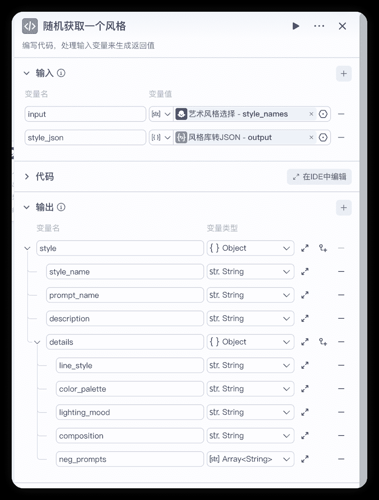

代码如下：

```
import _ from &#x27;lodash&#x27;;
// 引入一个工具库，里面有很多有用的函数

async function main({ params }: Args): Promise&lt;Output&gt; {
    // 主函数开始，接收输入参数，返回处理结果
    
    // 确保输入的内容是一个数组（如果是单个值就转换成数组）
    const inputArray = Array.isArray(params.input) ? params.input : [params.input];
    
    // 从数组中随机选择一个风格名称
    const style_name = _.sample(inputArray);
    
    // 获取风格配置信息（包含所有风格的详细设置）
    const style_json = params.style_json;

    // 创建一个空对象，用来存储风格名称和对应配置的映射关系
    const style_map: Record&lt;string, any&gt; = {};
    
    // 遍历所有风格配置
    for (const style of style_json) {
        // 把每个风格的名称作为键，整个风格配置作为值，存入映射对象
        style_map[style.style_name] = style;
    }

    // 构建最终输出结果
    const ret: Output = {
        // 返回随机选中的那个风格的完整配置信息
        style: style_map[style_name]
    };

    // 返回处理结果
    return ret;
}
}
```

这个就是从上面大模型看好的 5 个风格中随机挑选一个的代码，你完全可以后续依葫芦画瓢来实现类似的随机功能。详细信息，你可以按照行来参考我的代码注释。

## 文本内容准备

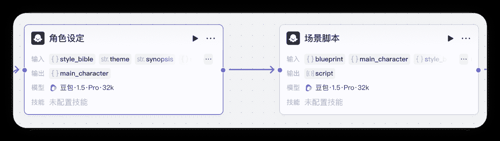

你可能觉得可以绘制绘本了，但其实还不能急，因为这个时候如果想要绘制，故事内容纯靠 AI 发挥，完全就是赌运气，可能偶尔生成的效果很好，但是多数时候它都没办法及格，这个时候我们需要设定一些规则再来生成内容就会好很多。还拿前面迎新会举例，大致的主题和框架定了，也定了使用剧本杀的方式来作为风格，那么这个时候谁当主持人，谁当参演人员这些就很关键了，然后根据这些情况来写具体的执行脚本是不是也顺理成章了。

### 角色设定（大模型）

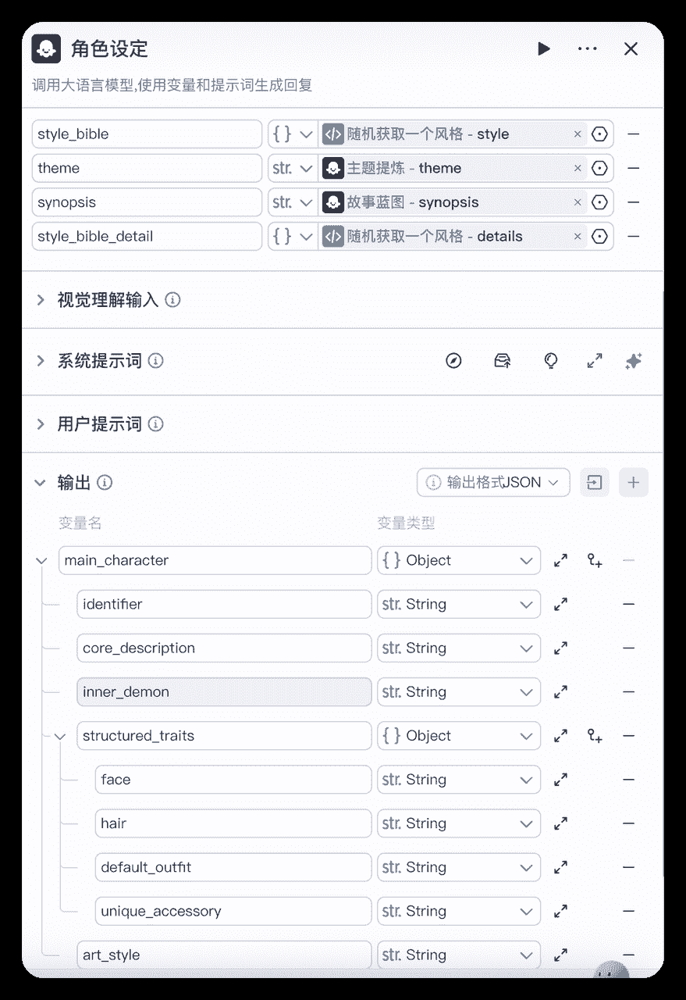

系统提示词如下：

```
你是儿童动画角色设计师。为故事创建完整的主角设定，确保符合艺术风格并体现故事主题。

## 艺术风格约束

**风格名称**: {{style_bible.style_name}}
**风格细节**:
  - 线条风格: {{style_bible_detail.line_style}}
  - 色彩调色板: {{style_bible_detail.color_palette}}
  - 光影氛围: {{style_bible_detail.lighting_mood}}
  - 构图原则: {{style_bible_detail.composition}}
  - 禁止元素: {{style_bible_detail.neg_prompts}}

## 故事背景

**核心主题**: {{theme}}
**故事大纲**: {{synopsis}}

## 角色设计要求

### 主角 (Main Character)
必须包含以下所有要素：

**1. 角色名称 (identifier)**:
- 独特且令人难忘
- 符合故事设定
- 易于儿童记忆

**2. 核心描述 (core_description)**:
- 角色的核心个性
- 角色在故事中的作用
- 与主题的关联

**3. 内心冲突 (inner_demon)**:
- 内在的恐惧或错误信念
- 故事中需要克服的障碍
- 角色成长的关键

**4. 外观特征 (structured_traits)**:
  - **面部 (face)**: 眼睛、鼻子、嘴巴等细节
  - **头发 (hair)**: 发型、颜色、质感
  - **服装 (default_outfit)**: 简单易绘，符合个性
  - **配饰 (unique_accessory)**: 标志性元素

**5. 艺术风格 (art_style)**: 1 - 2句话总结风格圣经核心特点

## 输出格式

{
    &quot;main_character&quot;: {
        &quot;identifier&quot;: &quot;主角名字&quot;,
        &quot;core_description&quot;: &quot;主角核心描述（与主题关联）&quot;,
        &quot;inner_demon&quot;: &quot;主角的内心冲突/心魔&quot;,
        &quot;structured_traits&quot;: {
            &quot;face&quot;: &quot;面部特征描述（符合艺术风格）&quot;,
            &quot;hair&quot;: &quot;发型描述&quot;,
            &quot;default_outfit&quot;: &quot;默认服装描述（简单易绘）&quot;,
            &quot;unique_accessory&quot;: &quot;独特配饰描述（标志性元素）&quot;
        },
        &quot;art_style&quot;: &quot;风格圣经的简明总结（1 - 2句话）&quot;
    }
}

## 注意事项

- **以上JSON为输出格式示例**，请按照此格式填写实际内容。
- 主角必须包含所有字段（identifier, core_description, inner_demon, structured_traits, art_style）。
- 所有描述需确保符合正确的Jinja2语法规范，避免出现语法错误。
- 所有描述必须与艺术风格保持一致。
- 特征描述要具体、可视觉化。
- 确保角色设计支撑故事主题。
- 故事中可能出现其他角色，但不需要在此处定义配角。
```

很多时候我们在做连续画面，经常会感觉怪怪的，很严重的 AI 感，其实很大原因就是因为没有让角色保持一致性。而我这个节点其实就是从文字层面让角色保持一致的，这也决定了后续生成图片的质量，很多人认为只要让图片一致就可以保证角色一致性了，其实我经过尝试这样不够，很多时候图片角色保证了一致性，但是会出现一个问题，就是人物的一些行为和事件与这个人物基调不相符，然后感觉这个故事逻辑很混乱。

我们可以从电影去借鉴一些思想，很多演员会在接到邀请大致看完电影初稿后，会自己尝试去了解人物内心，也就是俗称的人物小传，这个人物是什么性格，应该穿什么服装，然后平时喜欢去什么地方，有什么生活经历，这些会把这个人物变得丰满、真实，进而当有了剧本之后会围绕这个人物小传来不断完善这个人物，渐渐让这个人物立起来。

其实我们这个节点也有点像人物小传，不过我没写的那么细致，只是让大模型生成一些核心点，根据这样一个具体的人物生成出来的内容相对是比较真实的，由于绘本本身的特性，不会有太多的文字以及大篇幅的段落，所以体现不是很明显，但是如果内容稍长就会感觉到这个节点的价值。

> 其实有的时候我们让 AI 生成内容的时候经常会感觉 AI 味很重，其实有一个办法就是给 AI 设定一个具体对象，一定要越具体越好，如果开始不知道可以找一些行业的知名人物作为参考，然后详细描述这个人作为 AI 的人设。

> 举个例子，我们想写一个美妆测评，然后给 AI 立个人设：你的名字叫做 lily，你是一个美妆博主，在当地小城市算是小有名气，但是现在只身一人来到上海，发现自己名气根本不算什么。你平时对自己要求严格，收入的三分之一拿出来去来提升自己，每天早晨 8 点起床，去健身房锻炼，然后喝一杯咖啡吃一个三明治，你已经坚持了三年啦。虽然你是个美妆博主，但是除了品牌商以及测评时用到的化妆品、衣服、包包，其实你自己拥有的并不多，你的 LV 是在你收入第一个二十万的时候买的，当时买完之后你一个月基本都没有去过什么特别贵的餐厅，吃过什么特别的糕点。。。

> 上面我只是举一个例子，没有写完，而且我没有详细去写，你会发现对于多数 AI，如果你把人设打造的足够详细，AI 可能会从你的人设中发现一些蛛丝马迹，从而让你生成的内容和其他人区分开。你可以学着不断丰富这个人设，当然前提是这个人设是自洽的，你生成的内容才会既缺少 AI 味，同时又看起来像是一个真实的人。

### 场景脚本（大模型）

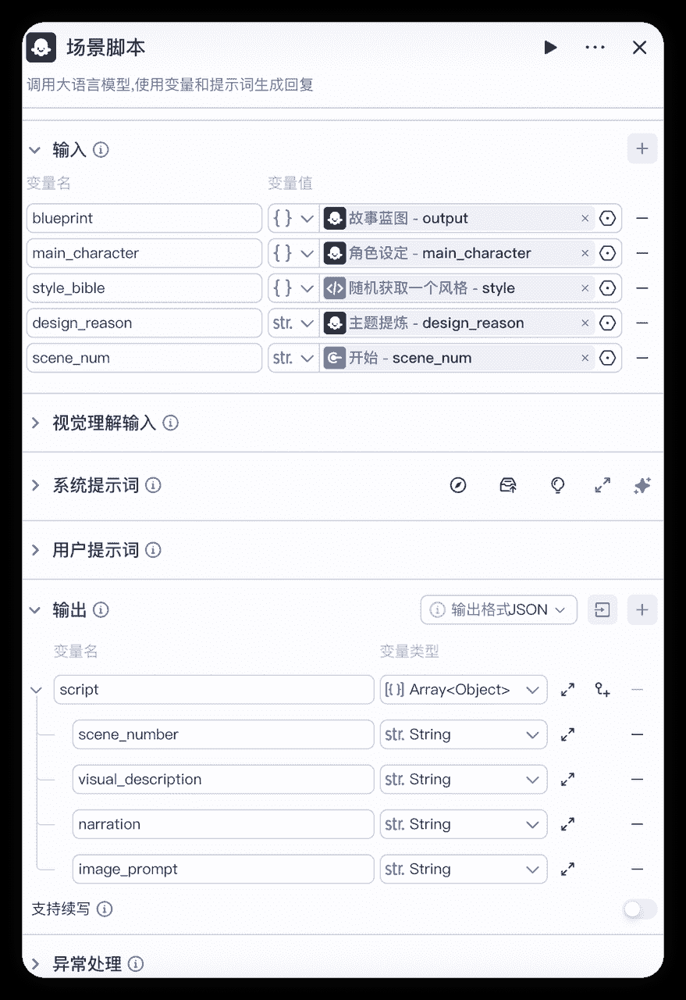

系统提示词如下：

```
你是儿童动画编剧。根据故事大纲、角色设定和艺术风格，创作完整的分场景脚本。

## 重要提示
- **语言**: 所有旁白必须使用中文
- **用途**: 脚本用于TTS语音合成
- **受众**: 5-7岁儿童

## 输入信息

### 故事蓝图

{{blueprint}}

### 角色设定

{{main_character}}

### 艺术风格

{{style_bible}}

### 教育转化策略

{{design_reason}}

## 创作规则（必须遵守）

### 规则1: 开场和结尾特殊要求

**开场场景（第1场）**：
- **旁白格式**: 直接进入故事内容，不需要问候语
- **视觉描述**: 描述故事的第一个场景，展示主角和故事环境
- **图片提示**: 根据故事内容生成具体的场景描述

**结尾场景（最后1场）**：
旁白必须包含两个部分：
1. **教育桥梁**：总结故事的核心知识点，并明确指出与原始内容的关联
2. **思考互动**：设计开放式问题，让孩子思考并联系自己的经验

### 规则2: 五步叙事结构

设计**8-12个核心故事场景**（包含开场和结尾），遵循经典结构：
1. **开端**：介绍主角和世界
2. **首次尝试**：主角行动但失败
3. **至暗时刻**：情况更糟，情感低点
4. **顿悟时刻**：主角获得关键洞见
5. **解决**：运用智慧解决问题

### 规则3: 编剧三原则

1. **展示，不要告知**
   - ❌ &quot;他很伤心&quot;
   - ✅ &quot;他垂下头，肩膀在颤抖&quot;

2. **对话即行动**
   - 每句旁白都有目的
   - 推动情节或揭示内心

3. **保持悬念**
   - 场景结尾留小悬念
   - 吸引观众继续观看

### 规则4: 主角中心

- 每个场景聚焦主角
- 视觉描述主角的行为、表情、所见
- 配角最多出现一次，不能有具体姓名

### 规则5: 简短原则（核心约束）

**⚠️ 硬性规定**：
- 每个场景的旁白**不超过50个汉字**
- 超过50字必须拆分成多个场景

**拆分示例**：
原文（超过50字）：&quot;主角鼓起勇气，走过长长的、黑暗的森林，最终找到了那朵发光的花&quot;

拆分后：
- 场景A：&quot;他深呼吸，眼神坚定，要出发了。&quot;（14字）
- 场景B：&quot;森林里好安静，只有他的脚步声。&quot;（15字）
- 场景C：&quot;看，那是什么？一朵会发光的花！&quot;（14字）

## 输出格式

{
  &quot;script&quot;: [
    {
      &quot;scene_number&quot;: &quot;场景编号（整数）&quot;,
      &quot;visual_description&quot;: &quot;场景视觉描述&quot;,
      &quot;narration&quot;: &quot;场景旁白（不超过50汉字）&quot;,
      &quot;image_prompt&quot;: &quot;图片生成提示词（高度详细，精确描述当前场景的主角动作/表情、环境元素、背景、光影和氛围，消除歧义）&quot;
    }
  ]
}

## 注意事项

- **硬性要求**：每个场景旁白不超过50个汉字
- 场景总数：{{scene_num}}个（包含开场和结尾）
- 开场直接进入故事内容，不需要问候语
- 结尾旁白包含两部分：教育桥梁 + 思考互动
- 所有旁白使用中文
- `visual_description` 必须具体且可视觉化，详细描述主角状态及场景细节。
- `image_prompt` 必须高度详细、精确且无歧义，直接可用于文生图模型，主要包含：
  - **主角**：主角在当前场景中的**具体动作、姿态和面部表情**，突出其情感状态和行为。
  - **环境**：场景的**地点、主要背景元素、时间（白天/夜晚）、季节和天气**，确保这些细节能够区分不同场景。
  - **光影与氛围**：当前场景的**光线来源、强度、颜色和整体氛围（如温暖、神秘、紧张、欢乐等）**，强调场景情绪。
  - **构图与视角**：明确的构图方式（如特写、中景、远景）和视角（如平视、低视角、高视角），以避免歧义。
- `image_prompt` **绝对不能包含**：
  - 已经由 `generation_results.style_bible` 定义的艺术风格细节（如线条风格、色彩调色板等）。
  - 已经由 `generation_results.character_bible.main_character` 定义的全局角色特征（如面部结构、发型、默认服装等）。
  - 通用的负面提示词（如文字、水印、畸形等），这些会在文生图模型调用时作为单独参数传递。
```

到了最关键的部分了，前面那些内容基本都是为这个节点服务的，这个节点的提示词，我建议你根据自己的需求好好做优化，这个提示词其实和我代码中的提示词有些出入，因为我发现在使用 coze 这里面的模型，如果提示词设计的复杂了，很容易出现生成的结果过于呆板，可能是大模型本身能力问题吧，我代码中使用的是谷歌的 Gemini，提示词限制多了反倒它会把很多细节描述出来。

所以这里只能抛砖引玉一下，大家根据自己的需求来改提示词，如果可以去更换一些其他模型看看效果如何，尽量选择自己成本可接受范围内最好的模型来实现这个节点，其他节点可以用一些差的模型，但是这个节点用一些生成效果好的模型远比你去优化提示词来的方便。

## 生成人物图片

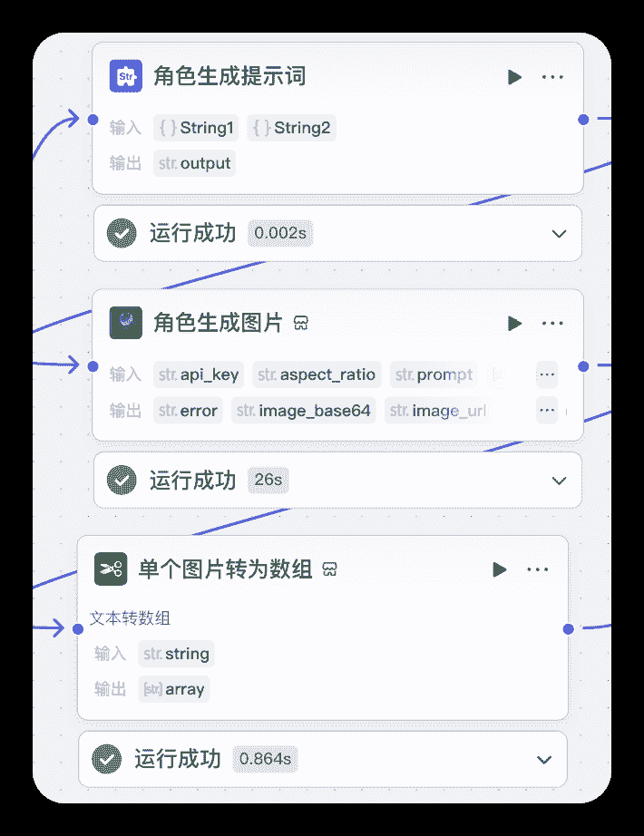

文字生成部分我们基本结束了，剩下的就是如何来生成图片了，前面说了给人物列小传可以保证角色一致性，但是这个需要不断调整和打磨，而且多数人可能不会那么在意，而最直接的办法就是先生成一个角色，然后后续围绕这个角色来生成图片。而这个部分就是为了更好地生成角色图片服务的。

### 角色生成提示词（文本处理）

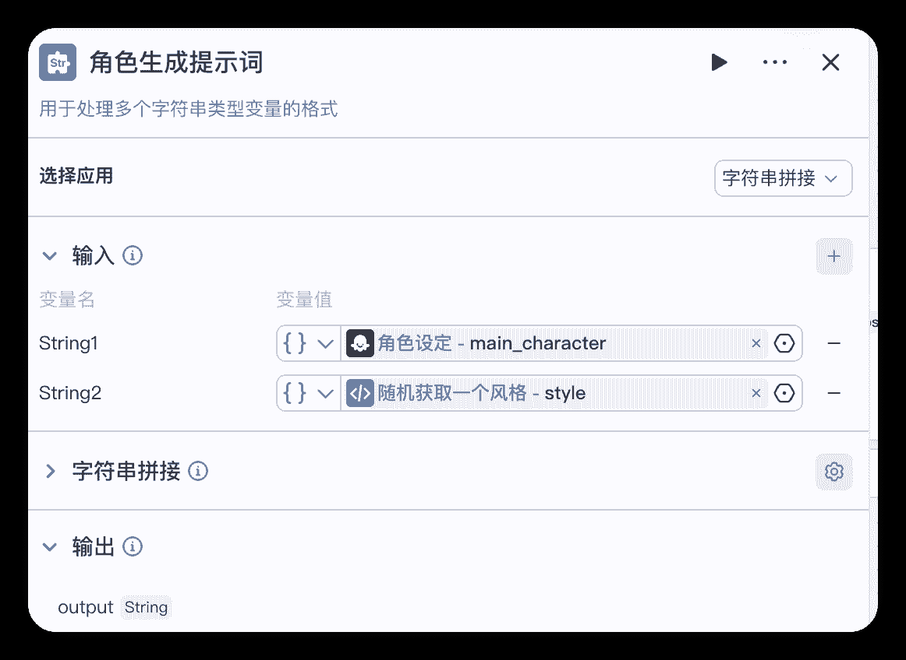

字符串拼接的文本信息：

```
你是世界级的角色设计师，请为以下儿童绘本主角设计一张包含所有关键参考视图的综合性角色设计参考图。

**核心指令**：根据提供的角色特征和艺术风格，在一张图中同时呈现以下元素，确保它们布局清晰、易于识别，并且相互之间有足够的留白。所有元素必须严格符合角色特征和艺术风格。图片必须高清晰度、线条清晰、色彩准确、无变形扭曲、无多余元素、无任何文字、水印或标记。

**主要内容**：
1.  **脸部特写（Face Close-up）**: 清晰的角色脸部特写。
2.  **正面全身（Front Full-body）**: 清晰的角色正面全身图。
3.  **侧面全身（Side Full-body）**: 清晰的角色侧面全身图。
4.  **背面全身（Back Full-body）**: 清晰的角色背面全身图。

**角色名称**: {{String1.identifier}}

**角色核心描述**: {{String1.core_description}}

**角色特征**: 面部: {{String1.structured_traits.face}}, 发型: {{String1.structured_traits.hair}}, 服装: {{String1.structured_traits.default_outfit}}, 配饰: {{String1.structured_traits.unique_accessory}}

**艺术风格**: {{String2}}

**构图要求**:
-   将上述四个视图（脸部特写、正面全身、侧面全身、背面全身）以四格漫画（four-panel comic strip）的形式布局在一张画布上。
-   每个视图必须清晰独立，且相互之间有足够的留白。
-   整体构图应清晰、专业，如同专业角色设计稿。
-   背景应简洁，不干扰主要设计元素。

**负面提示词**: 文字, 水印, 标记, 复杂背景, 多余角色, 扭曲, 变形, 多余肢体, 解剖错误, 模糊, 噪点, 像素化, 失真, 色彩异常

**最终格式**: PNG图片
```

这节点其实就是为了方便把提示词展现出来，因为我们后续使用的不是官方的图片生成节点，所以没有对应的提示词文本输入框，这里使用这个方式可以方便大家查看和修改提示词。如果你也遇到使用第三方没有写提示词的文本输入框，可以试试我这个办法。

### 角色生成图片（插件-banan 生图）

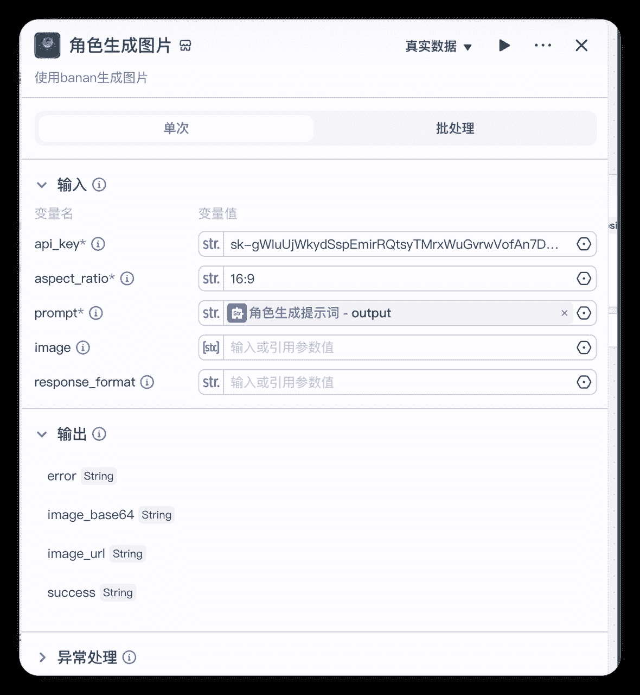

你发现这个画风和其他的似乎不一样，是因为这个我使用了自己开发的插件来生成图片，我试了 coze 官方提供的图片生成工具，便宜的模型生成效果很差，贵的模型效果很好但是不是很稳定，最终还是选择了谷歌的 nano-banana 来作为图片生成的模型，但是 coze 官方不提供，我去找了其他插件，要不价格太高，要不是文档写的很乱，所以我找了好多平台进行试用，然后自己开发了一个调用插件。其他节点找起来比较简单，但是这个可能对于刚入门的人来说很复杂。我来一步步演示操作步骤。

1.  点击“添加节点”，然点击“插件”按钮

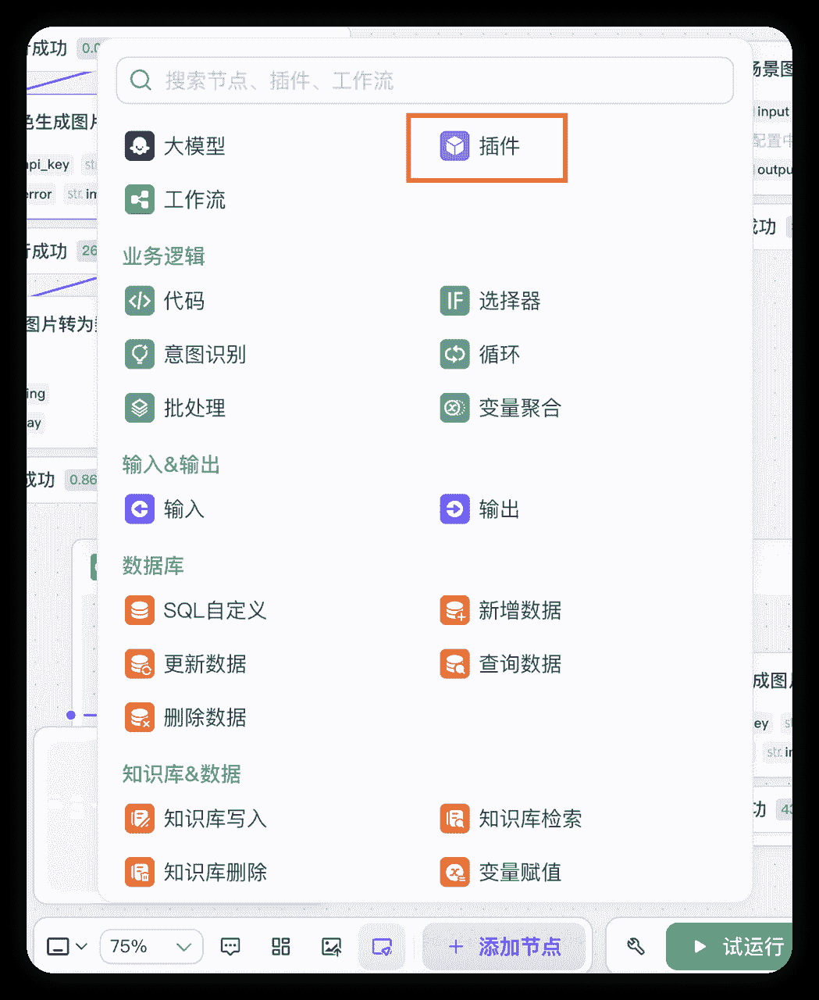

1.  一个新的弹框出现，在搜索框中输入“banan 生图”，这里我需要澄清一下，不是我不会拼 banana 这个单词，而是审核多次之后不通过，最后询问客服发现可能是命名的问题，最后只能改成这个名字。

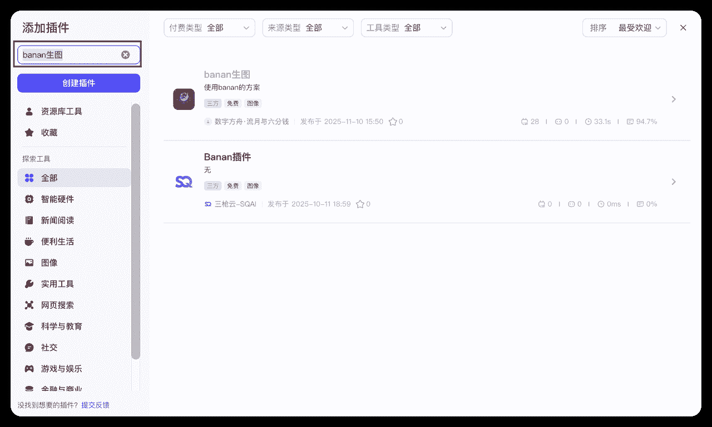

1.  然后点击一个箭头按钮，在点击添加按钮

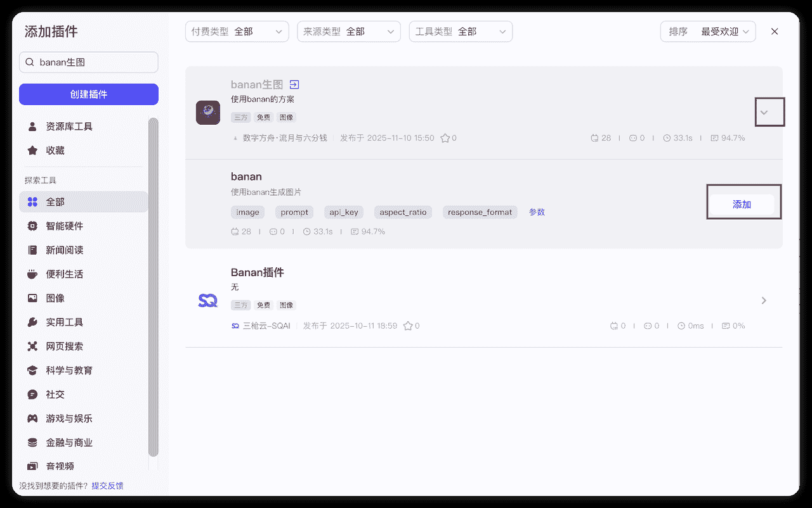

1.  你会发现出现了一个新的节点，这个就是我们刚才的插件，其他插件也是这样的添加方式

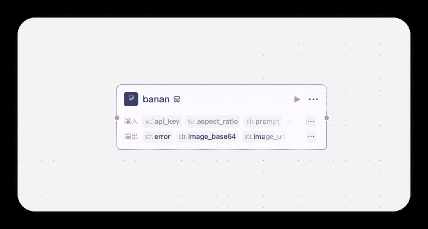

1.  点击这个插件就会弹出如下的侧边框，然后依次输入内容即可，可以参考我的插件文档，我对于这些如何调用的信息写的还是比较详细的，https://www.coze.cn/store/plugin/7570947057146445834。不过，本着从零的教程，我给大家讲一遍。

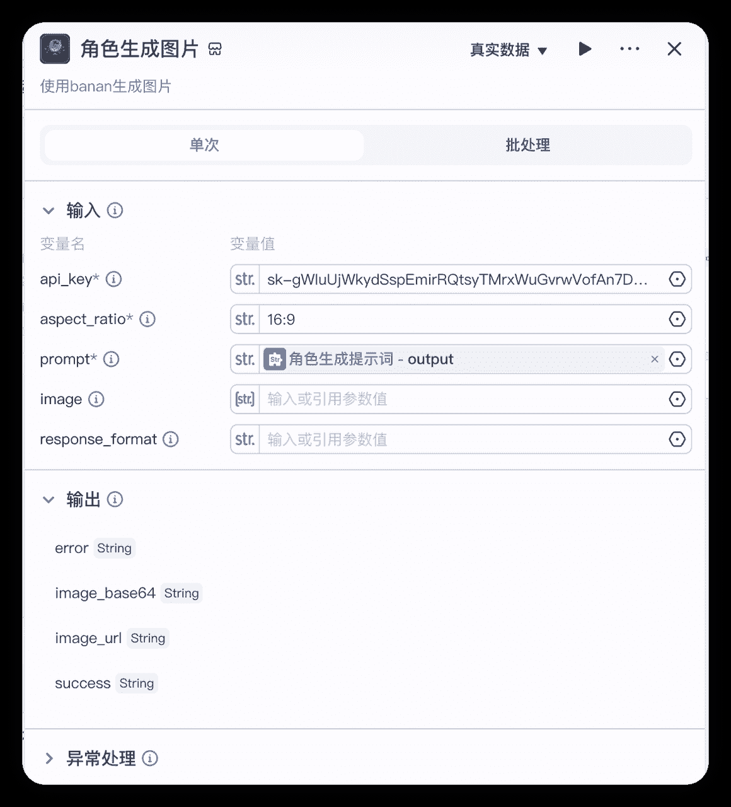

+   api_key：这个是一个平台的密钥，你需要自己获取并且充值然后就可以获取了，具体步骤如下：

+   点击这个链接：https://api.whatai.cc/register?aff=R4av56198，然后填写注册的相关信息，并登录，你看到左边会有一些步骤，直接按照步骤做即可，当然也可以看我的下面教程

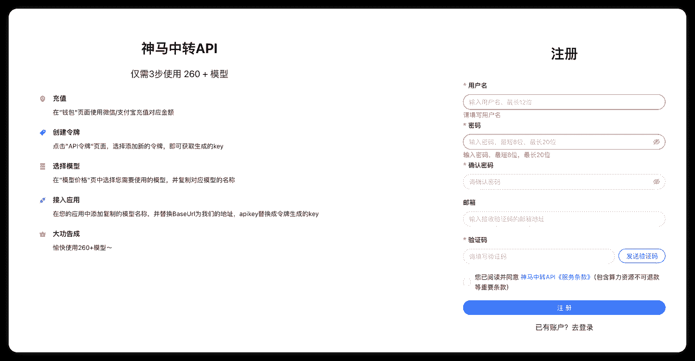

+   进入 https://api.whatai.cc/token，这个页，点击添加“添加令牌”按钮

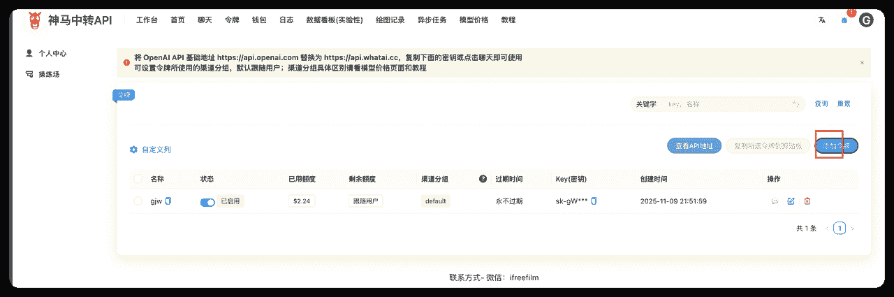

+   然后弹出下面的侧边框，输入对应信息点击提交，如果你不知道其他信息，只需要输入名称即可，后续了解了再修改


+   然后列表页中的信息，点击红框中的复制按钮就是你的 key，粘贴到刚才的 api_key 的位置即可


+   在 https://api.whatai.cc/dashboard 这个页面可以进行签到，获得一下额度，你可以开始测试时候不需要充值，后续长期使用再来充值。我目前测试好多这个还算比较稳定，而且由于 nano-banana 的 api 本身是调用谷歌的 gemini-2.5-flash-image-preview，但是这个模型不是单纯的文生图模型，所以会有一定概率不出图片，这个平台如果不出图片会退还费用，这样相比较而言还是比较合算的，基本一张图 0.16 元。

> 这里有个小 tips，就是很多平台会说自己调用模型很便宜，例如：固定价格$0.08/次，你这个时候要看平台 1 美元额度的换算，然后你就能知道充值一美元大约用几次或多少 token，但是这个还不算完，你需要查看充值页面你要花多少人民币才能得到 1 美元，很多平台会标榜自己调用便宜，但是其实充值换算就会提升价格。

> 大家如果找到更加便宜的 nano-banana 的 api 也可以替换成自己的，逻辑是一样的，如果没有对应 coze 插件，又不会写插件代码，可以评论区给我对应平台链接，我去适配。

> 不过不建议在这种平台一次充值太多，因为这些平台非官方很容易出现风险，当然如果有条件还是支持官方的平台或者相对于更加大一些的平台。

> 我在代码中就使用的是谷歌的官方，但是无奈 coze 无法使用只能我做个插件妥协了。但是目前最好还是使用 nano-banana 来生成图片，我最早使用的谷歌早期的文生图模型，虽然效果不如 banana，但是已经和其他那些主流模型基本持平了，现在 banana 可能是断层领先。据说要说最近会出 nano-banana2，到时候我也会添加对应的插件调用方式的。

+   aspect_ratio：图片宽高比，必需。可选值： 4:3， 3:4， 16:9， 9:16， 2:3， 3:2， 1:1， 4:5， 5:4， 21:9

+   prompt：生成提示词，必需。前面生成的提示词就派上用场了。

+   image：输入图片 URL 列表，可选。用于图片编辑或生成变体，这次生成角色用不到。

+   response_format：响应格式，可选，默认值： url。可选值： url， b64_json，不知道则不需要修改

返回结果一般只需要关注 image_url，这个就是一个图片的 url 链接

这个插件我基本讲明白了，后续大家想要高质量生成图片，可以用我这插件，毕竟谷歌的 nano-banana 是目前生图的最佳选择，其他都没他全面。

> 你如果仔细查看我上面的提升词，你会发现其实不是让 banana 生成一个图片，而是生成四个图片，只不过最后是把这四张图布局在一张画布上，这个是一个核心。其他模型未必能够实现这个效果，即使实现也不是很稳定，这也是我选择 nano-banana 的原因，而在早期我代码实现的方式是基于一张全身图，生成其他三张图，最后用代码拼接在一起，而现在使用 banana 一次就搞定，而且成本省了很多，最关键的是不会出现矛盾的画面。

> 为什么会想着拼在一起呢，而不是直接用一张全身图呢。其实核心还是在于保证后续人物的一致性，因为只有全身照，但是你的动作中有背面场景或者其他动作场景，而且这些场景有很多张场景图需要，那么很容易出现这个人的背面每次是不一样的。如果你还在生成场景的时候出现一些面部特征，只有全身照就会出现面部不一样的情况，因为全身照会稀释面部的具体特征，而在生产场景时很容易因为稀释导致面部不一致，这也是很多 AI 生成连续画面偶尔出现人物诡异的原因。而这个其实是参考了电影或者游戏中的人物展示方式，四个角度基本可以把人物整体效果展现出来了，尽可能减少问题。

> 但是这个前提是这个图片模型本身对于这个识别能力比较强，这也是为什么我推荐 nano-bananad 的原因。

### 单个图片转为数组（插件-文本转数组）

这个插件有点难找，我之前用这个就保留下来，你也可以替换成其他自己熟悉的文本转数组的插件，下面我告诉你怎么找。

+   搜索“剪映小助手”，然后找到一个剪刀图标部分，点击后展开


+   往下滚动到后面发现一个叫 Str_Array 的点击添加即可

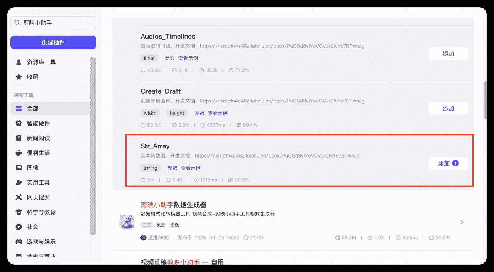

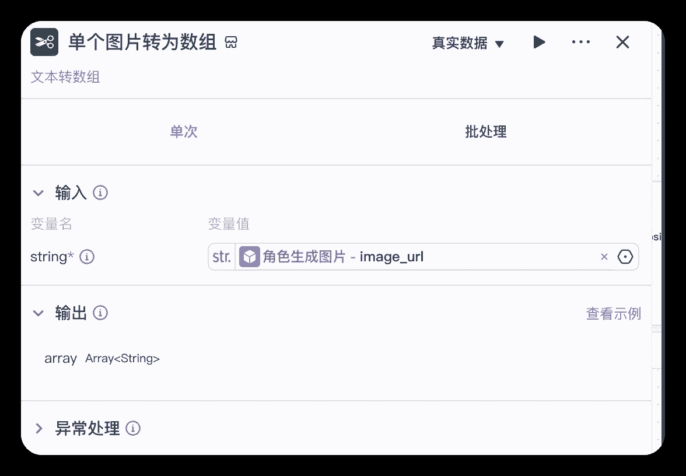

参数按照我上面的图片配置即可，这个主要干的事儿就是把字符串转成数组，后面会用到。虽然使用代码节点其实也很容易实现，但是我建议能用别人的插件尽量去用，而不是自己去写，毕竟最后代码节点给其他使用成本还是有些高的，而且在软件开发中有句话叫做“不要重复造轮子”。

## 生成场景图片

到了我们最关键的一步，就是把前面的所有物料转换成最终的绘本场景图片。

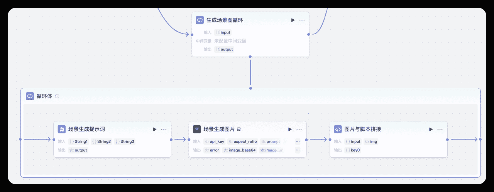

### 生成场景图循环（循环）

你发现这次这个节点又拖家带口了，为什么说又呢？因为前面批处理节点也是这样的，你可能会有这样的疑问，为什么这里不用批处理节点呢，因为我们前面提到批处理节点不保证顺序，而绘本生成图片的顺序很关键，所以这里用循环节点。我们来拆解一下这个部分干了什么。

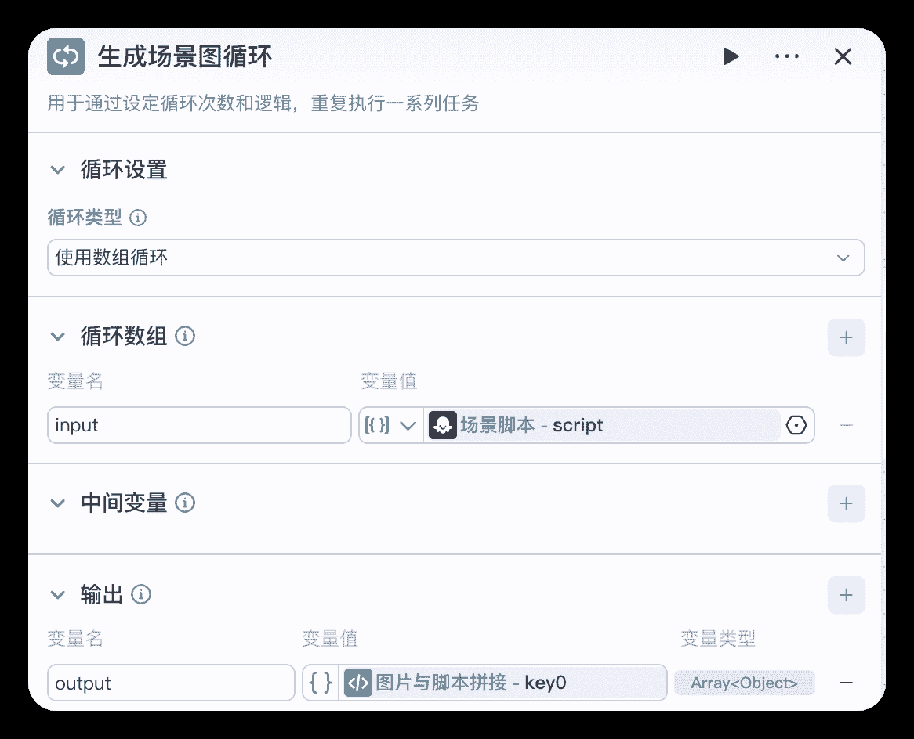

#### 场景生成提升词（文本处理）

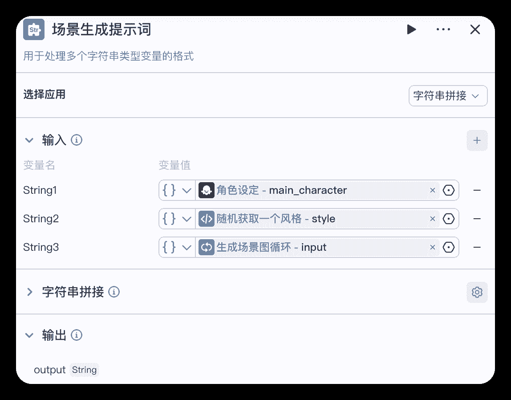

**字符串拼接内容如下：**

```
你是绘本插画师，基于参考图为场景创作插图。

**核心指令**：根据提供的场景描述和图片提示，结合角色特征和艺术风格，为场景创作插图。**确保图片中主角面部、发型、服装、独特配饰与参考图高度一致。** 构图应采用平视或中景，避免极端视角（如鱼眼镜头、超远景）和手部特写。图片必须高清晰度，色彩准确，儿童友好，无任何文字、水印或标记。背景、动作、姿态和氛围需与场景描述精确匹配。

## 核心任务

**基于参考图编辑**：
- 输入：主角参考图
- 保持：面部、发型、服装不变
- 修改：背景、动作、姿态、构图、氛围

## 铁律约束（最高优先级）

### 角色特征（绝对不可改变）
- **面部**: {{String1.structured_traits.face}}
- **发型**: {{String1.structured_traits.hair}}
- **服装**: {{String1.structured_traits.default_outfit}}
- **配饰**: {{String1.structured_traits.unique_accessory}}

### 艺术风格（必须严格遵守）
- **风格名**: {{String2.style_name}}
- **线条**: {{String2.details.line_style}}
- **色彩**: {{String2.details.color_palette}}
- **光照**: {{String2.details.lighting_mood}}
- **构图**: {{String2.details.composition}}


## 场景要求

**场景编号**: {{String3.scene_number}}

**场景描述**:
{{String3.visual_description}}

**图片提示**:
{{String3.image_prompt}}

**额外要求**:
- **一致性**: 角色与参考图的各个细节必须保持绝对一致。
- **动作与表情**: 角色在场景中的动作和表情要符合 `visual_description` 和 `image_prompt` 的具体描述。
- **背景细节**: 背景应丰富但不过度复杂，能够烘托场景氛围，但不分散对角色的注意力。避免背景出现与故事无关的元素。
- **光影效果**: 严格遵循艺术风格的光影氛围，营造出场景所需的特定情绪。
- **儿童友好**: 所有内容必须适合5-7岁儿童，避免任何可能引起不安或误解的元素。
- **只能生成一个场景的图片**：要求生成的图片只有一个场景，不能存在多个图片的拼接情况

**负面提示词**: 文字, 字母, 数字, 水印, 标记, 畸形, 扭曲, 多余肢体, 不适内容, 鱼眼镜头, 超远景, 手部特写, 分散注意力的背景元素, {{style_bible.details.neg_prompts}}

**参考图**: [使用提供的角色参考图作为基础]

**最终格式**: PNG图片
```

这个和之前“角色生成提示词”的功能一样，就是为了方便查看和修改场景图片提示词，就不再赘述了。

#### 场景生成图片

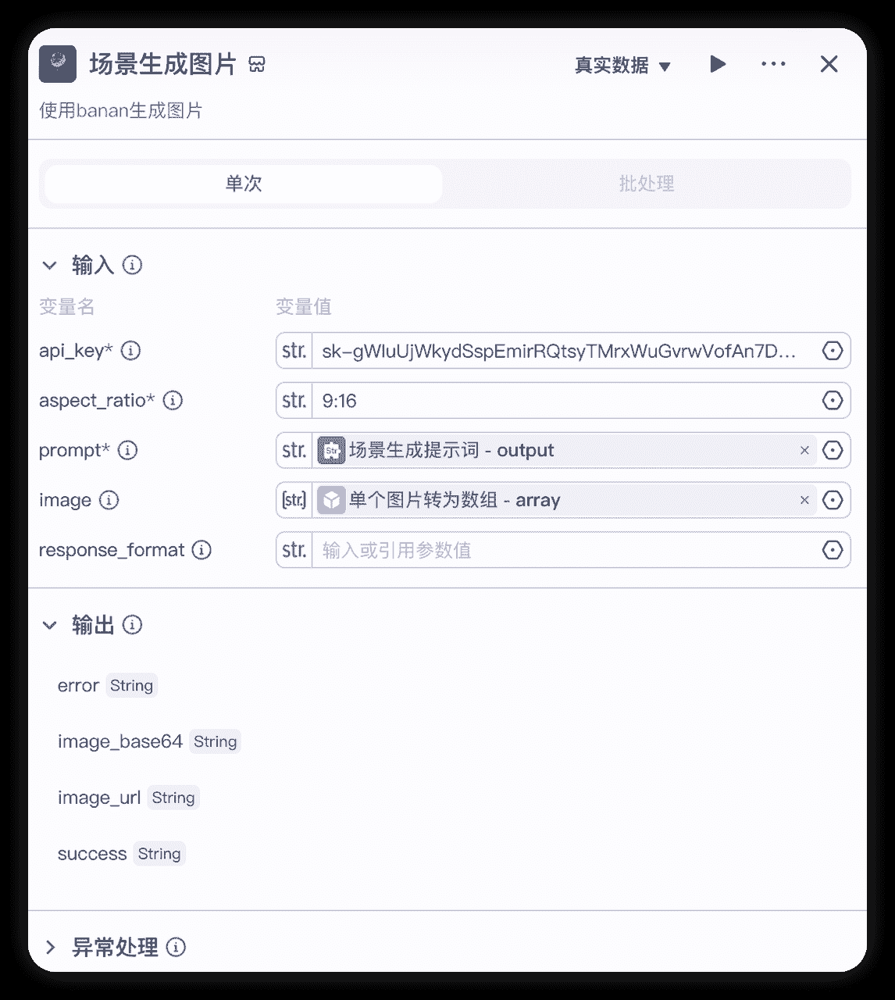

这里也是使用我之前的 banan 生图的插件，和角色生成图片是类似的，唯一的区别就是 image 这里面有参数，你查看上面的提示词可以看到要参考图片来生成场景，其实这就是保证每次生成的人物是一致的。而这个方式其实不是在生图，而是在编辑图，相当于有一个主角的图片，然后根据提示词描述的场景，让这个主角图片尽量贴合这个场景的画面。无论你文字描述这个主角多么详细，总是有细节是语言无法描述的，还不如直接给一个图片让生图模型参考，最后来编辑图片得到的效果更好、也更方便。

#### 图片与脚本拼接

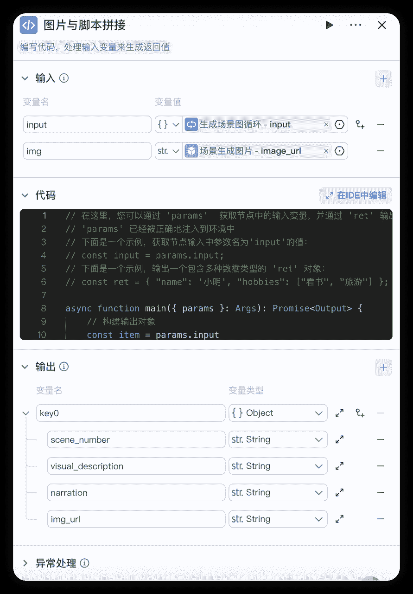

代码如下：

```
// 在这里，您可以通过 &#x27;params&#x27;  获取节点中的输入变量，并通过 &#x27;ret&#x27; 输出结果
// &#x27;params&#x27; 已经被正确地注入到环境中
// 下面是一个示例，获取节点输入中参数名为&#x27;input&#x27;的值：
// const input = params.input; 
// 下面是一个示例，输出一个包含多种数据类型的 &#x27;ret&#x27; 对象：
// const ret = { &quot;name&quot;: &#x27;小明&#x27;, &quot;hobbies&quot;: [&quot;看书&quot;, &quot;旅游&quot;] };

async function main({ params }: Args): Promise&lt;Output&gt; {
    // 构建输出对象
    const item = params.input
    const result = {
        ...item,
        &quot;img_url&quot;: params.img
    };

    const ret = {&quot;key0&quot;:result};
    return ret;
}
```

这个代码核心其实就是把生成的图片和之前生成的各种内容拼接在一起，并且保证图片和文本内容是对应的。

## 图片拥有旁白

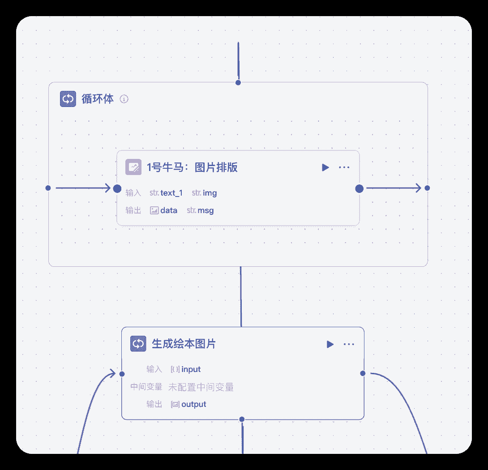

前面图片生成了，但是绘本不能光有图片，文字也是绘本的关键，所以我们要想办法让图片上有文字。

### 生图绘本图片（循环）

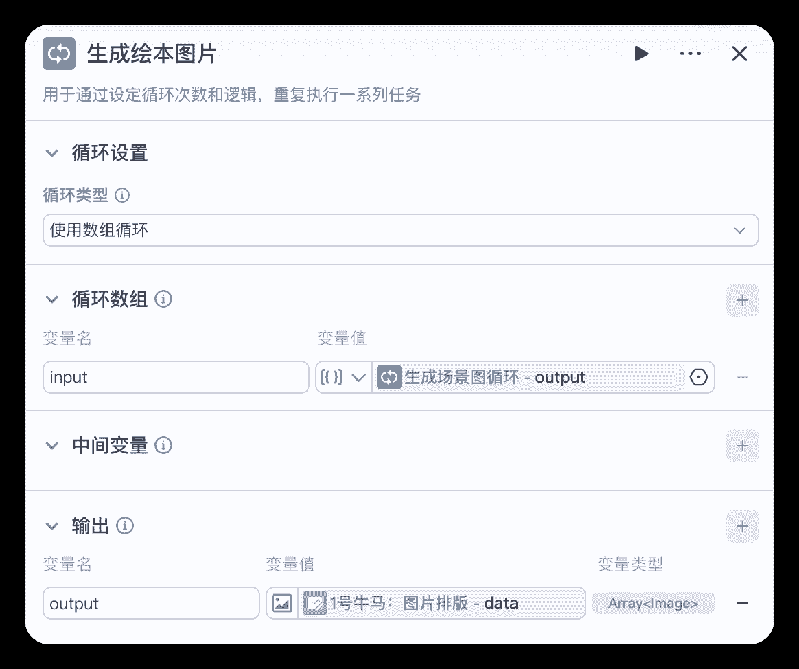

还是用到循环，你应该这里也能理解为什么不用批处理的原因了吧。核心就是把每张图片和文字结合起来。

#### 1 号牛马：图片排版（画板）

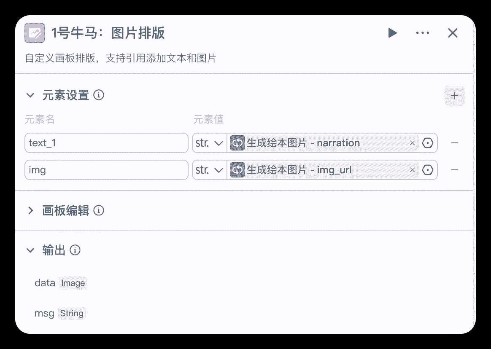

这个节点这么看其实没什么复杂的，但是这个节点其实很难用文字讲清楚，我尽量讲的详细一些，来让你可以尽量还原我的模型，也有能够自己修改的能力。

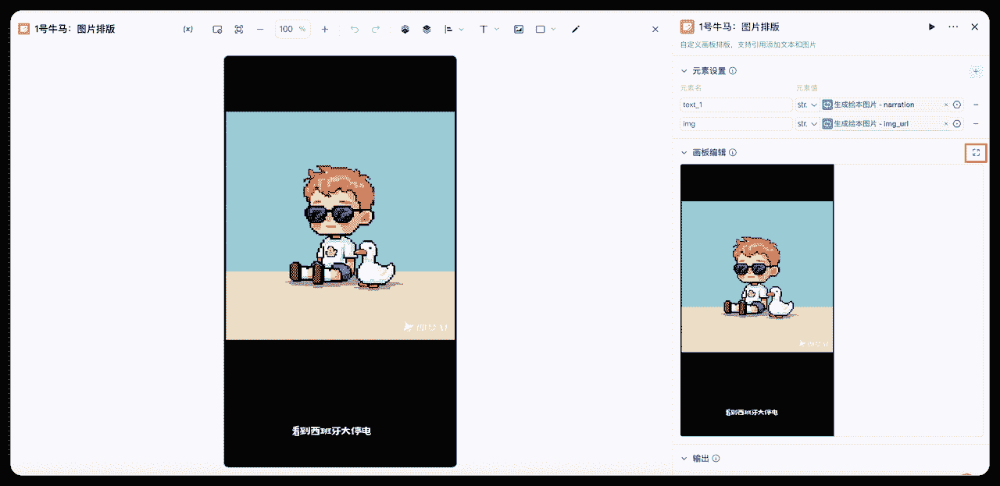

如果你是开始新建这个节点，你点击“放大图标“的按钮，你会看到如下情况，你可能会很懵，是因为这里面需要添加一些信息才能变成我的这个样式。

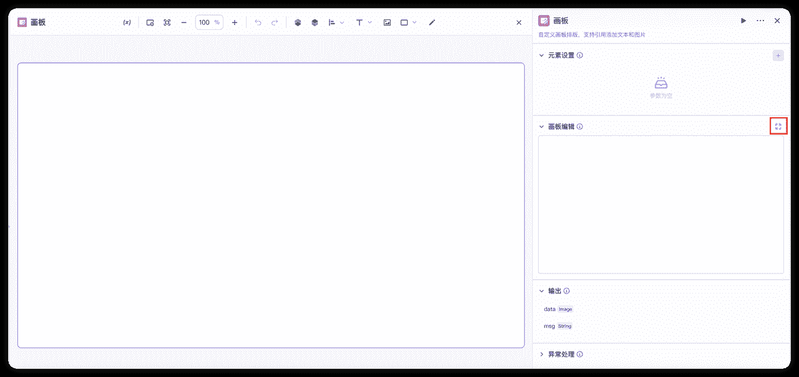

1.  首先点击下面的红框按钮，按照我的设置进行设置，一定要原封不动的抄下来。

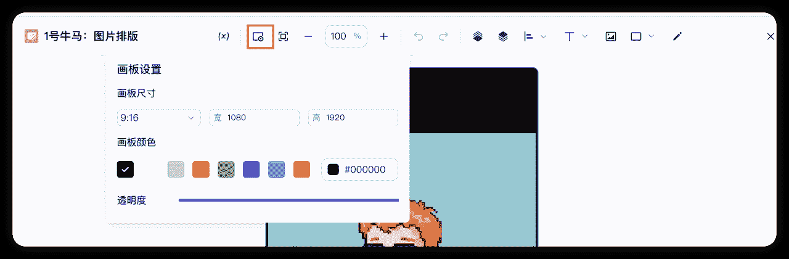

1.  点击红框按钮，随便上传一张图片，最好是一张方形图片，然后把图片进行拖拽，拉大到和我这个方式类似

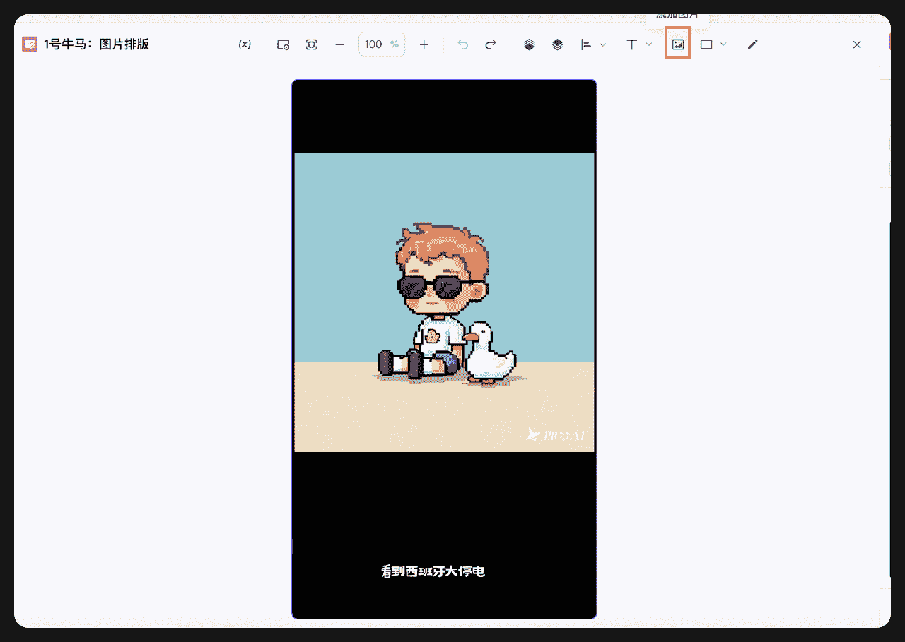

1.  然后点击这个图片，按照我下面的配置方式进行设置，这样图片就设置好了


一定要确保右边的元素设置是对的，同时在方框图片中进行图片的加载，然后选择图片后把引用选择刚才的img

1.  下面开始设置文字，点击红框图标，然后一定要选择区块文本。


1.  然后像 word 中的文本框一样，可以通过拖拽产生一个框，类似下面的效果，由于使用的背景是黑色，可能不是很明显，但是肯定是有的。


1.  然后模仿我下面的内容进行修改，最关键的是一定要把这个框放到最大，类似我红框的效果，至于其他字体、字号、间距、颜色按照你你舒服的来就好。最好可以按照我的圆圈把文字改为水平居中，这样看起来会美观一些。


这个画板的设置基本就讲了，不过你也可以根据自己的需求做调整，这个多用几次就熟悉了，后续需要将图片和文字进行拼接都可以用这个，当然不只是这个玩法，剩下就有你来探索了，这也是我认为 coze 最独特的一个工具设计。

## 平台发布信息

### 发布平台信息


系统提示词如下：

```
你是内容创作者，为绘本故事创建各平台的发布包。

## 内容信息

- **标题**: {{title}}
- **主题**: {{theme}}
- **故事概要**: {{synopsis}}
- **核心价值**: {{moral_of_the_story}}
- **完整脚本**: {{script}}
- **项目类型**: children_story（儿童故事）

## 创作原则

### 去AI味，做真人
- 真实分享，不过度营销
- 自然表达，像朋友聊天
- 适度优化，不刻意迎合算法
- 真实情感，有个人观点

### 儿童故事特色
- 充满童趣和好奇心
- 制造悬念，激发互动
- 亲子视角，引导讨论
- 可爱表情：🌟✨🎈🎨📚👶🧸

## 平台发布包

### 抖音 (Douyin)
**要求**:
- 标题：≤28字，制造好奇
- 风格：用孩子视角提问
- 内容：聚焦最奇特想象，反问结尾
- 标签：最多4个，如 #育儿 #亲子 #绘本 #动画

**示例标题**:
&quot;如果小动物会说话，第一句会说什么？&quot;
&quot;妈妈，为什么小猫会害怕水呀？&quot;

**示例描述**:
&quot;今天给宝宝讲了这个故事，看到小猫克服恐惧的那一刻，娃问我：&#x27;妈妈，我也能像小猫一样勇敢吗？&#x27;💕 你家娃也问过类似的问题吗？评论区告诉我！&quot;

---

### 小红书 (Xiaohongshu)
**要求**:
- 标题：≤18字，价值导向
- 风格：&quot;大数据请推给宝妈&quot;开头
- 内容：详细介绍+亲子互动指南+强引导收藏
- 标签：最多9个

**示例标题**:
&quot;5岁娃必看的勇气启蒙绘本！&quot;
&quot;给娃的想象力插上翅膀✨&quot;

**示例描述**:
&quot;宝子们！大数据请把我推给宝妈！🌟

发现了一本超治愈的绘本，讲的是小猫克服恐惧的故事💕

📚 亮点：
✨ 画风温馨，孩子超喜欢
✨ 教会宝宝什么是真正的勇气
✨ 适合睡前亲子共读

🎈 亲子互动3问：
1. 你觉得小猫勇敢吗？
2. 你有什么事情害怕做吗？
3. 你愿意像小猫一样帮助朋友吗？

赶紧收藏起来，不然就找不到了！💝&quot;

---

### Bilibili
**要求**:
- 标题：专业解读视角
- 风格：强调独家、深度
- 内容：分析艺术风格或内涵，求三连
- 标签：空格分隔，不带#

**示例标题**:
&quot;【绘本拉片】这本画风超美的绘本，到底讲了什么？&quot;

**示例描述**:
&quot;这期给大家拉片一本超治愈的绘本📚

画风是吉卜力风格，每一帧都像壁纸🎨
故事讲的是勇气和友情，但深层其实在探讨什么是成长

时间轴：
0:00 开场
2:30 故事解析
5:00 深层内涵
7:00 总结

制作不易，点赞关注支持一下吧！&quot;

---

### 视频号 (WeChat Channels)
**要求**:
- 标题：≤16字，逗号用空格代替
- 风格：强调社交货币
- 内容：核心价值+金句+引导转发
- 标签：简洁正能量

**示例标题**:
&quot;这个故事 一定要讲给孩子听&quot;

**示例描述**:
&quot;什么是真正的勇气？

这个故事给了最好的答案：勇气不是没有恐惧，而是即使害怕也要帮助朋友💕

建议每个家长都讲给孩子听🌟

快转发给家里有娃的朋友吧！&quot;

---

### 快手 (Kuaishou)
**要求**:
- 风格：接地气，&quot;家有萌娃集合&quot;
- 内容：用网络热词，引导互动
- 标签：大众化、高流量

**示例描述**:
&quot;家有萌娃的集合啦！🎈

笑不活了家人们，今天给娃讲了这个小猫的故事，娃听完问我：&#x27;妈妈，我也能这么勇敢吗？&#x27;

瞬间感动到😭

你家娃也这么可爱吗？评论区聊聊！&quot;

---

### 微信公众号图文
**要求**:
- 标题：≤26字
- 风格：温暖亲子、图文适配
- 内容：三段式结构
- 标签：亲子教育相关

**示例标题**:
&quot;每个孩子都需要听的勇气故事&quot;

**示例描述**:
&quot;亲爱的家长朋友们，今天想和大家分享一个关于勇气的绘本故事。

【故事梗概】
小猫咪咪天生怕水，但当好朋友小鸭掉进水里时，她必须克服内心的恐惧...

【故事启发】
真正的勇气，不是没有恐惧，而是即使害怕也要做正确的事。这正是我们希望孩子理解的成长道理。

【亲子实践】
睡前和孩子一起读这个故事，问问他：你有什么事情害怕做吗？我们可以怎样一起克服？

如果觉得有启发，请点击&#x27;在看&#x27;并分享给更多家长💕&quot;

---

### YouTube
**要求**:
- 标题：国际化表达
- 内容：适度表情符号
- 标签：中文+国际标签

**示例标题**:
&quot;勇气启蒙绘本 | 教会孩子什么是真正的勇气 | 亲子共读&quot;

**示例描述**:
&quot;这是一个关于勇气和友情的温馨绘本故事📚

故事讲述了小猫咪咪克服对水的恐惧，勇敢救助朋友的经历。通过这个故事，孩子们能理解：真正的勇气不是没有恐惧，而是面对恐惧时选择做正确的事🌟

适合：5-7岁儿童
主题：勇气、友情、成长
风格：温馨治愈、吉卜力风

如果喜欢，请订阅频道并点赞支持💕&quot;

## 输出格式

{&quot;output&quot;:{
  &quot;douyin&quot;: {
    &quot;title&quot;: &quot;抖音标题（≤28字）&quot;,
    &quot;description&quot;: &quot;抖音描述（含表情）&quot;,
    &quot;tags&quot;: &quot;#育儿 #亲子 #绘本 #动画&quot;
  },
  &quot;xiaohongshu&quot;: {
    &quot;title&quot;: &quot;小红书标题（≤18字）&quot;,
    &quot;description&quot;: &quot;小红书描述（结构化+表情）&quot;,
    &quot;tags&quot;: &quot;#育儿经验 #亲子阅读 #绘本推荐 #早期启蒙 #带娃 #儿童教育 #勇气 #友情 #睡前故事&quot;
  },
  &quot;bilibili&quot;: {
    &quot;title&quot;: &quot;B站标题&quot;,
    &quot;description&quot;: &quot;B站描述（专业+时间轴）&quot;,
    &quot;tags&quot;: &quot;绘本 亲子 睡前故事 育儿 童话 勇气 友情&quot;
  },
  &quot;wechat_channels&quot;: {
    &quot;title&quot;: &quot;视频号标题（≤16字）&quot;,
    &quot;description&quot;: &quot;视频号描述（金句+价值）&quot;,
    &quot;tags&quot;: &quot;#家庭教育 #情商启蒙 #睡前故事 #育儿 #勇气&quot;
  },
  &quot;wechat_official_account&quot;: {
    &quot;title&quot;: &quot;公众号标题（≤26字）&quot;,
    &quot;description&quot;: &quot;公众号正文（三段式结构）&quot;,
    &quot;tags&quot;: &quot;#亲子教育 #绘本 #睡前故事 #勇气 #友情&quot;
  },
  &quot;kuaishou&quot;: {
    &quot;title&quot;: &quot;快手标题&quot;,
    &quot;description&quot;: &quot;快手描述（接地气+网络热词）&quot;,
    &quot;tags&quot;: &quot;#萌娃 #亲子 #动画 #育儿 #家庭 #可爱&quot;
  },
  &quot;youtube&quot;: {
    &quot;title&quot;: &quot;YouTube标题&quot;,
    &quot;description&quot;: &quot;YouTube描述（国际化表达）&quot;,
    &quot;tags&quot;: &quot;#绘本 #育儿 #亲子 #勇气 #友情 #儿童故事&quot;
  }
}
}

## 注意事项

- **以上JSON为输出格式示例**，请按照此格式填写实际内容
- 所有内容使用中文（YouTube可适当加英文）
- 根据儿童故事特点和各平台特色调整文案风格
- 每个平台的标题、描述、标签都要符合其字数和格式要求
```

这个是额外附送的，好多人肯定有发送到其他社交媒体的需求，那么完全可以让大模型给你生成对应的文案、标签，当然你如果更加专业，可以自己修改提示词来实现更好地效果，这里我只是提供一个参考。我这里提供了各种平台的，你也可以根据自己的需求把没用删除掉，也可以依葫芦画瓢来生成其他平台的文案。

## 最终结果


最后把将结束节点配置好，就可以得到如下效果。


# 待改进的点

目前其实只是一个初步的版本，还是有很多待改进的点，但是由于现在已经是 20 个节点了，对于很多初学者来说需要进行消化，我们就把这部分内容留到下次吧。

1.  目前如果生成某张图片有问题，需要让整个工作流重新跑一遍。其实是不合理的，这也是我为什么最初使用代码来做这个事儿的原因，因为可以用代码来控制到底重新生成哪个图片。使用 coze 实现起来成本较高，甚至为了更好地解决这个问题要在添加好多节点才能实现，而且效果未必很好，这个时候还需要人来参与进行”人在回路“的方式，这个不符合工作流自动化的初衷。

1.  目前角色只有一个主角，但是如果有多个角色互动，那么很容易出现角色不一致的问题，这个是用 coze 可以解决的，但是需要考虑的很复杂，而且需要图片生成模型能力足够好。你可以不去搭建节点，去想想这个功能如何实现。

1.  目前只是生成了图片，但是其实视频传播会更好，如何把这些图片做成一个完整的视频，并且带有对应的旁白配音，这个其实也是一个优化点

1.  由 1 引出的优化点，如果让大模型来判断生成的结果是否符合标准，做一个评分机制，根据评分结果来判断是否需要重新生成，这个是不是会更好一些，而我的代码中是完整实现了每个步骤的评分，不光是图片，还有对于各种文字的评价，如果评分过低会让其提出优化建议，然后重新生成。这个其实是更为好的方式，但是使用 coze 其实可以实现，只不过难度很大，不是逻辑很难，而是如何让其重新生成，如何判断，这些在代码可能几行的事儿，而 coze 中要考虑很多因素，然后用很多节点了实现。

大家可以在评论区进行评论，从 2、3、4 中选择一个自己希望优化的点，可以先去尝试，我会优先把大家呼声最高的以此种教程的形式展现出来。

# 完整 JSON导入


[huiben.txt](https://internal-api-drive-stream.feishu.cn/space/api/box/stream/download/all/BIxRbzkC4oILx3xPfNMcALbUnkb)

操作方式：直接创建一个工作流，然后把上面的内容进行复制，然后到工作流的画布中粘贴就好，参考文章：https://mp.weixin.qq.com/s/JvHyGNY0KL6XyVA0A_g-Ug

由于 coze 升级，不需要开始节点的复制了，直接可以复制完整节点，所以省去了一些步骤，不过需要把自己的 key 添加上去，要不是没办法跑通的

# 最后说两句

很多圈友其实已经讲解过 coze 了，而且实现的功能远比我这个复杂。但是我这里讲 coze，其实有如下几点考虑：

1.  用一个更好地形式完成之前绘本的帖子

1.  我希望大家可以学会用逻辑的方式来使用 coze，不是上来就想着去连接节点，连接节点这个动作很容易，你可能很着急完成这个工作流。我知道你急，但是你先别急，想清楚整体脉络再连接，远比连完后发现有问题再改动省时间

1.  不要认为 coze 类似这种低代码平台很 low，也不要完全神化写代码的能力，是 coze 有局限，代码很灵活，但是如果你可以现在低成本实现一个功能拿来验证，而不是开始就投入巨大精力去学习编程，这样投入产出比会更高。咦？你会写代码，那当我没说。

1.  不要总想着一次性出结果，而是让 AI 一步步思考，你去找那些优质的流程然后让 AI 逐步执行，这才是工作流的价值。而我这做绘本的这个思路，其实参考了很多经验，生成故事是参考了创意写作、生成角色参考了游戏设计等，由于 coze 本身的局限以及模型能力的差距，有些流程我进行了合并和提示词的简化，所以没有完全遵守创意写作的思路，不过用这个当做一个绘本设计的 MVP（最小可行性产品）完全足够了，后续你可以加入你自己的想法。

感谢大家的时间，如果觉得不错可以点赞，我的第一篇完整帖子完成，下次有新想法再来和大家分享，期待下次相聚，祝冬安。