# 借助 AI 编程，全口喷打造抖音私信AI客服

> 来源：[https://xuqiwei1986.feishu.cn/docx/BPTkd07h8o0zCqxw9G1c22fXn4e](https://xuqiwei1986.feishu.cn/docx/BPTkd07h8o0zCqxw9G1c22fXn4e)

大家好，我是坤哥

今天我想和大家分享一下我这一周做的一件很有意义的事：借助 AI 全口喷打造一个抖音私信自动回复 AI 客服系统。

重点是全程（脚本实现，时序图绘制等）我自己没写一行代码！完全用自然语言提问的方式来让 AI 成功地帮我打造了这样的一套客服系统，并且仅花了不到两天时间。

这套系统其实技术方案蛮复杂的（文中有相关的架构图），如果没有 AI 的助力，最保守的估计，需要至少五年以上的 `Python` 工程师花至少一周以上才能完成。

接下来我会和大家一步步分享一下我的相关经验，大家看完之后如果任何涉及需要网页自动化的系统都将游刃有余

## 一、背景

我们是做🛰️场景内的 AI 客服，近期团队决定进军📕，抖音等平台的 AI 客服。

那要进军这些平台的 AI 客服，最重要的是什么，不是 AI，而是平台的私信相关接口（主要是监听新消息和回复的能力）。

要拿到这些接口的权限，必须要有平台的服务商资质，而要拿到服务商资质，要有注册资金，软著等很严苛的要求。

更要命的是，即便你申请下了服务商资质，这些敏感的接口权限像抖音等其实也在收紧，基本不对外开放了。

还有一种办法是找市面上已有的第三方服务商，由于有这些接口的权限，我们可以直接通过他们来间接实现私信的接口。

但问题是

我们找了一家服务商，费用如下：

+ 980 /年可以接入三个账号
+ 3000/年 API 接入费用

简单算一笔账：假设我一年要服务 99 个客户，那么一年就要给这家服务商缴纳 `980 * 33 + 3000 = 35340` 元。

这笔费用对我们来说是完全不能接受的。

正规的手段看起来是走不通了，于是我们不得不另寻他法。

## 二、方案初探

抖音网页版是可以查看新私信，进行私信回复的，稍微懂点技术的朋友应该会想到用 RPA，浏览器自动化方案等。

那如果不懂技术的咋办呢，问 AI 呀，说到这不得不一下 AI 的选型。

### 一）AI 选型

请务必选国外的 Gemini, Claude, GPT，不要用国内的豆包，DeepSeek 等大模型。

国外的大模型相对来说确实会贵一些，像 Claude，GPT，Gemini 这些都是 20刀/月，但它们效果比国内好不少。

你付出的只是几百，但省下的是成吨的精力和时间，不要用战术上的勤奋掩盖战略上的懒惰。

我全程都用的 Gemini 2.5, 一是因为效果其实还不错，二是虽然 Claude 目前公认为编程最佳，但官方是有次数限制的，而用 Gemini 可以无限次提问。

### 二）使用 AI 探讨技术方案

现在假设我们不懂技术，需要让 AI 给出一套方案，怎么做呢，很简单，直接把你的困惑发给 AI。

AI 会给出相应的技术方案：

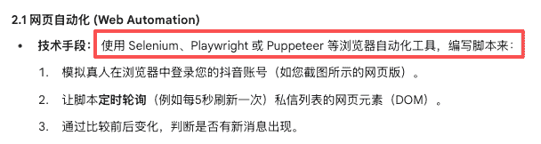

可以继续追问 `Selenium`, `Playwright` 等有啥区别，AI 会给出合理的建议：

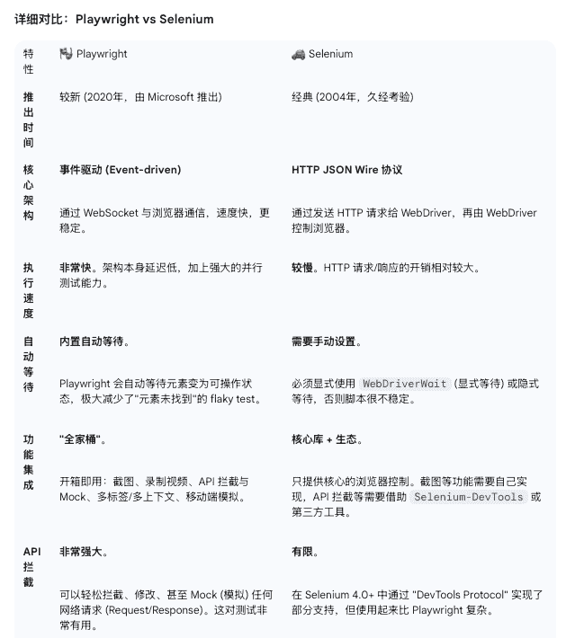

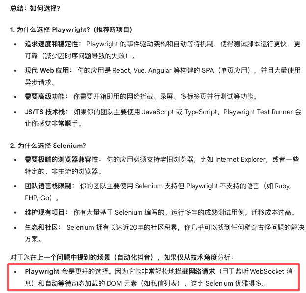

可以看到 Gemini 给出了建议，就用 `Playwright` 来实现，于是接下来我们之后的技术就确定了用 `Playwright`。

`Playwright` 支持多种编程语言，如 `Python`，`JS` 等，一般用 `Python` 的居多，所以最终决定使用 `Python` + `Playwright` 来实现。

## 三、方案落地

技术方案定好了，接下来怎么让 AI 来实现我们的要求呢。

首先我们需要明白何为浏览器自动化，所谓自动化，肯定是有一套既定的流程，然后我们让脚本来让浏览器按这套既定的流程来执行。

### 一）核心流程剖析

先来想一下我们的目的：抖音私信回复 AI 自动化。

#### 1、 需求分解与流程设计

我们先来看一下如果是正常人应该怎么会查看私信，以下是我录的一个查看及回复私信的一个 gif

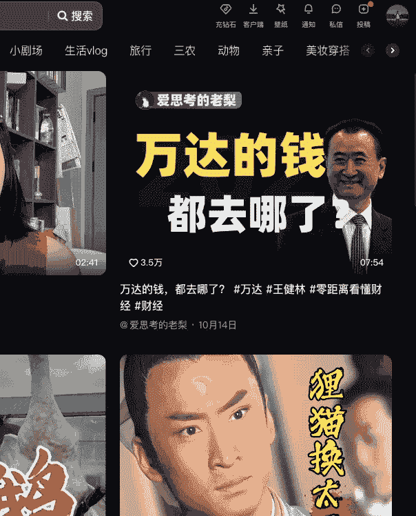

可以看到流程还比较简洁明了，主要步骤如下：

1. 点击顶部的私信图标，打开私信列表。
1. 点击小红点，或者当前窗口是否有新的消息进来。
1. 如果有则在输入框输入信息，然后点击发送按钮将你要回复的消息发送出去。

我们要做的就是用 `Python` + `Playwright` 来将上述流程自动化

怎么实现？

我们在以上步骤中，提到了「私信图标」，「小红点」，「输入发送省」，「发送」，那就需要定位这些元素来告诉浏览器我要对这些元素进行某些操作。

怎么定位这些元素呢

#### 2、 元素定位简介

我们可以双击网页点击 Inspect 来打开 Chrome 的开发者工具（Developer Tool）

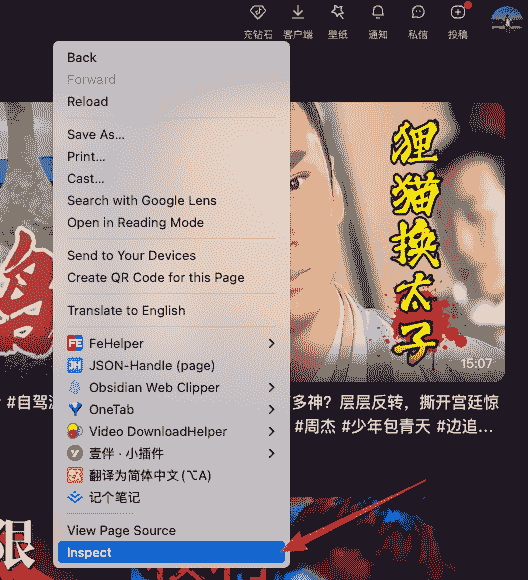

点击下图中的箭头，然后点击我们想要定位的元素，就可以知道页面上的元素对应的具体 `CSS Selector` 了

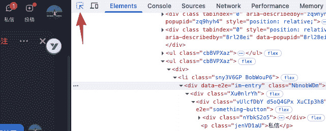

这里简单介绍一下什么是 `CSS Selector`：

> 想象你在一个大图书馆里:
>
> 📚 书架 = 网页
> 📖 书 = 网页上的各种元素(标题、段落、按钮等)
>
> `CSS Selector` 就是你告诉管理员"我要找什么书"的方式:
>
> 例子:
>
> "给我所有红色封面的书" → 选择所有红色的元素（`class` 等属性表示）
>
> "给我找本馆最受瞩目的书" → 选择唯一身份的元素（`id` 表示）

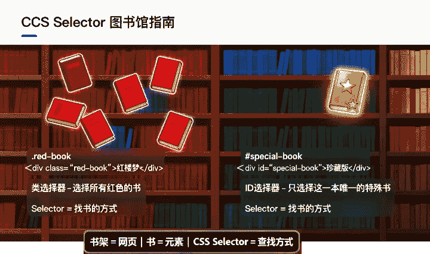

比如我想看私信对应右边哪个具体的 `CSS Selector`，直接点击私信

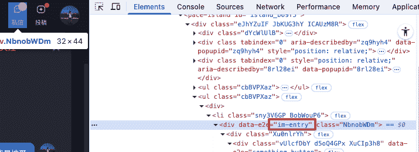

可以看到它对应 `im-entry` 这个 `div`，对应具体的选择器我们可以双击这个元素。

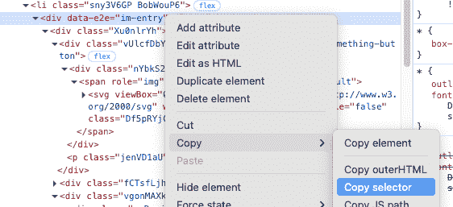

选择 Copy selector, 可以看到 selector 如下：`#island_b69f5 > div > ul:nth-child(5) > div > li > div`

`Playwright` 就是通过这种形式来定位网页上的具体元素。

你可以通过如上截图或文字的形式来告诉 AI，页面的元素对应的 `CSS` 选择器特征是啥（比如"私信"在`data-e2e="im-entry"` 的 `div` 中），AI 就会自动地帮你写出通过 `CSS` 选择器来定位到此元素的相关代码。

同理你可以找到消息来时的红点（`class` 为 `semi-badge` 的 `span`），消息列表的每一个元素(`class` 为 `conversation-item` 的 `div`)。

#### 3、 实现基础监听

找到之后干啥呢，就可以让 AI 调用 `Playwright` 框架来写出以上步骤了呀。

比如你可以给 AI 下如下指令：

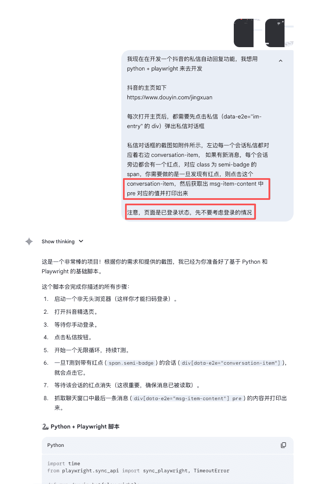

以上 AI 指令中细心的你可能注意到了，我在图中的最顶部上传了两张截图。

我用如下截图的形式来告诉 Gemini 每个元素对应的 `div` 位置，方便 Gemini 来定位。

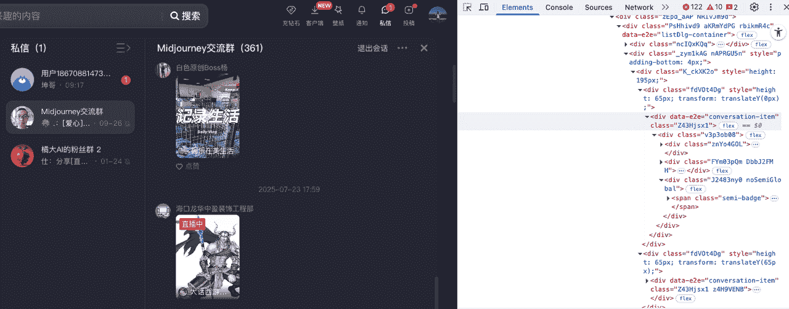

此外你会发现以上指令我只让 Gemini 实现了最核心的功能：监听私信，打印私信信息。

其实，理论上首页需要登录并将鼠标移动到顶部的私信区域才能看到私信，但这部分不属于核心功能，先略过。

做产品我们常说要实现最小 MVP，同样，做项目，我们也要用「核心优先原则」来验证，等实现了最核心的功能，再慢慢补充登录，回复等细节。

此外先实现最核心的功能也能让 AI 发挥得更好，因为上下更少，AI 能发挥出更大的作用，如果一下全部实现所有的功能，很容易

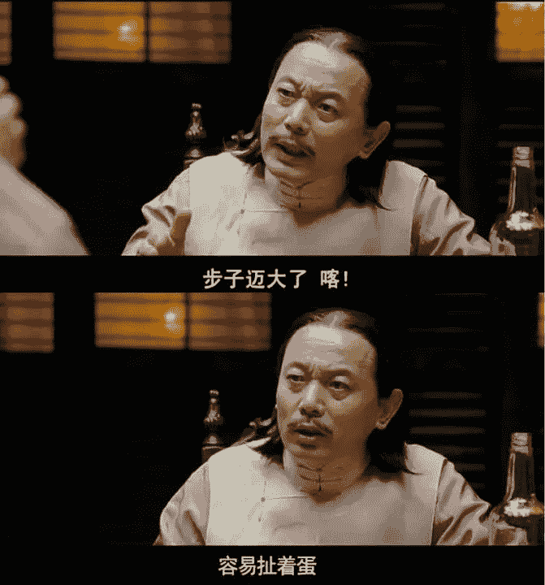

Gemini 的回复中不光给了你脚本，还告诉了你如何运行此脚本的建议。

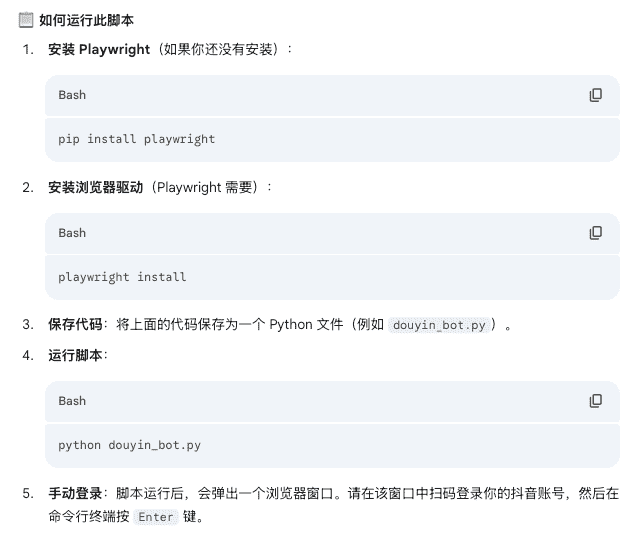

可以按照 Gemini 的建立来按以上步骤试运行一下，当然了，在此期间，你可能会遇到一些环境问题，可以继续与 AI 对话，比如告诉你的系统（Windows 10，Mac），用的 `Python3` 等让 AI 继续帮你把环境搭好。

以上步骤执行成功后，你就可以继续下一步了：区分消息是「我」发的还是对方发的，毕竟只有对方发的消息你才需要回复。

怎么区分，同样的找到到「我」发的消息的对应的元素特征：

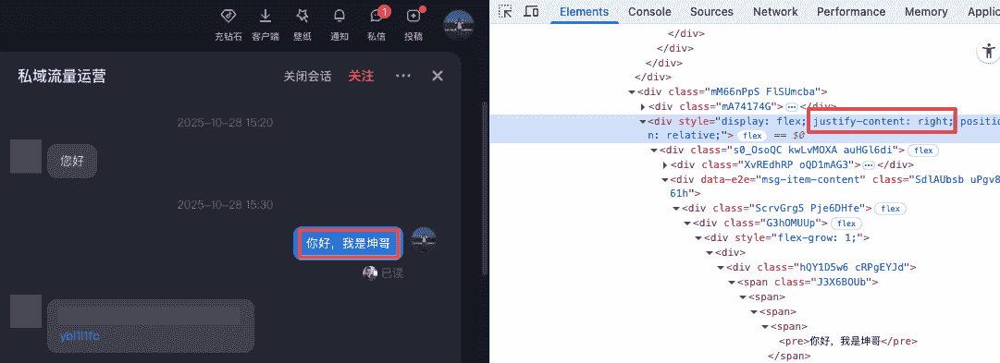

然后据此来让 AI 帮忙区分是我发的还是对方发的。

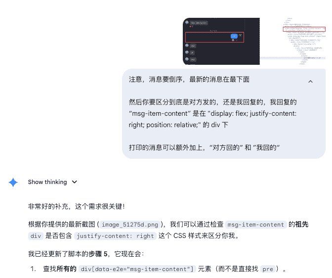

执行之后效果如下：

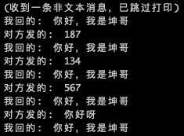

这里其实还有一些细节我略过了，比如要让 AI 知道对话框中，最下面的是最新消息等（AI 可能会误认为最上面的消息是最新的），这些都需要你不断地测试再让 AI 去调整的，在此不再赘述。

现在我们已经可以区分是对方还是自己的消息了，也能监听新消息了。

接下来我们就需要给收到的这些新消息发送消息了，这里我们没有必要一下就对接 AI 客服的接口，可以先尝试回一个固定的消息，重要的是先把核心流程跑通，比如我统一回的是「你好，我是坤哥」。

同样的我把把网页的输入框，发送按钮对应的结构发给 AI。

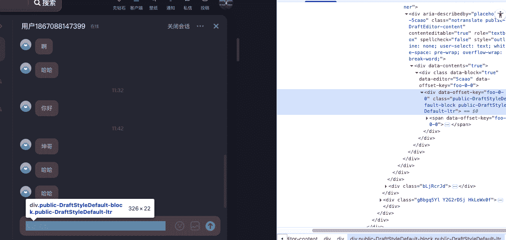

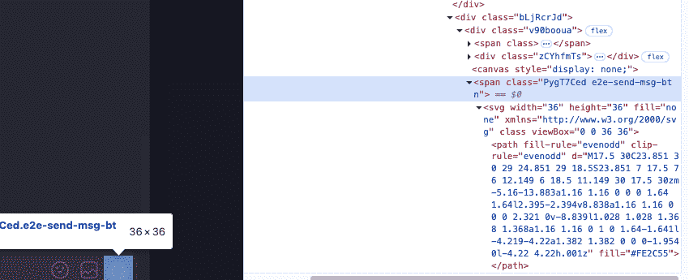

然后再下一个指令告诉 AI：

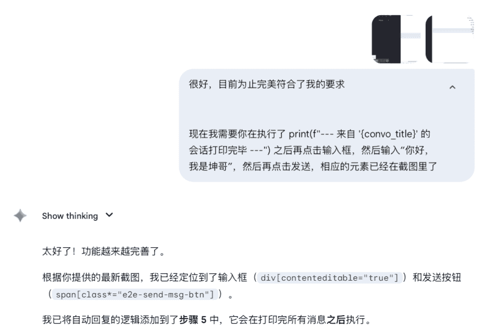

这一步完成之后，可以让 AI 把固定的回复（「你好，我是坤哥」）改成对接你的 AI 回复接口，获取接口的回复后再将信息发送出去。

在此我们完成了从监听私信到发送 AI 回复的完整闭环。

接下来我们可以继续补齐之前剩下的步骤，比如登录后我们需要把鼠标移动（`hover`）到私信上私信列表才会展示出来。

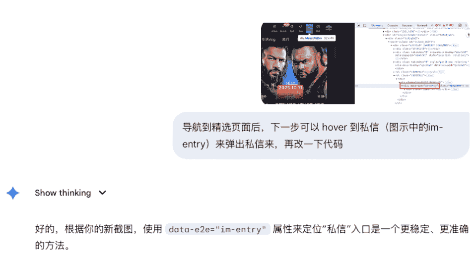

到此我们已经完成了登录之后的所有自动化流程，接下来就是我们另一个比较重要的登录环节。

### 二）登录及部署实现

#### 1、 登录流程分析

##### 1）是否登录状态识别

登录是非常重要的操作，毕竟你要登录了才能实现监听，回复私信等后续的一系列操作

我们首先要识别当前客户是否处于登录状态，怎么识别，打开抖音主页

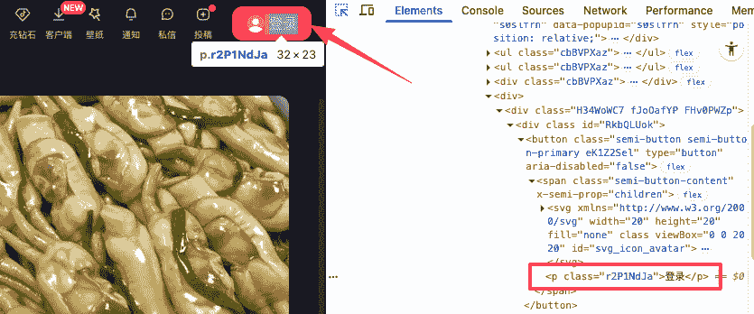

找到顶部的登录按钮，按前文所述的方法可以定位到其对应的 `CSS Selector`

我们只需截图告知一下 Gemini，它就能推测出「登录」对应的 `CSS Selector` 是啥（也可以直接把 `CSS Selector` 告诉 AI），进而准确定位「登录」按钮

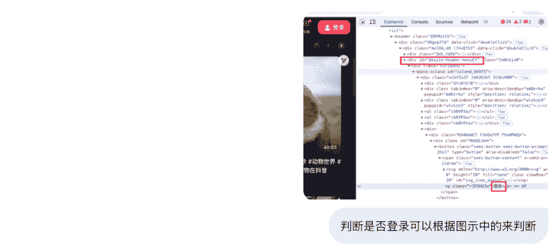

如果用户未登录，就应该点击「登录」，弹出二维码，让客户扫码登，点击登录显示的弹框如下:

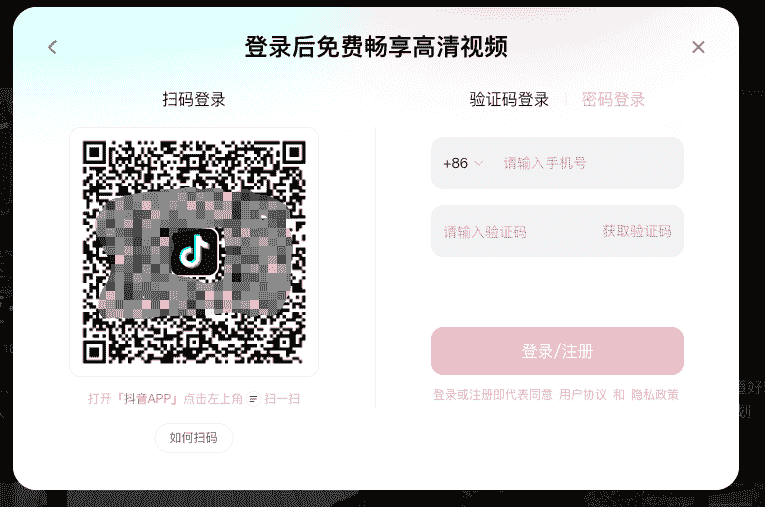

##### 2）二维码弹框提取

通过以上步骤我们顺利地弹出了二维码图片，但要注意的是以上的这些点击登录，弹出二维码 UI 是在 `Playwright` 启动的浏览器实例中才能看到

而客户是访问不到 `Playwright` 的浏览器实例的，那怎么办？怎么让客户来扫码其中的登录二维码进而拿到他们的 Cookie 等信息来做进一步的监听/回复私信呢

我们可以把 `Playwright` 启动的浏览器 `Chromium` 实例弹出的二维码传到我们展示给客户的前端页面

同样，我们把二维码的相关 `CSS Selector` 告诉 Gemini，它就能定位到二维码的位置了

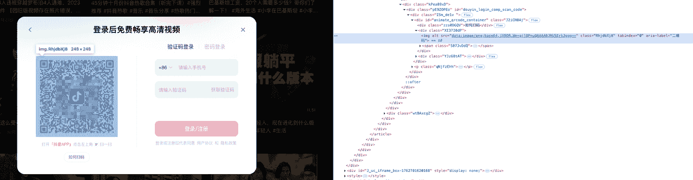

然后就可以对二维码做个快照转成图片，传到前端页面，前端就能拿到二维码图片了，效果如下：

PS：左边是我们展示给客户的前端页面，右边是 `Playwright` 启动的 `Chromium` 实例中显示的登录二维码，右边的二维码会传到左边的页面来让客户登录

客户在前端页面扫码成功后，`Chromium` 实例的所在页由于一直会监听扫码状态，如果成功会自动跳到登录状态（无登录按钮），再发一下登录成功的消息给我们展示给客户的前端页面，此时由于拿到了客户的登录相关的信息，就可以开始做监听/回复私信的后续操作了

登录的主要流程如下

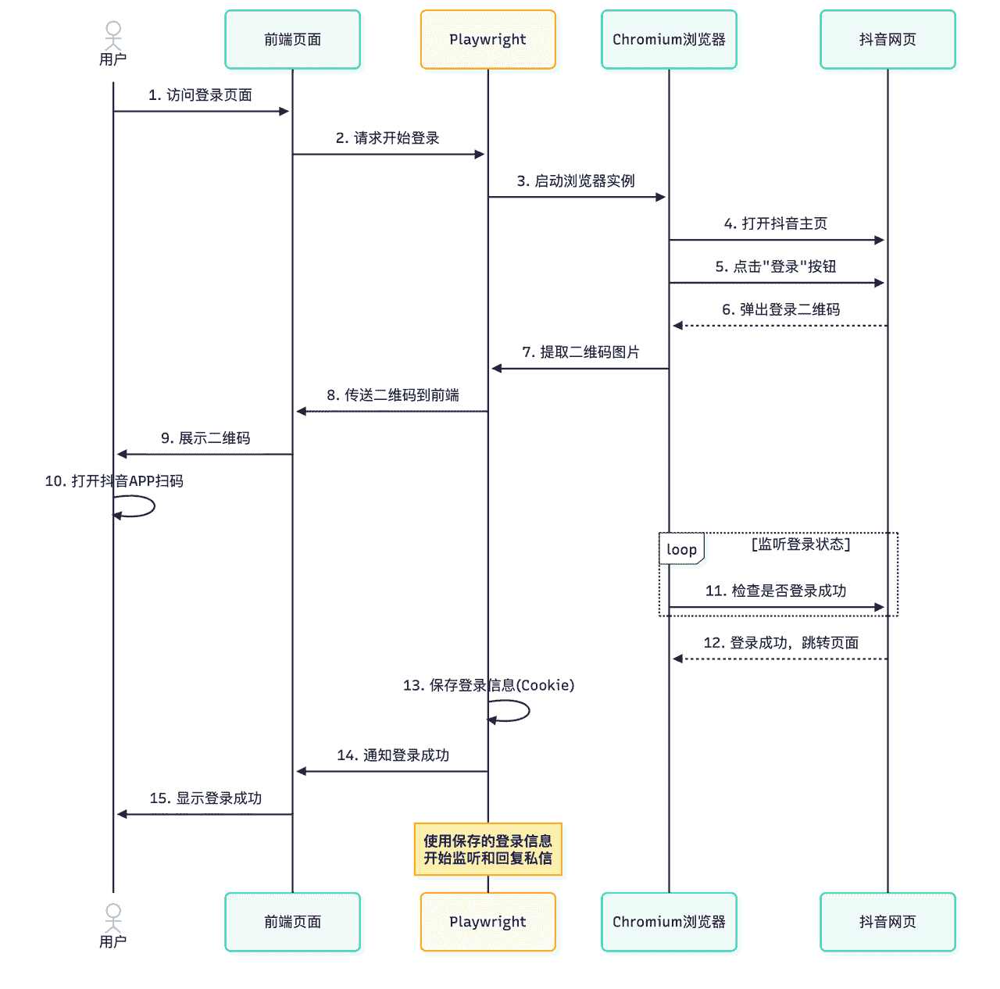

#### 2、 商业化部署流程

一旦 AI 帮你写好了脚本，我们还需要考虑另一个问题， 怎么部署，因为我们可能服务很多客户，怎么更合理地部署脚本以服务更多更多的客户，以下是我们的连续追问。

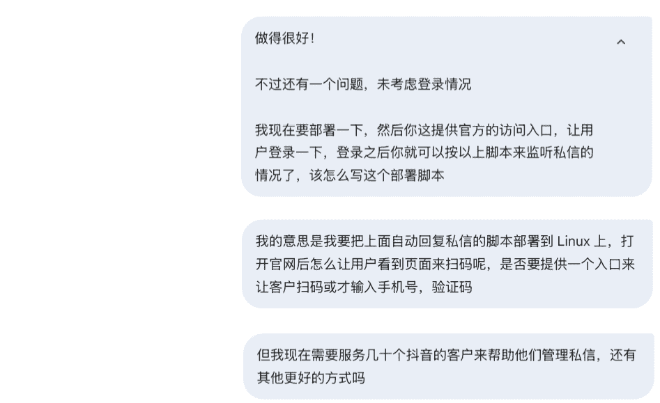

最后 AI 会给你一个非常合理的方案，它拆分成了两个脚本，登录（`login_server.py`）和私信监控回复（`douyin_monitor.py`）脚本。

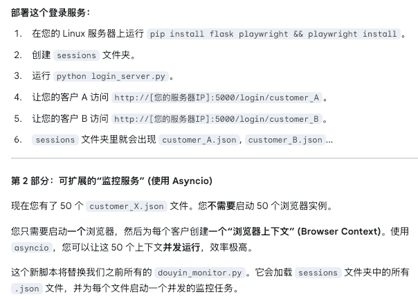

登录脚本专门用于客户登录，让用户浏览器和 `Chromium` 浏览器通过 `Socket.IO` 进行通信，这样可以把 `Chromium` 的二维码等信息传到用户浏览器让用户来扫码登录，效果如下：(左边是用户请求的地址，右边是后台 `Playwright` 跑的 `Chromium` 实例，右边的二维码会通过 socket 通信把二维码传到用户浏览器中来让用户进行扫码登录)。

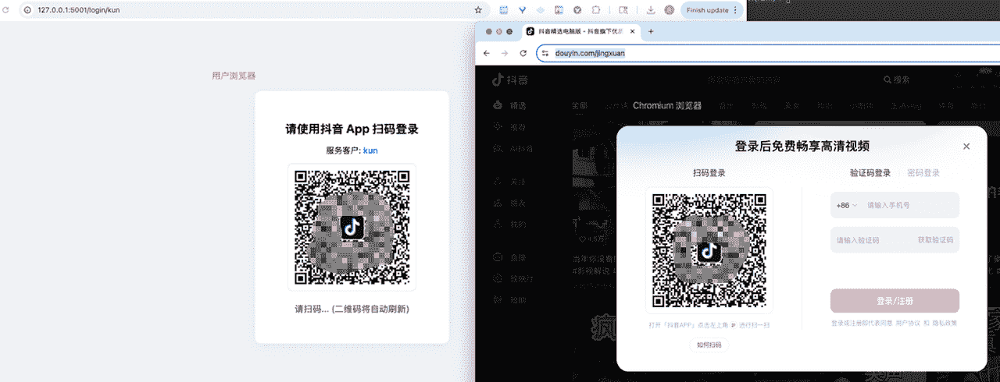

整体的技术设计图我也让 AI 画了一下，如下图，我们稍微看看就好，这些不重要，重要的是你通过口喷实现了一个自动化解决方案。

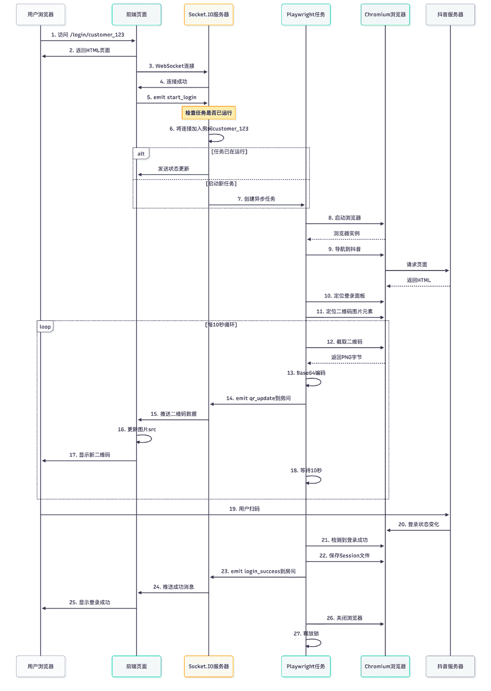

当客户登录后会把相关的 Cookie 等此客户的 context 信息保存下来，监控脚本则会持续监控加载这些 context 信息来持续监听私信以及作出自动回复了。

以上所有流程包括脚本生成，时序图绘制完全是由 AI 生成的，我自己全程没有写过一行代码。

此外你会发现我基本没有截 AI 生成的代码，因为这不重要，代码我压根没怎么看，有些也看不懂

最重要的是你的思路，以及如何把上下文信息（如元素的定位截图，希望支撑多少客户等）详细地给到 AI

AI 就会很聪明的根据这些信息给出你想要的解决方案

## 四、一些坑点和收获

用 AI 来做这套系统虽然确实很快，但中间其实是有一些磕碰的，并没有想象中那么顺利，这里我把一些踩到的坑分享出来。

### 一）不要过分相信 AI

文中说可以用图片的方式来告诉 AI 元素对应的 `CSS` 属性相关信息，确实 Gemini 由于是多模态的，多数情况都能识别出来。

但注意不要过于依赖图片来让 AI 识别元素，因为实测发现即便你截的图片在你看来很清晰，但 AI 依然有可能误判（比如你截的 `class` 是 `im-entry`，但由于 AI 的幻觉或识别原因，它可能给你造出一个根本不存在的 `class`）。

最好是用「图片+文字说明」的形式来让 AI 更明确你表达的意思。

### 二）考虑多个 AI 一起用

有时候碰到一个问题，如果你连续追问，但可能依然没法解决，不妨换一个 AI 来问一下。

因为此时 AI 可能会被你的上下文影响导致问题一直无法解决，此时另一个 AI 有可能「旁观者清」，一下把你的问题给解决了.

比如我在实测过程中就发现了一些 `Flask` `socketio` `async mode` error 相关的问题，连续问了多轮 Gemini 都无法解决，结果重新梳理了一下问了 Claude 立马就解决了.

### 三）专业知识依然重要

虽然全程我都用 AI 来写代码，但其实如果你具备一定的技能的话会更容易定位解决问题。

比如在做登录时，有一个二次验证的判断，要判断此元素是否存在，如果不存在则认为登录成功。

结果一开始 AI 针对这个元素用的中一个 `visible` 的属性，结果发现这个元素虽然出现在页面中，但一直被判断为不存在（因为这个元素的父元素 `height` 为 0 ，导致 `visible` 为 false），问了好几轮后来才发现应该用 `attached` 来判断元素是否存在。

## 五、总结

AI 确实太强了，仅通过自然语言就能打造商业级软件，编程门槛被大大降低。面对这样的变革，许多人尤其是程序员开始焦虑：我们会被取代吗?

我个人的看法是：恐慌大可不必，因为 AI 时代的分水岭不在技术，而在认知。

比如如果我不告诉 AI 这是一个需要服务几百上千商家的抖音私信回复系统，它就设计不出我想要的这种架构

技术实现可以交给 AI,但业务洞察、问题定义、架构决策——这些只能来自对业务有深刻理解的人。

这揭示了一个残酷的真相：AI 不会淘汰程序员,但会淘汰「只会写代码」的程序员。

它淘汰的是那些满足于接需求、写代码、交任务的初级执行者。而那些能理解业务本质、发现真问题、做关键决策的人，反而因为 AI 而如虎添翼。

哈佛最近关于 AI 对招聘市场影响的调查印证了这一点：初级岗位大幅缩减，高级岗位需求不降反增。

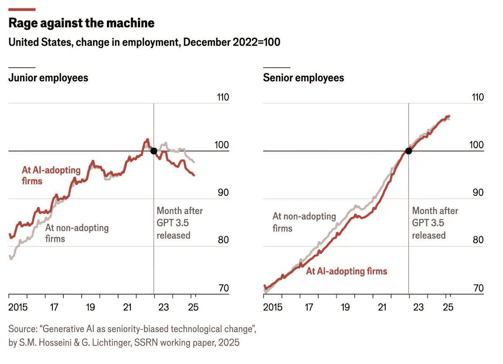

**AI 时代最稀缺的，从来都不是执行能力，而是定义问题的能力。当工具越来越智能,人的价值就越**发体现在:你能否问出好问题,能否看到别人看不到的机会,能否做出机器做不了的判断。

所以，与其担心被 AI 取代，不如思考:我是在成为业务专家,还是只想做个熟练工?
