# 0基础→5小时上线自己第一款Web产品

> 来源：[https://xuqiwei1986.feishu.cn/docx/Op4LdDfiBoaI4kxqPbjcqk1Rnlh](https://xuqiwei1986.feishu.cn/docx/Op4LdDfiBoaI4kxqPbjcqk1Rnlh)

拆解我在刘小排老师线下课获得黑客松优秀奖的产品开发流程

大家好，我是Tina，目前在家全职带娃，有自己的亚马逊盘子，正在跟着刘小排老师学习AI编程。

## 一. 缘起

为什么我会报名刘小排老师的AI产品出海课程，并来到了两天一夜的线下课呢？因为我纠结，迷茫，困惑了大半年。是的，我之所以纠结，迷茫，困惑，是因为我多了一个母亲的身份。一方面我的崽崽是个天使宝宝，为他付出时间精力是我所乐意的，但是，另一方面，由于我坚持了大半年的纯母乳喂养，无论是个人精力还是受孕激素的影响，我经常陷入深深的自我怀疑，我觉得我好像与社会脱节太久了。当海航家群里热火朝天地讨论着AI资讯时，我下意识自动略过了，但我知道，那不应该被错过。

于是，在结束大半年的哺乳期后，我感觉我重获了自由。恰逢赚钱来到深圳举办线下AI大会，我抱着去体验下的心态参加了这次AI大会，感觉非常值得，心潮澎湃，下定决心如果小排老师开课了，我一定要报名。我想看看，这是一个什么样的新世界。

## 二. 产品idea灵感来源

我是一个AI小白，参加小排老师的课程是我人生第三次使用AI。我第一次用AI的时间我记得很清楚，那时我在美国法学院读书，我的同学上课途中很兴奋地给我展示了chatgpt,那时我用AI来辅助学习与写作业。第二次用AI，是今年年初我用Deepseek来辅助我给娃取名字。所以，我真的是空杯心态来参加小排老师的线下课，我不做任何预设，我给自己的心理建设就是老师教啥我做啥，主打一个不会就学，没有借口。然后直到上课当天脑子里也没有带好的产品idea，虽然凭借做亚马逊的经历，已经pass掉很多我觉得不太有商业价值的产品idea。

上完第一天的课程，晚饭后我们组员都留下来进行实操练习，我们的助教James很认真很负责，与每一个组员逐一讨论并敲定了各自要做的产品idea。我深知自己编程0基础，短时间内做不了很高端很复杂的页面功能，所以我跟自己说找到一个核心功能即可，最好是用户能一键解决问题即可。就像小排老师课上讲的，把简单的留给用户，把复杂的留给自己。

很多人做产品一开始就在问：“我该怎么推广？”但真正的关键不是“怎么推”，而是先弄清楚——推给谁、为什么他会在意？这就是小排老师一直强调的，要找到购买理由。我自己也是在刘小排老师课上被狠狠“点醒”的。老师那句：“在你问‘产品怎么推广’之前，先回答——谁、在哪个场景、花多少钱、解决什么问题？”

我开始回看自己的工作和学习场景——每天我都在浏览大量图片、设计图、包装视觉图。我常常遇到这种情况：

看到一张非常好的AI生成图，想复现类似风格，却找不到原Prompt。这就是痛点。“如果能有一个工具，帮我一键提取这张图背后的Prompt，就能少试错几十次。”另外，我还可以再根据我的创意和设计进行迭代与超越。

于是我用小排老师的那四个问题来审视这个idea：

### 什么人？

像我一样的独立创作者、设计师、AI绘图初学者。他们不想研究复杂参数，只想快速复刻灵感。

用户 1：AI 绘图初学者

他们最大的问题：不懂 Prompt 结构，想复刻某张图但不知道写什么。想学，但没有时间研究参数。

`image2prompt` 让他们能够看到喜欢的图就能复现，学会 Prompt 的基本组成并更快进阶。对新手来说，它是一款“Prompt 学习扫描仪”。

用户 2：自由设计师、视觉从业者、亚马逊卖家（也是我本人）

这些人工作节奏快、交付量大，尤其是Amazon Listing 图，海报、Banner、包装，产品视觉构图，电商场景渲染图等等。他们没有时间做几十次 AI 调参，但有大量“参考图”需要复刻风格或构图。

`image2prompt` 帮他们做到：复刻灵感图，加快交付，减少试错，提升收入（时间就是钱）。对这一人群来说，它是“效率工具”。

用户 3：内容创作者（短视频 / 公号 / 📕）

这类用户的特点：每天需要大量封面图、插画、情绪图。想用 AI 生成高质量视觉物料，但没有系统学习 Prompt 的意愿。他们需要：看到别人图的风格，提取出来再改，或者快速生成同主题视觉系列。

`image2prompt` 帮他们：建立“内容视觉一致性”，提升作品专业度，节省更多时间精力。

### 什么场景？

当他们看到一张漂亮的图（无论是产品包装、AI作品还是社媒图），希望了解它的“Prompt配方”，以此再创作。

场景 1：看到别人发的好图，想复刻，但不知道怎么写 Prompt

上传 → 出结果 → 马上复刻。这是最真实的用法，也是用户最常用的。

场景 2：做 Amazon 图、海报、Logo、包装，需要参考图 Prompt

设计师不需要从零写 Prompt，也不需要苦苦猜风格是什么。`image2prompt` 直接告诉你：“这张图的 Prompt 长这样。”

场景 3：想学 Prompt，但从何学起？

用户可以：上传一张图，看它的 Prompt 结构，再试着改几个词，就在“模仿—对比—复现”中学会 Prompt 思维。

场景 4：做短视频封面、插画、📕爆款风格图

用户看到一张喜欢的风格，只需要提取 Prompt → 复制 → 改几个词 → 量产系列素材。

### 愿意花多少钱？

对于这类用户，愿意为“节省时间、提高创作效率”的工具买单。哪怕是每月几美元，也能接受。

### 解决什么问题？

帮助他们从“看图模仿”转变为“理解Prompt逻辑、快速生成类似作品”，降低创作门槛，提高效率，帮创作者节省大量试错时间。过去你要复刻一张图片，需要：猜关键词，反复生成，调构图比例，分析风格，现在只需要 5 秒。对于项目紧、交付多的设计师来说，就是救命工具。

经过和助教James的讨论，敲定做提取图片的提示词这个核心功能。产品只有一个功能：图片 → Prompt。不需要注册、不需要教程、不需要做复杂选择。

这就是 MVP 的力量——用最小功能解决最痛的问题。


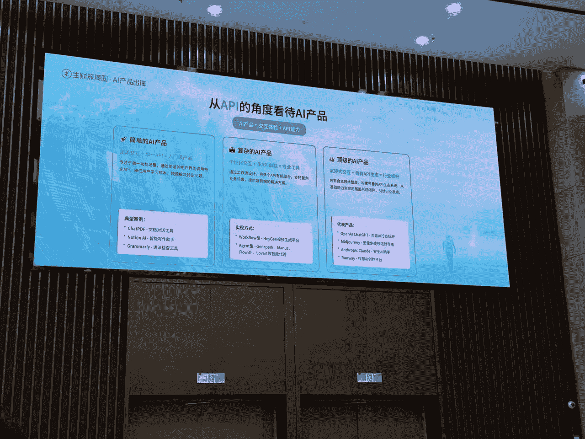

## 三. 开发过程

本着借假修真，借着完成马拉松参赛作业实则实操课程内容，跑通流程的初心，我只求把装载一个核心功能的初级产品成功上线，能用就行。 主打一个不会就学，边学边做。产品idea是上课第一天25号晚上9点42分确定的，参赛作品是26号凌晨3点52分提交的，刨除掉我个人晚上回酒店洗澡洗头吹头的时间，全程是5个小时，提交后这个网站也就没有做任何更改了。下面是分享这5个小时我做了哪些具体操作，当时只求最快跑完流程，很多细节和步骤是不够完善完美的，我事后回过头再看这肯定不是做MVP的最优解，还可以更好更全面，当然这是后话了。

### Chatgpt帮我想好产品名字，我挑一个顺眼的

是的，因为小排老师说“万事用AI”，所以我就试试问问Chatgpt，“我想做一款产品，实现给一张图片，一键生成提取出prompt，可用于再次生成该图片或者修改prompt生成自己想要的，请问可以取什么名字，用到哪几个关键API？”

然后他给了我很多个很好的选择，我本着简洁明了的原则，就挑了`image2prompt`。正所谓万事开头难，当我很轻松地敲定了我喜欢的产品名字后，瞬间有了开发产品的热情和动力，隐隐约约感受到了Chatgpt/AI的强大。

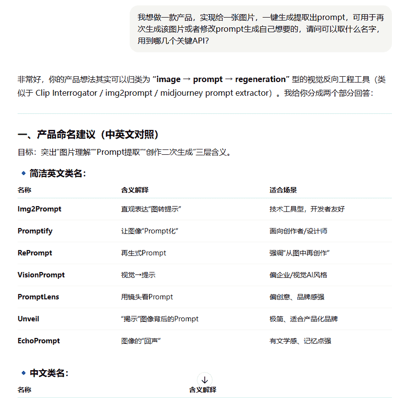

### 和Chatgpt讨论，进一步明确产品的核心功能和关键API

一开始我和Chatgpt讨论（左下图），他一直在扩散式思维，我感觉他把我要做的东西复杂化了，脑中想起了小排老师说的“低耦合，高内聚”。我需要直截了当地实现一个核心功能，其他的可以后续再不断迭代，所以我要主动去做减法和收敛，直接告诉Chatgpt我要实现哪一个单一核心功能就行，“有点复杂，我目前产品只想实现一个核心功能，就是image → prompt，请推荐一个最关键的API”。（右下图）

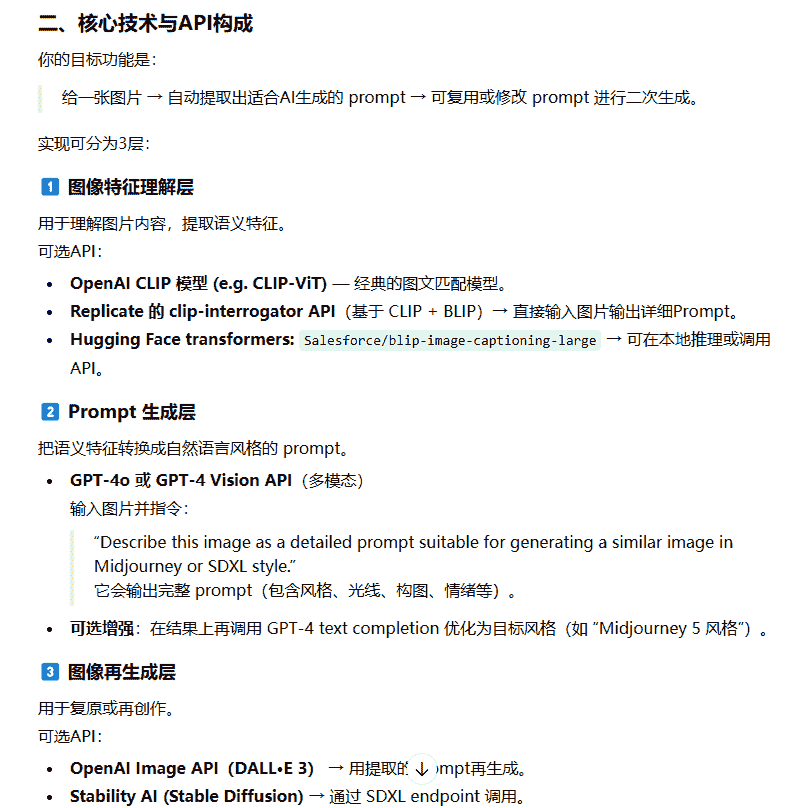

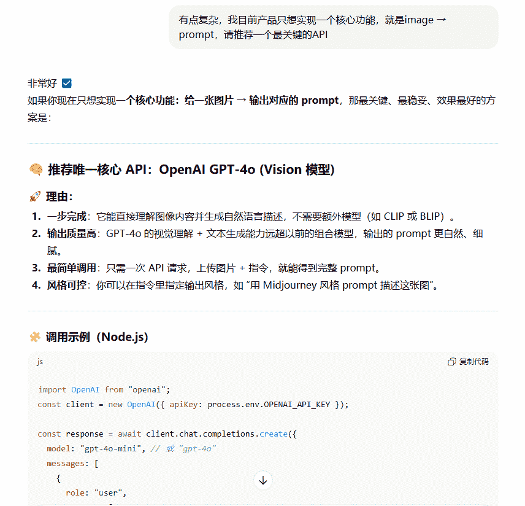

### 边学边做，让Chatgpt帮我整理脑中的毛线团

其实周六白天上了一天的课，我的脑袋其实已经超载了，到了晚上9点多才开始着手去做自己的第一个网页产品，凭着新接受的AI知识和碎片化的记忆，脑子几个词一直蹦来蹦去的，V0，Vercel，Github，Supabase。好像都需要用到，但却不知从何下手。

还好，我又想起来可以问下Chatgpt看看，“请帮我用通俗易懂的语音解释清楚这几个是干什么的？彼此的关系是什么？V0，Vercel，Cursor， Github，Supabase”。

于是，我得到了超乎意料的答案，J人看了表示很舒服，逻辑清晰，简洁明了。于是，我进一步清晰了各个工具的功能，还有基础的使用流程是怎样的。

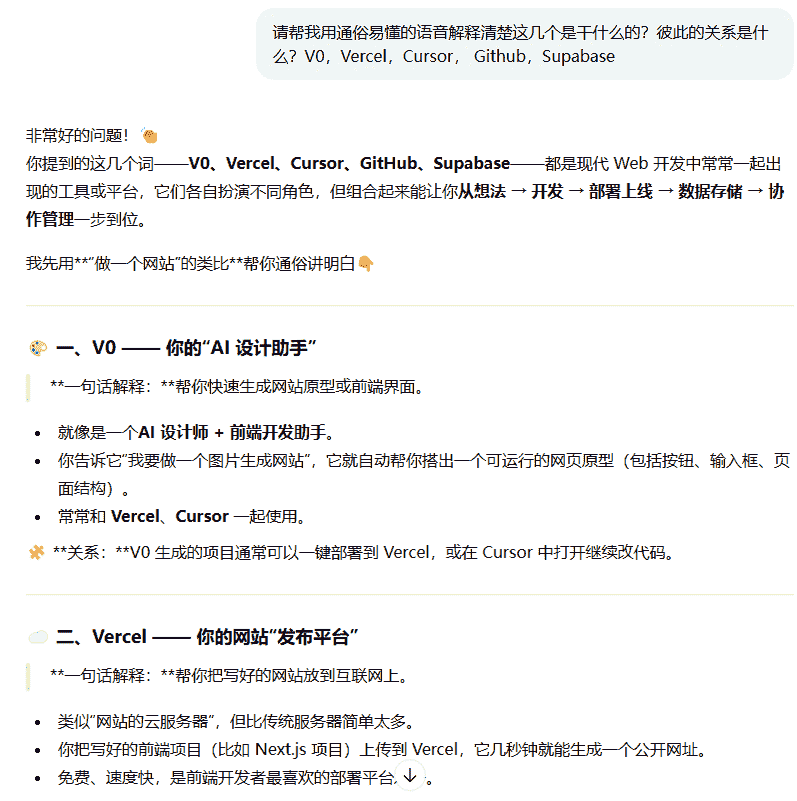

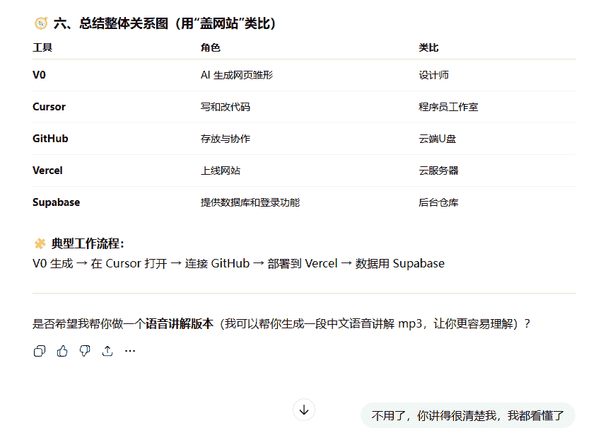

### 用懒人办法让V0设计前端页面

因为时间有限，我在小排老师的讲义手册里看了几个老师推荐的好的landing page,迅速锁定一个我自己脑中预设的要做的这款产品最接近的网页，直接截图粘贴给V0，告诉他，“我想做一款产品，实现 “图片 → 提取 Prompt” 功能，名称是`Image2Prompt`，域名是`img2prompt.com`，界面参考这张图片”（参考图如右下）。

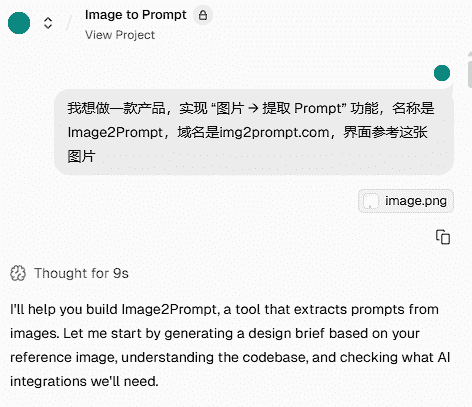

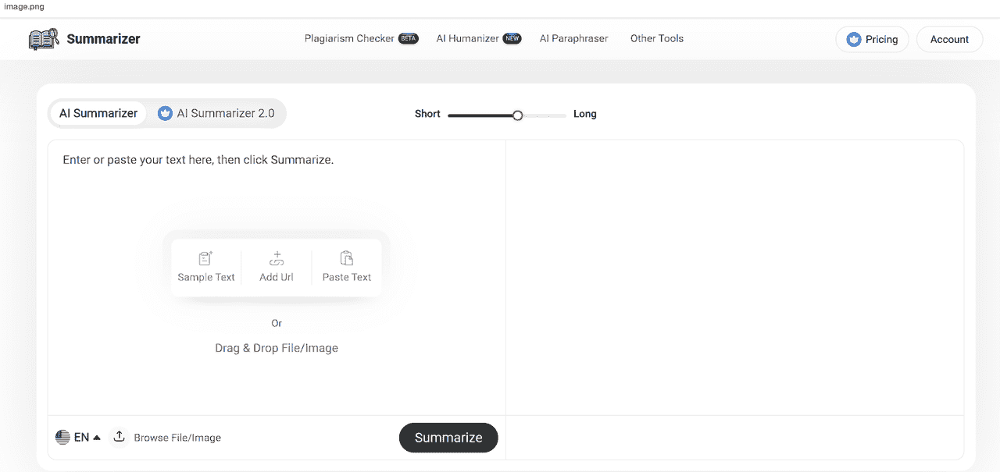

然后V0就自己跑出来一个雏形，效果不错，但是比较素（如左下）。我就直接和V0沟通，“这一块页面太素了，完全没有任何色彩，一点都不吸引人，需要优化，你自己多想点办法”。

后续我就不断让V0自己多想点办法，然后继续调整一些小功能按钮的位置和颜色，大体的框架就是我想要的参考图那样的。

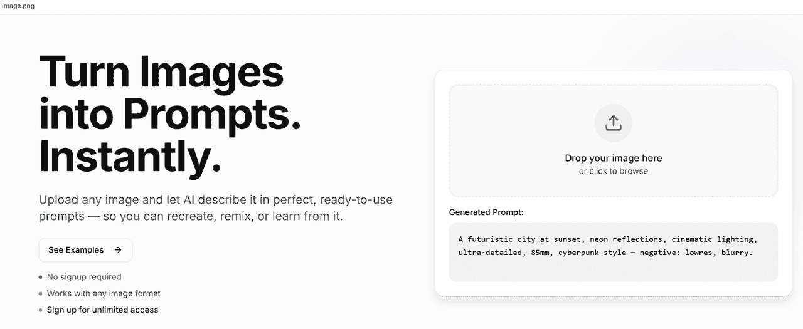

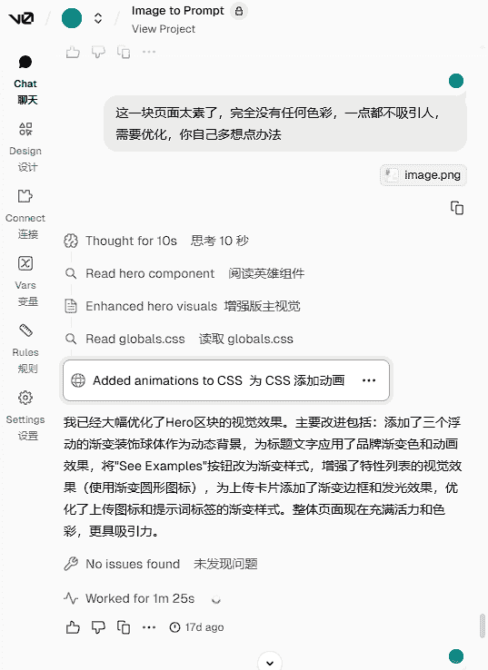

### 时间有限，用Chatgpt的基础代码和钞能力实现核心功能

基于前面和Chatgpt讨论后确定的关键API，我用小排老师课上教的内容调用了API，并用postman进行了简单调试，没问题后就把API调用丢给Chatgpt，Chatgpt结合我和他聊天记录给我推荐了一段代码，我直接复制这段代码给V0，V0就开始吭哧吭哧干活了，一开始报错，我直接点`fix`让V0自己修，修了2次后，V0直接告诉我今日额度用完了。心急之下直接冲会员，用钞能力让V0继续干活，修多2次我想要的页面终于出来了。其实如果后续真的要做自己的商业化产品，是需要另行在Cursor或者cc重新打磨代码的。

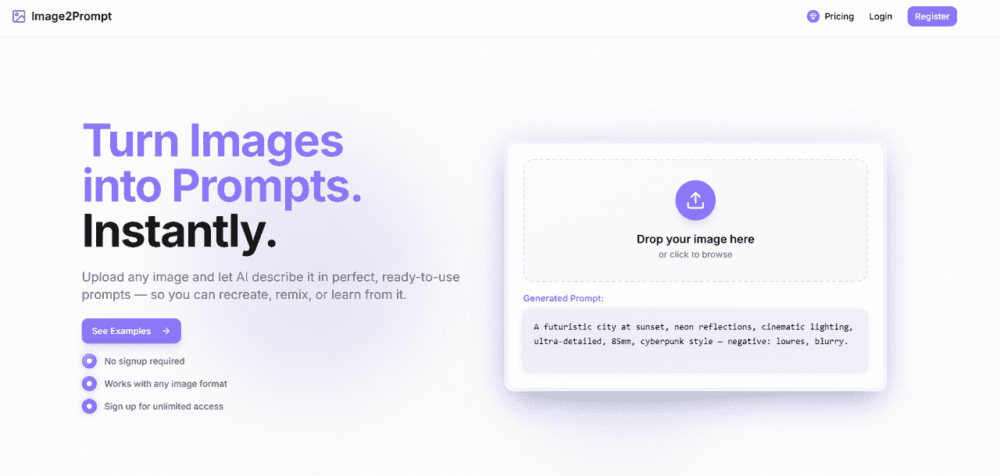

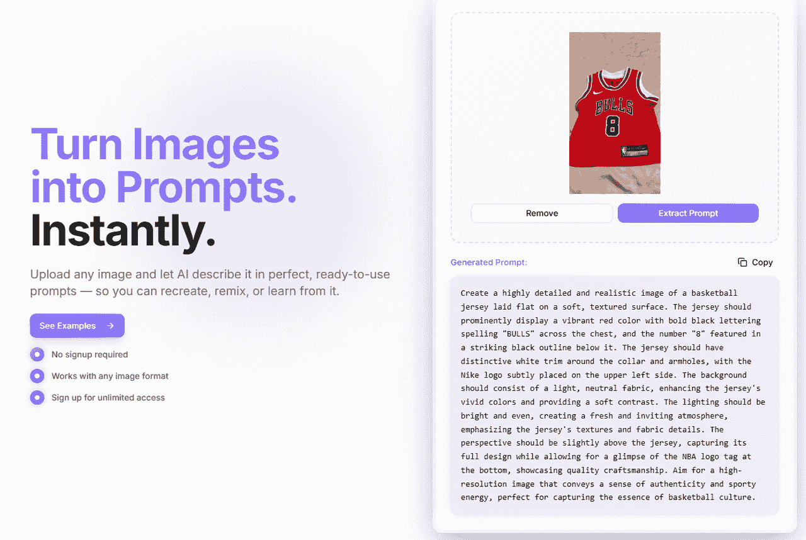

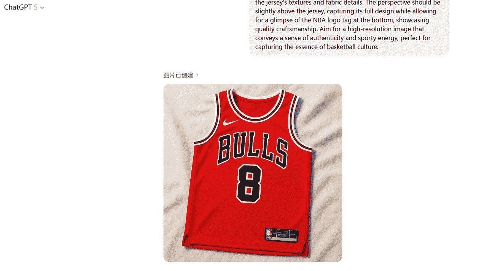

于是我试着上传了几张照片进行测试，再把生成后的prompt发回给Chatgpt，检测生成效果是否如我一开始上传的图片。结论是简单的图片基本能百分百还原，复杂一点的图片还原度会降低。但是我知道我时间有限，没办法精益求精，所以就继续推进下一个练习操作，添加组件和模块。

### 直接问V0，我的landing page还可以怎么样变得更好

于是V0真的很给力，给我推荐了几个方案，我只需要做好决策，选择我想要的功能让他去干活就行。如果我有更进一步的想法，直接告诉他。如果没有，只要我觉得好像好差点什么，就继续和他聊，告诉他我需要再好看一点，还不够好看，虽然我表述很广泛，不够明确（那是因为我自己也不知道我最终的结果想要什么），但是因为我充钱了，我有资本让他多试试。果然，多试几版就出现我要的了。其实最后提交的版本还有很大的改动空间，只因为后面熬不动夜了，所以就点到为止，保证麻雀虽小五脏俱全就行了。

前端页面设计得差不多了，这时按照小排老师课上教的在V0Connect下Supabase，一步步实现登录注册，并用Vercel部署上线。

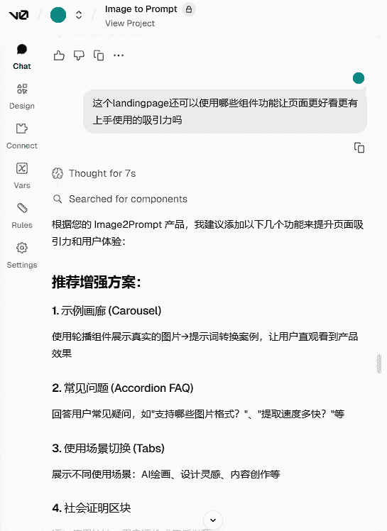

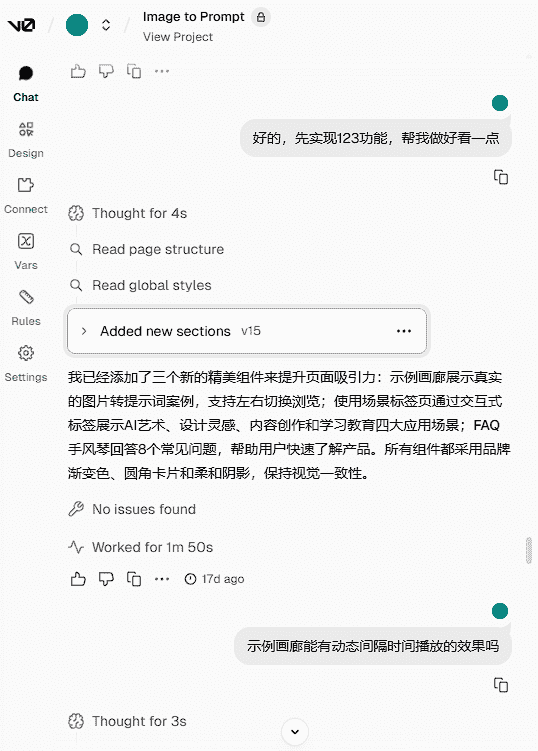

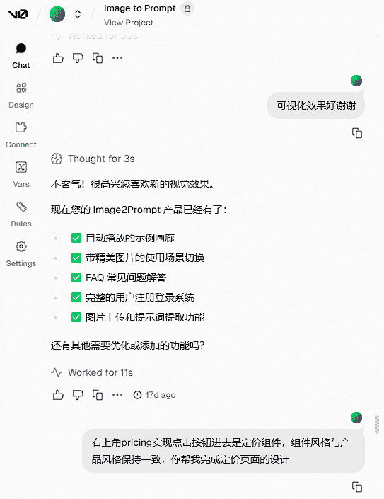

到此，就是我提交参赛作品的页面了。

`https://v0-image-to-prompt-alpha.vercel.app/`

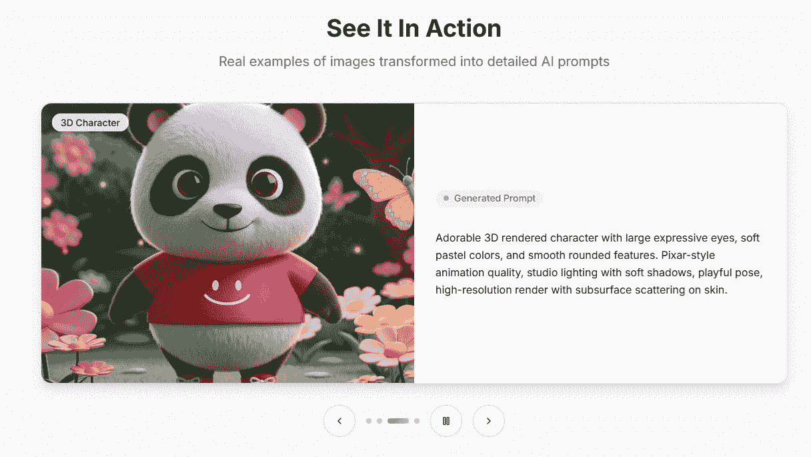

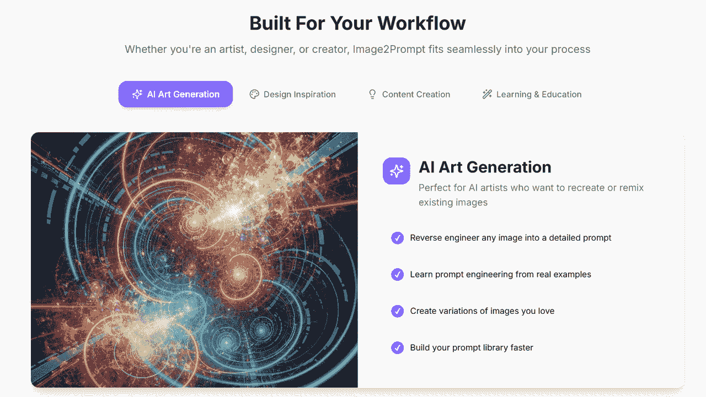

## 四. 做出MVP后的复盘与实操SOP梳理

### 用ChatGPT确定产品核心功能

#### 步骤1：让AI帮你命名和聚焦

打开ChatGPT，直接输入以下Prompt：

“我想做一个AI小工具，可以把上传的图片转换成对应的提示词（Prompt），用于Stable Diffusion等图像生成。请帮我：

1.  想10个简洁的英文产品名；

1.  给出每个名字的含义与风格；

1.  告诉我最推荐哪个，并说明理由。”

ChatGPT会生成很多备选名。你只需选一个简洁、易懂、能表达功能的即可。

例如：`image2prompt`（简单、直白、记忆点强）

#### 步骤2：让AI帮你提炼产品结构

接着输入以下Prompt：

“我想做一个网页产品，核心功能是 “用户上传一张图片 → 输出对应的Prompt文字”。

请帮我：

1.  画出基本的功能流程图；

2.  告诉我需要哪些技术模块；

3.  哪些部分我可以让AI自动生成？”

AI会告诉你流程大致是：输入图片 → 调用图像识别API → 输出Prompt文本 → 显示在网页上

同时，它会告诉你涉及的工具：

+   `V0.dev`：生成前端页面

+   `Supabase`：登录注册、数据库

+   `Postman`：测试API

+   `Vercel`：部署上线

### 用V0快速生成前端雏形

#### 步骤1：让V0帮你生成界面

进入 `https://v0.dev`，在Prompt栏中输入：

“我想做一个网页，功能是“上传图片→提取Prompt”，请帮我：

1. 设计一个简洁的Landing Page；

2. 页面包含上传框、生成按钮、显示结果的区域；

3. 风格参考 Notion/Minimal 设计。”

几秒后，V0会自动生成一个初始页面。

#### 步骤2：持续调试

如果你不满意效果，可以继续对话：

“请把主色调改成浅紫色，并让按钮更圆润。”

“请增加一个‘复制Prompt’按钮。”

或者，把你认为好的网站直接截图给V0，让他照着改。

每一次修改，V0都会重新渲染页面并生成新版本。

**实用技巧：**

+   点击右上角 `Fix` 可以自动修错；

+   用 `Add Component` 添加按钮、模块、文本；

+   所有代码可导出或直接部署到Vercel。

### 用Postman测试API

#### 步骤1：选择合适的API

你需要找到能识别图片内容、输出描述的API。

可直接问ChatGPT：

"我想提取图片的描述Prompt，有哪些开源或免费API可以使用？

请推荐一个示例接口并生成调用代码。"

常见API平台推荐：

+   Replicate（支持图像识别与Prompt生成）

+   Openrouter

+   Fal

+   Together

#### 步骤2：用Postman测试接口

打开 `https://www.postman.com/`，创建新请求（New Request）

填入API URL，例如：

`POST https://api.openai.com/v1/images/describe`

在 Headers添加：

`Authorization: Bearer YOUR_API_KEY`

`Content-Type: application/json`

在 Body里输入示例图片URL，点击「Send」。

如果返回了类似：

```json
{
  "prompt": "a golden retriever sitting on a couch"
}
```

说明接口调用成功 。

#### 步骤3：让ChatGPT帮你整合代码

当API测试没问题后，输入以下Prompt：

“请帮我把这个API整合进我V0生成的网页里。

实现逻辑是：

1. 用户上传图片；

2. 调用API；

3. 显示返回的Prompt结果；

4. 出错时给出提示。”

ChatGPT会生成一段带注释的代码， 直接复制 → 粘贴到V0的代码编辑区 → 点击 `Run`。

如果报错？直接问它：“这是错误信息，请帮我修复。”让AI自己修。ChatGPT在调Bug时特别强，只要你把错误信息粘上，它几乎都能定位。

### 用Supabase实现登录注册

+   登录 → 创建新项目（New Project），选择免费计划（Free Tier）

+   打开「Authentication」模块 → 启用Email登录（为求简单跑通MVP，可以把需要邮件认证的功能先关闭）

+   获取API Key和项目URL，复制这两项，在V0中配置环境变量：

`NEXT_PUBLIC_SUPABASE_URL=xxxxxx`

`NEXT_PUBLIC_SUPABASE_ANON_KEY=xxxxxx`

+   回到V0，对ChatGPT说：“请帮我把Supabase登录功能接入我网页里。”它会自动生成登录/注册组件。

### 用Vercel部署上线

+   前往 `https://vercel.com`，使用GitHub账号登录


+ 点击「Import Project」 → 选择V0生成的代码仓库

+ 点击「Deploy」，1分钟后，Vercel会给你一个在线链接，比如：`https://v0-image-to-prompt-alpha.vercel.app/`

你的第一个AI产品就上线了！

# 五. 分享一些踩过的坑

## 养成保存需求文档和重要聊天记录的好习惯

这次线下课程结束后，赚钱的工作人员瓜斯就鼓励我写分享贴发星球，但因为回家后要带宝宝做儿保、打疫苗、排敏等，一拖就是十天。等我再打开 ChatGPT 想复盘时，发现当时很多对话已经找不到了，开发过程的截图、需求推演、命名思路都缺了好几段。

这次经历让我意识到一个非常实际的坑：ChatGPT 的历史聊天并不会永久保存，特别是跨设备、清缓存、系统更新后，很多有价值的内容可能会丢。

改进建议：以后每次和AI讨论产品需求、UI结构、API设计、Prompt 模型时，同步整理一份需求文档（Notion / 飞书文档 / V0 / Google Docs 都行）。可以建立固定文档结构，例如：

V0 需求文档结构：

+ 简单描述产品需求（目标用户、核心功能、关键指标）

+ 技术栈说明

+ API 四要素（API KEY + 示例 `Curl` + 示例输入 + 示例输出）

+ 原型图 / UI 设计（可附图或链接）

聊天中有重要指令、灵感或调试代码时，立刻复制到需求文档下方「讨论记录」部分。

每次课程结束或阶段性项目收尾时，打包保存：截图 + 文档 + 版本号。

一句话总结：ChatGPT 是灵感和执行的加速器，但不是长期存档库。把“即时智慧”转化为“可复用资产”，才是从 AI 学习中真正提效的关键。

## 工欲善其事，必先利其器

硬件设备和基础工具的配置非常重要。我在第一天上午的课上就因为🪜不顺畅卡了大坑，虽然这个🪜我在家里用没什么问题。那会儿别人已经在热火朝天地部署项目、运行代码，而我这边一直在刷新——退出、重进、再刷新，直到练习时间结束，ChatGPT 页面还没打开。最后还是助教James帮我换了一个更稳定的🪜节点，才顺利通关。这让我意识到：工具的稳定性直接决定了学习节奏和心态。

改进建议：可以课前提前准备：

+ 检查🪜节点（至少准备 2～3 个备用线路）

+ 预装必要依赖：`Node`、`pnpm`、`Git`、`VSCode`、`Cursor`

+ 测试 ChatGPT、Vercel、GitHub 是否能顺利登录

课程当天尽量使用有线网络或高质量 Wi-Fi，避免断连。遇到网络或环境卡顿时，不急着“硬顶”，及时求助助教。好的工具环境，是让学习和开发“顺滑”的第一步。

# 六. 收获与建议

## 来都来了，重在参与

其实我在参加小排老师的线下课之前，给自己做了很多心理建设。我是编程0基础，我是AI小白，我在家带娃来之前也没有很充足的时间可以把讲义手册看完学完，但是，但是，我对自己的要求就是认真跟完两天的课程，认真动手参与每一次练习和作业，不管做的结果如何，起码我做了，起码我要做完。

失败的体验也是体验，失败也是一种反馈，没做完没提交怎么会有反馈呢？所以，一定要多动手多实操，不会就学，不会就问。

## 珍惜对的场域和能量

一开始开放报名的时候得知有线下课，我毫不犹豫就报名了，事实证明小排老师的线下课是非常值得的。

首先，两天的线下课是线上课程的浓缩版，小排老师会带着我们提前过一遍，串讲整个课程的核心板块。即使我在当下听得不是完全理解，但是对于课后我再去自己深入学习线上课程是有帮助的。

其次是线下课100多号人在一起高密度地学习，高强度地脑暴，会形成一股积极学习地氛围和能量，深深地感染着我，让我在很累很乏的时候还能坚持住。也是线下难能可贵的能量场，让我一个技术小白能在脑子已经成浆糊了之后还能再花5个小时去搞一个mvp出来。

那天晚上在现场，当你沉浸其中的时候，时间过得很快，但是你的产品就像搭积木一样，逐渐在成型。

## 接受不完美，再逼自己一把

核心思路：先跑通，再优化！

一开始我是只想静静跟完线下课就行，然后尽量地动手实操。说实话，参加晚上地黑客松比赛，我是想都不敢想地，因为我来上课当天都没有一个明确的产品idea，不懂任何编程知识，连前端后端是啥都不知道，我是无法相信我能做出一个web产品，甚至还去参赛，甚至还去拿奖，简直是痴心妄想~

但是，这里要很感谢我们组的助教James，一直鼓励我们，也在临门一脚推着我去敲定产品idea。于是我本着交练习作业的初心，按照小排老师白天教的一步一步去操作，去练习，相信AI，把自己交给AI，然后就看着网页在和AI一点点的互动来回里，慢慢有了雏形，逐渐变得顺眼。

然后，最重要的一步，打开黑客松参赛链接，填完参赛报名表，点提交，已经是凌晨3点52分了。到此，我觉得我最难的任务已经完成了，开心之余，马上关电脑睡觉。我已经没有精力再去让这个mvp变得更完美了，几个小时之后我还有一天的课程要上呢。本来就是奔着当分母去的，能入围，那是意外之喜，没入围，起码我跑通流程啦，那这趟线下课就没有白来！

# 七. 感谢良师益友

第一位是我的亚马逊启蒙者和贵人，seven老师。是他带我入门了亚马逊，教会我怎么样去选品和开品，怎么样去思考用户体验，seven老师在赚钱里发了很多关于亚马逊的精华帖，其实很多思路都是可以迁移到AI产品出海里的。非常感谢Seven老师的真诚分享与耐心指导，让普通人能真正看见通过亚马逊成功出海的路径，正确的产品思维让我受用终身，也给了我出海的勇气和底气。

第二位自然是刘小排老师了。无论是线上课还是线下课，刘小排老师的课程内容都非常详实、逻辑清晰，每个知识点都有完整的框架和实操路径。更难得的是——他真的很严格。小排老师会明确学习标准，督促大家打好基础，经常强调“慢就是快”，“要看懂AI写的每一行代码”。对我这样一个 AI编程小白 来说，以前觉得“编程”是天书，是我绝对不会不自量力去触碰的东西，然而通过小排老师的课程，我第一次真切感受到——原来AI编程可以被普通人系统地学懂、学会、学以致用。非常感谢刘小排老师，让我从“看不懂代码”到“能用AI创造产品”。我非常期待学会了AI编程后打开的新世界！

第三位是我们组的助教James，非常负责，热心且严格。线下课的两天课程，每逢小排老师留练习操作时间给我们时，耳边就不断响起他的声音，“操作上有没有问题？”“有问题及时提出来，当场解决”“你的参赛选题想好了吗”......我可以说，没有助教的鼓励，没有助教临门一脚推一把，当天晚上我听完现场答疑可能就撤了，也就不会留下来做黑客松参赛的做品了。这样的助教，既严格又温暖，让人既安心又被激励。感谢James，让线下课的学习真正变成一次被点燃的旅程。

第四位是老友Albert。虽然在深圳线下大会我们只聊了5分钟不到，但就是那五分钟，让我彻底想清楚了方向。几句点拨，几句鼓励，让我从“想学AI”变成“敢去实践AI”。希望我能早日实现你对我的祝福！

未来已来，我已经做好成为AI时代原住民的准备。我知道，AI产品出海的前途是光明的，道路是曲折的。加油！与诸君共勉。
