# 我做影刀RPA+AI企业服务的这一年半（生财首发）

> 来源：[https://xuqiwei1986.feishu.cn/docx/DF7XdXv8JopcWdxorDpca9nVnPc](https://xuqiwei1986.feishu.cn/docx/DF7XdXv8JopcWdxorDpca9nVnPc)

> 大家好，我是**C小调**，一直在杭州，2019年加入的生财，好久没来生财发帖，是因为这两年创业确实比较忙（苦逼），每天都是在处理各种问题、做帐号做自媒体，但生财是一直在续费，也在默默关注，学习各种新思路，生财现在的年轻人都好厉害。

>

> 我之前微信3000人，有生财标签的就有600多人，超过1/5，总体来说无论是心态开放程度还是商业思维，认识的圈友们都很优秀，这些年也看到了很多圈友的正向变化，挺好。

>

> 说回**我自己，我曾经在企业/高校干了**10多年的数字化管理，会写代码，也做过小程序等产品，一直在兼职创业，2024年6月底正式从高校离职，放弃了事业编制中年创业，主要是觉得因为心态和时机都成熟了，目前专注在做影刀 RPA+AI 企业服务。

>

> 亦仁在11月7号发了012号超级标，我正好有一年多 RPA+AI 在B端的落地实践经验，所以也来写一篇：

>

> 我做影刀RPA+AI企业服务的这一年半

>

> **目录**

> **一、方向篇**

> 为什么选择RPA？

> 为什么选择影刀？

> 为什么不做产品？

> 为什么先做服务？

>

> **二、客户篇**

> 客户在哪里，如何找到客户？

> 为什么要挑选客户？

> 什么样的算是好客户？

> 做B端业务的优点

> 做B端业务的缺点

> 为什么销售非常重要？

>

> **三、业务路径篇**

> 3个阶段

> 关于人才

> 关于业务整体架构

> 关于收费标准

> 关于源代码

> 关于收入组成

>

> **四、案例篇**

> 国内电商

> 跨境电商

> 财务场景

> AI落地场景

>

> **五、未来篇**

> 生态位

> 愿景

>

> **六、个人学习篇**

>

> **七、企业落地篇**

>

> **八、写在最后**

> 

> 详细内容可以跳转至飞书查看[做影刀RPA+AI企业服务的这一年半（生财首发）](https://e5e9p6peyt.feishu.cn/docx/DF7XdXv8JopcWdxorDpca9nVnPc)

> 全文：约 5100 字，阅读时间大约 12 分钟，希望对你有所启发~

>

# **公司主营业务**

**目前专注企业数字化落地**，目前服务的客户主要有：国内电商、跨境电商、财税公司、代运营公司等；

是**国内电商、跨境电商、财税等行业 RPA+AI 解决方案**与技术服务商，也是【影刀官方认证服务商】；

另外，我们还有**面**向企业端的 RPA 实操培训、面向个人 C 端从 0 到 1 的课程。

# **目录**

**一、方向篇**

**二、客户篇**

**三、业务路径篇**

**四、案例篇**

**五、未来篇**

**六、个人学习篇**

**七、企业落地篇**

**八、写在最后**

# 一、方向篇

大模型有很多，好工具也有很多，学不完根本学不完，既兴奋也焦虑，那怎么办？

先选定一个赛道，用 1-2 个工具来尽快跑通商业闭环。

## 为什么选择 RPA？

### RPA 是什么

**RPA：Robotic Process** Automation 机器人流程自动化

### **RPA 可以做什么**

+   **PC 端、手机端**一些有规律的、重复的操作，如数据处理、信息发布等；

+   **网页端、客户端**的数据抓取等；

### RPA 可以用在哪些平台

+   桌面软件的自动化

+   浏览器网页的自动化

+   手机 APP 的自动化

+   Excel、Word 自动化

+   数据库、SQL 的自动化

......

### **RPA 的**优势

+   无论是电脑端还是手机端均适用，几乎是全平台运行；

+   相比于以前的网页数据爬虫，功能已经大大增强；

+   模拟真实的键鼠操作，不需要抓包破解数据，没有法律风险。

我做了很多年的数字化，**RPA 是在我认知范围内，可以快速在企业**落地，并能跟 AI 打通的“超级连接器”；

RPA 会是一个人人可用、Excel 级别的“超级工具”。

## 为什么选择影刀？

+   因为影刀总部在杭州，我也在杭州；

+   因为产品优秀、开发者多、社区活跃，生态更开放；

+   **每**一个超级工具，后期都会形成一个完整的生态，生态有很大的机会（影刀2024年、2025年的增长都很快），那就先入局；

### 2022.4.30：注册影刀

+   我以前也学过Uibot，最早知道影刀，很有可能是通过生财经常刷到，所以才关注 :D

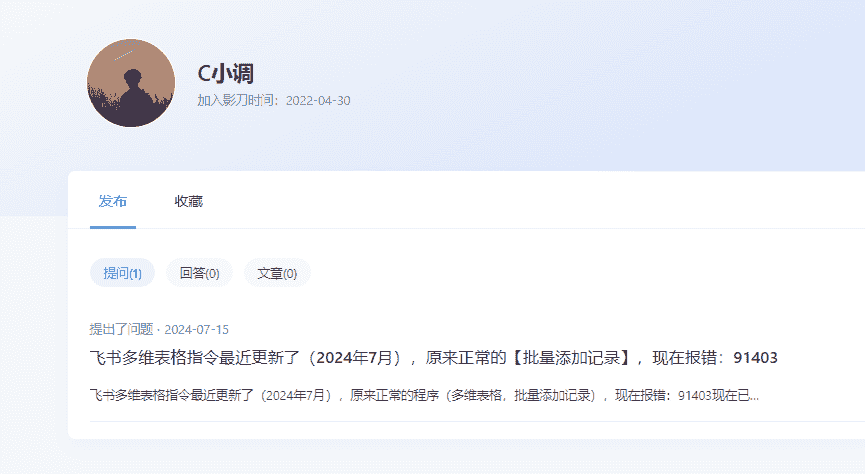

### 2023.12.22 参加影刀开发者活动

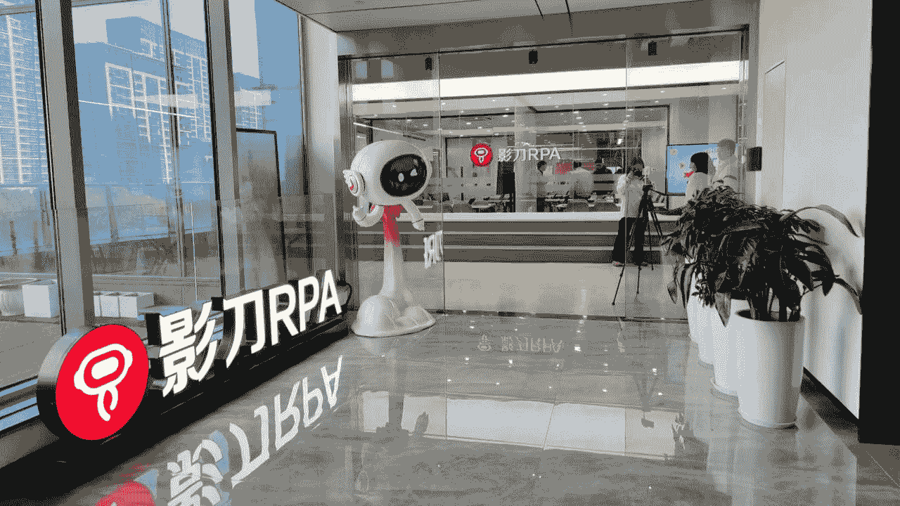

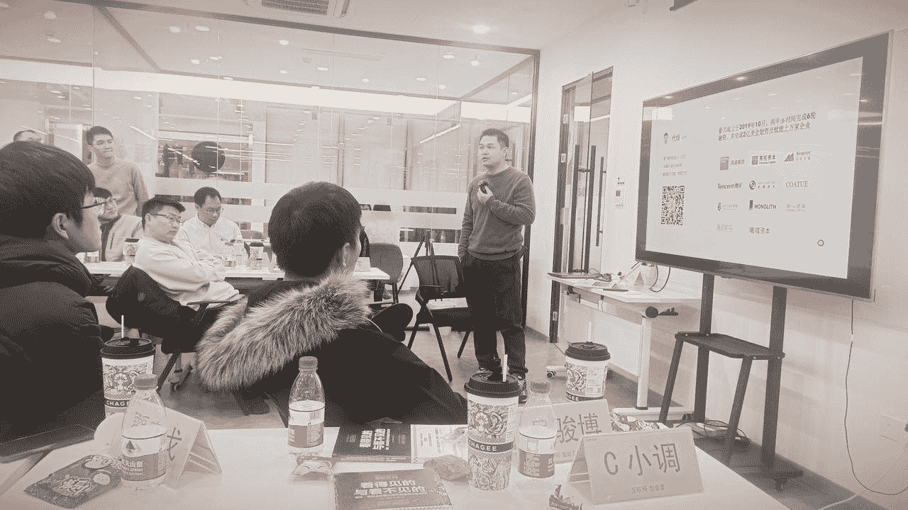

### 2025.1.4 参加影刀开发者活动

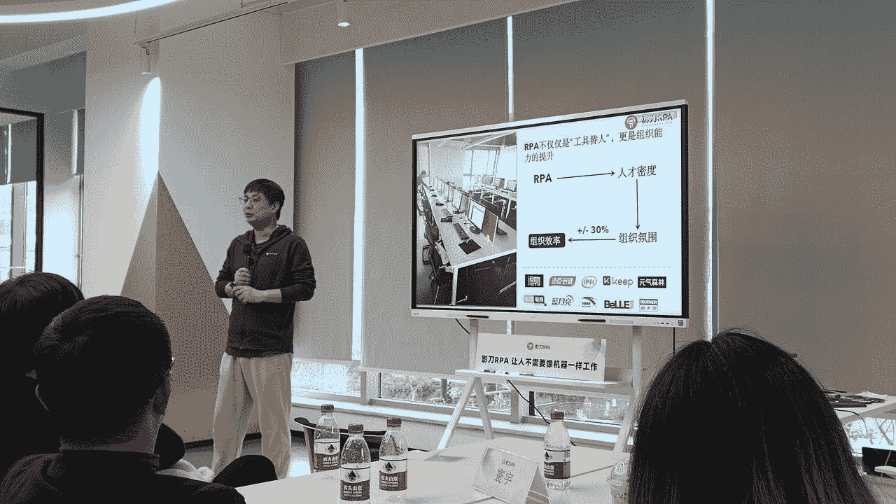

## 为什么不做产品？

+   不造产品不造轮子，小团队不要教育市场，不要教育市场，不要教育市场，重要的事说三遍；

+   如果既要研发产品，还要教育市场，太难了，国内太难没什么机会；

+   **用成熟的工具/产品，来服务企业客户，干些脏活**累活，先拿到 AI 门票，是我当下的认知；

+   没有简简单单靠工具就能，非常难，要结合行业，要做深度服务；

## 为什么先做服务？

+   客户愿不愿意持续给钱，是这件事有没有价值的核心，做服务是最快闭环的；

+   先有客户，有持续的落地服务+案例，让自己活下来，后期再想产品、可复制的事；

# 二、客户篇

## 客户在哪里，如何找到客户？

我们 **2024.4.19 **开始做帐号的，**抖音、小红书、视频号同步**，主要是一些场景的机器人运行切片，刚开始前3个月还是挺难的（线索少、咨询少），主要是让帐号定位，要挺过去；

**抖**音的推荐还是非常精准的，随着帐号标签越来越精准，我会定时在抖音/视频号开直播，加强信任，直播还是需要的。

我们现在是不去陌拜和打电话的，客户通过搜索找到我们了才会跟进，所以我们的客户在全国/世界各地，包括深圳、南京、义乌、福州、厦门、杭州、悉尼、洛杉矶...等等，明年也会尽可能拓展杭州的客户，这是目标。

### 客咨来源

+   我们的客户咨询线索，抖音占了 73%，小红书占了 17%，超过了 90%；

+   抖音、小红书主要是打标签，持续发就可以。

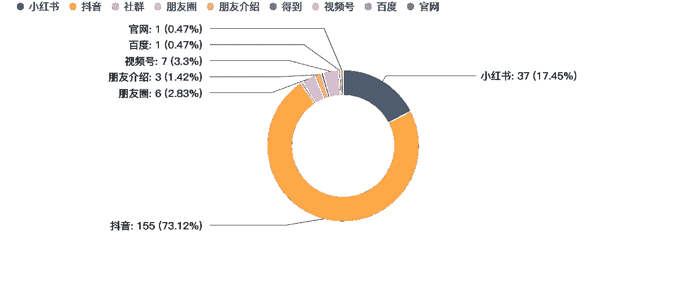

### 客户行业

客户的行业分布：

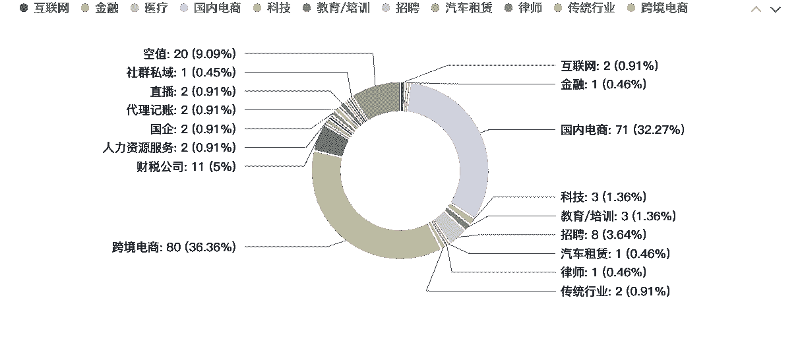

+   需求，是跟你发布的内容高度相关的，你发什么内容，就会吸引什么客户。

### 客户需求

客户需求的词云：

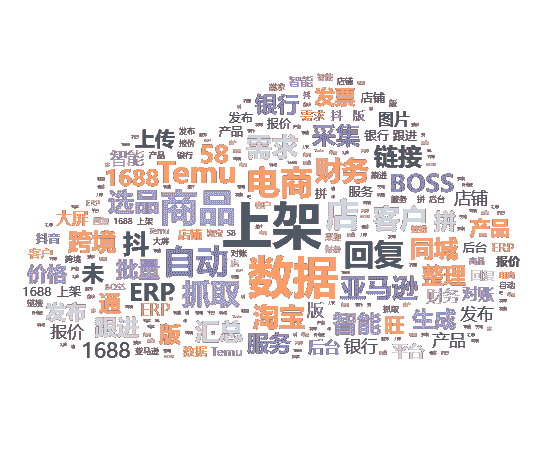

## 为什么要挑选客户？

+   客户不是越大越好、越有名越好，可以早点祛魅，大客户要求多，周期长，未必是好客户；

+   很多几千万、几个亿营收公司的数字化非常弱，提不出完整需求的也不是好客户；

## 什么样的算是好客户？

+   老板、决策层对 RPA+AI 非常认可；

+   甲方愿意花时间、投入钱、投入人，跟服务方一起探索行业实践；

## 做 B 端业务的优点

+   企业客户对价格没有那么敏感，对服务比较敏感；

+   完成一个客户的交付，可以拓展类似需求的客户；

+   一旦客户的机器人稳定运行了，按机器人按月收取的维护费是比较稳定的现金流；

## 做 B 端业务的缺点

+   起步、打开局面比较慢，需要时间，0基础起步还是难的，后面就好起来了；

+   建议在一些圈子，最好有一定的资源；

## 为什么销售非常重要？

+   技术/产品出身的小伙伴，很多不太会销售，这个算是一个卡点，要早点突破；

+   B端业务，好的客户大概率不会送到你面前，需要你去跟进沟通，去发现挖掘；

+   我们是跟进通过线索找来的客户，相比于直接销售会容易一些；

# 三、业务路径篇

## 3个阶段

### 1）阶段一：1 人公司，3个项目以内

+   一个人：开发+项目经理+销售，你必须是兜底的那个人；

### 2）阶段二：2-5 人团队，10个项目以内

+   如果有其他小伙伴，开发和项目经理配合，各自分工先完成闭环；

### 3）阶段三：6-20人团队（兼职为主），10-50个项目

+   首先要有组团队、吸引人的能力；

+   要有多项目同时管理的能力；

+   要有及时分钱、财务算账的能力；

### 主要难点：

项**目价格评估，是需要**经验的，前期**需要懂技术的人参与，评估整个项**目周期和成本，如果经验不足还是有很多坑的，后期随着项目多，越来越有经验，可以汇总很多案例+数据生成智能体，我们内部已经上线报价扣子智能体。

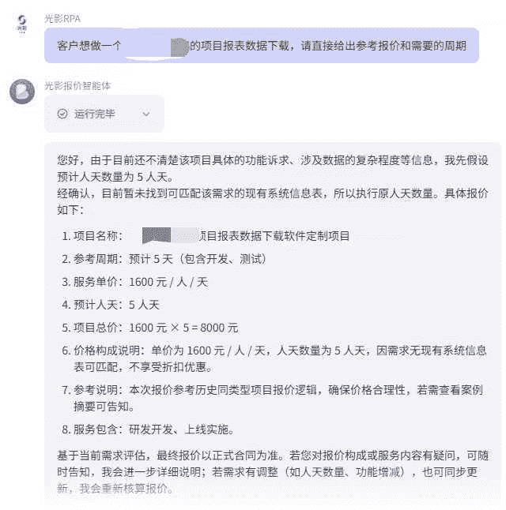

## 关于人才

假如团队比较小，可以这么配置：

项目经理（1人，含创始人），主力开发（2人）。

假如是10人团队，大致分工：

项目经理（3人，含创始人），主力开发（6人），销售/售前（1人）。

**前期是有经验的开发人员难找，因为有没有**经验，交付质量和交付周期是完全不一样的；

**等业务平稳了，客户线索越来越多，销售**转化就变得很重要了，一定要安排销售跟进。

## 关于业务整体架构

我们团队目前所以的业务数据都在飞书多维表格，我大致列一下：

### 几个关键多维表

+   **项目总表（项目名、合同金额、验收时间、维保时间、项目已**收入、项目已支出、项目实时毛利...)

+   **收入明细流水表（收入名称、关联项目、收入方式、收**入金额、收入日期、开票 PDF...)

+   **支出明细流水表（支出名称、关联项目**、支出方式、支出金额、支出日期...)

+   **客户信息表（公司名、联系人、所在城市、服务状态、**开票信息、客户累计收入 LTV...)

### 多维表格设计要点

+   一个【多维表格】管所有，每个子表都有自己的仪表盘；

+   表格之间通过【项目名称】、【客户信息】等互相关联；

+   项目已收入、项目已支出实时计算，这样就可以算出实时毛利；

**......**

## 关于收费标准

### 开发部分费用

设计费：1500*n；

开发费：1600 元/人/天*n；

假如某个项目设计费 3000，开发 5 个人天 8000，总金额就是 11000；

### 维保部分费用

开发交付后，免费维保 2 个月；

超过维保期，每个机器人维保费 300-800/月，如果需要运维，每月单独计算费用；

## 关于源代码

**原则：**

+   **影刀企业版客户提供源代码；**

+   影刀创业版客户不提供源代码，通过分享程序链接+授权码提供服务；

+   **不在个人社区版上开发；**

**大部分客户没有技术背景，其实也不太介意是不是源代码，我们要在生态中长期生存，一切动作**要利于行业发展，利于影刀RPA商业化，保护开发团队的利益，设定好自己的业务框架。

## 关于收入组成

**目前收入主要分四部分：**

1）影刀定制开发费用（主要来源，毛利大约是30%-40%）

**2）影刀企业版推荐佣金（一个企业版20%**，比如：59800*20%=11960）

**3）企业培训/讲课（讲课费）**

4）C端入门课程（小红书+视频号+快团团）

# 四、案例篇

列举一些简单的案例说明：

## **RPA 国内电商应用场景**

### 各类数据汇总

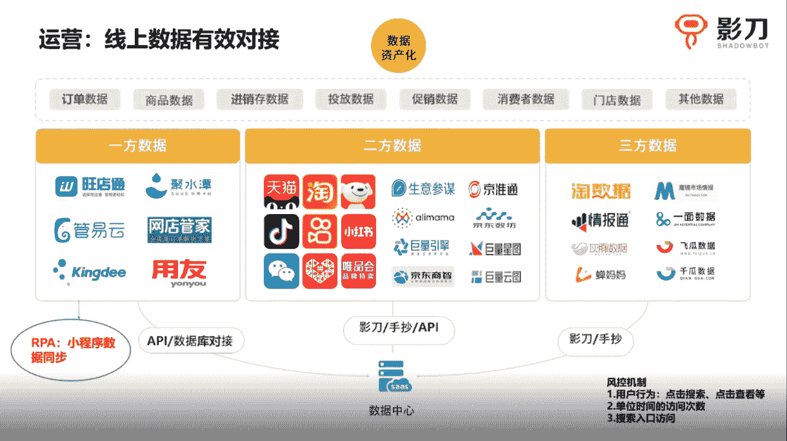

### 百度营销：多店铺数据汇总

1.  **多店铺后台目标数据抓取**，数据按规范整理到 Excel 表格+报表；

1.  自动完成账号下，**多店铺自动提现**操作；

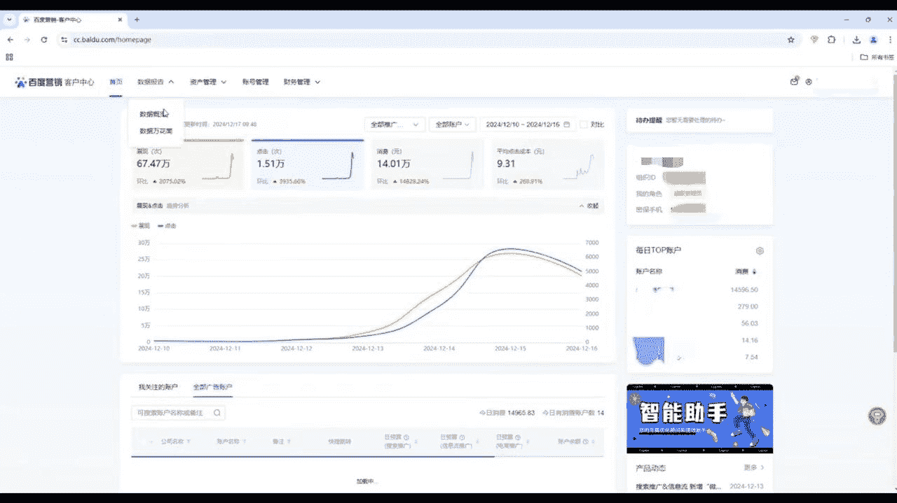

### 某商城：商品上架+优惠券设置

1.  批量上架商品：主图+详情图+SKU 信息；

1.  优惠券设置：根据促销类型，批量生成设置促销优惠券。

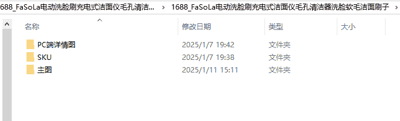

### 1688：生意参谋数据汇总

+   企业多店铺，生意参谋数据汇总分析，自动生成报表；

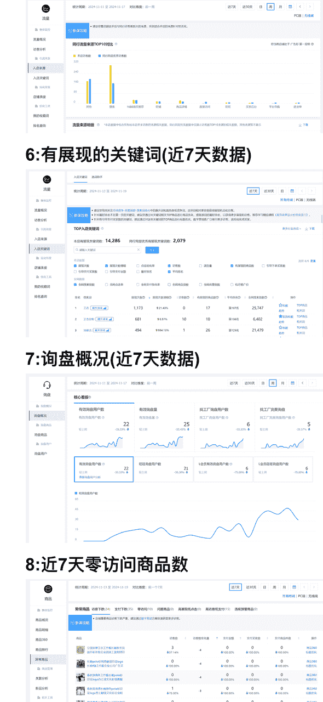

### 天猫：退货查询，物流拦截

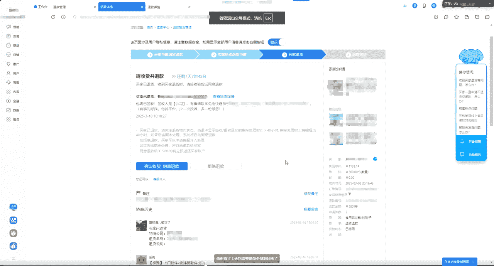

### 巨量千川：多店铺巨量广告数据汇总

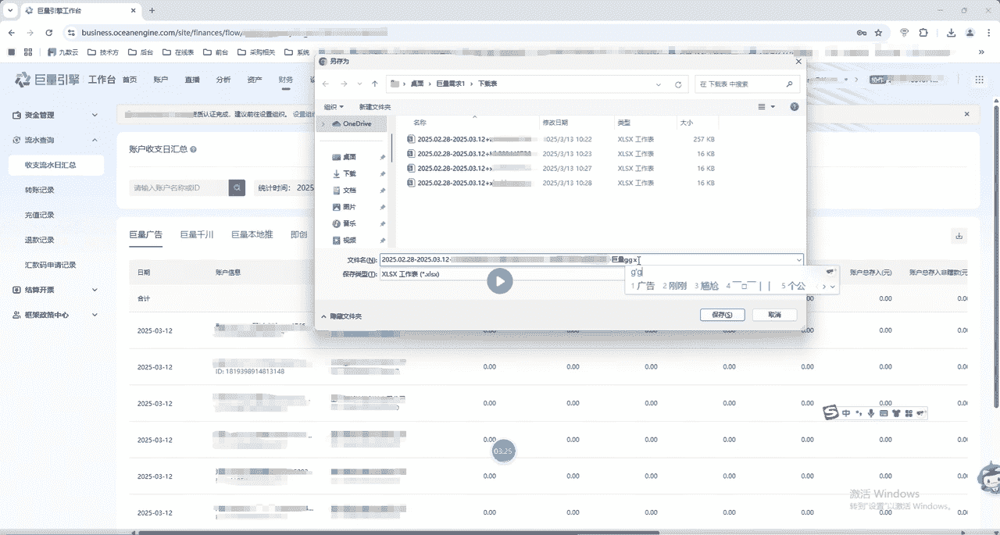

## RPA 跨境电商应用场景

### 亚马逊：广告自动投放（领星 ERP）

1.  **设计并生成所有店铺的广告计划**；

1.  整理到广告计划 Excel 表格，不同的店铺对应不同的广告投放策略，并对应好基本投放信息；

1.  访问**领星 ERP **网站，自动提交广告投放计划，自动设置开启、关闭。

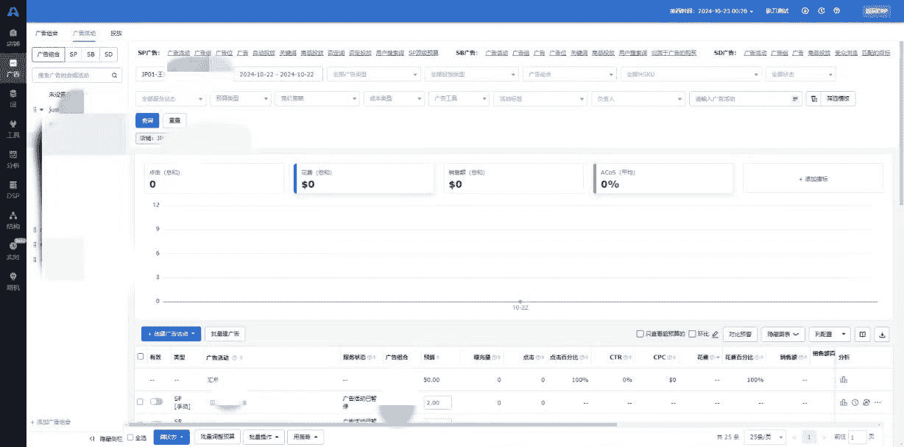

### TikTok Shop：批量上架（店小秘）

+   根据采集数据，**批量修改商品信息并提交****。**

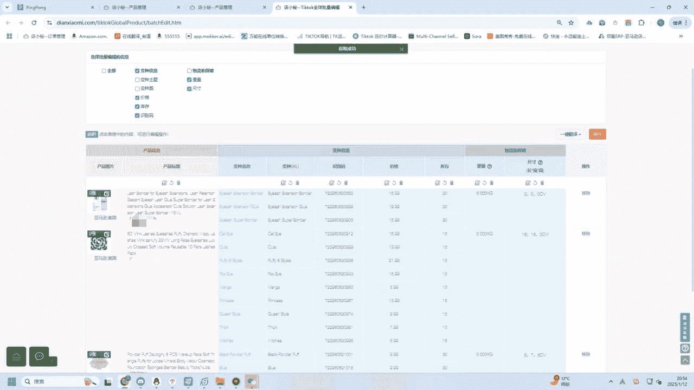

### Temu：商品自动上架（店小秘）

+   通过店小秘，上架 Temu 商品；

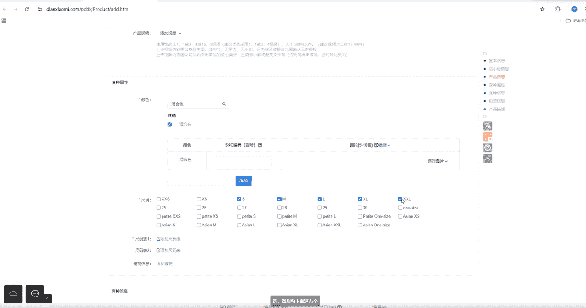

### Ozon：商品自动上架（妙手）

+   通过妙手 ERP，采集后，批量编辑上架

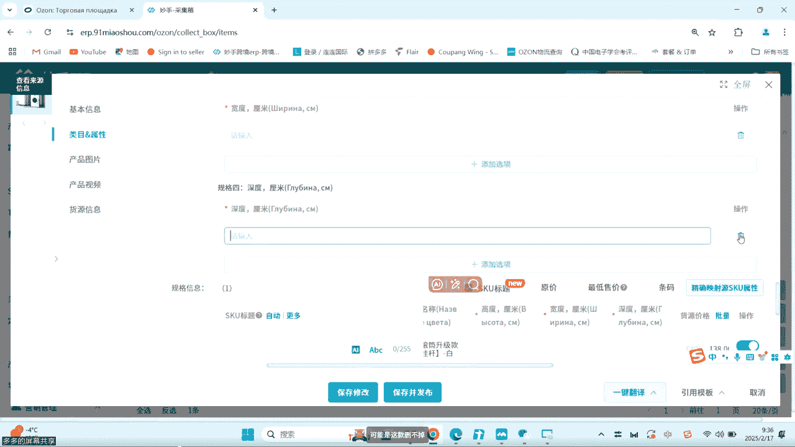

### Shein：自动补充**商品合规信息**

+   通过 SKU 编码搜索对应商品，自动填写对应商品合规信息

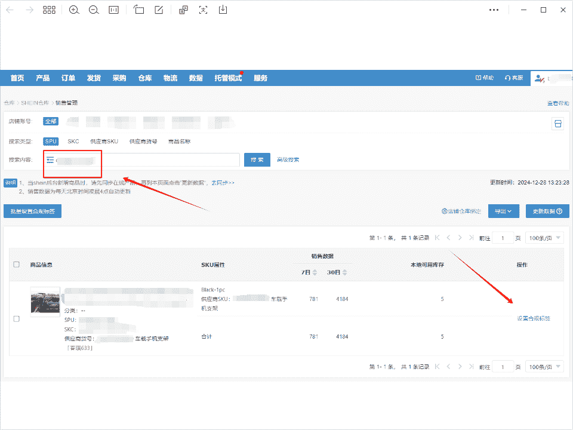

## RPA 财务应用场景

### 财务 RPA 常见自动化应用

+   流水数据自动下载

+   多平台数据比对、流转、汇总、提交

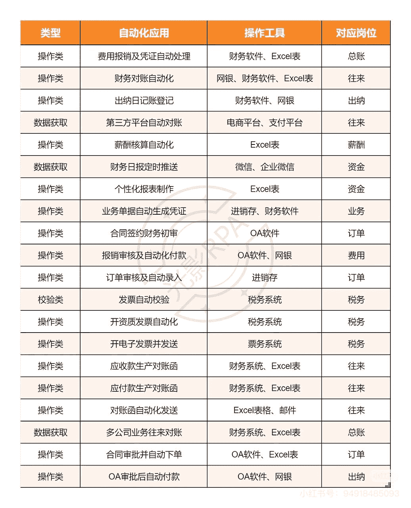

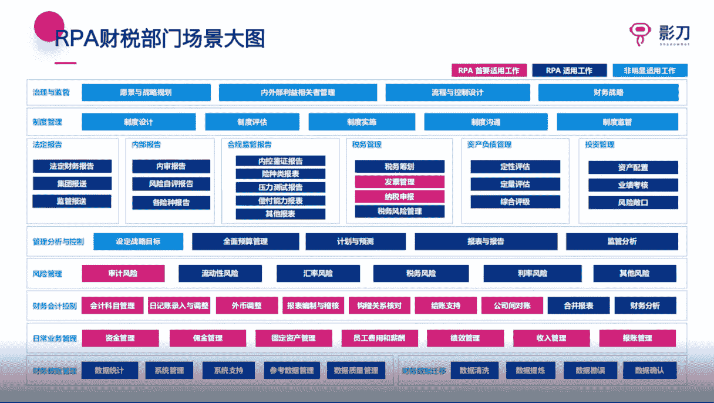

## AI 落地场景

我们用 AI 在企业端的落地，一部分是影刀 AI Power，一部分是飞书多维表格+Coze智能体。

### 影刀 AI Power

**影刀AP，可以实现影刀应用直接调用智能体/工作流/大模型，并实现一些**图片识别、内容分类、翻译等业务的基础判断，在影刀体系内完成闭环，不用其他智能体。

**工作流/智能体页面图示：**

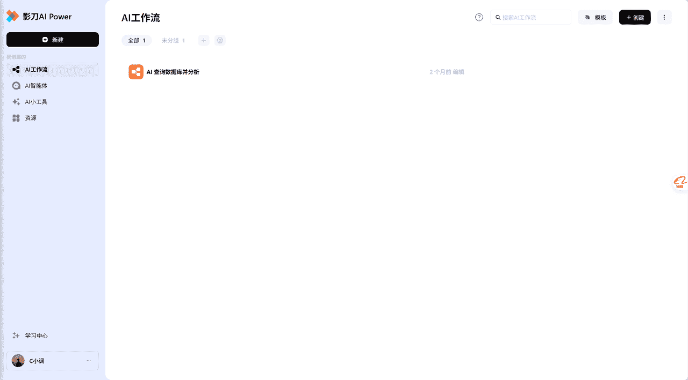

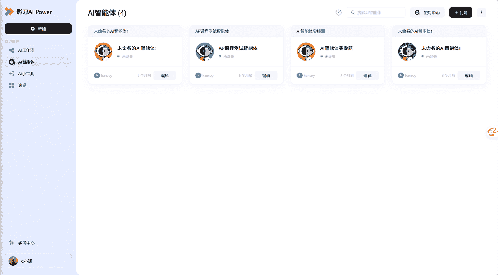

### 飞书多维表格

主要实现**内容分类、智能回复、选品、生图**等复杂逻辑的内容/图片生成；

目前这一部分的需求越来越多了。

### Coze智能体

**主要通过关联飞书文档、飞书表格实现企业**内部智能体的搭建，包括销售端、运营端等。

# 五、未来篇

AI 落地，一定要结合业务场景，相比于研究工具，目前应该花大量时间在挖掘细分行业的业务需求上，找到需求回头再找工具，会更快，更知道自己要什么。

## **生态位**

+   **保持前端获客能力，保持交付落地能力，在主流**自媒体平台的 RPA 赛道占据一席之地；

+   保持在电商**、跨境电商、财税****等**行业一线，有行业 Know-how。

## 愿景

+   **一家领先的**** RPA + AI ****智能解决方案与技术服务提供商，**有 RPA+AI 在企业应用落地的最佳实践。

+   整体业务范围包含：咨询+服务+服务，上限更高。

# 六、个人学习篇

## 总的建议

+   **建议自己了解一下，会对你的工作有很多启发，了**解一个高效的工具非常重要，RPA 值得；

+   **复**杂的应用还是建议交给有经验的工程师，因为需要一定的编程基础，自己学习的投入产出比不高，专业的事就交给专业的人，快速实现更重要。

## 学习路径

**看视频**

**看视频，看视频，看视频，**不要着急上手，一定要多看几遍，**一个视频 3 遍起步。**

**跟着做**

对视频熟悉了之后，再**照着教程，慢慢跟着做**，先完成几个实用的小功能，找到信心。

**融入工作**

梳理自己工作中需要的业务，把学到的技能慢慢融入到实际工作中，会非常惊喜。

**做记录**

觉得**重要的代码块，截图保存备用**，并备注好分类+功能，以后会非常节省时间。

## 学习渠道

**官网&B 站教程**

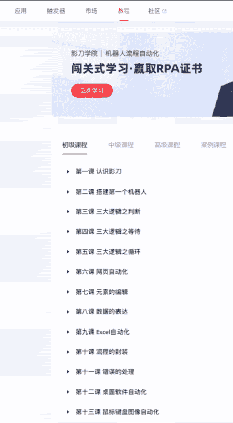

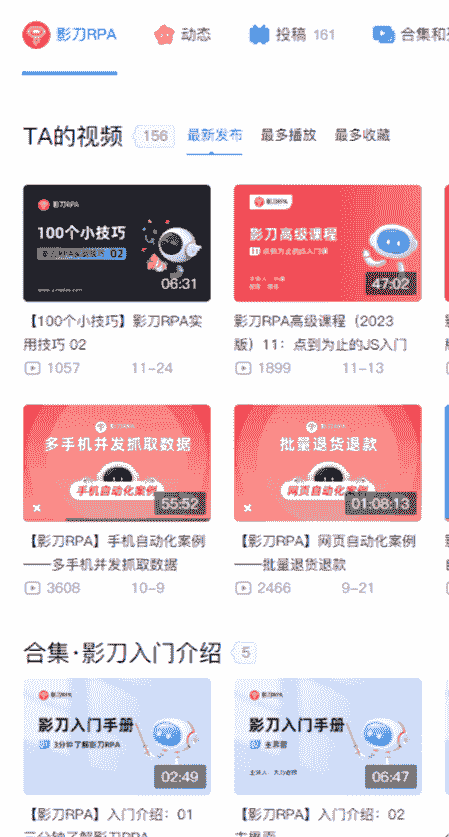

## 学习剪刀差

给自己** 3 个月**的时间，先**保持熟悉感**，**每天学一点点**，一起见证自己的变化。

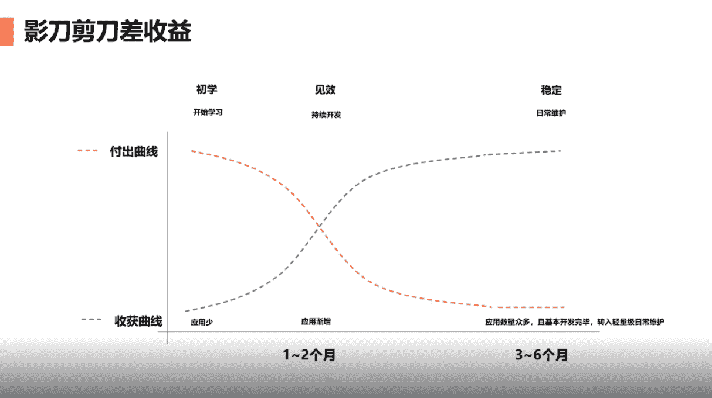

# 七、企业落地篇

## 主要落地场景

日常操作、数据监控、数据同步、数据采集、数据操作等。

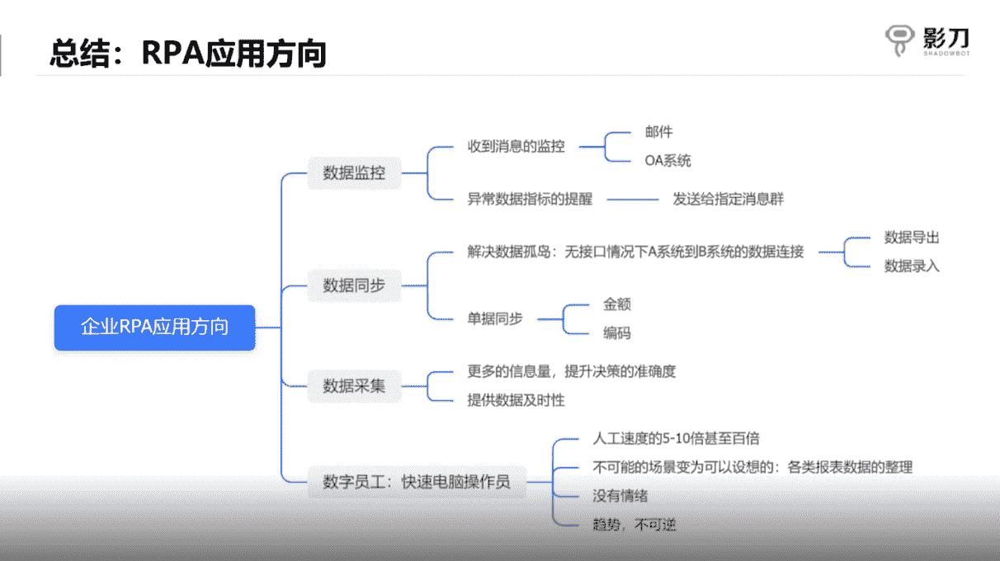

## 需求模板

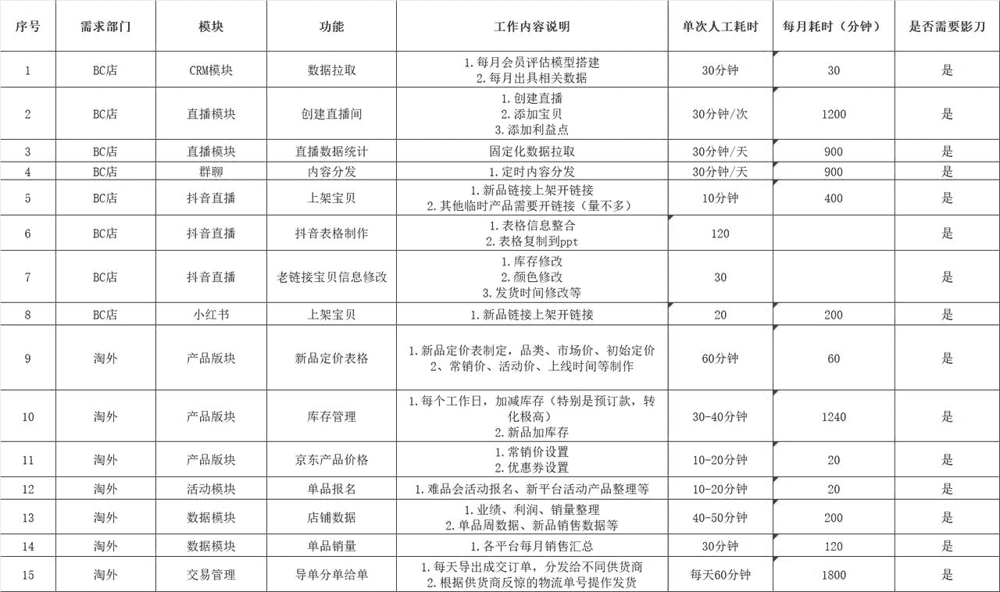

## 部署实施

### 第一阶段：调研开发，1 个月

1.  完成企业常见需求的调研、梳理（根据场景、业务线等）；

1.  在企业员工中普及 RPA 相关的知识和内容，并进行答疑；

1.  分阶段完成解决方案的交付，收集 bug 与其他反馈信息。

### 第二阶段：测试优化，1 个月

1.  根据客户的实际使用反馈，**优化与迭代**；

1.  整理好新业务流程，设置提醒通知机制。

### 第三阶段：稳定维护，按月度

+   由**于平台（网页、**客户端、App）会不定期进行改版和布局调整，机器人可能会出现一些小的运行问题，需要对一些机器人进行修复、程序调整。

# 写在最后

## 为什么要重视 RPA？

+   大部分朋友还不了解 RPA，你知道能做什么，就领先了 8、9 成的人；

+   我们当年怎么学习 Excel，现在就怎么学习 RPA；

+   **好的工具能解放人工，让你从岗位、公司**脱颖而出，也能帮公司快速扩大规模和营收。

## RPA 跟 Python 的差异？

+   Python 是编程语言，学习成本高，对零基础的财务、HR、运营不够友好；

+   Python 的特点是数据抓取、分析，但开发时间长，RPA 更快速，效率高；

+   RPA 有点像 Excel，零基础入门，上手容易，快速反馈，使用场景多太多；

+   影刀 RPA 的底层是 Python，如果会 Python 可以深度开发，很加分。

## RPA 能解决什么样的问题，适合什么企业？

+   能解决什么问题：日常办公的各种运营操作，各种数据抓取整合；

+   适合体量多大的公司：小公司可以用创业版（5988/年），大公司可以买企业版（59800/5 帐号/年起）。

创业版购买地址：https://www.yingdao.com/venpay/，社区版运行别人的程序到时间上限也会触发购买。

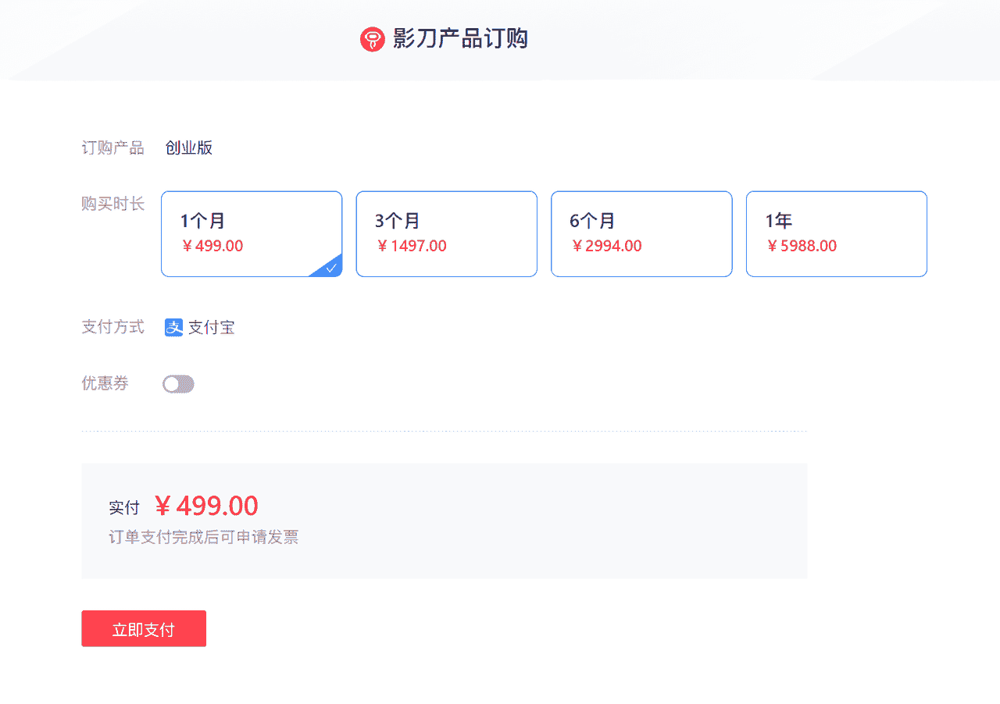

感谢阅读，大家多交流。

**C小调**

**2025年11月11日**