# 致生意伙伴：一份《找对贵人，构建贵人圈》的落地指南

> 来源：[https://xuqiwei1986.feishu.cn/docx/M1tWdnQcVoIYQ8xL8OSc2Lr4nvc](https://xuqiwei1986.feishu.cn/docx/M1tWdnQcVoIYQ8xL8OSc2Lr4nvc)

Hi，大家好，我是珍妮，从留学转行到房产，又因为做出业绩后不断被各行各业的老板看到，被老板们抛来橄榄枝，于是我通过自营盘和代运营盘实现转行，给老板们配置并培训运营获客团队，做线上获客。

在事业上，很多人都会想要遇到贵人，希望有贵人提携自己一把，带着自己起飞。

有些人可能找对了贵人，真的起飞。

有些人识人不准，反而栽坑。

还有些人给贵人疯狂打杂，依旧没有收到什么回馈。

我想与大家分享的，不仅仅是如何找对贵人，更是如何主动构建一个能持续滋养你、成就你的“贵人圈”。

每个创业者在往上攀登的路上都少不了被社会毒打，但并不代表“我们必须把所有弯路都走遍了、才知道什么是正确的路”。

今天分享的内容，希望能让你在创业路上少走弯路，下方是分享目录：

1.  我因为贵人而转行的故事与我的分享初衷

1.  怎么定义贵人

1.  寻觅你的贵人

1.  如何找对贵人——七盏能量信号灯

1.  与贵人共赢的核心心法与边界

1.  提升贵人运的实操体系——从沟通到闭环

1.  总结：如何复刻珍妮“遇贵人”的路径

1.  致谢

# 我因为贵人而转行的故事与我的分享初衷

我是2022年入的生财，之后一直潜水。

23年因为无意中在生财发表了一篇精华文后，陆续遇到了贵人，

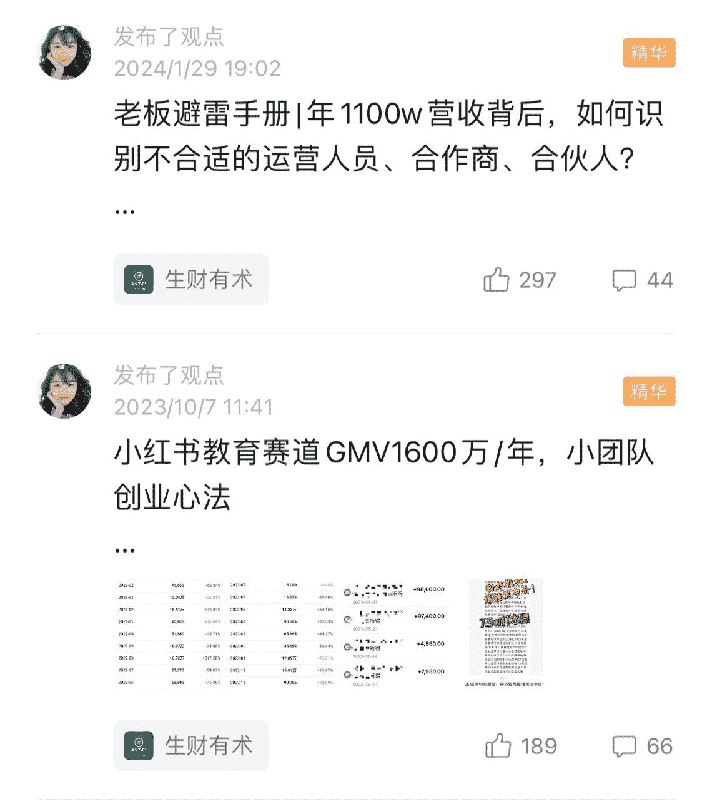

24年时，成功从留学行业转行到房产做出业绩，

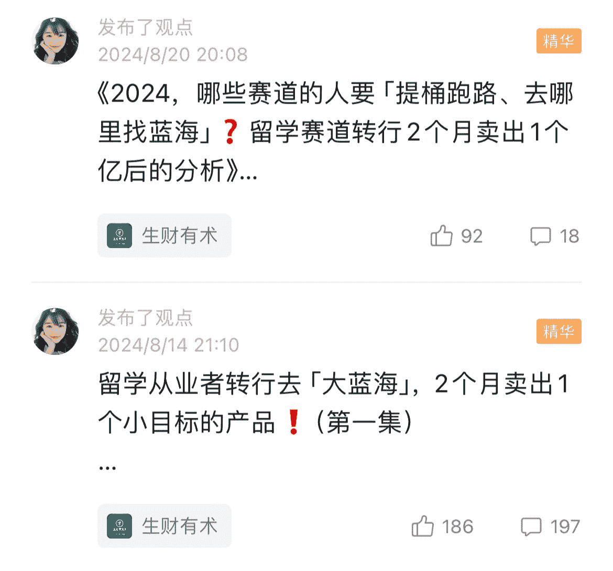

到了25年更甚，遇到了更多好机会，包括但不限于：教育、房产、文旅、以及一些线下传统行业，

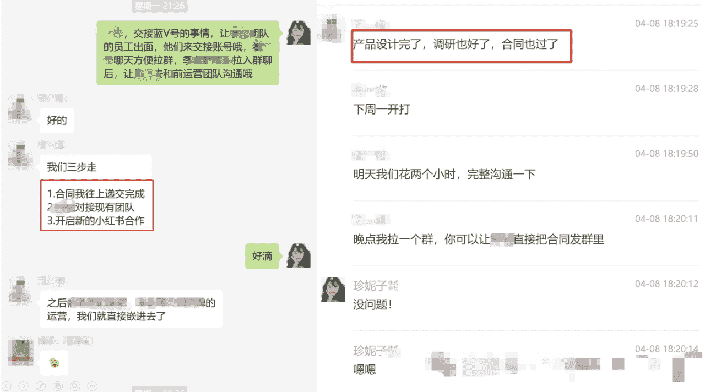

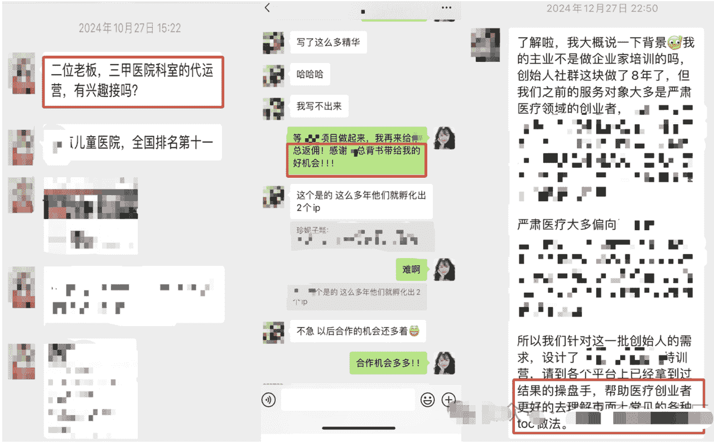

25年生财有术418的拉新手册里，也有友友因为我那篇“如何在生财遇到贵人”而感谢我。

与此同时，我也助力一些生财圈友拿到了结果。

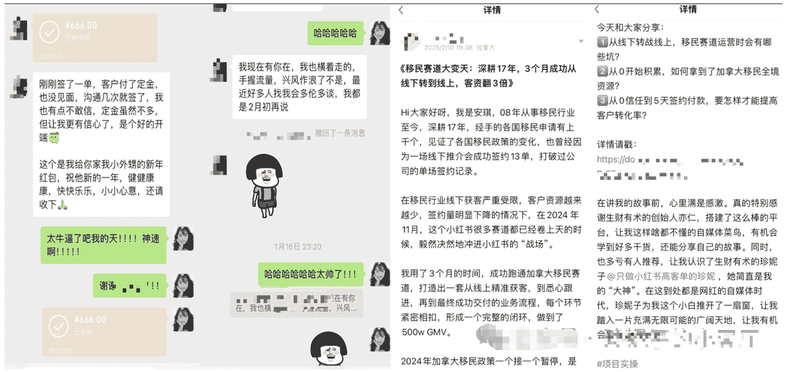

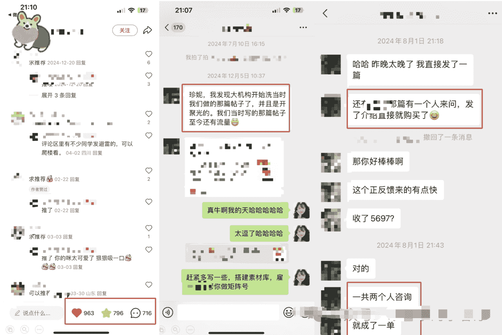

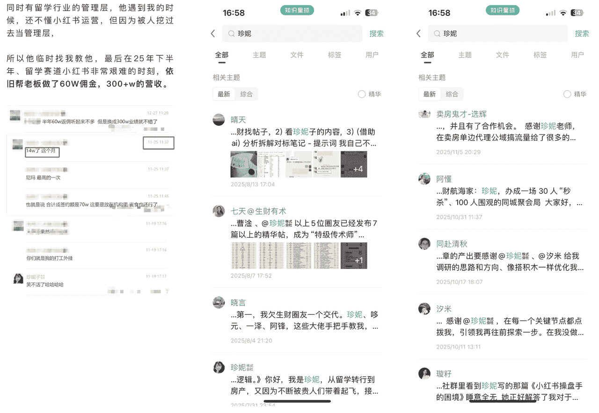

我不仅有丰富的实战经验，而且我深耕石剪布这套识人理论近5年，能通过别人的微信文字说话风格、语音说话风格等，来辅助评估合作的契合度。

这篇文章，写给在每个在做生意的伙伴。

# 怎么定义贵人

别再把“贵人”简单理解为来帮你的人。真正的贵人分为两种：

1.  提携型贵人：给你机会，拉你上路。这是我们通常理解的贵人。

1.  磨炼型贵人：给你挫折，助你成长。他们是你命运中的“考官”，你踩的坑、吃的苦，就是你的考卷。只有当你深度复盘，学会了如何应对这类课题，提高了认知和心性，这道题才算真正考过。从此，你便拥有了化敌为友、转化负能量的能力。

祝愿你，不仅能遇到指路的贵人，更能最终成为自己最巍峨的靠山。

# 寻觅你的贵人

想要知道“去哪里遇到贵人”，就得先明白“和贵人的社交方向”。

不是所有社交方向，都和“向上社交”有关。

如果你仔细看，就会发现：长辈们往往都会投资年轻人。

因为年轻人朝气蓬勃，是时代的弄潮儿。

无论做什么事业，最后都需要“人”，而且需要大量的“年轻人”。

对于长辈来说，投资年轻人，就是投资自己的未来。

所以，对于我们普通人来说，和贵人的社交方向，

也包括了三个分类：

**向上社交（接触前辈与导师）**

**平级社交（携手伙伴与同侪）**

**向下社交（投资潜力与未来）**

有了以上3个分类，那么怎么找到贵人出没的高频场合呢？

## 如果我们是要向上社交，最好的办法，就是进入高端付费圈层。

因为一个愿意花钱进付费圈子的人，要么说明他比同龄人更有经济实力，要么说明他更有进取心。

**向上社交的时候要有以下心法：**

1）无论我们自己之前有多牛，我们的谦逊是必要的，但不用在别人面前自我矮化。

2）上层的贵人也需要下一层次的人给自己打辅助，我们平时在平级和向下社交中积累的人脉，有时也能为上层贵人提供支持。这也是向上社交的一种方式。因为很多前辈，需要靠谱的伙伴来协助管理事务。

3）向上社交很多时候需要我们先付出，而且可能在较长一段时间内看不到直接回报。这很正常：贵人身边通常有很多人希望与他建立联系。所以贵人也会筛选身边的人，他们往往相信“路遥知马力、日久见人心”。

4）创一代里面，能赚钱的人往往是比同龄人更能吃苦更能受委屈的。

向上社交需要做好面对吃苦和受委屈的准备。如果不确定自己能否承受，可以做一个简单的自我觉察：【被人误解或批评时，我们是否总想立刻解释和反驳？】

注：向上社交需要的‘吃苦’，是指以专业能力解决复杂问题的毅力，而非无原则地忍受委屈。

5）平时在平级和向下社交中，建议注意维护自己的口碑。因为当有贵人愿意提携我们时，他们很可能会私下了解我们的为人。如果平时口碑不佳，贵人可能会担心提拔我们会影响他自己的声誉。

## **如果我们是平级社交，那就要留意我们的朋友**同事里谁做事靠谱，我们要和同级打成一片。

### 例子1：

我以前在语培机构当雅思老师的时候，哪怕我是那个机构年龄最小的雅思老师，但是我会留意学生们&同事们对机构每个人的评价。

谁口碑好，谁口碑不好，我都在心里记下来，日常和口碑好的同事们一块吃饭，给他们买买好吃的。

以至于我都离职7年了，我还在给我的前同事派单。因为我交付不了的工作，我可以包给我前同事来干。

### 例子2：

做生意的过程，就是不断扩大朋友，减少敌人的过程。

生财有些圈友，在事业上做出了成绩，于是在生财发帖感谢我。

有的是感谢我当时给他介绍了好的资源和机会，

有的是感谢我当时在运营获客上指点了对方。

而这些在25年开始发帖感谢我的圈友，有的是我24年无心种下来的种子。

为了感谢【他们对我的感谢】，我也会给对方主动做曝光，提升对方的知名度，并且把我平时遇到的好资源私下安利给对方。

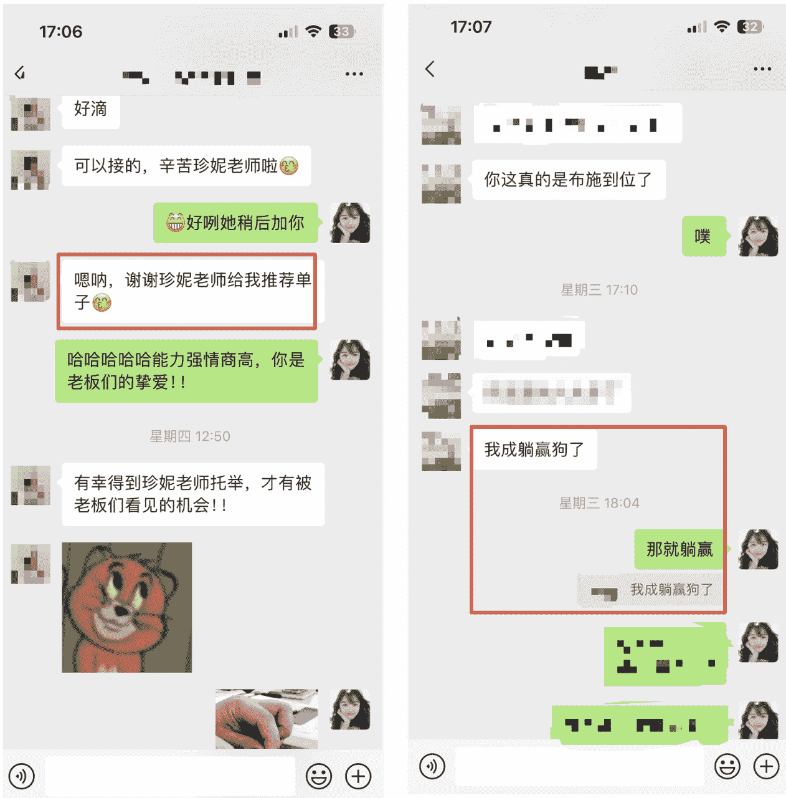

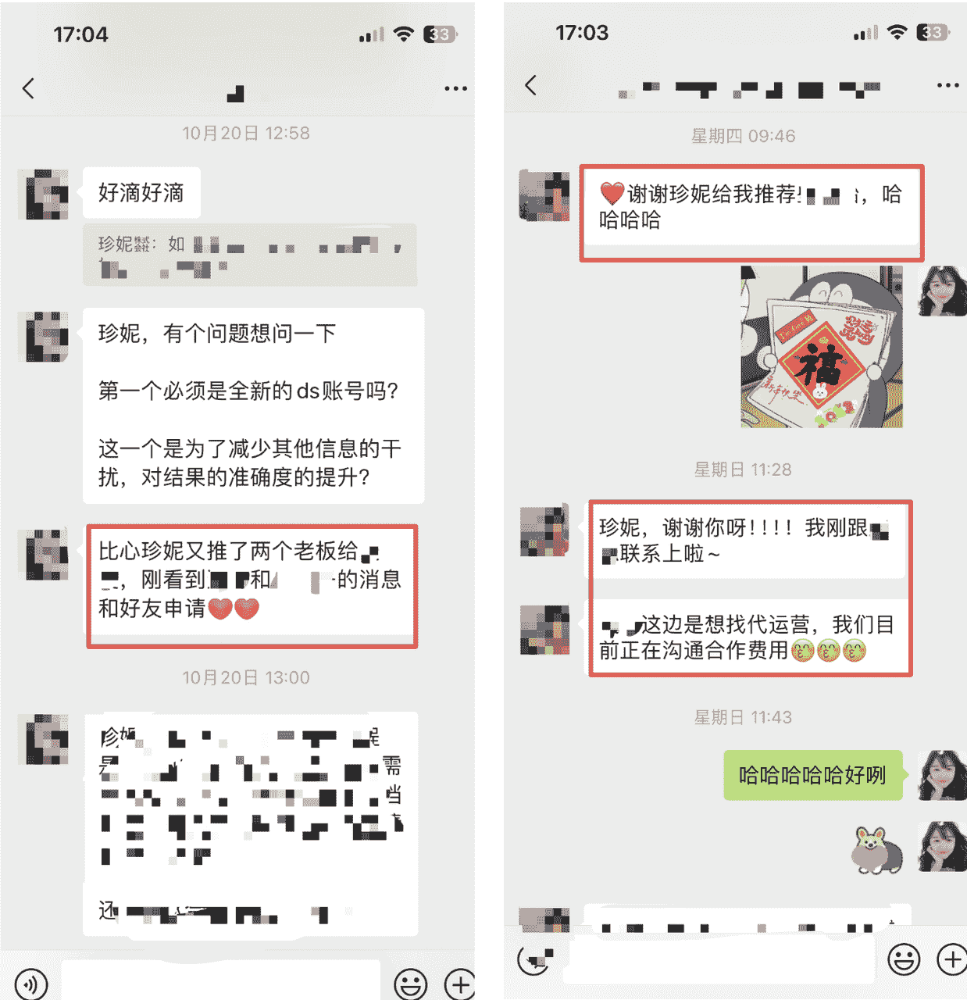

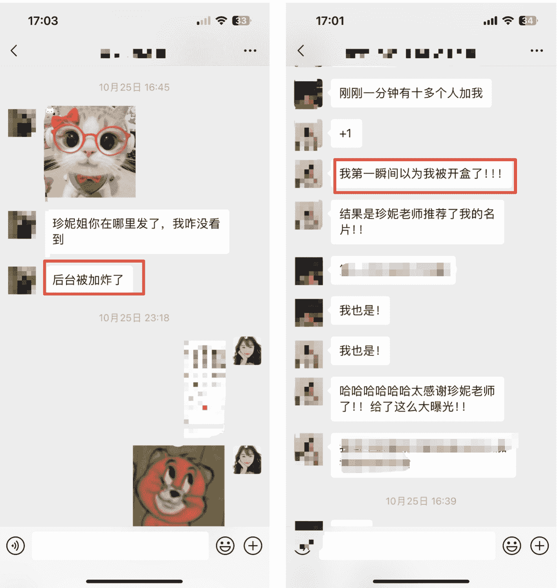

## **如**果我们是向下社交，就要主动被人占便宜。被占便宜的同时，细心留意那些有上进心、懂得感恩的人，在他们需要帮助的时候拉他们一把。

我的一些好机会，是我曾经当初中英语老师、雅思老师时遇到的学生给我的。这些学生有的年龄比我小5岁，有的比我小9岁，然而我能顺利跳槽，或者接得住【上头的人】给我的机会，是源于我平时会向下社交。

### 例子1：

以前我是当过雅思助教的。机构里的助教往往只会监督学生背背单词，但我会主动帮全机构学生免费修改雅思作文，再安利一些辅助写作工具给学生，让他们能早一点学会雅思作文背后的写作逻辑。

机构并不会因此给我额外报酬。但我在这个机构只当了4个半月助教后，就跳槽去了另一家机构B当正式老师。

去机构B面试那天，有一个我当助教时、辅导的学生，ta恰好机构B做留学申请业务，ta要过去递交ta的留学申请材料，ta就送我去机构B面试，还在机构B的校长面前帮我美言了几句，于是我马上顺利被录取了。

后来我做留学生英语润色翻译业务起家，当年这些雅思学生，是第一波支持我业务的人，在我业务启动初期，给我写了很多好评，转介绍了很多客户。

当时还有一位我的雅思学生，曾送我一本对她的家人影响深远的书，从此改变了我的命运。

### 例子2：

我当初中英语老师和班主任的时候，和我们班初中生的关系搞得很好。后来他们上大学了，又来我这里接兼职，有的人帮我写小红书笔记，有的帮我处理数据。做生意，肯定是优先用熟人，所以不管是我从留学行业转行到房产，还是遇到后面这些好机会，背后都有我当年学生给我的帮助。

遇到有上进心又愿意干活的学生，我就会多花心思带带。我明白大学生没什么钱，所以遇到一些我觉得不错的好机会，我掏个几百块钱把人扶上马送上一程。

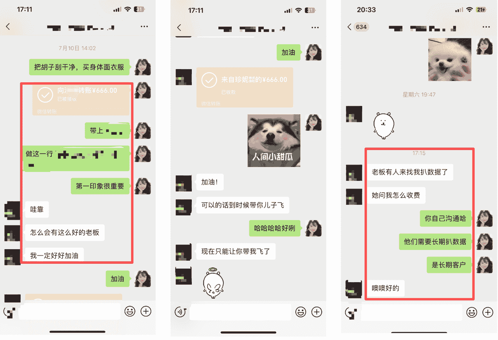

主动被人占便宜，也需要一些智慧：

因为当你愿意付出，有时可能会遇到一些“奖惩错逆”者，即你对他好，他解读为软弱。

遇到小单子，被人奖惩错逆，我们可以适当包容，毕竟这是人际交往中难免的；

但如果涉及大单子，就需要谨慎处理，及时调整相处方式，这是保护自己的必要做法。

如果不断忍让，可能会让自己陷入被动，沦为“能量黑洞”，卷入别人的因果。

# 如何找对贵人——七盏能量信号灯

在构建贵人圈之前，可以先学习如何找对贵人，哪些是可能需要我们注意的。

下面的案例，都来自我对生活中各类人群的观察，不针对任何具体个人，请大家不要对号入座。

下方方法仅供圈友用来当做防身术，不是用来对外出击哦。

## 【工作观信号】：

1.  如果合作方将业务完全外包后便不闻不问，这或许意味着他与一线战场的信息同步出现了延迟。对你而言，这可能不仅仅是“承担更多基础工作”，更意味着你需要独自承担决策模糊、方向不明的沟通成本与执行风险。

1.  当合作伙伴开始频繁谈论退休、表达“不想努力”时，这或许是他内心能量值较低的信号。真正的功成身退是从容的规划，而反复提及的倦怠，可能暗示其当下正面临难以突破的瓶颈。与能量持续走低的人并肩，你不仅要背负自身的行囊，还可能消耗心力去拉动对方。

1.  在合作中，比起听对方说“有多忙”，更重要的是看他“忙出了什么结果”。如果对方的“忙”只存在于言语中，却让你承担了绝大部分的落地工作，那么这种忙碌就更像是一种管理你预期的手段。创业公司老板如果不在一线，公司发展可能会遇到困难。李宁公司在创始人不管业务时都经历过三起三落，何况普通人？

## 【财务观信号】：

1.  负债情况，可以反映一个人的决策模式。
成年人的负债有两种：一种是暂时的资金周转问题，另一种是系统性的财务困境。如果发现合作伙伴长期处于系统性的财务困境中，他的认知可能还停留在靠杠杆和规模创造优势的阶段，而未来十年更需要精准和稳健。
需要注意的是，与这样的伙伴接触，你稳健的财务和资源很可能成为他试图弥补自身模式短板的依赖对象。他描绘的蓝图需要你用更审慎的眼光去评估。保持距离，是避免被卷入其系统性风险的一种清醒选择。

1.  留意那种让你“自己承担所有成本入股”的合作邀请。
他的合作模式可能是：你用实际投入承担全部风险，他用一些指导和未来设想分享主要收益。你连日常开支都需要自己负担，他却能几乎没有投入地参与。
更值得注意的是，他可能希望你用个人信用为他背书。当那些信任你而来的客户，因为他的服务不到位而不满时，受损的是你的信誉，而他却可能已经转向下一个“合伙人”。
这不像是一种平等的合伙，更像是一种单方面的风险转移。真正的合伙应该是风险共担、价值共创，而不是一方全力付出，另一方主要分享成果。

1.  分清“价值定价”与“资源整合”。健康的金钱关系分为两种：一种是为您创造的价值明码标价、支付报酬；另一种则旨在整合你现有的资源为己所用。前者是清晰的雇佣或采购，后者则更像一种战略合作，需要你格外审视其结构与回报是否对等。

1.  资源也分两种：让你增值的，和让你价值降低的。
真正的资源会带你进入价值提升的通道，而有些资源可能主要是把你作为辅助工具。前者与你分享收益，后者可能更多考虑如何利用你的价值。

1.  合作中，甲方给你支付款项时，如果提出“只付一半”款项，可能需要我们留意。如果轻易同意，可能会让对方觉得可以进一步调整约定。
尾款能否顺利收回，有时在对方提出“只付一半”时就能看出迹象。如果不明确表达立场，就是默认接受全部损失。
从拖延合作款项到提出私人借款，可能是对方在试探你的底线。他借的不仅是钱，更是你对他的认可程度。

1.  一个人若曾经历负债并成功走出，这段经历往往是他认知系统的一次淬炼与升级。这非但不是缺陷，反而是其思维趋于成熟、更加理解风险控制的证明。

真正需要警惕的，并非负债本身，而是那种长期陷于财务困境，且试图掩盖或美化现状的行为模式。这通常意味着其核心的决策逻辑可能存在缺陷，且缺乏直面问题的勇气。

1.  在商业环境中，大致有两种角色：主动进取的，和懂得稳健前行的。
前者往往会主动寻找机会，有时会以指导者的身份出现，主要目的是将你的稳定资源，转化为他们的发展机会。
关于如何与这类人相处，有三点建议：
第一，不必在市场上过度暴露你的野心。野心是你个人的发展步骤，不一定要完全公开。
第二、面对过于主动的“人生导师”，你可以礼貌地回应：“我目前主要是做好手头的小业务，太大的项目可能还接不住。谢谢您的认可，祝您找到更合适的伙伴。”礼貌的拒绝，也是一种保护自己的方式。
第三、建立合作最好遵循“小单-中单-项目”的渐进步骤。在任何一步发现对方不太合适，可以暂停继续。你的信任很宝贵，需要给到合适的人。

1.  付款的节奏，反映一家公司的运营状况。
合同约定15号付款，却经常拖到20甚至25号，这可能不是偶然，而是其现金流紧张的表现。财务状况健康的公司，通常在次月月初就能完成结算，不会拖到次月月底。
当对方提出“这次先付一半”时，这可能不是临时调整，而是资金压力下的选择。他的运营可能遇到困难，你的让步，可能是在替他承担压力。
在商业合作中，第一次拖延可能是意外，第二次发生就需要我们重视了。

1.  警惕“资金挪用”的信任游戏。

这种“拆东墙补西墙”的模式，其本质不是在经营可持续的业务，而是在维持一个脆弱的“信任循环”。你的资金一旦进入这个系统，就可能不再由你掌控，而是被异化为维持其运转的“协调成本”。

如果您想更形象地理解，可以参考《创世纪》中叶荣添的早期案例：他反复利用母校资金、伴侣人脉来填补项目缺口。在彻底反思前，他始终陷于这个循环——将信任他的人皆转化为系统的“支持者”。

在当今市场环境下，这种模式的可持续性极低。如果遇到类似情况，务必清醒意识到，这或许并非一次平等的合作，而是参与了一个高风险的系统。

1.  当合作方开始“定义”你的价值。

在沟通中，如果对方反复贬低你业务的规模或价值，这通常是一个需要警惕的信号。无论其初衷为何，这种沟通方式本身就是在试探你的自信底线，并试图在心理上占据高位。

更关键的是，这类人往往有意无意地离间你与原有社交圈的关系，以期让你在更孤立、更依赖他的状态下进行合作。

应对策略：守护好你的核心圈子与客户网络。尽量避免让其深度介入，确保你的事业根基始终由自己主导。

1.  识别“建议”与“落地”之间的落差。

当你遇到一个习惯于评论他人事业却鲜有自身成功案例的“指导者”时，可以抱持一份清醒。这里有三个值得玩味的现象：

第一，他对实干精神的轻视，往往反衬出自身执行经验的匮乏。

第二，他热衷于评价你的盈利模式，其背后可能关联着他自己的知识变现需求。

第三，一个自身财务状况堪忧的人却专注于指导他人致富，这其中的商业模式，需要你用自己的理性去审视和判断。

1.  借钱，是商业关系中需要谨慎对待的事项。
一旦对方开口，无论他有什么背景，建议保持清醒。这代表他的财务可能出现了问题，而你，只是他众多求助对象中的一个。他即使后续有收入，也可能优先偿还大额债务。你的小借款能否收回，存在不确定性。

1.  警惕“分钱时表现积极，出钱时让你先行垫付”的合作模式。

这是一种典型的权利与责任失衡的结构：在分享成果时争先恐后，在承担成本时则期待你先行垫付。其行为逻辑往往是：将你的资金视为可动用的运营工具，而将自己的视为需要守护的私有财产。

这深刻反映了对方的合作态度：他或许并未将你视为平等的伙伴，而是看作一种可补充的资源。一旦你开启垫付，不仅回收款项困难，还可能面临关系异化的风险。

必须坚守的原则是：

第一，避免金钱借贷，因其会模糊合作的边界。

第二，坚持“款到开工”，这是对彼此专业性的最好尊重。您的价值，体现在卓越的成果交付上，而非为合作垫付资金的意愿。

1.  有人通过恳切的方式，展示自己的身份证，承诺公司即将有大额进账，可以很快归还你的款项——这是情感式沟通的一种表现。
他们的“担当”表达，可能基于一个逻辑：用较低的代价（尊严）和较高的预期（未来收入），来争取你的理解（时间），以便将实际资金优先用于维持其他重要关系。
他口中那“即将到账的款项”，可能是为了安抚像你这样的“伙伴”而设定的预期。目的不一定是欺骗，而是希望争取时间。
处理方法可以参考：真正有效的约定是“预付款到位”。款未到，合作不开始。你的信任，需要对方用实际行动来换取。

1.  在商业关系中，利益分配大致遵循两种模式：一种致力于让追随者共享红利，另一种则可能让伙伴长期处于付出多于回报的状态。

前者用真金白银构建共赢体系，后者则倾向于用情感纽带维持不平衡的关系。一个值得深入观察的信号是：如果一个人核心团队的成员长期处于拮据状态，这通常清晰地表明其利益分配机制存在缺陷。

我们的选择因此变得清晰：是进入一个价值共创、利益共享的良性循环，还是陷入一个需要用情感来弥补实际收益不足的关系。前者通向可持续的事业，后者则可能是一种持续的消耗。

1.  合作方要求不签电子合同，改为纸质合同，有时可能需要我们留意。
所有“电子转纸质”的合同变化，都建议我们仔细核对。默认需要审阅，直到确认无误。
请律师审核，不是在增加成本，而是在为合作增加保障。

1.  所有刻意说给你听的“消费故事”，可能是一次有目的的“信任建立”。
他告诉你：“他每月为身边人花费多少”，目的不一定是展示慷慨，而是为你营造“他很有实力”的印象。请记住：真正的实力来自创造价值，而不是展示消费。
你需要理解资金的流动逻辑：每一笔钱的去向，都在进行价值交换——或是实用价值、情绪价值，或是其他形式的回报。你听到的“慷慨”，可能是他过去的经历，也可能是他负债累累下的虚空造势。
钱是价值交换的媒介。如果不清楚他背后想交换什么，建议对他的故事保持平常心。
所有超出常规的“给予”，都可能伴随着相应的期待。
就像高校给老师60万安家费的实质，是老师们未来十年工资的折现。
如果你没有准备好相应的付出，建议不要轻易接受这类好意。

## 【能量场信号】：

1.  警惕以“性话题”进行的边界试探。

在商业场合中，主动开启与性相关的话题，绝非无心之举。这往往是一种有意识的试探，目的在于模糊商业合作的专业边界，并评估你的服从性与可拿捏程度。

你的反应至关重要。最有力的回应是立即将话题拉回“专业三要素”：合同、预付款、工作范围。明确传递出“一切以商业规则为准”的信号。

语言可以温和，但原则必须坚定。请记住：预付款未到，合作不开始。这是守护您专业边界最有效的防线。

1.  关于精力分配与自我守护。

第一，晚上11点后的非紧急会议，都可能带有“服从性测试”的意味。遇到这个模式，可能意味着你进入了需要留意的人际环境。

第二，警惕持续“补坑”的关系。如果你的角色长期是为人查漏补缺，而非共同创造价值，那么这更可能是一种单方面的精力消耗。

第三，晚上八九点沟通是工作，晚上十一点后开会可能涉及其他考量。你的精力很宝贵，需要给到值得的人和事。

1.  识别“言行不一”的合作方。

第一，关键在于观察其行为的最终指向。若有人口口声声“为你好”，但其行动却持续让你为他制造的问题负责，并独占核心利益，那么其动机就值得深度审视。

第二，检验其诚意的黄金标准，是实际的利益分配。在款项未到账之前，所有关于“利他”的动人表达，都仅是停留在口头的信息。

第三，理解“利他”的真相。健康的利他主义最终会导向共赢，即双方的价值都获得增长。若结果长期是只有他获利而你亏损，这就背离了合作的本质。

1.  分清“情感共鸣”与“情绪透支”。

从能量角度看，人际关系可分为两种：一种相互滋养，是双向的能量流动；另一种持续消耗，是单向的情感输出。

当他人向你表露脆弱时，这既可能是真诚的信任，也可能是一种无意识的索取。你需要敏锐地觉察自己的状态：如果对方的倾诉让你感到能量被持续抽空，而非在倾听后产生一种深度的连接感，那么你就需要警惕自己是否已从“支持者”滑向了“情绪承重墙”。

健康的支持应有清晰的边界。你的关心是宝贵的，但它不应成为换取你实际付出的工具。

1.  一个人的负面情绪爆棚，往往不完全源于性格，更反映了他当前所处的困境和认知闭环。当怨天尤人成为常态，所有善意提醒都被拒之门外时，这通常意味着他陷入了一种难以自拔的心理模式。

此时，你的关心需要智慧和限度。过度介入，你付出的可能远不止一次倾听，更是被卷入其负面漩涡、影响自身状态的风险。

请理智分配您有限的精力：将其投入给能够共同成长的建设性关系，而非填塞难以满足的情绪黑洞。

1.  内耗，是提前预支未来的焦虑。
如果你身边有人处于内耗状态，你的任务不是帮助所有人，而是有选择地支持。对于陷入内耗的人，广泛展示你的积极状态，就是一种自然筛选——愿意走出来的，可以适当帮助；选择停留在原地的，让他自然发展。
不建议一对一地指导他人摆脱内耗，除非是付费咨询。你的时间不是他人的情绪通道，免费咨询吸引来的往往是希望倾诉，而非真正寻求解决方案的人。
更深层的逻辑是：负面情绪也是一种需要处理的信号。销售高手能够转化它，将其变为机会；如果你没有这种转化能力，靠近它，你可能会受到负面影响。

##  【情感模式信号】：

关于“价值评价”的清醒认知：

第一，当遇到“通过贬低你来抬高他自己”的沟通模式时，这往往与你的真实价值无关，而更像是一种试图在心理上占据主导地位的策略。

第二、你的价值，应该由市场的“多元反馈”来定义，而不是某个人的“单一评价”。后者往往不够全面。

第三、应对评价的最好方法，是成为价值的创造者。用实际的业绩和行业影响力，建立你自己的价值体系。

## 【资源互动信号】：

1.  商业关系的本质，主要体现在一点：他是你的“价值提升者”，还是你的“资源使用者”。
“桥梁型”贵人带你进入资源丰富的上升通道；“消耗型”贵人则可能让你陷入不断付出的循环。前者在为你增加价值，后者在对你减少价值。
识别“消耗型”的关键是：他只动口不承担风险，只收获不付出。当你取得成绩，他第一时间用来宣传自己；当你开始盈利，他立即要求分享。而如果出现亏损，他可能不会分担。你的任何一次接受，都可能成为他下一次提出要求的先例。

1.  判断一个人的资源是否可靠，可以看他如何获得的。
真正的资源，是靠“踏实做事”和“愿意付出”换来的。他必须能持续提供别人需要的实际价值，并且不怕被人占便宜，这样才能积累下可靠的人脉。
如果这两点他都比较欠缺，那他的资源可能就是经过多次转手的。
这意味着，他的影响力是借来的，他的地位是“花花轿子众人抬”的结果。
他向你承诺的资源，本质上类似于“比尔盖茨和银行家女婿”的故事——一个听起来很美好的设想。
所有只谈模式、却无法落实的建议，都可能缺乏实际操作基础。

1.  警惕以“评价模式”为名的指导。

当有人评价你的事业模式“不够成熟”时，其首要目的也许并不是助力于你，而是通过定义“不足”来建立其自身的心理优势，为后续让你在其框架内“协助”做好铺垫。一个值得玩味的现象是：真正的模式创新者，精力多聚焦于解决自己面临的实际问题；而习惯于评论他人事业者，其自身的落地经验往往与其言论的深度并不相称。

## 【修养格局信号】：

1.  警惕那些让你失去掌控感的“帮助”。

第一，真正的帮助是赋能，而非剥夺。如果有人以“让你放松”为名，让你逐渐脱离业务核心，这需要警惕。你的核心竞争力，必须始终掌握在自己手中。

第二，合作的基础是共担责任。如果伙伴在关键事务上持续失误，又拒绝接受必要的反馈与协作，这通常意味着合作的基础已经动摇。此时，及时调整合作边界，是保护你自身事业根基的必要之举。

1.  观察一个人被批评后的反应，能了解他的成熟度。
如果他第一反应是解释、找理由，说明他可能还需要历练，格局有待提升。真正做过事的人，都明白“解决问题比解释原因更重要”。
如果他直接情绪激动、发脾气，那建议保持距离。这说明他可能平时比较顺遂，不太接受不同意见，习惯以自己的方式看待事物。

1.  判断一个人是否值得长期相处，可以看他能否管理好自己的情绪。地位高的人情绪不稳，可能外强中干；地位低的人情绪不稳，可能还不够成熟。

1.  当我们看到别人的高消费时，不必立即认为是“炫耀”。
很多时候，这只是他的正常生活标准，或是职业发展的必要投入。
需要我们留意的，是那种在展示之后，反复试探我们自身经济状况的人。这种行为的背后，动机可能比较复杂。
一个有用的思考是：在需要靠形象驱动的行业里，公开的展示与私下的实力有时存在差距。保持这个认识，能让我们在人际交往中更平和、也更理性。

## 【声誉验证信号】：

在个人发展上，通常有两条路：

路径A（实在之路）：事情做10分，对外说7分。根基扎实，路越走越宽。

路径B（包装之路）：事情做3分，对外说9分。看似热闹，实则如履薄冰。

当有人劝你放弃A而选择B时，他或许看重的是短期速成的表象，而《保富法》这本书中的智慧则告诉我们，B路径透支的是未来的信用与安宁。

# 与贵人共赢的核心心法与边界

识别出贵人之后，如何与之健康、长久地相处，并保护自己，是更重要的课题。

## 核心心法：保持专业界限

在商业世界，最高级的自律只有一条：管住自己，不介入他人的情感私域。

我们相聚于此，唯一的目标是成就事业，而非扮演情感顾问。他人的亲密关系，其内在的复杂性远超外表所见，表象与真实往往截然相反。

你偶然听到的私事，必须当场遗忘。你任何“为TA好”的指点，都是在主动跳进一个与你无关的因果漩涡。介入他人的情感因果，可能让在你的商业世界中付出代价。

记住你的身份：你是来成就事业的合伙人，不是来调解纠纷的法官。专注搞钱，是对彼此最好的保护。

## 心态准备：完成自我启蒙

1.  想要遇到贵人，在心态上，你必须完成3种彻底的转变：

从“依附思维”转向“主体思维”：

+   错误：别人是强大的1，我是弱小的0。

+   正确：我是强大的1，别人是来锦上添花的0。

从“感受判断”转向“能量判断”：

+   错误：关系热不热闹，对方说不说好话。

+   正确：我的能量是被滋养，还是被持续消耗？合作后生活是更有序，还是更混乱？

从“运气思维”转向“价值思维”：

+   错误：期待不付出就能被贵人垂青。

+   正确：我能提供什么价值，去换取他人的助力？任何不谈价值的单向“帮助”，其背后往往都存在着对等的期待。

1.  想要遇到贵人，在价值准备上，你必须认清两种截然不同的路径：

路径A：价值匹配

+   你提供：金钱/资源、实用技能、情绪价值（至少其一）

+   策略：先小额测试，再深度社交

+   结果：赢得可持续的贵人运

路径B：单方面索取

+   你提供：无条件的信任和空白的大脑

+   策略：等待“贵人”主动降临

+   结果：极易落入各种“高风险合作”或“无效社交”的陷阱

未来的商业环境，无疑将更加青睐路径A。尤其是那些掌握“实际技能”，能为他人解决真切问题的人，将构筑起自己最可靠的护城河。

# 提升贵人运的实操体系——从沟通到闭环

将正确的认知，转化为日常可执行的动作，才能切实提升你的贵人运。

## 沟通语言：在细节中展现专业

1.  你的微信聊天框，是你个人品牌的无声广告牌。

避免满屏感叹号：这可能传递出急切与压迫感，让对方需要额外调整心态来与你交流。

切勿随意倾倒负能量：向不太熟悉的人抱怨，会向潜在的合作者（包括贵人）传递出一个信号：你或许不擅长管理情绪，且在公私场合的边界感上较为模糊。

注意基本排版：不断句、无标点的文字会增加对方的阅读负担，这无异于为自己设置了信任障碍。专业的沟通，始于对他人时间与阅读习惯的尊重。

1.  所有不提前预约的突然语音，都可能是一次临时的“精力安排”。
对方利用突然性制造紧急感觉，本质是在测试你对他需求的响应速度。这不完全是沟通，是一种不太对等的“配合度观察”。
应对方法建议：用规则回应临时性。坚持“预约制”沟通，并在沟通前提供文字要点。这不是过于正式，是在用行动表达：我的时间和注意力，需要提前安排。

1.  在商业沟通中，你只需要区分两种信号：

真正的橄榄枝（行动派）：

+   清晰谈论利益分配

+   主动预付定金或投入资源

+   提供的是有价值的核心资源

虚假的画饼（空谈派）：

+   不断夸赞你的优秀

+   畅想未来却从不提钱

+   提供的是边角料或需要你“补锅”的烂摊子

你的应对策略必须是：对空谈派，保持礼貌，观察其后续行动；对行动派，快速推进，用专业回报其诚意。

## 做事闭环：在行动中积累信任

1.  在面对面应酬上，存在两种模式：系统化准备的，和凭感觉临场发挥的。

系统化准备（掌控式）：

+   提前分析在场人物画像与需求

+   设计个人气场与着装

+   进行风险推演，准备Plan B

+   结果：建立稳定信任，把握局面

临场发挥（随机式）：

+   到场再看情况

+   穿着随心所欲

+   遇到问题现场补救

+   结果：消耗自身信用，陷入被动

不同的准备模式，直接决定了你在场合中是引领节奏的专业者，还是被动适应的参与者。

1.  在干活过程中，通过两个动作建立我们的可靠性：主动同步进度，并把问题变成选择题。

第一步：主动同步进度，别等别人来问

+   关键动作：在负责人询问之前，就定期、主动地告知他项目进展到了哪里。

+   为什么必须这样做：一旦对方主动来问“做得怎么样了”，说明他心里已经开始着急，并对你产生了疑虑。这会消耗他对你的信任。

+   正确做法：把“同步进度”当作你的固定任务，主动管理对方的预期，让他永远处于“已知情”的安心状态。

第二步：遇到问题，提交选择题，而不是论述题

+   关键动作：当你遇到卡点时，不要只把问题抛给贵人，让他帮你想办法。而是应该准备好你的分析和对策，让他做选择。

+   具体操作模板（必须用文字写清楚）：

1.  已尝试的方案：我试了A方法和B方法。

1.  失败原因分析：A方法因为XX原因效果不佳；B方法遇到了XX障碍。

1.  后续计划选项：所以我接下来计划尝试C方案，或者调整后的D方案。

1.  需要的具体帮助：现在我想请您帮我决策选C还是D。

+   为什么必须用文字（如飞书文档）：

+   贵人的时间极为宝贵，文字能让他快速浏览、随时处理。

+   一个未经预约的电话，会强行打断他的工作流，是非常不尊重人的行为。

+   清晰的文字能体现你的思考深度，让他知道你已尽力，而不是在偷懒。

总结： 信任来自于“凡事有交代，件件有着落，事事有回音”。主动同步进度，是“有交代”；提交选择题，是“有着落”。做好这两点，你才能成为那个让贵人放心、省心的可靠之人。

1.  项目结束，关系才开始。通过持续的价值反哺，将单次合作变为长期投资。

第一步：主动成为贵人的“资源接口”

+   关键动作：在合作结束后，主动为贵人链接新的、靠谱的人脉或客户。

+   核心心法：无论贵人多么强大，其核心需求之一永远是“扩张与连接”。你为他链接资源，就是在为他事业的生态添砖加瓦。这让你从一个优秀的“执行者”升级为不可或缺的“战略盟友”。

+   正确做法：留心身边人脉，将有价值、且与贵人业务相关者，真诚地引荐给他。这证明你不仅在“完成任务”，更在为他“创造网络”。

第二步：执行“定期报喜”机制，展现他的赋能成果

+   关键动作：定期向贵人汇报你因他的帮助而取得的新进展、新成绩。

+   核心心法：贵人帮助你的深层欣慰，在于见证自己的投入能激发出怎样的成长。你的“报喜”，就是他收到的关于自己“眼光”与“影响力”的最佳证明。

+   正确做法：在分享成果时，真诚地强调他的帮助在你成长路径中起到的关键作用。这会让给予你帮助，成为他一段极具正向反馈和情感价值的美好体验。

# 总结：如何复刻珍妮“遇贵人”的路径

对于想复刻我路径的圈友，以下是11条经过实战验证的心法：

1.  用实际成果沟通
主动展示你的项目业绩与操作细节，提供真实的实用价值。不要光过多宣传，却让读者看不到实际内容。

1.  真诚地互利
愿意让人受益，同时关注他人需求，介绍可靠资源。不要把自己都觉得不太合适的资源随意推荐给别人。

1.  多交朋友，少立对立
做生意的过程，就是不断扩大交流范围、减少潜在摩擦的过程。多让别人通过你接触到好机会或多获得一些收益。

1.  保持谦逊与余地
事情做足十分，说话留些空间。不要事情做了三分，话却说到十分满。

1.  积累自身影响力
这是你保持自信的基础。当你展现出专业实力，别人自然会更加尊重你。若你表现得不自信且急于获利，可能会进入不太理想的合作模式。

1.  测试优于轻信
合作最好从小金额、小事情、小项目开始。对方通过了初步考察，再慢慢扩大合作范围。几千几万块的小单，就足以让你了解一个人，避免未来几十几百万的损失。即使是大项目，也建议用项目制分红，按阶段贡献分配，不与任何人过度绑定。

1.  及时调整是智慧
如果对方“反应不太合适”（你对他好，他反而拿捏你），在你创业初期，比较好的方式不是“继续包容”，而是适时调整。经验尚浅时不建议与经验丰富者直接竞争，适时调整才是保护自己的方法，何况很多创业新人还在成长阶段。

1.  珍惜你的精力
把时间用在发展事业上，而不是不太理想的人和事上。如果你发现自己总在吸引消耗者，这本身就是一个强烈的信号，提醒你需要向内审视并加固自己的能量边界。

1.  找到刚柔的平衡
特别敢拒绝人，和完全不敢拒绝人，这两个极端都难以持续积累财富。前者容易树敌而不自知，后者可能显得不够坚定。

1.  经营好你的支持系统
稳定的家庭关系是你内心的底气之一。这让别人知道，你并非没有退路，不太容易被影响。

1.  守护原则
无论对方通过多少考察，对任何突破你个人最基本原则的请求（包括法律、健康、家庭），保有拒绝的权利。

以上11条，是构建你自身“贵人圈”的基础。生意的有趣之处在于，你越早具备识别“磨炼型贵人”的觉察力，就越能避免在后续阶段还在经历教训。每一个走到一定高度的创一代，大多是在经历过后才更加成熟。

# 致谢：

在结束分享之际，我特别感谢「生财有术」这个高能量的平台。

在这里，我遇到了目前核心事业圈中的每一位伙伴与贵人。

感谢所有同行的朋友，我们在此交换的不仅是见解，更是宝贵的信任与支持【献上玫瑰花.jpg】。

## 附录：

这是我在生财发过的文章，感兴趣可戳哦：

+   小红书两年做了 2700W营收后:我对「留学行业的趋势分析」

+   https://t.zsxq.com/DT1SJ

+   小红书教育赛道GMV1600万/年，小团队创业心法

+   https://t.zsxq.com/aPL7f

+   粉丝3000月营收20万，小红书低粉高变现的蓝海攻略分享

+   https://t.zsxq.com/XXl6X

+   老板避雷手册|年1100w营收背后，如何识别不合适的运营人员、合作商、合伙人?

+   https://t.zsxq.com/Fvvr8

+   老板避雷手册2:运营端忽视这些细节，会让你血亏500万

+   https://t.zsxq.com/LhyXR

+   「续集」老板避雷手册3:如何识别不合适的运营人员、合作商、合伙人?

+   https://t.zsxq.com/2Wg9U

+   如何和另一半&长辈相处，实现2700w营收的同时稳定家庭?

+   https://t.zsxq.com/49u9r

+   老板避雷手册4:卖「合伙人产品」要避开的雷区，2个半月卖122.98万后，我的观察

+   https://t.zsxq.com/r7CMz

+   留学从业者转行去「大蓝海」，2个月卖出1个小自标的产品 !(第一集)

+   https://t.zsxq.com/k8Nsa

+   《2024，哪些赛道的人要「提桶跑路、去哪里找蓝海」?留学赛道转行2个月卖出1个亿后的分析》

+   https://t.zsxq.com/SOgPV

+   《「老板识人大法」:如何避免被人割韭菜?筛选运营、销售、与交付人员?》

+   https://t.zsxq.com/RB6mX

+   《海外旅游赛道，天坑赛道中的清北，2024要怎么破局》

+   https://t.zsxq.com/KeDG9

+   《未来10年普通人少有的、还能走的高利润赛道:房产单边代理的趋势分析》

+   https://t.zsxq.com/Q0HDl

+   《Tiktok难民涌入小红书，海内外的中国人要怎样赚钱(附小红书实操攻略，带封面模版)》

+   https://t.zsxq.com/0Qdl8

+   《老板避雷手册5:如何招聘、筛选小红书运营人员?》

+   https://t.zsxq.com/qniLQ

+   《“二手房赛道之卖房单边代理”:赚钱环节简单拆解 》

+   https://t.zsxq.com/diiKG

+   《卧底深圳房产中介:我发现了小红书房产获客的误区》

+   https://t.zsxq.com/XOMZh

+   《想要无痛转行，做好小红书赛道的高客单，应该如何用好生财有术?》

+   https://t.zsxq.com/pTmU1

+   《25年值得做的4类生意:小红书操盘手的自我拯救指南》

+   https://t.zsxq.com/fKQ1D

+   《亏了200万，老板去线上获客的10个误区:珍妮做代运营后的血泪经验》

+   https://t.zsxq.com/UVLwW

+   《运营避雷指南:一文看懂小红书爆款封面制作全流程与雷区》

+   https://t.zsxq.com/j3BYR

+   《不上班4年，我对「一人公司」袪魅。》

+   https://t.zsxq.com/biEDH

+   《帮儿子幼儿园在小红书招生后，我发现了操盘手想赚「安稳钱」的正确和错误逻辑。》

+   https://t.zsxq.com/SOv5Y

+   《做运营&做销售&交付端的人，要怎么算各自的利益才不会崩盘?》

+   https://t.zsxq.com/NxdZq

+   《南京夫子庙要如何利用AR眼镜项目去增加游客量?》

+   https://t.zsxq.com/uTczD