# 《如何挖掘小红书风向标？18条中标锦囊送给你》

> 来源：[https://xuqiwei1986.feishu.cn/docx/IlQXdv64Qo1jESxcz2xc90Chnlf](https://xuqiwei1986.feishu.cn/docx/IlQXdv64Qo1jESxcz2xc90Chnlf)

见字如面，大家好，我是龙珠圈友飞掌柜，AI大模型专家，长期深耕AI赛道，我非常喜欢研究风向标，近期参加了生财的【build in小红书-超级标研究院】活动，真的感触超级深刻！

首先感谢生财平台发起的这个活动，要是没有这次活动，我估计一周才能写出3-5条风向标，但是短短10天的时间，我一共产出了55条风向标，中标16条。而且大家一致反馈，挖掘风向标、写作风向标、中标风向标的效率大幅提升！

给大家上一张图感受下，图片上所有人要么是风向标数量超过50条，要么是中标20条，全部都退了保证金，并且领取了碎片，可谓是收获满满！

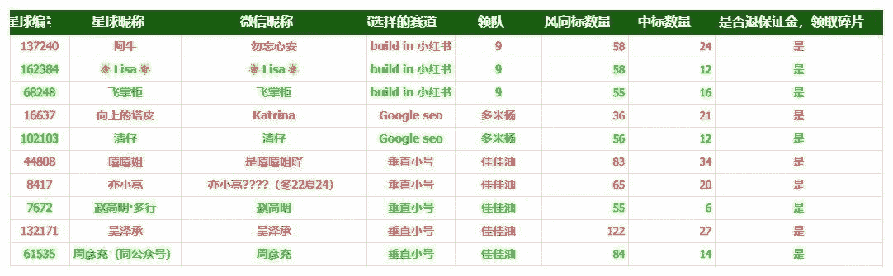

其次感谢领队9（少波）和同行的战友们！领队每天群内和私信的督促，对于我完成任务起到了莫大的帮助，还有我们组非常积极的几位伙伴，比如Lisa、勿忘心安等，大家写完风向标不仅群内分享，还相互交流经验，非常有助于共同成长！可以说我的中标之路，战友们给了非常大的鼓舞！

当然，中标报喜也少不了，一方面是激励自己，一方面是刺激别人，哈哈哈！就是在这样你追我赶的过程中，大家都在进步！我一直相信有好的氛围，才能拿到好的结果！不多说，图片最有说服力！

| 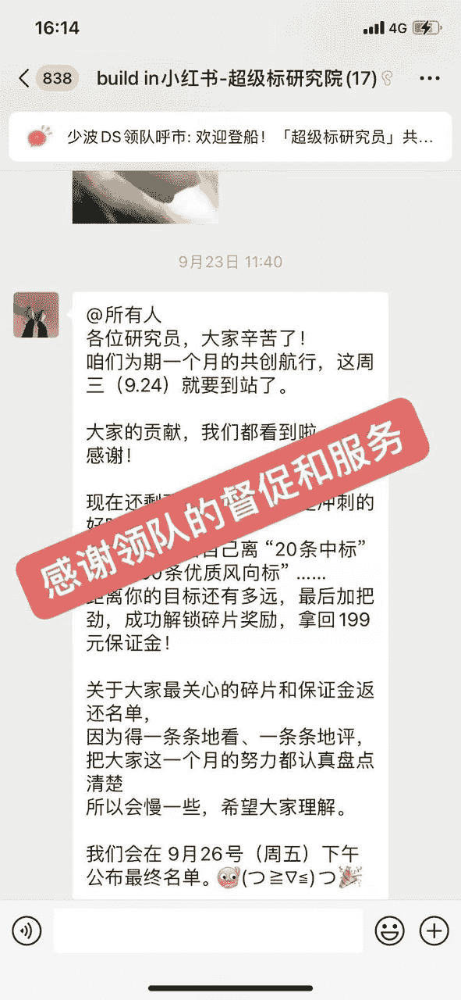 | 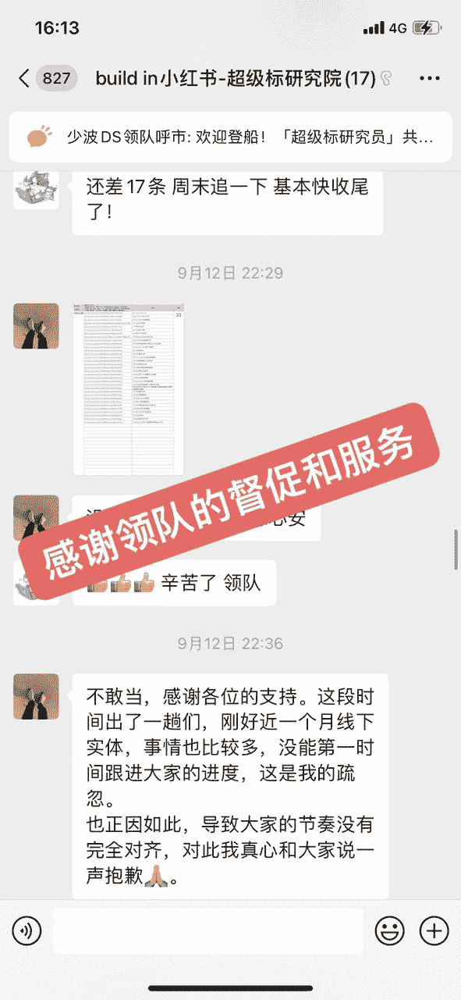 | 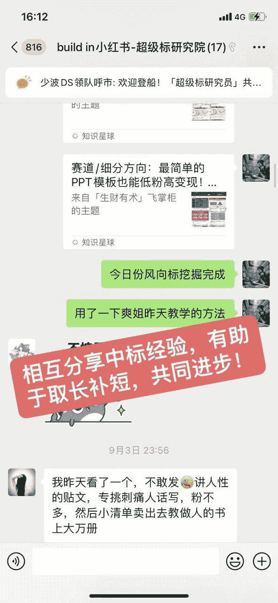 | 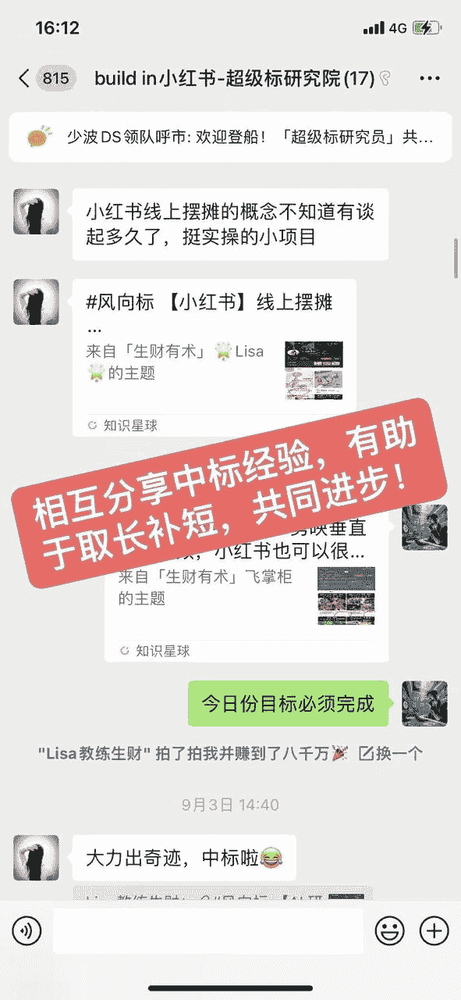 |
| --- | --- | --- | --- |
| 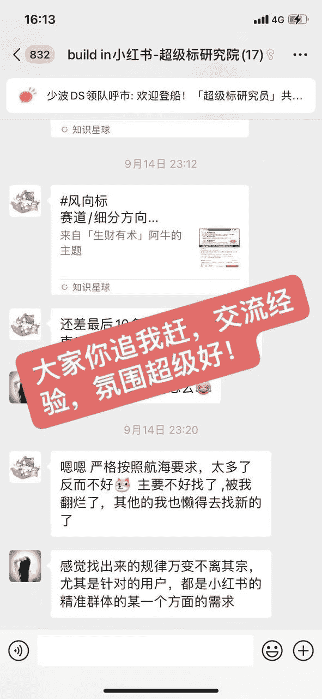 | 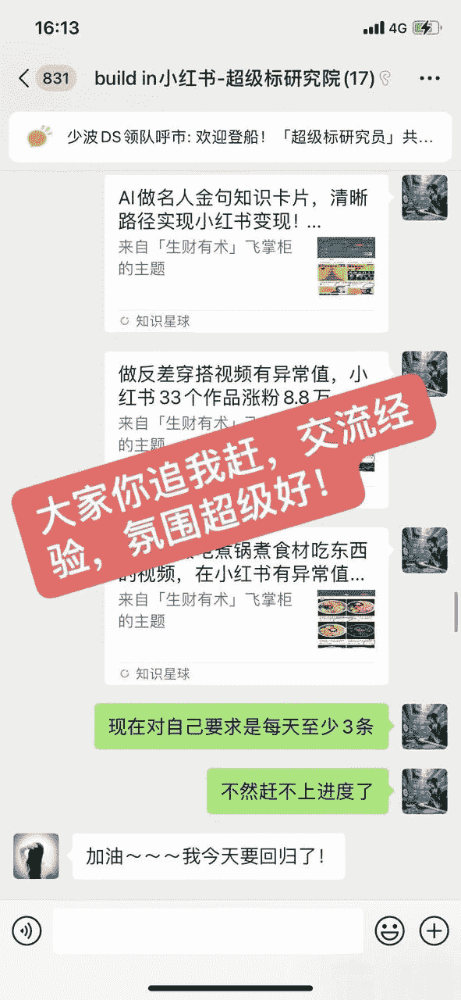 | 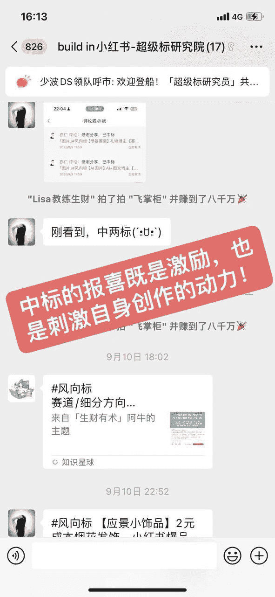 | 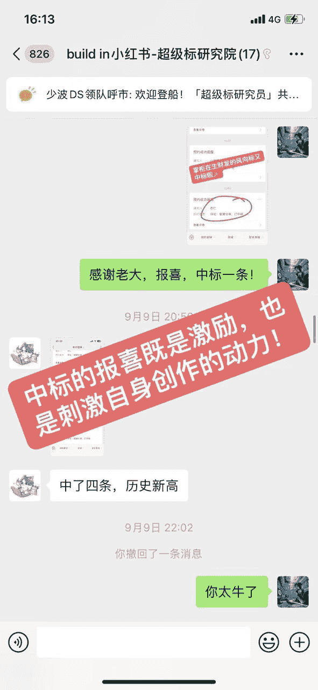 |

最后要感谢鱼丸李李和运营愣楞，他们问我能不能分享下寻找风向标+写作风向标的经验，约稿的那一刻，我太开心了，原本还在犹豫要不要写一篇复盘贴，在他们的鼓励下才有了本文，郑重感谢！

有时候，真就是这样，没有人推你一把的时候，你犹犹豫豫，当有人鼓励和助推，你义无反顾往前冲就行了！

| 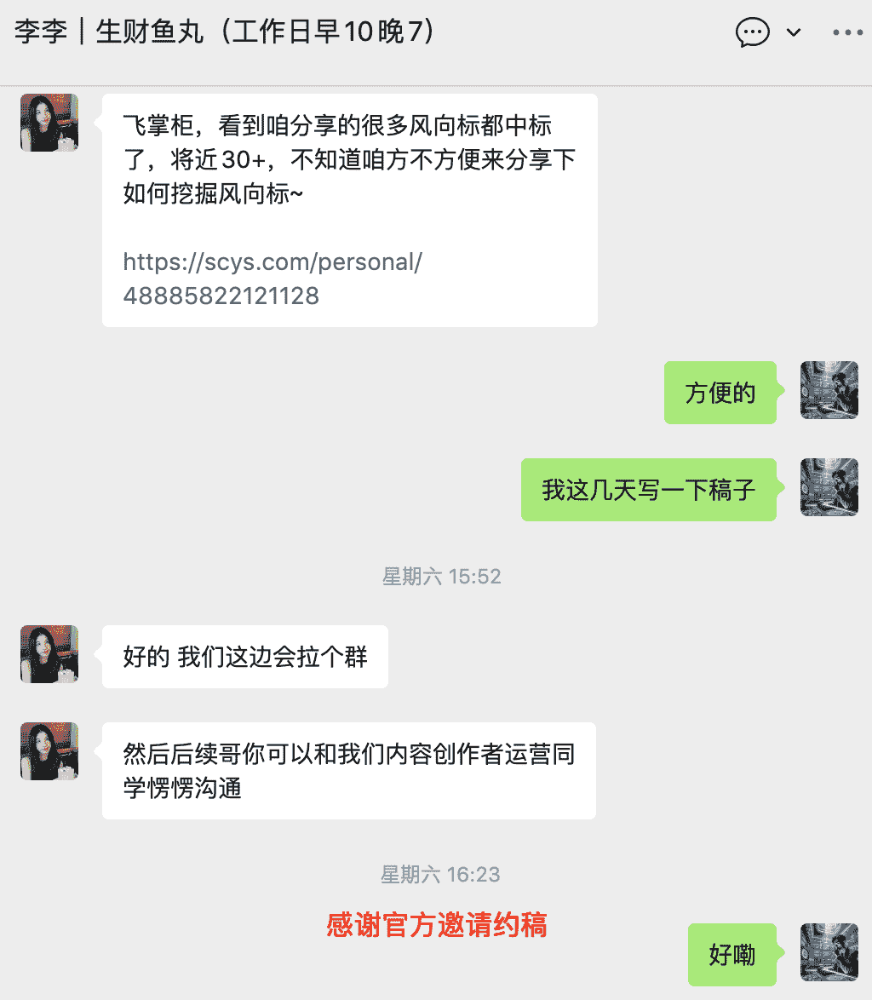 |
| --- |

# 一、风向标中标统计

掌柜经常被问到：

“掌柜你说一年凭借中标就能把生财门票赚回来？真的假的？”

“你不是还在上班吗？哪来的那么多时间研究风向标，还写作输出呢？”

“我感觉咱们是普通人，一年能写多少风向标？能中多少？我担心写了之后万一都不中怎么办？”

说实话，类似这样的困惑我之前也有很多，只多不少，本文的分享，我就会把自己写作风向标的经验和盘托出，对以上问题一网打尽！

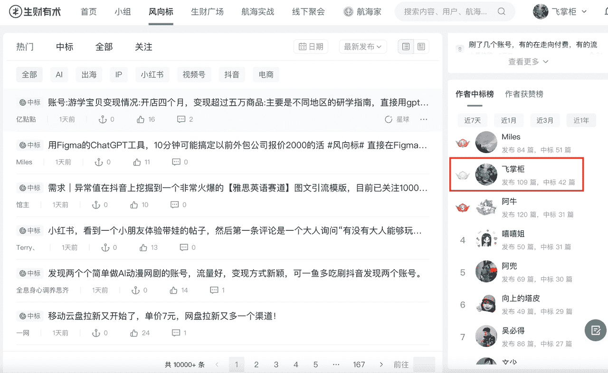

第一，先看数据，近一年我在生财发布109篇风向标，中标42篇，排名第二，我平时寻找风向标，基本上是从小红书上找，因此本文主要分享如何在小红书上寻找风向标的经验。

按照一条风向标中标2术值，AI风向标还可能中标4术值计算，我这一年可以说中标的术值已经超过100了，所以门票赚回是妥妥的～

第二，阅读本文能对你有什么价值？为啥要说这点，因为有人觉得写作风向标不就是寻找潜在的赚钱机会么？这个答案也对，也不对。对的原因是解释了一下风向标，不对的原因是我觉得还不够深

比如，看本文的时候，无论我分享的风向标是小红书哪个细分赛道的，大家要思考几个问题：

**1**、如果是我看到这条风向标，是否觉得是机会？如果是机会，为什么？怎么写出来？如果不是机会，从哪些方面努力，也许可能成为机会？

**2、我目前做的是XX项目，这条风向标的搞钱经验，对我有无启发？有启**发，是在哪些具体方面可以给出指导？是定位、流量、产品、运营、转化，还是其他启发？

**3**、这条风向标对我当前所做的项目有无帮助？如果是直接关系，我该如何对标？如果关系不大，搞钱思路方面我能有哪些学习的地方？

相信通过这样的剖析之后，大家看待风向标的视野会更上一层楼！因为你用这样的思路看待风向标，无论是寻找风向标、拆解风向标、写作风向标哪个环节，都会收获超级多！

# 二、风向标锦囊奉上

**有**人问我，掌柜你怎么发现那么多风向标的？我把自己挖掘风向标实操经验给大家总结成18个锦囊，先说好，我只给锦囊，能不能成为妙计，完全在于你是否用，以及怎么用！

## 锦囊1：摆正心态，写风向标没有任何门槛

有伙伴觉得，我之前做项目都没做出什么结果，根本看不出其他项目有什么赚钱机会，能写吗？肯定能行哈，掌柜一开始也是各种给自己设门槛，后来发现，没中标全都是执行力不够！

风向标和精华帖，在我看来一个很大的区别，就是门槛高低，精华帖可能需要你拿到某个结果，完整写出跑通闭环，或者有相对深刻的失败经验，对他人有借鉴意义，和市面上的多数文章不同，有深度内容才可能中。但是风向标不同，文字不需要很多，讲解清楚这条为什么值得作为搞钱风向即可，甚至有时候官方的一张图，一组海报，一段政策描述，新上线的功能，都可能成为风向标。

因此，我说的本质一点，可能会刺痛到所有人，不少人其实是给自己找理由，本质上就是懒，我自己写风向标中标前后对比，就是感觉之前太偷懒了。

**曾**经有段时间，贴了一段话在床头：对比高手，如果你在信息差、资源差、认知差上不占优势，执行差上还不努力，活该你不中标，活该你穷！

根据这个锦囊，掌柜中标人生第一条风向标，就是看完电影《孤注一掷》后，手机给我推送了某个公众号，我顺势写了一条风向标，结果中标了：https://scys.com/articleDetail/xq_topic/411881455414428

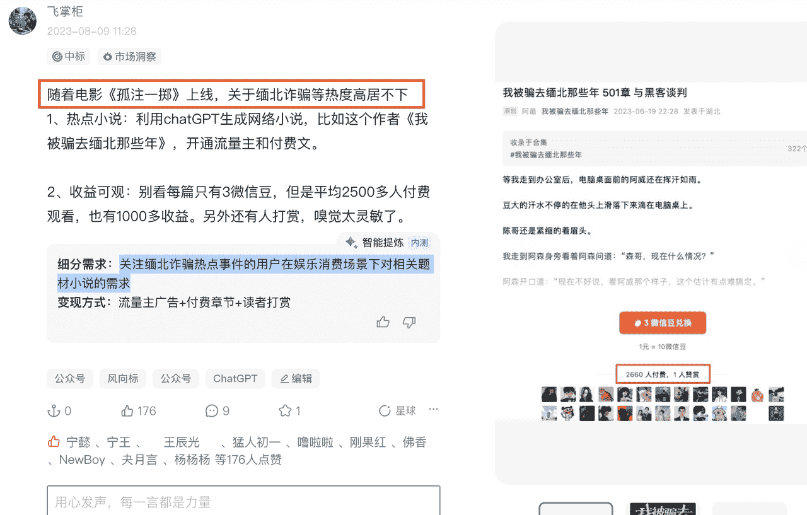

## 锦囊2：融入优质圈子，参加高能活动

进入生财之前，我连风向标是什么都不知道；进入生财之后，我能一年中标超过40条，能兑换生财门票免费续费生财一年～

参加【build in小红书-超级标研究院】之前，我一个月最多输出3-5条风向标；参加活动之后，一个月至少有50条，并且中标率提升到30%

就像毕业想找到好工作，你得有好的大学环境！

就像单身想快速找对象，你得多参加线下活动！

写风向标好氛围很重要！给我最大的感触就是：

1、人要想成长，得把自己置于优质的圈子中， 比如生财！

**2**、人要想学会风向标，得进入风向标研究院，成为风向标研究员、风向标资深研究员、风向标科学家。生财就提供了这样的成长体系，要充分利用！

**3**、人要想风向标多中标，得多参加“风向标挖掘航海”，“build in*XX 超级标研究院”这样的活动，能量超级高！

有多高？直接看图：当你没有动力写作风向标了，赶紧打开群看下：大家你追我赶，看着别人完成任务+中标报喜+拿到碎片，你不羡慕嫉妒恨吗？等啥呢，除了行动别无他法！

| 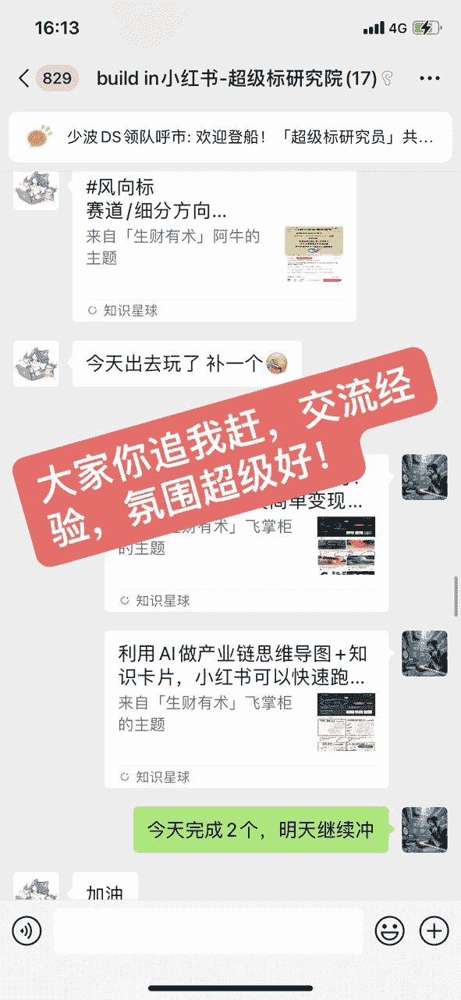 | 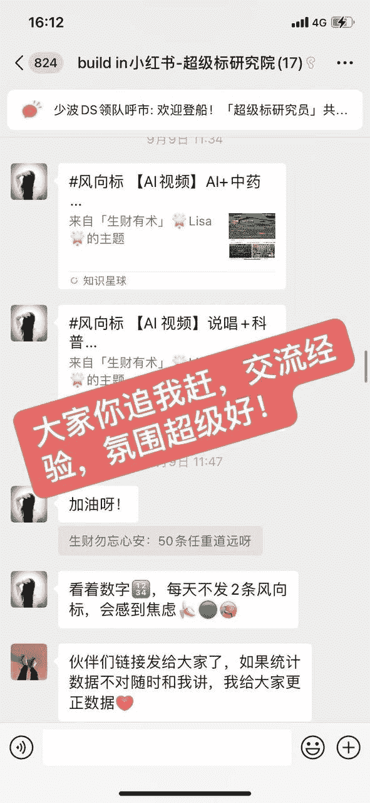 | 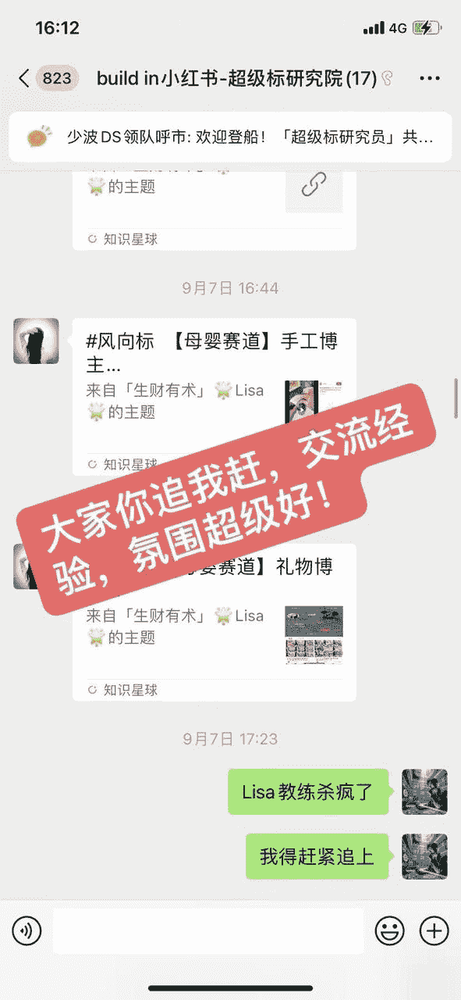 |
| --- | --- | --- |

中标之后也别闲着，群内报喜！如果是别人的报喜，那就用来刺激自己！如果是自己的报喜，也别光报喜，多分享经验，时刻保持利他之心！我就不信，都这样了你还能没动力？哈哈哈[呲牙]

| 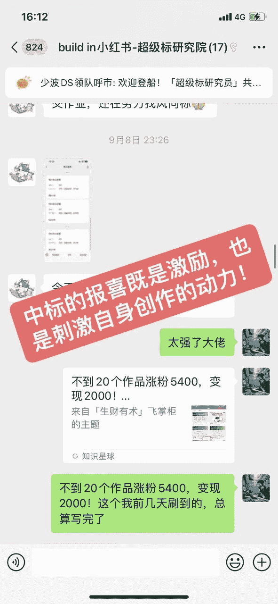 | 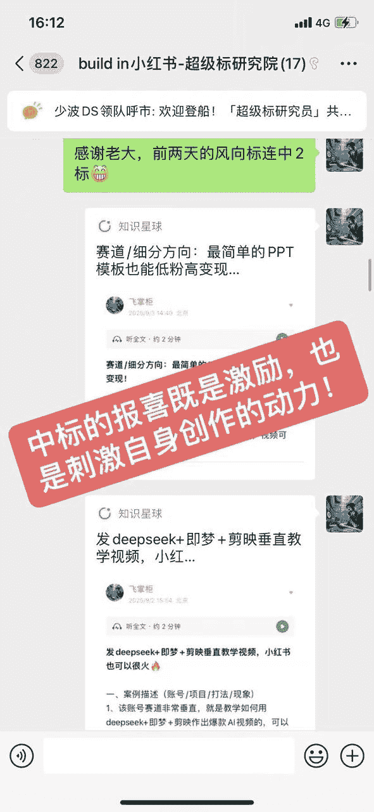 | 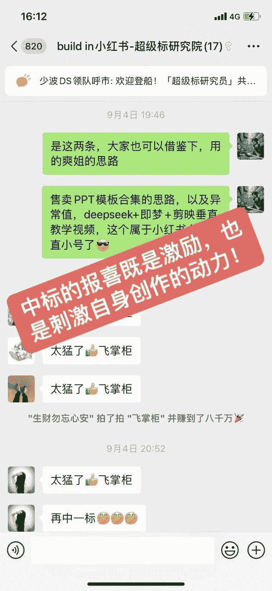 |
| --- | --- | --- |

有时候报喜真的是越报越有，而且是在这样的圈子，才让我在一个月内连续中标16条：

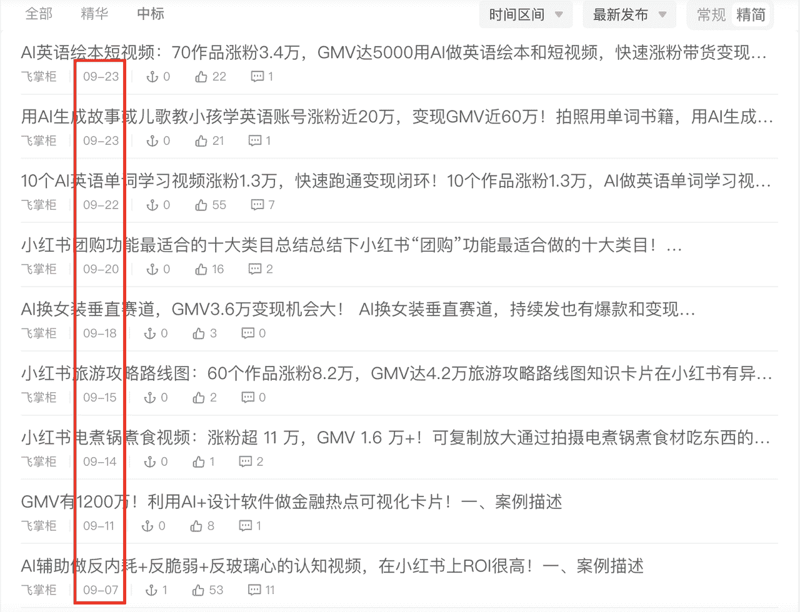

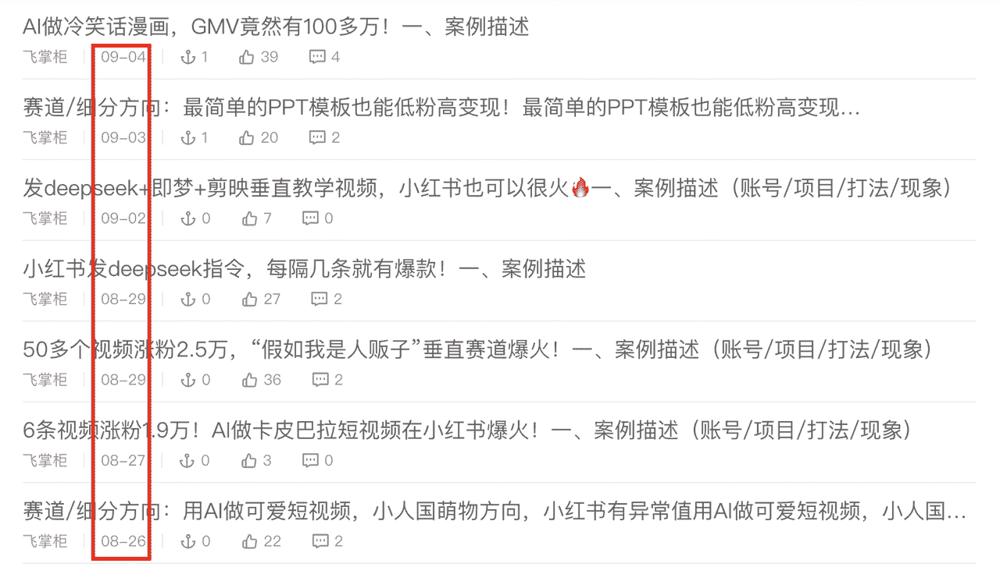

## 锦囊3：做了才可能有结果，不做永远没结果

写风向标的过程，也是锻炼你赚钱思维和商业逻辑的过程，刘润说过“能一眼看透事情本质的人，和终其一生都看不到的人，往往天差地别”。

你能筛选出某个风向标，说明你比别人有洞察能力！

如果风向标还能中标，说明你比别人有商业判断能力！

如果风向标还能落地，说明你比别人有项目闭环能力！

以上哪一点，对于你来说都是好处，所谓进一寸有一寸的欢喜，成长的意义也体现在这里！所以做了才可能有结果，不做永远没结果，写风向标也是，写了才有可能中，不写永远不会中！

突破方法：站在岸上是永远学不会游泳的，直接开始动手写，风向标也没有格式限制，所以你看到从各种角度和风格，挖掘出的风向标五花八门，见证了各行业领域、各细分赛道的多样化打法！

掌柜自己写的时候，就是越写越上瘾，一边看一边惊叹：原来项目还可以这么玩，原来流量还可以这么搞，原来作品还可以这么拍。我能怎么学习，怎么运用，怎么对标？等等

而且，风向标的来源，不仅仅是公众号、小红书、抖音、快手、视频号等各种自媒体平台，还可能来源于其他网站和工具，还可能来自线下实体，还可能来自于你的生活。

根据这个锦囊，我当时上班路上看到有人路边卖手机壳，酱香拿铁当时很火，于是好奇手机淘宝搜了下， 结果一看惊呆了，这玩意居然这么挣钱？马上发了一条风向标，中标了：https://scys.com/articleDetail/xq_topic/211841518111251

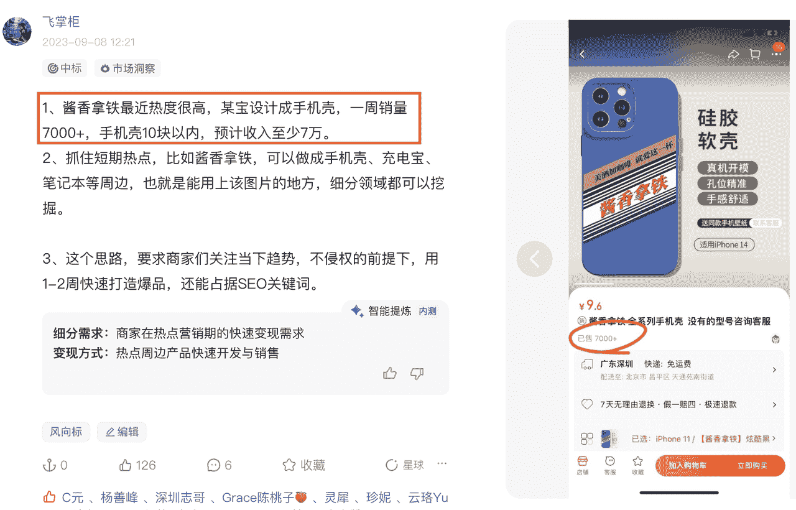

## 锦囊4：通过搜索关键词找到风向标

在小红书搜索框输入关键词后，下拉菜单会推荐长尾词，这些词通常代表用户真实需求。比如搜索 “健身” 时，系统可能推荐 “健身小白跟练”“居家健身器材推荐” 等，这些方向可作为风向标参考，多点几次就能找到不错的账号。

同理，掌柜挖掘的主要是AI赛道，因此当有新的热点出现时，我也会搜索对应关键词，比如deepseek火爆的时候，我搜索过“deepseek提示词”，当即梦4.0官方更新功能时候，我搜索过“即梦4.0”，多浏览几个账号，就找到了不错的对标。

| 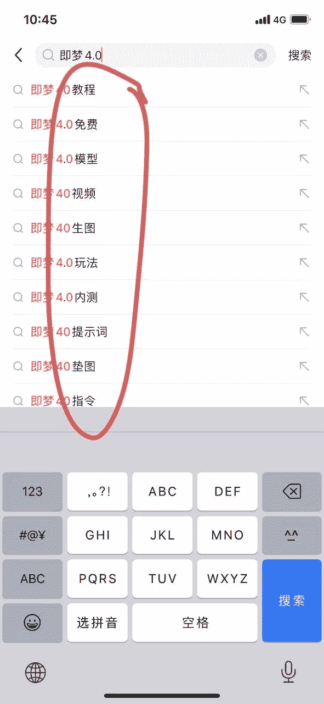 | 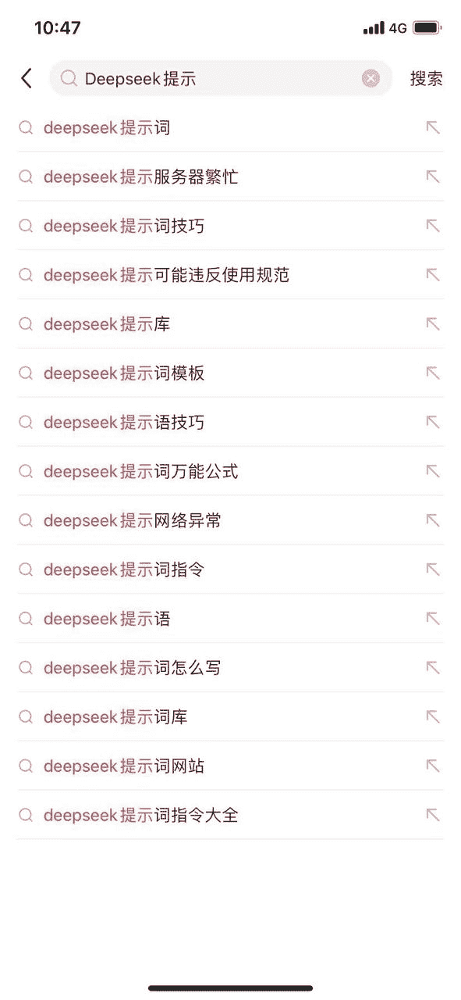 |
| --- | --- |

根据这个锦囊，以下2条风向标中标：

1、小红书发deepseek指令，每隔几条就有爆款！https://scys.com/articleDetail/xq_topic/4842444554428218

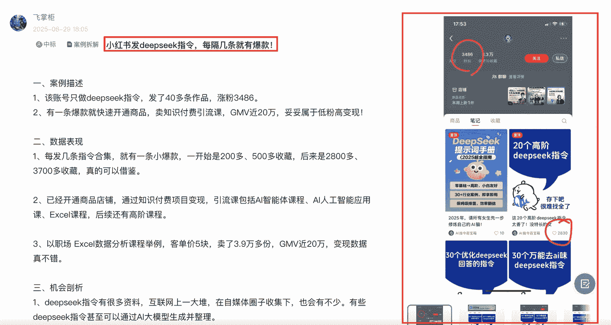

2、发deepseek+即梦+剪映垂直教学视频，小红书也可以很火🔥https://scys.com/articleDetail/xq_topic/2854551448855281

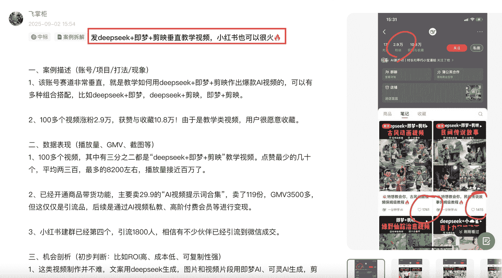

同理咱们搜索关键词也会被系统打上标签，比如我经常搜“低粉高变现、异常值、小红书最新政策、9月热门选品”等关键词，可能比自然流，刷到的潜在风向标多一些。

简单理解：你搜什么，未来看到什么就会多

> 以上中标的2条风向标，延伸一下，我们可以从几个维度思考：

> 1、如果咱们没有提示词，是不是可以先去淘宝、小红书拍一单，稍微整理下，变成自己的产出物？

> 2、如果咱们有提示词，是否能否像博主一样，发小红书引流，然后后端通过AI写作产品承接？

> 每次都用这样的思维去拆解，才会有不同的感知，而不是单纯刷小红书了～

> 1、虽然说很多AI大模型工具升级，已经降低了用户输入提示词的门槛，但是想要快速得到想要的结果，还是得写得好一点，特别是AI作图和AI做视频，因此“卖提示词”依然有市场！

>

> 2、小红书想引流，建群是最基础的，提示词群，让用户看到就想加入，这个思路可以贯穿，长期可用，和“加我领资料”一样好使！

>

> 3、AI大模型+即梦+剪映是常见的AI组合，AI大模型能换成任意一个工具，小红书近段时间哪个火就发哪个，比如deepseek+即梦+剪映，豆包AI+即梦+剪映，通义千问+即梦+剪映，等等。

## 锦囊5：关注官方活动和热门挑战赛

小红书官方会不定期发起各种活动和挑战赛，这些活动和挑战赛通常会围绕平台当前的热门话题或趋势展开，参与人数众多，内容丰富。

关注小红书官方账号，如 “小红书”“薯队长” 等，及时获取官方发布的活动和挑战赛信息，也可以留意 APP 首页的活动专区或入口，积极参与活动，发布相关笔记，增加曝光机会。

你关注了，之后有官方最新的活动，也会推送给你，这样你会比别人更早看到官方内容，也更快拆解信息差，挖掘到风向标！掌柜就经常刷官方活动，看待没人写过，并且值得挖掘，用户参与后能有流量曝光等收益，那就写！

根据这个锦囊，这条风向标中标：

小红书团购功能最适合的十大类目总结https://scys.com/articleDetail/xq_topic/2854524848241551

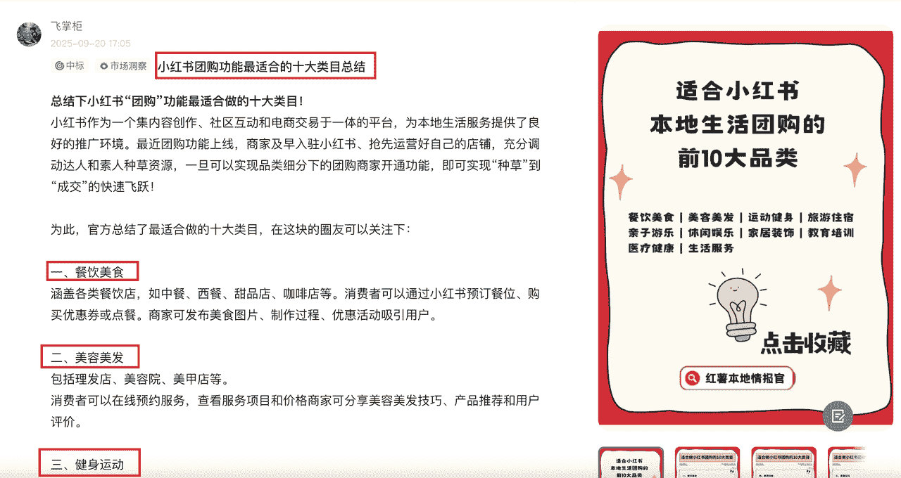

## 锦囊6：账号变现路径越多，越容易中标

观察账号是否有清晰且多样化的变现方式，如直接售卖产品、提供付费服务、知识付费、广告合作等。

例如，一个养生健康类的低粉账号，通过 AI 短视频吸引粉丝，然后通过售卖养生礼盒、提供个性化养生方案以及知识付费教学等多种方式实现了高变现。

所以，变现方式越多，说明该博主对商业化的路径越清晰，可以重点关注，往往会成为风向标～通过写作风向标，掌柜总结出了小红书上变现的多种思路，换个角度看，具备以下变现方式的账号，咱们作为写风向标的对象，自然也容易提高中标率！

> **1、带货变现**

> 粉丝达到一定数量，可以开通商品带货（包括商品、选品、小清单），满足官方开店条件，可以开通店铺。开通店铺的好处是可以上架自己的产品，不开通主要是分销别人的商品，无论是实体产品还是虚拟产品。

>

> 带货方式，可以是上架商品，可以是笔记带货（作品中左下角植入），可以是建群后群内发送，可以是直播带货。

>

> **2、接广告变现**

> 一般是走蒲公英商单，量大；我也见过私信引流后直接微信达成合作的，量少；建议还是走官方，能积累数据和案例。不走蒲公英，也可以通过小红书官方渠道和机构接单，结算方式分两种：1）置换+固定费用；2）固定费用+阶梯提成。

>

> **3、引流私域变现**

> 可以是知识付费产品，比如卖社群、卖会员、卖合伙人、卖一对一私教、卖资料、卖教程，载体可以是知识星球、小鹅通、小报童、其他小程序。也可以其他项目变现，比如咨询服务、陪跑服务、卖工具卖铲子、卖授权卖加盟。重点当然是吸引细分赛道的用户。

>

> **4、线上引流线下**

> 这个一般是针对有实体店铺的商家，比如太二酸菜鱼，达到了年营收30亿。品牌营销策略主要集中在线上，通过小红书发作品，主要是吸引大家线下探店打卡，消费的用户群体也主要是年轻人。

>

> **5、参与官方活动**

> 参与小红书的官方免费体验，创新计划活动或话题等，可以赢取现金奖励，还有一定的流量扶持。不过这种一般不太多，也有部分作品是为了蹭官方的热度，从标签上让用户能够搜到，多了一个入口。

>

> 所以，大家看风向标的时候，可以从以上五大类维度思考，对方账号属于哪种变现类型。

根据这个锦囊，这条风向标中标：

用AI做可爱短视频，小人国萌物方向，小红书有异常值https://scys.com/articleDetail/xq_topic/2852111524545481

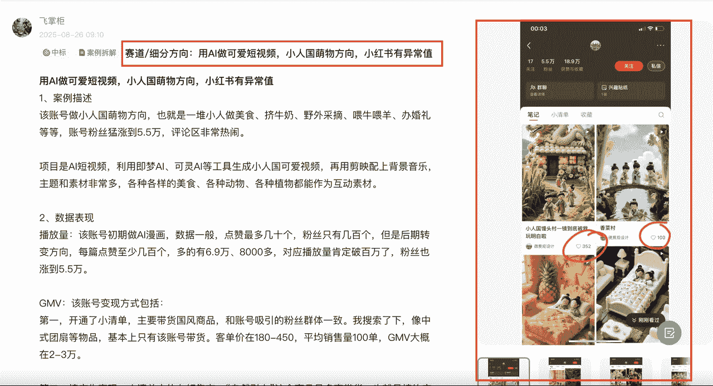

## 锦囊7：利用“每天拆解”账号找对标

| 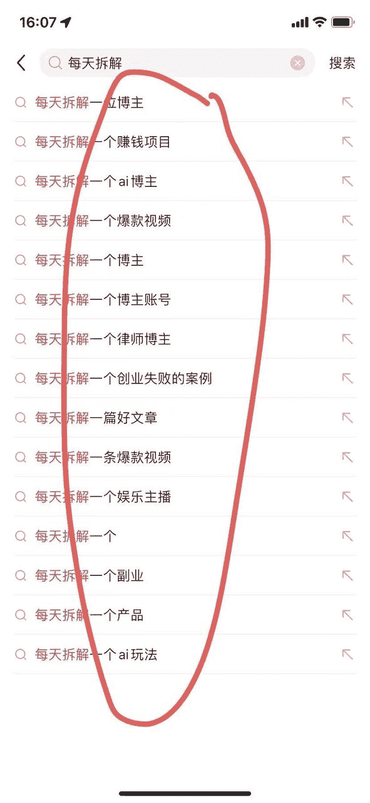 | 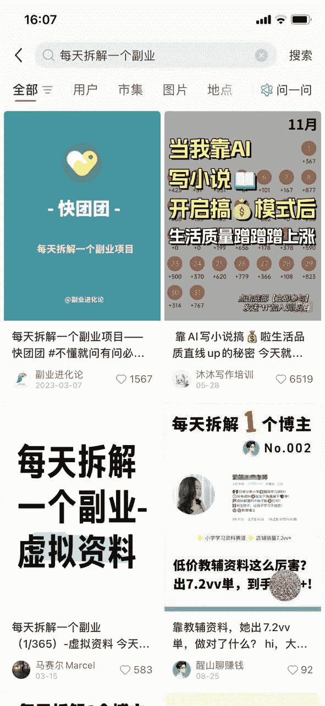 | 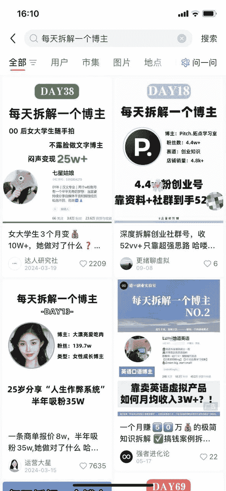 | 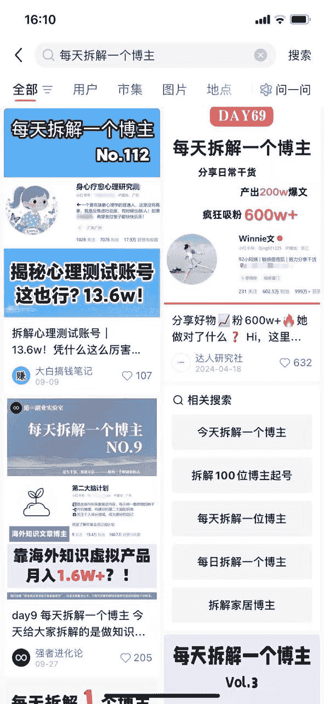 |
| --- | --- | --- | --- |

> 在小红书上搜索“每天拆解”，会发现很多长尾词，这个办法非常适合以下群体的伙伴：

> 1、不知道如何找对标账号，你可以搜索每天拆解+自己的领域，比如“每天拆解母婴博主，每天拆解AI项目，每天拆解段视频带货”等。

>

> 2、不知道如何找风向标，比如每天拆解一个博主，每天拆解一个副业，有人已经把数据表现、赚钱较多的账号帮你整理了出来，他们就是第一批风向标！

>

> 如果没有人写过，那你就去写，早就是优势，同时，数据刷多了之后，系统也会给你打上标签，之后你估计大概率会刷到同类型的账号，这样看到的风向标会更多～

小红书上的这类账号，专门拆解其他优秀博主的成功案例和经验，比如近期涨粉为什么特别快？账号内容结构、封面标题、文案节奏到底哪里值得学习借鉴？

通过分析这类账号，也能找到不错的风向标，掌柜就经常利用这个方法，重点看AI赛道的博主，同时也期望找到适合自己的潜在赚钱机会。我自己之所以决定做AI考证项目，就是通过看风向标刷到的。

而且，别人拆解的过程，其实是实操复现或者数据分析的过程，跟着实操一遍，也能判断该项目难度如何，变现路径是怎样的，对自己筛选项目的眼光也是历练！

根据这个锦囊，我当时通过每天拆解一个博主，写了这条风向标，并中标，成长打卡型AI博主照样可以小红书万粉+跑通变现：https://scys.com/articleDetail/xq_topic/1524155211211442

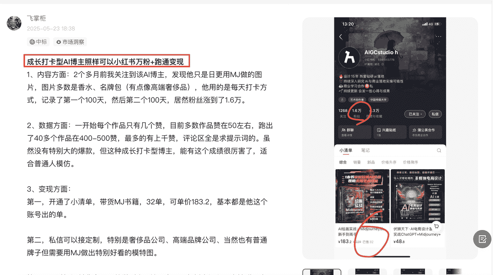

## 锦囊8：自己实操过的风向标更容易中标

寻找风向标的过程中，发现自己对于某个项目非常感兴趣，不妨下手实操，如果能短期内快速跑通闭环，说明该风向标确实值得研究，也就更容易中标

比如2025年高考倒计时10天，ima官方发文，鼓励大家分享高考知识库，助力全国高考生，我预感到这波会带动非常多的流量。所以看到这条消息后马上下场实战，1小时已经有120人加入，还在不断增长！

我自己并非做教育赛道，都能利用热点短期内做一波，如果是做AI+高考业务的，真可以抓紧实操，抓住短期风口。

最快的结果无非是，没有做起来，账号没涨粉，原先的思路走不通。但最起码也能总结出卡点在哪里？如何解决这些卡点？所以钻研的过程中，同样可以积累非常多的经验～

根据这个锦囊，这条风向标中标：

**A**I+高考热度升高！ima知识库有机会！https://scys.com/articleDetail/xq_topic/5125415414452544

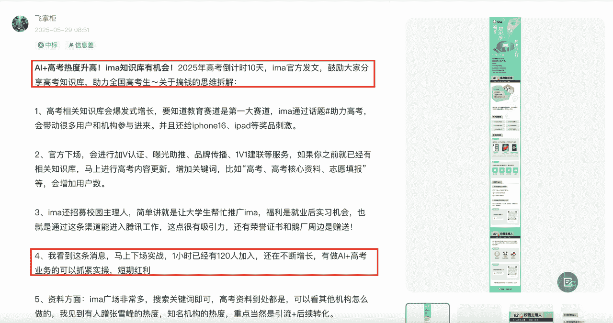

## 锦囊9：关注有潜力的账号，现在不中将来有可能中

小红书会推荐你关注过的人，他最新发布的作品，因此看到有潜力的账号，比如作品数据不错，但还没开通带货变现；比如作品数据一般，仅有几条爆款，怕有运气因素，可以先关注，作为观察对象。

等过一周、一个月，这些账号跑通变现闭环了，并且具有“低粉高变现”等异常值，到时候就可以作为风向标写出。我中标的不少内容，就是从关注中来的，也不用经常看，一个月看一眼关注列表博主的作品，就知道能否写风向标了。

根据这个锦囊，这条风向标中标：

小红书博主做AI+古人跳水视频项目有异常值：https://scys.com/articleDetail/xq_topic/1524152811141122

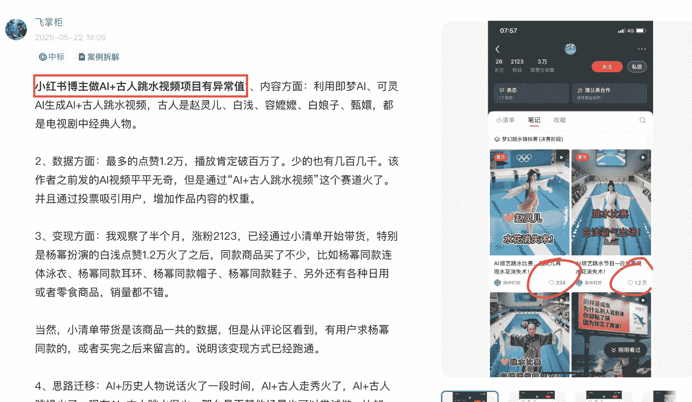

## 锦囊10：利用好标签机制，提升中标概率

小红书会推荐你爱看的内容，这是基于系统对你的标签，因此你要是寻找风向标，就应该多看前沿的内容，多看细分赛道头部的一些账号，积累标签网感。

这样你会比其他人更早刷到他们最新发布的作品，更早收藏，更早跟进，更早写出风向标。比如掌柜主要寻找AI风向标，因此看的多数是AI博主、AI作品较多。因此发现页给我推送的，多数也是AI相关内容，估计就是被系统打上了标签，哈哈哈～

**小**红书的流量匹配分发机制中，有一条就是内容标签匹配，笔记在发布后，首先会被系统打上一系列标签，尝试推荐给对这些标签感兴趣的用户，获得初始曝光。

小红书注册的时候，会让用户选择感兴趣的领域，可以不选，或者选择3个以内，掌柜的标签就是科技、教育、商业财经。

因此AI类的、做教育赛道的、商业思考和财经笔记等，会自动推送给我，他们之间还有结合，比如AI做教育绘本、AI做英语视频、AI做财经新闻知识卡片等。这样也能增加看到更多风向标的机会！

根据这个锦囊，这条风向标中标，是当时系统给我推荐的AI+教育类内容：【垂直赛道AI少儿百科】小红书博主也可以涨粉快，高变现！https://scys.com/articleDetail/xq_topic/2852424528124811

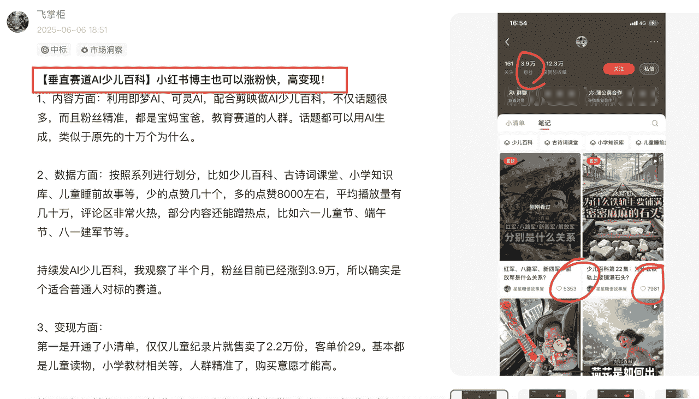

## 锦囊11：数据表现越好，越是中标的体质

小红书会持续推荐你搜索过的内容，特别是数据比较爆的，对于创作者来说，当有一条爆款，会马上疯狂出新的同类型笔记，把内容做优质，把账号权重做高，因此只要你搜过他，系统推荐的概率也会大幅增加，因为作品多了。

**作为风向标研究员，就应该观察记录哪些数据表现不错的博主，有一个小红书的内部评分体系**，公式是：CES 评分=点赞数*1 分+收藏数*1 分+评论数*4 分+转发数*4 分+关注数*8 分，可以根据综合评分判断是否可以写风向标。

当然，看小红书的时候，其实没人会算这个**分**数，毕竟太浪费时间了，但是一眼看过去，本质上就是通过点赞数、收藏数、评论数、转发数、关注数这些指标，来判断该账号是否存在“低粉高变现”等异常值，是否值得写风向标。

根据这个锦囊，我当时看到好多博主都在做反内耗+反脆弱+反玻璃心的认知视频，数据表现真的绝了，起号很快，而且容易做矩阵，这条风向标中标：

AI辅助做反内耗+反脆弱+反玻璃心的认知视频，在小红书上ROI很高！https://scys.com/articleDetail/xq_topic/4842484112858258

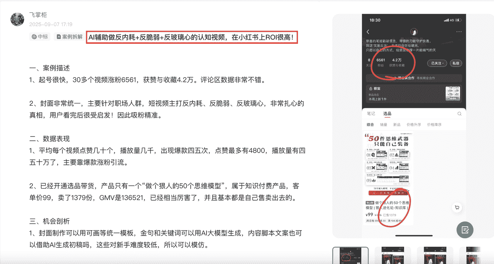

## 锦囊12：查看评论区和私信情况，来挖掘风向标

低粉高变现的账号往往在评论区和私信中有较高的互动量，私信咱们看不到，评论区可以重点分析：

首先，评论区的关键词反映了用户的真实需求和痛点，例如 “求图”、“怎么领”、 “跟团”、“怎么买”等，这些需求背后对应着潜在机会。通过查看这些互动内容，可以判断该账号的变现潜力。往往还能带动气氛，让大家愿意购买。

其次，评论越热烈，作品会越火爆，权重也就越高。有时候还会找到同类型的账号，利用对比的方法写出风向标，也就是两个博主虽然发的内容方向差不多，但是创作思路不同，封面不同，文案不同，也会出彩。

比如我刷到“是兰兰吖”这个账号，通过AI生成电煮锅煮食材的视频，在小红书有异常值，分析评论区，有两个价值点：

第一是求电煮锅怎么购买，食材为啥非常标准。

**第二是粉丝帮忙@出了“西红柿不柿”这个账号，赛道和“是兰兰吖”一样，但是封面和内容不同，“是兰兰**吖”的封面是AI做的，评论区博主自己承认了，确实非常精美。“西红柿不柿”则是用真实图片。后者选品带货品类更多，变现也多。

根据这个锦囊，这条风向标中标：

小红书电煮锅煮食视频：涨粉超 11 万，GMV 1.6 万+！可复制放大https://scys.com/articleDetail/xq_topic/8854584584282822

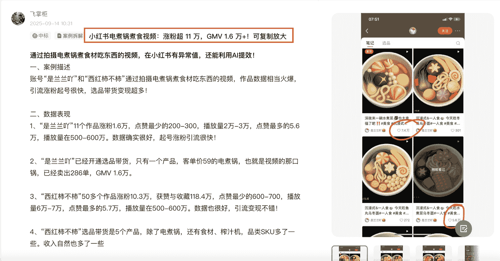

## 锦囊13：“加我领资料”的套路依然有爆款产出

这类小红书博主的内容，多数是各类模板和干货，比如PPT模板、简历模板、海报模板等，有人说，现在这类型的网站不是已经很多了吗？咋还有人通过小红书售卖呢？

其实这就是信息差，在小红书上，依然存在大量这样的账号，“加我领资料”的套路很好用，因为短平快。比如，一个分享AI自媒体经验的账号，通过展示真实的实操过程和好用的AI工具和技巧，吸引了精准的粉丝并实现了高变现。

本质上就是知识付费引流的逻辑，特别是虚拟商品，需要通过引流品沉淀到私域，之后才可能有更高客单价的转化。

根据这个锦囊，这条风向标中标：

最简单的PPT模板也能低粉高变现！https://scys.com/articleDetail/xq_topic/5124228854841544

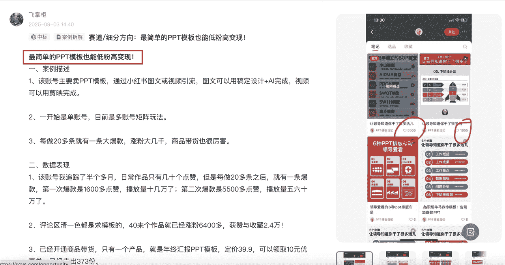

**同时，也给到我们启发：比如卖PPT模板，都已经火了多少年了，目前在小红书依然可以出爆款，普通**人依然可以变现，所以任何细分赛道，方法思路对了，执行力拉满了，照样可以拿到结果。

## 锦囊14：“低粉高变现”等异常值爆款更容易中标

研究低粉爆文的内容结构、标题形式、封面设计等，总结出可复用的爆文模板。例如，某考研赛道的低粉账号，采用固定的封面和标题格式，如 “真心建议大家都去水个XX硕士”，给观众的感觉是“你咋还推荐这么水的硕士呢？”

一看内容，才发现是详细介绍硕士项目的优势、申请条件等，通过这种反差吸引用户眼球，简单有效的模板，构造的学历冲突，实现了单篇笔记高询单量的现象。

再比如某博主用“假如我是人贩子”做主题，迅速抓住用户眼球，观众会好奇“到底人贩子干了啥？”，其实内容是利用AI做儿童安全知识科普，50多个视频涨粉2.5万，垂直赛道爆火！

所以给咱们的启发就是，如果自己想做出爆款，也需要总结模板，这样有利于SOP化，降低创作内容的成本，提升ROI！如果是从挖掘风向标的角度看，那就是找到这样的账号，狠狠地写！

根据这个锦囊，这条风向标中标：

50多个视频涨粉2.5万，“假如我是人贩子”垂直赛道爆火！https://scys.com/articleDetail/xq_topic/5124222188844114

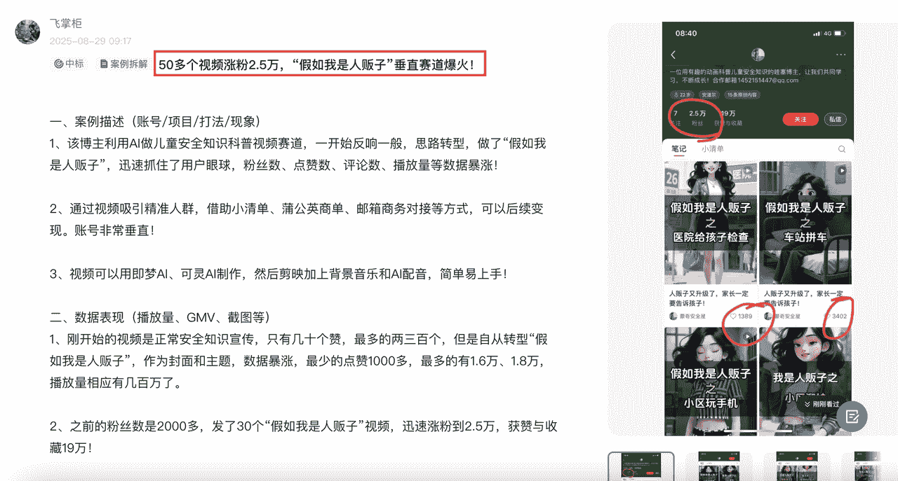

## 锦囊15：教育经典赛道结合AI有机会

在我所中标的风向标中，AI+教育非常多，教育是个能覆盖到所有人的赛道，也是存在大量小机会的领域，容易借助AI工具降本增效，或者产出小爆款，我是怎么找到的？

一方面是通过“AI做英语绘本、AI做儿歌、AI做教育视频”等关键词搜索出来；另一方面是关注几个账号+每天地铁上刷之后，系统打了标签自动推荐。

通过以上办法，这几条风向标中标：

1、用AI生成故事或儿歌教小孩学英语账号涨粉近20万，变现GMV近60万！https://scys.com/articleDetail/xq_topic/8854521551845212

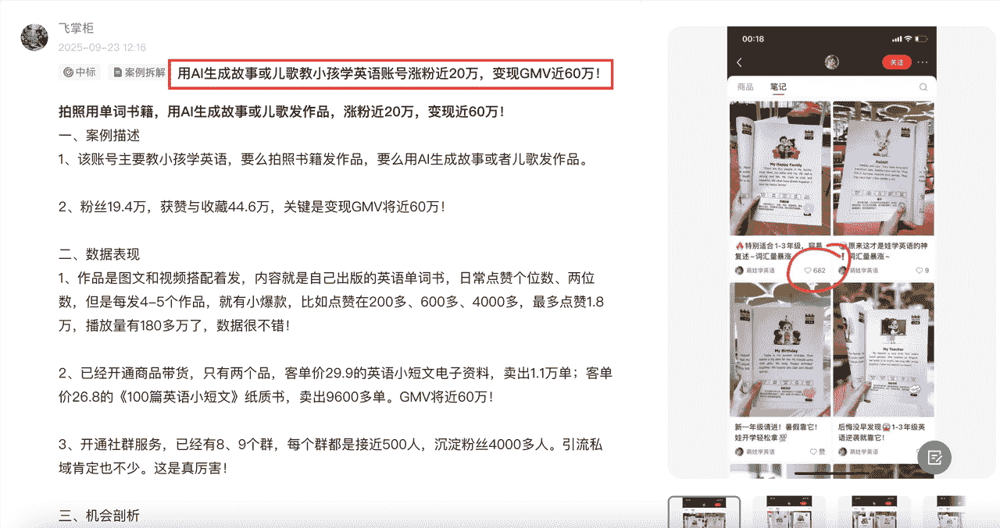

2、10个AI英语单词学习视频涨粉1.3万，快速跑通变现闭环！https://scys.com/articleDetail/xq_topic/2854524214288881

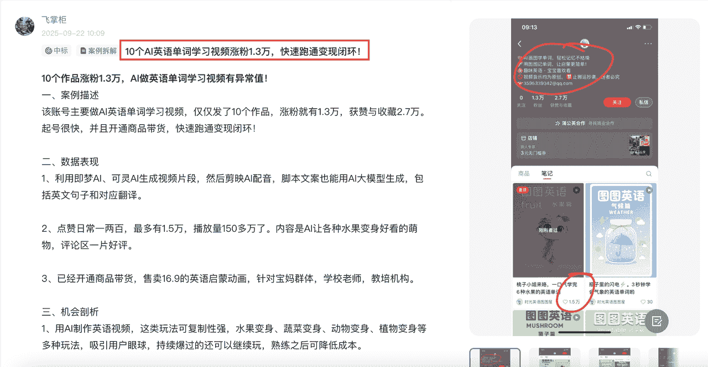

3、AI英语绘本短视频：70作品涨粉3.4万，GMV达5000

https://scys.com/articleDetail/xq_topic/2854521584418141

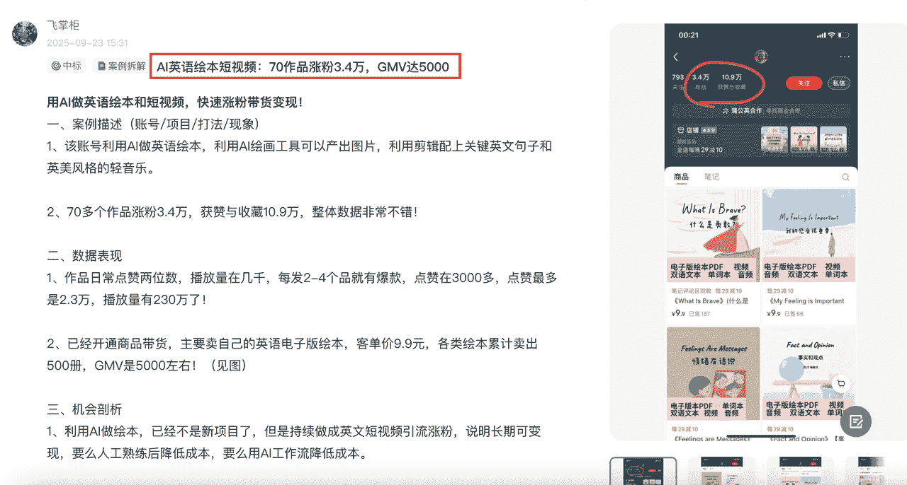

4、宫崎骏风格的AI视频小红书博主，低粉高变现有异常值：https://scys.com/articleDetail/xq_topic/5125414281142844

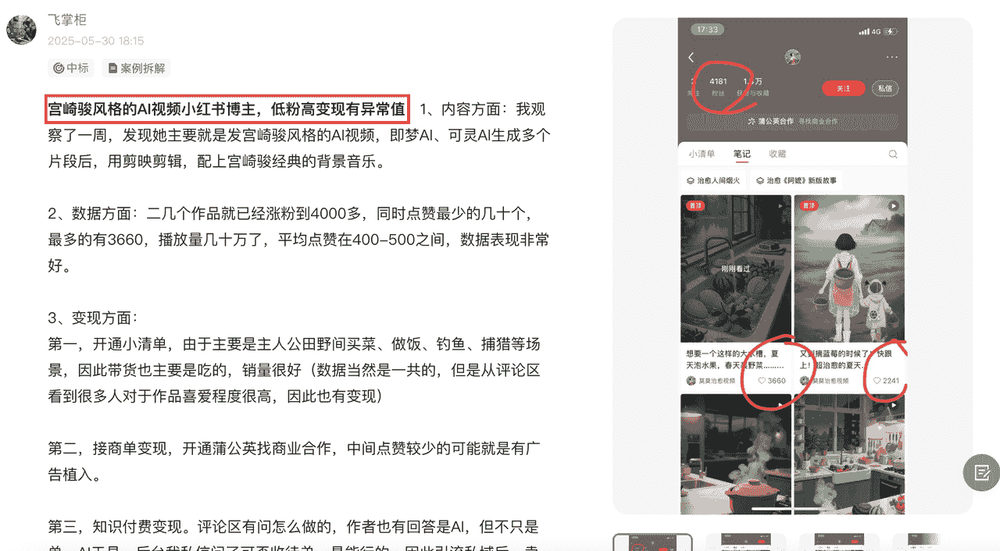

5、发现个低粉高变现的小红书博主，不到20个作品涨粉7000多，变现还不错，属于AI原创治愈动画赛道：https://scys.com/articleDetail/xq_topic/8852218144122882

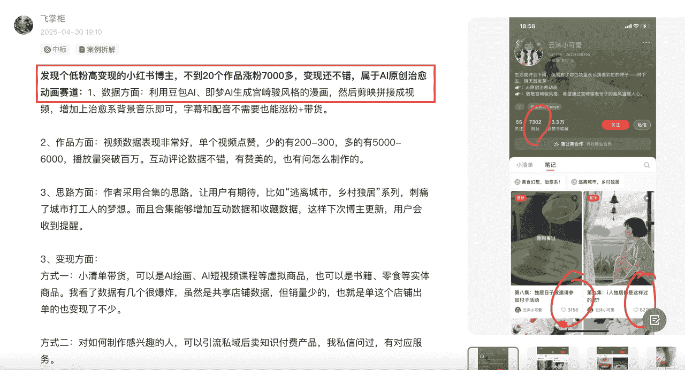

## 锦囊16：不要瞧不起任何小项目，打开格局

我觉得很多人看风向标，有一些误区，比如觉得是行业级别的大机会，才是风向标。其实错了，做互联网和自媒体项目，哪怕是一个很小的创新，通过内容出圈、玩法出圈、口碑出圈等方式火起来，业务体量也是不小的。

反而是那些大机会，不适合普通人，因为所需要的前置条件太多，比如要么是很多资金投入，要么是得有产业链资源，要么

| 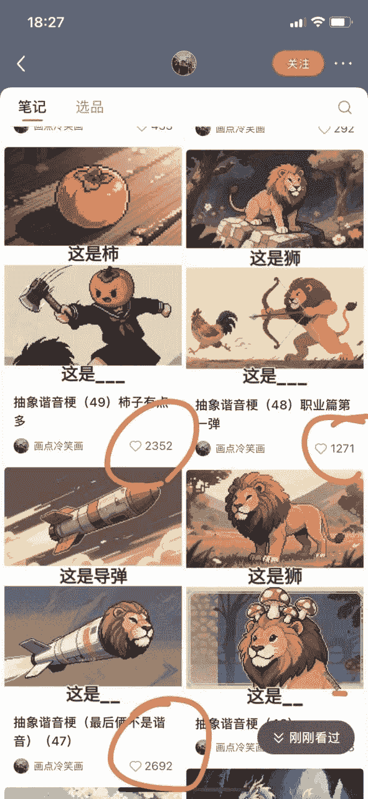 | 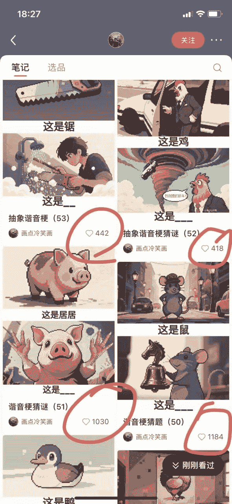 | 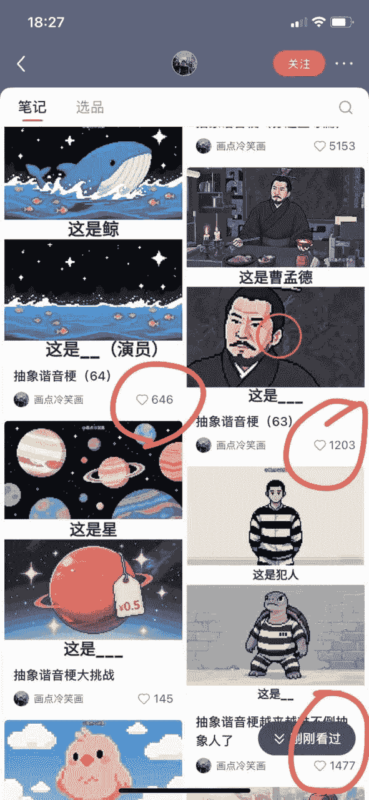 | 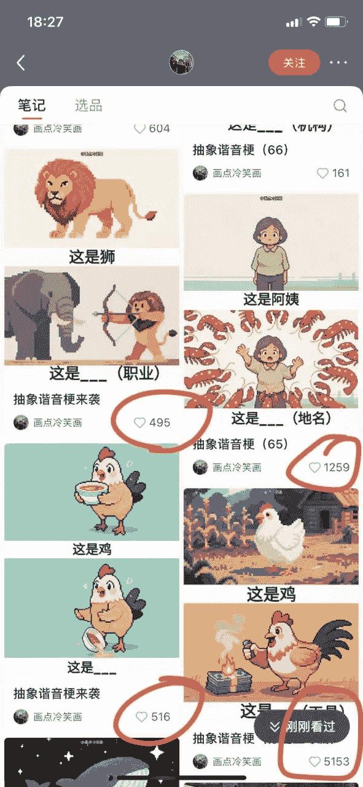 | 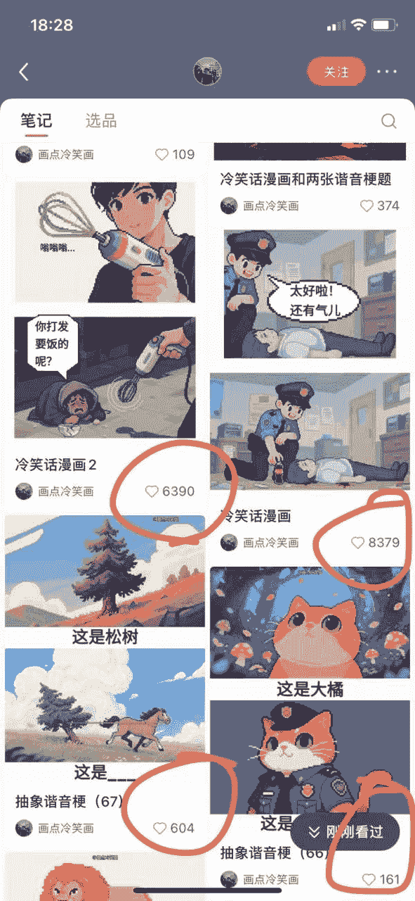 | 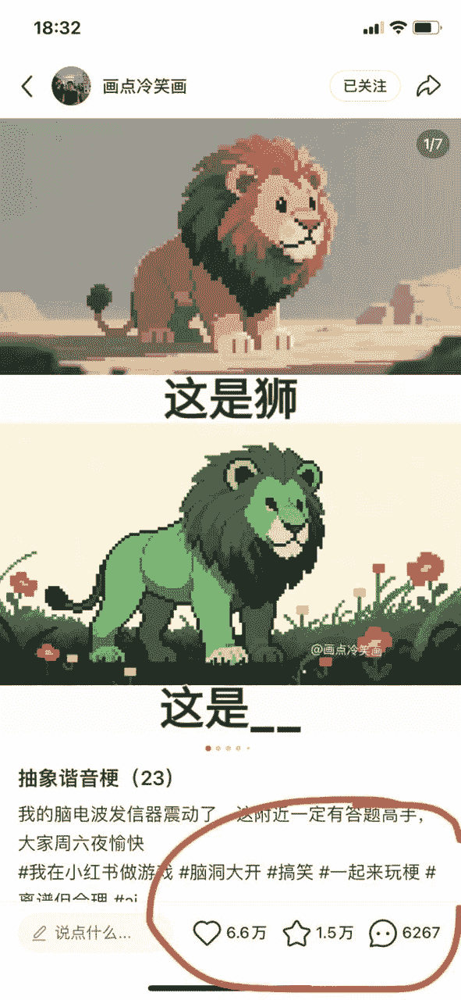 |
| --- | --- | --- | --- | --- | --- |

> 1、这条风向标的中标，给了我很大信心，AI做冷笑话看起来是很低端的项目，上不了台面，但其实一点都不low，能充分调动用户评论的积极性。

>

> 2、小红书想要账号数据好，得有权重，权重从哪里来？就是体现在点赞量、评论量、转发量等数据，AI做冷笑话很多，朋友之间愿意转发的动力促成了数据较好。

>

> 3、这类题目还可以作为社群运营的游戏，这两天我已经在不少社群看到这样的互动玩法，非常能提升社群活跃度，过两天我准备试一下。

>

> 所以你看，风向标的作用不只是商业分析，也不是盯着中标的福利，而是能够迁移运用，放到自己项目中。

根据这个锦囊，写了这条风向标并中标：

AI做冷笑话漫画，GMV竟然有100多万！https://scys.com/articleDetail/xq_topic/8854585815214552

## 锦囊17：了解小红书的流量规则，更好挖掘风向标

很多伙伴其实都在研究小红书的流量规则，这个官方不公布，只能是经验摸索和总结出来，以下是掌柜总结出来的内容，如果你是做小红书项目，可以重点关注如何搞到更多流量；

如果你是从风向标挖掘的视角看，刷到某个账号数据偶尔不错，也别着急，可能一个月后他的完整变现路径才会显现出来，所以长期跟踪下不错的博主。

> **1、梯度流量判断**

> 很多伙伴关心自己的作品是否能进入流量池，那怎么判断呢？三级流量池的判断经验是：当你的笔记分数越来越高，就会一级一级被系统推荐到更大的流量池。

>

> 进入1 级流量池—>再看赞藏评—>进入2 级流量池—>再看赞藏评—>进入3 级流量池—>再看赞藏评

>

> **每**次给完一级流量池曝光之后，系统会根据这个公式（CES 评分=点赞数*1 分+收藏数*1 分+评论数 4 分+转发数 4 分+关注数*8 分），再确定要不要给下一级的流量池。

>

> 最后，赞藏评总数在1000多算小爆款，在1万以上算大爆款，不同类目可能有所不同。这个不是绝对的哈～

>

> **2、自然流量扶持**

> 小红书被认为是对新手相对友好的平台，每篇笔记系统会推送 200-500 曝光，但曝光不等于阅读数，比如1万曝光，可能只有5000阅读，这个和闲鱼等其他平台规则一样。一般是阅读数小于曝光量。

>

> 曝光数只有企业号可查，而阅读数就是小眼睛，也就是多少人次看过，曝光数除于阅读数大于 10%，就算是优质笔记了。因此大家如果想看自己账号的这部分数据，那就开通下企业号。

>

> **3、爆款带动流量**

> 随着笔记评分逐步提升，系统会逐级将其推荐至更大流量池，最终成为爆款内容。这篇爆款笔记还能带动账号其他笔记的整体数据提升。但需满足以下条件：

>

> 第一，笔记通过平台审核，无违规记录，且未被系统或作者删除/隐藏。

> 第二，笔记包含精准关键词（如香水、家具等）和垂直领域标签，被系统收录并精准推送给相关兴趣用户。

> 第三，内容质量优良，能够有效引发用户的点赞、收藏、评论等互动行为。

>

> 一般 0 基础新手小白很难发第一篇就能获得大爆款；在运营的第一个月，新手笔记的小眼睛（即阅读量）停留在 100-200 都很正常，基础好的出效果会快一些。

>

> 80%新手都在第二或第三个月开始才迎来爆发，有酝酿期，所以不用太心焦，持续打磨好内容。

根据这个锦囊，我当时看到一个AI做卡皮巴拉短视频的博主，6一共只有6条视频，点赞数最少的1200多，最多的好几万，直接涨粉1.9万，真猛！

于是立刻写了风向标并中标：https://scys.com/articleDetail/xq_topic/2852111451124581

## 锦囊18：想要风向标多中标，大佬们的方法得用起来

拥有对标思维的人都知道，“先抄再超”肯定是最快速的成长方式，风向标挖掘也是，如果你不会，生财有大量风向标精华帖等着你，用大佬们总结的方法去写作风向标，中标概率会大幅增加，掌柜亲测有效！

俗话说得好“站在巨人的肩膀上，才能让我们挖掘风向标得心应手！”所以掌柜给大家总结了10位高手的风向标精华帖，感谢各位大佬们的经验，让我受益匪浅～

> 1、写风向标路上，如何从新手进阶到中标高手？

> https://scys.com/articleDetail/xq_topic/1524885118418242

> 2、风向标挖掘经验分享：建立你的赚钱信息源库

> https://scys.com/articleDetail/xq_topic/4845441824448818

> 3、《持续中标19条，分享我的几点心得》

> https://scys.com/articleDetail/xq_topic/1521252585882882

> 4、老彭：风向标挖掘经验分享：10个真实案例的深度拆解

> https://scys.com/articleDetail/xq_topic/4848258118828418

> 5、浅笑：沉浸式写风向标一段时间，我的一些分享和启发

> https://scys.com/articleDetail/xq_topic/5121521824482514

> 6、az：发了快 700 条风向标后，我总结出「风向标收集创作指南」

> https://scys.com/articleDetail/xq_topic/185248828415242

> 7、沐文：如何在风向标中掘金挖宝

> https://scys.com/articleDetail/xq_topic/181454418112422

> 8、HEXIN：2000字，教你玩转生财“风向标

> https://scys.com/articleDetail/xq_topic/181154514588242

> 9、薄荷Heidi：视频号赛道风向标：洞察行业动态，深扒账号背后爆火变现原因

> https://scys.com/articleDetail/xq_topic/2855184454845181

> 10、亦仁：如果财富归零，我会去哪里寻找好的赚钱机会？

> https://scys.com/articleDetail/xq_topic/4848812141282828

>

> 当然，还有咱们官方出品的宝贵材料《风向标挖掘-航海手册》，个人觉得必看！

> https://scys.com/activity/landing/2701?tabIndex=0

同时我也在思考，写作本文的时候，必须从一些不一样的视角，必须从我自身风向标中标实战总结出有价值的点，给到大家！这样才不是同样的经验来回看，而是常看常新，视野打开，方法更多，而且得有中标案例作证，才更有感觉，这也是本文这么安排结构的原因～

# 三、风向标心得总结

**掌**柜很喜欢研究风向标，是因为我觉得能够在这个过程验证自己的商业思考，锻炼产品、流量、运营、转化等多方面的能力。和大家分享下我的部分思考：

## 1、风向标平台很多，重点是掌握方法，并且要聚焦

本文分享的多数是小红书如何寻找风向标，那么对于公众号、抖音、快手、视频号、微博、推特、X平台等，道理都是相通的，第一性原理和迁移能力任何时刻都要搬出来，用它！

而且我建议重点聚焦，不知道大家发现没？掌柜在生财发的所有风向标中， 几乎全是小红书平台，是因为我知道自己的时间精力有限，在一个平台充分挖掘，才可能中标更多，而且从创作者的角度看，他们也会“一鱼多吃”，也就是在其他平台，说不定刷到的也是这个博主。

同时，在所有的小红书风向标中，AI+小红书赛道是我重点聚焦的赛道，我一直坚信，做任何项目都应该垂直化+聚焦化，子弹击中打，才有穿透力！

再谈下各平台的超级标，我觉得所有的平台未来都会走向细分垂直化，这是方法，也是趋势，比如：公众号（垂直小号）、小红书（垂直小号）、抖音（垂直小号）、知乎（垂直小号），其实你会发现，自媒体发展的逻辑本就是：让普通人和小IP更容易被看到，很多商业模式都在一点点地打破重构。

**再迁移一下，放到你自己的项目上，你也需要做垂直，记**住：世界也许是个草台班子，但我们不能是！

## 2、客户的注意力在哪，你的生意就在哪，钱就在哪

当下大家的注意力，早已从传统的线下转移到了线上。一个成年人，每天大部分的自由时间，都花在了手机上。如果她是女生，那么很大程度上在小红书，女性的消费力量远高于其他人，这就是为啥很多人选择小红书变现的原因。

对于想快速跑通闭环的人来说，小红书是不错的试水平台；

对于想做女性用户生意的人来说，小红书有非常垂直的方向；

对于想做高客单价的主理人来说，小红书有天然的筛选机制；

## 3、小红书每一种变现方式的背后，都是一套体系

在小红书，能做到万粉以上的博主，常常会通过接广告、直播带货、笔记带货，无货源电商、知识付费等方式，进行变现。

选择[任意一种](https://zhida.zhihu.com/search?content_id=709059515&content_type=Answer&match_order=1&q=%E4%B9%B0%E6%89%8B%E7%94%B5%E5%95%86&zhida_source=entity)变现方式，你都可以获得不错的副业来源。2023 年，小红书将“电商”、“直播”业务合二为一，组建交易部。和淘宝的“货架电商”、抖音的“兴趣电商”不同，小红书的电商叫做“买手电商”。

如今小红书已经入局了团购、本地商业化，有非常多的IP博主和小商家出现，做个人IP本质，就是经营信任。他们通过做轻资产投入的自媒体运营，把生意盘活，把超级个体模式跑通。

如果你也能掌握搭建这些商业体系的方法，如果你把我上面讲到的所有锦囊，小红书平台所有的变现方式研究一遍，那么我相信你离财富不远了。所以自媒体是风口，是趋势，我们普通人就应该多关注，多参与，多实战，才有可能拿到结果！也才能利用好像小红书这样的平台，变现不少。

## 4、人生发财靠机会，东方不亮西方亮

2000 年要买房、2008 年要做电商、2013 年要做公众号、2018 年要做抖音。这些风口，只要你能抓住一个，就起飞了。当下也是如此，如果你在小红书上发现了一个不错的项目，对于新手可以快速0-1跑通，对于高手可以思考如何1-N放大。

无论是小财还是大财，都需要你的能力匹配上对应的机会，为了寻找这样的机会，我们才会研究风向标，而且研究过程中，说不定你会遇到志同道合的伙伴，最终的变现路径， 也许不是中标、不是实操项目，而是和你的合伙人开公司，搭盘子，开启人生的无限可能～

此时变成了：东方不亮西方亮，无心插柳柳成荫，未来那么远，谁能说得准呢，哈哈哈～

## 5、风向标很容易过时，持续实战才能更快成长

我在生财众多风向标大佬中根本算不上什么，而且风向标的更新速度很快，别说一年前，有些风向标，甚至一个月前、一周前，很可能已经过时

你的中标也并非功勋章，只是验证自己商业判断的一次次历练，所以，重要的事提升思维+掌握方法+学会迁移+动手实战！

> 有个圈友说了句很有哲理的话，也给了我写风向标很大的信心，用来做本文的收尾：

> **你在挖掘风向标的路上持续升级打怪，别人向往高手，所以**他们通往中标之路的过程中，必定会遇到你！

>

> 而我想补充后半句：

> **荣幸遇见，请收下这18条风向标中标锦囊，**助力看到这篇分享的你，更快、更容易中标！