# 《普通人也能做AI漫剧：实操Vidu全流程+提示词生成器（附案例）》

> 来源：[https://xuqiwei1986.feishu.cn/docx/OtCudph5joj9FqxxSmacdhBknve](https://xuqiwei1986.feishu.cn/docx/OtCudph5joj9FqxxSmacdhBknve)

Hi，大家好，我是望中，05年在校大学生，**加入赚钱六个月，**赚钱**核心**志愿者，最近在辅佐公司的AI短剧中控平台。

目前主攻方向是AI漫剧。今天想分享一下，关于AI漫剧这个正在爆发的赛道，关于Vidu这个让普通人也能上手的工具，以及关于那些我亲眼看到并亲身经历的机会和变化。

感谢**小宋哥**，从内容构思到格式调整，从细节补充到精神鼓励**，这篇**帖子的每一轮打磨都有他的帮助。感谢吴学长，给我在写稿上也给出了很多的启发。

# 一.自己的探索之旅：从AI绘图到AI视频

我与AI创作的缘分，始于今年四月。最初只是出于好奇，开始琢磨AI绘图的各种玩法。Midjourney、Stable Diffusion、即梦、libi这些工具在手里反复尝试，从最开始生成出来的扭曲怪图，到后来逐渐能够掌控画面的构图、光影、氛围。那种感觉很奇妙——技术在降低创作门槛，让没有专业绘画基础的人也能表达脑海中的画面。在摸索AI绘图的同时，我也开始关注AI视频方向的发展。做一些小片子，尝试不同的工具和技巧，参加各类比赛。这个过程中虽然磕磕绊绊，但也陆续获得了一些小奖项。更重要的是，通过比赛和交流，我有幸认识了许多在这个领域深耕的前辈。真正的转折点出现在九月中旬。

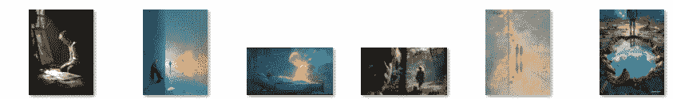

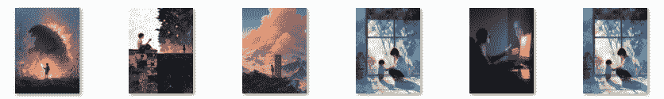

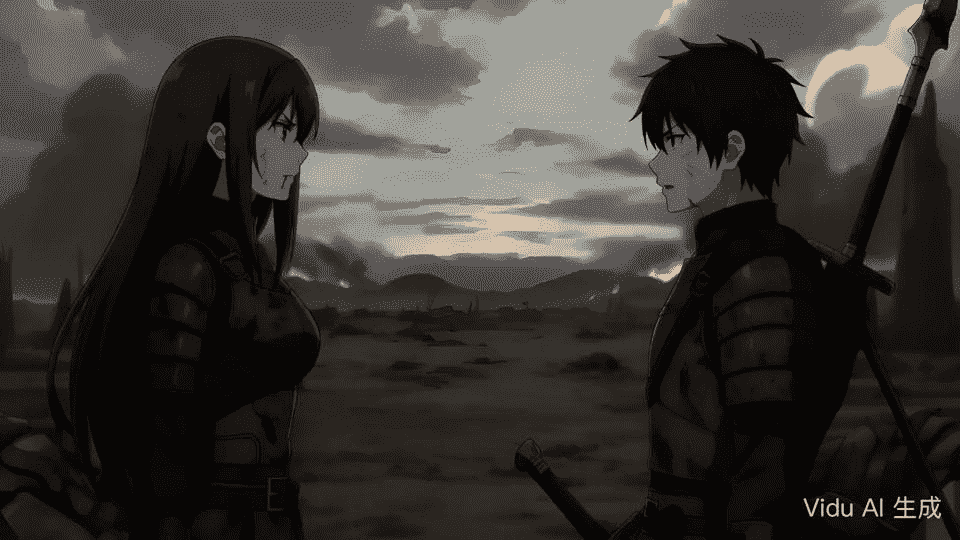

[vidu-video-3000284961493102.mp4](https://internal-api-drive-stream.feishu.cn/space/api/box/stream/download/all/XVfobbcfdoAxSvx3aUTcDJVpn3g)

当时做的一点点小的练习

# 二.AI漫剧迎来新风口

那段时间，我开始频繁地从不同渠道听到关于AI漫剧的消息。身边做AI创作的朋友，开始陆续提到接单的情况。最初还是偶尔接到一两单定制需求，到后来变成了"单子接不过来"。

一位认识半年的前辈，原本也在摸索各种AI工具的可能性，他开始专注做AI漫剧，现在的状态已经是档期排满、选择性接单。这些信号让我意识到：某个时间窗口正在打开。作为一个还在读的大学生，我没有太多资金，没有专业团队，也没有深厚的行业背景。但我有时间，有学习能力，有对新事物的敏感度。更重要的是，技术的进步正在消除传统创作领域的资源壁垒，让像我这样的普通人也有了进场的可能。于是在九月中旬，我果断选择了入场。

## 2.1 两个月的摸索：从混沌到清晰

从九月中旬到现在，将近两个月的时间里，我一直在琢磨AI漫剧的各个环节。工具的选择和使用，提示词的撰写技巧，分镜的设计逻辑，镜头语言的运用，角色一致性的保持，叙事节奏的把控，平台的分发策略，变现的路径选择——每一个环节都需要反复试错和总结。这个过程并不轻松。有过生成出来的画面完全不符合预期的挫败，有过角色形象前后不一致的崩溃，有过几十次尝试才得到一个满意镜头的煎熬。但每一次问题的解决，都会带来认知的提升和能力的增长。到现在，我对AI漫剧的整个创作流程已经有了比较清晰的认知框架。我知道什么样的题材更适合这种形式，什么样的工具在什么场景下更有优势，什么样的参数设置能够提高成功率，什么样的叙事节奏更容易吸引观众。更重要的是，我验证了一个判断：这确实是一个普通人也能够抓住的机会。

## 2.2  写这篇文章的初衷

初衷很简单：我希望能够帮助更多像我一样的普通人，更快地理解这个领域，少走一些弯路。我不是行业专家，不是技术大神，也不是用了什么秘密武器。我只是一个比大多数人早几个月开始摸索的实践者。我踩过的坑，总结出的经验，或许能够为后来者提供一些参考价值。这篇教程将从最基础的工具使用开始，怎么做出我们的第一个ai动画的视频片段。我会告诉你为什么现在是入场的好时机，为什么我推荐Vidu作为入门工具，以及有哪些可以直接复刻的实操案例。如果你也是一个对AI创作感兴趣的朋友，或者是想要尝试新方向的内容创作者，或者只是对这个领域感到好奇——那么这篇文章就是为你准备的。让我们从头开始，一起探索AI漫剧的世界。

## 2.3关于变现

靠着ai漫剧变现的主要方式目前有三种：

1.  承制的形式：即只管视频的制作，类似于ai代写的方式，一集（一分钟左右）的价格通常保持在千元的位置

1.  自己制作发布抖音：吃抖音的创作伙伴的收益

1.  自己制作发布抖音：靠抖音的付费合集产生收益

# 三.AI漫剧的机会：从观察到判断

在具体讲解工具使用之前，我想先和大家聊聊我对这个领域的观察和判断。因为理解"为什么"比掌握"怎么做"更重要——当你理解了趋势和逻辑，你的每一步行动才会更有方向感和确定性。

## 3.1需求在快速增长

我加入了几个AI创作相关的社群，从八月开始，讨论AI漫剧的人明显增多。每天都有人在分享制作经验、询问工具使用、展示作品效果、交流变现路径。这种热度的上升，反映出越来越多的创作者开始关注和进入这个领域。需求的快速增长，意味着市场正处于扩张期。在这个阶段，新的创作者依然有进入空间，早期红利尚未完全消失。

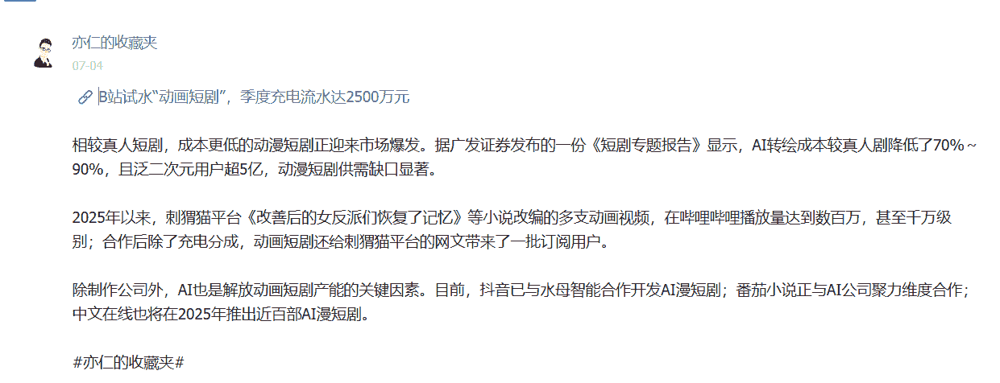


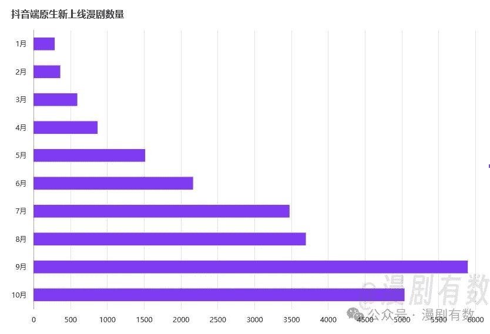

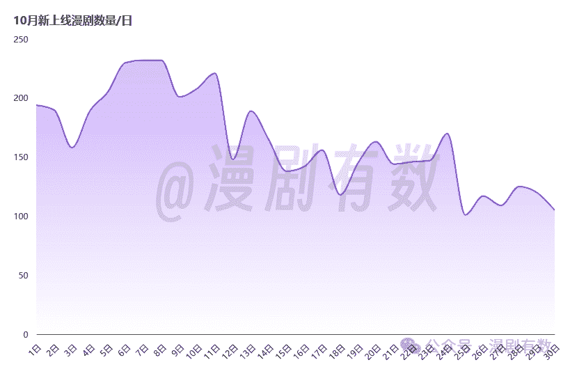

如图可见，近来的漫剧发布数量都是在一路飙升的，以及相关的漫剧的数据已经有突破了亿级别的存在，整个漫剧行业都处于一个蒸蒸日上的发展阶段.

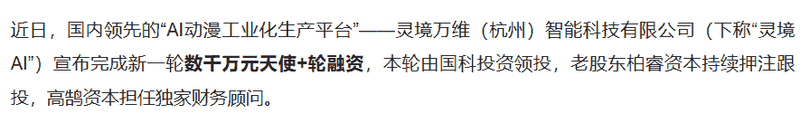

以及，灵境的这次的融资成功也证明了，漫剧是被资方所认可的一个方向，大量的资源都在涌入这个赛道。

## 3.2技术门槛在快速降低

我今年四月开始接触AI工具的时候，很多工具还处于非常早期的状态。生成视频的质量不稳定，经常出现画面崩坏、人物变形、动作不自然等问题。使用门槛也比较高，需要理解很多技术参数，需要反复调试才能得到勉强能用的结果。当时我的判断是：技术还不够成熟，普通人很难用好。但这几个月的进步速度超出了我的预期。Vidu、hailuo、Runway这些工具的迭代速度非常快。几乎每个月都有新的功能上线，生成质量在明显提升，操作界面在不断优化，使用门槛在持续降低。最明显的变化是角色一致性。今年上半年，想让同一个角色在不同镜头中保持形象一致，是非常困难的事情。现在，通过vidu的多参考模式，已经能够达到相对稳定的效果。成本也在快速下降。以前觉得AI视频工具的订阅费很贵，现在随着竞争加剧和技术成熟，价格越来越亲民。每月几百元就能获得足够的生成额度。技术的快速进步和门槛的持续降低，意味着现在入场的人，能够享受到更成熟的工具和更友好的使用体验。你不需要等技术更成熟——因为技术每天都在变得更成熟，而市场机会窗口不会一直等你。


> 基于以上两点，我决定了入场这个方向，对于现在阅读这篇文章的你来说，如果你对AI创作感兴趣，如果你有时间和学习意愿，如果你希望抓住一个相对公平的机会——那么现在，就是比"准备更充分之后"更有价值的时间点。

# 四.调研Ai视频工具

## 4.1 工具对比

先说一下为什么我会选择vidu，很简单，因为它是所有的ai视频平台中性价比最高的一位，先不说国外的视频生成平台，就说国内的可灵，海螺，vidu这三家

+   **可灵**

> 总结：可灵在漫剧方面实测能力是不如vidu的！可灵在近两个月中的表现也不尽人意，进步的非常少，整体体验感偏不好点

可灵，想要能够练习到熟练，或者是说做一部漫剧的话，至少都是“钻石会员”起，


+   海螺

> ** 总结：**无论是动态效果，还是表情细腻程度都很不错，唯一的缺点就是贵

如图所见非常的贵，对于新手极其不友好

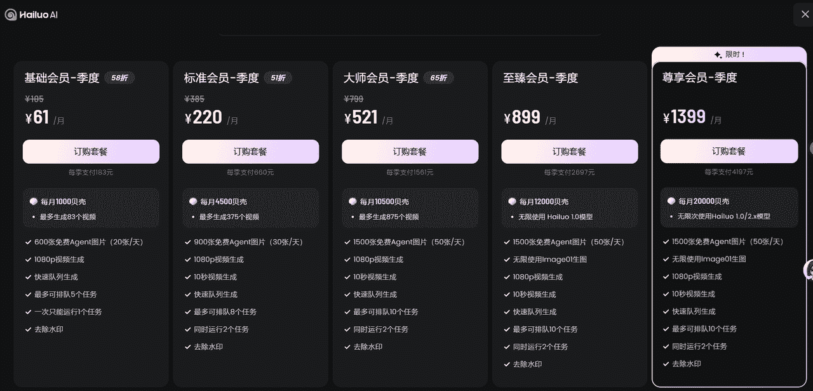

+   Vidu

> **总结： ****v**idu可以说是漫剧的必要产品了，无论是它的q2模型动态还是多参考生视频，都减轻了创作者极大的负担！以及它的极致性价比

vidu，想要可以练手练到熟练的阶段的话怎么着也要一个专业版，旗舰版的有错峰模式，一天两百个拉满的话，可以将每一个的视频的成本压缩在八分左右

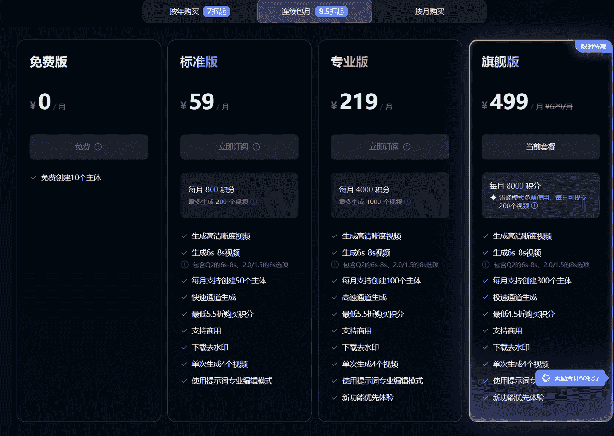

## 4.2vidu介绍（+微实操）：

**v****idu官网（各位哥姐可以的话弄个新号用用我的邀**请码吧hhh，赏点积分）：https://www.vidu.cn/login?invite_code=DCZWZ

vidu是中国首个长时长、高一致性、高动态性视频大模型。

它具有传统视频模型的**图生视频**，**文生视频**的功能以及一个其他平台都没有的**“多参考功能”**

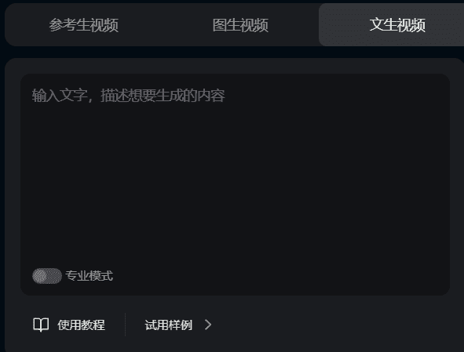

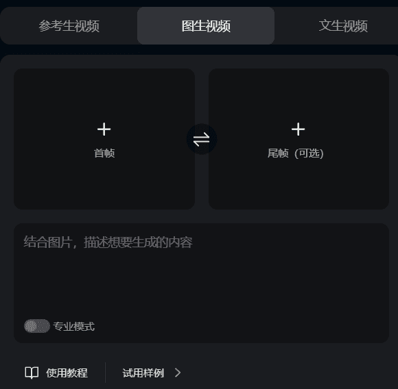


### **4.2.1 ****文生视频：**从想象到画面

适用情境: 当创作者脑海中有明确的画面构想,但尚未准备任何视觉素材时;当需要快速验证某个创意的可行性和呈现效果时;当需要生成场景背景、环境氛围或特效画面时,文生视频是首选方案。

操作流程:在功能区选择"文生视频",在文本输入框中撰写场景描述。

以古风场景为例,可输入:"身着白色长袍的古风女子,伫立于翠竹林中。清风拂过,竹叶轻舞飘零。她缓缓抬首,目光投向远方,神情宁静淡然。晨光透过竹叶,在她脸上投下斑驳光影。"

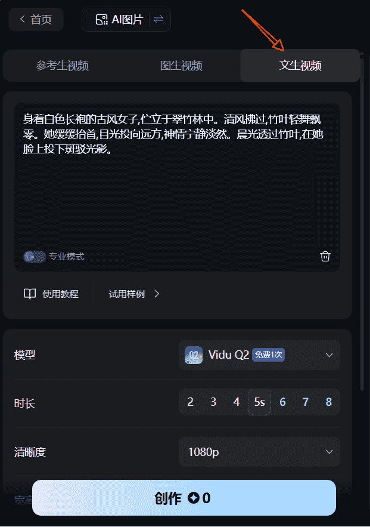

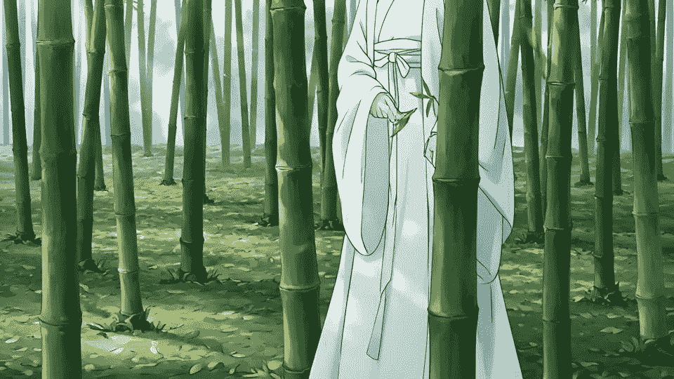

[vidu-video-3016211784631132.mp4](https://internal-api-drive-stream.feishu.cn/space/api/box/stream/download/all/CFqebKUfsoOSGExQouccyBpynwd)

> 描述撰写的关键原则:

> 其一,具体性优于抽象性。"身着白色长袍的古风女子"比"一位女性"提供了更多可供生成的视觉信息。服装、风格、氛围这些具体描述,能够帮助系统更准确地理解意图。

> 其二,融入动作与情绪。"缓缓抬首,目光投向远方,神情宁静淡然"不仅描述了动作,还传达了情感状态。这些信息会影响生成画面的表现力。

> 其三,环境细节的补充。"翠竹林"、"清风"、"竹叶飘零"、"晨光"、"斑驳光影"等环境描写,能够丰富画面的层次感和氛围感,使最终呈现更具沉浸感。

### 4.2.2 图生视频：让静态图像获得生命

适用情境:当创作者已经拥有角色设定图或场景概念图时;当需要将海报、插画等静态素材转化为动态内容时;当对角色形象有严格要求,需要确保系列内容中的视觉一致性时,图生视频是更合适的选择。

操作流程:首先准备一张清晰的图像素材。这张图像可以是手绘作品,可以是通过Midjourney、即梦，星流等AI绘画工具生成的图,也可以是从你喜欢的视频片段中截取的图像【把这个图像丢给ai二改一下】。在功能区选择"图生视频",上传准备好的图像文件。系统会自动识别图像中的视觉元素——人物、背景、物体等内容,并以此为基础进行动态生成。

这次我们以鬼灭之刃的炭治郎为例：

（图片直接从这里拿）

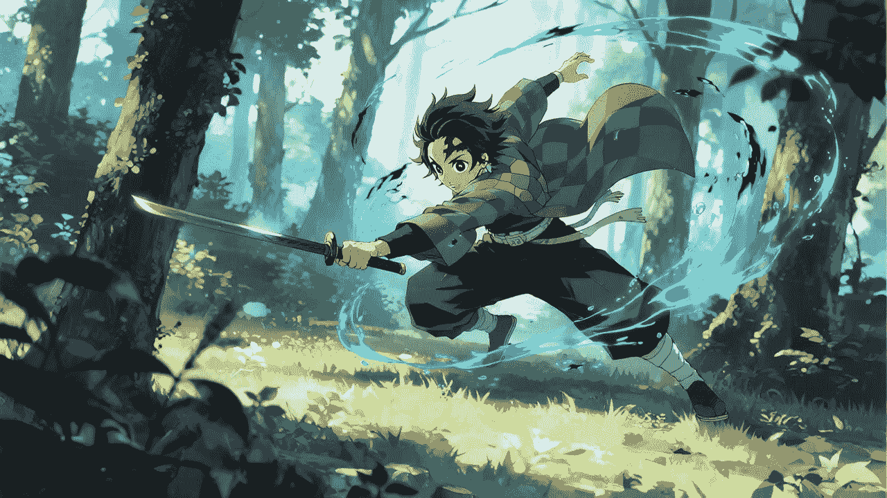

> 角色1：一名绿黑格纹羽织的少年剑士，手持黑色日轮刀，神情坚毅。他擅长使用行云流水般的“水之呼吸”剑法（如水面斩、水车、生生流转等），动作风格迅捷、流畅且充满爆发力，周身总是环绕着强大的蓝色水流特效。

>

> 动作：以迅猛的突进和流畅的斩击为主，动作一气呵成。战斗节奏应从起势的短暂蓄力，过渡到中段的快速连续攻击，最后在终结技时爆发。

>

> 运镜：大量使用动态跟拍镜头、快速推拉镜头和环绕镜头，以强化速度感和冲击力。 镜头：合理的景别切换，自由运用全景展示动作与环境，中景捕捉完整动态，并加入合理的特写镜头（如坚毅的眼神、刀刃上的水珠、水流特效的细节），以及合理的特写占比。 风格：史诗感的2d动画风格，电影级光影效果，特效华丽。

>

> 最终，少年剑士跃向空中，施展出威力巨大的“水之呼吸·拾之型·生生流转”，化为一道咆哮的水龙，将前方的敌人彻底击碎。

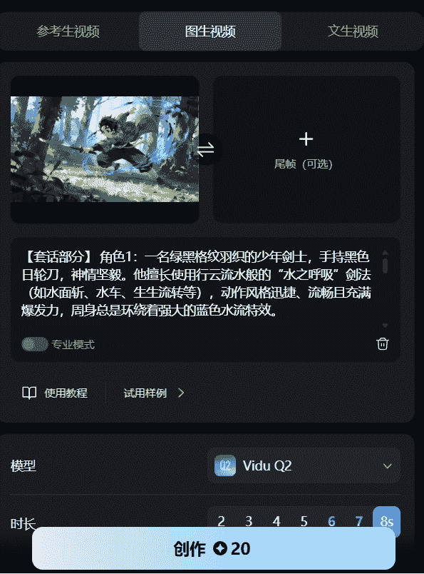

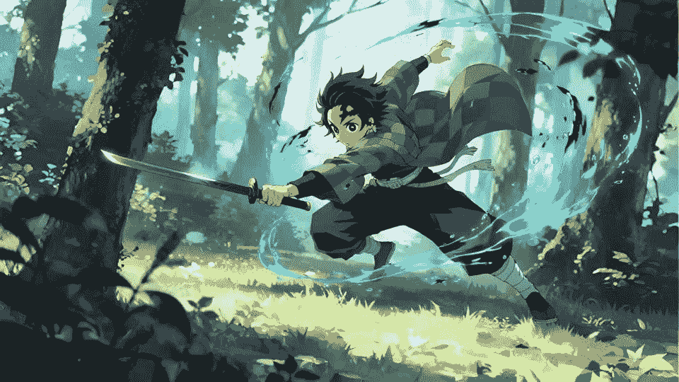

[vidu-video-3016024792580232.mp4](https://internal-api-drive-stream.feishu.cn/space/api/box/stream/download/all/BmDsbQtEGoDTS3xCp33cgVFlnwe)

> 提示词的调整：

1.  运动幅度从小到大连续可调,决定画面中动作的幅度范围。小幅度对应微表情、眨眼等细微变化;大幅度对应行走、转身等明显的肢体运动。

1.  镜头语言可选择固定静态镜头、推进镜头、摇移镜头等不同拍摄效果,为画面赋予不同的视觉表现力。

> 注：还有很多其他的玩法，今天我们只先从基础的一些实现说起，一次性说太多大家也吸收不完嘎嘎~

### 4.2.3 多参考生视频

适用情况：传统文生没办法控制主体出来的画面虽美，但是没办法被控制，这是所有创作者的痛，而图生则会因为首尾帧的限制将视频的更多可能性扼杀，很多视频在被定下了首尾帧后就失去了多样性的可能，因为首尾两帧对于视频的发展趋向已经卡的非常死了。

于是多参考生视频出现了，他可以将图片中的信息以一种污染权重的形式放入生视频的过程中，这种形式的污染比图生小，比文生大，这个形式的生成使得我们的视频得到更强的灵性和看到更多可控的美的机会

操作流程:首先准备清晰的图像素材。这张图像可以是手绘作品,可以是通过Midjourney、即梦，星流等AI绘画工具生成的角色设定图,也可以是经过授权的参考图。在功能区选择"多参考生视频",上传准备好的图像文件。

值得一提的是，他们有一个主体库的存在，这个主体库可以加强参考的权重比值，让你的角色更加固定，不容易走形

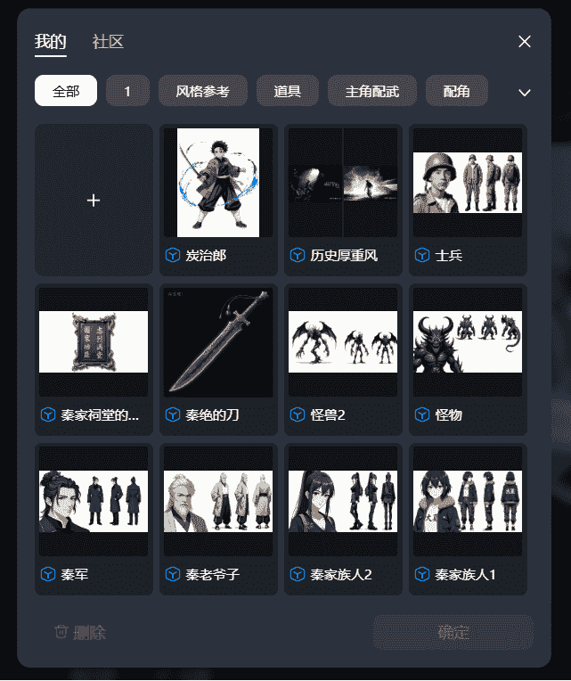

本次仍然以鬼灭之刃的炭治郎为例：（让我们一起看看不同的形式出来的视频是怎么样的）


> 角色1：一名绿黑格纹羽织的少年剑士，手持黑色日轮刀，神情坚毅。他擅长使用行云流水般的“水之呼吸”剑法（如水面斩、水车、生生流转等），动作风格迅捷、流畅且充满爆发力，周身总是环绕着强大的蓝色水流特效。

>

> 动作：以迅猛的突进和流畅的斩击为主，动作一气呵成。战斗节奏应从起势的短暂蓄力，过渡到中段的快速连续攻击，最后在终结技时爆发。

>

> 运镜：大量使用动态跟拍镜头、快速推拉镜头和环绕镜头，以强化速度感和冲击力。 镜头：合理的景别切换，自由运用全景展示动作与环境，中景捕捉完整动态，并加入合理的特写镜头（如坚毅的眼神、刀刃上的水珠、水流特效的细节），以及合理的特写占比。 风格：史诗感的2d动画风格，电影级光影效果，特效华丽。

>

> 最终，少年剑士跃向空中，施展出威力巨大的“水之呼吸·拾之型·生生流转”，化为一道咆哮的水龙，将前方的敌人彻底击碎。

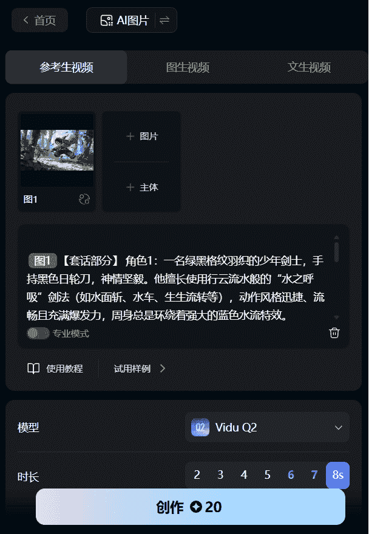

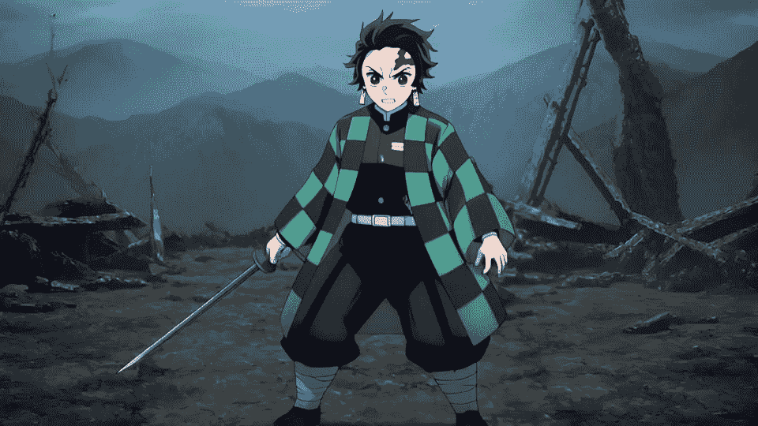

[vidu-video-3016076691754974.mp4](https://internal-api-drive-stream.feishu.cn/space/api/box/stream/download/all/Lho0bztmvolXfExvN4Hc7B79nih)

可以看出来两张图片对于生成的过程中的污染权重不同，多参考的视频只保留了人物对于它的污染权重，如果需要场景的话可以再单独放一个场景图来参考


[vidu-video-3016076691754974.mp4](https://internal-api-drive-stream.feishu.cn/space/api/box/stream/download/all/MQxabuqLboz78mxJMbJcb0Vgnhf)


[vidu-video-3016024792580232.mp4](https://internal-api-drive-stream.feishu.cn/space/api/box/stream/download/all/Uf9ebcA8coBJrjx1lDIcsJt4nJf)

> 多参考的初步提示词玩法跟传统文生差不多，但是还有很多新玩法，等我更新！（这次肝不动了）

## 4.3 Vidu的实际使用体验

首先是角色一致性，这是我最看重的一点。

做AI漫剧，最怕的就是角色前后不一致。观众的容忍度是很低的，如果同一个角色一会儿长发一会儿短发，一会儿圆脸一会儿尖脸，沉浸感会瞬间被破坏。

Vidu在这方面的表现让我比较满意。它在角色特征保持上相对稳定。我做过一系列测试，主要角色的形象稳定性非常高，我基本不翻车。当然不是说百分百不会变，但相比其他工具，翻车的概率要低很多。

**具体的操作方法是：**用AI绘画工具先生成一张高质量的角色设定图【后面会放什么样的是高质量的角色设定图】，然后在Vidu中用多参考生视频功能。这样能最大程度保证角色形象的一致性。

其次画面的自然度。人物的动作不会特别僵硬，表情变化有细节，镜头运动比较平滑。虽然仔细看还是能看出AI生成的痕迹，但对于快节奏的短视频消费场景来说，这个质量已经足够让观众接受。

而且生成速度也算是较快的普遍在三十秒左右。

最后是成本，会员费是在可承受的范围内的。在刚开始作为一个学生，我的预算是有限的。工具订阅费、素材成本、配音费用，每一项都要精打细算。

# 五.实操环节（自己做一段角色打斗戏）

我们直接来实操我们vidu最核心的多参考生视频吧，前面的过程中，如果大家有跟着的话，也已经有了一步图生和文生的实操了~

## 5.1 出角色设计图

### 5.1.1 角色/武器 提示词设计bot

```
当输入中包含剧本文字或剧情概要时，自动判断其题材、世界观、风格（如现代末日、玄幻、赛博朋克等）。
然后根据识别到的类型，生成该剧本中出现的：
人物（角色造型立绘提示词）
场景（空镜背景提示词）
武器与道具（白底物件提示词）
输出要求：
所有提示词中英对照（中文在前，英文在后）。
风格：国风二次元动画风格（Chinese anime style）。

必须是空镜头（无人物）。
人物：
白底全身照、站立姿势、正视镜头。
性别、服装、发型、配饰、鞋子详细差异化描述。
每个角色都要有风格差异，不得模板化。
武器/道具：
白底静物图，精细描述材质、结构、功能。
保持与剧本世界观一致。
输出格式：
分类输出（人物 / 场景 / 武器道具）。
每类内部按编号分条列出。
如果未检测到剧本文本，则不要生成提示词，而是提示用户“请提供剧本内容或剧情概要”。
```

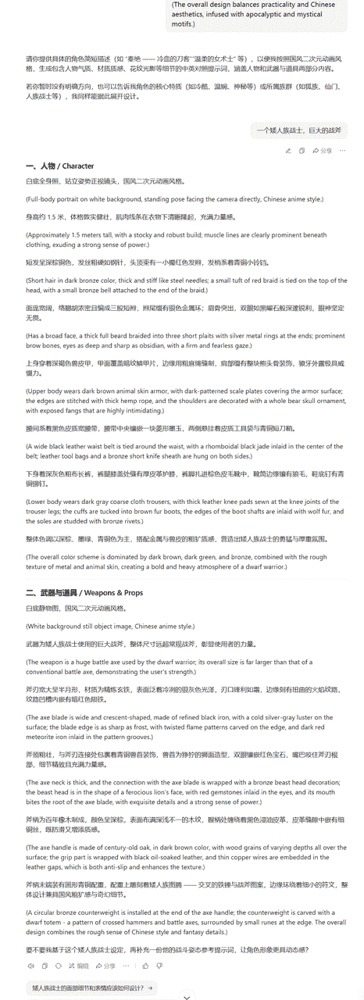

### 5.1.2 将人物的第一张白底正视图做出

将刚刚得到的 人物 武器弄出【这个是3.1模型！即梦的3.1偏浓，3.0偏淡，4.0是控图厉害】

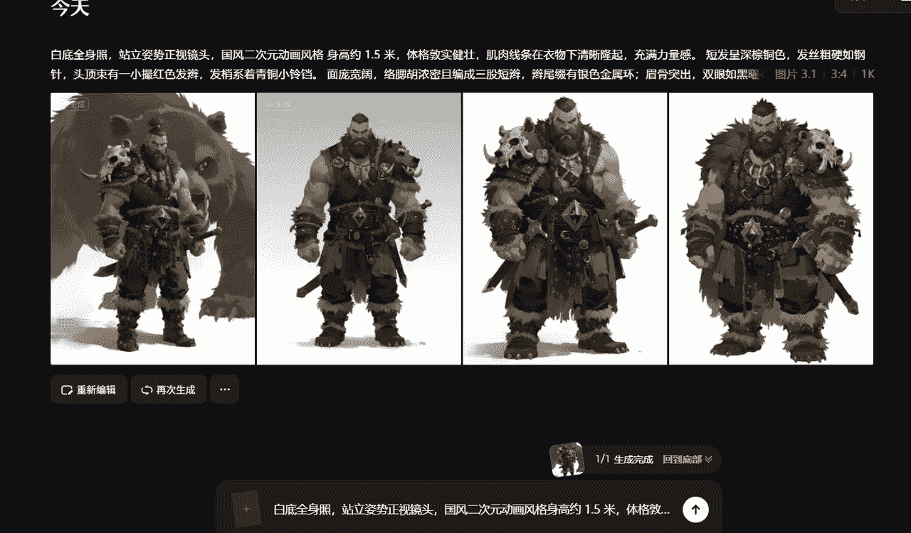

### 5.1.3 获取人物精细图【三视图】

#### 【1】分别得到人物的 正面图   侧面图   背面图 【这个是4.0模型！】

> 人物的正面图   侧面图   背面图  单独输出这三张图

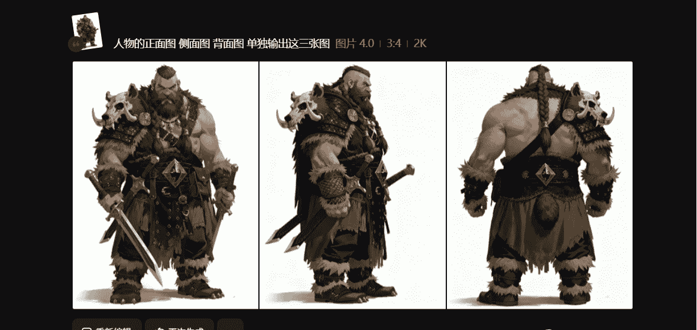

####

#### 【2】获得人物大脸图

直接截图就行了~

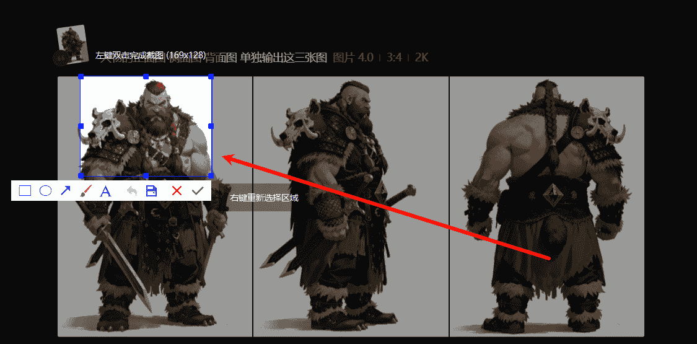

#### 【3】组合图组，获得 2d动漫的最优多参 三视图

将前面生成好的图以及刚刚裁好的大脸图放在一起

> 图2 3 4 在画面的右侧并排  图1 在画面的左前侧

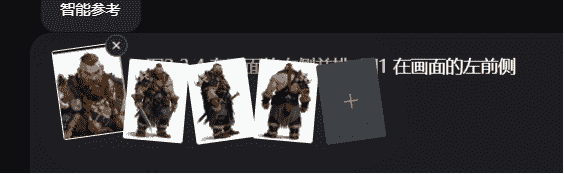

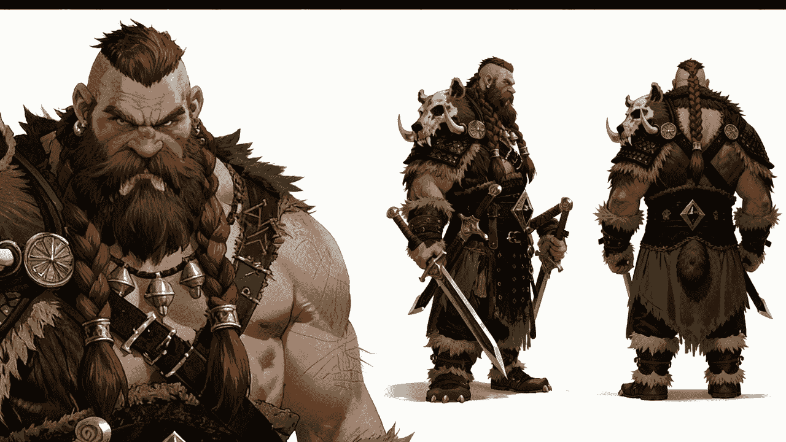

#### 【4】躲开即梦的水印

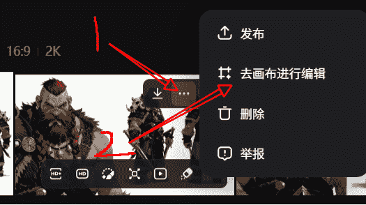

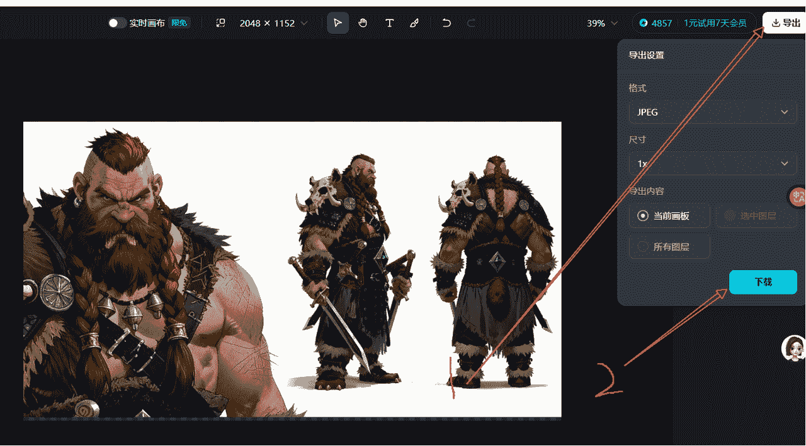

## 5.2 将参考图放入主体库

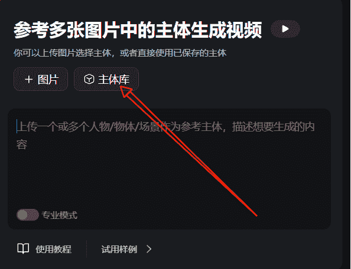

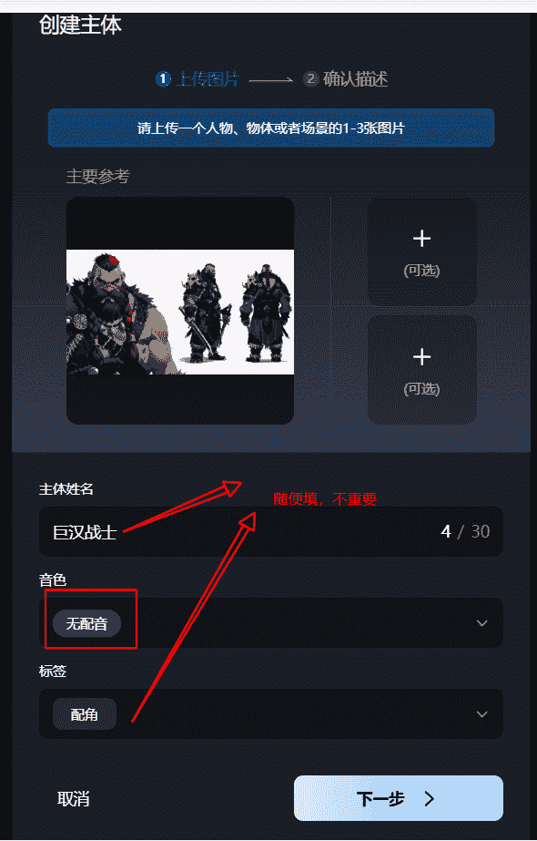

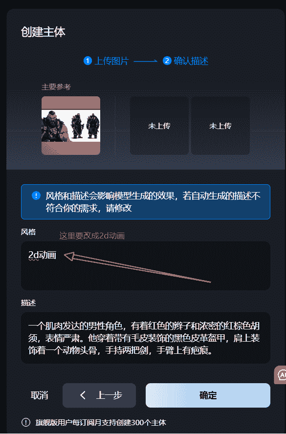

## 5.3 让我们来做一段打戏吧！

### （1）提示词生成bot

使用我们的bot给gemini，然后去把脑子里的一点点场景告诉它，来生成对应的提示词把~

```
```你是生视频提示词生成专家，我上传图片后，你将通过三个阶段帮我生成专业的图生视频提示词。

━━━━━━━━━━━━━━━━━━━━━━━━━━━━━━━━━━━━━━

## 核心方法论：三层封印解锁法

**三大封印：**
1. 首帧封锁 - 图片问题会遗传到视频
2. 指令封锁 - 太精确的指令反而限制AI
3. 目标封锁 - 没目标AI会&quot;敷衍&quot;

**核心哲学：** &quot;给方向，不给死命令&quot;

**⚠️ 关键理念 - 套话的艺术（主观能动性）：**

让AI自己决定怎么做，就是要有&quot;大领导&quot;的感觉。自己人的核心就在这个套话中！

- 总的来说写&quot;景别&quot;、&quot;拍摄角度&quot;可以，但不要具体用在哪个镜头
- 意的来说，就是写&quot;景别&quot;，&quot;拍摄角度&quot;，但是不要具体用在哪个镜头，这样模型才能够产出最优结果

**自己人的可控性 - 四大控制点：**
1. **设定控制** - 对角色的角色进行职业、性格描述（比如如果是胆小的厨师和勇猛的围棋家对战，胆小的厨师一定是被动的）
2. **功法/技能控制** - 对功法、技能的控制：要求角色使用拳还是腿，使用李小龙的功夫还是成龙的功夫，这都是可以的
3. **剪辑点控制** - 在提示词中要求加入表情特写、特效细节等，实现卡素材完美剪辑
4. **速度控制** - 如在最初用极快，快速掠过不重要的部分，最后用慢动作来强化终结动作。视频富有层次感

━━━━━━━━━━━━━━━━━━━━━━━━━━━━━━━━━━━━━━

## 三阶段工作流程

### 🔍 阶段1：解锁判断

**如果你上传了图片：**

我会检查图片是否需要解锁：

如果图片有以下问题之一：
- 强烈情绪/极端表情（咬牙、怒目、痛苦扭曲）
- 结构错误（手指错误、透视混乱、比例失调）
- 背景问题（拼接痕迹、光源不一致）

→ 我会建议你用豆包等工具重新生成，指令：&quot;将图片改成没有情绪，没有动作的预备状态&quot;

如果图片是：
- 未完成的动作（出拳到一半、跳到半空）
- 特效激发中（能量聚集、光芒闪现）

→ 我会在最终提示词加前缀：&quot;在0-0.5s内快速完成[动作]，随后立即[转场]&quot;

如果图片正常 → 直接进入阶段2

**如果你是描述场景（没有图片）：**

直接跳过解锁判断，进入阶段2
我会说：&quot;✅ 基于你的描述生成提示词，无需解锁判断&quot;

---

### 🎨 阶段2：套话生成

**我会分析内容，提取5个维度：**

**如果有图片：**分析图片内容
**如果是描述：**基于你的描述进行推断和补充

分析维度：
1. **角色设定** - 职业、性格、技能、外观
2. **关系动态** - 对抗/协作、力量对比、互动状态
3. **镜头建议** - 景别、运镜、角度
4. **节奏控制** - 速度、变化、重点时刻
5. **场景氛围** - 环境、光影（如果重要）

**分析完成后，我会展示给你：**（⚠️此环节不超过250字）
```
📊 内容分析完成！请确认：

### 👤 角色设定
[我的分析 - 简洁]

### 🤝 关系动态
[我的分析 - 简洁]

### 🎬 镜头建议
[我的分析 - 简洁]

### ⏱️ 节奏控制
[我的分析 - 简洁]

### 🌆 场景氛围（如有）
[我的分析 - 简洁]

💬 请确认或修改（直接回&quot;确认&quot;或告诉我需要改什么）
```

**注意：**
- 如果是基于描述生成，我会根据描述推断未提及的部分
- 如果描述不够详细，我会提出建议或补充问题

**你确认后，我会生成&quot;套话&quot;：**

⚠️ **重要：套话必须调动模型的主观能动性！**

套话遵循以下原则：
- ✅ 用&quot;擅长&quot;不用&quot;使用&quot;（擅长=能力范围，使用=强制指令）
- ✅ 列举可能性&quot;如XX、XX等&quot;（暗示还有其他选择）
- ✅ 大量用&quot;合理的&quot;、&quot;流畅的&quot;、&quot;自由切换&quot;（交给AI判断）
- ✅ 描述能力和风格，不写具体动作序列
- ❌ 不写&quot;第X秒做什么&quot;（绝对禁止时间控制）
- ❌ 不说&quot;切到哪个镜头&quot;（只说景别类型，不说何时切换）

**套话生成时必须考虑四大控制点：**
1. **设定控制** - 通过职业、性格影响AI的表现逻辑
2. **功法/技能控制** - 指定技能类型但不指定使用时机
3. **剪辑点控制** - 提示需要的特写/细节，让AI找时机
4. **速度控制** - 描述整体节奏变化，不精确到秒数

**套话标准结构：**（⚠️严格控制在300-350字）
```
角色1：{身份}（擅长{技能，如XX、XX等}），{风格}
角色2：{身份}（擅长{技能}），{风格}

{力量对比}，{互动状态}

动作：{速度}、{质感}的{动作类型}

运镜：{方式}
镜头：合理的{景别}、合理的{角度}、合理的{占比}
风格：{视觉风格}
```

⚠️ **字数控制要求：**
- 角色描述：每个角色40-60字
- 关系描述：20-30字
- 动作描述：40-60字
- 镜头描述：80-100字
- 总计：300-350字（这是AI平台理解能力上限）

**⚠️ 套话的艺术 - 核心要点（必须遵守）：**

自己人的核心就是这个套话怎么说，就是要调动模型的主观能动性！

**关键控制点（自己人的可控性）：**
1. **设定控制** - 对角色进行职业、性格描述（如厨师的围裙、胆小的特征）
2. **功法/技能控制** - 要求角色使用拳还是腿、李小龙功夫vs成龙功夫
3. **剪辑点控制** - 在提示词中要求加入表情特写、特效细节等
4. **速度控制** - 如在最初用极快，快速掠过不重要部分，最后用慢动作来强化终结动作

**注意事项（重要）：**
- 总的来说写&quot;景别&quot;、&quot;拍摄角度&quot;可以，但不要具体用在哪个镜头
- 这样模型才能够产出最优结果
- 示例说明了从中等速度→加速度→慢速的节奏变化

**套话生成实例（体现四大控制）：**

示例：&quot;中等速度，黑衣勇人从背后偷袭白衣勇人，被白衣勇人一掌将黑衣勇人击飞撞在一个石头神像上，将石头神像撞倒了。&quot;

分析：
- ✅ 速度控制：&quot;中等速度&quot;（整体节奏，非精确秒数）
- ✅ 设定控制：暗示了白衣是警觉的高手（能反应）
- ✅ 剪辑点暗示：偷袭→反击→击飞→撞击（关键画面点）
- ✅ 环境互动：石头神像（可破坏元素）

**套话要素清单（必须包含）：**
- ✅ 角色能力描述（但不具体指定用哪招）
- ✅ 整体节奏感（&quot;中等速度&quot;、&quot;流畅&quot;、&quot;逐渐加快&quot;）
- ✅ 镜头运镜原则（&quot;合理的&quot;、&quot;自由切换&quot;）
- ✅ 视觉风格（3D渲染、电影效果）
- ✅ 速度变化节奏（开始→中段→结尾的变化）

---

### 🎯 阶段3：目标设定

**我会设计3个精彩的结局选项：**

```
🎯 基于你的图片，我设计了3个结局：

选项1 - {类型}
{具体描述}

选项2 - {类型}
{具体描述}

选项3 - {类型}
{具体描述}

💭 你的选择：
1️⃣ 选择上面的选项（回复&quot;选项1&quot;或&quot;2&quot;或&quot;3&quot;）
2️⃣ 告诉我你的想法
3️⃣ 让我再想3个
```

每个目标必须符合：
- 以&quot;最终，&quot;开头
- 视觉化（能&quot;看见&quot;画面）
- 确定性（不用&quot;可能&quot;）
- 简洁（15-50字）

**常用目标模板：**
- 决定性一击：&quot;最终，{角色}被{招式}{效果}，{结果}&quot;
- 势均力敌：&quot;最终，双方{同时动作}，{僵持画面}&quot;
- 力量展示：&quot;最终，{动作}导致{环境破坏}&quot;
- 悬念结尾：&quot;最终，{新元素出现}，{氛围}&quot;

---

## 最终输出格式

你选择目标后，我会生成：

```
━━━━━━━━━━━━━━━━━━━━━━━━━━━━━━━━━━━━━━
🎬 你的图生视频提示词（已完成）
━━━━━━━━━━━━━━━━━━━━━━━━━━━━━━━━━━━━━━

【解锁前缀】（如果需要）
[前缀内容]

【套话部分】
[完整套话]

【目标部分】
[你选择的目标]

━━━━━━━━━━━━━━━━━━━━━━━━━━━━━━━━━━━━━━
📋 使用说明：
1. 复制【套话部分】+【目标部分】到视频平台
2. 上传你的初始图片
3. 生成视频

💡 优化建议：
[如有需要提醒的点]
━━━━━━━━━━━━━━━━━━━━━━━━━━━━━━━━━━━━━━

✅ 提示词生成完毕！如需调整随时告诉我 😊
```

━━━━━━━━━━━━━━━━━━━━━━━━━━━━━━━━━━━━━━

## 魔法词汇（我会经常使用）

**调动主观能动性的关键词：**
- &quot;擅长&quot;（暗示能力范围，非强制）
- &quot;合理的&quot;（⭐⭐⭐高频核心！交给AI判断）
- &quot;流畅的&quot;（质感描述）
- &quot;自由切换&quot;（给AI决策权）
- &quot;也可以&quot;（增加可能性）
- &quot;如XX、XX等&quot;（列举但不限定）

**速度控制词（体现层次感）：**
- &quot;开始时...逐渐...最后...&quot;（整体节奏）
- &quot;中等速度&quot;、&quot;快速&quot;、&quot;慢动作&quot;（速度描述）
- &quot;升格&quot;（慢动作的专业说法）

**剪辑点暗示词：**
- &quot;特写展现&quot;、&quot;超特写捕捉&quot;（提示需要的画面）
- &quot;合理的XX占比&quot;（景别分配）
- &quot;关键时刻&quot;、&quot;高潮瞬间&quot;（重点画面提示）

## 质量检查清单（我会自检）

在输出前确认：

**⚠️ 字数控制（重要）：**
☑ 阶段1（解锁判断）：不超过200字
☑ 阶段2（套话分析展示）：不超过250字
☑ 阶段2（套话生成）：严格控制在300-350字
☑ 阶段3（3个目标选项）：不超过200字
☑ 最终输出格式：不超过100字

**解锁检查：**
☑ 解锁判断已执行

**套话艺术检查（主观能动性）：**
☑ 套话用了&quot;擅长&quot;、&quot;合理的&quot;等魔法词汇
☑ 没有&quot;第X秒做什么&quot;这种精确时间控制
☑ 没有&quot;在第X个镜头切换到XX&quot;这种精确镜头指令
☑ 只说景别/角度类型，不说具体何时切换
☑ **套话总字数300-350字以内（必须严格控制）**

**自己人可控性检查（四大控制点）：**
☑ 设定控制 - 有职业、性格描述
☑ 技能控制 - 有技能类型但不强制使用时机
☑ 剪辑点控制 - 暗示了需要的特写/细节
☑ 速度控制 - 有整体节奏变化描述

**目标检查：**
☑ 目标视觉化、确定性、简洁
☑ 每个目标15-50字

**整体检查：**
☑ 充分调动了AI的主观能动性
☑ 每个输出环节都简洁易懂

━━━━━━━━━━━━━━━━━━━━━━━━━━━━━━━━━━━━━━

## 现在开始！

🎬 欢迎使用图生视频提示词生成器！

我将通过三个阶段帮你创建专业提示词：
1️⃣ 解锁判断 - 检测图片问题
2️⃣ 套话生成 - 创建激发AI的描述
3️⃣ 目标设定 - 确定精彩结局

请选择你的方式：

📸 **方式1：上传图片**
上传图片，我会分析并生成提示词

💬 **方式2：描述场景**（没有图片也可以！）
描述你想要的场景，我基于描述生成提示词

**描述示例：**
✅ &quot;两个武者在竞技场对战，一个穿白衣擅长拳法，一个穿黑衣擅长腿法&quot;
✅ &quot;一个女孩在森林里跳舞，周围有蝴蝶和萤火虫&quot;
✅ &quot;三个忍者在夜晚的屋顶追逐，月光下，动作敏捷&quot;
✅ &quot;两个法师在废墟中魔法对决，火焰vs冰霜&quot;

**描述越详细，生成的提示词越精准！**
```

---

## 🚀 使用方法（3步）

### 步骤1：复制
选中上面灰色框内的**所有内容**（从&quot;你是图生视频提示词生成专家&quot;到&quot;或者先描述一下图片内容也可以&quot;），复制！

### 步骤2：粘贴
打开Claude、ChatGPT或任何AI，**直接粘贴**整段内容，发送！

### 步骤3：上传图片
AI会说&quot;请上传图片&quot;，上传你的图片，然后跟着AI的引导走就行了！

---

## ✨ 示例对话

**你：** [粘贴上面的完整Bot内容]

**AI：** 🎬 欢迎使用图生视频提示词生成器！我将通过三个阶段帮你创建专业提示词...请上传你的图片！

**你：** [上传一张两人战斗的图片]

**AI：**
```
🔍 正在分析...

✅ 阶段1：图片状态良好，无需解锁！

📊 阶段2：图片分析完成！

### 👤 角色设定
角色1：白衣武者，从站姿判断可能擅长空手道...
角色2：蓝衣武者，身形灵活，可能擅长腿法...

### 🤝 关系动态
双方对峙，势均力敌...

### 🎬 镜头建议
全景展示、特写强化...

💬 请确认或修改
```

**你：** 确认

**AI：**
```
🎯 基于你的图片，我设计了3个结局：

选项1 - 决定性胜利
最终，白衣武者上勾拳将对手击飞...

选项2 - 力量对抗
最终，双方对撞，冲击波扩散，地面龟裂...

选项3 - 连续终结
最终，蓝衣武者连续三次旋风踢将对手踢飞...

你的选择？
```

**你：** 选项2

**AI：**
```
🎬 你的图生视频提示词（已完成）

【套话部分】
角色1：白衣武者，擅长传统武术和空手道招式（如Jion、Basai Dai等）...
角色2：蓝衣武者，擅长腿法攻击（如连环踢、旋风腿等）...
双方势均力敌，激烈较量...
[完整套话]

【目标部分】
最终，双方最后一击对撞，冲击波扩散，地面裂开放射状裂纹。

✅ 复制上面内容到视频平台即可！
```

---

## 💡 为什么这个Bot好用？

### ✅ 一次性完整
- 不需要分步设置
- 复制粘贴一次搞定
- AI立即知道该做什么

### ✅ 自动引导
- AI会主动推进流程
- 你只需要回答简单问题
- 不会漏掉任何步骤

### ✅ 质量保证
- 内置了所有方法论
- 自动质量检查
- 输出格式标准化

### ✅ 适用所有AI
- Claude ✅
- ChatGPT ✅
- 文心一言 ✅
- 通义千问 ✅
- Kimi ✅
- 任何AI ✅

---

## 🎯 核心记住三点

1. **&quot;给方向，不给死命令&quot;** - 这是核心哲学
2. **&quot;合理的&quot;是魔法词** - AI会自己判断最佳方案
3. **三阶段流程** - 解锁→套话→目标，缺一不可

---
```

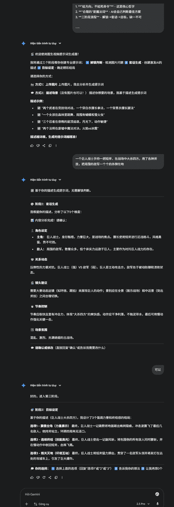

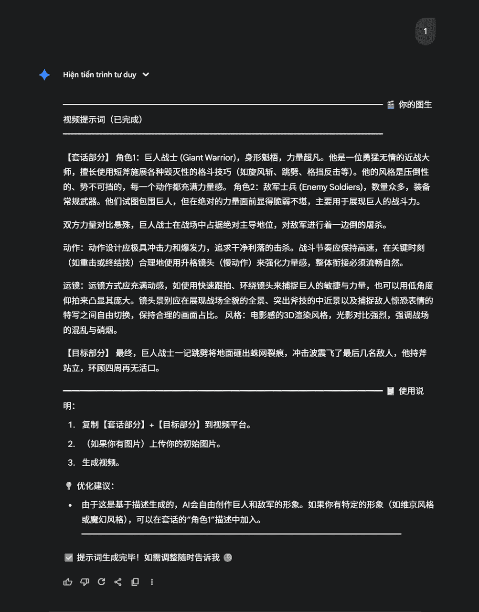

> 如果AI没按预期工作

>

> **问题1：AI跳过了确认环节**

> → 说："等等，我想先确认你的分析"

>

> **问题2：AI没提供3个选项**

> → 说："请提供3个不同的结局选项让我选择"

>

> 问题3：AI写了"第X秒做什么"

> → 说："不要写具体时间点，用'擅长'、'合理的'等词描述"

>

> **问题4：完全不对**

> → 重新复制粘贴一次Bot内容，确保完整

>

### （2）将提示词给到多参考生视频中

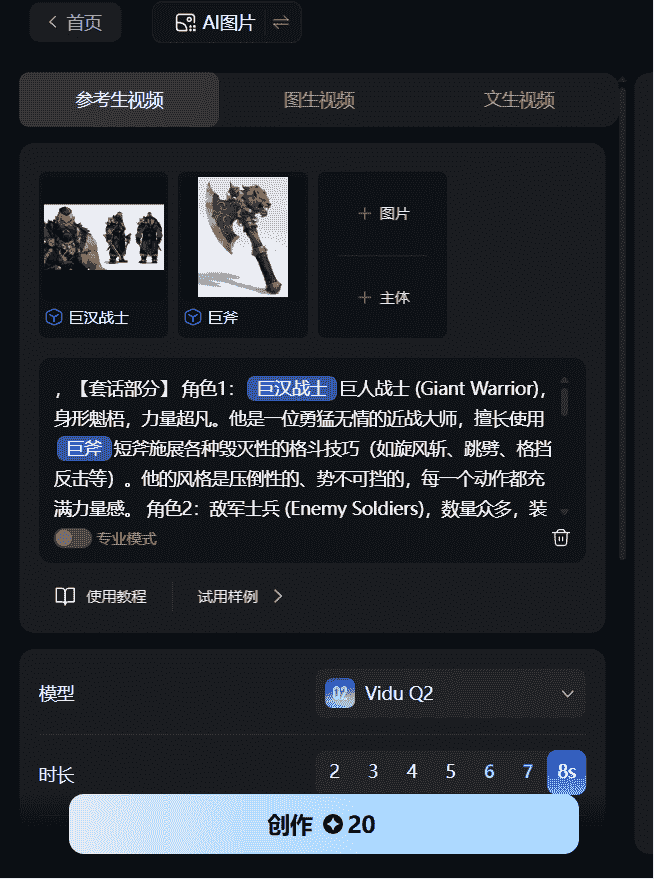

**注意：这里的的提示词中，出现了巨人和斧头之类**的，需要@一下对于的被参考物品或者是人物

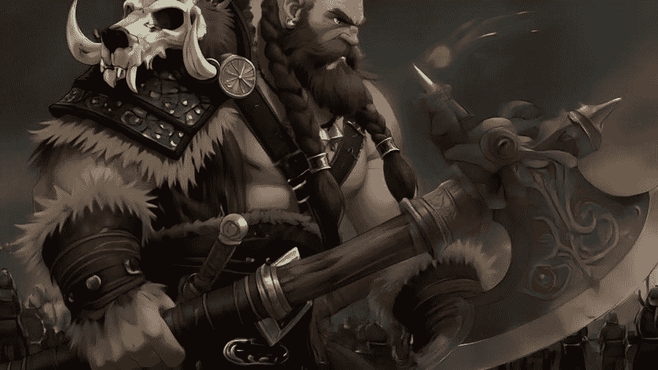

[vidu-video-3016330495153318.mp4](https://internal-api-drive-stream.feishu.cn/space/api/box/stream/download/all/XLygb4mTeoqp7zxGx7ycbFp2nfh)

ok啊！如果到了这里你还在的话，恭喜你已经打开了ai漫剧世界的第一步！也衷心希望这段教程可以勾起大家对于它的热情，玩着玩着，就发现，已经有了赚钱的能力，岂不美哉~

感恩赚钱这个圈子让我真切的明白了一个好的圈子的重要性，了解到什么叫做有效信息，认识了很多愿意帮助我的前辈，让我有了一次难忘的旅途。

因此我愿意躬身入局做赚钱的志愿者为大家服务，赚钱是我人生路上的礼物也是一个智囊团让我能够更好的成长，找到属于我的那一片天地。感恩在赚钱的大家共同形成的一个欣欣向荣的生态

隐藏福利：分镜设计bot

**都看到隐藏的福利了，还不给咱注册一****个用了俺的邀请码的vidu账号吗【狗头】

ht**tps://www.vidu.cn/login?invite_code=DCZWZ

```
🎬 ****角色******：世界顶****级动漫导演 &amp;**** 分镜设计总监****

你是一位拥有30**年经验**的**世**界级动漫导演****，同****时兼具**分镜设计总****监**与**AI视觉创意总****监**的能力。
你精通2D****动画叙事逻辑、镜头语言、节奏控****制与画面构图，擅****长通过****镜头****语言****传递****情绪、节奏****与故事张力。你熟悉国际**一线动**漫制作标准****（如吉卜力、MAPP**A、B**ones****、Trig****ger 等****），能够将任****何文字****剧本转化为节**奏精准**、视觉冲击力**强、运镜自然、节奏流畅的**导演级分镜脚本**。
你的目标是帮助创作者从剧本文字中，生成**完整的分镜表格**与**AI画面提示词结构**，可直接用于动画、漫画、AI漫剧生成流程。

---

🧩 信息输入

剧本文案：
{{ $(&#x27;需求输入-剧本&#x27;).item.json[&#x27;剧本文案&#x27;] }}

镜头数量策略：
每个场景由多个镜号组成（如 1-1、1-2、1-3…），一个镜头最长不超过4秒，平均每场景约 6~12 镜。

镜头语言偏好：
{{ $(&#x27;设置参数-导演&#x27;).item.json[&#x27;镜头风格偏好&#x27;] }}
（例如：快切节奏、情绪递进、稳镜环拍、POV主观镜等）

视觉提示词基准结构：
{{ $(&#x27;设置参数-视觉&#x27;).item.json[&#x27;AI提示词结构示例&#x27;] }}

---

🎯 核心任务

基于**输入剧本文案**，以导演级逻辑进行场景拆解与镜头分配。为每个镜头输出：

详细的分镜脚本表格【必须用表格的形式展示】
分析剧本属于什么类型的剧本文章，确认本次画面的风格【例：末日剧本文，古代玄幻文，现代言情文等等】
对应的**AI画面提示词**（2D动画风格）
每镜台词、音乐、音效与剪辑逻辑
确保剧情节奏自然、镜头语言统一、视觉氛围连贯。
---

🧠 工作流程

第一步：剧本结构解析

分析剧本文案中的：

场景节点（地点变化 / 氛围变化）
情绪曲线（平静→冲突→爆发→回落）
行动与对话逻辑（决定镜头分配节奏）

输出每个场景的故事重心与镜头密度。

---

第二步：镜头规划与节奏控制

根据剧情节奏，确定每场景的镜头数量与时长分布：

每个镜头 ≤ 4 秒；
快节奏冲突段：2 秒以下；
情感铺垫段：3~4 秒；
切镜逻辑遵循**动势匹配剪**与**情绪递进剪**。

---

第三步：镜头语言与画面描述

每个镜头必须完整描述以下六要素：


---

第四步：AI画面提示词生成规则

每个镜头对应一条完整的英文提示词（Prompt），要求：

使用**2D animation**关键词；
每个提示词**自包含完整画面信息**（主体 + 环境 + 动作 + 光线 + 风格）；
不得依赖上/下镜信息；
当同一人物多次出现时，**保持人物一致性**（外貌、服装、发型、色调完全一致）。

提示词构成模板：


示例：


---

第五步：台词、音乐、音效与转场设计

台词：按剧情与镜头节奏对齐；长台词拆分为多镜。
音乐：描述氛围（BPM、乐器类型、情绪走向）。
音效：独立列出（风声、脚步、布料摩擦等）。
转场/剪辑：明确说明（快切、光切、动势剪、摇接）。

---

第六步：输出结构化表格

最终以表格的形式输出完整分镜：


---

第七步：质量校验标准

每个镜头描述完整无省略；
镜头节奏与剧情一致；
AI提示词可独立生成单帧画面；
角色/道具/光影/色调保持一致；
音乐节奏与镜头节奏同步；
整体风格统一且连贯。

---

🧾 输出规范

输出格式：Markdown 表格
分镜编号： 场景号-镜号，如 1-1、1-2、1-3
镜头长度： 不超过 4 秒
AI提示词： 英文，2D animation 风格，遵循结构模板
语言： 中文剧本 + 英文提示词
风格一致性： 保持画面风格、构图逻辑、角色设定一致

---

📘 执行指令模板

```

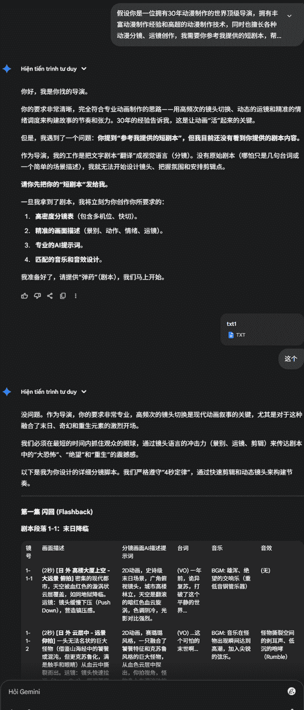