# 虚拟仓手册02

> 来源：[https://xuqiwei1986.feishu.cn/docx/NoIadju6VoqulFxKCN3ccEKSn2d](https://xuqiwei1986.feishu.cn/docx/NoIadju6VoqulFxKCN3ccEKSn2d)

> 2025年10月10日发布了一篇的小白美区无货源-代采教程之后，得到了精华帖和鱼丸的鼓励；让我对tiktokshop的分享充满了信心；同时与一些圈友沟通发现各位伙伴对TikTokShop的未来也很看好，但是不清楚应该如何入门；

>

> 所以我决定写一个系列出来，从我的视角给大家分享我实操有收益且还不错的玩法；

>

> 以下我预估的分享事项；希望能做到一个月一篇；

本文为tiktokshop美区无货源电商进阶版；主要分为四个部分：

**1.无货源玩法解析  2.虚拟仓流程讲解  **3.选品与商品计价  4.资源与获取方式

其中选品与商品计价需要花费稍多的时间仔细学[代采手册01 ](https://vqjz0ej9x2.feishu.cn/wiki/NH6ywfIymirwvSk4lNBcW6runtc?from=from_copylink)。本文无阅读门槛；但如需实操请前置阅读

# 1.无货源玩法类型讲解

请不要先入为主抗拒无货源；他与海外仓备货玩法并不相悖；虽然违反平台规则；但是不影响你赚取收益。

三种模式无非就是货物的来源不同，本质上店铺营销的端口都一样；

以下是我对三种货物来源的模式评价：

货盘不可控，容易亏损最大化；其余两种无优劣。都是国人节省成本的产物。

代采-第三方平台采集贴合货架电商模式，简单适合新手入局

虚拟仓-美国虚假仓库发货适合兴趣电商平台测品，难度大适合为长远发展做铺垫

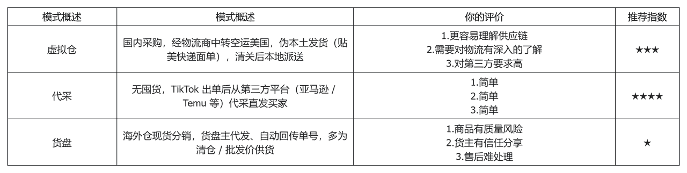

## 1.1  10月无货源相关新闻解析：

美区10月25日晚开始；黑五之前查封了一批虚拟仓，代采的店铺为跨境黑五的正规商家让利和铺路；

但我的店没事，围观博主的分析分享给大家。

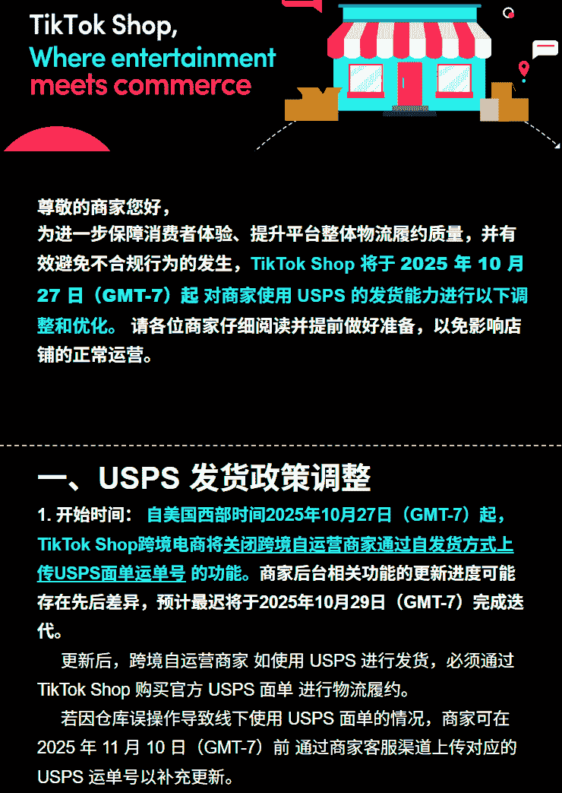

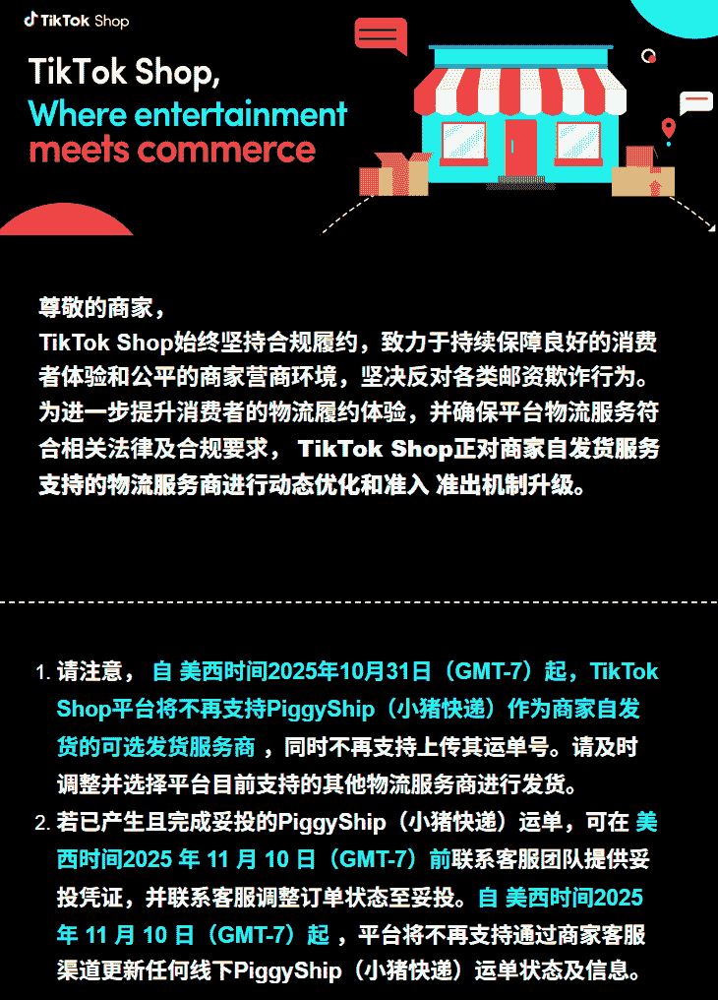

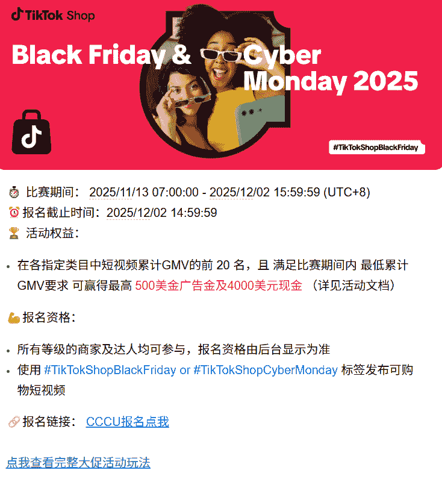

本次集中封禁店铺主要有以下几个考核方向：（物流时效，店铺商品数，执照注册地址）

近期无法玩批量上品的操作，建议一天上4-5个精选的品；

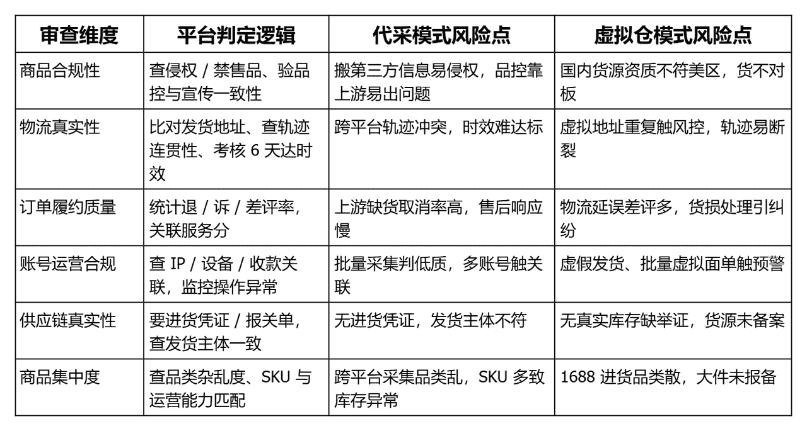

As well as 依旧严惩物流行业科技单和跑水单的问题；发就封；大家在找寻供应商的时间要擦亮眼睛：

+   **科技单**：指通过技术手段破解美国邮政服务（USPS）的面单编号规律，直接生成并打印未经授权的面单进行发货的行为。这类面单无需支付邮资成本，完全依赖技术漏洞实现 “免费发货”。其物流跟踪信息往往是伪造或无效的，一旦被 USPS 检测到异常，包裹可能会面临物流轨迹中断、被扣留等问题，卖家店铺也可能因物流异常被降权或封禁。

+   **跑水单**：指通过伪造或篡改物流单据，使得实际上没有发货的商品显示为已发货状态，以欺骗买家或逃避平台监管的行为。常见的操作模式包括利用 USPS “先取件后结算” 的模式，注册空壳公司下单发货，结算期一到就注销公司逃避支付运费；或通过技术手段伪造 USPS 面单号，生成虚假物流信息等。跑水单的核心是 “不付钱发货”，卖家使用跑水单可能会面临法律风险、商业资源永久损失以及平台的严厉处罚等问题。

> 在我看来，这种行为都是平台正规化的一个路径；类似于📕在2024年疯狂调整📕千帆的政策和一直更新限制低质视频；2024年年底视频号去无人直播，去数字人化素材是一样的；

>

> **本质上是为了优化整体的营商环境，并不是为了封杀跨境卖**家； 宏观调控过后往往会迎来一波大红利；

>

> 而且为了需要在尽快入局tiktok电商，我们也需要优化自己的策略去适应平台规则；

>

> 针对虚拟仓的店铺操作；与代采不同，不建议大家用自己法人的执照进行测品，最好是使用直接购买的店铺绑定个人的收款账号进行开新店。方法依旧如同上篇的代采一样；

# 2.虚拟仓路径详解

按 TikTok 出单→1688 下单→国内发货→货代处理→头程运输→美国清关→TikTok 面单发货→尾程配送” 简单分为 8个步骤，时效在 5-8 天。

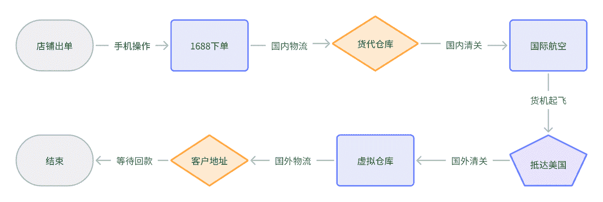

## 2.1 完整流程

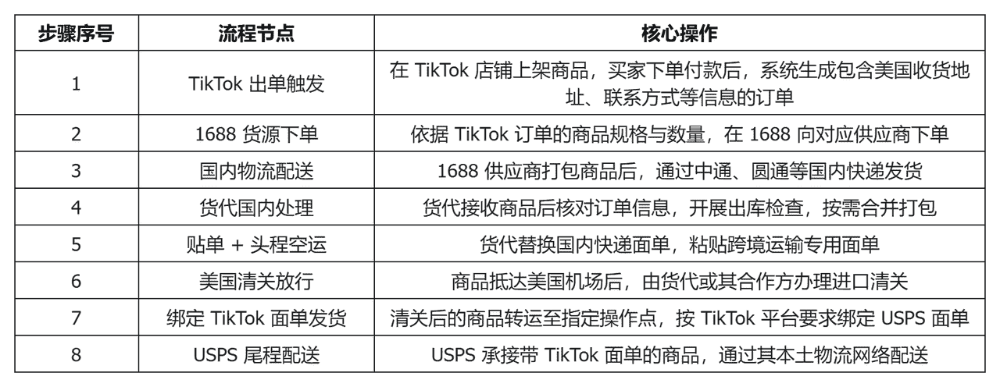

> TikTok 出单触发：你在 TikTok 店铺上架商品，买家下单付款后，系统生成订单（含买家美国收货地址、联系方式等核心信息），此时启动后续备货发货流程。

> 1688 货源下单：你根据 TikTok 订单的商品规格、数量，在 1688 向对应供应商下单，同步备注 “跨境发货”，并提供货代国内集货仓的地址、联系人及联系方式。

> 国内物流配送：1688 供应商按订单打包商品，通过国内快递（如中通、圆通等）将商品直接发往你指定的货代国内集货仓，完成 “货源→货代” 的国内流转。

> 货代国内处理：货代收到商品后，核对订单信息（与你同步的 TikTok 订单匹配），进行出库检查、合并打包（如需），同时代办出口清关所需的基础手续（如整理商品清单）。

> **（头程）**贴单 + 头程空运：货代替换国内快递面单，贴上跨境运输专用面单，将批量商品通过空运发往美国（头程运输核心环节），全程跟踪空运轨迹。

> 美国清关放行：商品抵达美国机场后，货代或其合作方代办进口清关，完成关税缴纳、合规查验，确保商品顺利放行。

> 绑定 TikTok 面单发货：清关后商品转至指定操作点，按 TikTok 平台要求，绑定 TikTok 合作的 USPS 面单（平台预设合作渠道），生成美国本土发货轨迹。

> **（尾程）**USPS 尾程配送：USPS 承接带有 TikTok 面单的商品，通过其本土物流网络完成 “美区国内物流” 配送，将商品送达美国买家手中，全程时效合计 5-8 天。

## 2.2 流程核心要点

+   全程核心衔接：你需在 “TikTok 出单后” 及时将订单信息（商品、买家地址）同步给货代，避免 1688 发货与 TikTok 订单错配。

+   面单关键动作：货代负责 “国内面单→跨境面单” 的替换，美国端直接启用 TikTok 关联的 USPS 面单，无需你额外对接 USPS。

+   时效把控：国内物流 1-2 天、货代处理 + 头程空运 3-4 天、清关 + 尾程配送 1-2 天，合计 5-8 天，需提前跟货代确认空运舱位稳定性。

# 3.虚拟仓物流费用

举例:假设我有一个带塑料包装总重135g，国内货值1.8元的五金工具需要派送到美国的客户手里；我需要支付的费用具体是多少呢：

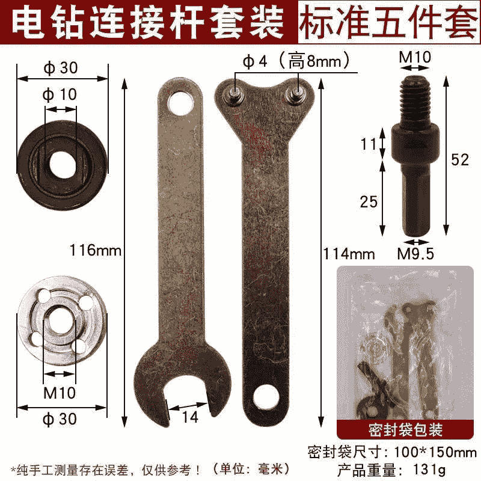

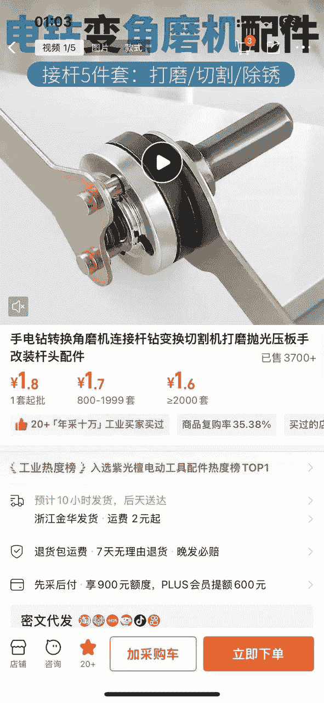

## 1.头程物流计算

以海鸥速递跨境物流小包专线为例计算；在国内发货到美国仓库的头程物流的价格是85RMB+14RMB的总费用，总计是99元；

附上跨境虚拟仓小包价格表：

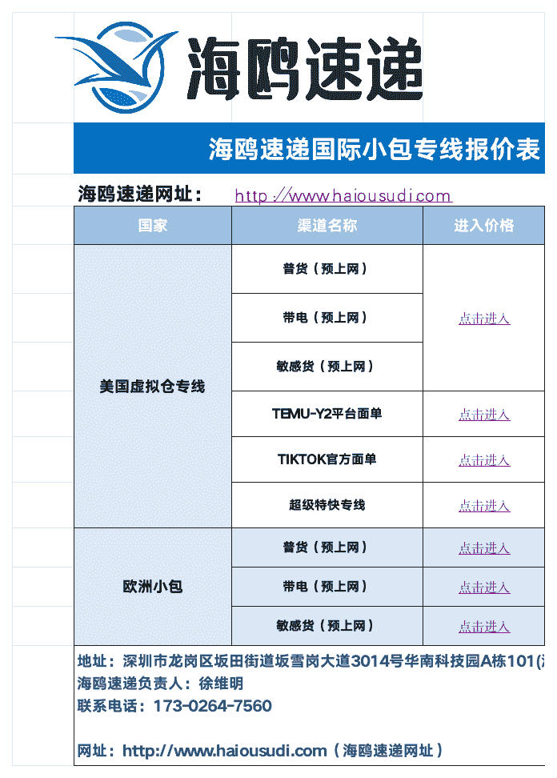

[海鸥速递国际小包专线报价表2025年09月20日00：00 生效.xlsx](https://internal-api-drive-stream.feishu.cn/space/api/box/stream/download/all/MVjFb752IoXJ9hxJaC5cNHB7nUe)

在我把货物送到深圳的货物代理的仓库，我需要支付的中国到美国的头程费用是：0.135*（85+14）=13.365元；折合美元约为1.856美元

本次展示仅以克重作为参考标准；如需更深入了解体积重（抛重），可豆包搜索解读下图；

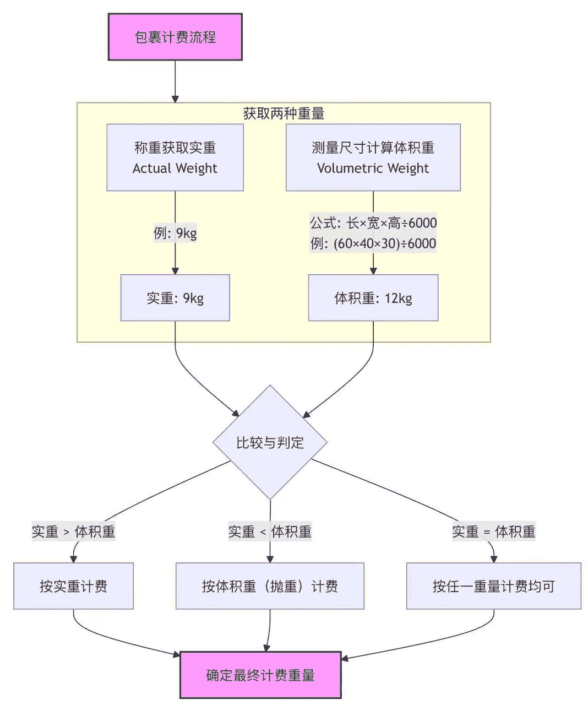

## 2.尾程物流计算

尾程计算因为tiktok对商家自发货的容忍度会越来越低，所以直接套用了官方后台的CBT官方派送的价格，如果是发官方面单的第三方的物流，会相对更便宜一点；但是可以给我们作为一个很好的参考。

附上美区官方面单的价格表：

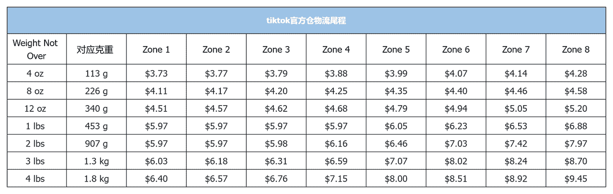

Weight Not Over：表示 “重量不超过”，列出行了不同重量段的运费标准，单位包含盎司（oz）和克（克）、千克（kg），千克单位是我后面添加的，方便计算具体的价格；

Zone 1-8：代表美国境内的配送区域（Zone 数值越大，通常距离越远），不同区域对应不同运费。

zone序列对比国内理解为：1为市内；23为省内；456为省外；78为偏远地区。

所以你可以理解：

当这个五金工具需要送到美国的商家手里你需要支付：产品费用+头程总运费+尾程运费+杂费=总成本

此工具1688包邮进货价为1.8人民币，折合为0.25usd，属于最小的支出。

头程空运小包计费：0.135*（85+14）=13.365元；折合美元约为1.856usd

按照尾程偏远地区最大值计算邮费：4.58usd。

那么物流成本为：1.856（头程运费）+4.58（尾程运费）=6.436usd（总物流成本）；

# 4.选品与商品计价

本篇文章这里为重点；与进阶正规备货息息相关。无货源是作为电商入门的基础玩法，想进阶到多国备货全球化电商务必先理解本篇内容。

在第三方物流商的价格表帮助下了解完整个商品的物流成本结构后，我们可以开始真正的虚拟仓选品与计价；这个部分因为实操的难度大，所以我将通过视频的形式给大家展示网站选品与计价表格的操作。

## 4.1选品软件

本次使用的软件是出海匠，与其他的选品软件并无优劣之分。

但他是唯一一个可以清晰看到商品运费和快速以图搜款的软件。

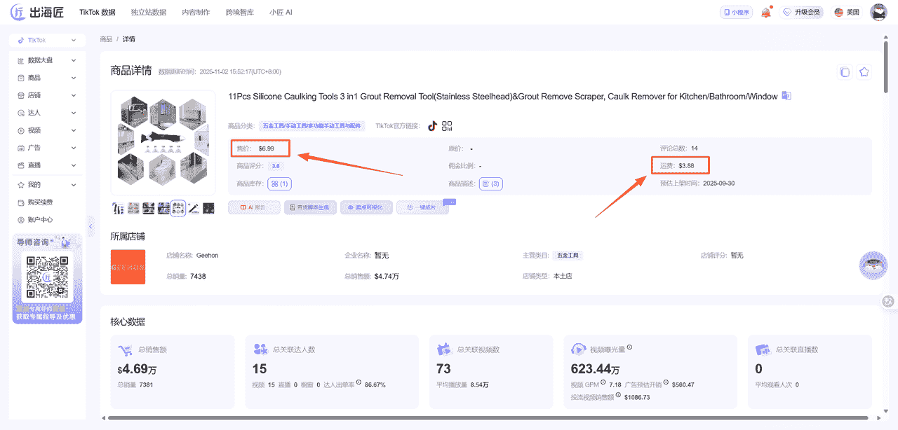

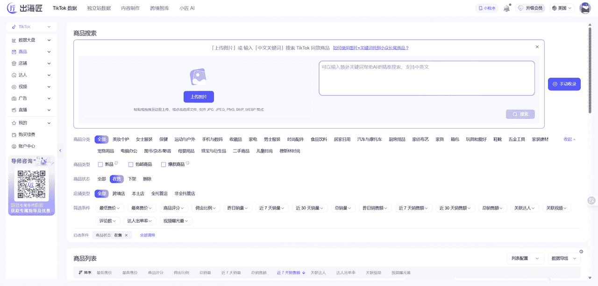

## 4.2全成本表格

为方便各位深刻的理解整个项目的全链路收费概念，我们在物流成本的基础上引入了仓库操作费，平台税率，提现手续费，达人佣金，广告投流，产品退换货等全新的概念以表达商品全部真实成本；

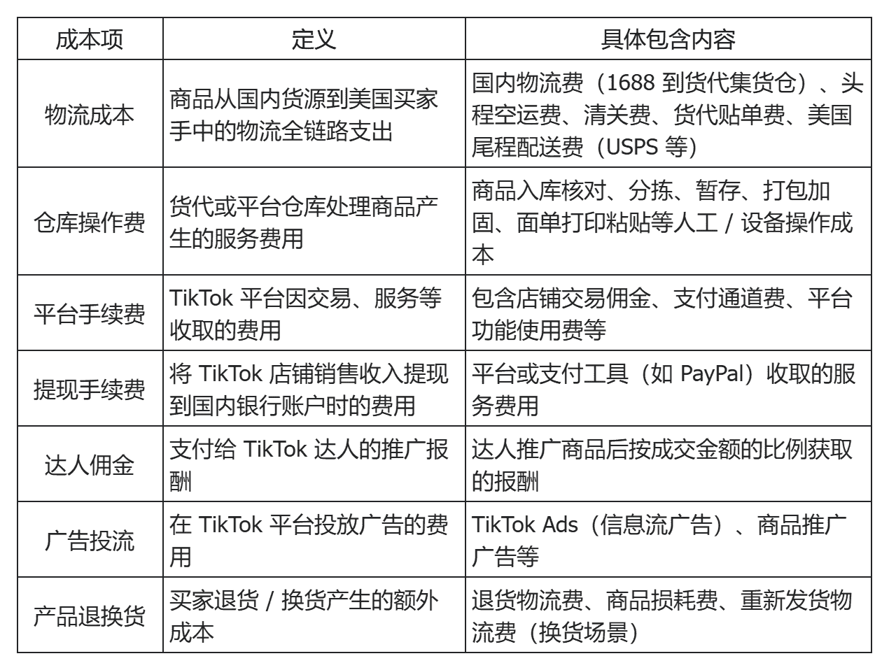

理解上方收费的概念后；既可复刻我常用的成本计算表格：

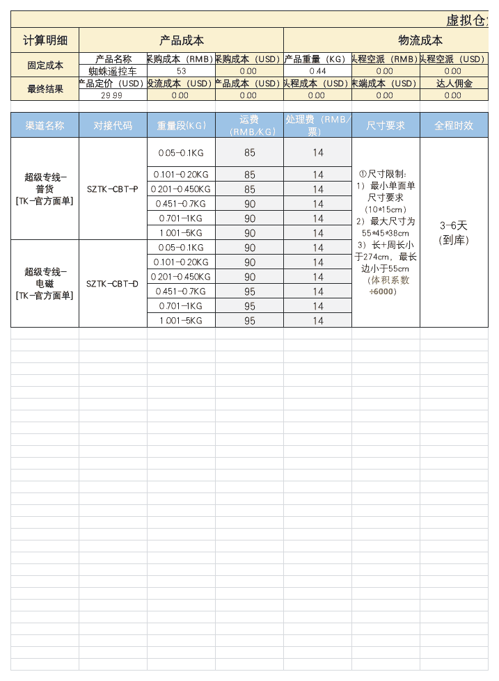

[选品表格.xlsx](https://internal-api-drive-stream.feishu.cn/space/api/box/stream/download/all/XJbTbkn3RounP7xE91AcCWzin8d)

商品除了本身的实重还有体积重；这两者在国际物流中取其大；所以尽量选小件容易转实拍的品。

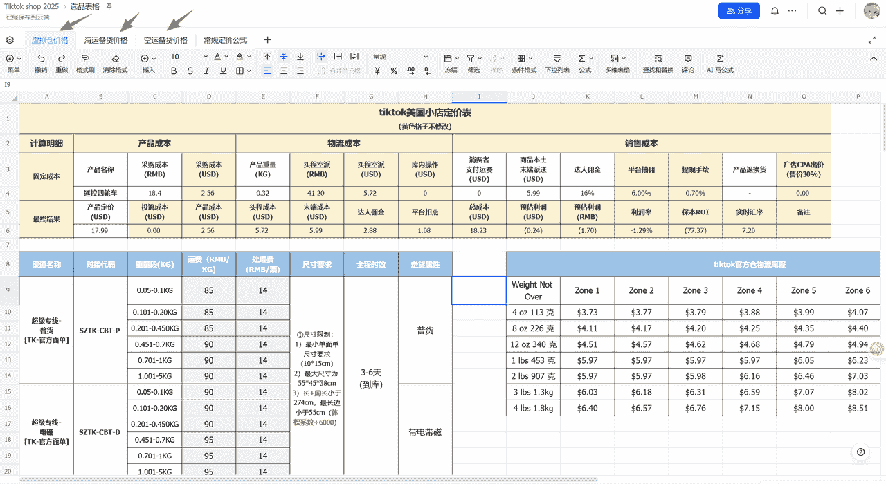

你看到了多重货运方式，尤其是虚拟仓和空运，可能理解不了二者的不同

**虚拟仓（使用配送方式为跨境物流小**包专线）与常规空运的不同最核心就是时效；

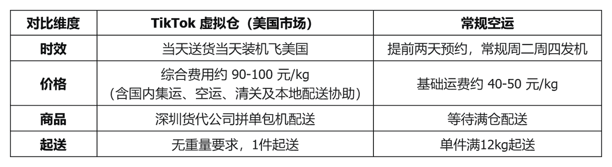

## 4.3视频教程

**本视频主要教学为三个部分：**

**1.出海匠如何使用和查看爆品**

**2.如何在1688查看商品信息**

**3.如何通过选品表格计算利润**

4.理解跨境小包，空运，海运的利润区别

5.制作一个属于自己的单类目的选品表

飞书妙记版本，1.5倍数看最佳：

<https://vqjz0ej9x2.feishu.cn/minutes/embed/obcnvkl4p596w8t2773g589f?from=ccm>

> 关于店铺持续发展问题：

> 市面上常规的玩法：1主店（备货）+2测品店（虚拟仓）：

> 通过虚拟仓进行测款，稳定每天2-3单；（测品店铺）

> 通过空运进行备第一批货，常规为2-4个出单的品各备20-30件，拼单一个箱子发海外仓；（主店）

> 商品评分ok且持续出单，考虑将商品转正且开始拍摄短视频引爆内容。

> 通过海运备200-500件到海外仓以防止短视频爆单。（主店）

>

> 这就是虚拟仓转正规玩法备货的全流程。沉淀出了多个品之后，可以做自己的品牌。

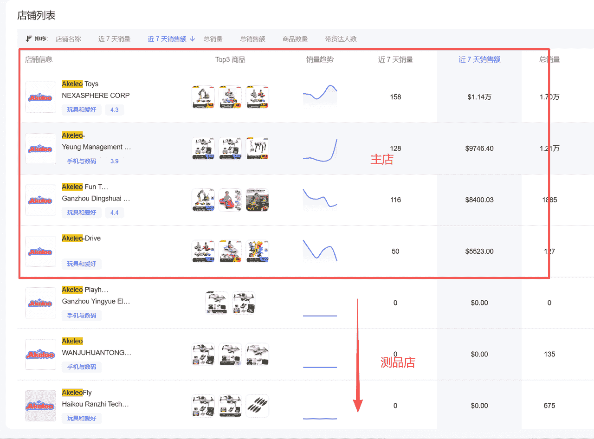

## 4.4 发货流程

举例：以海鸥物流为合作伙伴，与前篇的代采店铺设置有点不一样。下方我们虚拟仓店铺设置流程和发货流程。

4.4.1首先需要设置店铺虚拟仓地址：

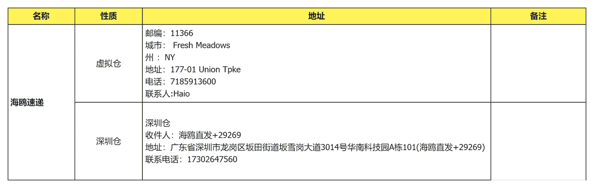

4.4.2通过妙手教程绑定海鸥速度作为第三方物流服务商方便进行系统推单。

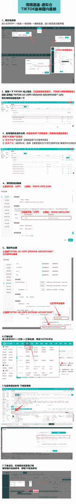

[9.29海鸥速递-官方面单妙手下单.pdf](https://internal-api-drive-stream.feishu.cn/space/api/box/stream/download/all/VvT6bKLqQoUAGRxHoCRcDQRKnid)

4.4.3在店铺后台申报使用官方物流面单

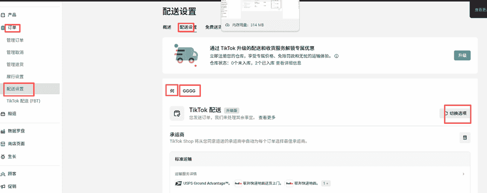

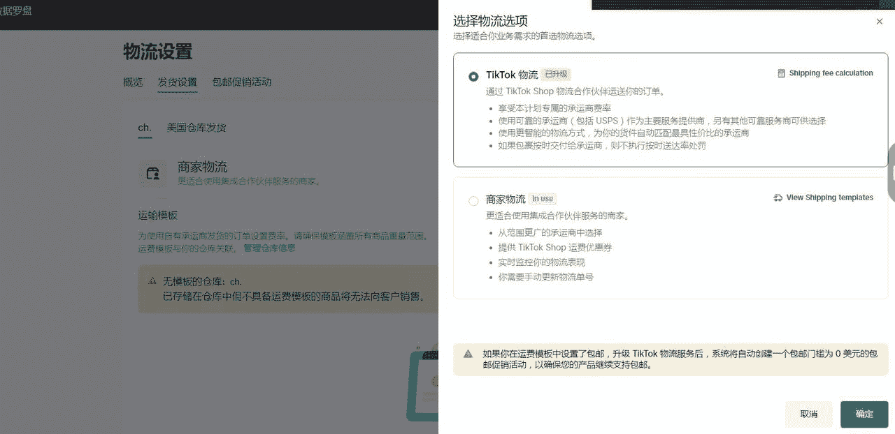

4.4.4确定海鸥国内中转中心地址：

深圳仓

收件人：海鸥直发+29269

地址：广东省深圳市龙岗区坂田街道坂雪岗大道3014号华南科技园A栋101(海鸥直发+29269)

联系电话：17302647560

4.4.5出单后1688发到这个地址剩下交给货代就行了。

# 5.资源与获取方式

系统学习一个方面的知识；我主要通过看书掌握；

🛰️读书搜索tiktok；基本可以观察到一些优秀的作品；可以认真查看作者做在tiktok的思路、遇到的困难与相对应的解决方案。

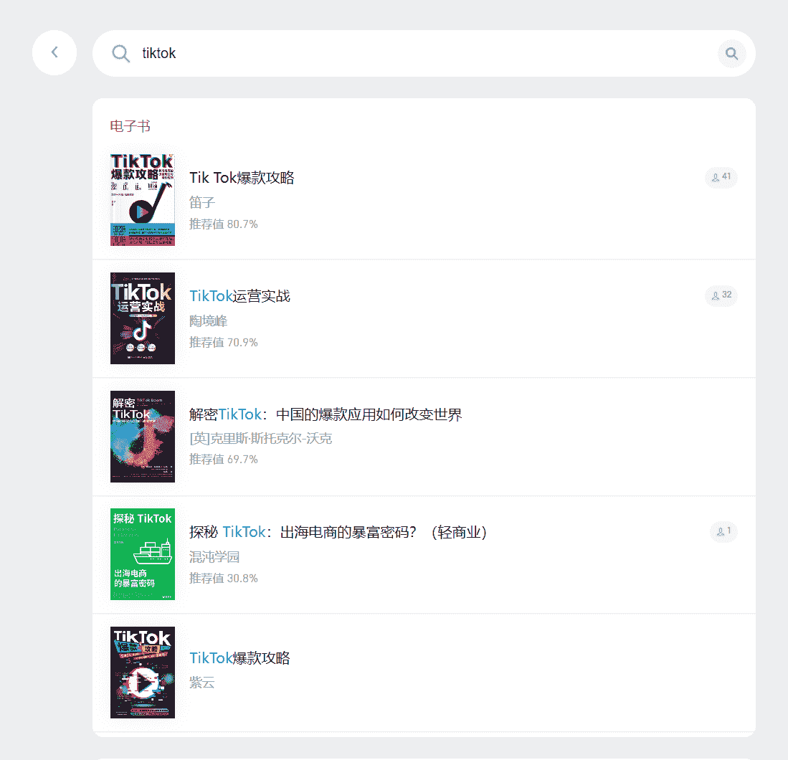

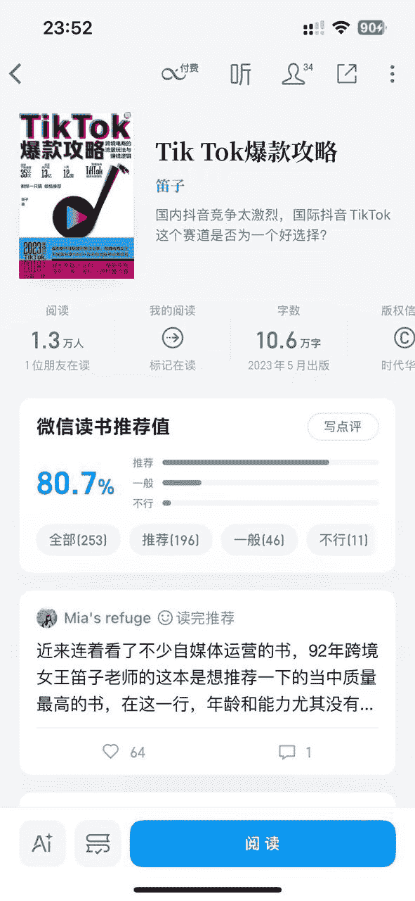

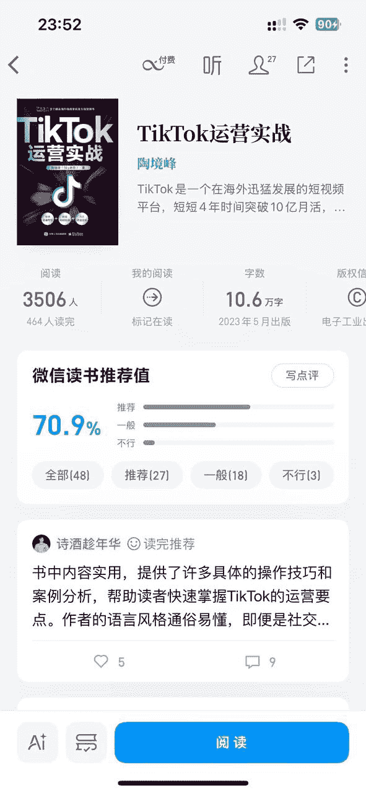

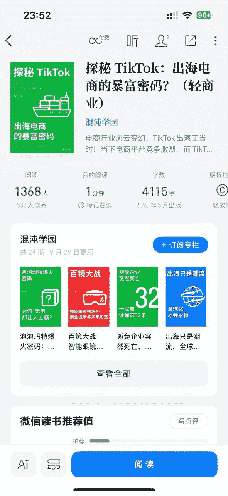

## 5.1资源搜索与解答

以前的我：

大方向充满信心，小细节全部都是问题。根本不知道该问谁！

现在：低在线人数跨境电商直播间头号金主。

问就有，敢不答我就送三个两毛钱的啤酒到榜一，然后打字：主播机器人？

问题很基础主播都会认真回答，他们巴不得你问，大部分啤酒都省了。

亲测有效，可复用全行业。

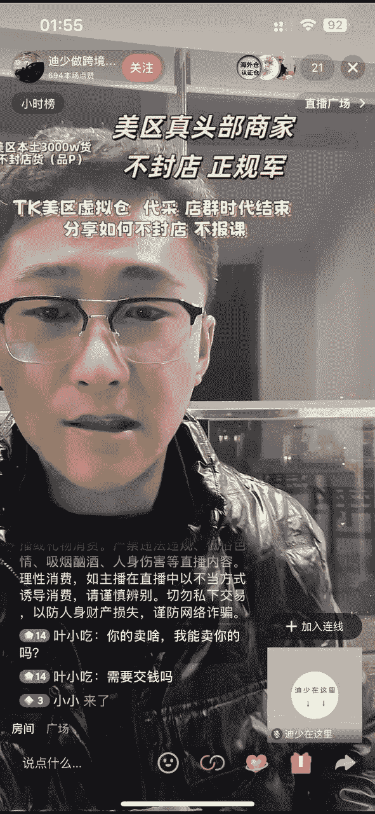

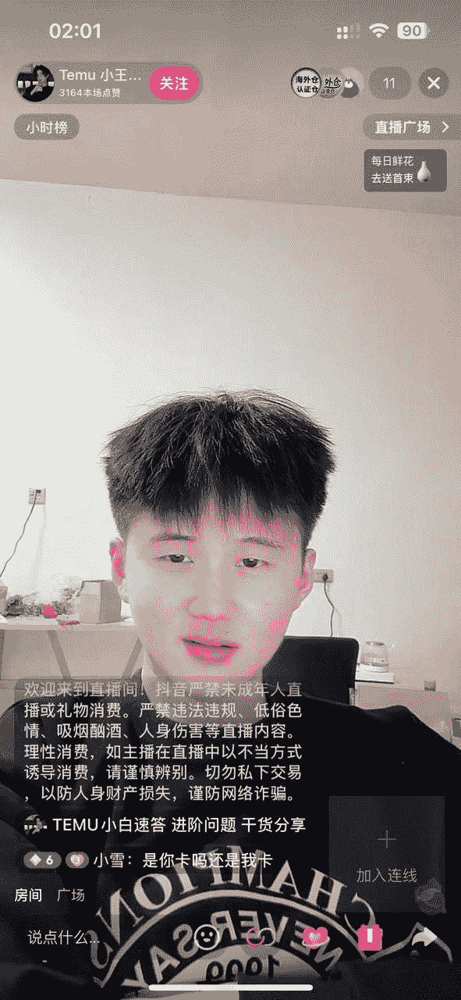

## 5.2资源推荐

我常用海鸥物流和纵连国际；来源都是抖音直播间加🛰️的，如果不懂直接甩电话过去就可以了；

一般第三方都很愿意跟你沟通的，当然他只懂物流层面的内容。

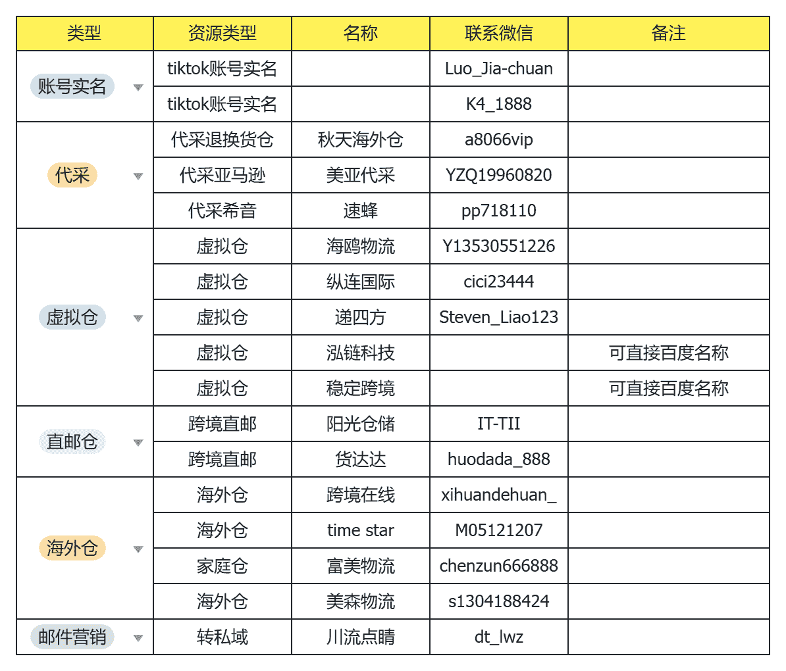

感谢观看；祝大家早日暴富。