# 你好，我是那个13次航海“颗粒无收”的学渣，现在手握3个YouTube高级YPP

> 来源：[https://xuqiwei1986.feishu.cn/docx/VdkFdeQvlolztFxPqdncAChQndf](https://xuqiwei1986.feishu.cn/docx/VdkFdeQvlolztFxPqdncAChQndf)

大家好，我是**木子年华**，YouTube深海圈答疑教练。

手上握**着3个高级YP**P——至于收益嘛……我不好意思说，咱先卖个关子，等会儿再爆料。

从综合实力来看，我大概是整个深海圈教练团的“稳居末位的天花板”，

但没关系——我相信，总有一天，我能从垫底王逆袭成闪光王。

今天想跟大家分享一下，我加入**龙哥盟**、正式踏入**深海圈**之后的那点心路历程。

一方面提醒自己不忘初心，另一方面，也希望能帮到那些和我一样，曾在迷雾中摸索、在泥潭里挣扎的朋友们——

让我们一起，摸着石头过河，最后都能走到光亮的那一边。

接下来，是我的“**个人标签清单**”，看看有没有你的影子——

+   **十五年老本行长期月入三千，朝五晚九**压力爆棚，喜提高血压、腰突、骨刺三件套。

+   **三次转行失败，两次职业咨询无果，病急乱投医，**知识付费、训练营没少入，越折腾离钱越远。

+   **加**入赚钱之后13次航海颗粒无收，一半航海打卡都没打完，直到在YouTube项目上破釜沉舟，才终于实现从0到1。

现在的我不再焦虑“为什么别人能行”，

而是每天提醒自己——“你已经上船，慢点划也能到岸。”

# 一、在YouTube深海圈干的咋样了

## **频道成绩和收益（ypp+收益）**

+   **6月12日开始发第一个视频，9月份开了2个高级，10月份开**了1个高级，一共3个高级YPP，1块银牌

+   终于该说收益了，由于做的是印度故事赛道，rpm较低，而且比较偷懒，今天更了明天没更的，所以9月份总共290多美金，10月份450美金左右，手动捂脸中……11月份我会努力翻倍的！

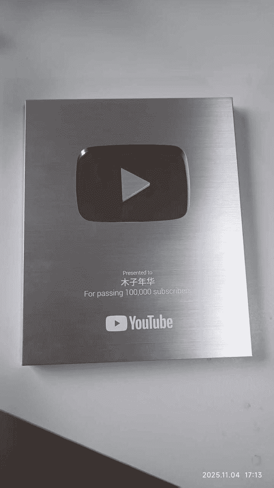

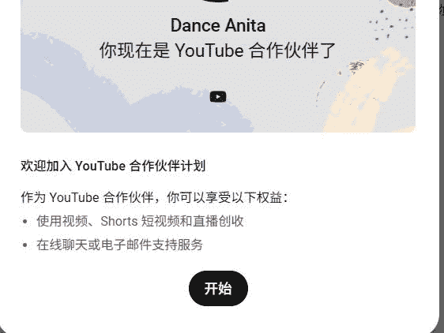

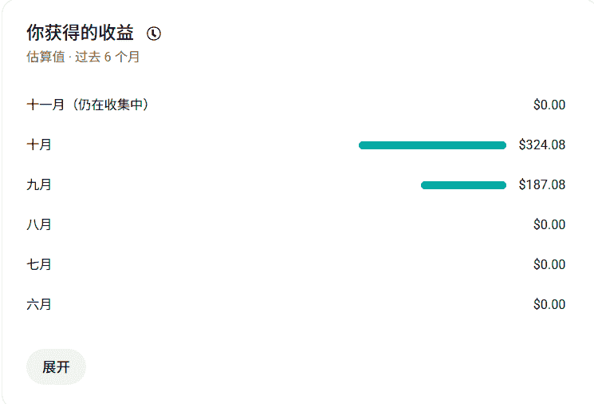

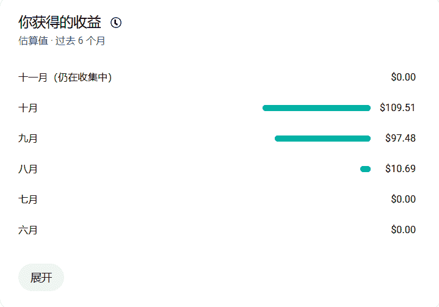

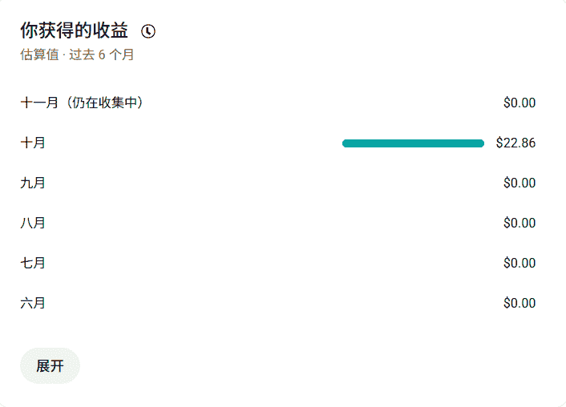

## YouTube深海圈经验沉淀（保姆帖+实操视频）

+   写了两篇保姆贴，没有发表到赚钱，只发到了我们深海圈大群里，如今内容略有些过时，但当时帮助不少圈友解决了问题，也帮助一些人做出了千万爆款，开通了YPP

[[保姆贴]做Youtube shorts还不太会用sora批量生图的圈友请看这里](https://djqz1ucs9l.feishu.cn/docx/V0tvd52IDox2hFxWWjucJQW0nGe?from=from_copylink)

[[保姆贴第2弹]Youtube shorts-3小时复刻完一个56秒印度故事播放885万复盘](https://djqz1ucs9l.feishu.cn/docx/UKhUdqnBdoXHHhxcLohcX8a5n1d?from=from_copylink)

+   录了一条23分钟的实操视频《曹教练视频教程亲测有效！20分钟做完一个视频不是梦！》也纳入了我们youtube深海圈知识库视频课的课件，视频课属于我们深海圈内部知识产品，就不分享啦！

## 好事频频，每天干劲满满

+   [赚钱好事入门指引](https://pa7l8baqg83.feishu.cn/docx/H7cndjjcsojpLux6w6Oc7O5znNc?from=from_copylink)于热衷于发布#赚钱好事，被我们波妮总教练邀请写了一篇赚钱好事入门贴 ，纳入了我们youtube深海圈群公告重要事项。

+   我们深海圈常说越晒好事，好事越多，这不是玄学，是积极心理学，把一点点进步、收获都记录下来，是视觉显化的过程，是正念的奇迹，中国人讲究谦虚低调，不敢不敢，没有没有，过奖过奖，抬爱抬爱，时间长了容易形成负面暗示，总觉得进步太小，成就太少，不值一提，看见别人千刀万刀焦虑的不行；

+   但是发#赚钱好事 就有很神奇的作用，能慢慢帮你专注于眼前的事情，只专注自己的进步，自己跟自己比，当然每天都是进步的了！但是自己跟自己比你也得有个参照物啊！每一条好事都是参照物！

+   10月9日与其他5名教练一起参加了方波妮总教练的视频号直播，时间是晚上11点30到12点40，本来担心大半夜的人不会都跑光了吧，但是意外的反响很好，属于超常发挥了：

“木子教练语速太快了，我以为我开了倍速”

“木子教练太幽默了，看直播的时候乐坏我了”

“我错过了什么？木子教练深夜说剧”

看到这些反馈我非常开心，看来这些年来给银行网点讲大课的工夫没白费，能把自己一点浅显的认知传递给更多刚开始做youtube的圈友，让大家少走弯路，提升心力，也是很值了

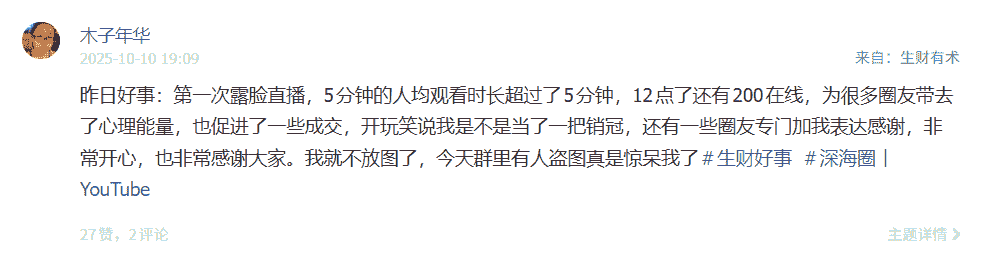

# 二、不想回首也不想再来一次的过去

## 八年工作困局：永远转不完的螺丝钉

我以前干的是**银行网点服务质量培训项目经理**这行，说白了，就是拿着一份100分制的标准表，去给各家网点打分。评的内容事无巨细——从厅内外的环境卫生、服务设施、营销宣传，到人员服务质量：大堂经理迎来送往做了没、高柜柜员业务流程七步曲全不全、低柜理财介绍合规不合规、保安站没站直，全都得看。最后打出的分数，还要给分支行当做绩效考评的参数，排名高低都是领导的面子。

我当年带过河南农行的省行项目，负责全省18个地市、1100个网点的统一考核，根据每月采集的数据，我们还得按分行、支行、网点三层维度，套上163个细项指标，做出月度、季度、年度的PPT报告。光听就知道多烧脑。

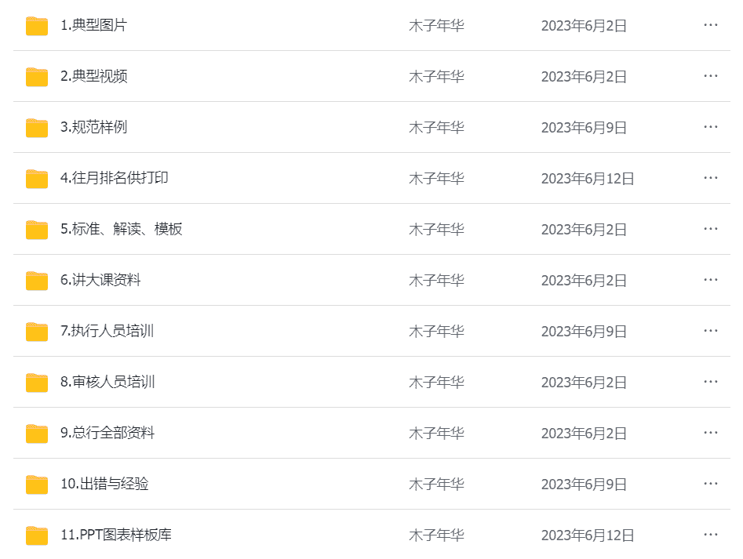

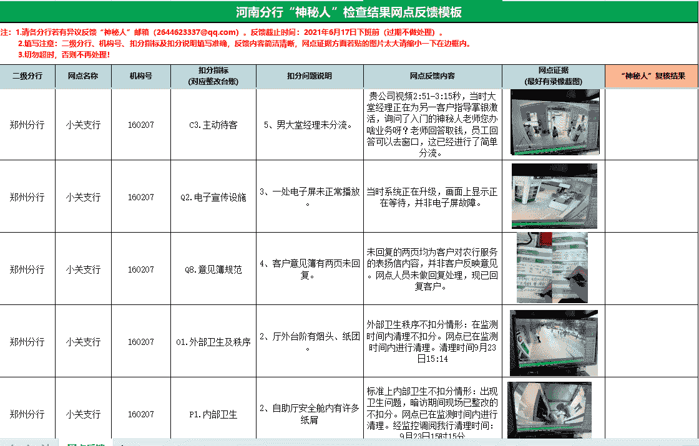

**这份工作，说实话，真是“谈笑**风生”都谈不下去的那种不堪回首。低薪、高压、事多、还不能出错。八年时间，我从年轻的热血干将，变成了被所有人默认为三头六臂的老炮。公司里的老同事都是07年一起入行的老熟人，偏偏我手脚快、心细、效率断层第一，于是他们干脆“逮住一个能打的”，什么活都往我头上压。

**从**处理个案、出数据、写PPT，到下网点明查暗访、现场培训、讲大课、线上授课、带新人……我一个人就是一支小型项目部。有生以来最忙的一段时间，是2024年上半年——我一个人带17个项目，处理几百个网点的个案，凌晨四点爬起来改报告那都是常态。收入呢？别问，问就是“感人”——最高六千，平时三四千、四五千打转。

那段时间，说实话，**工**作的成就感真不高。哪怕我是公司公认的“最能干的骨干”、干活最多、收入最高的那个，也依然觉得自己像颗永远转不完的螺丝。所谓最大的成就，大概就是——有一次在省行内部会议系统里，给河南农行全省一千多家网点做大课培训，现场会议室大小领导坐了一百来号人，线上同时还有一万多人在听。

那一刻确实挺热血，像打了鸡血一样，可下了课回到办公室，看到一堆待处理的表格和PPT，热血就慢慢变成了“热泪”。后来回想起来，那场培训也算是我职场八年里最像样、也最像样板戏的一次高光时刻——响亮、体面，但转身就归于平淡。

其实早在2007年入行那会儿，我就**多**次尝试转行，结果三次失败三次吃回头草。直到2025年3月，我终于咬咬牙，脱离了这片职场“浅滩”，一头扎进“深海圈”——这一次，算是真·转行成功。

要说断断续续干了十五年的老本行，能对它没有一点爱吗？

不可能。但是我翻了20分钟相册，都翻到2017年了，居然找不到一张像样的工作照片，连跟客户的合影、出去讲课的拍照都没有。手机里只有孩子的照片，花花草草流浪猫的照片，我想我不仅不够爱这个工作，也不够爱自己（要改变！）。

真的是唯一的三张了！

## 创业不易：一场被现实烤糊的比萨梦

2010到2011年那会儿，还有2025年年初，

我老公两次开比萨店，我都跟着折腾。

各种材料我一手准备，跑营业执照、办食品经营许可证、报税、采购、招聘、培训……

除了不会甩饼，我几乎啥都干了。

那阵子每天忙得脚不沾地，白天笑着招呼客人，晚上还得算账。

后来店都卖了，没成。

说是创业，其实更像一场“实战版的社会大学”。

学会了怎么和人打交道，也明白了做生意不光是会做，还得能扛。

虽然最后没赚到钱，但那几年算是把“比萨人生”烤得透透的——

香是香了，就是有点糊。

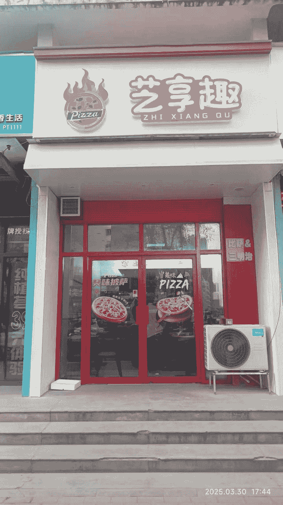

## 那些年尝试的各种副业，换来的只有焦虑

2008年就知道本行业无前途，一直在进行行业外的尝试，但是学历低能力低，没其他**能干的，思维视**野也不开阔，只能想到考证、提升学历、创业开店、找其他行业工作等等，越折腾离钱越远。

前后做过两次付费职业规划咨询，做过一堆职业倾向测试，性格测试等等，没什么好的结果。

2016年是最后一次回到本行业，也**仍然是面对着熟悉、繁琐、低薪的工作内容，长期高压、烦闷、暴躁，2022-2**025年几乎每月必重感冒一次，高血压、腰椎间盘突出、骨刺等各种毛病不断，每年医保额度用的一干二净还要额外自费2000以上。

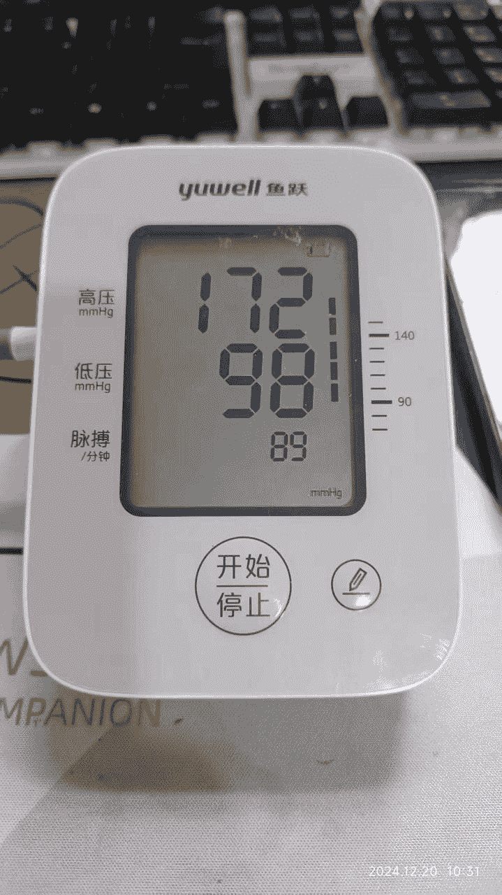

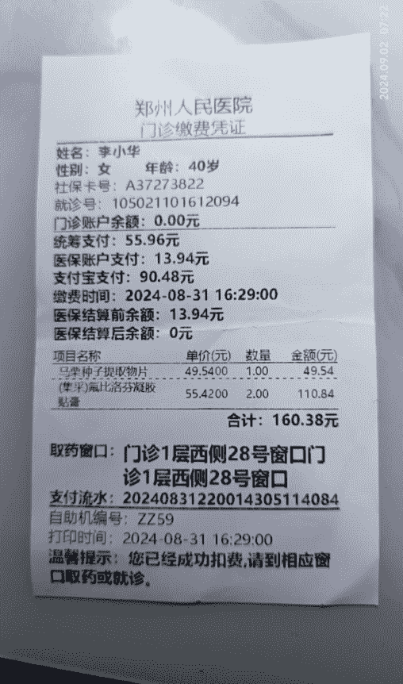

由于本职工作过于忙，需要大量时间马不停蹄赶工，一线人员采集的数据提交通常会集中到20号以后，所以每月的24日到次月10日都会忙到爆炸的程度，只有月中几天能稍微松口气，看看书，学学课，不断做各种尝试。

2019年开始学英语，用流利说和开言英语打卡一年达到level5，拿了个英语专业的网络教育本科，学信可查，但实际应用水平还是很差，现在也基本都还给老师了

想找英语相关的工作更是异想天开，各种专四专八的竞争对手无数。

2021年产假期间参加过一次40天的写作训练营，作业量大到无法忍受，总感觉自己属于写文章憋不出来字的类型，习得性无助缠绕着我，同期同学都开始投稿变现了，我还抓耳挠腮写不出来几篇字

2022年年底第一次接触到tiktok，参加了付费课程，但是觉得对我来说太难了，做不起来，课程和直播都看不完，实操不起来，一直搁置

**要说不**焦虑，是不可能的，快焦虑麻了，本职工作行业不景气，长期低收入没前途就算了，还随时可能倒闭，副业又迟迟做不起来，归根结底怕真失业了，四十多岁了，身体又不好，吉祥三保铁人三项都干不动，还能找啥工作？而且还没有获得打工之外独立赚钱的能力，那真是怕的要死啊！

# 三、最对的选择，加入深海圈

## 航海13次 0 成果，下定决心最后再试一次

2023年3月，通过钱瑞👸号广告加入黄小刀的chat**gpt付费训练营，才第一次听说龙哥盟，2**023年4月加入赚钱，迄今参加13次航海，一半以上都没打完卡，更别提实操从0-1

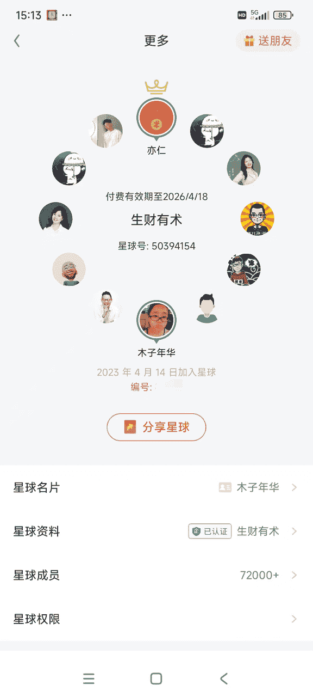

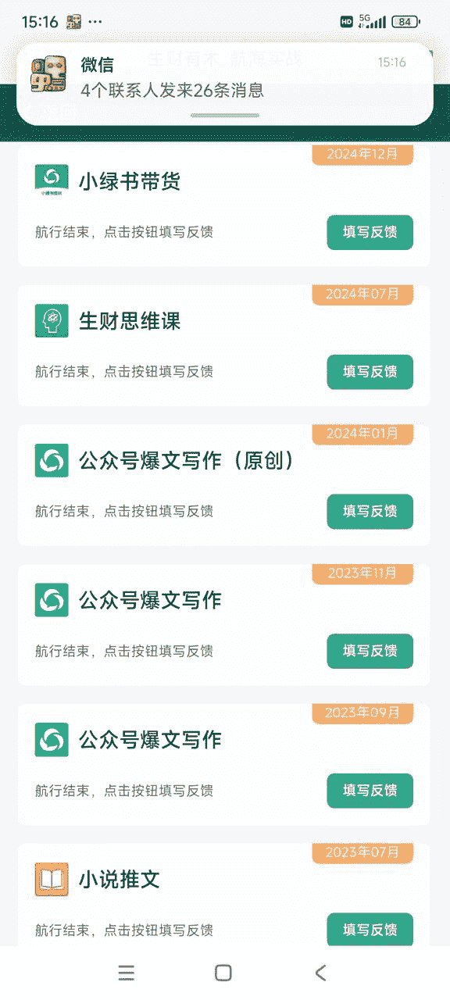

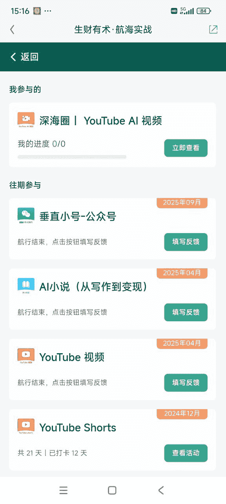

2024年12月参加了youtube航海，正如过去两年未完成的那些航海一样，还是勉强看完航海手册，reddit故事号的第一个视频只做了一半，本职工作的忙时开始了，就把youtube丢到一边，想都想不起来的程度

2025年年初，手里所有项目都到期了，客户没有续约打算，公司也不可能辞退我，我只能拿着3000工资在公司混日子，但是公司其他项目全部到期的2026年之后还能不能存活下去都是未知数。市场和行业变了，银行没钱了，这种锦上添花的可有可无的项目统统要砍掉，直接就导致公司业务锐减

这时不看好的项目——老公的第二家店执意要启动，这意味着我要负责孩子全部的接送、照顾任务，同时还得上班，我身体绝对承受不了。就以这个为借口果断离职了，这时候领导只认为我是暂时去顾一下店，毕竟50平小店不用2个人全职投入，人手不够的话用大学生兼职就行

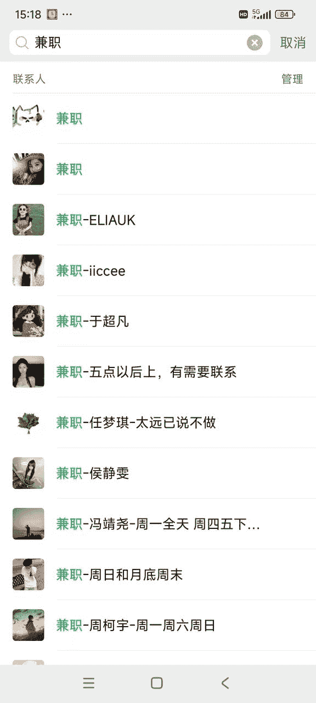

**到了3月份我仍然没有回公司的意思，俩月不上班心都野了，也**理智上更清楚不能回到快倒闭的公司混吃等死

这时候我参加了3月youtube航海，还是做不起来，手册看了一遍又一遍，但是一说实操就做不下去，文生图，图生视频是啥意思呢？死活也弄不明白，当时筹备开店也非常忙，经常一天都坐不到电脑前

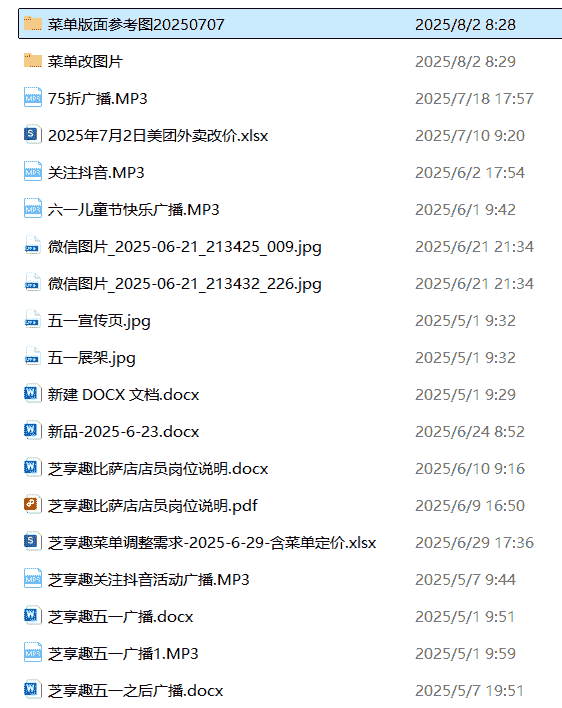

这时候鱼丸突然给我发了一个youtube深海圈报名信息，而且是剩最后一天了，我看了看海报，看到有一对一咨询，一下就相中这个服务了，果断入手！

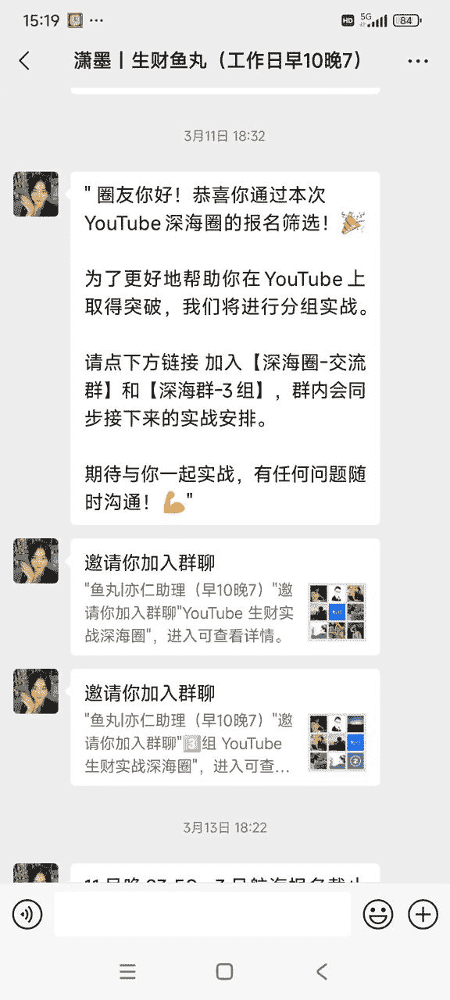

明知道3月份，4月份肯定是没时间做的，等于白白浪费2个月的服务，但那又怎样，万一之后没有报名机会了怎么办呢？还是先上车啊

上车之后的开营仪式，群内铺天盖地的信息，自然是懵的，没时间看，也不清楚要怎样利用深海圈的资源

但是我清楚，这也许是我破圈的最大机会了，没有之一。

事实证明我的选择是正确的，这应该是中国乃至全世界最好的社群，我为我的眼光感到骄傲！

## **无法开始才是最大的问题**

2024年12月第一次参加youtube航海，2025年6月12日才做出来第一个视频，这个时间跨度之大，自封为youtube深海圈拖延症第一人也不过分，其中心理上的挣扎，自我设限的程度自不必说。

> **无法开始，才是最大的问题。**

> **无法开始，才是最大的问题。**

> **无法开始，才是最大的问题。**

无法开始到什么程度，宁愿一遍一遍看手册，看手册里的各种频道示例，一看就是一下午，但就是不动手做哪怕一张图片。

不知道做什么赛道，不知道做什么视频，所以不知道做什么图片。

似乎陷入了死循环。

去年12月参加航海之后一直犹犹豫豫，选不定赛道，浅尝辄止，没有正反馈，就逃避现实，一直反复刷航海手册，3月份加入深海圈之后就一直只刷知识库，也知道自己没看进去，就像上学时候背单词只背 abandon abandon abandon一样，一直没往下进行，然后心力被消耗了大半，就躺平了。

幸好被教练们的主动关怀拉出泥潭，才逼着自己开始做，刚开始怕的要死，就好像发出去这个视频会不会有人打我一样那么恐惧，一个视频都没做，还在纠结🪜问题，节点问题，哪个账号在哪台设备上登录的问题，畏难情绪挥之不去，终于拖到5月底才约了第一次1V1咨询，看看我都问了些啥：？？

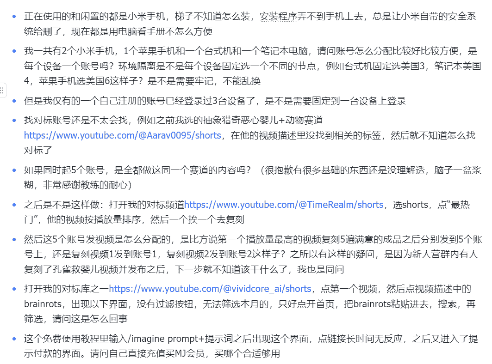

我的一对一咨询教练酷拉皮卡教练耐心解答了我这**些乱**七八糟无关紧要的问题，最后总结就是：啥都不要紧，只管发！发！发！第一个第二个号就是让你玩的，大胆试错，现在又有教程，又这么多对标资源，随便做做发发，找找感觉，就成了！再重复一遍，无法开始才是最大的问题，所以要想尽一切办法尽快开始！迈出去第一步啊！

## 赛道眼花缭乱，浪费了1个月时间

为什么不知道做什么赛道？

达人秀下滑了，走秀不建议做了，宝宝危险也不能做，

手册里示例赛道这个也打不开了，那个也打不开了……

虽然一再强调不要在赛道上过于纠结，但还是忍不住纠结，总感觉必须要找一个一飞冲天的赛道才能开始，事实上根本没有一飞冲天的赛道啊喂！

什么都不会做，只能找最简单的，最后到5月底了才看风向标找了个山海经PPT轮播的，说是最简单，既然这么简单那就做吧，终于迈出了第一步：

（但是这个号没做起来，还转了两次赛道，断更两次，0播了，就重新开频道了。）

7月份，3个号同时发，都没开通YPP的时候，也就对着对标账号复刻模仿，一个号对标一个对标账号，第一个是山海经PPT轮播，第二个是山海经人物跳舞，第三个是山海经宝宝/山海经带孩儿。

其**中有一些5万、10万的，最高的一个80万，距离我发第一个视频已经过去一个多**月，我才找一对一咨询教练约了咨询，酷拉皮卡教练给我说刚开始做的时候基本上没有什么粉丝粘性，不用过多考虑垂直问题，什么能做就做什么，目标是尽快做出爆款，建议各种赛道，各种形式都尝试，哪个能做出爆款哪个再继续做。

这样我才发现自己的制作思路都是错的，没有集中精力冲爆款，只做了意义不大的更新，浪费了一个月时间。

## **慢就是快，沉下心来提升制作水平**

刚开始做的视频内容都是没有任何情节和脚本的PPT式的轮播、山海经变种人物跳舞等形式爆款，门槛太低，对于自身的制作水平提升无任何好处。

就比如我刚开始同时更新的3个频道，一直是三万播、五万播，平平无奇，开ypp遥遥无期；

**第一个正反馈是有一条跳舞的视频超过了10万播，一条是85万播，但是后续没有再产生爆款，而且对**于这种低门槛的形式爆款的一比一复刻，已经产生了同质化焦虑，没有创新能力做出差异化

经过慎重考虑，还是选择了据说流量最大，最容易冲击YPP的-印度故事赛道，从8月5号开始制作第一个印度故事

50秒左右的故事通常有20-30个分镜，生图、生视频片段需要投入更多思考，能快速积累手感和制作能力

那时候的生图工具、生视频工具远没有现在好用，有时候出一次图片甚至需要1-3分钟，也没有现在这样好用的批量出图、出视频工具

做一个故事类的视频从开始的拆解脚本、修改脚本，一张一张出图，一个一个出视频片段，加上后期的剪辑，最低也要四五个小时，慢了得一两天

当时用的最多的生图工具是豆包，豆包的出图速度并不快，大多数时候要等几十秒，为了呈现出最好的效果，一张图片如果不符合故事情节需要，就需要反复抽卡

**为了做**出视觉效果更佳的故事，从刚开始的人物形象设计就投入了很多心力，要在AI工具的辅助下，设计出最满意的人物形象，有时候会通过搜索印度沙丽样式，参考印度影视剧服化道，还有印度时尚类自媒体等渠道多方面寻找灵感，一个故事的女主角就设计了10种以上的形象。

**搜集网络图片中时尚造型供参考**：

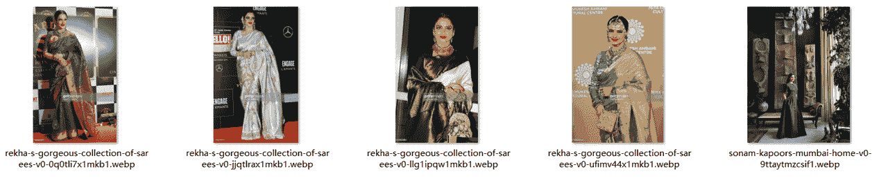

**AI辅助设计人物形象**

我的第一个印度故事视频果然不到10万播放，还不具备做爆款的能力。

所以——**菜就多练**！

**8**月8日作业点评的第一条就是我的这条印度故事视频，曹教练详细评析了我视频的不足，经过复盘改正，终于在8月9日做出了第一个800万爆款。

然后，**连续6条视频都超过百万播放**

**一个月内出多条千万爆款**

为了巩固第一个800万爆款的成果，不爱写文章的我努力克服了自我设限，一点一点写了复盘贴，当做对自我的一种突破：

[[保姆贴第2弹]Youtube shorts-3小时复刻完一个56秒印度故事播放885万复盘](https://djqz1ucs9l.feishu.cn/docx/UKhUdqnBdoXHHhxcLohcX8a5n1d?from=from_copylink)

当时抓耳挠腮写不出来，还专门订了个酒店，在酒店安安静静写，终于在写完这篇帖子后，理清了自己的思路，视频制作时间压缩在了2小时内，后边能持续产出爆款了

慢就是快，沉下心来，用心打磨本领，力求质量，不求数量，不无脑更新，而是尽最大努力做精品，多花时间复盘，才迎来了曙光。

# 四、再掏心窝子说点真心话

## 给我们深海圈的宝子们

+   根据自己的优势选择赛道，自己一定会有优势，就比方说我看了200部韩剧，对狗血剧情比较敏感也是优势，养猫养狗的小伙伴们熟知小动物的生活习性、行为动作也是优势，学外语的朋友精通跨文化交流更是优势。

+   建立自己的对标库非常重要，时间实在来不及的情况下保存到收藏夹独立文件夹即可，文件夹中的链接名字可以修改，改成自己一眼就能看出来的简介即可。

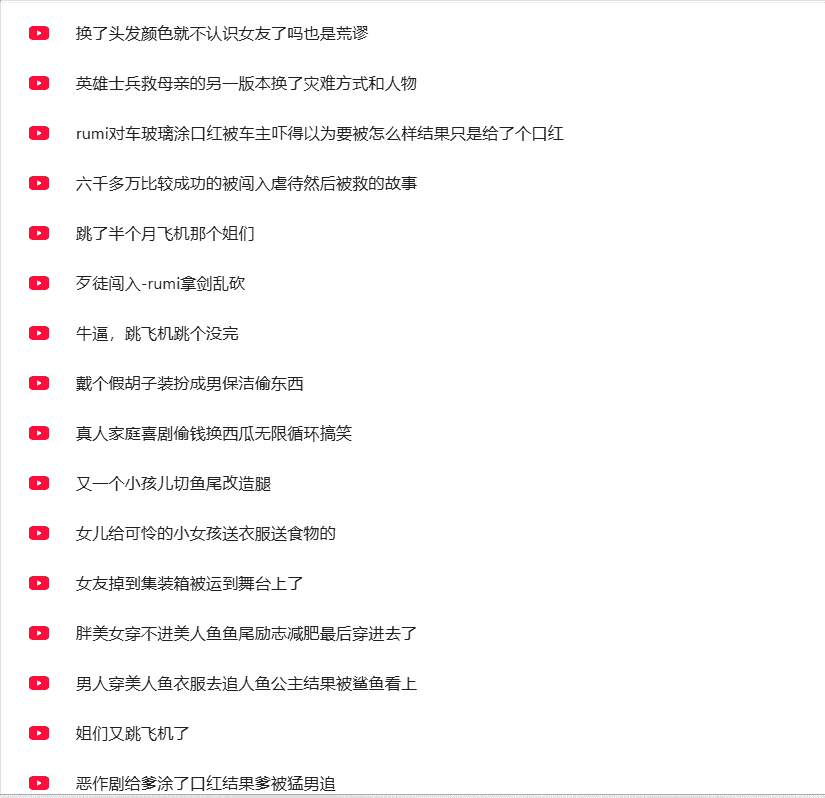

+   对标爆款尽量选择7天内、10天内的，爆率会高很多，当然选择一两个月的也不是不行，但是得做出大幅度创新，包括：情节创新，动作编排，剧情发展，人物形象。例如我有一个4000万爆款对标的就是一两个月前的爆款，但是利用了更新后的图生视频工具的进步，把原视频的部分情节的动作编排做的更流畅，更吸引人，情绪更饱满，也能提高爆率。

+   以印度故事为例，人物形象一定要非常漂亮，精致，华丽，男女主角更新后的形象要注意彼此的服装要尽量搭配，增加CP感，男配角和女配角尽量特征明显，能从头到尾穿同一套衣服的就穿同一套衣服，假如需要穿家居服的就穿同一种颜色，让人一眼能看出来这是谁。各个人物之间不要撞衫不要撞色。

## 给赚钱里迷茫的大家

1.  多学习，多分享，不怕错，不怕丢脸，有问题先搜手册，搜不到就请教，不用怕问的太简单

1.  看别人开YPP再快也不要着急，给自己留3个月时间，3个月开通YPP非常正常

1.  把多数精力放在提升制作水平上，必须先手搓出爆款之后再考虑自动化

1.  借酷拉皮卡教练的话，账号不是亲儿子，头两个号就是让你玩的，不要当宝贝一样，只管做只管发

1.  相比其他优秀的圈友而言，我的本职工作是跟短视频毫无关系的，也没有电商经验，带货经验，运营经验，直播经验，更不会写代码，综合能力层级实际上不高，仍然能做出爆款，虽然花的时间比较长，别人可能十几天就开一个YPP，半个月就达到亿播，我是将近两个多月开的YPP。

1.  两三个月开YPP是一个很正常的水平。恰恰说明了主要通过正确的努力，践行我们赚钱听话照做4字箴言，下功夫学习，努力实操，复盘，迭代，是一定能拿到结果的，不需要太多顾虑。大家加油！

# 五、突破万播的小经验分享和案例展示

**下**面是我从刚开始做视频，到突破万播、百万播、千万播的过程，感谢各位圈友阅读到这里，一些小小的干货送给大家

## 第一条视频，9000播放

[视频1-成片.mp4](https://internal-api-drive-stream.feishu.cn/space/api/box/stream/download/all/Cf0vbmSLeoZXAXxtZzAcE1rQnDd)

## 第一条11万的

当时搞了3个号同时更，为了保持所谓的垂直，自己找了个山海经赛道的所谓细分赛道，山海经小姐姐跳舞，现在看来几乎相当于怼脸抄，把人家频道所有视频都下载下来了，一个挨一个对标，集中发到第二个号上，当时这种跳舞的动作都没那么好出，智谱出的一言难尽，pixverse时好时坏，即梦的动作模仿出来的还凑合，也是一遍一遍调提示词，才做的稍微精美一些，为了跟原视频有所区别，也用有限的脑子费了点儿事，把图片尽量做的不一样了些，卡布奇诺咖啡杯都快搞成酒杯了

[对标2-视频1成片.mp4](https://internal-api-drive-stream.feishu.cn/space/api/box/stream/download/all/HkpJbWrL1oZTr2xK9R6crIuBnoM)

## 第一条85万的

还是这个频道，一直在更新山海经人物跳舞的视频，同时也在对标一些其他流量很大的，例如山海经宝宝的可爱瞬间，山海经人物带孩儿的温馨画面，十月中旬全删了，怕被误扫射。这个视频也是稀里糊涂的突破80万了，后来一对一咨询的时候还是酷拉皮卡教练提醒我，视频小爆了，得分析一下啊，它的爆点在哪里啊，泳池是不是一个爆款元素啊，爆了的视频要挖掘再利用它的爆点，是不是应该再做个泳池的啊？等等等等

这时候对爆款才稍微有了一点点感知

[5.mp4](https://internal-api-drive-stream.feishu.cn/space/api/box/stream/download/all/AD27bnHqgoc1QpxAG2RcgCh7nlc)

## 第一个印度故事，只有10万

这个印度故事情节里带小孩儿，不管三七二十一就删了。

这是跟酷拉皮卡教练一对一咨询之后，被提醒，做了这么多了，还没出大爆款，要考虑开YPP的问题了，要加快进度，做那些太简单的跳舞、带孩儿之类的，对于积累视频制作技能毫无帮助，于是赶快去做故事，复刻了一个山海经人物表白戒指被吃下去的，只有三万多，然后尝试做印度故事试试水，这条上过作业点评

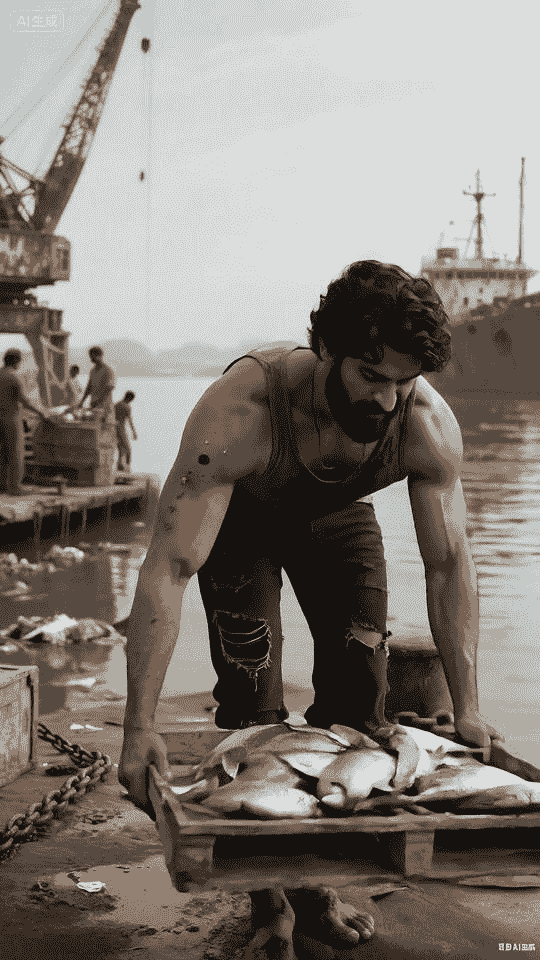

[8月5日.mp4](https://internal-api-drive-stream.feishu.cn/space/api/box/stream/download/all/EBOIbnkWgoURC1xKcmBcZbPSnJf)

## 第一条百万的，885万

这是做的第三条印度故事，就突破了，最终落在了885万，这是第一个真正意义上的爆款，用的是拾文大佬7月29日的精华帖【喂饭教程】AI多分镜视频创作一术破万法 里边的方法一步不漏地手搓出来的，从开始选角色就折腾个把小时，由于对提示词控制缺乏经验，就一遍一遍命令gas按照自己的想法去改，改完粘贴到豆包里生图，满意了为止，整整搞了两天。附上当时的豆包生图记录，看到最后不要笑https://www.doubao.com/thread/wb53284be15d720fb

当时从第二条印度故事开始连续6条都是百万以上，现在大部分都删了，都带小孩儿形象。

当时觉得没把儿童置于危险境地，但是现在标准更加严格，让未成年人受到不必要的关注、有斥责、欺负的情节都不行，吓得我一下子全删完了

[8月9日.mp4](https://internal-api-drive-stream.feishu.cn/space/api/box/stream/download/all/DK5EbBtY3oUCROxFPvqcwZ6XnJg)

## 第一条千万的，2100多万

这一条是第一次破千万，这条没有儿童形象，现在仍保留。

用的是跟上面一条800多万的爆款一模一样的方法，也是手搓了一两天，基本是复刻的，跟原视频相比，人物形象、发型、服装款式全换，只改动了一个情节。

附上豆包生图记录：https://www.doubao.com/thread/wd468244b0634c688

[8月20日.mp4](https://internal-api-drive-stream.feishu.cn/space/api/box/stream/download/all/XG5tbIGVLoGqH3xwcoTcUHgznZc)

## 第一条5000多万的

这条也不带儿童形象，仍然保留

跟原视频相比改动幅度较大，但也仅限于人物形象、服装、发型、配饰、室内环境、分镜表达方式等等，情节基本上是一样的。

原视频1700多万https://www.youtube.com/shorts/uFFAgculxFM

豆包生图记录：https://www.doubao.com/thread/w9c743f38df787dac

[9月1日 (1)_20251008_16181497.mp4](https://internal-api-drive-stream.feishu.cn/space/api/box/stream/download/all/R362boLU3o4BaLx05OtcJkvmnrb)