# 借助AI工作流，8个月做了15家📕虚拟店铺，我整理出这套可快速起店的SOP

> 来源：[https://xuqiwei1986.feishu.cn/docx/BKs9dXSHCow0IRxyLF3cBU9Cnlc](https://xuqiwei1986.feishu.cn/docx/BKs9dXSHCow0IRxyLF3cBU9Cnlc)

hello，各位圈友大家好！我是尹星河，更绪的合伙人！想跟大家分享我们团队这几个月在📕虚拟店铺的一些探索

5[【适合新手】📕虚拟电商从0到1全流程拆解！无保留分享](https://o7nsrridj4.feishu.cn/docx/OrEhdYvTgoLlO8xDXeRcwJ3CnGc?from=from_copylink)底的时候，分享过一篇内容，记录了自己从0到稳定2W+的心路历程，得到了很多圈友的点赞，感兴趣的可以回顾下！

后面几个月时间，我们一直专注在自己的业务上，因为整体都跑通了闭环，所以复制起来就很快，线下开了公司，招了几个小伙伴，也一直疯狂的开店，每个月基本上都能开两三家店，一个月内起店，开店当月破万收益的也有好几个！后续一个店能稳定在5k - 2w之间

**这几个月时间也刚好还在📕虚拟电商的红利期**内，十多个店收益加起来也能稳定在12w+

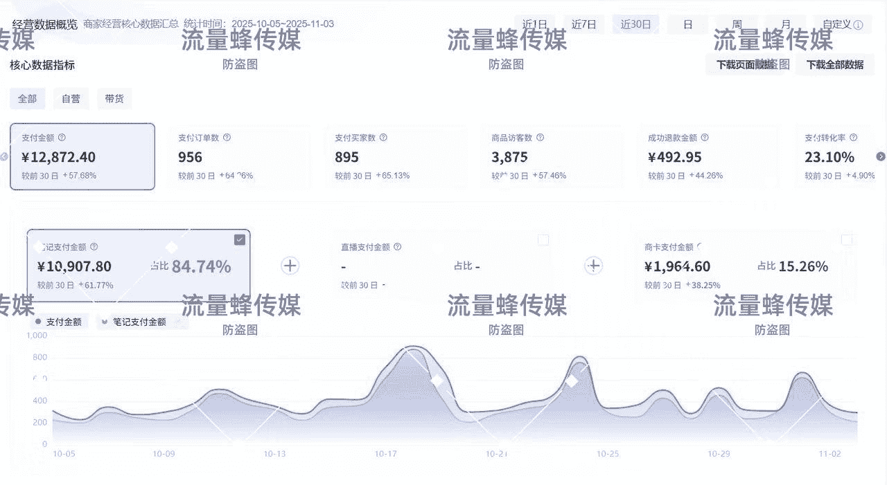

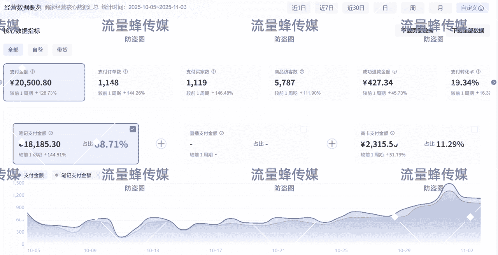

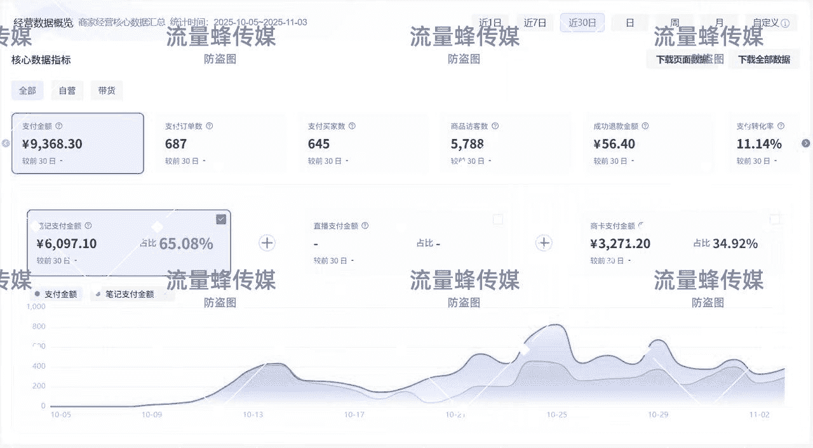

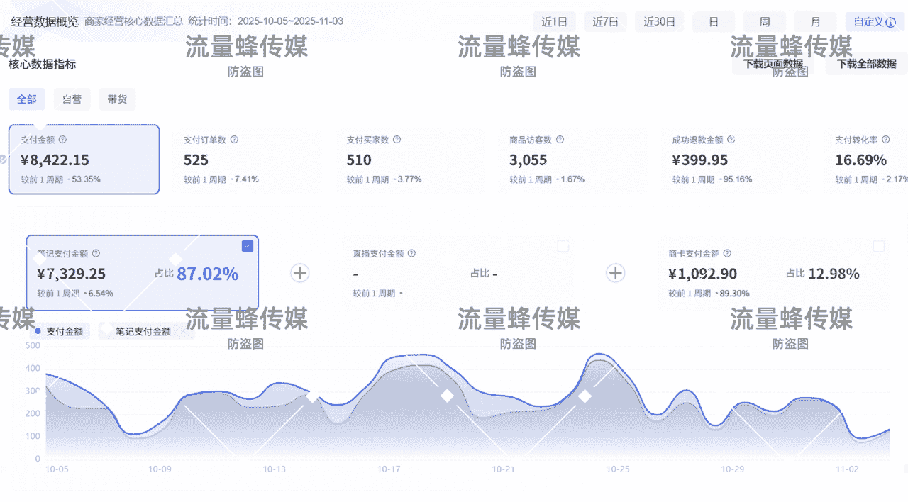

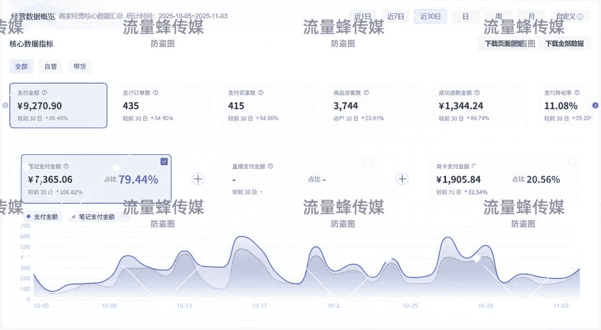

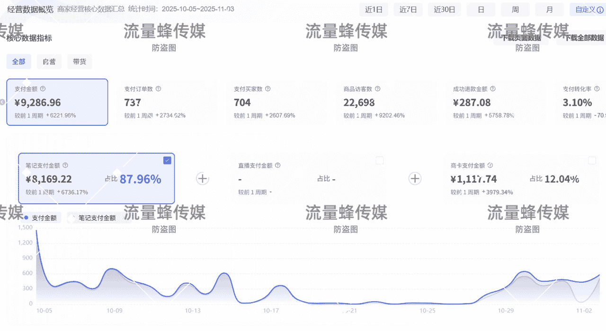

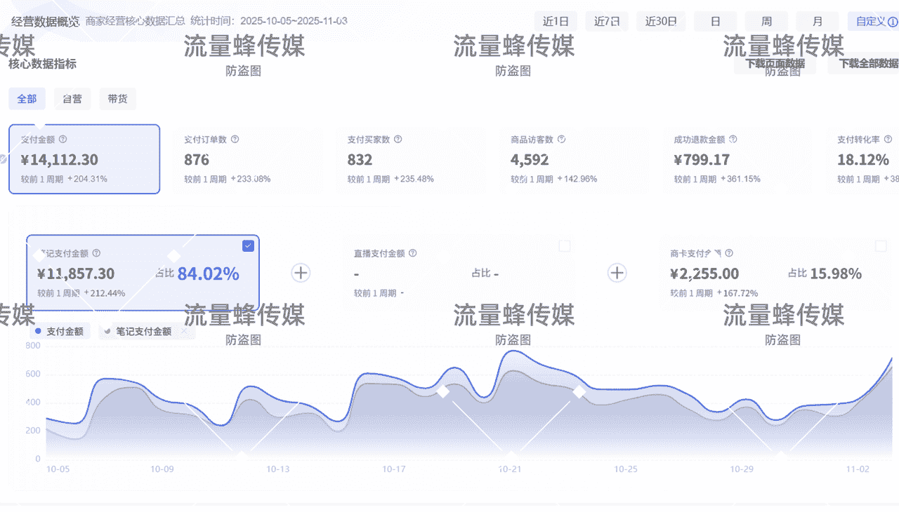

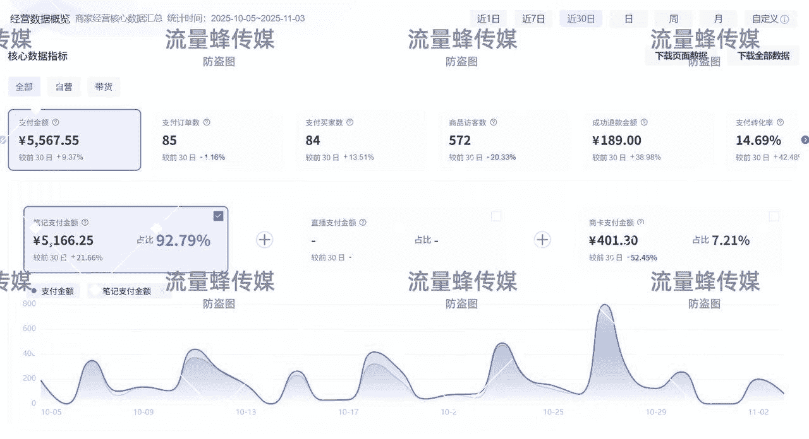

（部分店铺近一个月数据，我们所有的店铺都是一拖三，按照某些人的说法，就差不多是60家店了）

（线下公司工作场景|之前夏天随手拍）

这个过程我们探索测试了很多玩法，包括原创知识库、淘宝搬运快速铺货、纯付费投流等等

也不断学习AI的运用，在没有编程基础下，搭建了一套AI做笔记的工作流，用claude code 做了 📕商品数据采集与24小时监控的插件，做了📕多账号矩阵批量发布插件，大大提高团队选品、制作效率

做了这么多，最近刚好又空了一些。

**所以想跟大家分享这几个月踩过的坑，找到**的路，一套完整的可复制的📕起店SOP

# 踩过的坑

### 淘宝批量化搬运，真的很赚吗？

我们在5月底的时候，看到淘宝批量搬运上品的玩法，当时看到很兴奋，这不就是我想要的吗？批量上品、快速起量，都不用费脑子选品了，而且看到已经有朋友跑通0-1的闭环

当晚我就决定：拿一个店出来测试，说干就干！我们找了个淘宝搬运软件，开始疯狂上品。一开始啥也不懂，完全是手动操作：

1.  **在淘宝上找爆款虚拟产品**（考公、教资、语言学习、软件游戏...）

1.  **用软件一键采集链接到本地**（至尊宝插件）

1.  **上品软件搬到📕店铺**（我们测试了红麒麟、羽悦、晓微宝，目前主要用晓微宝多点）

1.  **自己纯手动做笔记推广**（每条笔记纯手动制作，下载淘宝商品主图做封面，自己写标题文案）

1.  **自己手动发布笔记**（做完就刚好发布了）

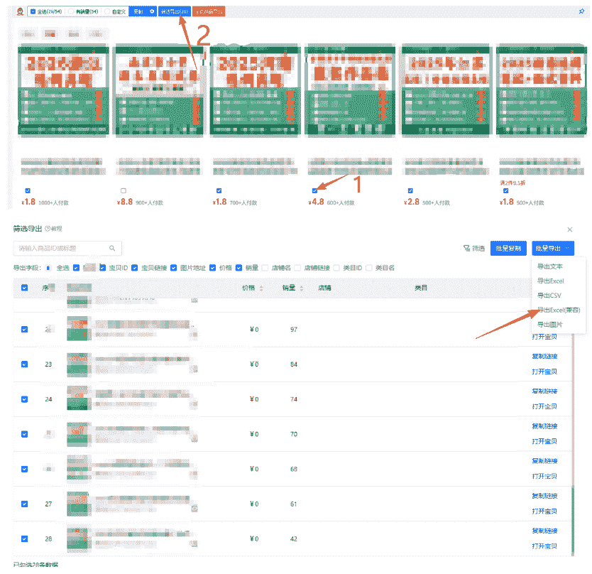

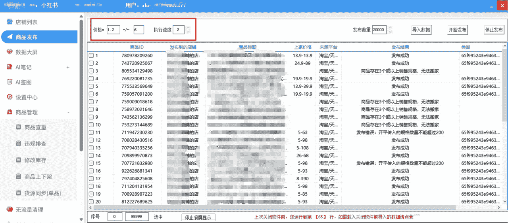

因为我们做笔记的过程都是手动的，做起来也很麻烦，需要一条一条做，感觉手指都快点麻了，眼睛盯着屏幕都是模糊的。所以第一个月并没有做多少，大概就做了100个品左右吧！

**所幸，可能是类目选得还**不错，再加上笔记确实用心了，第一个月竟然卖了1万块！我们自己都没想到，当时真的觉得，财富密码找到了。只要批量复制，规模化就能赚大钱。

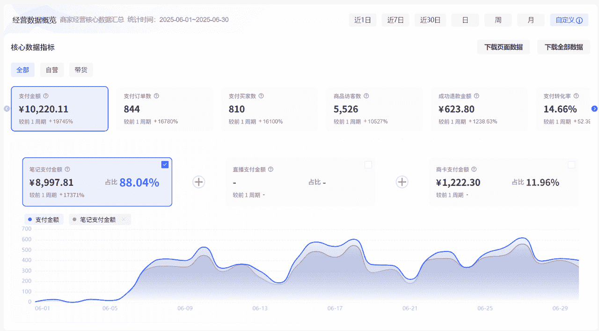

（开店第一个月的数据）

不过，我坐下来认真算了笔账，看着后台数据，又感觉头皮发麻。

表面上看卖了1万，但细算下来，投流成本就花了一半，因为品没有认真选，笔记也做得粗糙，我们所有品也都会拉去投流，瞎猫碰死耗子地投，大部分品的ROI都在0.5以下，根本不赚钱。

幸好量大，能筛出来几个还不错的品，针对性优化做笔记，勉强能拉回本来。

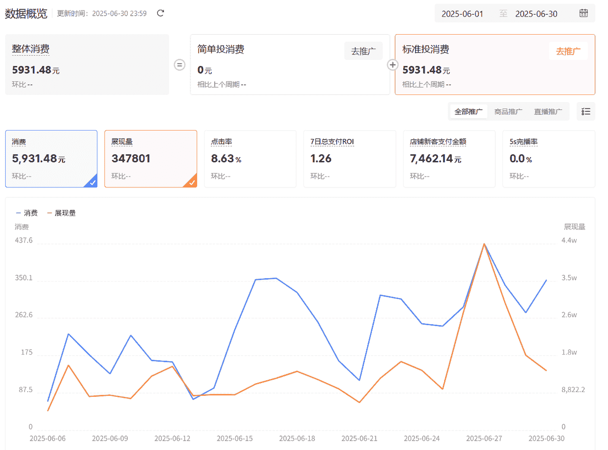

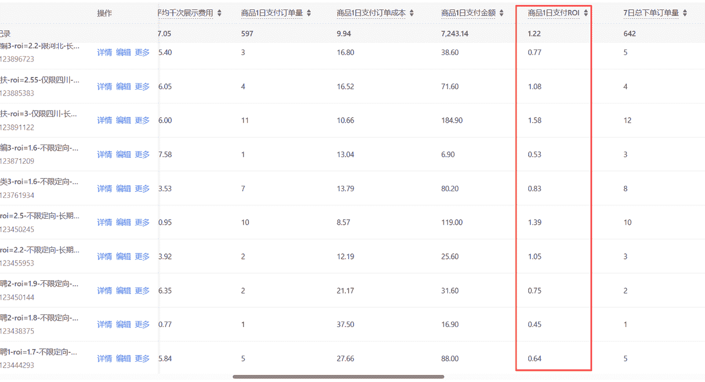

（我们投放有22%的返点，大概就花费了接近5000元）

另外因为出单的品很分散，有些只能出一两单，有些能出十多单，但每个都要去买资料，零零散散加起来又花了一千多。最后算下来，净利润就三四千，这种玩法对我们单店一个月做几万的收益相比，产出效率太低了

我坐在电脑前发呆，感觉又给平台打工了！

**当你的内容力、商品力不够的时候，就只能高度依赖投**流，只要投流，大部分钱都会被平台赚走了。

### RPA自动化，真的自动化吗？

但我还是不死心，觉得可能是我们效率不够高，如果能把流程优化到极致，说不定就能跑通了。于是我又拿了两个店来测试，开始疯狂钻研各种自动化工具。

我们先是用RPA工具做了一套自动化做笔记流程：

1.  用rpa工具一键把商品主图上传到多维表格

1.  **多维表格自动生成笔记内容**（调用AI大模型自动识别主图内容，生成标题、正文、话题）

1.  **RPA工具批量发布笔记**（自己使用影刀开发）

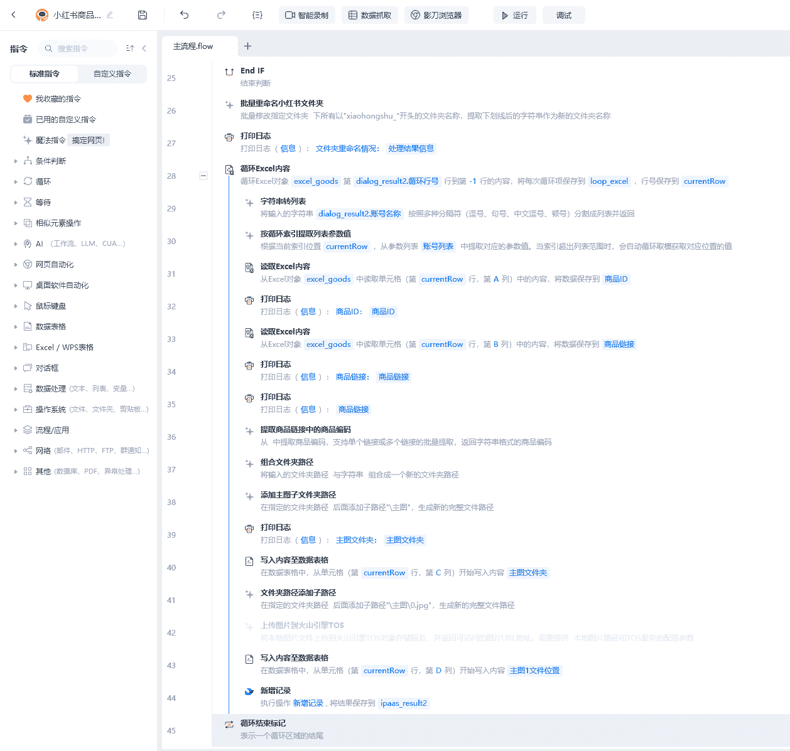

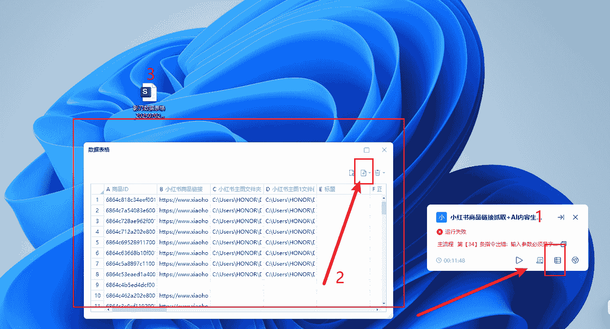

（**把商品主图上传到多维表格**）

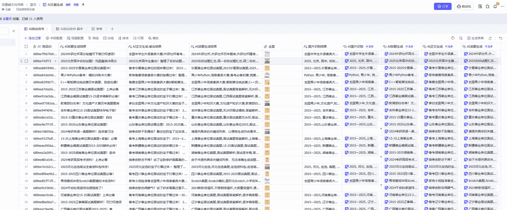

（**多维表格AI自动生成笔记内容**）

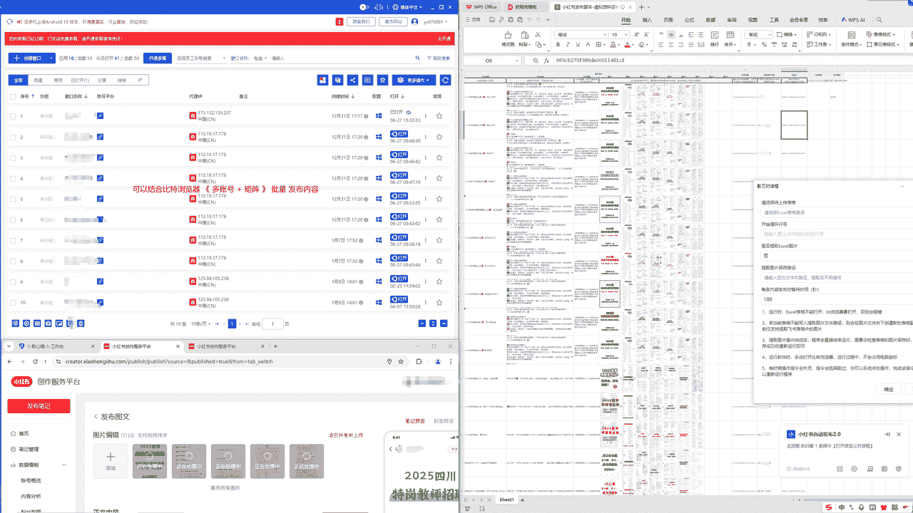

（**RPA工具批量发布笔记**）

刚做出来的时候，我们都觉得特别牛逼，效率确实提升了不少。原来要2小时的活，现在20分钟就搞定，感觉终于找到了正确的方法。但用了一段时间就发现问题了。

**RP**A要一直占用电脑桌面，一启动就抢占鼠标，工作期间电脑根本没法用。而且只能单线程运行，经常莫名其妙卡住，还得人工介入。每次看着电脑自己在那跑，我就像个保姆一样盯着，生怕出问题，这哪是自动化呀

**后来我们在龙哥盟里看到有人分享用Claude Code做自动化的案例，就想着试**试看。我也完全没有编程基础，抱着试试看的心态，开始学着用Claude Code。

不得不说，确实好用！就用最普通的话跟Claude说："帮我写一个Chrome插件，可以批量抓取📕商品的商品ID、主图，然后自动填写到飞书多维表格里。"中间遇到API调用、浏览器跨域等等问题，我截图给它，它自己就调试、自己改代码，反反复复改了几次，它就真的给我写出来了！

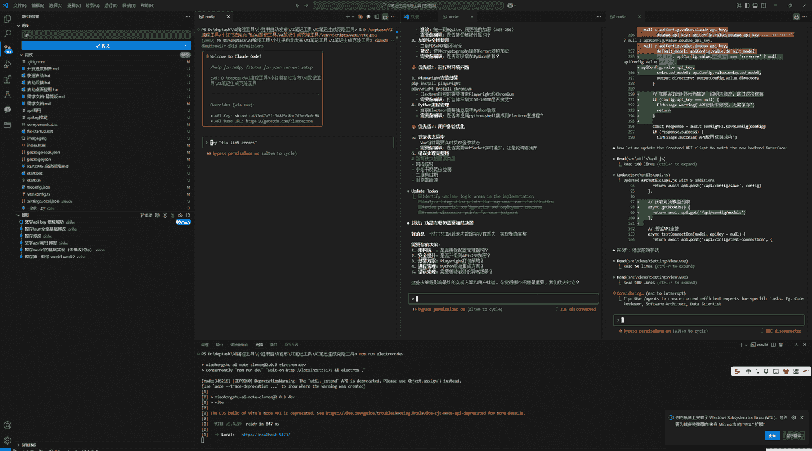

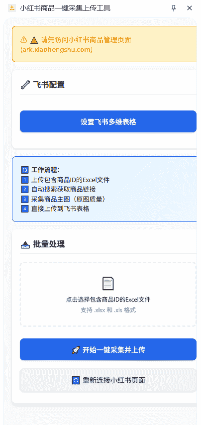

（**claude code对话记录**）

**我陆陆续续又做了一个核心插件：📕自动发布。可以在后台批量运行+直接调用多维表格数据**，不占桌面、不抢鼠标，直接从飞书就能自动上传发布，省事了很多！效果大概是这样的。

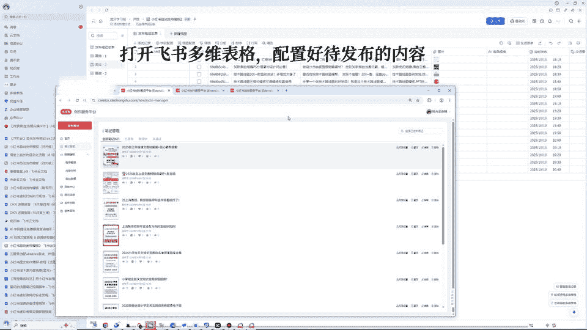

[发布.mp4](https://internal-api-drive-stream.feishu.cn/space/api/box/stream/download/all/IAyAbTFLuoIdRdxWScJcRKfCn4d)

我做这个大概花了2周时间，其实我也完全不会编程，claude code很聪明，多让他改几次就慢慢就改好了！

**那种**感觉就像突然拥有了一个24小时在线、永不疲惫的技术合伙人。学会使用各种AI工具，真的能大大提高效率。能用工具解决的，就不要用人力。AI不是来抢你饭碗的，是来帮你提升10倍生产力的。

优化完整个流程后，我们一天能上几百个品，发几百篇笔记。半个月时间就铺了几千个SKU。看着店铺后台那些商品，觉得这次真的要起飞了。

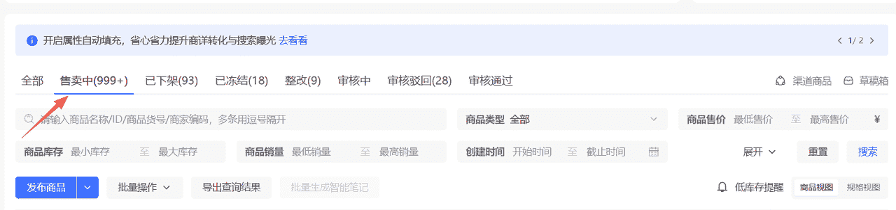

（**几千个商品数**）

出单速度很快！即使新店，也都能上架当天就出单，一个新店，开店第一个月就能卖大几千了

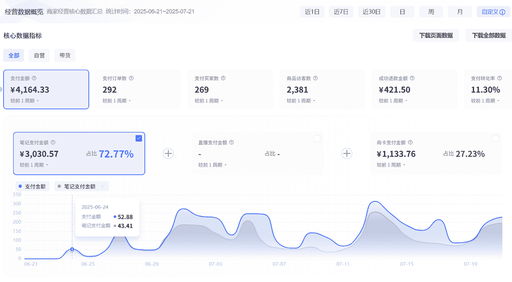

（6月底开的一个新店，开店第二天就出单，不投流了！都是自然流）

### 平台政策调整，有哪些隐藏规则？

现在想想，自己真的又太天真了。好景不长，做了一段时间后，新的问题接踵而来，而且是致命的。

#### 负反馈过高

因为没有认真选品，商品质量参差不齐，有些资料是过时的，有些资料也不完整，用户一给差评多了，就会导致负反馈过高，店铺被限流，甚至连笔记都看不到了，一开始还不知道这个原因，问客服也算笔记没问题

找了很久才找到，原来是负反馈限制流量

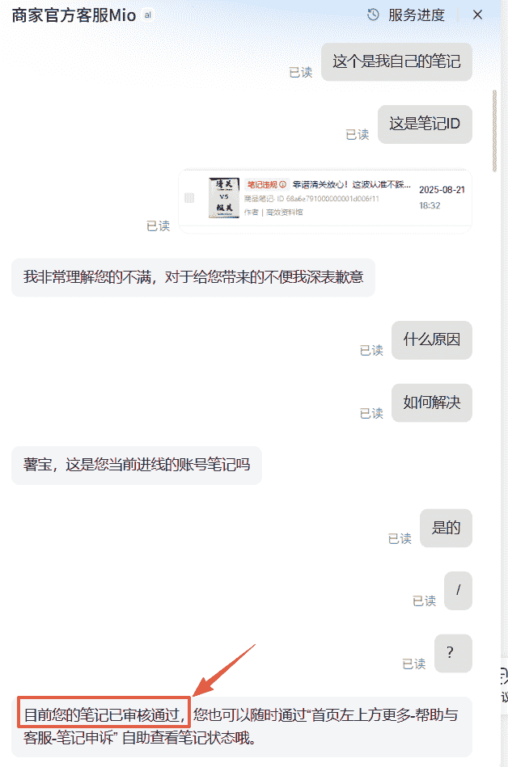

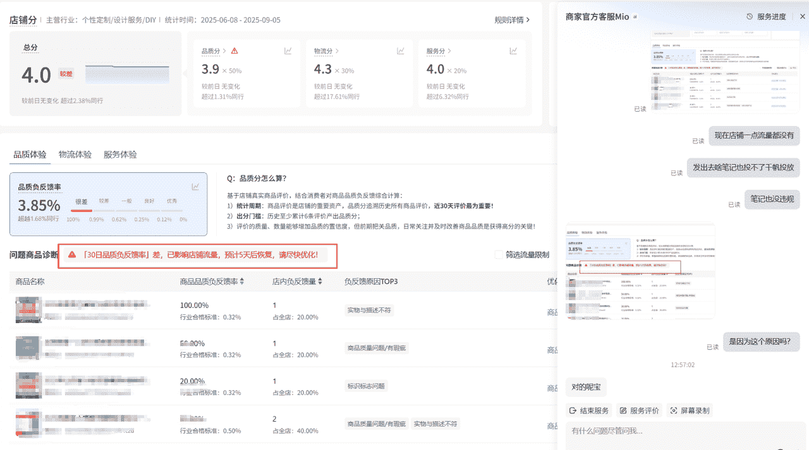

（**开始找官方客服说账号笔记没问题，但**是别人看不到内容，后面才知道是负反馈过高）

#### 账号限流

加上很多品都是从淘宝搬运的，别人早就搬过了。我们一发笔记，系统立刻检测到重复内容，直接判定违规。

一个账号违规多了，整个账号的流量都不行了。发出去的笔记过了好几天，连小眼睛都没有。幸好我们用的是子账号发布，没有影响到店铺主账号，不然店铺都要废了。

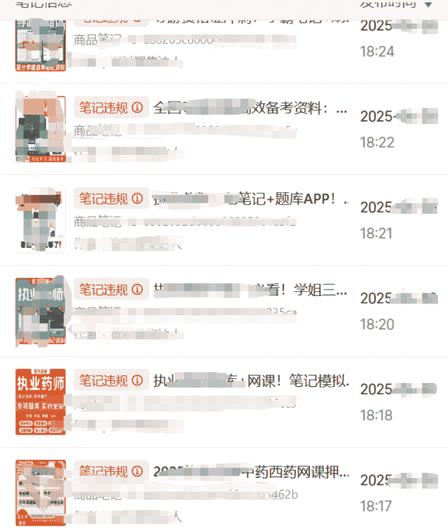

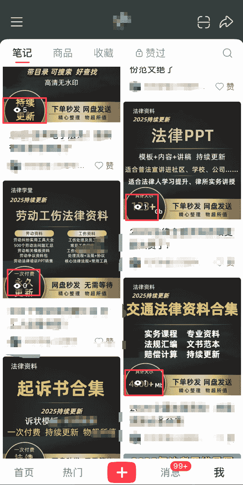

（个别账号违规限流，小眼睛一直个位数）

#### 实名限制

**更致命的是：📕平台从8月份开始大规模收紧政策。大部分新**账号必须实名认证才能发内容、才能有流量。

现在新账号发内容基本上全跳实名，即使实名了的老号也偶尔要二次实名验证。

**这**对矩阵玩家、废号流玩家、擦边业务来说，是毁灭性打击。很多新工作室，没有那么多号的资源储备，养不起号，很快就倒闭了。

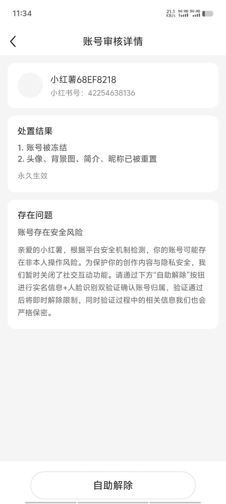

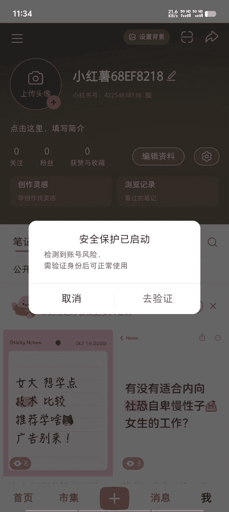

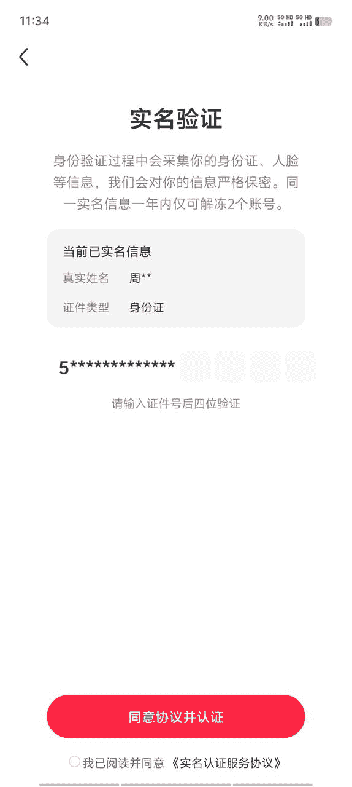

（📕实名限制！有渠道做sm的话可以一定程度缓解）

这些📕政策的调整，各种要素的叠加，让我们对批量矩阵、批量搬运没抱上太多期望。不是工具不够好，不是效率不够高，而是方向错了。我一直以为批量就等于规模化，以为只要量大就能覆盖需求。但我忽略了一个最根本的问题：📕的底层逻辑跟淘宝、拼多多完全不一样。

在淘宝、拼多多，用户是主动搜索商品，谁便宜买谁，品多确实有优势。但在📕，用户是被内容吸引过来的。他们刷到你的笔记，被你的内容打动，才会点进去看商品。他们为什么在你这买？不是因为你品多，而是因为你的内容有价值，能解决他的问题，他信任你。

而我们的杂货铺，说白了就是个搬运工。

**没有内容力，没有品牌心智，用户凭什么买你的？更关**键的是，我们在和平台对抗。平台想要什么？

**优质内容、用户体验、健康生态。我们做什**么？批量搬运、制造垃圾内容、薅平台羊毛。

**平台的规则就是你的生存法则，你跟平台对着干，**平台就一定会收拾你。这是注定走不长远的。

既然杂货铺走不通，那这些店怎么办？

**总不能就这么废了吧。我想了好几天，突然灵光一闪：也许可以换个思**路，不把它当主力店铺，而是当作测品工具。

**这个**想法一出来，整个逻辑就通了。专门挑小众、蓝海、细分的品类来测试，快速上架看市场反馈。哪个品数据好，就拿到精品店铺重点运营。相当于用杂货店做市场调研，试错成本低，而且能快速验证需求。

比如，我们在杂货店测试了一个很小众的考试资料，随便一张图就上架了，也没怎么推广。

这个品持续出单,光靠这一张图就卖了几千块。放在另外精品店，也都卖得挺好的

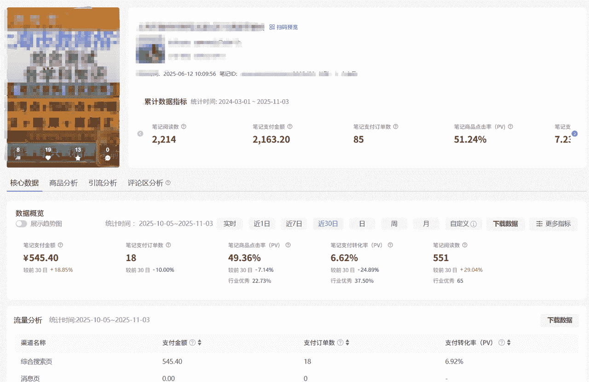

（笔记只有一张商品主图，源源不断有精准搜索流量）

**到头来想想，选品才是第一生产力。一个好的品，能**让你事半功倍。一个差的品，再努力也白搭。

# 找到的方向

### 数据化驱动选品，真的很香！

那么，什么样的选品方式才是最科学的呢？

说实话，我试了很多方法。蓝海选品、千帆热销榜选品、AI辅助选品...每种方法都试过，但总觉得差点感觉，最后还是要靠大量的经验判断。

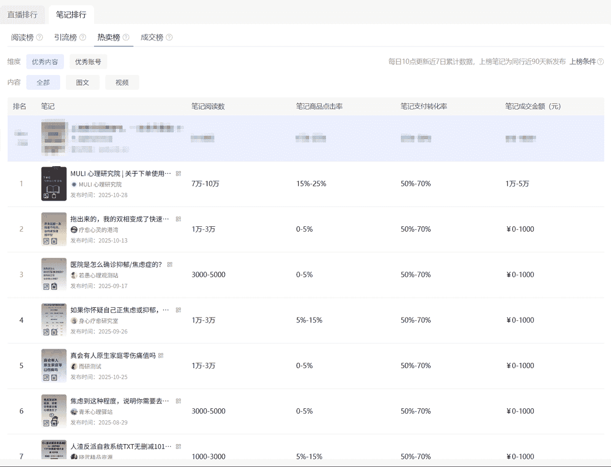

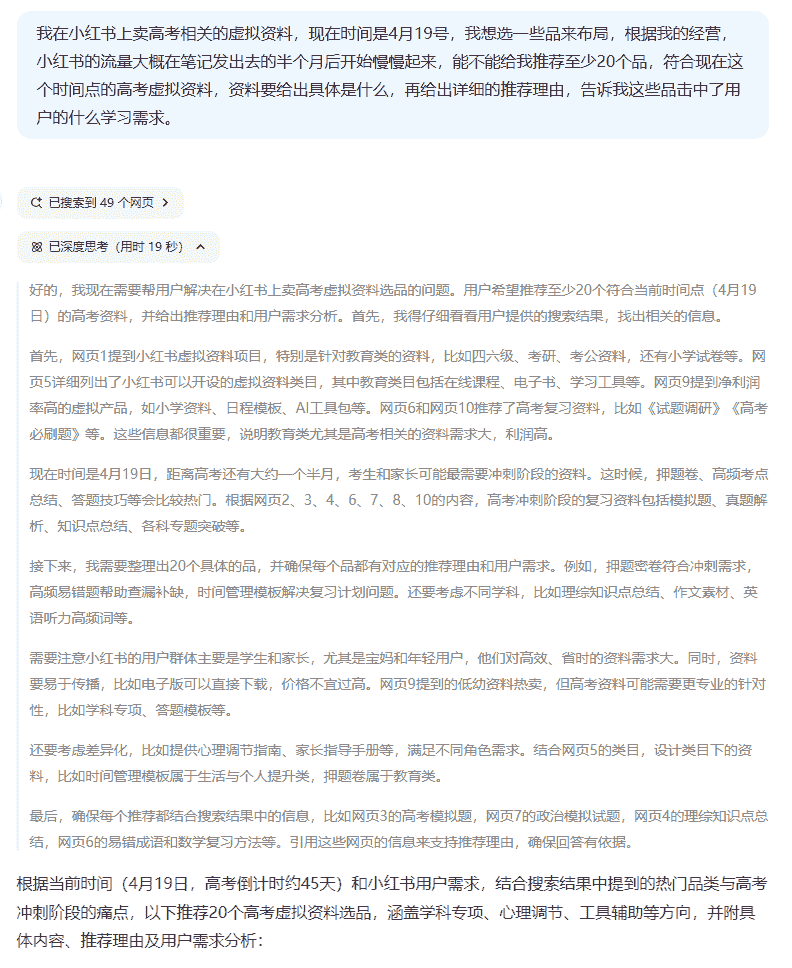

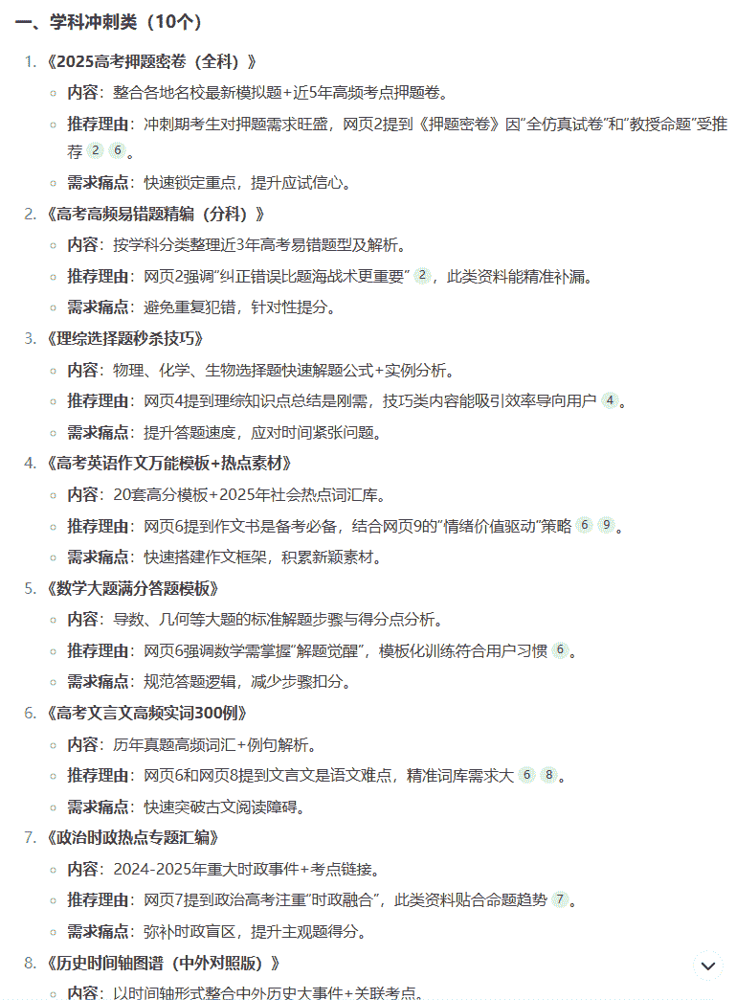

（笔记只有一张商品主图，源源不断有精准搜索流量）

**蓝海选品的问题是，很多所谓的蓝海其实是没价值的坑。热销榜选品的问**题是，等你看到的时候已经是红海了。AI选品看起来很专业，但它不懂实际的坑在哪里。

**有没有更科学的？**

**直到**我回去复盘杂货铺那段经历，突然想明白了：真正的机会不在于你选了什么类目，而在于你能不能发现数据异常值。数据不会骗人。那些数据表现"不正常"的品，往往就是市场还没被充分满足的地方。

**但什么数据才是最有价值的呢？**

我研究了很久发现，最关键的是**每日新增销量数据**。不是累计卖了多少单，而是今天卖了多少、昨天卖了多少、上周每天卖了多少。这是增量数据，看的是现在和趋势，而不是过去。

举个例子。品A累计销量5000单，品B累计销量500单。看存量数据你肯定选品A。但如果品A是过去半年慢慢积累的，现在每天只能卖2-3单；而品B都是最近一个月卖的，现在每天能卖20单。你还会选品A吗？

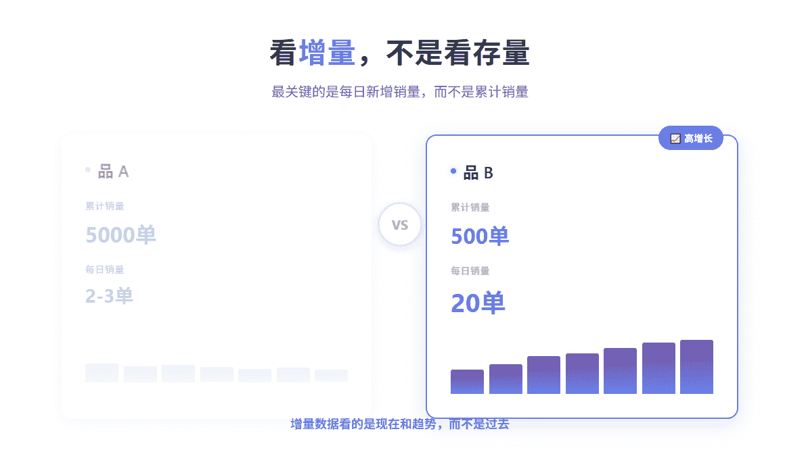

如果你知道1万个品每天分别卖了多少单、卖了多少钱，还知道他们店铺的总销量、总粉丝数，你该做哪些品是不是就更有把握了？

数据会直接告诉你答案。意识到这点后，我们开始自己做数据采集。

因为害怕数据采集被平台风控账号或网络，所以还是使用rpa的方式，用模拟人工的方式去一条一条采集，因为第一次做影刀手机数据采集，完全没有经验，全程都是和ai交流的。

**我的开发流程特别朴素：**

+   不知道怎么写xpath定位？把需求发给AI，让它写，我负责测试验证

+   看不懂某个指令是干嘛的？把官方文档喂给AI，让它用人话解释给我听

+   遇到复杂操作？直接用影刀的"魔法指令"，自然语言对话就能生成一个影刀指令

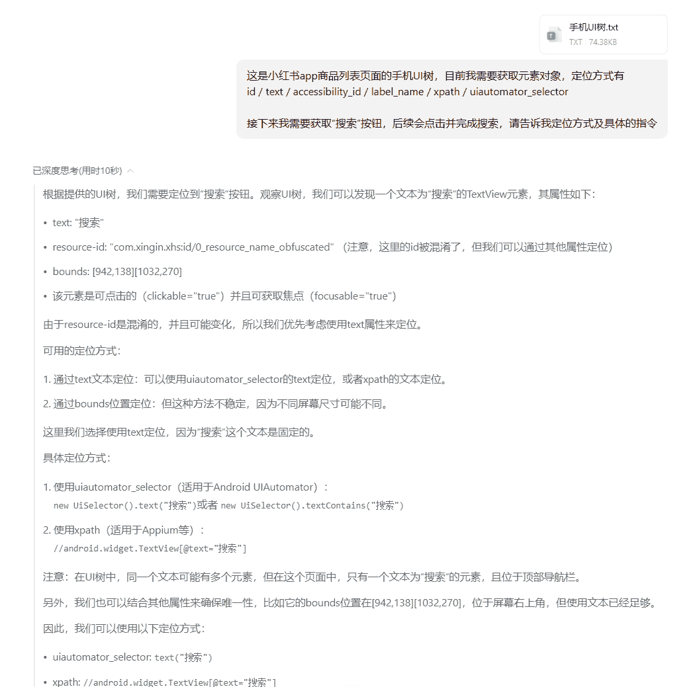

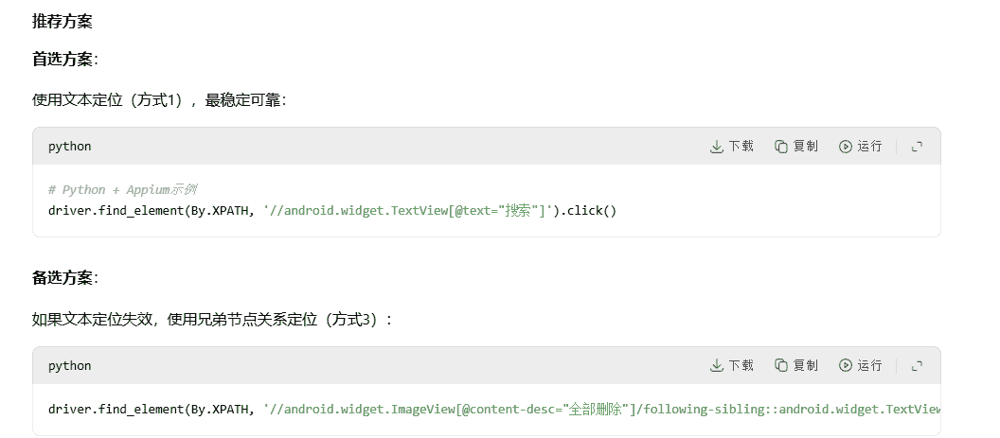

**（让AI帮忙写xpath指令）**

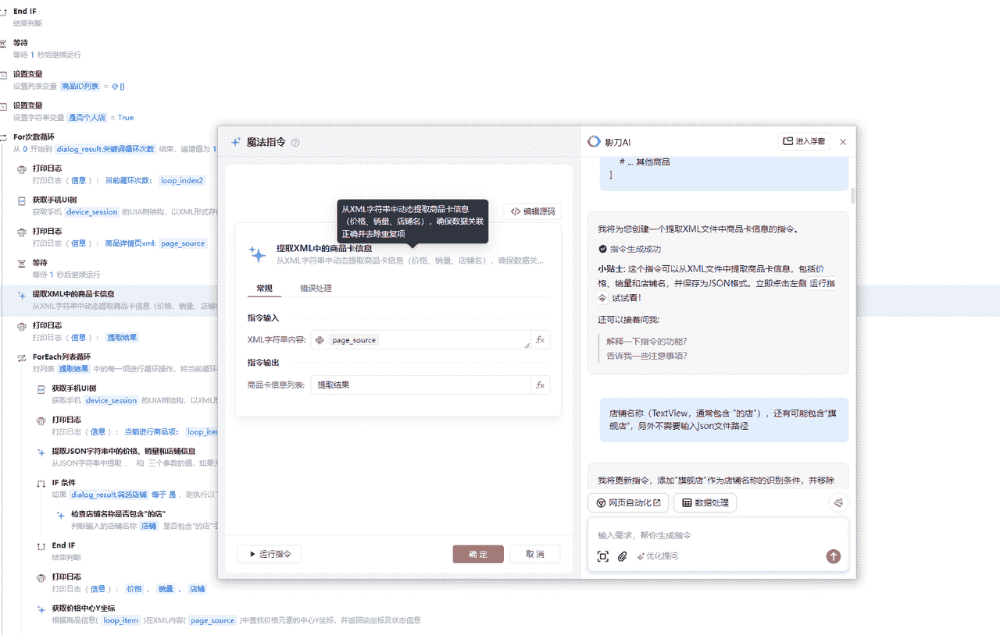

（影刀魔法指令特别好用，不会写的全部交给它）

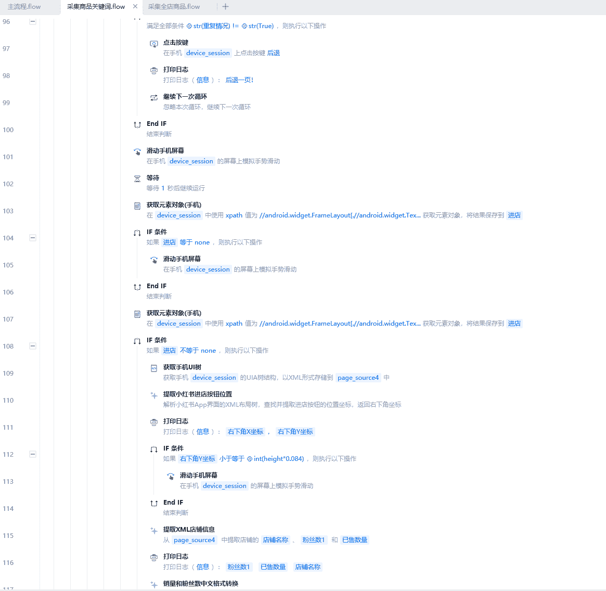

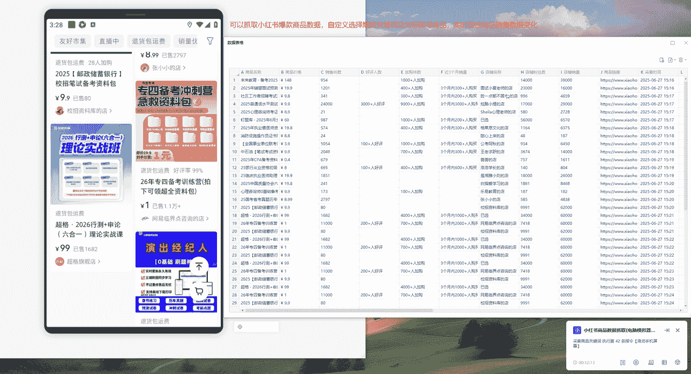

**（最后做出来的效果）**

就这样，用了不到一周时间，我就把📕商品数据采集工具搞定了。可以按关键词、按店铺名称采集全部商品数据，也不敢采集太多了，影刀商品数据采集我看有很多人分享过，我这边就不分享源码了

**技术可以外包给AI，但你要清楚自**己想要什么数据，这些数据能解决什么问题。

有了数据采集，我并没有停下来。我又花了一周时间，继续和Claude Code死磕，开发了一套数据监控系统：

+   **定期追踪商品数据变化**

+   预测每个商品24小时内的销售额、销量趋势

+   可视化界面展示（考虑到数据敏感性，没有上服务器，本地存储）

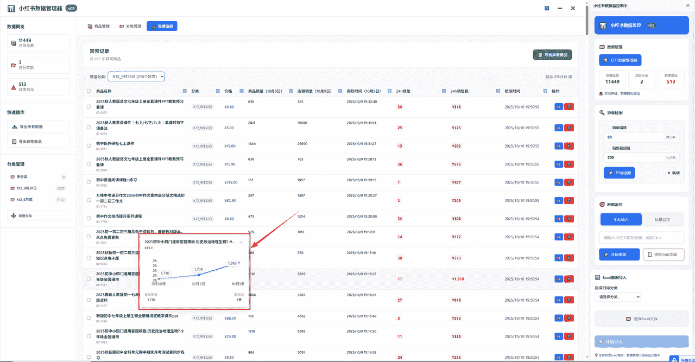

**（最后做出来的效果）**

这个技术实现细节我也说不清，都是AI claude code帮我完成的

可以监控商品数据的变化，也可以预测每个24小时销售额、销量的变化，大概的实现效果是这样的。

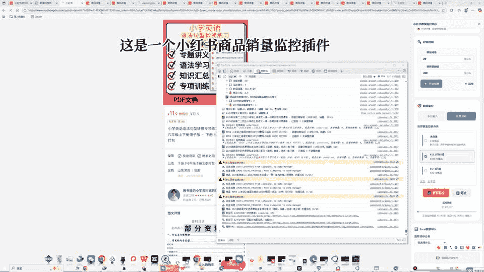

[10月22日.mp4](https://internal-api-drive-stream.feishu.cn/space/api/box/stream/download/all/ACRJblonGoJCryxTraIcdTernMo)

**现在我的数据库里有8万+条**商品数据，定期扫一遍，能看到很多肉眼看不见的东西——那些正在爆发的品、那些增长曲线异常陡峭的店铺、那些突然被冷落的品。

但光有数据还不够，更重要的是**建立数据反馈回路，持续迭代优化**。

每测一个品，都要去分析：

1.  我为什么选它？（选品逻辑）

1.  成功了是为什么？（成功要素）

1.  失败了又是为什么？（避坑指南）

然后把这些经验沉淀下来优化我们的选品标准。通过不断测试、不断复盘、不断优化。

团队的选品能力越来越强，成功率会越来越高。从10个品跑出1-2个，到10个品跑出4-5个，这种成功率的提升，就是数据反馈回路的力量。

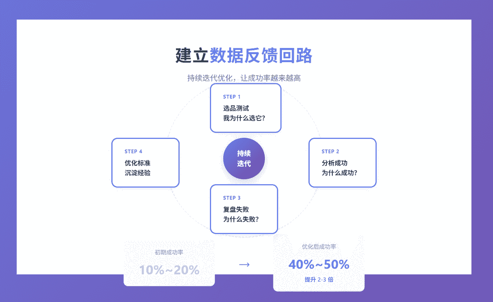

现在回头看，我总结出自己的选品核心：

1.  看数据异常值，市场机会往往藏在那些"不正常"的地方。销量近期暴涨、评论区异常活跃、某个词突然搜索量飙升——这些都是信号。

1.  看增量而非存量，别只盯着现在卖得好的品，要盯着"正在变好"的品。趋势比现状更重要，变化比静态更值钱。真正有价值的信息，永远在变化和趋势里。

1.  **建立反馈回路持续优化。**数据驱动不是看一次数据就完事，而是持续测试→复盘→优化→再测试。数据不会骗人，但前提是你要看对数据，并且从数据中持续学习。

### 原创资料，真的很香！

我们卖的产品大多是弱版权类的资料。这类产品有个天然的问题：因为没有版权壁垒，所以你一旦卖起来了，很快就会有同行跟进。

一开始我还挺乐观的，想着自己先做起来，商品链接权重和笔记权重积累起来了，能拿到持续的搜索流量，应该问题不大。但现实是，随着竞争对手越来越多，你的份额还是会被不断蚕食。可能你之前一天能卖50单的品，慢慢就变成30单

这种感觉挺无力的，就像你辛辛苦苦挖了一口井，结果旁边突然多了十几口井，大家一起分水。你不是不行了，只是蛋糕被切小了。

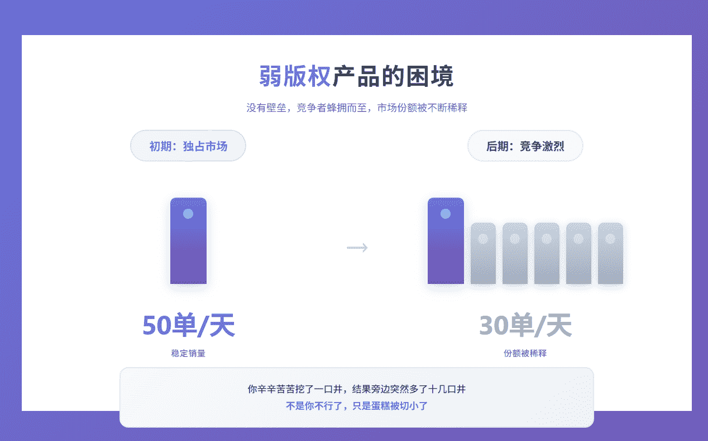

这个时候我开始思考：能不能做一些原创的东西？

我们先从简单的开始。八九月份的时候，看到"教师训话稿"这个品挺火的，就想着用AI复刻做个二创资料出来。思路很简单：什么火就跟什么，让AI快速生成内容，然后包装一下上架。

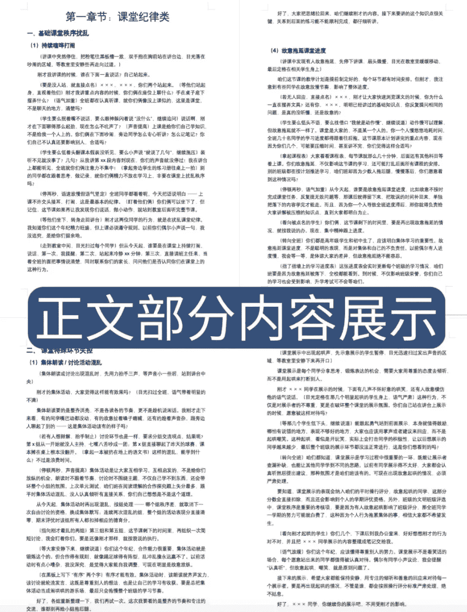

（让AI 帮忙做内容洗稿，内容框架不发生变化）

但问题很快就出现了。我们不是教师群体，根本不知道老师们真正需要什么样的。

我们只是看数据觉得这个品热度高，就盲目跟进了。最后做出来的产品很粗糙，也没有什么特色。卖了100多单之后就不动了，后面基本没什么销量。

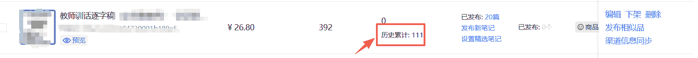

**（商品销量数据）**

**我们复盘了这次的问题，发现问核心不是"**追什么热点"，而是"用户真正需要什么"。

**因为所有人都能看到热门，很多人都会扑上去。没有差异化**优势，凭什么在一堆同质化产品里脱颖而出？

这时候我注意到📕上做漫画、做小说的特别火，因为这些内容带着故事性、带着剧情，用户愿意看、愿意分享。

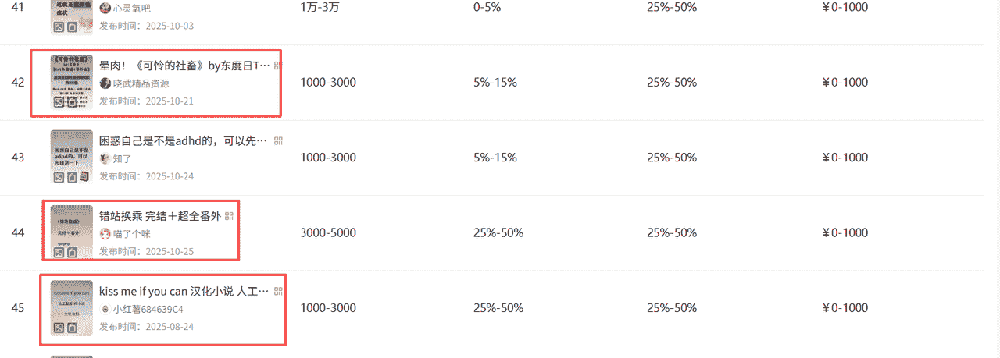

恰好我们团队有个懂漫画的员工，他有个朋友会做原创漫画。

我们就商量着，能不能基于一个游戏剧情做一套原创的AI 3D漫画？用Comfy UI来生成画面。中间费了很多功夫，具体实现细节我也不是太清楚，因为不太喜欢看这些。做出来的效果是这样的，大家可以看看

（不得不说，AI漫画的质量确实很高！）

说实话，当时我们完全没做过这种东西，📕上也没有人做，心里其实挺没底的。但想着反正也是测试嘛，试试看能不能跑通。

可能是因为画面比较精美，也可能是因为市场上确实没有类似的产品，笔记发出去之后数据就慢慢起来，高峰期的时候一天能稳定做2000元，持续了好几天。后来可能因为AI内容的原因被平台判违规，流量掉了一些，但这个品现在还能稳定一个月产出一两万。

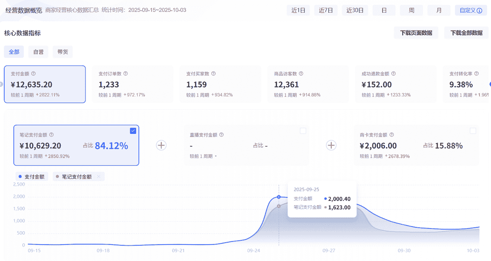

**爆发期几天的数据**

更重要的是，**到现在都没有什么竞争对手。**

**原创不一定要多么高大上，关键是要结合你的独特资源和市场空白。我们有懂漫画的人、有**AI的技术积累、懂📕的平台运营，这三个东西组合起来，就形成了一个小小的壁垒。

原创这个方向跑通之后，我们又开始思考：还能在哪些领域复制这个模式？

我们梳理了团队的知识储备，发现在运营领域积累比较多。于是就挑了这个相对熟悉的赛道，做了一套运营知识库。

因为是基于自己实际经验整理的，有很多一线的案例和方法论，用户反馈还不错，到现在也出了几百单。

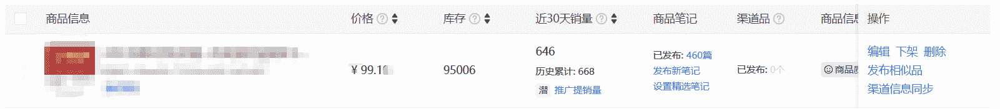

**一些销售数据**

这两次经验让我总结出一个公式：蓝海机会=市场需求×你的独特优势。

市场需求保证了有人愿意买，你的独特优势保证了别人短期内做不了或做不好。两者结合，就是一个小众但有壁垒的细分赛道。

**关于原创，我的几点思考：**

1.  原创不是追求完美，而是追求差异化。你不需要做到行业第一，你只需要做到"和别人不一样"就够了。

1.  **不要为了原创而原创。**原创的目的是建立壁垒、减少竞争，如果原创本身不能带来这些，那就没必要为了原创耗费太多精力。

1.  **要敢于测试。**我们做3D漫画的时候完全没有把握，但如果不试，就永远不知道这条路能不能走通。很多机会是测出来的，不是想出来的。

### 高客单虚拟产品，真的很香！

我们接着一起往下思考，我们说到蓝海机会，做原创蓝海产品确实能避开竞争

但是对于普通人来说，想做出一个真正极致差异化的蓝海爆品太难了，我们那个AI 3D漫画更多是碰巧挖到了合适的机会，很难能有持续不断的这样的好品

那如果一个普通蓝海产品注定卖不出去太多量，那该怎么办？

**销售额 = 销量 × 客单价**

既然销量这个变量很难突破，那就在客单价上做文章啊！

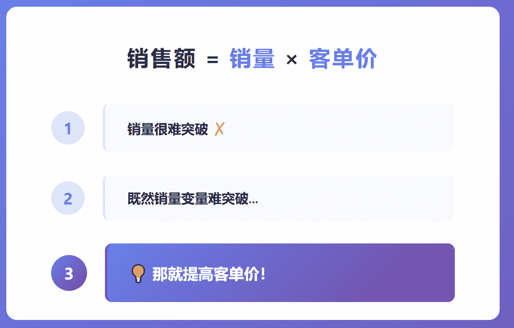

**这个思路一下就打开了：我应该专门**去找那些"小众细分 + 高客单"的领域。

因为小众，竞争不激烈，我铺上核心关键词，搜索流量基本都能吃下来；又因为高客单，即使出单量不大，整体营收也不会差。

有了这个思路，数据采集工具就派上用场了。

我专门加了一个价格筛选功能，设定区间在25-300元，专门抓取这些相对高客单的虚拟产品数据。然后去分析这些店铺都在卖什么、哪些品类有机会、竞争程度如何。

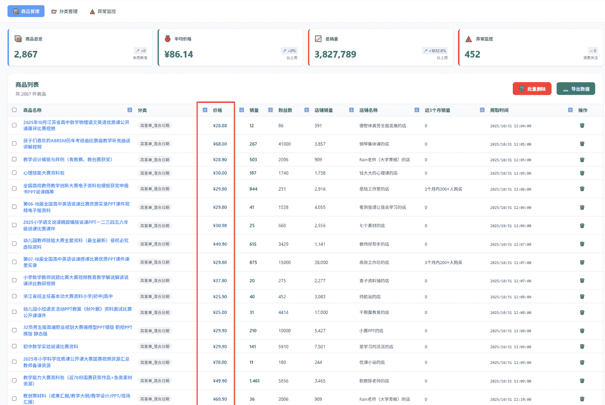

**筛选出相对高客单的产品**

这个筛选一做出来，我发现了很多之前完全没注意到的细分市场。

比如一些专业考试资料、小众比赛材材料、国外竞赛资料、国外k12资料，客单价都在几十到上百元，但做的人很少。这些领域需求虽然不大，但确实存在，而且用户付费意愿很强。

找到一些完全没听过的品类，销量不错，客单都还挺高的

我们借助杂货铺大量上品的优势，集中性去做一些相对细分高客单的产品，这个上品做起来也非常省事

然后再专挑一些细分领域去做垂直类店铺，有些品能有一两百的客单，我们虽然出单不多，但是算下来也有几千元了。更关键的是，这些垂直店铺因为专注，权重积累得更快，后续的搜索流量也更精准。

**做了一**段时间高客单产品之后，我发现了一个特别大的好处：省事。

低客单产品，9.9元、19.9元的那种，虽然出单量大，但各种问题也多。有人买了不会用要教、有人觉得内容不全要退款、有人挑三拣四要求一大堆。

但高客单产品的用户完全不一样。这些人一般都是刚需购买，目标很明确，付完款拿到资料就走了。基本不会来问东问西，资料有点小问题也懒得找你，可能觉得不值得为这点事浪费时间。

**基本上没有任何的客服消息**

**有些生意虽然销量小,但赚的是轻松钱。一个月卖100单客单价10元的产品，和卖10单客**单价100元的产品，虽然营收一样，但后者带给你的时间自由和心理轻松程度完全不同。

## 一套可复制的快速起店SOP

故事讲完了，接下来给大家讲一套我们团队目前依旧在用的快速起店SOP

只要执行到位，基本上第一个月就能起店成功！

下面是我们之前分享过的教程，里面有完整的操作框架，这里我就不挨着挨着讲了，这里主要讲一些操作重点

感兴趣的可以去看看里面的内容：[📕虚拟电商，起单店，投放，规模化放大，干货纯享版](https://o7nsrridj4.feishu.cn/wiki/LLLswEE1iidGhakVjR0c5h9Bnic?from=from_copylink)

### 选品

做了十多家店之后，五十多个账号后，我发现很多人选品其实是在凭感觉。

"我觉得这个品应该好卖"、"别人做K12资料赚钱，我也做K12资料"——这种凭感觉的选品方式，成功率真的很低。你看别人做起来了,可能是人家有你不具备的资源或运气。而你都不具备！

后来我慢慢摸索出一套相对科学的选品方法，核心就是一句话：选品的本质不是"选"，而是"测"。

你永远不可能在上架前就100%确定这个品能不能卖,但你可以通过快速测试来验证。说白了，这个过程其实就是通过测试来建立数据反馈回路。

#### **选品要回答的三个问题**

我现在选品会强迫自己回答三个问题,这三个问题都通过了,才会决定测这个品:

**①需求端：用户真的需要吗？**

不是我觉得用户需要，而是用户真的在找、在问、在买。

我一般用两个方法来判断需求：

第一个，用聚光的关键词搜索工具看搜索量。搜索量大，说明关注的人多，需求基本就在那里。

第二个，直接去📕搜这个关键词，看笔记数量、点赞数、评论区。如果评论区有很多人在问"求分享"、"有没有XX"，说明需求没被满足好，这就是机会。

**比如有一次我搜"公考面试"，搜索量挺高的，但翻评论区发现很多人在问"有没有最新的面**试话术模板"。这说明虽然大方向很卷，但这个细分需求还没被满足好，反而可能有机会。

**聚光关键词规划工具**

② 供给端：现有的解决方案够好吗？

不是看有没有竞品，而是看竞品做得好不好。

如果竞品销量很高、价格合理、内容也做得很精细，说明市场已经被充分满足了，你去做大概率很难突围。

但如果你发现竞品普遍质量不高、内容陈旧、或者价格虚高，那就有机会。

**现**在大市场基本都被挖得差不多了，要找机会得往细分了去看。不是说大类目不能做，而是要找大类目里还没被满足好的细分需求。

几千、几万销量：竞争大词，不适合直接做，需要进一步细分品类

几十、几百销量：细分蓝海词，可以直接入局

③ 自身端：我能做得比别人好吗？

这个最容易被忽略，但其实最重要。

不是所有机会都适合你。你要想清楚自己有什么优势，能不能做出差异化。

比如别人做小语种资料赚钱，但你不懂小语种也没资源，硬要跟大概率做不好。但如果你本身是英语老师老师，或者团队里有懂教育的人，那做学习资料就是在发挥优势。

这三个问题的交集,就是你应该做的品。

#### 实操指南

说点具体的操作方法。我们现在依旧主要用千帆市场行情来找品，这是📕官方的数据工具，免费的。

路径是：千帆网页端 → 数据中心 → 市场行情

我主要看两个地方：

**热卖榜：学习别人怎么做**

看最近哪些品卖得好，点进去看笔记怎么写的、图片怎么做的。不是照抄，而是学习思路。

比如我看到某个考证资料卖得很好，笔记标题都在强调"最新版"、"2025更新"，我就知道用户很在意时效性。下次做类似品的时候，我也会特别强调这一点。

**成交榜：找不那么卷的机会**

我一般不看排第一第二的品，那些太多人盯着了。我会往后翻，看排在中后位置的店铺都在卖什么。

这些店虽然不是头部，但能进榜单说明有稳定出单，而且做的人相对少一些。

**示例：**

说实话，我现在做了几百个品了，到现在也没办法保证每个品都能起来。

**选**品没有什么绝对的公式，更多是在实践中摸索。关键是不要靠感觉，要基于数据和分析去做判断，然后通过测试来验证。

### 测品

我现在的思路很简单：不要在一个品上死磕，要保持测品的节奏。

我会维护一个选品库，把看到的、觉得有机会的品都记下来。然后分批次去测，这周测5个，下周测5个，看哪个能起数据。不出单就换，出单了就继续做。

**内部持续更新最新可做的品**

#### **我的测品流程**

这套流程我已经重复了很多次，基本上每个新店都是这么跑的。

#### 第一步：选品上架

用前面讲的方法选好品之后，就上架商品。

商品详情页我一般直接参考同行的，封面可以搬也可以模仿着做。定价也看同行，如果不打算投流，我会定得比同行低一点；如果准备投流，可以定高一点，一般20块以上的品才考虑投。

有时候我也会把价格设高一些，然后配一个优惠券。这样用户领券后的实际价格是合理的，但看起来优惠力度很大。

#### **第二步：找对标笔记**

商品上架好之后，我不会马上去做笔记，而是先去找对标。

怎么找？两个方向：

1.  搜这个品销量最高的店铺，看他们哪些笔记出单多，点赞收藏数据好。

1.  直接搜产品关键词，看最近哪些笔记是爆款，数据好的都收藏起来。

这一步很关键。别人已经验证过的爆款笔记，就是你最好的参考模板。

#### **第三步：制作笔记**

**找到对标笔记之后，我会做10篇笔记。注意，**不管你有多少个SKU，先做10篇就够了。

封面和标题直接套用爆款笔记的逻辑，换成自己的资料进行展示。

文案可以用AI批量改写，但要保证至少有3种不同的封面和标题类型，这样才能测出哪种点击率更高。

一开始不要贪多，先把基础数据跑出来再说。

#### **第四步：发布笔记**

10篇笔记可以都发在一个账号，也可以分配到多个账号。我们一般是大号发1篇，其他小号各发2-3篇。

发完之后，就是等数据了。

#### **第五步：观测数据**

发布笔记之后，每天都要看数据。主要看两个地方：

1.  商品数据，看商品访客、支付转化率、实时订单数。

1.  笔记数据，看哪些笔记带来了订单。

根据数据的不同情况，我会采取不同的策略：

**情况1：发了一周，1单没出**

先看有没有商品访客。

如果没有访客，大概率是笔记做得不行，用户根本没点进来。这时候要认真研究对标账号的笔记，看人家封面、标题怎么做的。

如果有访客（20+以上），但就是不出单，可能是品本身不行，或者详情页、定价有问题。可以试着优化详情页，或者降价、加个优惠券。

**情况2：发了一周，零散出了几单**

先看商品转化率。虚拟产品的基础转化率一般在10%左右，如果不到这个数，就要优化详情页或者调整价格。

如果转化率还可以，那就再补5-10条笔记，看能不能出更多单。

情况3：发了一周，每天都能稳定出单

恭喜你，这个品大概率是个好品。

这时候不要急着去测新品，而是要围绕这个品继续做笔记。看哪条笔记出单多，就围绕这条笔记的风格继续裂变。

不要只看笔记的点赞收藏数，要看哪条笔记真正带来了订单。有时候数据好看的笔记不一定出单，反而有些看起来平平无奇的笔记能持续转化。

**测品这件事，不出单是常态。你可能测10个品，只有2-3个能起来，这很正常。不要因为一个品没起来就气**馁，继续测下一个就行。每一次测试，不管成功还是失败，都是在积累经验。慢慢地，你就能感觉到哪些品有机会、哪些品大概率不行。

### 笔记制作

**前面讲了选品和测品的逻辑，但**说实话，再好的品，笔记做不好也白搭。

我见过太多人选品选得挺准，结果笔记做得一塌糊涂，图片模糊、排版乱七八糟、内容文案一长串，还全是AI写的。用户根本不会点进来，更别说下单了。

关于笔记制作的具体流程，之前已经分享很多了，你也大概率看过很多人的内容！这里就不讲整体流程了

只说几个我踩过坑之后总结出来的核心细节。这些细节看起来不起眼，但真的会影响你的出单。

#### **几个必须注意的操作细节**

1.  **用电脑做图，别用手机**

我要说三遍：用电脑做图，用电脑做图，用电脑做图。

刚开始很多人图省事，直接用手机做图发笔记。结果发现图片质量真的不行，放大之后很模糊，排版也很浮夸，用户体验很差。虽然用电脑麻烦一点，但这个步骤真的不能省。

1.  **封面要1:1模仿爆款笔记**

很多人做封面喜欢加自己的"创意"，结果做出来四不像。

我的做法很简单：找到对标的爆款笔记，看人家封面怎么排版的、用什么颜色、放了哪些元素，然后1:1照着做。不是让你直接搬运，而是模仿这个结构和风格。

**别人已经用数据验证过的爆款样式，就是最好的**模板。先照着做，等有经验了再说创新的事。

1.  **资料展示要截图清晰**

这个特别重要，因为我们卖的是虚拟资料，用户买之前最关心的就是资料长什么样。

如果你的截图模糊，用户根本看不清内容，怎么会下单？

我的经验是：如果电脑屏幕分辨率不高，先把资料下载到本地，用WPS导出高清图片。如果图片里的内容不方便理解，可以在封面上加个小字说明，突出资料的卖点。

wps导出图片

稿定设计调整图片

1.  封面、标题、正文要匹配搜索关键词

这个很多人容易忽略。你的笔记要能被用户搜到，就必须带上核心关键词。

比如你卖的是"公考面试话术"，那封面、标题、正文里就要出现"公考"、"面试"、"话术"这些词。但也不要堆砌关键词，太营销化反而会被限流。

**我**一般是在标题里自然地带上关键词，封面图上也会加一两个核心词，正文第一段再重复一次。这样既能保证被搜到，又不会太刻意。

1.  **文案不要写太多**

刚开始我做笔记的时候，总想着多写点，把产品说清楚。结果写了五六百字，用户根本没耐心看完。

后来我发现，文案简短反而效果更好。控制在200字以内，简单说清楚这是什么资料、能解决什么问题、有什么特点就够了。

**用**户刷📕的时候，注意力很分散。你的文案越简洁干净，他们越容易接受。长篇大论反而让人失去耐心。而且内容写得越多，越容易违规

做了这么多笔记，我最大的感悟是：

**笔**记制作是个基本功，但也是个持续优化的过程。不要指望一开始就做得很完美，关键是要保持测试和迭代的节奏。做多了，自然就有手感了。

**我现**在做笔记的节奏是：先按照对标爆款的风格做出10篇，发出去看数据。如果点击率不好，就调整封面；如果有访客但不出单，就优化详情页和文案。每次调整都是基于数据反馈，而不是凭感觉。

### 数据分析

📕的转化路径其实很清晰，一共5步：

曝光 → 笔记点击 → 商品点击 → 商品下单 → 商品支付

每一步都会有损耗。我的做法是：找到损耗最大的那一步，重点去优化它。不要眉毛胡子一把抓，先解决最大的瓶颈。

#### 核心的一些数据参考：

##### **笔记内容数据**

1.  **封面点击率**

1.  **封面点击率高，笔记小眼睛数多**

1.  8%达标：封面及格，能用

1.  12%优秀：封面很棒，重点推广

1.  **笔记互动率**

1.  检验商品笔记的内容力：互动率高，笔记小眼睛数多

1.  3%达标：内容还不错

1.  5%优秀：内容很棒

1.  如果是非商品笔记，则要达到10%的互动率

##### 商品数据

1.  **种草转化率**

1.  **笔记支付金额：检验笔记出单能力**

1.  笔记支付金额

1.  笔记支付单量

1.  笔记商品点击率：检验笔记的转化力

1.  10%达标：笔记有带货能力

1.  15%优秀：笔记转化力很强

1.  **商品转化率**

1.  商品访问及支付转化率：检验商品的转化力

1.  10%达标：商品页面合格

1.  20%优秀：商品转化力强

##### 观测数据

+   不要急于下结论，给数据一点时间，大概等待1周左右

+   要有一定数据量，500--1000个小眼睛数，数据稳定后再做决策

### 新手实操sop(每一步都很重要，认真看！)

前面讲了那么多选品、测品、笔记制作、数据分析的方法论，可能有人会觉得有点绕。

这里我把整个起店流程浓缩成一个简单的SOP，特别适合**新手。你不用想太多，照着这**个步骤做就行。每一步都很重要，不要跳过。

#### **第一步：准备4个账号**

开一个店铺号，再开3个主理人账号。

这4个账号的流量都要是正常的，不要用那种刚注册完、从来没发过内容的新号。最好是有一定活跃度的账号

#### **第二步：每天积累选品库**

打开千帆-市场行情，每天去刷一遍。

**看**热卖榜和成交榜，找那些数据不错、你觉得可以跟的品，收集起来。不用马上做，先记下来，慢慢积累成一个选品库。

当然，如果你有自己的经验和判断，也可以根据自己的想法来选品。千帆只是一个参考工具，不是唯一标准

#### 第三步：找对标笔记，做10篇笔记

从选品库里挑一个品，去找对标的优质笔记。

找到之后，直接1:1模仿着做。封面怎么排版、标题怎么写、文案怎么说，都照着做。不要加自己的"创意"，就是抄作业。

做10篇笔记，2-3种不同风格的封面。

#### **第四步：发布笔记，等一周**

10篇笔记做好之后，发出去。可以都发在店铺号，也可以分配到4个账号上。我一般是店铺号发1篇，其他3个主理人号各发3篇。

发完之后，什么都不用管，等一周。

不用每天盯着看数据，不用纠结笔记小眼睛数多不多，就看一个指标：有没有出单。

#### 第五步：一周后复盘，补笔记/测新品

一周后，回来看看这个品出单了没有。

如果有品出单了，就回到这个品上，再补5-10条笔记。如果补了5-10条之后还能持续出单，就再补10条。

注意：不是一次性补很多条，而是一批一批地补。出单就补，不出单就停。

没出单，也很正常，这个品就过了，继续做下一个品，不要纠结。

#### 第六步：爆品要狠狠打，普通品见好就收

如果一个品能稳定每天出单，甚至出单越来越多，恭喜你，这就是个爆品。

这时候要**集中火力打这个品。**补笔记的节奏可以快一些，一般的品补到30条笔记左右就够了，很爆的品可以补到大几十条、上百条。

但如果一个品只是零零散散出单，不温不火，那就见好就收。补个20-30条笔记，不要投入太多精力。把精力放在继续测新品上。

#### 第七步：保持选品与测品的节奏

**就是这样不断循环：选品 → 做笔记 → 发布** → 等一周 → 看出单 → 测下一个。

保持这个节奏很重要。很多人容易在一个品上死磕，迟迟不愿意换品。但其实时间就是在这种犹豫中浪费掉的。

你的目标是找到那些在你手上能起量的品，而不是证明某个品一定能行。

这就是我的起店SOP，7个步骤，循环往复。其实没有捷径。

**就是不断选品、不断测试、不断复盘、不断积累经验。做的品多了，你自然**就知道什么品有机会、什么笔记能出单。只要你坚持按这个节奏做，总会测出能爆单的品。

我自己也是从完全的新手一路摸索过来的。刚开始选品靠感觉，测品没章法，笔记**做得也不好。但就是这样一步**步试错、一点点积累，慢慢才有了现在这套相对稳定的方法。这条路不难走，但需要耐心。

---

好啦！以上就是我这次的分享，都是自己手敲的，一共有1.2w+字！如果你看到这里还没离开，肯定很有耐心

如果你觉得内容挺有价值的，可以回到星球里，给我点个赞！非常感谢

当然，也可以转发给需要的朋友！

祝你早日测出爆品，早日起店成功！！！