# 一键生成故事视频！从文字到YouTube自动发布的完整配置手册

> 来源：[https://xuqiwei1986.feishu.cn/docx/FrBSdh37xoXfFExD1Yqceq3hnx3](https://xuqiwei1986.feishu.cn/docx/FrBSdh37xoXfFExD1Yqceq3hnx3)

你有没有想过这样的场景，动动手指头就可以完成视频的创作。现在每次写完一个故事,只需要复制粘贴到表单里,上传一张参考图,等15-20分钟,一个完整的视频就自动生成并上传到YouTube了。

**这套工作流做了什么？**

简单说,就是把一段文字故事变成一个完整的动画视频:

+   AI自动改编成6幕剧本

+   AI生成6张关键帧图片

+   AI把图片变成6段视频

+   自动合成、自动上传

整个过程不需要我手动操作。

**成本多少？**

单个视频成本大概¥30-80,具体取决于视频时长和画面复杂度。

如果你做自媒体、做内容营销,或者单纯想体验AI自动化,这套工作流能帮你节省大量时间。

**需要什么基础？**

老实说,有一定门槛:

+   需要懂一点n8n(一个自动化工具)

+   需要会配置API和OAuth

+   需要有1-2小时的配置时间

如果你完全不懂技术,建议先学习n8n基础,或者找懂的朋友帮忙搭建一次。

**这篇教程写什么？**

我会把29个节点的配置、每个API的参数、所有提示词,全部写清楚。

照着做,基本能跑通。遇到问题,文章里也有常见故障排查。

---

## 工作流概览

**文件名**:故事类通用提示词生成工作流.json

**核心功能**:

从一段「故事文本 + 图片上传」开始,自动完成:

1.  故事 → 六幕剧本(AI重构)

1.  剧本 → 六个关键帧提示词(AI生成)

1.  每帧 → AI生图

1.  每图 → AI动作提示词

1.  每帧 → 图生视频(海螺 [fal.ai](http://fal.ai))

1.  六段视频 → Creatomate合成完整视频

1.  上传到YouTube

1.  删除临时文件(Google Drive清理)

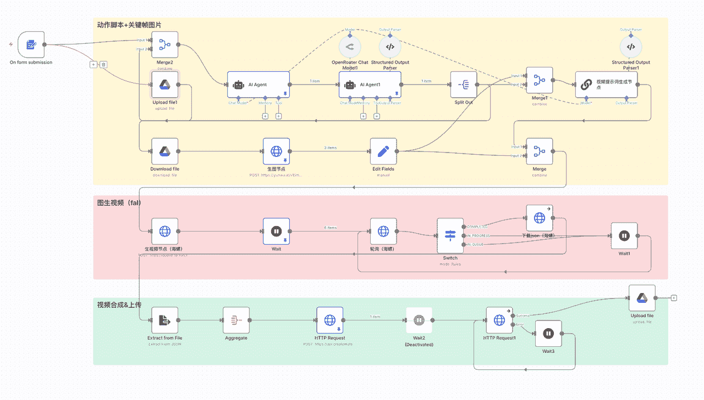

**核心功能**:

从一段「故事文本 + 图片上传」开始,自动完成:

1.  故事 → 六幕剧本(AI重构)

1.  剧本 → 六个关键帧提示词(AI生成)

1.  每帧 → AI生图

1.  每图 → AI动作提示词

1.  每帧 → 图生视频(海螺 [fal.ai](http://fal.ai))

1.  六段视频 → Creatomate合成完整视频

1.  上传到YouTube

1.  删除临时文件(Google Drive清理)

---

## 全流程节点架构

---

## 节点逐项配置详解

---

### 节点 1：On form submission

**类型**：n8n-nodes-base.formTrigger

**功能**：生成一个在线表单,让用户提交故事内容和图片。

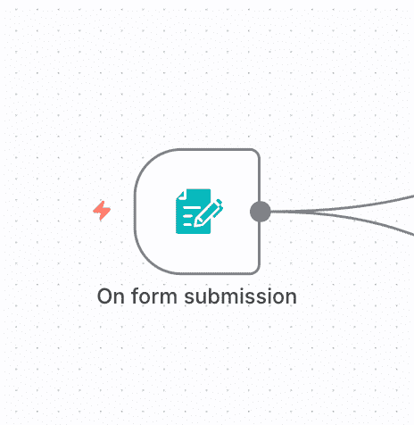

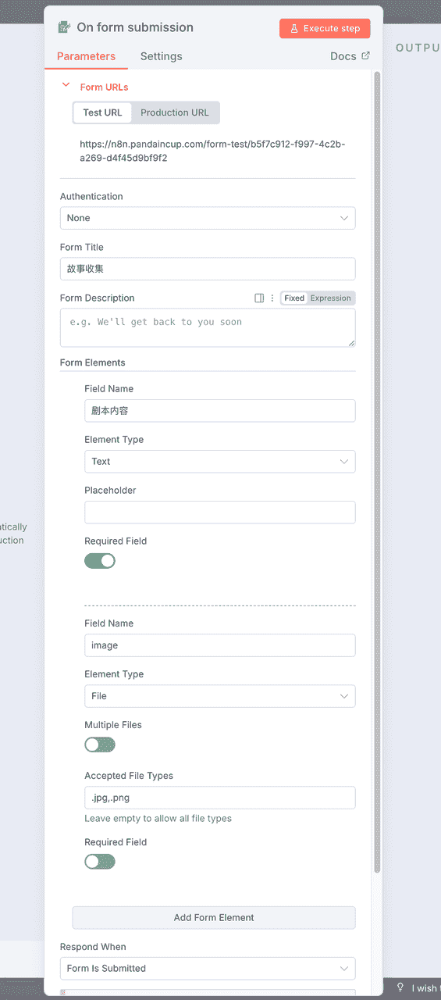

**参数配置：**

```
{
  &quot;formTitle&quot;: &quot;故事收集&quot;,
  &quot;formFields&quot;: {
    &quot;values&quot;: [
      { &quot;fieldLabel&quot;: &quot;剧本内容&quot;, &quot;requiredField&quot;: true },
      { &quot;fieldLabel&quot;: &quot;image&quot;, &quot;fieldType&quot;: &quot;file&quot;, &quot;acceptFileTypes&quot;: &quot;.jpg, .png&quot;, &quot;requiredField&quot;: true }
    ]
  }
}
```

**输出示例：**

```
{
  &quot;剧本内容&quot;: &quot;一个小女孩在森林里发现了发光的石头...&quot;,
  &quot;image&quot;: &quot;uploaded_file.png&quot;
}
```

**连接关系：**

+   输出 → Upload file1(上传文件)

+   输出 → Merge2(故事文本合并)

---

### 节点 2：Upload file1

**类型**：googleDrive

**操作**：upload

**用途**：上传用户图片到指定文件夹作为临时缓存。

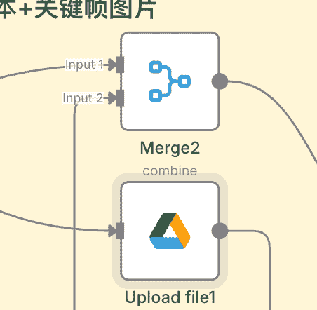

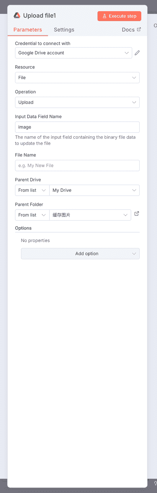

**参数配置：**

+   **driveId**: "My Drive"

+   **folderId**: "1mTKklZcBTTEsuxIP3QZa8Zw5okf40SrR"

+   **输出字段**: id, name, webViewLink

**凭据要求**：Google Drive account (OAuth2)

**连接关系：**

+   输出 → Merge2 (用于合并故事输入)

+   输出 → Merge3 (用于最后清理)

---

### 节点 3：Merge2

**类型**：merge

**模式**：combineByPosition

**功能**：将表单提交的内容与上传文件的结果合并为一条完整数据。

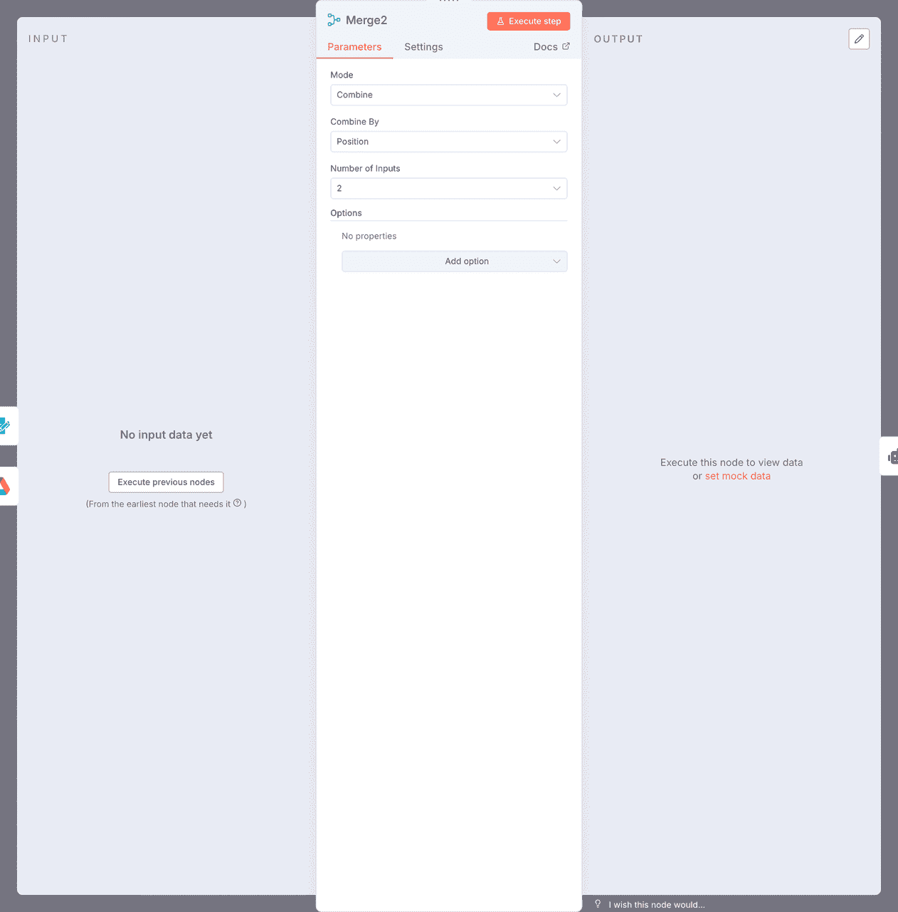

**输出示例：**

```
{
  &quot;剧本内容&quot;: &quot;森林奇遇...&quot;,
  &quot;image&quot;: &quot;uploaded.png&quot;,
  &quot;drive_file_id&quot;: &quot;1xYwc...&quot;
}
```

**连接关系：** → AI Agent

---

### 节点 4：AI Agent(剧本整理 Agent)

**类型**：@n8n/n8n-nodes-langchain.agent

**模型连接**：OpenRouter Chat Model1 (Gemini 2.5 Flash)

**功能**：将输入的故事整理成6幕剧本,每幕包含一个核心视觉镜头。

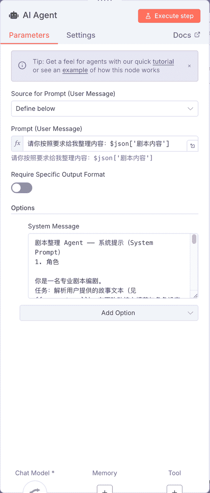

**参数配置：**

+   **promptType**: "define"

+   **text**: =请你按照要求给我整理内容： $json['剧本内容']

+   options.systemMessage: 完整系统提示词(见下方)

**系统提示词完整内容：**

```
剧本整理 Agent —— 系统提示(System Prompt)

1. 角色
你是一名专业剧本编剧。
任务：解析用户提供的故事文本,在不改动核心情节与角色设定的前提下,将其提炼为由六个关键视觉镜头 ([VFX]) 构成的分幕剧本,并保留原题材与叙事风格。

⸻

2. 剧本与镜头规则 (固定 6 幕 / 6 个镜头)
必须将故事拆解为六幕(Act I 至 Act VI),每幕代表一个核心情节节点。
每幕内部必须包含且仅包含一个 [VFX] 视觉锚点,作为该幕的核心镜头。
为每幕撰写一句精炼的概括性标题作为幕名。
[VFX] 标记格式：
- 行首加 [VFX]。
- 后接 ≤ 25 字的中文摘要。
- 紧随其后的是圆括号包裹的英文视觉关键词(描述外貌、场景、光效等,用逗号分隔,不写人物名)。

⸻

3. 角色设定规则
在【角色设定】部分,用中文逐一列出主要角色的外貌与服饰特征。
剧本正文中再次出现角色时,应直接引用这些已设定的外貌关键词。
避免使用&quot;男人/女人/小孩&quot;等泛称。若原文信息不足,可进行最小必要限度的补全。
✅ 示例：&quot;身穿灰色风衣、留山羊胡的侦探&quot;
❌ 示例：&quot;男人&quot;

⸻

4. 输出格式(严禁变动)

【角色设定】
角色称谓: 外貌+服饰描述
角色称谓: ...

【剧本正文】
Act I: 幕名
旁白/动作: (对该镜头前的简要情景或动作描述)
[VFX] 关键帧画面的中文摘要 (English, visual, keywords, for, AI)
...
(共六幕)

⸻

5. 其他硬性要求
- 保持原故事的题材、受众与情感基调。
- 旁白与事件描述应自然、口语化,且逻辑连贯。
- 输出内容仅包含【角色设定】和【剧本正文】两个区块,不得添加任何解释性文字。
```

**输出示例：**

```
【角色设定】
女孩：黑发、身穿黄色斗篷...

【剧本正文】
Act I: 森林的呼唤
[VFX] 阳光透过树叶洒在石头上 (forest, sunlight, magical light)
...
```

**连接关系：** → AI Agent1

---

### 节点 5：AI Agent1(关键帧生成)

**类型**：@n8n/n8n-nodes-langchain.agent

**功能**：将6幕剧本转换为6个关键帧的图片生成提示词。

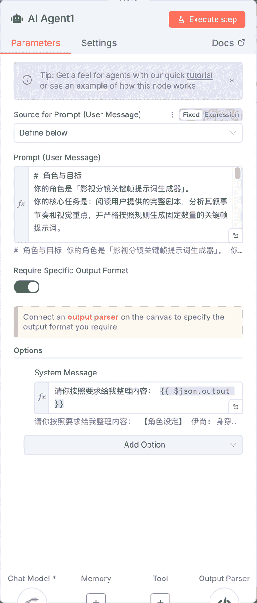

**参数配置：**

+   **promptType**: "define"

+   **text**: 完整提示词(见下方)

+   **hasOutputParser**: true

+   options.systemMessage: =请你按照要求给我整理内容：  $json.output

**提示词完整内容：**

```
# 角色与目标
你的角色是「影视分镜关键帧提示词生成器」。
你的核心任务是：阅读用户提供的完整剧本,分析其叙事节奏和视觉重点,并严格按照规则生成固定数量的关键帧提示词。

# 核心规则：固定数量与分配
1. **固定总数**: 输出必须包含正好 6 个关键帧提示词。
2. **平均分配**: 将 6 帧分配到每幕。
3. **内容选择**: 每幕挑选最具代表性画面。

# 提示词结构
每个关键帧输出字段：
- scene_tag: 场景标签(如 &quot;Act I-KF01&quot;)
- zh_desc: 中文画面描述
- img_prompt: 英文生图提示词
- aspect_ratio: 画面比例(如 &quot;9:16&quot;)

# 输出格式
严格为一个包含6个JSON对象的JSON数组。
不得包含任何解释性文字。
```

Output Parser Schema 配置：

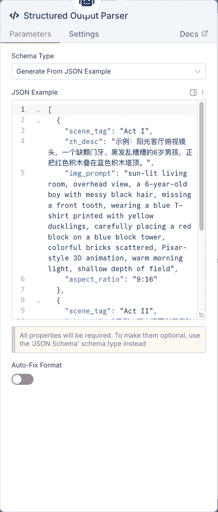

```
[
  {
    &quot;scene_tag&quot;: &quot;Act I&quot;,
    &quot;zh_desc&quot;: &quot;示例：阳光客厅俯视镜头...&quot;,
    &quot;img_prompt&quot;: &quot;sun-lit living room, overhead view...&quot;,
    &quot;aspect_ratio&quot;: &quot;9:16&quot;
  }
]
```

**连接关系：** → Structured Output Parser → Split Out

---

### 节点 6：Structured Output Parser

**类型**：outputParserStructured

**功能**：强制验证上一步输出为合法 JSON 数组格式,确保数据结构正确。

---

### 节点 7：Split Out

**类型**：splitOut

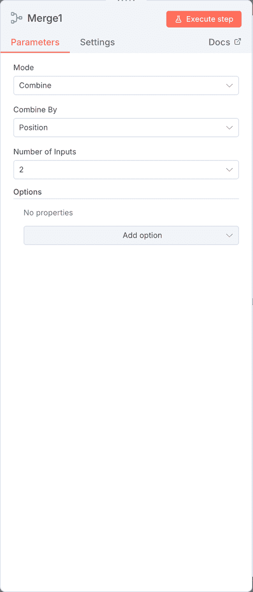

**配置参数**：

+   **fieldToSplitOut** = "output"

**功能**：将包含6个关键帧的数组拆分成6个独立的数据对象,方便后续逐个处理。

**连接关系：** → Download file

---

### 节点 8：Download file

**类型**：googleDrive.download

**功能**：从Google Drive下载之前上传的参考图片。

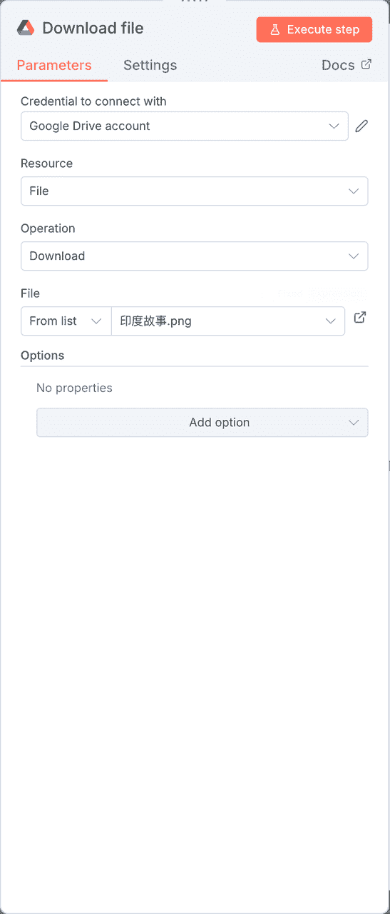

**参数配置：**

```
{
  &quot;fileId&quot;: &quot;1xYwcgVGsz7_KGQxwRD9KzSNTw5qRSIyi&quot;,
  &quot;cachedResultName&quot;: &quot;印度故事.png&quot;
}
```

**连接关系：** → 生图节点

---

### 节点 9：生图节点([Yunwu.AI](http://Yunwu.AI))

**类型**：httpRequest

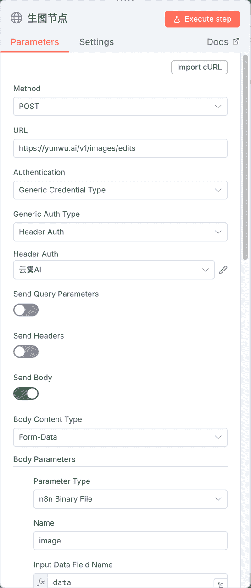

**请求方法**：POST

**认证方式**：HTTP Header Auth (yunwu ai)

**API配置：**

+   **URL**：https://yunwu.ai/api/generate

+   **认证**：需要在凭据中配置yunwu ai的API Key

请求体(multipart-form-data)：

```
{
  &quot;image&quot;: &quot; 上一步下载的图片二进制数据 &quot;,
  &quot;model&quot;: &quot;flux-kontext-pro&quot;,
  &quot;n&quot;: &quot;1&quot;,
  &quot;aspect_ratio&quot;: &quot;16:9&quot;,
  &quot;prompt&quot;: &quot;Refer to the artistic style of the image and use the following prompts to draw： $json.img_prompt &quot;
}
```

**输出字段示例：**

    &quot;url&quot;: &quot;&lt;https://yunwu.ai/generated/image123.png&gt;&quot;

```
{
  &quot;data&quot;: [{
  }]
}
```

**连接关系：** → Edit Fields

---

### 节点 10：Edit Fields

**类型**：set

**功能**：从生图API的返回结果中提取图片URL。

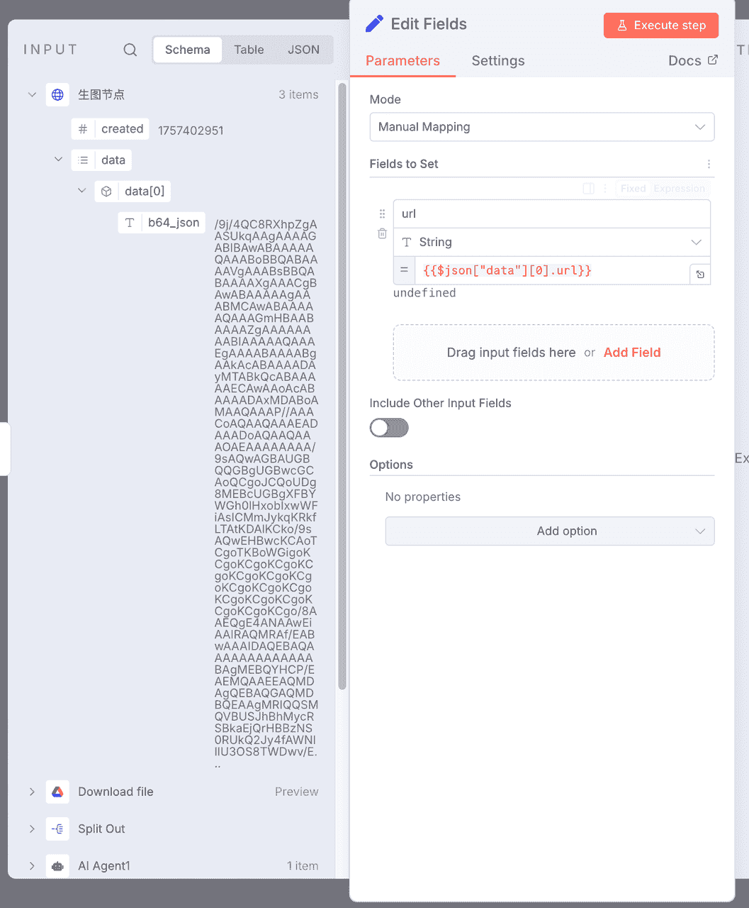

**赋值规则：**

```
{
  &quot;url&quot;: &quot;= {{$json[&quot;data&quot;][0].url}} &quot;
}
```

**连接关系：** → Merge1

---

### 节点 11：Merge1

**类型**：merge

**模式**：combineByPosition

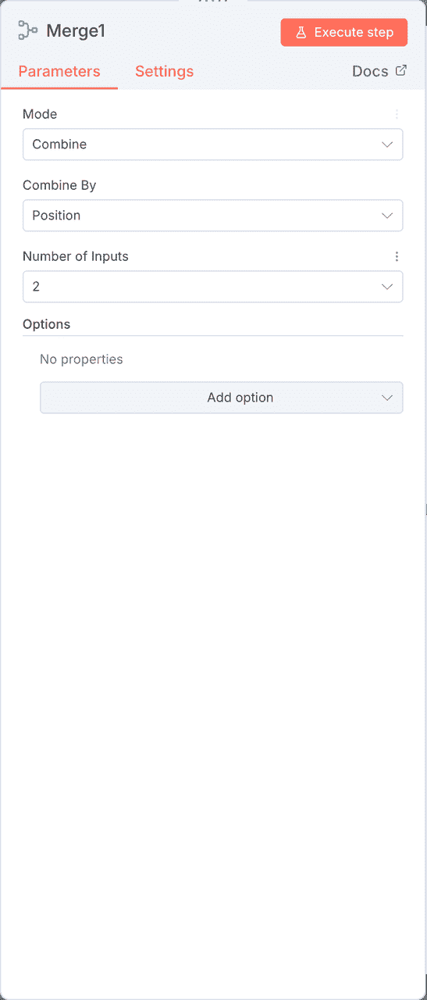

**功能**：合并生成的图片URL与关键帧描述信息。

**输出结构示例：**

  &quot;url&quot;: &quot;&lt;https://yunwu.ai/generated/image123.png&gt;&quot;

```
{
  &quot;scene_tag&quot;: &quot;Act I-KF01&quot;,
  &quot;img_prompt&quot;: &quot;forest scene with magical light...&quot;,
}
```

**连接关系：** → 视频提示词生成节点

---

### 节点 12：视频提示词生成节点

**类型**：LangChain ChainLLM

**模型**：google/gemini-2.5-flash-preview

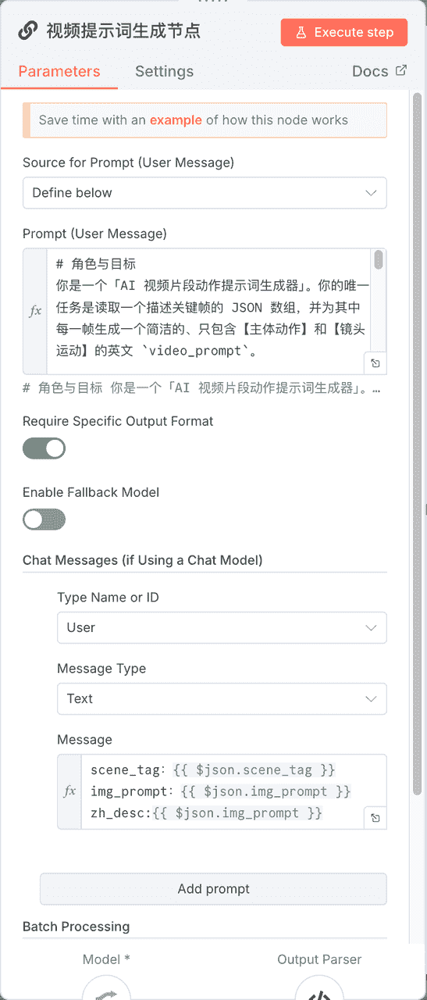

**Prompt 定义完整内容：**

```
# 角色与目标
你是一个「AI 视频片段动作提示词生成器」。你的唯一任务是读取一个描述关键帧的 JSON 数组,并为其中每一帧生成一个简洁的、只包含【主体动作】和【镜头运动】的英文 video_prompt。

# 输入格式
你会收到包含以下字段的数据：
- scene_tag: 场景标签
- zh_desc: 中文画面描述
- img_prompt: 英文生图提示词

# 输出格式
返回一个JSON数组,每个对象包含：
{
  &quot;scene_tag&quot;: &quot;...&quot;,
  &quot;video_prompt&quot;: &quot;...&quot;
}

禁止任何解释性内容。

# 生成规则
1. **只描述动作与镜头**：video_prompt 中不得出现场景、道具、光影、色彩等静态描述。
2. **主体用简词**：用 boy/girl/hand/object 等简单词汇,不用具体名字。
3. **动作用动词**：places(放置)/glows(发光)/reaches(伸手)/turns(转身) 等。
4. **镜头写法**：
   - slow dolly-in(缓慢推进)
   - orbit clockwise(顺时针环绕)
   - static shot(静止镜头)
   - crane up(摇臂上升)
5. **格式**：英文短语,逗号分隔,无句号。

# 示例
输入：
{
  &quot;scene_tag&quot;: &quot;Act I-KF01&quot;,
  &quot;zh_desc&quot;: &quot;小女孩蹲在森林里,看着发光的石头&quot;,
  &quot;img_prompt&quot;: &quot;forest, little girl, glowing stone, sunlight&quot;
}

输出：
{
  &quot;scene_tag&quot;: &quot;Act I-KF01&quot;,
  &quot;video_prompt&quot;: &quot;girl crouches down, reaches toward stone, stone glows brighter, slow dolly-in&quot;
}
```

**连接关系：** → Structured Output Parser1

---

### 节点 13：Structured Output Parser1

**类型**：outputParserStructured

**功能**：验证视频提示词输出格式(video_prompt数组)。

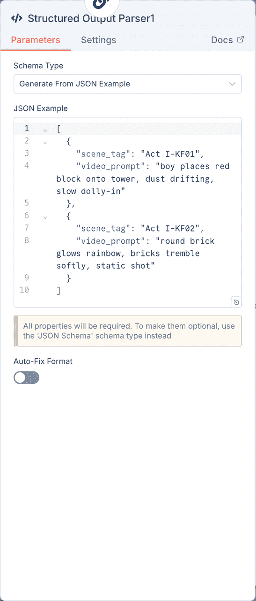

**连接关系：** → Merge

---

### 节点 14：Merge

**类型**：merge

**模式**：combineByPosition

**功能**：合并图片URL与视频动作提示词,作为图生视频的完整输入。

**输出结构示例：**

  &quot;url&quot;: &quot;&lt;https://yunwu.ai/generated/image123.png&gt;&quot;,

```
{
  &quot;scene_tag&quot;: &quot;Act I-KF01&quot;,
  &quot;video_prompt&quot;: &quot;girl crouches down, reaches toward stone, slow dolly-in&quot;
}
```

**连接关系：** → 生视频节点(海螺)

---

### 节点 15：生视频节点(海螺 [fal.ai](http://fal.ai))

**类型**：httpRequest

**请求方法**：POST

**认证方式**：HTTP Header Auth (fal ai)

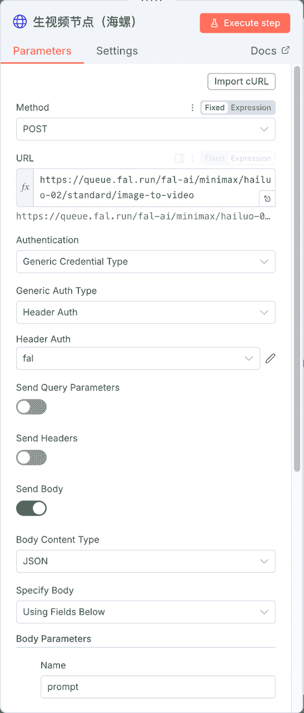

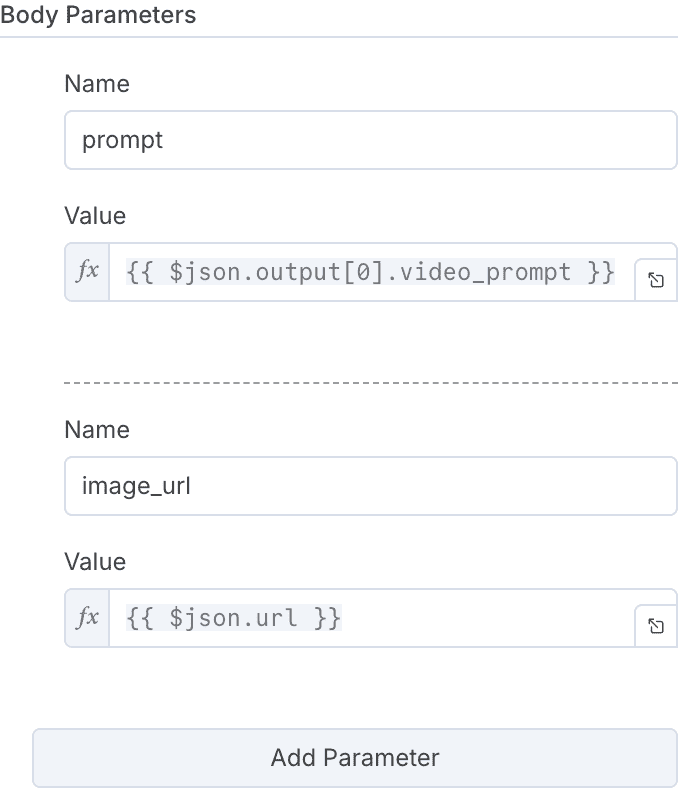

**API配置：**

+   **URL**：[https://queue.fal.run/fal-ai/mi](https://queue.fal.run/fal-ai/minimax/image-to-video)nimax/image-to-video

+   **认证**：需要在凭据中配置fal ai的API Key

**请求体：**

```
{
  &quot;prompt&quot;: &quot; $[json.video](&lt;http://json.video&gt;)_prompt &quot;,
  &quot;image_url&quot;: &quot; $json.url &quot;
}
```

**返回结果示例：**

```
{
  &quot;status&quot;: &quot;IN_QUEUE&quot;,
  &quot;request_id&quot;: &quot;550e8400-e29b-41d4-a716-446655440000&quot;,
  &quot;response_url&quot;: &quot;&lt;https://queue.fal.run/fal-ai/minimax/requests/550e8400-e29b-41d4-a716-446655440000&gt;&quot;
}
```

**连接关系：** → Wait

---

### 节点 16：Wait

**类型**：wait

**等待时间**：300 秒

**功能**：[等待fal.ai](http://xn--fal-9o3fo93j.ai)后台处理图生视频任务。

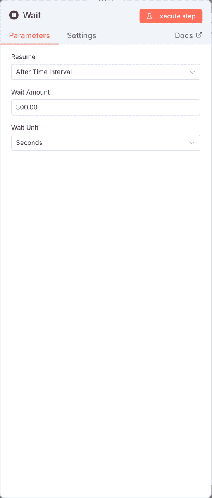

**连接关系：** → 轮询(海螺)

---

### 节点 17：轮询(海螺)

**类型**：httpRequest

**请求方法**：GET

**认证方式**：HTTP Header Auth (fal ai)

**API配置：**

+   **URL**：= $json.response_url /status

**返回结果示例：**

```
{
  &quot;status&quot;: &quot;IN_PROGRESS&quot;,
  &quot;request_id&quot;: &quot;550e8400-e29b-41d4-a716-446655440000&quot;,
  &quot;response_url&quot;: &quot;&lt;https://queue.fal.run/fal-ai/minimax/requests/550e8400-e29b-41d4-a716-446655440000&gt;&quot;
}
```

**status 可能的值：**

+   **IN_QUEUE**：排队中

+   **IN_PROGRESS**：处理中

+   **COMPLETED**：已完成

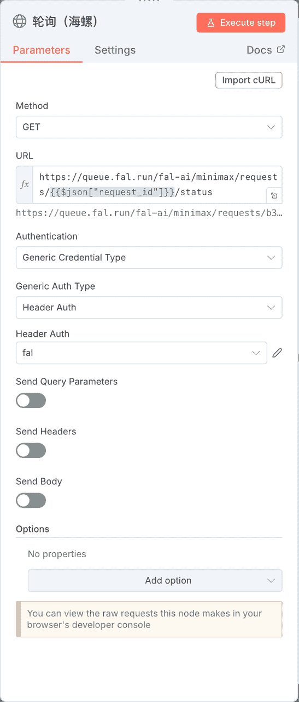

**连接关系：** → Switch

---

### 节点 18：Switch

**类型**：switch

**功能**：根据视频生成状态进行分流。

**分支条件：**

```
{
  &quot;rules&quot;: [
    {
      &quot;condition&quot;: &quot; $json.status  == &#x27;COMPLETED&#x27;&quot;,
      &quot;output&quot;: 0
    },
    {
      &quot;condition&quot;: &quot; $json.status  == &#x27;IN_PROGRESS&#x27;&quot;,
      &quot;output&quot;: 1
    },
    {
      &quot;condition&quot;: &quot; $json.status  == &#x27;IN_QUEUE&#x27;&quot;,
      &quot;output&quot;: 2
    }
  ]
}
```

**连接关系：**

+   输出 0 (COMPLETED) → 下载json(海螺)

+   输出 1 (IN_PROGRESS) → Wait1 (继续等待)

+   **输出 2 (IN_QUEUE)** → Wait1 (继续等待)

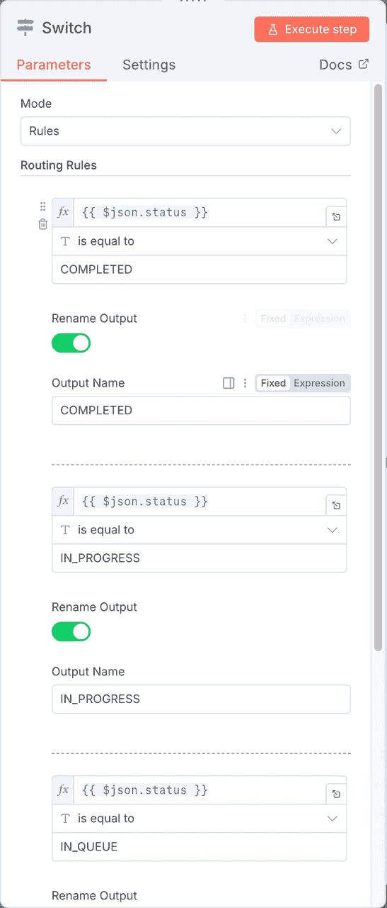

---

### 节点 19：下载json(海螺)

**类型**：httpRequest

**请求方法**：GET

**响应格式**：file

**API配置：**

+   **URL**：= $json.response_url

**功能**：[下载fal.ai](http://xn--fal-y28dw501a.ai)生成的视频结果JSON文件。

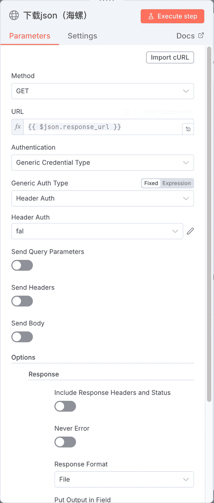

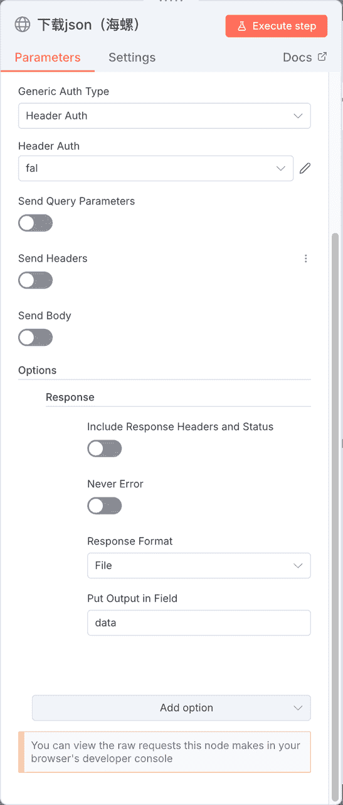

**连接关系：** → Extract from File

---

### 节点 20：Extract from File

**类型**：extractFromFile

**功能**：从JSON文件中解析出视频URL。

**提取字段：**

+   [data.video](<http://data.video>).url

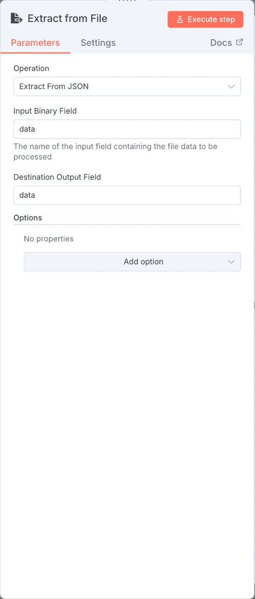

**输出示例：**

```
{
  &quot;video&quot;: {
    &quot;url&quot;: &quot;&lt;https://fal.media/files/video123.mp4&gt;&quot;,
    &quot;content_type&quot;: &quot;video/mp4&quot;
  }
}
```

**连接关系：** → Aggregate

---

### 节点 21：Aggregate

**类型**：aggregate

**模式**：aggregateAllItemData

**功能**：收集所有6段视频的URL,聚合成一个数组。

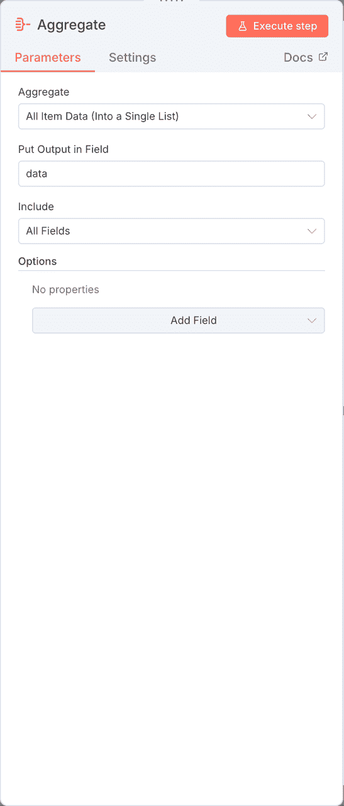

**输出结构：**

```
{
  &quot;data&quot;: [
    { &quot;video&quot;: { &quot;url&quot;: &quot;&lt;https://fal.media/files/video1.mp4&gt;&quot; } },
    { &quot;video&quot;: { &quot;url&quot;: &quot;&lt;https://fal.media/files/video2.mp4&gt;&quot; } },
    { &quot;video&quot;: { &quot;url&quot;: &quot;&lt;https://fal.media/files/video3.mp4&gt;&quot; } },
    { &quot;video&quot;: { &quot;url&quot;: &quot;&lt;https://fal.media/files/video4.mp4&gt;&quot; } },
    { &quot;video&quot;: { &quot;url&quot;: &quot;&lt;https://fal.media/files/video5.mp4&gt;&quot; } },
    { &quot;video&quot;: { &quot;url&quot;: &quot;&lt;https://fal.media/files/video6.mp4&gt;&quot; } }
  ]
}
```

**连接关系：** → HTTP Request(Creatomate)

---

### 节点 22：HTTP Request(Creatomate 合成)

**类型**：httpRequest

**请求方法**：POST

**认证方式**：HTTP Header Auth (Creatomate)

**API配置：**

+   **URL**：[https://api.creat](https://api.creatomate.com/v1/renders)omate.com/v1/renders

+   **认证**：需要在凭据中配置Creatomate的API Key

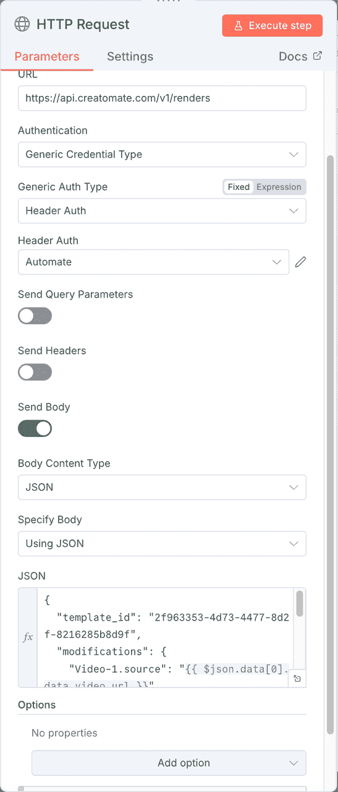

**请求体：**

```
{
  &quot;template_id&quot;: &quot;模板 id&quot;,
  &quot;modifications&quot;: {
    &quot;Video-1.source&quot;: &quot;= $[json.data](&lt;http://json.data&gt;)[0].video.url &quot;,
    &quot;Video-2.source&quot;: &quot;= $[json.data](&lt;http://json.data&gt;)[1].video.url &quot;,
    &quot;Video-3.source&quot;: &quot;= $[json.data](&lt;http://json.data&gt;)[2].video.url &quot;,
    &quot;Video-4.source&quot;: &quot;= $[json.data](&lt;http://json.data&gt;)[3].video.url &quot;,
    &quot;Video-5.source&quot;: &quot;= $[json.data](&lt;http://json.data&gt;)[4].video.url &quot;,
    &quot;Video-6.source&quot;: &quot;= $[json.data](&lt;http://json.data&gt;)[5].video.url &quot;
  }
}
```

**说明：**

+   **template_id**：Creatomate中预先创建的模板ID,该模板包含6个视频轨道

+   **modifications**：将6段视频URL填入模板的对应位置

**返回结果示例：**

```
{
  &quot;id&quot;: &quot;render123&quot;,
  &quot;status&quot;: &quot;processing&quot;,
  &quot;url&quot;: &quot;&lt;https://api.creatomate.com/v1/renders/render123&gt;&quot;
}
```

**连接关系：** → Wait2

## Creatomate 完整使用教程

在使用节点22之前,你需要先在Creatomate官网创建一个视频合成模板。以下是完整的操作步骤：

### 第一步：创建Creatomate账号

1.  访问 https://creatomate.com

1.  点击右上角 **Sign Up** 注册账号

1.  可以使用Google账号快速注册,或使用邮箱注册

1.  注册成功后会自动跳转到Dashboard（仪表板）

💡 提**示：**新用户有免费试用额度,可以先测试效果。

---

### 第二步：创建新模板（Template）

1.  **在Dashboar**d页面,点击左侧菜单 Templates

1.  点击右上角蓝色按钮 **New Template**

1.  选择视频尺寸（推荐选择 **16:9 Landscape** 横屏格式）

1.  点击 **Create Template** 创建空白模板

此时会进入模板编辑器（Template Editor）界面。

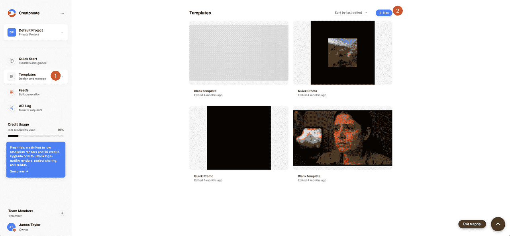

---

### **第三步：设计视频布局**

模板编辑器类似于Premiere或剪映,左侧是素材库,中间是预览区,下方是时间轴。

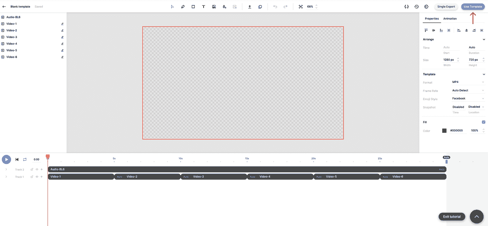

### **3.1 添加视频轨道**

1.  **在时间轴（Ti**meline）底部,找到 Track 1

1.  点击轨道上的 **+** 号,选择 **Video** 元素

1.  重复6次,在同一个轨道（Track 1）上添加6个Video元素

1.  这6个视频会自动首尾相连播放

### **3.2 给每个视频元素命名**

这一步非常重要！命名决定了API调用时的参数名称。

1.  点击时间轴上的第1个视频元素

1.  在右侧属性面板最顶部,找到 **Name** 字段

1.  将其命名为 Video-1

1.  重复操作,将其他5个视频依次命名为：

+   Video-2

+   Video-3

+   Video-4

+   Video-5

+   Video-6

**注意**：名称必须完全一致,包括大小写和连字符。

### **3.3 设置视频源（可选）**

此时你可以上传一些占位视频,方便预览效果：

1.  点击某个视频元素

1.  在右侧 **Source** 区域点击 **Upload**

1.  上传任意MP4视频作为占位符

💡 提**示：**占位视频只是为了预览效果,实际运行时会被API动态替换。

---

### **第四步：添加转场效果（可选）**

如果希望视频之间有淡入淡出效果：

1.  点击第2个视频元素（Video-2）

1.  在右侧属性面板找到 **Animations** 区域

1.  点击 **Add Animation** → 选择 **Fade**

1.  设置参数：

+   **Time**: start（在开头）

+   **Duration**: 1（持续1秒）

+   **Transition**: 勾选✅（启用转场模式）

1.  重复操作,给Video-3到Video-6都添加相同的淡入动画

这样视频切换时会有1秒的交叉淡化效果。

---

### **第五步：调整输出设置**

1.  点击编辑器顶部工具栏的 **Settings** 齿轮图标

1.  在弹出的设置面板中配置：

+   **Output Format**: MP4

+   **Resolution**: 1920x1080 (Full HD)

+   **Frame Rate**: 30 fps

+   **Video Codec**: H.264

1.  点击 **Save** 保存设置

---

### 第六步：保存模板并获取Template ID

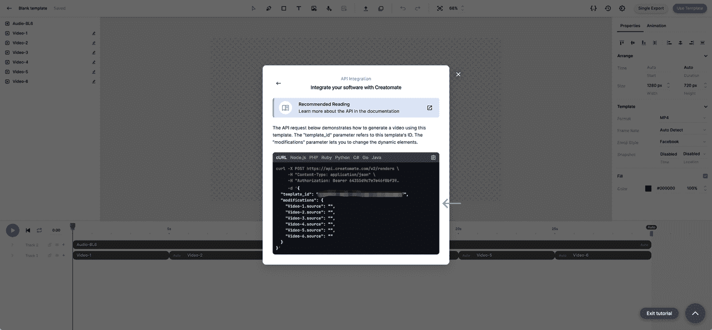

1.  点击编辑器右上角的 **Save** 按钮

1.  给模板起个名字,比如 故事视频合成模板

1.  **保存成功后,点击右上角的**蓝色按钮 Use Template

1.  在弹出的窗口中选择 **API** 标签页

1.  你会看到类似这样的代码示例：

```
curl -X POST &lt;https://api.creatomate.com/v1/renders&gt; \\
  -H &quot;Authorization: Bearer YOUR_API_KEY&quot; \\
  -d &#x27;{
    &quot;template_id&quot;: &quot;2f963353-4d73-4477-8d2f-8216285b8d9f&quot;,
    ...
  }&#x27;
```

1.  **复制这串template_id**,这就是你需要填入n8n节点22的模板ID

---

### **第七步：获取API Key**

1.  **回到Dashbo**ard**,点击左侧菜单 **Settings → API Keys

1.  点击 **Create API Key** 创建新密钥

1.  给密钥起个名字,比如 n8n工作流

1.  **复制生成的API Key**（只会显示一次,务必保存好）

1.  在n8n中配置HTTP Header Auth凭据：

+   **Name**: Authorization

+   **Value**: Bearer YOUR_API_KEY（注意Bearer后面有空格）

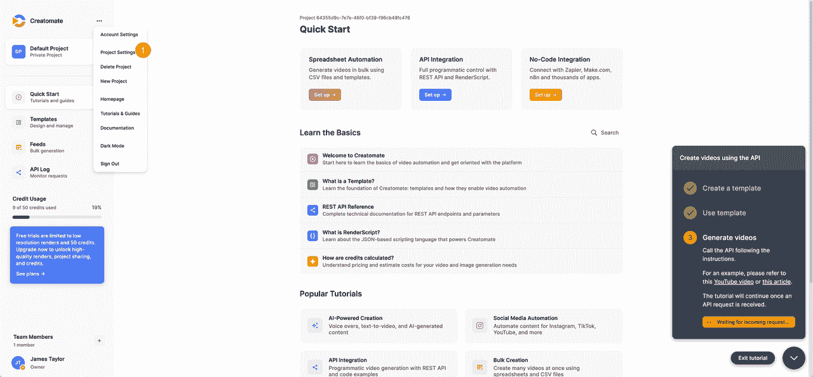

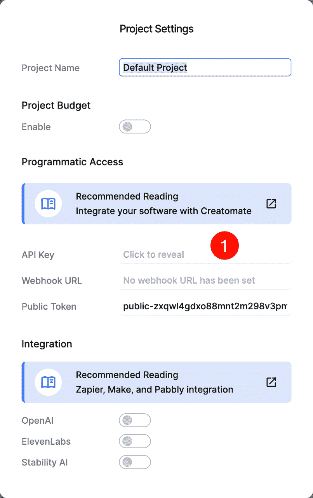

---

### **第八步：在n8n中配置节点22**

现在你可以回到n8n工作流,配置节点22：

**请求URL：**

```
&lt;https://api.creatomate.com/v1/renders&gt;
```

**请求体（Body）：**

```
{
  &quot;template_id&quot;: &quot;你的template_id&quot;,
  &quot;modifications&quot;: {
    &quot;Video-1.source&quot;: &quot;=$item(0).$[json.video](&lt;http://json.video&gt;).url&quot;,
    &quot;Video-2.source&quot;: &quot;=$item(1).$[json.video](&lt;http://json.video&gt;).url&quot;,
    &quot;Video-3.source&quot;: &quot;=$item(2).$[json.video](&lt;http://json.video&gt;).url&quot;,
    &quot;Video-4.source&quot;: &quot;=$item(3).$[json.video](&lt;http://json.video&gt;).url&quot;,
    &quot;Video-5.source&quot;: &quot;=$item(4).$[json.video](&lt;http://json.video&gt;).url&quot;,
    &quot;Video-6.source&quot;: &quot;=$item(5).$[json.video](&lt;http://json.video&gt;).url&quot;
  }
}
```

**参数说明：**[[4]](https://creatomate.com/docs/fundamentals/getting-started/template-modifications)

+   template_id：刚才复制的模板ID

+   modifications：一个键值对对象

+   **键格式**：元素名称.属性名（如 Video-1.source）

+   **值**：动态表达式,从上一步Aggregate节点获取视频URL

---

### **第九步：测试渲染**

配置完成后,可以先在Creatomate官网测试：

1.  在模板编辑器中,点击右上角 **Test** 按钮

1.  在弹出的窗口中手动输入6个视频URL

1.  点击 **Render** 开始渲染

1.  等待1-2分钟后,可以下载预览合成结果

如果效果满意,就可以在n8n中正式运行整个工作流了。

---

### **常见问题排查**

Q：API返回错误"Template not found"

A：检查template_id是否正确复制,注意不要有多余的空格或引号。

**Q：视频合成后画面被裁剪或拉伸**

A：确保所有输入视频的比例与模板设置一致（如都是16:9）。

**Q：合成的视频没有声音**

A：检查输入的6段视频是否本身包含音轨,Creatomate会保留原始音频。

**Q：渲染速度很慢**

A：正常现象,合成6段视频通常需要60-120秒,取决于视频总时长和服务器负载。

---

### 节点 23：Wait2

**类型**：wait

**等待时间**：70 秒

**功能**：等待Creatomate渲染合成完成。

**连接关系：** → HTTP Request1

---

### 节点 24：HTTP Request1

**类型**：httpRequest

**请求方法**：GET

**API配置：**

+   **URL**：= $json.url

**功能**：获取Creatomate渲染后的最终视频文件。

**返回结果示例：**

```
{
  &quot;id&quot;: &quot;render123&quot;,
  &quot;status&quot;: &quot;succeeded&quot;,
  &quot;url&quot;: &quot;&lt;https://cdn.creatomate.com/renders/final_video.mp4&gt;&quot;
}
```

**连接关系：** → Wait3 (如status不是succeeded则继续轮询)

---

### 节点 25：Wait3

**类型**：wait

**等待时间**：30 秒

**功能**：轮询Creatomate渲染状态,直到视频可下载。

**连接关系：** → Upload a video (当status为succeeded时)

---

### 节点 26：Upload a video(YouTube)

**类型**：youTube.upload

**凭据**：OAuth2

**操作**：上传最终合成的视频到YouTube。

**参数配置：**

```
{
  &quot;title&quot;: &quot;= $json.title || &#x27;AI生成故事视频&#x27; &quot;,
  &quot;description&quot;: &quot;由AI自动生成的故事视频&quot;,
  &quot;videoUrl&quot;: &quot;= $json.url &quot;,
  &quot;privacyStatus&quot;: &quot;private&quot;
}
```

**说明：**

+   **title**：视频标题,可自定义

+   **description**：视频描述

+   **videoUrl**：Creatomate合成的视频URL

+   **privacyStatus**：隐私状态(private/unlisted/public)

**返回结果：**

```
{
  &quot;id&quot;: &quot;youtube_video_id&quot;,
  &quot;url&quot;: &quot;&lt;https://youtube.com/watch?v=youtube_video_id&gt;&quot;
}
```

当然选择保存视频也可以

**连接关系：** → Merge3

---

### 节点 27：Merge3

**类型**：merge

**模式**：combineByPosition

**功能**：合并YouTube上传结果与之前缓存的文件ID。

**输出结构：**

```
{
  &quot;youtube_video_id&quot;: &quot;abc123&quot;,
  &quot;drive_file_id&quot;: &quot;1xYwc...&quot;
}
```

**连接关系：** → Delete a file

---

### 节点 28：Delete a file

**类型**：googleDrive.delete

**功能**：删除之前上传到Google Drive的临时缓存文件。

**参数配置：**

```
{
  &quot;fileId&quot;: &quot;=  $(&#x27;Upload file1&#x27;).item.json.id  &quot;
}
```

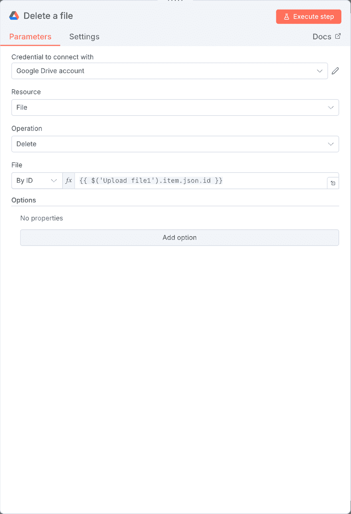

**说明**：清理临时文件,避免占用存储空间。

---

## 凭据配置清单

---

## 运行建议与注意事项

### **环境配置**

+   **执行模式**：启用队列模式 EXECUTIONS_PROCESS=main

+   **超时设置**：建议设置工作流超时时间为30分钟以上

### **性能优化**

+   [fal.ai](http://fal.ai) 生成较慢时,可调高 Wait 节点至 600 秒

+   Creatomate 模板需提前创建好,确保支持 6 段视频拼接

+   每次执行约需 15–25 分钟,具体取决于API响应速度

### **成本控制**

+   [Yunwu.AI](http://Yunwu.AI) 生图：按张计费,6张图约 ¥3-10

+   [fal.ai](http://fal.ai) 视频生成：按视频计费,6段视频约 ¥20-50

+   Creatomate 合成：订阅制或按次付费

+   总成本：单个视频约 ¥30-80

### **故障排查**

+   如某段视频生成失败,检查 Switch 节点是否正确判断状态

+   如 YouTube 上传失败,检查 OAuth2 权限是否包含上传权限

+   如 Creatomate 合成失败,检查模板ID是否正确,视频轨道名称是否匹配

---

## 完整执行路径图

```
FormTrigger 
  → Upload file1 
  → Merge2 
  → AI Agent (故事→剧本)
  → AI Agent1 (剧本→6帧提示词)
  → Structured Output Parser 
  → Split Out (拆成6条)
  ↓
[循环6次]
  → Download file (下载参考图)
  → 生图节点 ([Yunwu.AI](&lt;http://Yunwu.AI&gt;))
  → Edit Fields 
  → Merge1 
  → 视频提示词生成节点
  → Structured Output Parser1 
  → Merge 
  → 生视频节点 ([fal.ai](&lt;http://fal.ai&gt;))
  → Wait 
  → 轮询(海螺) 
  → Switch 
  → 下载json 
  → Extract From File
  ↓
  → Aggregate (聚合6段视频)
  → HTTP Request (Creatomate合成)
  → Wait2 
  → HTTP Request1 
  → Wait3 
  → Upload a video (YouTube)
  → Merge3 
  → Delete a file (清理缓存)
```

---

## 执行完成后

**输出结果：**

```
{
  &quot;youtube_video_url&quot;: &quot;&lt;https://youtube.com/watch?v=abc123&gt;&quot;,
  &quot;status&quot;: &quot;success&quot;
}
```

**缓存自动清理**,整个流程闭环完成。

如需导出此工作流为 JSON 文件,可直接在 n8n 中使用"Download"功能。

导入到其他 n8n 实例时,需重新配置：

1.  所有 API 凭据

1.  Google Drive 文件夹 ID

1.  Creatomate 模板 ID

---

## 写在最后：自动化不是终点，创意才是

**搭建完这套工作流后,你可能会像**我一样陷入一种兴奋状态——"我终于可以批量生产内容了！"

但冷静下来,我想分享三点感悟：

### 1️⃣ **工具只是放大器**

这套工作流可以帮你把1个故事变成1个视频,也可以帮你把100个故事变成100个视频。

但如果你的故事本身平庸无趣,AI只会帮你更快地生产"平庸"。

真正有价值的,永远是你的创意和洞察。

### 2️⃣ 自动化是为了腾出时间做更重要的事

我见过太多人,搭建了一堆自动化工具,结果每天还是在盯着工作流跑、调参数、修bug。

**记住:自动化的目的不是让你变成"调参工程师",而**是让你有更多时间去思考、去创作、去生活。

如果一套自动化流程需要你每天花3小时维护,那还不如手动做。

### 3️⃣ **分享比独占更有价值**

这篇教程花了我整整2天时间整理,包含了无数次试错和优化的经验。

我本可以把它藏起来,自己闷声发财。

但我选择分享,因为我相信:真正的护城河不是信息差,而是执行力和持续迭代的能力。

看完教程的人有1000个,真正动手搭建的可能只有100个,能坚持跑通并优化的可能只有10个。

而那10个人,早晚会走到我前面,到时候反过来教我新东西。