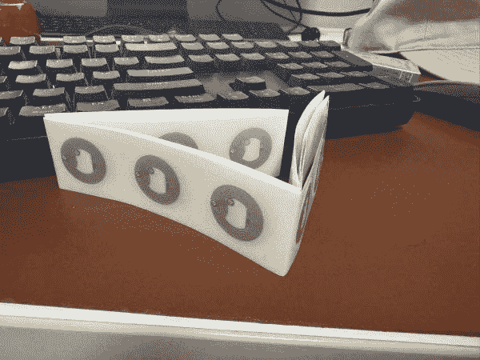
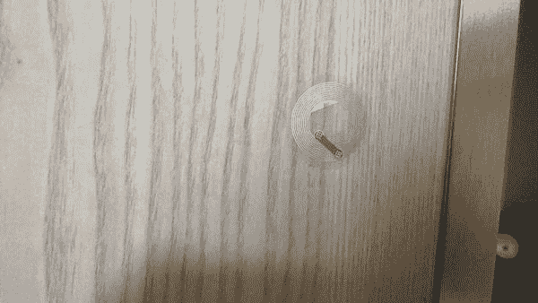

# 2025-11-04分享目前未火但潜力大的赚钱引流工具——NFC的应用

> 来源：[https://xuqiwei1986.feishu.cn/docx/Tzswdek5Ko4F80xNyA1cvtL5nto](https://xuqiwei1986.feishu.cn/docx/Tzswdek5Ko4F80xNyA1cvtL5nto)

> 🔗 原文链接： h[ttps://scys.com/ar](https://scys.com/articleDetail/xq_topic/14588211155244242)ticleDetail/xq_t...

核心价值：分享了NFC技术的商业应用潜力及相关赚钱思路，适合对新兴商业机会感兴趣、想探索新赚钱途径的创业者和营销人员。

+   提到NFC在宾馆房卡等方面已有应用，与蓝牙、二维码类似可记录读取数据。

+   苹果手机全面支持NFC技术，使其应用场景更丰富，如可自行写入数据。

+   举例将家中wifi信息写入NFC芯片，碰一碰即可连接，显示其便利性。

+   指出可借鉴“草料二维码”模式，帮用户生成NFC，还可助力企业营销等。

结尾：文章介绍了NFC的商业价值及应用场景，启发大家抓住NFC技术尚未普及的时机，挖掘其中的商业机会，开拓新的赚钱领域。

分享目前未火但潜力大的赚钱引流工具——NFC的应用

好久没发生财有术发帖，看了一下我过往在生财有术几次发言，还算对得起发言。很多赚钱思路的想法我在这里的发言是非常早的。包括视频号、AI、快团团等。我看我2022年就在这儿发过ai的应用尝试和一些展望，那时候99%的朋友还不知道Aigc 今天再和大家分享一个目前还没有那么火，但是接下来一定会被广泛应用的赚钱和引流工具，当然我分享的都是大势，大家可以根据大势去研究具体的操作方法。今天的分享是关于NFC的应用。 前两天买了几个NFC芯片贴纸,我认为这里面有巨大的商业价值,而且是很实用,很落地的商业应用. NFC在生活中很常见,我们去住宾馆,宾馆前台人员要给你做一张房卡,那个房卡里就有NFC的芯片,前台人员把房卡在写入器里写入你的房号,你就可以用房卡开门. 它在应用上,和蓝牙、二维码都有点类似性,可以用来记录和读取数据.这么说来,这个东西并不少见,为什么现在说它有很大商业价值呢? 大家最近肯定在线下商店都会看到支付宝到处在推所谓的“碰一碰”,你用手机碰一下支付宝的设备,而无需扫二维码,就可以完成支付.所谓碰一碰支付,其实也就NFC技术. 支付宝早不推这个,晚不推这个,为什么现在推呢? 这是因为苹果iphone手机现在已经全面支持了NFC技术,以前苹果手机出于安全原因对NFC的开放力度很小,现在开放很多了(安卓早就开放了). 现在苹果手机用户不仅可以使用手机进行NFC数据读取,也能够写入数据. 也就是说,你可以把你想要完成很多的动作,链接,数据,通过手机写入到一个NFC芯片中,然后你手机一碰,就可以完成相应的操作. 再直白的举例,如果把NFC比做一个二维码,你不仅可以识别二维码,你还能自己生成二维码. 二维码已经在线上线下商业的各种商业形态中有非常成熟的应用,而NFC技术显然还没有普及. 我也往NFC芯片里写了几个最简单的应用,比如我在我们家客厅里贴了一个NFC,把我们家的wifi信息写进去了.这样有客人来家里做客,或者自己需要连wifi,只需要手机碰一碰,不需要很麻烦的告诉它密码啥的. 这里面还有很多普通人可以去尝试的商业机会,首先帮别人生成NFC就是一个好生意: 之前二维码刚刚普及的时候,有一个网站叫“草料二维码”,这家公司就是做了一个网站,帮助用户生成自己的二维码,这个公司业绩还挺好的.其实NFC时代,完全可以做一个NFC版的“草料二维码”,帮助小白用户生成自己的NFC. 此外帮助企业去基于NFC技术做各种业务流程管控、营销策划,都是很好的. 再者,我们自己做营销链路、引流链路、私域转化,都可以用NFC技术,包括我们很多商品的包装盒上后续都应该加上NFC芯片贴,引导用户完成一些动作的时候,用这个非常合适. 这是一个机会,和大家分享一下,有兴趣的朋友可以去研究研究nfc

刘大宝 、 gaoxiaofei 、 阿盛 、 今天你反省了吗 、 希平 、 A_小志 、 阿超 、 东哥 、 Cara卡拉 、 张小米 等236人点赞