# 视频号书单项目实操复盘：如何靠名人语录图文视频矩阵，用短视频+直播卖书赚到几十万佣金

> 来源：[https://xuqiwei1986.feishu.cn/docx/JQPLdnGqcoctt4xI9BWcrMpEniz](https://xuqiwei1986.feishu.cn/docx/JQPLdnGqcoctt4xI9BWcrMpEniz)

## 一、简介

大家好，我是许帅，第七期圈友，尝试做过多个项目如票务代理、社交电商优惠券分享、短视频图书带货、👸号流量主写作、📕虚拟电商、B站好物带货，都能跑通0-1。

23年写过一篇实操帖子侥幸拿了龙珠：`https://t.zsxq.com/12qHKBQ9X`，

今天分享一个我之前做了2年的短视频图书带货项目：视频号名人语录书单（以下都称为视频号书单），这个项目发了2万+条视频赚了50万左右（佣金40万+，账号创作者分成、培训、私域图书复购、电子语录资料售卖等近10万），17个账号总体粉丝累计有200万+：10万粉以上的账号有8个，其他账号都是在1-10万粉。

这个收益对于赚钱很多大佬来讲微不足道，但却是我作为一个普通人从职场走出来的第一步，我希望能给跟我相似的圈友一些经验分享和帮助。

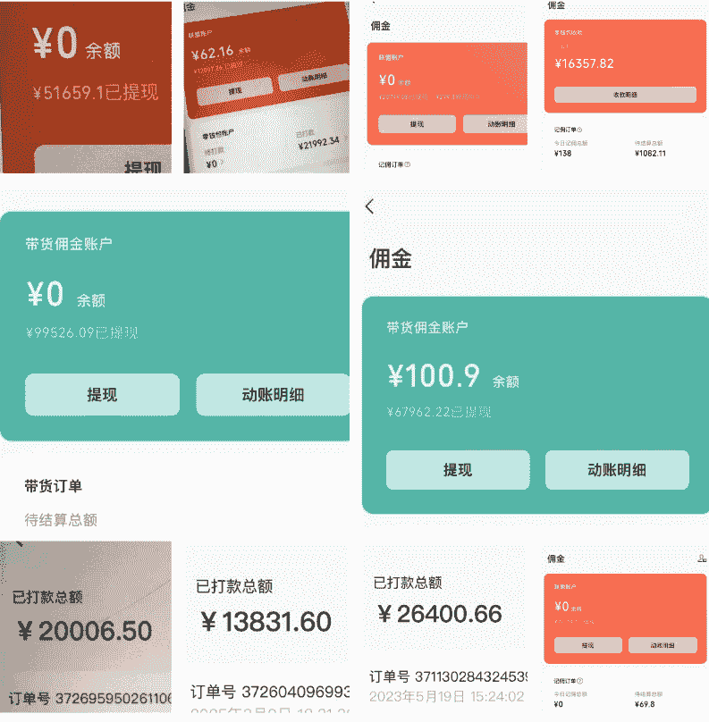

## 二、视频号书单项目介绍

刚开始接触这个项目是22年底，当时有大学同学在做这个名人企业家语录短视频，说是能赚到些钱。

他做的内容就是视频展示杨绛先生、林徽因、张爱玲、陈果教授、莫言、余华、弘一法师李叔同、冯唐、马云、曹德旺、稻盛和夫等等名人企业家所说的文案内容（如下所示），然后通过卖对应人物所写的书或者跟这个人物相关的传记书籍来赚取佣金。

**本**质上是短视频图书带货赚佣金，这是主要的赚钱方式，其次是培训收徒、创作者分成、引流私域复购、其他衍生品的售卖如社群学习、读书会、电子资料等。

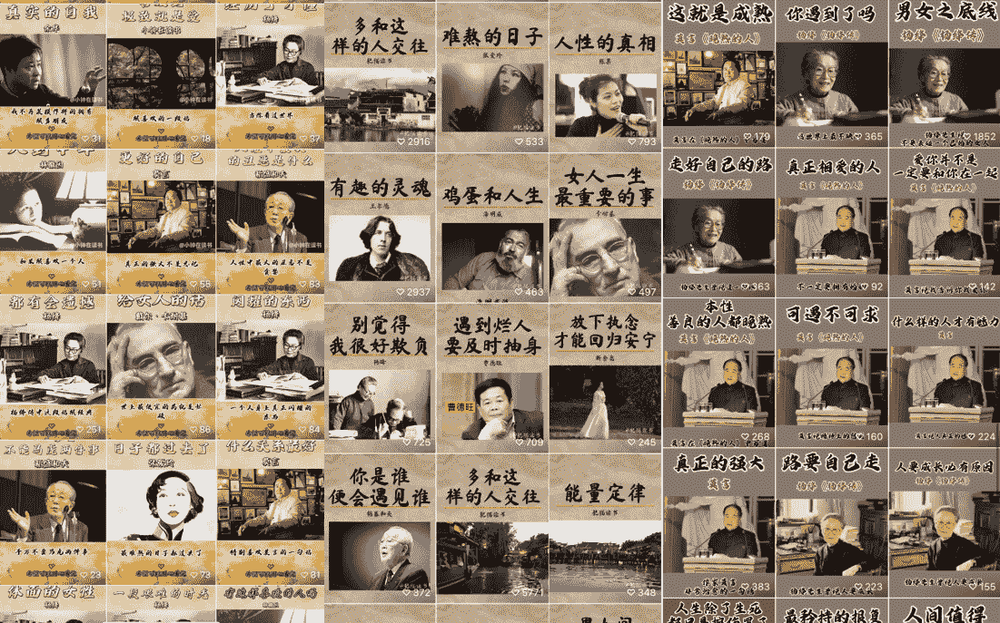

## 三、视频号书单怎么做到200万矩阵粉丝以及40万+佣金收益的？

### 第一阶段：新手期

22年底到23年初，视频号刚刚开始所谓的商业化，红利期还在，名人语录视频这样的内容在视频号点赞非常高，流量特别好。

这时的我，还正在一家知识付费小公司干运营，因为做的事情也比较杂，从私域运营销售到视频剪辑给老板做IP，包揽了很多活，而我做剪辑的主阵地就是在视频号上。

所以，在我看到我同学所做的书单内容后，我第一想法是，这种视频我也能做，于是本着多了解一些视频号视频制作及变现方法论，还有一点搞副业挣钱的想法，我开始学习这个模式：

第一步，我拆解了书单视频里需要的要素：背景图、语录文案、人物图、音频、动图素材等等；

第二步，我注册了2个视频号，一个选择了冯唐老师这个人物来试水，原因一是我正在读他的书《冯唐成事心法》，其次是他有一定知名度；一个选择发杨绛先生的内容，原因是我同学就是靠发杨绛先生语录挣到些钱的。

第三步，我在网上搜集了108句冯唐老师经典语录文案以及100句杨绛先生的语录文案，各自整理进一个word文档命名为冯唐108句经典语录、杨绛先生100句经典语录；

第四步，我用稿定设计这个网站找了一个背景图模板制作成我视频的主要背景图；

第五步，我把我同学视频常用的音频做了整理下载并导入我的剪映软件备用。

22年11月16日晚上，我抽空用剪映剪辑了3条冯唐老师语录视频和1条杨绛先生语录视频，然后定时11月17日发布在视频号上，当时主要是测试，但没想到发冯唐老师的这个号视频发完就小爆了，播放量嘎嘎冲，账号很快就几千粉丝了。

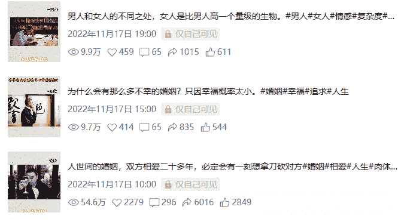

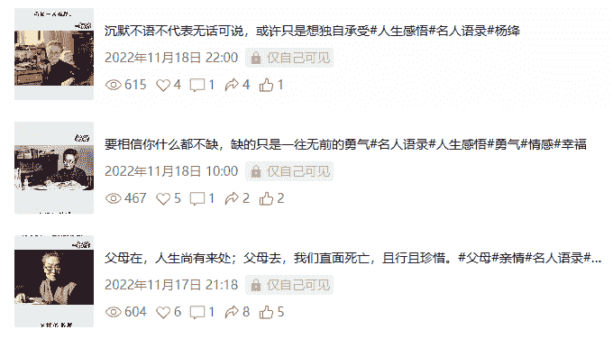

但是，这时候的我也不知道该怎么变现，就是光有流量，不懂变现，只是在商品橱窗里加了冯唐杨绛的几本书，但没出过单。

没过几天，我就看到大学同学发他爆了一个视频，并且通过直播预约的形式，预约了1万多人，接着他找代播帮他播了一场，两小时左右，销售额4000+，佣金2000+。

我听到这个消息之后，着实羡慕。

因为上班的原因，我只有晚上的2小时能剪辑，每次剪辑8-12个视频，两个视频号各发布的视频是4-6个，期间也测试过好几个名人的语录视频，换过文案、音频、背景图，但播放量都是几百到几千，而且这种视频制作起来，一个要花10多分钟，甚至20分钟。

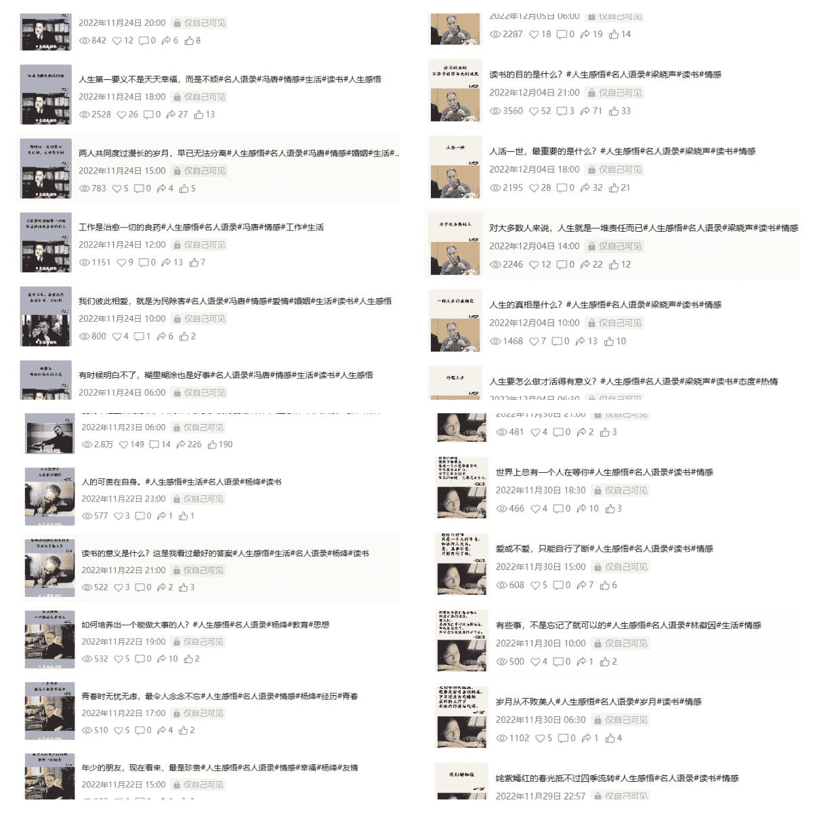

12月3日，发了冯唐老师书单视频又开始小爆了，但我仍没有意识到要利用好这个流量，隔天还发了其他名人的书单视频，整个就是一锅乱炖，连续3天，其他名人视频数据都一般。

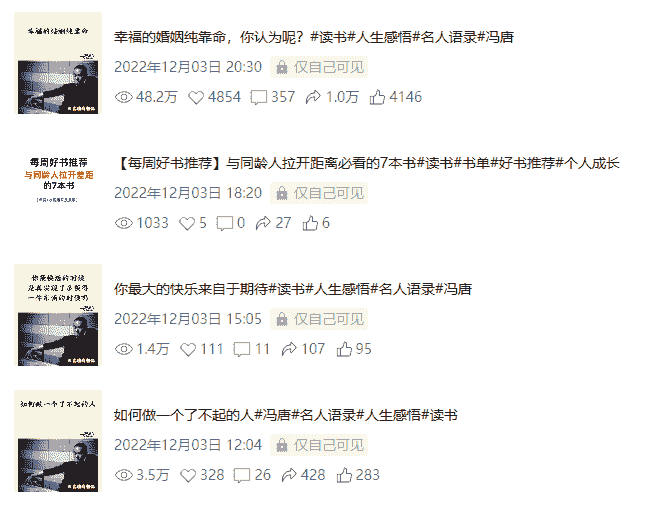

12月6日，我把视频改回冯唐老师的内容，数据又开始往上走，这时候我做了一个12月9日的直播预约，刚好接下来持续3天都有爆视频，直播预约了接近2000人。

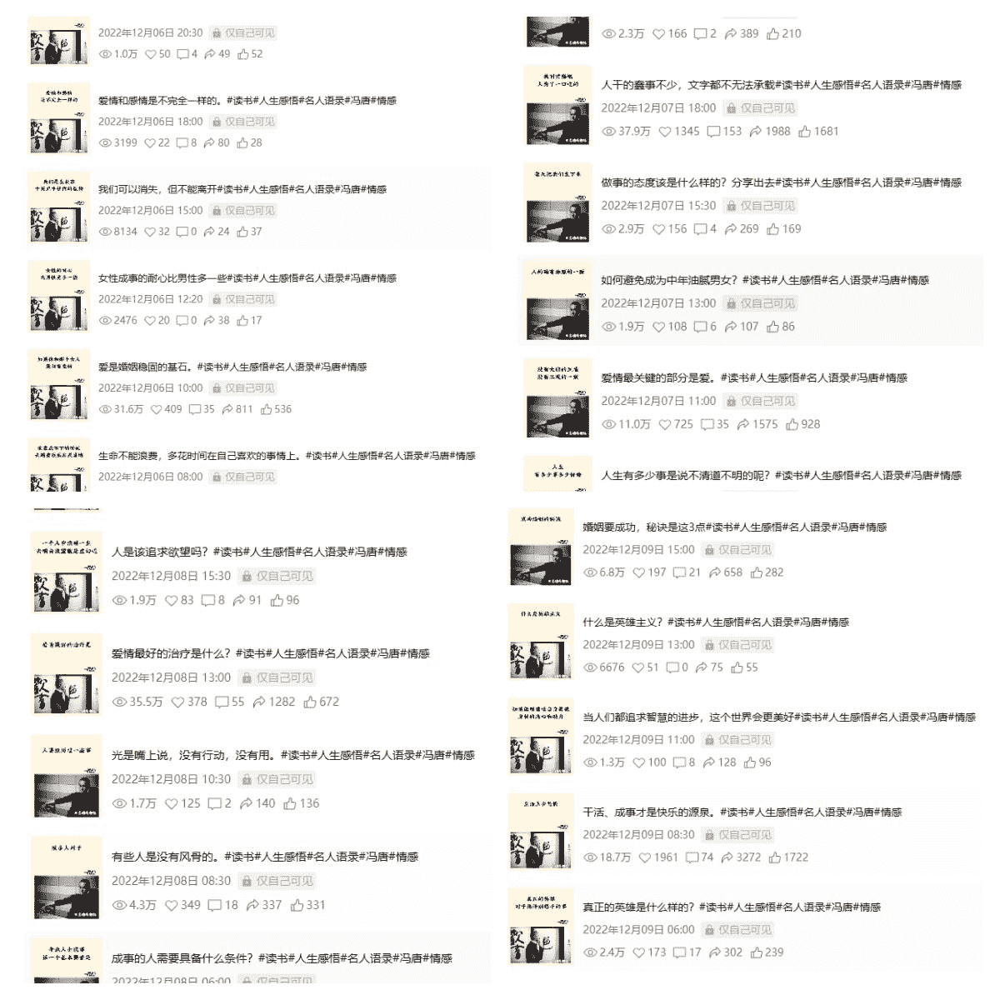

**12月9日晚上，我下班回家，就搭了一个简单的直播间，桌上放着几本冯唐的书《冯唐成事心法》《有本事》等，并且提前打印好冯唐老师108句经典语录，在稿定设计上导入自己头像做了一个粗糙的直播封面图，然后就直接出镜开播，通过直播讲解解析语录的含义给直播间的朋友，中间穿插售卖了几次冯唐的书，一套能赚70多佣金，1个半小时，747场观，最高160人在线，销售额927元，我赚了460+佣金。**

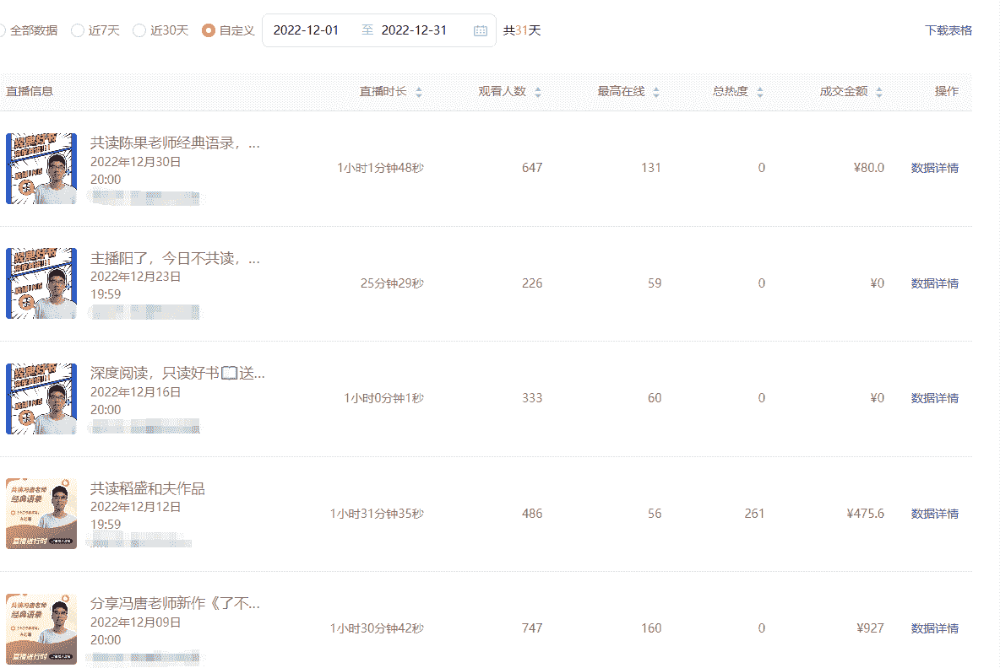

那天晚上我开始意识到，直播卖书还挺赚钱，算下来1小时能赚我一天80%的工资。

尝到第一个甜头，我马不停蹄的做了3天后的直播预约，每天继续发布视频，3天后播完，同样的时间，销售额降了一半，接着继续预约，

12月下旬，我看到同学做陈果教授的内容爆挺多的，于是我就转向陈果教授的语录，做了半个月，视频数据不错，但是直播数据特别差，到12月底，连续3次直播，每次1小时，都没有成交订单。我的热情也因为数据没有正反馈而停滞。

**这里为什么会改人物来发？**

我当时的想法是，卖冯唐老师的书，卖过几轮后，喜欢冯唐的用户已经被营销过了，想看看能不能多人物让用户复购，通过调整名人形象来看看有没有新的机会点。

### 第二阶段：成长期

12月下旬到23年1月初，我在视频号刷了视频，看了很多对标账号，发现有些账号发稻盛和夫这个人物的视频流量还不错。我研究了一下，发现稻盛和夫是个不错的切口：

1、是日本人在国内会有争议：视频评论区会很热闹。

2、五百强企业家知名度高：宣传上好做文章。

**3、出版了很多书：这意味着可售图书选择多，不管是他写的，还是写他的都可以卖**

**4、有一套独立的人生哲学经营方法论：不是随波逐流的观点，而是系统性的言论，自成一派，本身就有粉丝群体**

**5**、肖像权问题估计也不会有人管：国内名人的肖像权，如果真找你，也会违规下架，但国外的，有点难取证和走流程。

buff叠满了。

当时我就拿了其中一个视频号做稻盛和夫语录视频，自己上网搜索整理了一些稻盛和夫的语录同时扒了一些对标账号的语录，形成了又一份word文档【稻盛和夫的经典语录】，然后就开始发视频，1-3月期间，整体流量还不错，也做过近10次直播，只是变现比较差。

直播卖书卖不动了，我一开始觉得是稻盛和夫太知名了，他的经典书籍很多人是不是都有了，所以没多少人会买。

正准备换下一个人物的时候，我刷到了另一个号，发现这个号做的稻盛和夫视频，条条几千点赞，甚至有数十条10万赞的视频，橱窗也卖了几千套书，佣金估计有个几十万。

仔细研究后，我发现3个特点：

1、他会在视频结尾植入一段翻书视频，翻的书刚好是他想卖的书（不像我没有植入）

2、他会在评论区去评论引导用户去橱窗下单（不像我啥也没评论过）

3、视频里全是稻盛和夫的动态视频。（不像我用一堆风景动图）

并且在这段时间里，我刷抖音也看到很多卖书短视频，最后都会植入翻书的部分，但我自己没有执行过，而这个对标账号点燃了我植入的动力。

于是我赶紧在抖音搜索并下载了几个翻书视频，接着在剪映通过裁剪的功能截取下来，然后植入到视频里，类似下方这样。

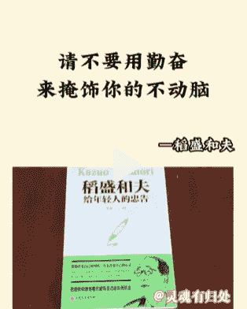

同时，把视频里的动图素材全部替换成稻盛和夫动态视频；

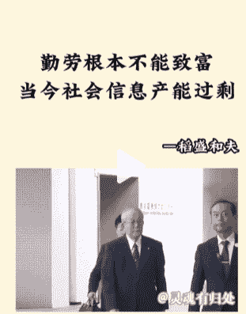

视频发布后，评论区都放一个引导橱窗下单的文案。

话术：推荐阅读《稻盛和夫给年轻人的忠告》，点我头像进商品橱窗可拍！

这样，视频播放量起来时，就会有自然流量的静默下单，相当于躺着也能赚到钱。

1-2月我发了一段时间，每天每个号坚持6条视频，但是视频不温不火，继续寻找原因。

又发现一个点：我自己在网上找的稻盛和夫语录发出去的流量都很低，直接搬对标账号的文案呢，流量都还不错。

二话不说，我就开始搬语录文案了，那会也不知道怎么快速操作，就是一个手机打开视频播放，然后自己在电脑手打文案，打5条文案就做5条视频。

后面才发现，其实这类视频有个特点，很多视频号用户看了这个内容后，觉得说的很有道理，会自己手打语录评论在评论区里；不得不说，视频号的中老年用户是真的很闲。我通过这个方式快速收集了一批对标账号的经典语录。

2月开始，图文视频播放量基本稳定在1-5万，开始陆续出现自然流静默下单的情况，我也尝试直播预约一周攒流量，然后直播一次，每月4次，但数据还是一般般。

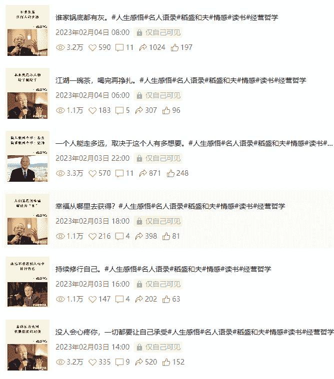

虽然变现一般，但我也没有放弃，还是坚持做视频，并且刷视频号的同行视频，

2月底让我刷到了一些图文视频，它们的特点是一屏都是文字，时长是7秒左右，它们不是我这种多页滚动文案的模式，流量都很爆，甚至有10万+点赞的。我突发奇想，是不是我也能这么做呢？然后就开始试验了，剪辑起来，发现一条视频都用不了2分钟就能导出了，比起之前做的视频，这个效率更高，视频数据如下：

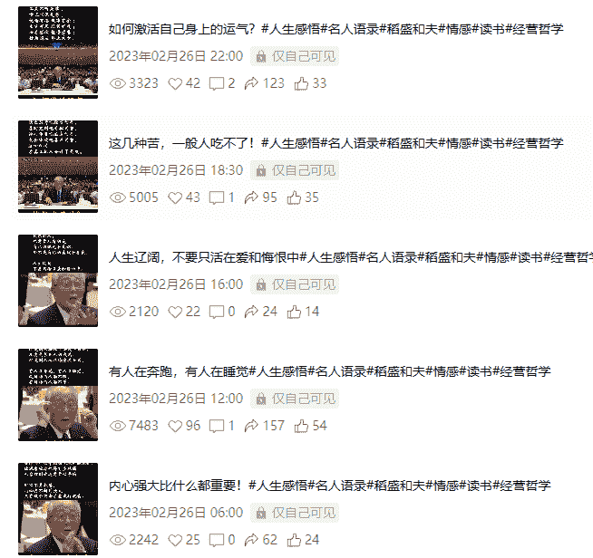

从22年11月底到23年2月底，我跑通了视频流量的环节也尝试过直播多场，但几乎没多少变现，平均下来一个月1000元左右。

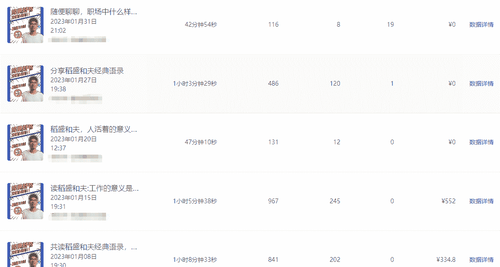

### 第三阶段：成熟期

23年3月初，我从公司离职，当时有一些存款，觉得不找工作也不影响，主要也是不想上班了，所以就打算全身心投入试一下这个短视频图书带货。

也不知道是不是账号知道我要离职，一屏式文案的图文视频开始爆了，先是一个90万播放量，隔天又一个500万播放量。

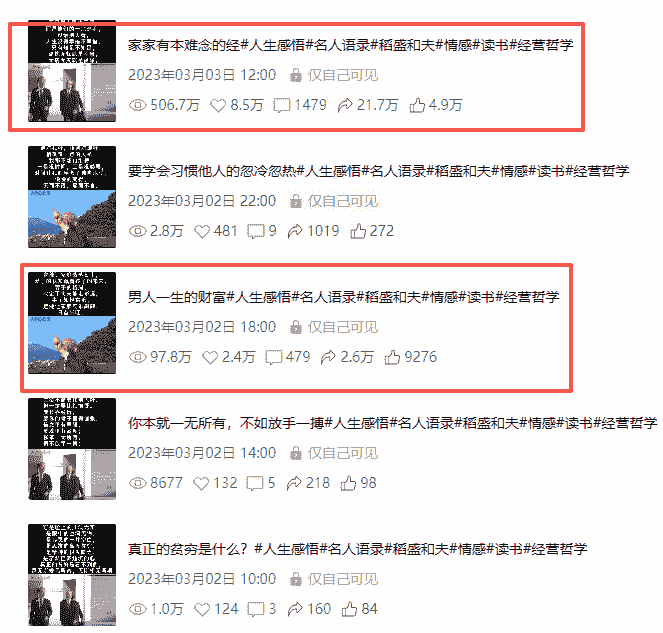

我第一次体会到，流量的迅猛，涨粉特别快，账号一下子到了6万粉。

书籍静默下单的数量小小的增加了一下，我依旧是做了一个直播预约一周时间。

运气比较好的是，3月9日、3月10日，各爆了一条视频，极大的增加了我的预约量。

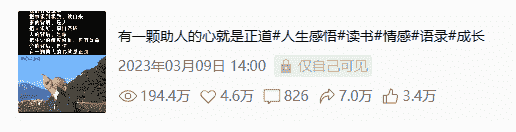

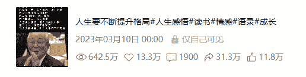

3月10日开播，5000场观，1200人在线，2小时卖了1926元，佣金有个1000元左右。

其实这个数据是差的，但我毕竟是新手，总得先吃点没经验的亏。

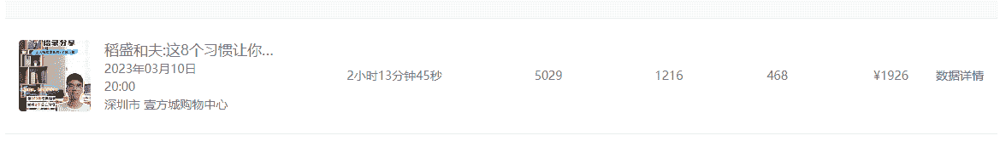

好在我当下是全职了，所以我的直播基本是一天一次，通过这个方式，直播每天都能出个几单加上自然出单，还能保证一些收入。

接下来的半个月其实数据都很一般，因为离职的空隙，不知道该做什么，有些迷茫，只是按照惯性动作去做视频。

也不知道是从哪里听来的一句话，爆款内容可以重复发，我在3月25日重新发了之前600万播放量的爆款内容，没想到隔天就冲了10万赞，最后数据是2700多万播放量，54万赞。

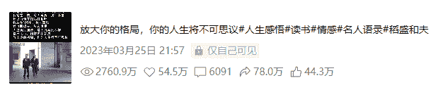

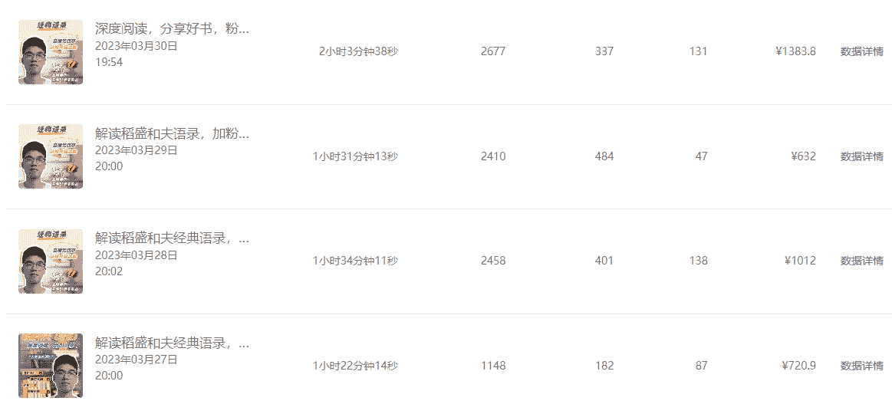

但是我这时候的变现是很一般的，自然流量出单，最高的时候一天能到1000元，直播的话相对少，每天的直播流量被稀释了，挣几百块一场吧，加上这会我也不懂，视频爆了就要开播的。等到反应过来，流量已经跑得差不多了。如果换成是1个月后的我，这波流量至少能赚大几万。因为一个月后的我在赚钱里了。

整个3月份下来，我赚到了1万+佣金。

4月份，我通过大学同学的邀请码进了龙哥盟，一进赚钱，我就把关于书单号的精华帖都看了一遍，对短视频书单的玩法体系规则有了一些基础的认知。

同时，我把我在第一个号A上的方式，复制到了第二个号B上

同样的爆款文案（10万赞文案）

同样的配乐音频（多个爆款视频的配乐）

同样的动态视频（稻盛和夫的片段）

同样的转化路径（静默下单、直播转化）

有**一点不同的是，剪辑上，我把**两个号都改回原来的文字滚动式图文，因为我理解了一个点，视频能爆，主要还是文案，形式没那么重要，形式可以替换做，文案不要改。

而且我本身对标的同行，他就是文字滚动式图文视频，也爆过好多条，这会我把他高赞的文案查漏补缺全部扒了一遍。

加上，我觉得这样的内容更美观一点。

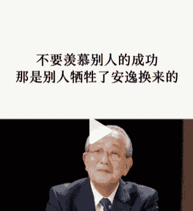

运气比较好，4月初A账号持续在爆视频，基本都几十万到上百万。

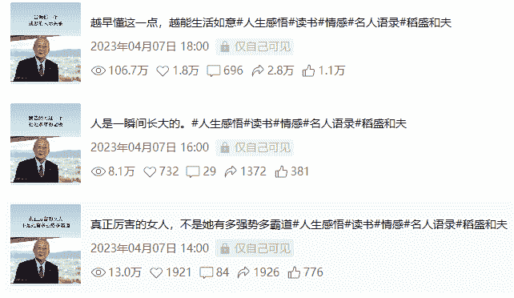

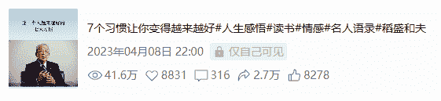

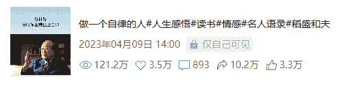

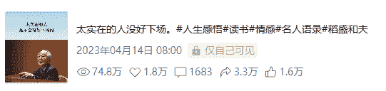

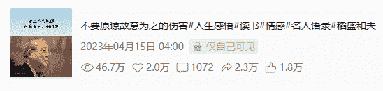

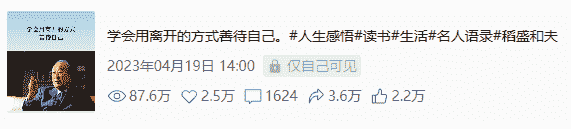

4月底，第二个账号B视频也开始陆续爆了，账号整体流量特别好，基本都是几万播放到几百万播放量。

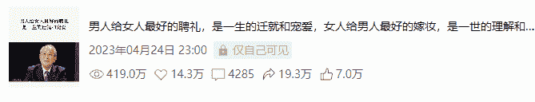

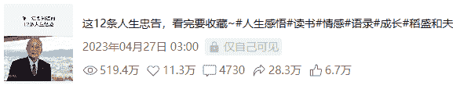

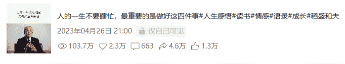

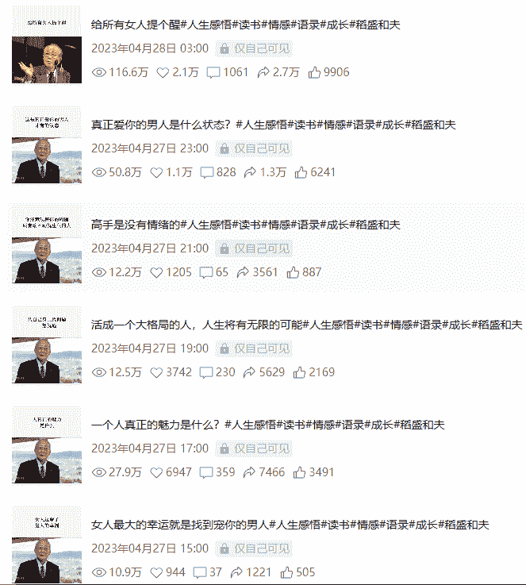

这会的我已经拉齐了**爆了就开直播**的认知，所以，我连续3天直播卖书挣了1万多佣金。

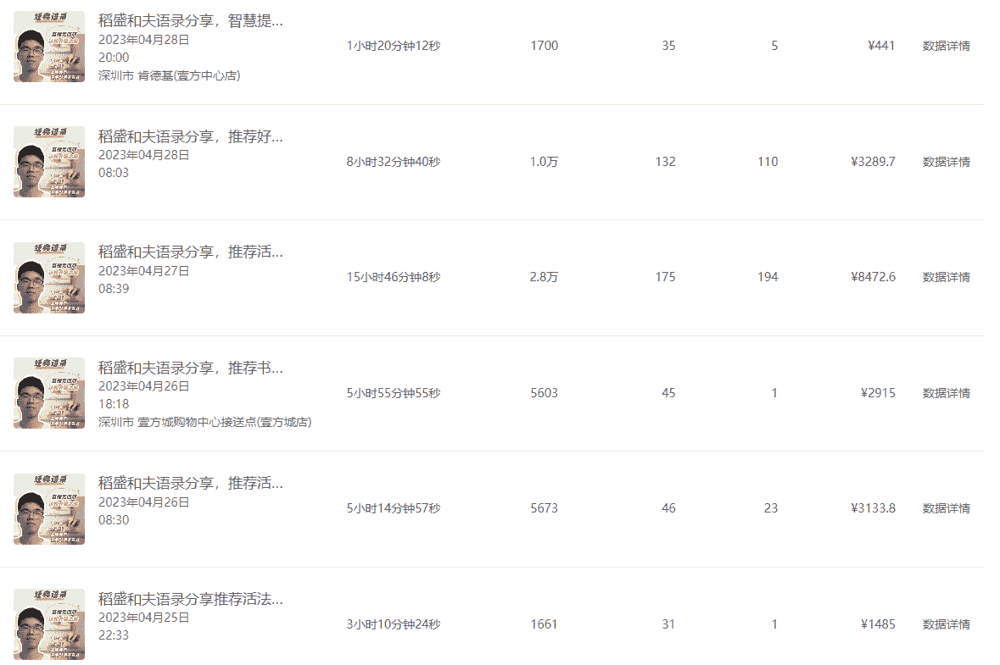

5月份双账号流量都不错，我每个号坚持发6-10条视频，一个月下来，**基本有个200**0万-3000万的总播放量，也陆续有各类图书供应商加到我，给我做了商品的定向合作，佣金提高了，我通过静默下单和直播转化的方式卖书，这个月收入突破了4万佣金。

6月份B账号被举报，流量下滑，A账号流量自然下滑，收入变成十分之一：4000+元。

5-6月的数据反差，让我意识到一个问题：没有爆款视频时，账号流量下滑，怎么提高收入或者说整体能稳定收入？

1、我需要有更多的账号备用，也就是做矩阵（玩法套路都一样，东方不亮西方亮）

于是我开始寻找低成本建号的方式，比如电信无忧卡5元月租，移动联通保号卡（淘宝下单，然后套餐是58元的，客服会告诉你打电话去联系运营商客服要求改成保号套餐8-9元。）

我当时就增加了3个，因为那会视频号一个人可以开5个号。

账号多了，可以拓展做多个名人的内容，我原本是想着把有潜力的名人都批量做一轮的。

2、增加单账号内容发布数量

内容数量上来了，整体播放量也会起来，不管是直播预约还是静默下单都会有所增加。

第一个办法是自己制作的数量增加上来，第二个是两个账号曾经做过的内容重复使用。

这两个方式都有用，其中重复使用内容，在当时是可行的，所有视频都可以共享给其他账号，一开始以为会有问题，实际上做了之后，该爆的流量还是会爆。

3、提升直播间的转化率

随着我深入制作名人语录视频，我发现做经典语录视频，不发爆款文案，很难大爆，但是能够大爆的爆款文案大概率又不是这个名人所写，甚至平台也出现说，把名人的只言片语放进去就算是名人所输出的内容，还有同一套语录放在多个名人身上都能爆，流量都特别好。

这导致我在卖书的过程里，不是很自洽，就是在挂羊头卖狗肉。

思前想后，我做了一个调整，直播卖书的时候，强调买这套书，我送我整理的经典语录（爆款文案版本的）给你（我之前看到过同行卖书赠送名人的语录），底层上算是一个互惠的行为，虽然本质上是我在赚钱，但从实际来讲，交易的背后必然是双方都获利，且认可这个行为。

这个方式既能让我正常卖书，又能让用户因为赠品而提升转化率。

后续在不断的测试过程中，我创造了大字版的语录文档以及配套的音频文件等赠品（因为用户都是中老年，长期看电子内容也不舒服，直接听音频更有效）这样的行为确实有效的提升了我直播间的图书转化率。

4、单本书籍改为套装出售，提高客单价

一开始卖的都是单本的书，佣金比较低，为了能够有更高收入，调整成了多本套装的形式，强调买套装赠送整理的语录文档音频。

5、引流用户加🛰️创造复购机会

第一个是在账号简介上引导用户添加我可领取免费资料100句经典语录。

第二个是在直播过程中，以买书赠送语录为由，引导用户私信自己领取，通过私信回复🛰️二维码引流到🛰️领取经典语录。

6、短视频图书带货培训

爆流量的账号其实在4月份就已经陆续有一些人加到我说要学习怎么做图书带货，所以只要做出一个小的文档课件，就可以出售了，边际成本越来越低，收益也能有效提升。

从23年7月-24年12月，我的收入相对稳定。

视频号书单也有了一套成熟且固定的模式：

短视频制作层面：多个账号用相似的模板去填充文案产出大量的视频，部分账号做新方向的测试，

短视频内容层面：视频尾部植入翻书+评论区引导橱窗下单，

直播层面：3-7天预约一次直播，通过买图书套装赠语录文档音频的方式提升销量，有爆款视频则开播拉时长卖组合套装书。

私域引流：用户购买书后添加我的🛰️领取语录，我会在朋友圈持续分享新的优惠图书信息引导复购、打造读书分享会社群、售卖电子资料。

在这个阶段里，

### 收入上

有过多次两天赚1万+佣金的时候，也有过账号被减少推荐、低质量内容违规等等的判罚导致月收入只有几千的时候，但大多数时候都是稳定2万以上的月利润。

### 账号上

为了提升我系统的反脆弱性，我也在持续增加更多账号，但我相对保守，两年只有不到20个号，25年初其实一个人已经开始限制2个号了，没有太多增加的机会。

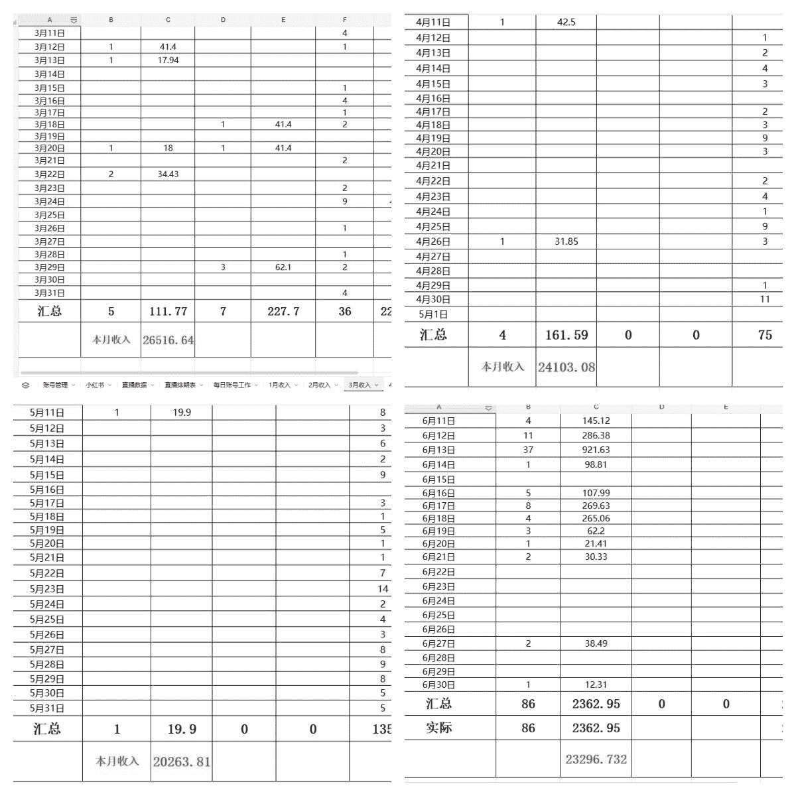

### 短视频培训上

收学员客单价999元有几十个，但是真正出成绩的不到5%，我一度觉得这并不能帮助别人赚钱，有些割韭菜的成分，所以后面就没有继续去做了。

但24年3月我带我妹妹做账号，依旧是同样的手法，她4个月赚了6万+，账号有22万+粉丝，这让我明白，方法上是没有问题的，问题大多在一个人是否能切实执行，以及坚持执行，而这个背后其实是对方对你的信任度有多高？

## 第四阶段：衰退期

这个衰退指的是名人语录图文视频这一个单独的类型，我个人一直认为这种名人语录类的视频，是一直在走下坡路的，因为它可批量怼+视频内容的呈现是相对低质量的非原创视频，从某种层面上来讲是一直对抗平台的。

衰退的表现有几点：

### 第一，相同的文案内容，多个账号流量下降明显

即使是几十万粉丝的号也没有流量。

24年10月之前，流量都是大几万，几十万，甚至上百万，我自己多个账号里，几十万的播放都属于低的，上百万播放的视频，更是有上百个。以往这种图文模式，靠的是前端涌进来大且泛的流量，然后自然筛选出有兴趣的用户去做直播转化，流量下滑后，无法筛选出足够多的用户，搭建不了好的直播场域，变现就下降了。

### 第二，相同的视频，视频号判罚违规率更多更高了

这其实也是必然，视频号平台在它商业化的过程里就陆续在增加各种规定规则，2023年-2025年，名人语录类视频也经常出现各类异常违规：

#### 1、视频减少推荐

解法：删除这个视频

#### 2、原创性审核声明

解法：删除这个视频，或者找到原创的人授权。

#### 3、内容低质量取消带货权限

解法：一开始还可以发10条原创风景视频解封，多了就解不了

#### 4、视频存在商品营销性过重

解法：删除视频，判断是翻书的视频内容时长问题，方法就是缩短时长，比如从原先3秒变成1秒；或者改成纯图片展示。

#### 5、跳出镜人验证，不验证就用不了账号，相当于废了

### 为什么会跳出镜人验证？

因为视频里用到了名人肖像，不管是图片还是视频都会触发这个验证，刚开始触发还比较随机，直到25年开始，触发就很频繁了。（貌似抖音不会触发，我不太了解，懂的朋友可以说明下）

解法：我摸索了一下，如果是跳出镜人验证，那么发10-20条以上真人口播视频持续1-2周，然后走视频号认证可以恢复权限，但是无法多次使用，而且时间跨度过长，大多数的人无法等待。

### 第三，视频号收紧了账号的注册数量，违规账号无法注销

22-24年3月，一个人可以注册5个号

24-25年，一个人可以注册2个号

貌似近期陆续在落实一人一号的政策

如果要继续多号玩法，只能走企业营业执照的模式，我搜索了一下，一个营业执照可以认证5个视频号，具体更多规则，大家可以直接在视频号里搜索有很多做视频号讲解的博主有介绍，当然你也可以直接在赚钱里搜索，这可能更有效。

以上这几个点是我在做账号过程里遇到的比较大的影响。

# 四、现在流行的视频号书单是什么样？

## 4.1 视频号书单常见类型？

图文视频、图片视频、IP口播（真人出镜念语录）、中英文音频（包含名人的演讲）、漫剪、手写/画线等

感兴趣以下几个视频可以播放看一下，都是不同类型的书单号：

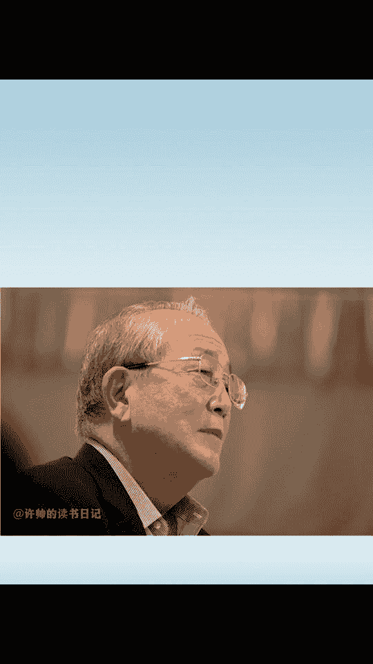

[`图文号.mp4`](https://internal-api-drive-stream.feishu.cn/space/api/box/stream/download/all/VShrbdXcBoVogyxZELSc5vksnWd)

这是我主要在做的内容，

好处是剪辑难度低，出品快，流量特别大，

坏处是没法在视频上挂商品链接，下单需引导

### 现阶段做不了，需转型。

[`中文音频号.mp4`](https://internal-api-drive-stream.feishu.cn/space/api/box/stream/download/all/IjoobLffOoldFixwx9LcIuM9noc)

这是我看到过有人能够通过长配音视频

好处是视频可带上商品链接，爆的时候出单很多，

坏处是制作起来难度大一点，费时间。

但它经久不衰，现在依然有人靠这种长视频配音持续获取流量出单。

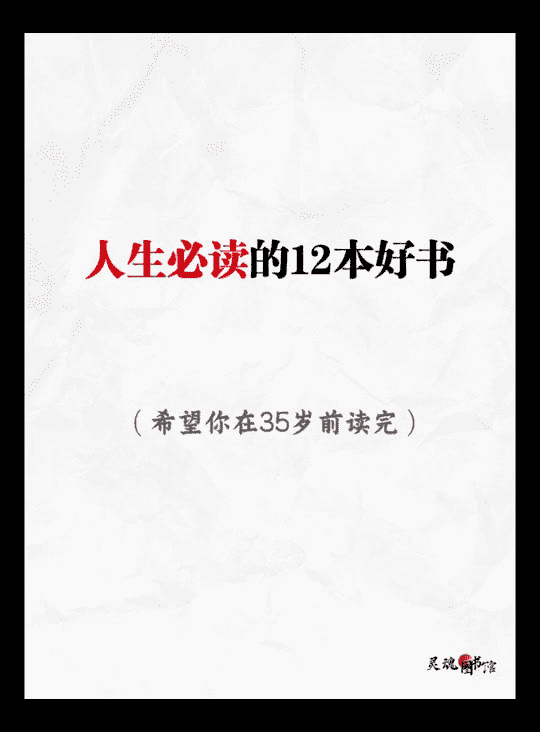

[`图片号.mp4`](https://internal-api-drive-stream.feishu.cn/space/api/box/stream/download/all/Iwt9bd72WoLYH5x7k3HcaoHynAg)

24年6-10月，很多人通过视频号自带的图片轮播发布这类视频，

好处是可带商品链接，见到过有人一个视频持续爆单几千上万单的。

坏处是制作起来也是需要一定时间投入。

### 现阶段可做，也能变现

[`画线号.mp4`](https://internal-api-drive-stream.feishu.cn/space/api/box/stream/download/all/NJ7qbsOyeoUOdvx133qcPpwGnOd)

早期流量比较好，可做原创划线，不会有违规的痛苦，

但没见过变现比较好的，变现好的都是在抖音。

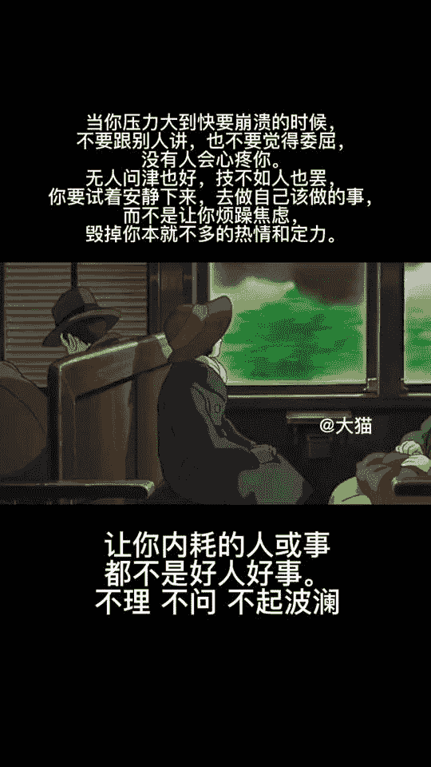

[`漫剪号.mp4`](https://internal-api-drive-stream.feishu.cn/space/api/box/stream/download/all/KpkwbvMfAouvZoxsO97cfGsjnxh)

这个其实是名人语录的变种视频，区别就是这个用的是动漫类的视频素材，违规率很低

好处是可以做创作者分成计划赚广告收入，涨粉也是很快。

坏处就是很少有卖书卖的好的号，更多是在收学员。

现在仍然有人利用这个模式赚取创作者分成和收徒。

[`口播带货视频.mp4`](https://internal-api-drive-stream.feishu.cn/space/api/box/stream/download/all/NiPQbTzMWoH0qqxvDLHcoKKEnBC)

口播类型的视频，开始我是自己上，后面我用的数字人（禅境数字人、飞影数字人、黑根网站），能出单，但不多。

好处是，基本不会违规，只要文案不出问题

坏处是，要自己不断的拍摄，废人，用数字人就有一定的成本支出。

24年开始有一大批口播账号爆火，有人可以做到单月赚5万佣金，因为这种视频也是名人语录的变种，拿爆款文案拍摄自己直接念书的模式，利用剪映软件一键识别出中英双字幕，直接就可以发，流量特别好，视频还可以带商品链接，用户下单的链路短很多，我想这也是视频号有在推动的一方面原因。

现在依旧还有人在做，也有人把它包装成读书博主口播课程，卖了大几十万，比如暨语美书屋、书生阿文。

还有很多形式，包括你会在视频号刷到一些账号，他放各种名人权威的演讲视频，也没有跳出镜人验证，这一块我是不清楚怎么做到的，兴许是企业认证的号权重更高，查的少，又或者是有授权，如果你感兴趣可能需要研究一下，有了解的朋友，也请不吝赐教。

以及你会在抖音看到很多的实拍书里的经典文案加上卡点音频的视频内容，但那些我只看到在抖音火过，视频号的用户不感冒，没有变现特别好的。

## 4.2 如果还要继续做低成本的图文名人语录，有什么办法？

解决办法：人物形象动漫化或者纯风景动图素材不放任何人物，这样爆的视频流量是很大但很泛，能出单只是转化率会很低。

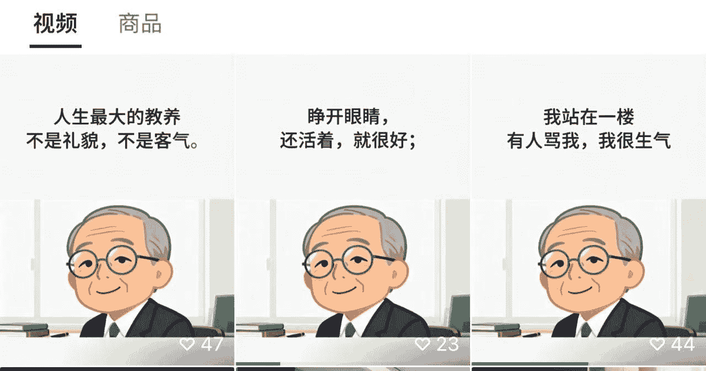

我目前看到动漫化后的形象以及纯风景动图素材+语录的形式，流量还是不错的，参考视频号：成长智慧录（这个号就是我早期的对标，他现在的转型也是适合的参考）。

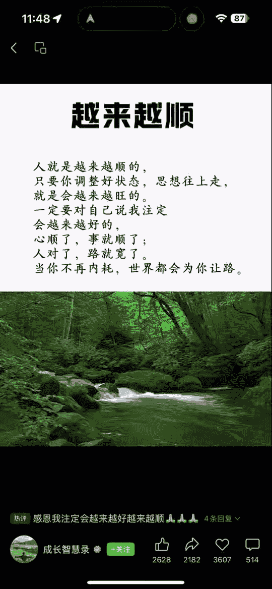

[`风景+语录形式的视频.mp4`](https://internal-api-drive-stream.feishu.cn/space/api/box/stream/download/all/Urpub1hKlol60rxLlAyceWYZnjb)

这里我把如何在电脑用剪映剪辑出一个成品视频的教程放这里：

如果你会剪辑，其实不用看也能做上面的视频，如果是小白，那看完这个视频，也能帮你理解这里面的结构并制作一个自己的视频。

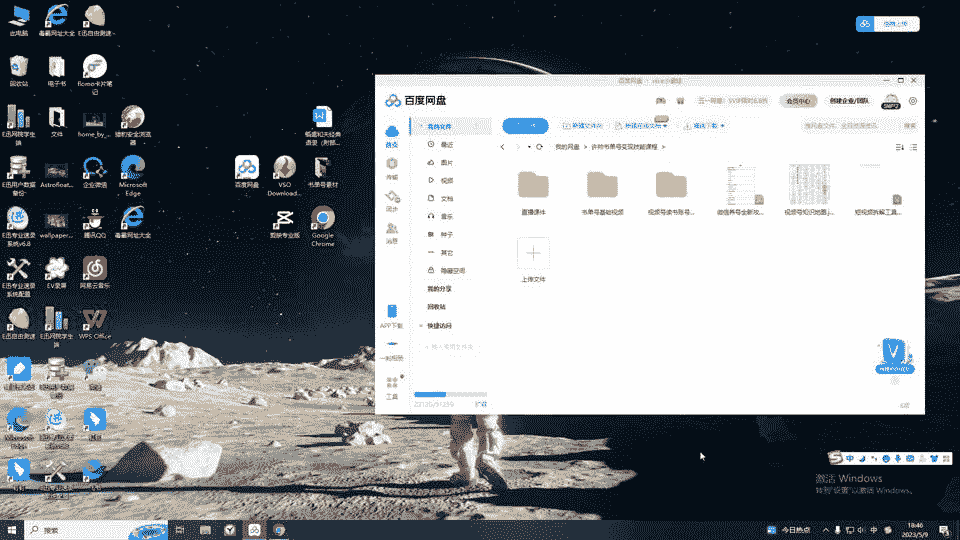

[`1、如何剪辑一个书单号成品图文视频（电脑版）.mp4`](https://internal-api-drive-stream.feishu.cn/space/api/box/stream/download/all/OCozbqJhnoygRVxG03Qcw1Nnnoc)

> 注意点：需要改掉原先的人物图变为动漫形象（可用豆包或即梦去生成）、动态视频素材，调整成上面的风景动图素材+语录的形式就可以继续发了 。

## 4.3 视频号书单现在入局？可以怎么做？（教学部分）

在24年底-至今，我尝试过多种类型，口播、图片视频、打字机语录视频、配音长视频，其实都能赚到一些钱，但是要像名人语录这样操作简单变现的方式，目前是行不通了。不过这类名人语录的视频，如果不以变现为目的，涨粉还是很快的，当然，不变现，做来干嘛呢？做项目还是要以变现为基础。

现阶段的视频号，能变现出单的视频类型有以下3种（目前只讲不出镜的，出镜口播对人要求高点，视频命名都是我自己命的，我也不知道网上应该叫它什么，大家理解就好）

### 第一个类型：打字机语录视频（参考视频号：一早读书&书在主页橱窗）

[`打字机语录视频.mp4`](https://internal-api-drive-stream.feishu.cn/space/api/box/stream/download/all/HoGGbjMoDoVN0NxvZGgcW4khnVf)

这个类型的视频，我也做过一个视频剪辑的教学给我还在做书单的学员看，如下所示：

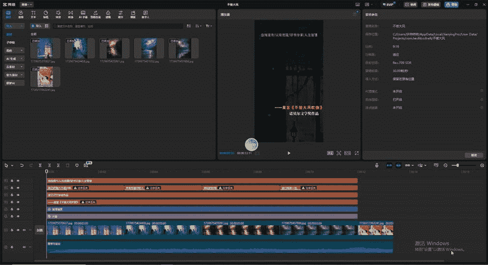

[`图文视频图书带货.mp4`](https://internal-api-drive-stream.feishu.cn/space/api/box/stream/download/all/GmO8bgJTEowDrlxdh1BcXO9In4e)

### 第二个类型：配音长视频-讲认知讲成长（参考视频号：韦冲读书）

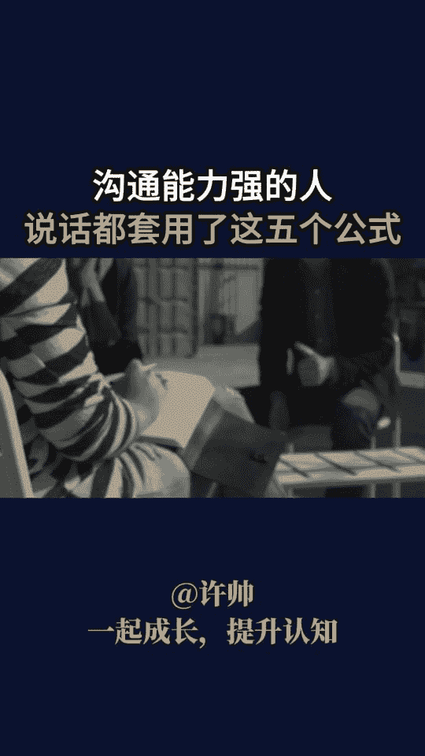

[`配音长视频.mp4`](https://internal-api-drive-stream.feishu.cn/space/api/box/stream/download/all/JXVPbxk8ioXmQexcC9jc2GwOndh)

没有做过相关视频分享，只有一个工程图参考下，这类视频制作起来比较耗时，提前准备好以下素材：

1、成长认知图书带货类文案的配音音频：视频号有很多，可直接转发给元宝AI要求提取逐字稿，元宝就会给你输出文案；其次可以在抖音去寻找那些5分钟左右的长认知视频，直接用软件提取文案即可。

2、背景图模板：运用稿定设计、美图秀秀可以制作

3、足够多的动态视频：有很多无版权网站可获取，如`https://pixabay.com/`

4、配音音频：我用的是逗哥配音神器这个网站`https://douge.com/index?from=IRFvy2`，使用需要充值会员，才有很多配音可用。

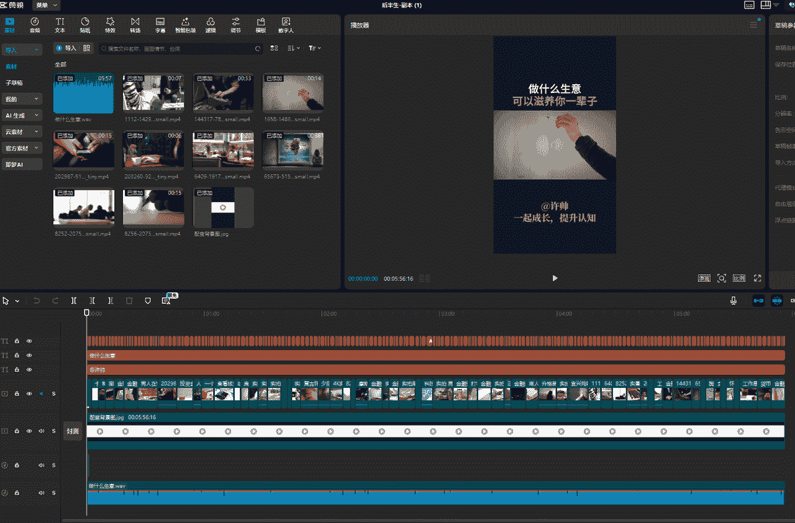

### 第三个类型：配音短视频-今天要分享的是XX语录（参考视频号：成长智慧录）

[`今天要分享的是XX书+一句语录.mp4`](https://internal-api-drive-stream.feishu.cn/space/api/box/stream/download/all/EvTPb6p3Pomqabxs1Yac42G4nbe)

这类视频第一次制作耗时，但可以形成模板化，提前准备好以下素材：

1、语录文案

2、语录文案的配音音频

3、对应书籍的背景图

网络上还有对应的COZE工作流，适合矩阵放大，大部分流量很好，变现上，视频号没有看到特别突出的，抖音有一些，可以自行搜索查证。

### 视频剪辑上是大同小异，比较关键的是，视频的素材（文案、音频、图片、动图）它们从哪里来？

#### 1、文案

视频号、抖音、📕同行视频标题、图片、视频、评论区

方法简单，多刷视频，看到爆款内容文案直接扒（爆款视频的定义：我认为📕点赞1千起步，视频号需要点赞1万起步，抖音尽量10万赞起步。），搭建一个对标账号库，有新爆款文案直接扒。

（1）先看视频标题和评论区，如果有整段文案了，直接复制出来就可以

（2）图片类的内容，就只能截图然后识别文字出来，电脑端我用的是豆包插件，有个截图识字的功能。

（3）配音类的内容

如果是视频号的话，现在可以丢给元宝AI，直接对话一句：逐字稿输出给我，就会有完整文案出现，需要注意有无错别字。

如果是抖红的话，我用的是逗哥配音神器：`https://douge.com/index?from=IRFvy2`

有个导入文案功能，可以复制对应视频链接或者上传本地音视频，就能生成文案，需要开通会员。

这里用什么就看你在什么平台做内容了。

直接提取视频号、抖音、📕同行爆款视频的文案，是因为对方视频是验证过数据的，火过的内容就是会重复火，不要有自己的想法，前期就是抄抄抄，但是要有思路的抄。

#### 2、图书图片

我基本上通过抖音去下载保存，在抖音找到对应图文视频有带图书图片的，然后复制对应链接去用下面的网站下载

DL熊猫无水印下载图文：`https://dlpanda.com/zh-CN`

其次是，可以在📕去搜索对应的图书名字，也会有很多精美的图片可以获取，记得去掉水印。

#### 3、背景图生成

（1）豆包生图，可以让豆包给你生成一批背景图的提示词，表述你想要的背景图是什么样的，然后生成9：16格式的背景图

（2）即梦生图：AI生图我用的少，赚钱有很多大佬的分享，可以阅读。

（3）稿定设计找模板制作：`https://www.gaoding.com/introduction`

#### 4、动态素材获取

这里提供一个动图素材获取的渠道：`https://pixabay.com/`

这是一个无版权的图库，可以搜索到各类图片、动图。

操作：搜索框输入想要的动图英文，格式选择`videos`

举例：我要搜大海动图，搜索框就输入`sea`，格式选`videos`，最终出来的全是大海的动图素材。

推荐：`sea`、`sunset`、`mountain`、`sky`、`flower`、`forest`等等

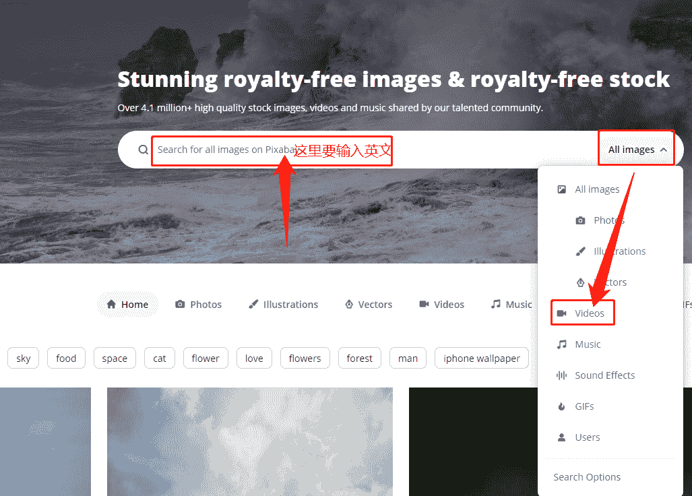

更多无版权图库：`https://zhuanlan.zhihu.com/p/695769453`

#### 5、音频

我大部分音频都是直接在剪映里搜索就可获取，这里贴一张剪映收藏图，有需要到剪映音频模块搜索即可。

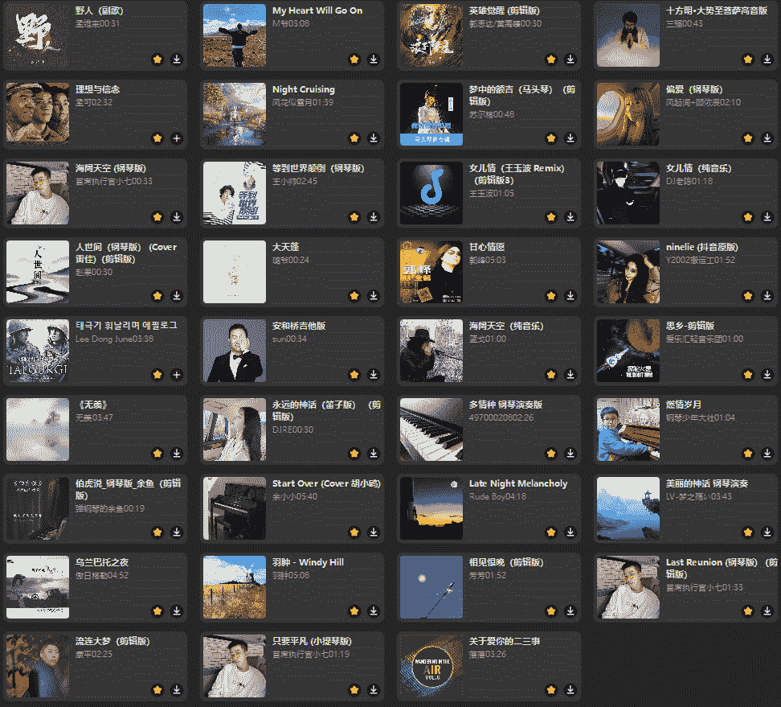

#### 6、配音生成

准备好一段文案，把文案粘贴在下方的工具里，直接生成，都需要开会员。

（1）用逗哥配音神器生成配音

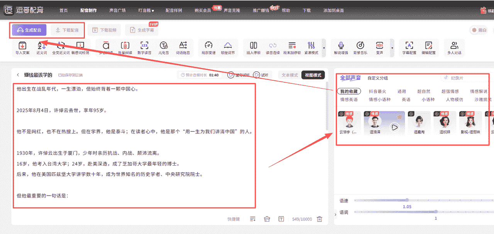

（2）用剪映SVIP会员的AI配音

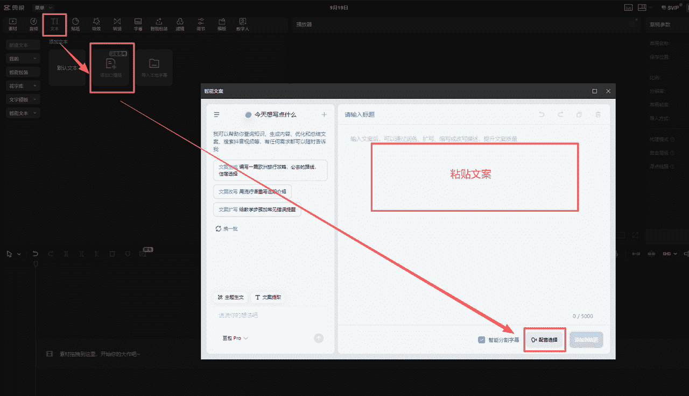

更多提效软件与方法，可以在赚钱搜索，因为我也是这么用的。

# 五、我的一些思考

## 5.1 新手小白选项目的核心有三点：

1，项目是身边有人做且出了点成绩；

2，你看了发现自己也能做，因为需要的能力你都有，如果没有，你要能学会；

3，你做了以后很快就有正反馈。

其实这三点，对于在赚钱的你来讲已经解决了。

第一点，赚钱已经有很多成功的人和项目；

第二点，赚钱的项目也有很保姆级的内容技能教学；

第三点，赚钱有航海实战，但还是要靠你自己去执行，去做。

## 5.2 项目没有反馈的时候，怎么办？

1、学会坚持，保持惯性动作，持续做事（如书单就是收集爆款文案、视频制作发布、增加账号、持续直播等）

2、不要太有自己的想法，多关注同行业的信息，有无更新的玩法，及时用账号跟进尝试，数据反馈也是反馈的一种，验证出错误的道路才能找到正确的方向。

3、多看赚钱相关的精华帖，反复重复学习，会有新思考指导新行动。

## 5.3 如果重来做这个项目，我会怎么做？

我觉得这是一个可以赚100万以上的小生意。

### 1、更激进地扩账号

至少做到100个，在我第一次月收入达到3万的时候，就应该把家里人比较好的兄弟朋友5个号都打满，甚至激进点直接买一批号，招揽一批人来合作。

原因是：

# 视频号运营复盘与感悟

## 前期策略与账号矩阵

同个视频发不同号一开始没有流量限制，都能爆，算是野蛮生长阶段，这意味着视频一次生产可以投入多个号使用，哪个账号爆了就直播哪个号，时间周期大概有6个月。

其次，24年3月开始，我带我妹妹做4个月赚5万多，早一点开始干，跟我一样也有机会，需要把SOP梳理清楚，直接复刻。

最后，账号也会涨粉，涨粉的账号，不用了可以卖掉也是一笔财富，一些中间商的报价。

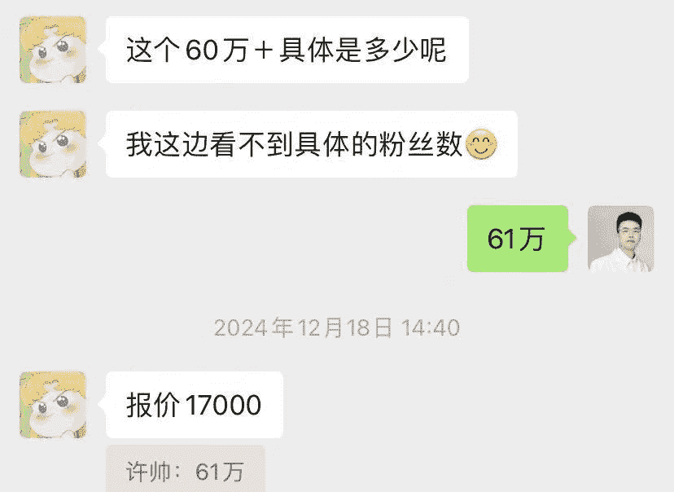

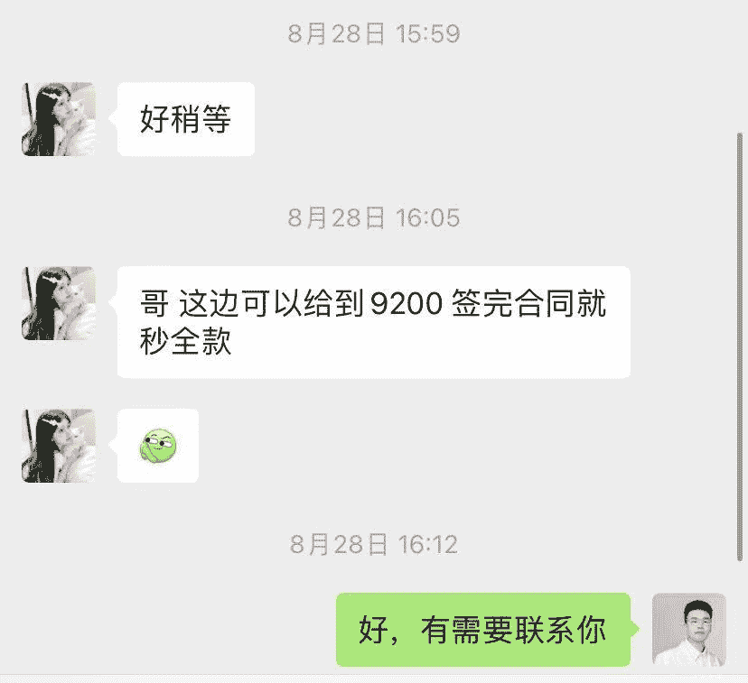

## 2、不局限于语录图文，配音视频和口播视频要倾注全力

因为视频号的用户群体，太需要听了，这个群体的人看东西久了，眼睛不舒服，但是听不影响，有些用户不想看书，于是语录音频很多人有需求，在私域是可以直接拿来卖的。

## 3、寻找批量制作视频的方法，大量的产出视频高频发布

比如一个号发48个视频，半小时一条积攒直播预约数，我当时是主要的号一天发24条视频，好的时候每个月单号几千万的泛流量。

## 4、多平台多账号去分发，同时运用批量上传工具，比如视频号的快视

我24年1月，尝试分发了📕，1个月不到就涨了1万粉丝，虽然没有大的变现，但有一定的粉丝基数。

抖音、快手这些，我基本没有怎么分发，但理论上是可以做的。

## 5、账号找厉害的学员合作输出，然后自己全力跑图书短视频带货的培训

这是一个一年可以几十上百万利润的机会，只有一个要求：相信自己。

另外，我自己分析无法扩大的原因是：

### 存在的问题与不足

#### 1、选的这个垂直细分赛道太小，天花板低

大佬说做难事跟做简单事，其实差不多，10倍比2倍容易

#### 2、路径依赖严重，导致我改变还是太少，需要更多的去碰撞去迭代，这次写复盘，也是为了让自己回到空杯心态。

## 5.4 最后，我想说

这个世界上，多数人都是先看见后相信，极少数人可以做到先相信后看见。

作为一个普通人，我只能先看见，所以来了赚钱，赚钱其实提供了一个让普通人看见的场域，普通人有了看见，才会激发出行动；有了行动，才可能会有好的结果。

在写这个复盘的过程里，赚钱的约稿团队提供了很好的视角，如解决了用户的什么需求？拿到这个成绩的底层逻辑是什么？

关于视频号卖书赚钱，我个人更多认为的是，书只是一个情绪的载体，本质上，名人语录分享提供的是情绪价值。

我的用户里50+岁女性占很大一部分，她们买书，可能并不是买知识，而是买情绪价值，比如买心安、买陪伴、买成长的感觉。

她们看到语录的时候，会觉得这个视频懂我、文案写/说得真好、我想每天都看/听他。

因此，做图书短视频，你要明白的是，你是贩卖情绪的，而不只是贩卖知识的。

至于为什么能拿到这个成绩，有什么共通的底层逻辑？

其实我没想太明白，我看到很多人做项目失败的原因之一，是喜欢单一归因，比如账号被封了，说明这个不行了，比如视频没流量了，是发布时间有问题等等，

但我认为人还是要**用发展的眼光看待事物**，只有持续做，持续改变，持续迭代，才会有不一样的效果。

比如做账号的时候，同样限流、封橱窗、各类违规都遇到了，有的人选择放弃，有的人选择继续。

这让我想起一句话：悲观者往往正确，乐观者往往成功。

人们能拿到结果，或许并不是他的能力有多么出众，只是他仍然在牌桌上。

是的，在他赚不到太多钱的时候，他也坚持在做，所以他得到了更好一点的结果。就像我前面说的没有反馈时，坚持惯性动作，持续做事。（当然，方向要是对的哈，如果你连续几个月做一件事都没有收益，那该反思是不是动作是有误的。判断动作是否正确，其实就是能不能赚到钱，也就是龙哥的第一块钱理论，能不能完成闭环，赚到第一块钱）

史蒂芬柯维（高效能人士的7个习惯作者）他有个10/90法则：生活中，10%是发生在你身上的事，90%取决于你对这些事的反应。

这里也有个经典故事分享：

有个父亲在早餐桌上喝咖啡，女儿一不小心打翻了杯子。

咖啡洒在他的衬衫上，这时他有两种选择：

1️⃣ 他愤怒地责骂女儿、埋怨妻子，结果全家心情都被破坏。因为耽搁时间，他上班迟到、被罚款、整天低效。

2️⃣ 他控制情绪，对女儿笑笑：“没关系，去换衣服吧。”

几分钟后，女儿破涕为笑，全家愉快出门，他也准时上班、顺利工作。

事件一样，结果完全不同，只因为你的反应不同。

我把这句话改了一下：做项目，10%是发生在你身上的困难，90%取决于你对这些困难的反应。

感谢阅读，花了几天输出，写的比较杂乱，但都是真心分享，如果您有收获，点个赞哟~
