# KPOP赛道亿播-我的YouTube 成长复盘

> 来源：[https://xuqiwei1986.feishu.cn/docx/EGexdvnB3o8PXExM5cccUmkunic](https://xuqiwei1986.feishu.cn/docx/EGexdvnB3o8PXExM5cccUmkunic)

## 前言

本篇帖子，我会从我曾经经历过的几个不同赛道和踩过不同的坑出发，分享：如何写提示词，降低抽卡概率；AI视频制作的工具使用最佳实践；如何培养自己对视频内容好坏的判断能力；以KPOP赛道为例，如何打造视频前3秒的吸引力；如何进行微创新等等一些基于Shorts的经验。

## 自我介绍

大家好，我是橙子汁，在做Youtube之前，我干了4年的外贸业务员，后面因为行业不景气失业了，找不到心仪的工作，于是开始尝试自由职业。2024年6月跟着航海着手📕店铺，出过一点点小小的成绩，高光时刻是单月单店月利润五位数。

为什么又转向做Youtube还加入了深海圈呢？首先，Youtube shorts是龙哥老大去年10月发的超级标02，我觉得它的含金量是毋庸置疑的。我分别在去年12月和3月参加过Youtube航海，跟完航海之后还是挺感兴趣的，但那会还在做📕店铺。到了3月第一期深海圈开放报名的时候，我瞄了一眼深海圈门票还是比较贵的，犹豫了一下，同时赚钱星球也马上到期了，那会选择了先续赚钱星球，自己研读一些精华帖。到了5月份，店铺接连被封禁，破大防了，但也是真的厌倦了每天守在电脑前选品，测品，剪视频，处理订单，发货，处理售后，还有各种指标考核，平台规则变化也非常快。在深知已经比较卷的情况下，新起店铺重新能够做起来的难度，于是寻找新的出口！因为做过外贸，外语不错，上网环境也熟悉，然后也做过📕电商，略懂如何找爆款和剪辑视频，感觉跟做油管有些逻辑是相通的，这些已有的基本能力可以直接做一个横向迁移。所以就入局试一试。

## 成果展示

我是2025年5月份加入的Youtube深海圈，由于一些不可抗力的因素，从7月底才开始正式运营。目前运营5个账号，1个高级YPP，2个初级YPP。打造出多条千万爆款，月流量过亿，单视频收益破千刀。

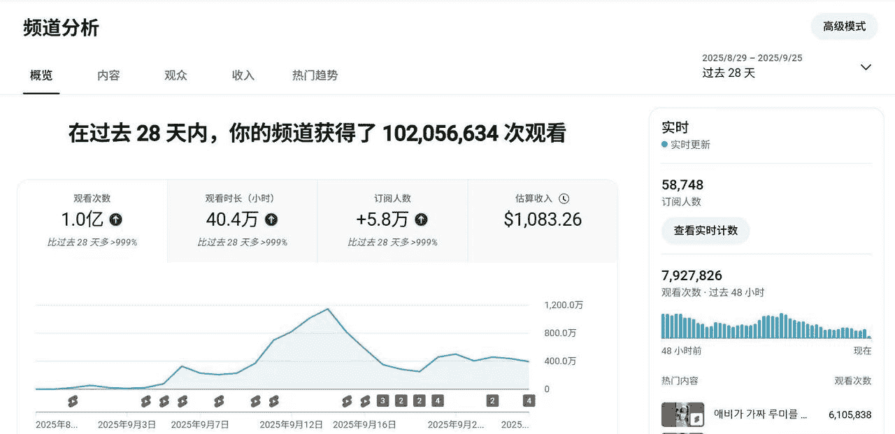

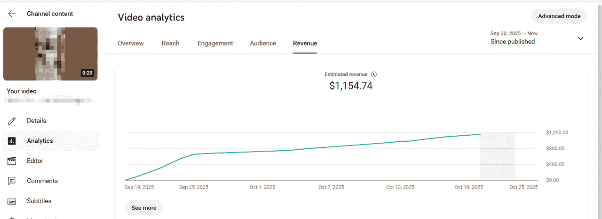

# 赛道经历分享

这几个月走过了多个赛道，接下来我给大家分享一下赛道经历以及遇到的挫折与挑战。

## 第一个赛道：4~6月达人秀变身（小白阶段）

小白阶段曾经稀稀拉拉地更新过一些达人秀变身视频，播放量集中在1~10万。主要的卡点是不会写提示词，使用的ai工具比较局限，生成的镜头不够生动也够不流畅，经常卡万播。

小白阶段的工作流：下载对标视频——>提取每个分镜关键帧——>逐个倒推提示词——>MJ出图——>Runway出视频 ，除去评委镜头，剩下就4-5个镜头需要生成，我清晰地记得当时一条视频的制作平均在4小时左右，非常慢，但是这个阶段积累了最基本的使用AI工具的能力。

由于这个赛道目前已经过时了，就不放案例视频了。（其实我那会做的时候就已经有点过时了）

## 第二个赛道：6~8月山海经复刻真人爆款故事（入门阶段）

这个阶段主要是利用山海经这个IP的人物形象来复刻真人实拍的故事脚本，视频播放量集中在10~300万不等。主要的卡点是觉得自己已经复刻得很到位了，但是播放量总是突破不了，非常焦虑。

接下来举一些案例，分析一下问题具体出在了哪里。

### 1.对于视频内容理解不到位，镜头冗余，剧情拖沓

案例视频：

故事概述：爷孙俩在玩拳击，小朋友不小心把爷爷的牙打掉了，吃牛排的时候，爷爷没牙齿咬不动，小朋友用拳击手套帮爷爷打碎牛排，爷爷顺利吃上了牛排。

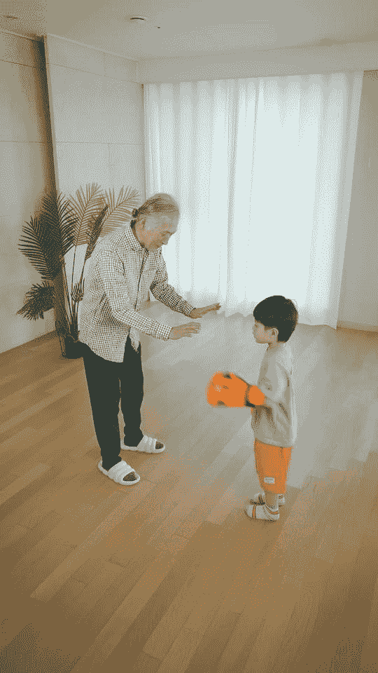

[Sigma Kid Power #funny #sigma.mp4](https://internal-api-drive-stream.feishu.cn/space/api/box/stream/download/all/B2T9b0vQmox9X7x447tcKebknjf)

对标视频

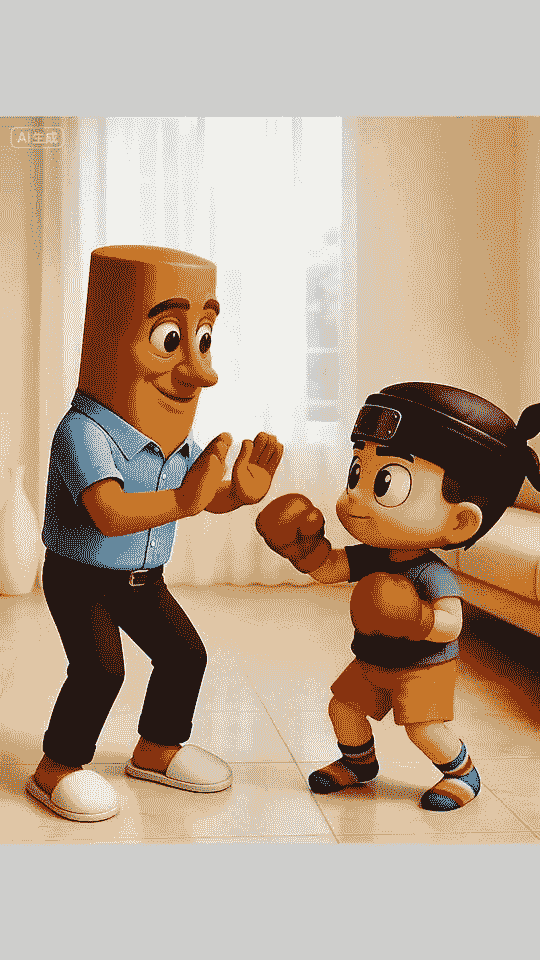

[Brainrot Capuccino has super Power #funny #capuccino #story  #tungtungtungsahur.mp4](https://internal-api-drive-stream.feishu.cn/space/api/box/stream/download/all/XfE6bfhKZoaEZ1xz4a1cDEJjnWd)

我的视频

我从我的作品里拎了3个镜头出来，可以很直观地看到这3个镜头的信息，其实是高度重复的，都在表达同一个意思-爷爷牙掉了。

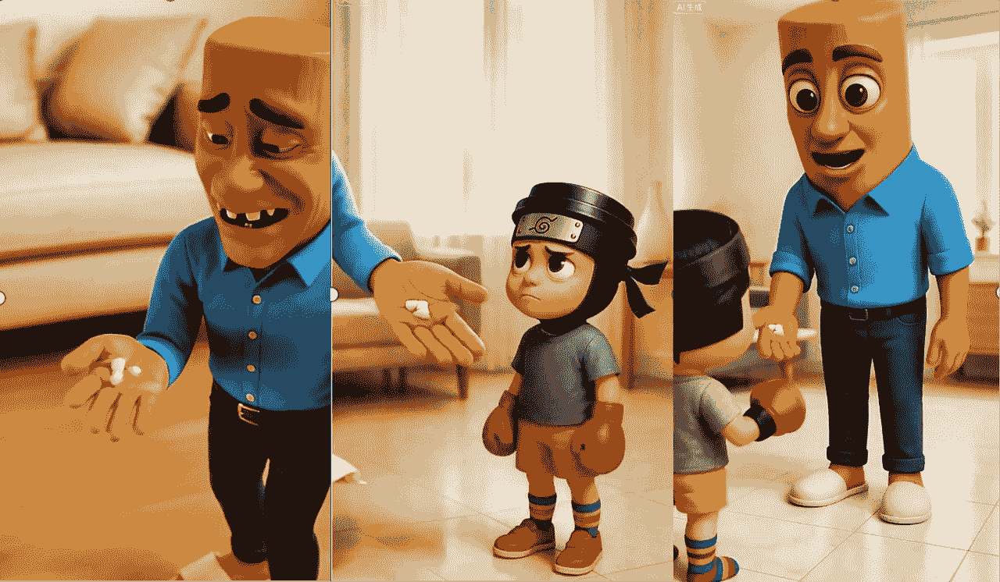

包括下面这2个镜头，也可以很直观地感受到后一个镜头是多余的，因为前一个镜头已经说明白了，爷孙俩在玩拳击。

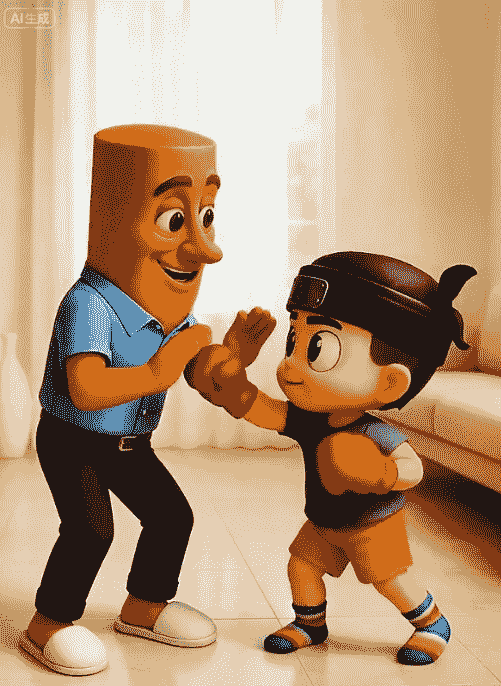

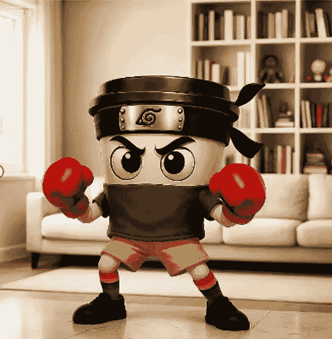

总结**起**来就是多余的镜头会显得剧情非常拖沓。一个镜头能传达完整意思的，就不需要像真人故事那样，好几个景别来回切换，远景切中景又切特写，这是没有必要的，会影响整体的节奏，进而影响完播率。AI复刻真人爆款故事的核心是理解了整个剧情之后，提取出核心的剧情框架，进行复刻，而非单纯地模仿对标视频的每个镜头。

### 2.提示词描述得不完整，经常性漏掉一些元素

提示词描述得不完整，会导致出图的效果达不到预期，抽卡次数增加，影响效率！最重要的是，出图的质量会直接影响出视频的质量。

举个例子：

比如我要生成一张这样的图片，之前的操作方法是上传角色参考图，然后用一大段自然语言来描述，这样子会非常容易漏掉某些元素忘记描述，导致需要反复修改提示词才能达到满意的效果。

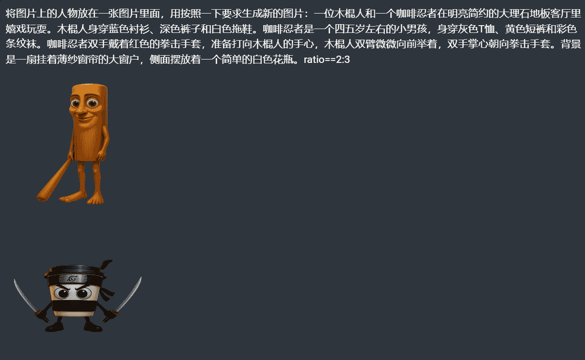

而实际上完整的图片提示词就是包含以下这些元素：

> [主体]：角色设定，表情，动作

> [环境]：场景描述

> [时间]：白天、夜晚

> [天气]：晴天、雨天

> [视角]：平视、仰视、俯视

> [景别]：远景（不常用）、全景、中景、近景、特写

> [风格]：写实，3D卡通，动漫，像素风等等

还是拿这张图举例，我们可以这样写提示词：

tips：关于角色设定，自己可以提前设计并生成，例如：木棍人身穿蓝色衬衫、深色牛仔裤和白色拖鞋，上传木棍人参考图，咖啡忍者是一个四五岁左右的小男孩，身穿灰色T恤、黄色短裤和彩色条纹袜，上传咖啡忍者参考图。

> [主体]

> 角色：木棍人, 咖啡忍者

> 表情：木棍人：开心，咖啡忍者：严肃

> 动作：咖啡忍者双手戴着红色的拳击手套，双手放在胸前，准备出拳。木棍人正对着咖啡忍者半蹲着，双臂微微向前举着，双手掌心朝向拳击手套。

> [环境]

> 一个明亮简约的大理石地板客厅，有一扇挂着薄纱窗帘的大窗户和白色花瓶。

> [时间]

> 白天

> [天气]

> 无

> [视角]

> 平视

> [景别]

> 中景拍摄

> [风格]

> 3D卡通风格，画面细腻，细节丰富

用上这样简单的结构化提示词，不仅可以大大提高提示词的完整性，降低抽卡的概率，还可以实现高效地批量出图。

### 3.镜头节奏把握不到位

当时的我不能很好地理解镜头节奏的重要性，导致每个视频都是给人一种平铺直叙的感觉，没有任何波澜。个人觉得镜头节奏非常影响整个视频的观感。每个分镜的信息清晰传达的同时，节奏需要张弛有度，普通过渡的镜头可以快，重要的镜头就需要慢，这样才能抓牢观众的注意力。

那什么样的镜头是属于重要的镜头？这很简单，你可以假设要是没了这个镜头，会不会影响到观众对于整个视频的理解。

对应到当时的山海经故事赛道，好多对标的视频已经不可见了，我就拿kpop赛道的视频片段给大家看一下，方便大家理解，什么样的镜头属于重要的镜头，需要慢；什么样的镜头属于拿来过渡的镜头，可以快。

案例视频片段：

[10月29日.mp4](https://internal-api-drive-stream.feishu.cn/space/api/box/stream/download/all/FzMsbdgRgovGTTxsiNncC0xan0b)

反面对标案例（仅用于阐述镜头节奏）

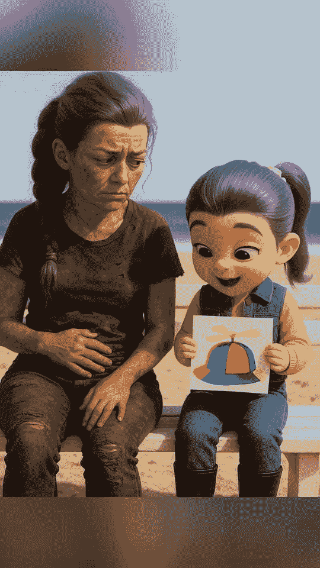

[10月23日.mp4](https://internal-api-drive-stream.feishu.cn/space/api/box/stream/download/all/S2qYbt8EooihmnxYvkucuX0GnCh)

正面案例（仅用于阐述镜头节奏）

第一个镜头：小女孩想要一个风车帽，母亲没钱犯愁

第二个镜头：母亲迅速吃完半个西瓜

第三个镜头：母亲拿西瓜皮当作帽子给小女孩戴上

第一个镜头和第三个镜头就属于重要镜头，第二个镜头就属于过渡的镜头，因为观众真正好奇的是把西瓜吃完后，下一个镜头拿西瓜来做了什么。

可以看到截取的反面对标视频片段，镜头节奏就给人一种平铺直叙的感觉，并且在这个案例里还容易引起观众误解，为什么西瓜只吃了一口就盖在了小女孩头上。

### 4.不熟悉各大主流AI工具的能力边界

当时的我对于一些主流AI工具擅长的能力边界不清晰，导致抽卡次数也非常多，有时候某些镜头实在是抽不出来了，就将就用了。现在回头看，其实选AI工具也有方法。

举几个例子：

针对图片模型:个人觉得Sora很适合出偏真人风格，出来的图片比较有质感也比较细腻；而即梦和香蕉比较擅长的是3D卡通风格，动漫风格之类的。

针对视频模型:复杂指令遵循方面，海螺/可灵/VEO的效果第一梯队的，即梦智谱就相对不灵活,出图的时候你得先完成一半的动作或者说图片里的动作趋势要很明显才行。想要更好地实现首尾帧效果，肯定优先使用可灵，海螺，Vidu。

这里我也给大家分享一下我在这个阶段的主要工作流：

> 出脚本提示词:Google ai studio配合一卒大佬给的元提示词

> 出图：大臣教练开发的批量出图工具（支持sora和banana模型）,偶尔会用即梦4.0

> 出视频:海螺，可灵和vidu，简单的镜头用即梦/智谱(一泽教练开发了RPA批量出视频工具）

总结起来就是大家可以根据自己做的视频类型，挑选自己用着顺手的AI工具进行深度使用，实现更好的镜头效果！ 以上这些让我在这个阶段积累了对内容的理解能力，镜头节奏的把握，熟知了各个主流AI平台的能力边界。

## 第三个赛道：8月开始KPOP故事赛道（进阶阶段）

这个阶段主要是利用KPOP猎魔女团这个IP的人物形象来做各种故事，视频播放量基本集中在百万以上，多个千万爆款。

### 赛道简介

可能有些圈友还不知道爆火的KPOP赛道到底是什么，我给大家简单科普一下，KPOP赛道是基于《K-Pop:猎魔女团》衍生出来的各种二创，这部动画电影是由Netflix和索尼动画联合推出的动画电影，上线于2025年6月20日，截至2025年9月，影片累计观看次数超2.36亿次，成为Netflix影史观看量最高的动画电影。

8月5号第一次在深海圈风向标出现，那会风向标给的对标账号还是一些几百万播放的视频，8月12日深海圈风向标里再次出现它的时候，已经出现了非常多的百万千万爆款视频了。当时曹教练给我们看过KPOP在Google trends上的搜索指数，一度超过了鱿鱼游戏，逼近了当时爆火的美国山海经的热度。也是在这个时间段，圈友纷纷选择了切换到KPOP赛道，包括我自己。

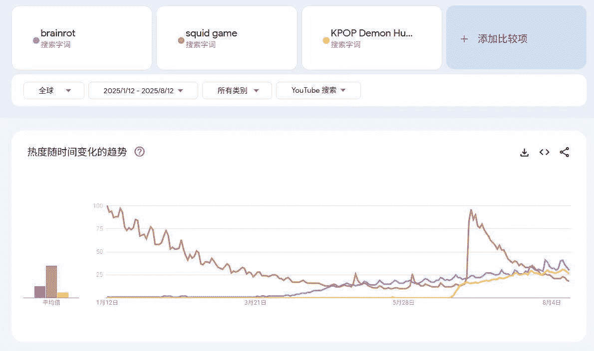

同样是故事赛道，从RPM上来看，KPOP比山海经也是高了不少，我记得当时山海经赛道，圈友们的RPM集中在0.02~0.05，KPOP赛道的RPM可以达到0.04~0.08。

### 心得分享

#### 1.重视视频开头的前3秒

先看2个我自己的视频：

故事概述：紫发女人商场偷东西，结果在路上发生了意外。

[99万-루미는 지누를 너무 사랑해요! #jinu  #rumi  #kpop  #story #kpopdemonhunters  #golden #케이팝데몬헌터스.mp4](https://internal-api-drive-stream.feishu.cn/space/api/box/stream/download/all/A0xnbFjyJo4yxkxPcLlcKTuCnFc)

播放量100万

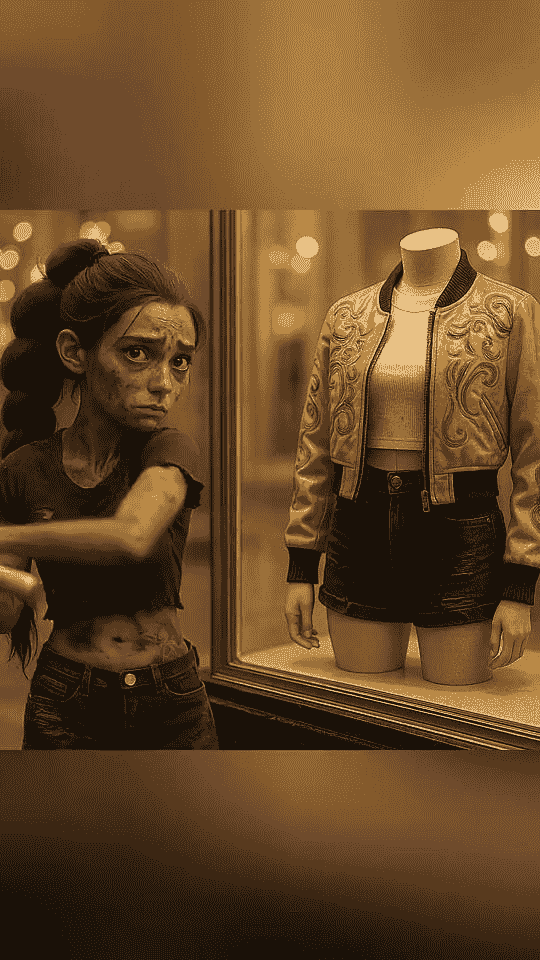

[2300万-루미는 지누를 너무 사랑해요! #jinu  #rumi  #kpop  #story #kpopdemonhunters  #golden #케이팝데몬헌터스.mp4](https://internal-api-drive-stream.feishu.cn/space/api/box/stream/download/all/BJSKbWw0RoHIfIxxhsVcnH90nwd)

播放量2300万

大家看完这2个视频，应该可以非常直观地看到，故事情节大致是相似的，最明显的差别仅仅是视频开头。

第一个视频开头：警报声有点听觉冲击，但程度一般，不够吸引人，同时缺少了视觉冲击元素 ，选择观看率68.5%。第二个视频开头：砸玻璃，视觉听觉双重冲击，抓住了观众了注意力，选择观看率来到了78.6%。

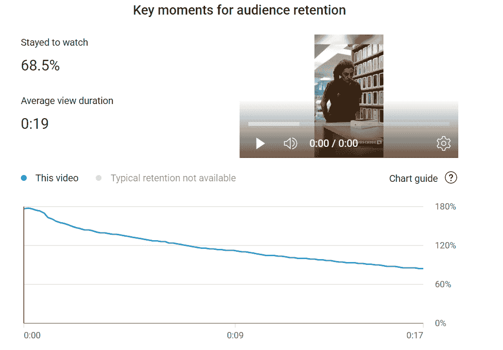

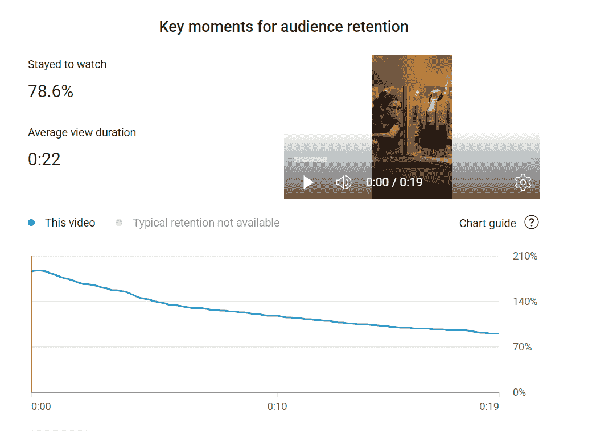

两个视频的播放量也是差了20倍，所以大家一定要重视视频开头前3秒画面的张力，平时可以积累一些爆款元素，例如视觉冲击元素、听觉冲击元素、悬念元素等等。

#### 2.微创新

微创新的前提是你没有特别擅长追热点，如果你非常擅长，那么你完全可以原封不动地快速复刻。

参加过9.20航海家大会，听过咱们Gary教练分享的圈友，应该有所耳闻做爆款视频的公式。

（帖子链接[龙哥盟航海家AI大会——Gary ：YouTube AI 内容出海：把全球第一的视频平台变成自己的金矿](https://ncnmu5q1eqm9.feishu.cn/wiki/LJxVwJzWRiGNxGkfRBLcju0fn6e)，还没看过的小伙伴，务必仔细阅读，通篇都是精华；已经看过的小伙伴可以再去认真看一看，常看常新，每看一遍都能打通一点任督二脉！）

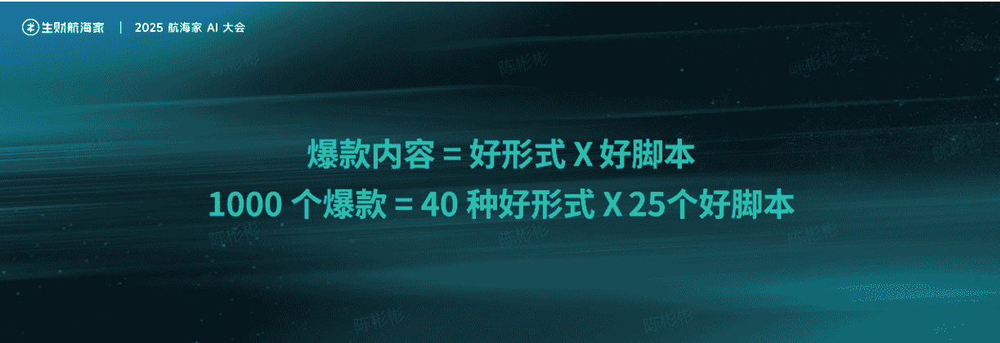

> **爆款内容=好形式*好脚本**

> 好形式：可以理解为视频的外在表现形式，例如从美国山海经切换到KPOP猎魔女团

> 好脚本：可以用2个标准判断，同一账号自己复刻自己爆了很多次；刷到好多账号都在做同一个脚本并且都有流量

接下来给大家分享一下如何进行微创新。

先给大家看2个案例视频：

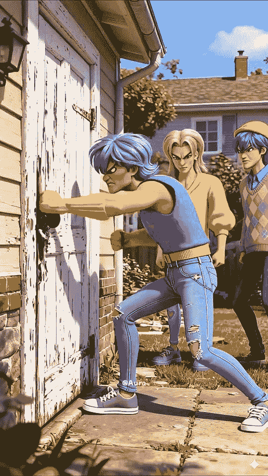

[Don't worry, RUMI! JINU is here to save you! 💪.mp4](https://internal-api-drive-stream.feishu.cn/space/api/box/stream/download/all/KaWTbTlG9ofB6JxiRxmcnMwAnih)

对标播放量2540万

[루미를 다치게 한 사람은 누구였나요#kpop #huntrix #rumi #golden ##kpopdemonhunters #케이팝데몬헌터스.mp4](https://internal-api-drive-stream.feishu.cn/space/api/box/stream/download/all/BRUvbQExPo5qxPx0eGxcGvNLned)

我的播放量2350万

> 大家可以看到这两个视频几乎是一样的脚本，我进行微创新的地方有以下几点：

> 1）换了人物：加入了儿童元素，因为经过实测，保**证内容安全的前提下，儿童是一个爆款元素。**注意：把握不好边界的，严禁出现任何儿童元素，不限赛道，不然容易被取消YPP!!!

> 2）爆款元素替换：喂烟雾替换成剪头发，蓝猫复仇改成小鲁米复仇等等。

> 3）换了画风：原视频属于3D卡通风格，我的视频属于超现实主义风格。

tips：因为我没有第一时间发现这个爆款脚本，所以微创新的地方有点多，大家平时在微创新的时候，可以每次少修改一点元素，多测一测流量。

### 遇到的挑战

#### 1.YPP被取消

在一个风和日丽的下午，其中一个账号收到了YPP被取消的通知，原因是“涉及未成年有害”，如图所示。

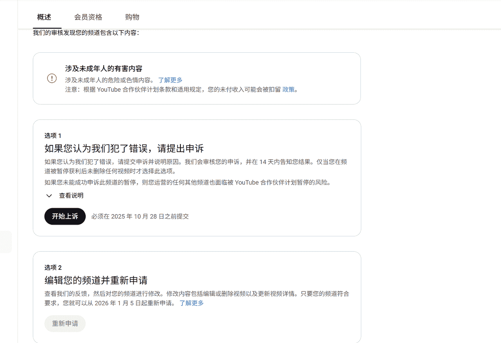

近期有一大批圈友中招，接下来给大家详细剖析一下“涉及未成年有害”，这是一个很常见的原因。

先看一下我被判罚的视频:

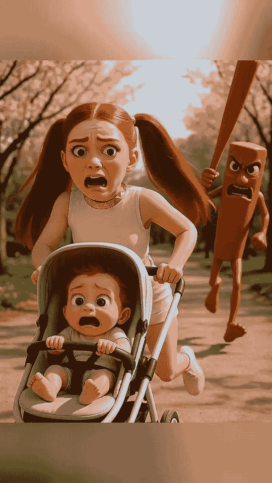

[What did Tungtungtung do ！👀✨  #brainrot #funny#tungtungtungsahur #rumi #golden #kpop #demonhunters.mp4](https://internal-api-drive-stream.feishu.cn/space/api/box/stream/download/all/HGZObWEOnoCL7oxBe5ycG9bznNb)

> 具体哪些情节会涉及未成年有害呢，我给大家总结了几个常见的情节：

>

> 1）展示或煽动未成年人参与危险活动，尤其是观看者可能会模仿此类危险行为

> 2）让未成年置身于可能会受伤的危险环境中，包括特技表演、挑战、冒险或恶作剧等等

> 3）煽动或宣扬对儿童进行身体或情感方面的虐待，包括但不限于：模拟父母虐待行为，胁迫未成年人，暴力。对儿童疏于照顾，给未成年人带来情绪困扰等等。

> **国内外对儿童法律法规的不同，揣摩不清楚规则的边界，就不要做带有儿**童元素的视频，否则会被“莫名”取消ypp，收益被回收，且无法申诉成功，得不偿失。

> 具体的细节，可以去youtube帮助-政策查看：https://support.google.com/youtube/answer/2801999?hl=zh-Hans&sjid=13473279827156286653-NC

#### 2.爆火过后面临流量下滑

这应该是很多圈友难以避免的情况，Gary教练给我们分析过3种情况：

> 赛道整体流量都有所下滑，那么就需要探索新的模式或者转赛道

> 账号原因，那么把内容发到其他账号测一测流量

> 你的视频在这个细分赛道里没跟上节奏，跑不过人家，那么需要重新研究如何做出能跑得过人家的视频

我对于我的账号分析，属于第2种情况，所以目前在起新号继续跑。

# 圈友可借鉴的经验复盘

1）找对爆款。深海圈的圈友多刷每周风向标，可以把列出来的对标全部关注一遍，那你就有了源源不断的爆款对标。其他的圈友可以多刷视频，视频看多了做多了，慢慢就能积累出网感和手感。

2）深度使用自己用着顺手的ai工具。因为每个做的视频类型不一样，等到有经验了，其实看完一遍完整视频就知道,对标的每个镜头大概用什么工具能更好地实现出来,单图生视频还是用首尾帧实现。

3）多用提效类工具。比如大臣的批量出图工具，一泽的rpa批量出视频工具，当然有能力的圈友可以自己开发。

4）积累自己的爆款脚本库，爆款开头以及多收集爆款元素

5）做好数据复盘。不要主观地判断视频的好坏，流量为王，数据为王，观众爱看的就是好的。

6）不管做任何一个shorts赛道，方法是可以互通的，耐心沉淀，下一个爆火赛道到来时，你积累起来的能力就能马上迁移过去。

# 新手误区提醒

1）前期不要时刻盯着播放量，要刻意练习自己制作视频的能力和对内容的理解能力。

2）不要一上来就复刻特别难的视频，首先要判断好自己的能力边界，也就是以自己目前的能力能不能复刻得好。

3）不要一上来就想着微创新，先把对标复刻到位，视频做多了，网感自然就培养出来了。

4）务必保持空杯心态,向有结果的人学习！关于油管的精华帖非常多，每一篇都是值得仔细研读的。

# 写在最后

当下这个阶段虽然取得了一点点小结果，但深知自己还有非常大的进步空间，不断迭代，坚定前行。感谢赚钱提供这么好的平台，这几个月走来颇有收获！

在此，特别感谢 Gary 教练、波妮教练以及怅惘教练的专业指导与资源支持，同时感谢深海圈小伙伴们的无私分享与互助！最后，祝还没开通YPP的小伙伴早日开通YPP,祝大家都能早日实现月入万刀，月入十万刀！