# 《告别Ps、拒绝天价摄影师！拒绝天价AI平台！我用豆包把商品图成本打到0，出片率90%！》

> 来源：[https://xuqiwei1986.feishu.cn/docx/GVP0dmIjGofWfJxqqvRc8bfonsb](https://xuqiwei1986.feishu.cn/docx/GVP0dmIjGofWfJxqqvRc8bfonsb)

**星球里的老板们，大家好！**

我是入星球快一年的小趴菜，入星球快一年了也没什么输出。一直在做temu跨境电商，近期平台严查产品铺货。

看别的大佬一直在星球输出，感觉自己没有什么贡献，特别着急。今天杨爽大佬在👸号发了“跟龙哥开会聊项目后，给你分享3条有潜力的新机会 | 第二期来了”关于AI 提示词/AI 指令售卖（基于豆包）的市场，所以把研究了一个月做的提示词生成器来跟大家分享一下。

**   **   咱们做电商的，是不是都为商品图发愁？这玩意儿是流量和转化的命根子，但拍图和修图真是又贵又费劲！

我自己的情况是：

1.  **Ps太难：** 抠图、光影、布景…技术不精，P半天不如人家随手一拍。

1.  **找人拍太贵：** 找摄影师、美工团队？动辄几千上万，一个季度的预算就没了。

1.  **市面上其它AI工具太黑：**** 我也试**过一些专业的AI商品图处理平台，效果是好，但按张收费，精修一张图的价格能赶上我找个兼职美工了，根本跑不起量。

一句话总结：钱花不起，技术又跟不上！

💡 核心问题：如何让AI“听话”，把钱省到底？

我们需要的不是艺术品，是高保真、高转化的商品图！

**我研究了市面上的A**I画图软件，发现它们最大的问题是：**画得太“自由”了！ AI总**喜欢过度发挥，把我的普通水杯画成水晶杯，把T恤画成概念服。这导致：图货不符，差评退货率飙升！

为了解决这个痛点，我花了一段时间，结合我做电商**的经验，自己研究出**了一个“提示词生成器”，并把它做成了一个【电商商品图场景生成器】网页工具。

**它的核心目标只有一个：用一套专业的“要求”，让AI乖**乖地，只改场景和光影，不碰你的商品原型！

🔥 为什么它能把你的商品图成本打到0？

这套“写要求”的套路，解决了我们最大的痛点，帮你把预算彻底解放出来：

1. 极致的“保真度”——你的产品不会变样（核心！）

我把大量“不许改”**和**“细节必须清晰的专业摄影词汇，加进了这个工具的底层逻辑里。它保证了：你生成的是你的产品，而非一件AI艺术品。 放心用，不担心“图货不符”！

1.  **“出片率”高到惊人，效率爆炸！**

这是最让我惊喜的一点。以前瞎蒙乱写一小时，可能只有一张能用。现在：

**我**个人实测下来，平均写四组要求（就是四次尝试），就有4-5张图能直接拿去用！这个出片率，几乎达到了90%的可用率！

3. 彻底告别高价服务和Ps门槛

你不再需要花钱给第三方AI平台按张付费！ 你只需要一张原始的商品照片，告诉我你想要的场景风格（户外、极简、科技感…），工具会自动给你生成最专业的“拍摄要求”。剩下的，交给AI，零基础也能操作。

**📝 怎么用？（流程贼简单）**

1.  **告诉我产品：** 你的产品是啥？什么材质？

1.  **选个场景：** 想要什么风格？

1.  **工具自动写要求：** 一键生成专业的AI拍摄指令。

1.  **丢给AI，收图！** 直接获得精美商用大片，去水印就可以用。

🖼️ 效果为证：原图 vs. AI生成的“商用大片”

空说无凭，效果才是硬道理。下面是我随手测试的结果，大家自己品品：

我给豆包的：

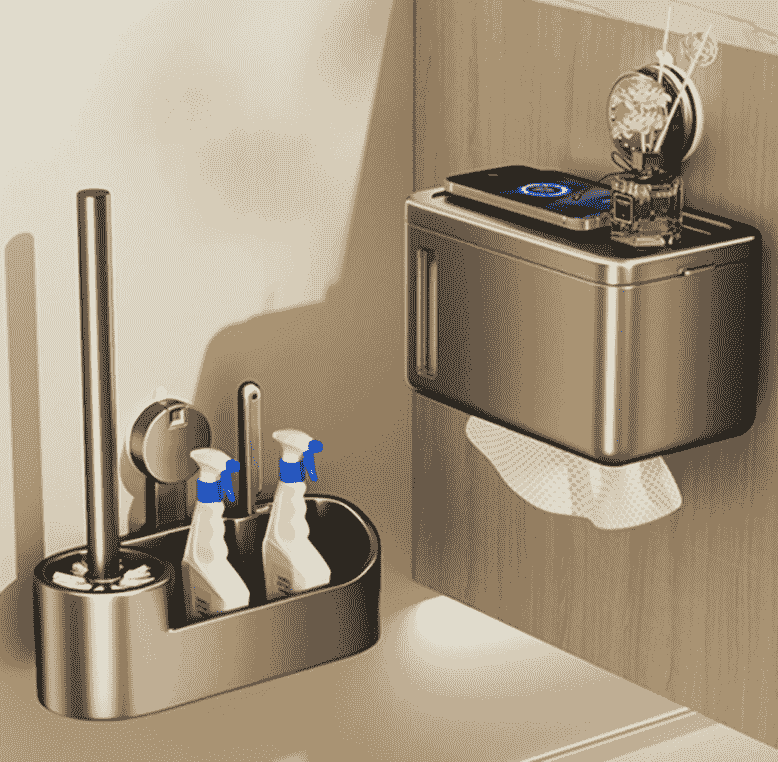

豆包给我的：

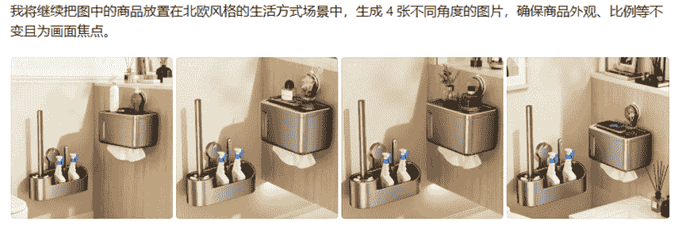

**原图2：**

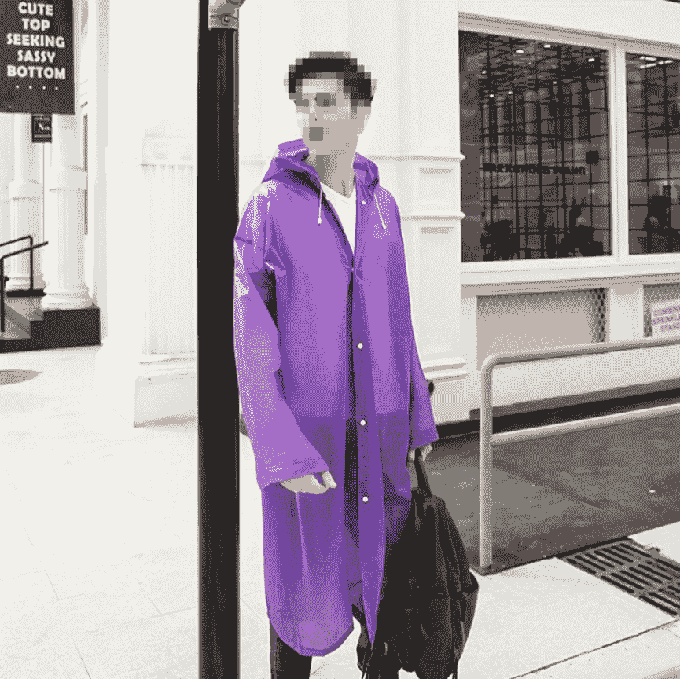

豆包给我的

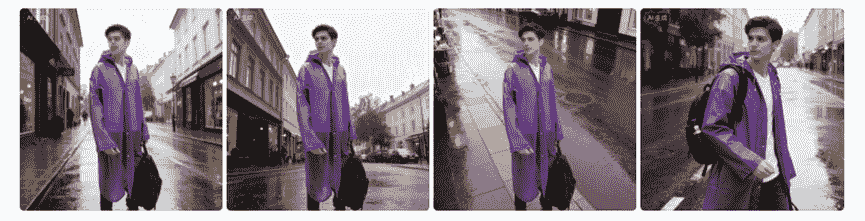

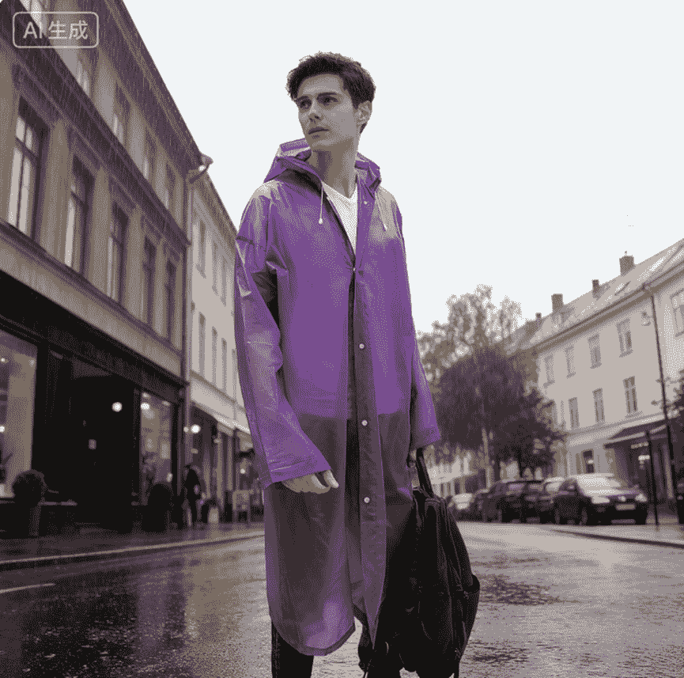

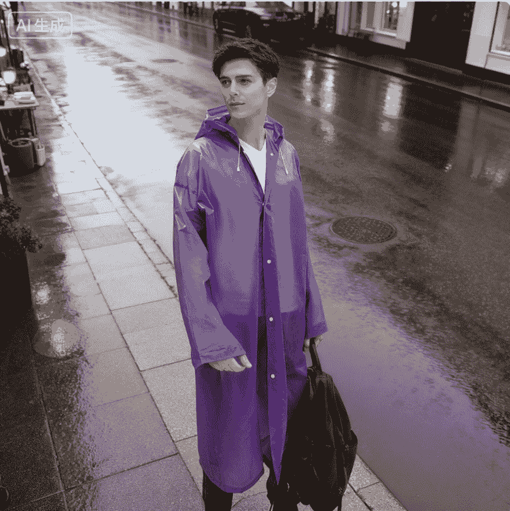

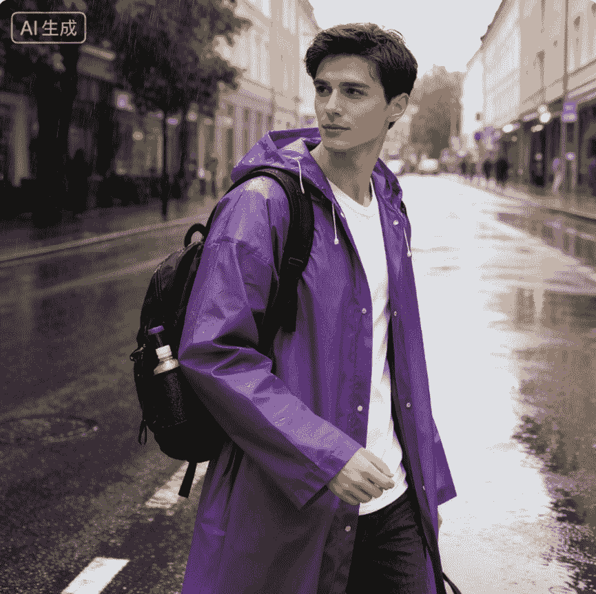

看细节上是不是很好？也很帅？

最后一组：

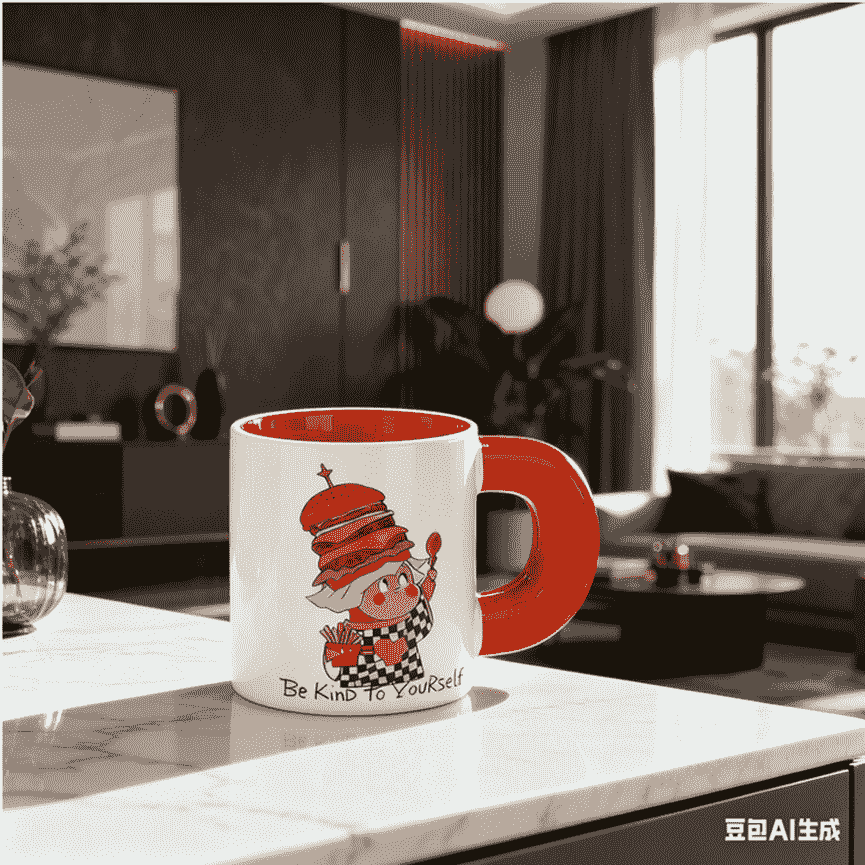

这是我给豆包的图，请忽略右下面的字。

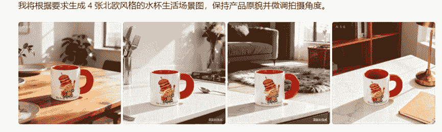

这一组是每一张都可以用的，商品的细节保留很到位。

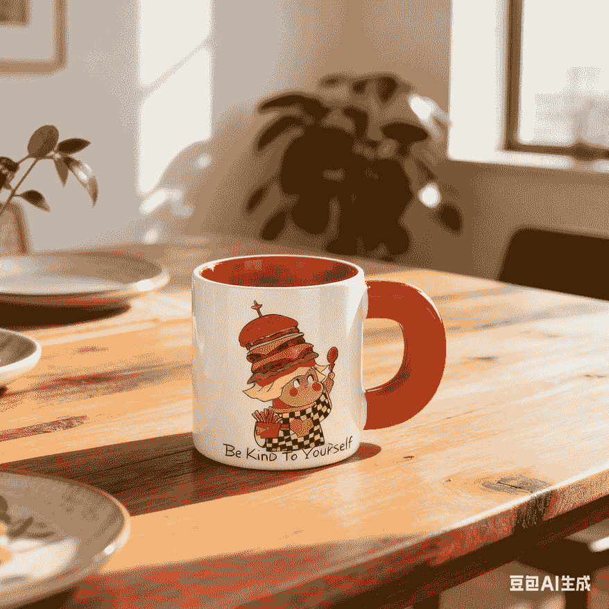

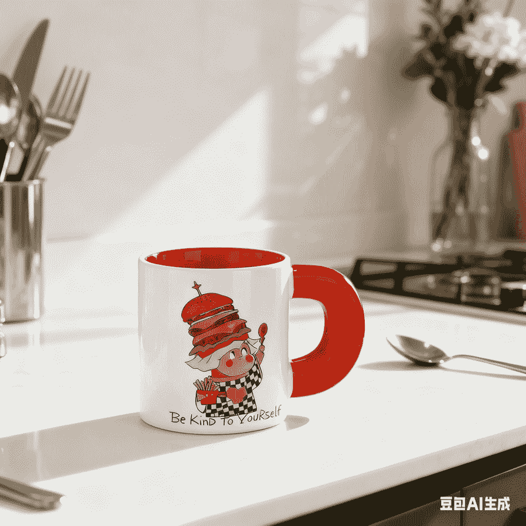

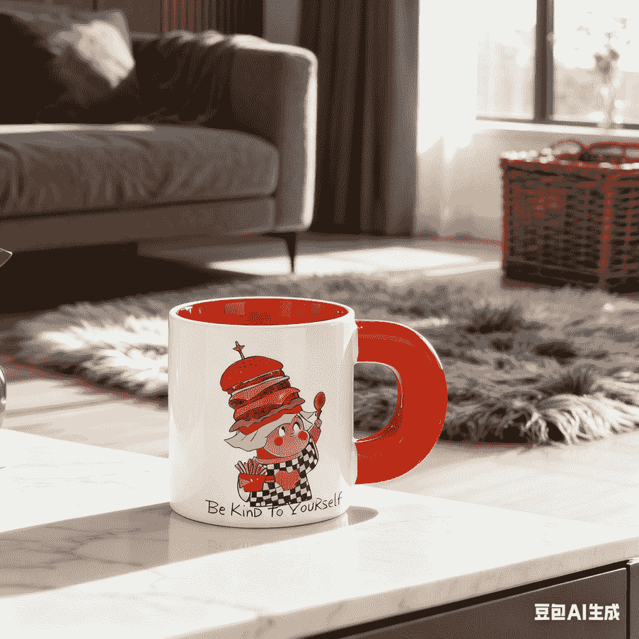

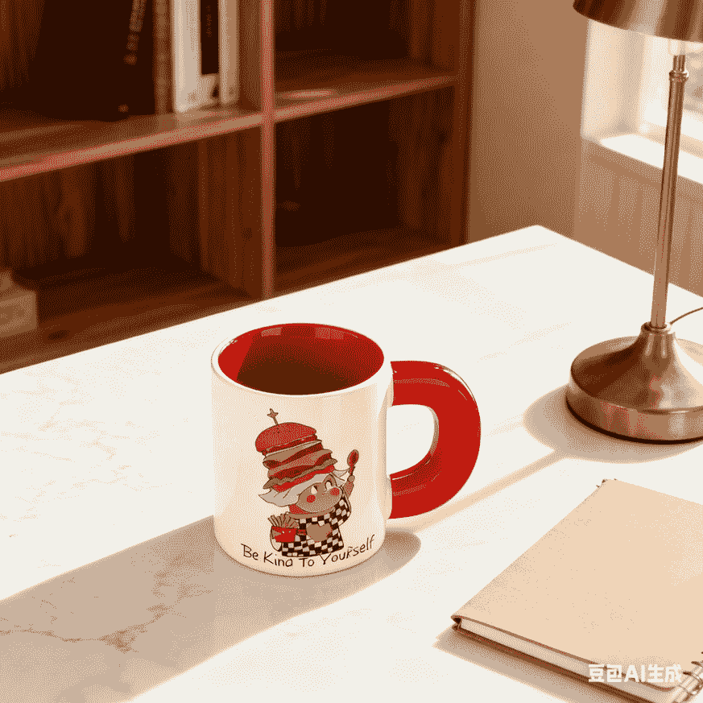

这个小工具是我的“用All in AI”成果，它的使命就是：用最低的成本和最高的效率，彻底解决电商人最大的痛点——视觉转化。

如果你也为商品图发愁，或者想把你的商品图成本打到0，欢迎在下面留言交流！大家一起用新技术把钱挣了！

特别鸣谢，七喜老师，黄小姐，李李

试用链接：http://129.211.171.236:8080/

账号：test

密码:test

有意见和建议欢迎反馈

今天有圈友让我做衣服模特图

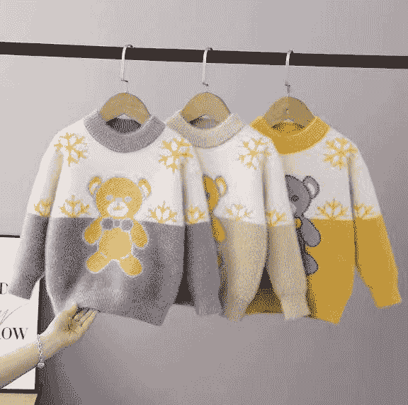

在自定义补充说明里填入，把商品穿在身上，所以有了下面这张

然后又要求要中国小孩，所以在自定义补充说明里填入中国小孩把商品穿在身上，所以又有了下面几张

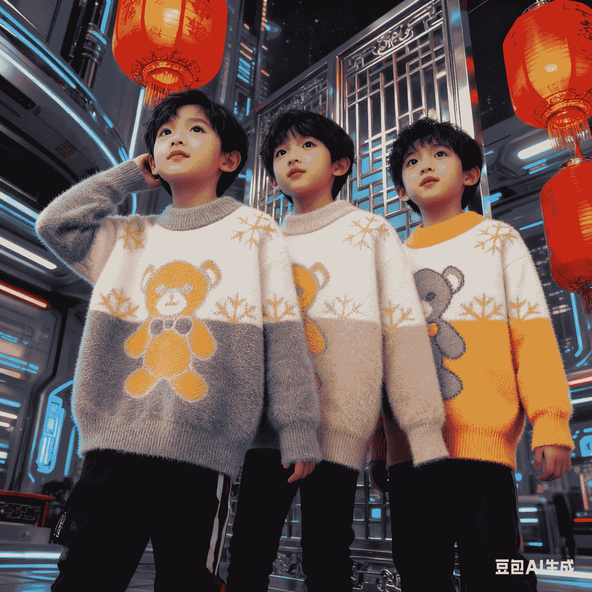

都是一次性生成的因为原图是三件衣服，而且我也没指定试穿哪件，所以有点三胞胎的意思。有需要欢迎交流。