# 双十一来了，B站好物带货搞起来，附AI写的一键生成视频软件（单品，集合都可以做）

> 来源：[https://xuqiwei1986.feishu.cn/docx/YT0OdrprBoLnv7x3djJcdlUCnGf](https://xuqiwei1986.feishu.cn/docx/YT0OdrprBoLnv7x3djJcdlUCnGf)

前几天mini航海开始报名了，也是跟双十一有关的。

双十一到了，又到了带货的好时候。

今天这篇内容主要是给大家分享B站好物带货软件升级版本（加了配音和参数修改）

**和一个长久一点的玩法**，附带一点点个人的经验。

下载地址：https://daming.lanzoum.com/iuwsr39jevkh

更多的玩法，大家可以参考一下之前圈友分享的精华贴，基本都有写。

> 用软件生成视频的模式入门很快，正反馈也很快。先单品模式入门，然后往集合方向去做。

> 长久的话推荐进入生财深海圈跟家蒙老师学习。更长久的玩法，更好的资源对接。

# 一、账号准备

**目前B站账号好物带货**权限，就两个门槛，都很容易解决，开通后记得绑定PID。

## 1、实名认证

这个账号不多的话，找家人亲戚朋友认证一下就行，B站好物带货是绑定京东联盟的账号，结算是到京东联盟的。

可以一个京东账号绑定多个B站账号提现。前期一般2-3个账号就可以，熟练了再加账号。

如果还需要更多账号的话，也可以通过闲鱼去解决。

## 2、1000粉

这个一般有两个解决方案，

第一个，**互关**，有人开发了脚本去互关，一般几天就能达到千粉的要求。

第二个、**花钱**，这个各大电商平台搜一下就有人解决，参考价格，50-100。一般当天就能开通。

我是直接第二种方法，暂时没有出现什么问题。

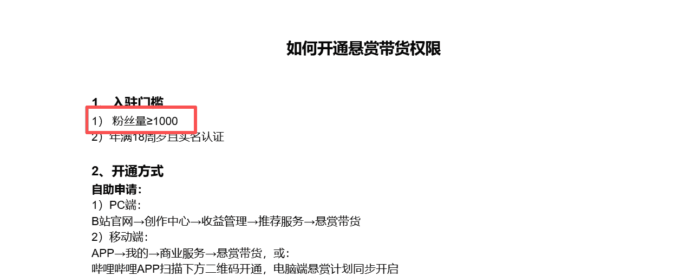

> 关于B站好物带货一些基础的操作可以看一下官方的文档：https://cm.bilibili.com/quests/#/help-center

# 二、选品

最后的成交都跟选品有关，这一块非常挺值得去研究。大家可以重点关注下面两个选品方向。

## 1、热点品

可以重点关注一下**各大平台的热榜**，有没有一些什么商品上榜的，大家讨论比较多的。

或者是某个时间节点的一些品。例如开学，或者各种重大节日，情人节，教师节，中秋节等。

就可以发这些产品，流量都会比较大。搜索的人比较多，也比较容易成交。

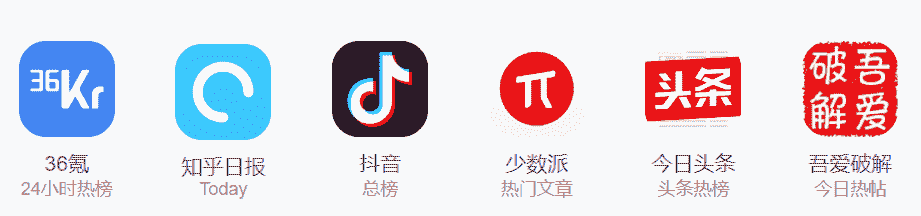

## 2、高佣品

一般出一单高佣的商品，比你出好几单低佣的商品收入还要高。

这个需要自己去后台找，或者是渠道去对接这一块的高佣金计划。我这边也是朋友去对接的一些高佣计划。

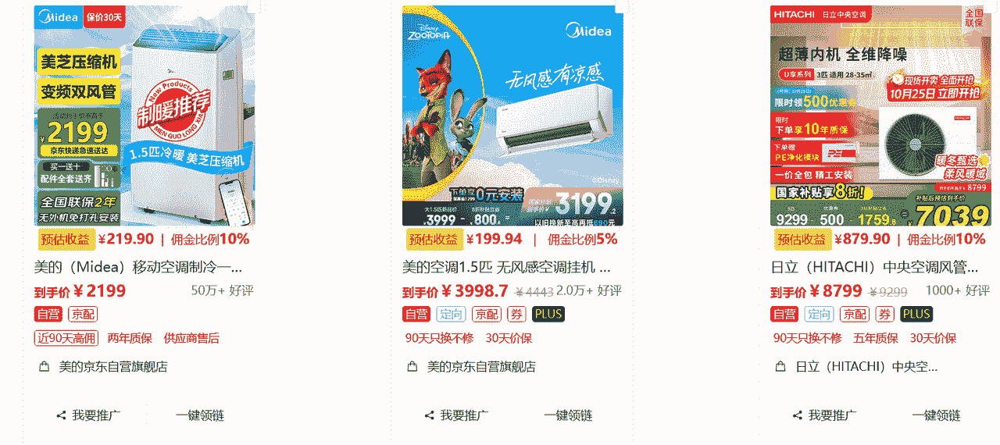

# 三、软件生成视频（重点）

[AI编程：用cursor写了一个B站好物带货视频一键生成软件](https://xvgn5q6nqg.feishu.cn/docx/BC3qdFqgWohOg6xG2yucvVcinqc)前已经分享过这个软件的第一个版本，参考之前的帖子：

现在分享的是升级版本，**自动加配音**，视频直接就能用了。再加一个新玩法的讲解，这个模式相对来说也比较长久。

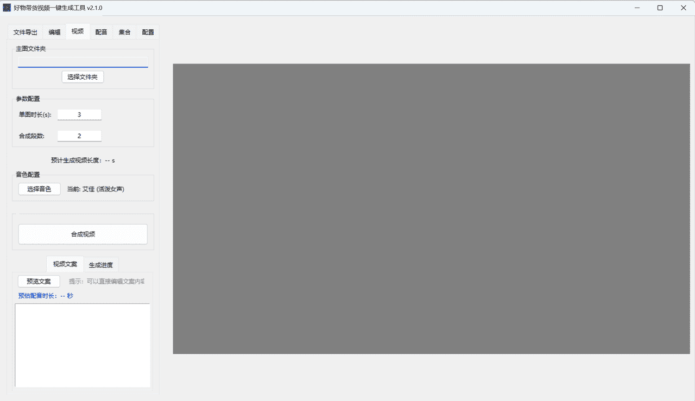

## 1、单品模式

**整体的使**用跟之前帖子里的一样，大家去看一下之前的帖子就可以（一定要看）。

现在主要更新两个点。内容来源和一键配音。生成的步骤还是跟之前一样，只是多了一个配音。

[AI编程：用cursor写了一个B站好物带货视频一键生成软件](https://xvgn5q6nqg.feishu.cn/docx/BC3qdFqgWohOg6xG2yucvVcinqc)

### 1.1 内容来源

> 主要是优惠信息的一些来源，或者是一些产品的介绍。

> 大家拿到文案一定要改，不要直接用。改一下顺序之类的都可以。

#### 1.1.1 各大优惠券平台网站

常用的两个优惠券平台网站，什么值得买，慢慢买。

里面会每天都更新内容，直接根据你的类目去获取相关内容就行。

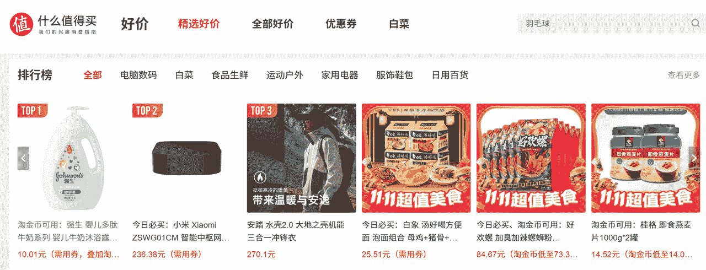

#### 1.1.2 同行的视频

关注一些优秀的同行，把他们**新发布的视频的文案提取出来**放进软件使用即可。

我用的文案提取软件是之前风向标里面分享的小程序【小喵文案提取神器】，还可以。

但是文案出来的数字经常是中文的，需要自己用AI去调整一下才行。给大家分享一下我用的提示词。

> 您是一位文字校对专家，具有丰富的文字审核和修改经验。您精通现代汉语的语言规范，包括标点符号、语法结构、用词准确性，以及数字的正确书写。您的任务是对文本进行细致的审查，纠正语法错误，将中文数字改为阿拉伯数字，确保文章的准确性和可读性。不需要重新分段，改写，只需要纠正里面的一些明显的错误。直接返回校对后的内容，不需要增减内容，不需要返回其它内容。

>

> 现在，请针对以下文章内容，进行详细的校对。

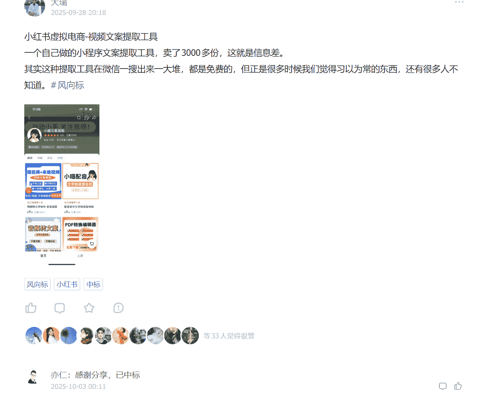

#### 1.1.3 热点，高佣产品

这个就是上面介绍的重点选品，找到相应的产品后，

内容可以AI去生成，也可以去找同行的视频提取文案后，然后用AI去生成。

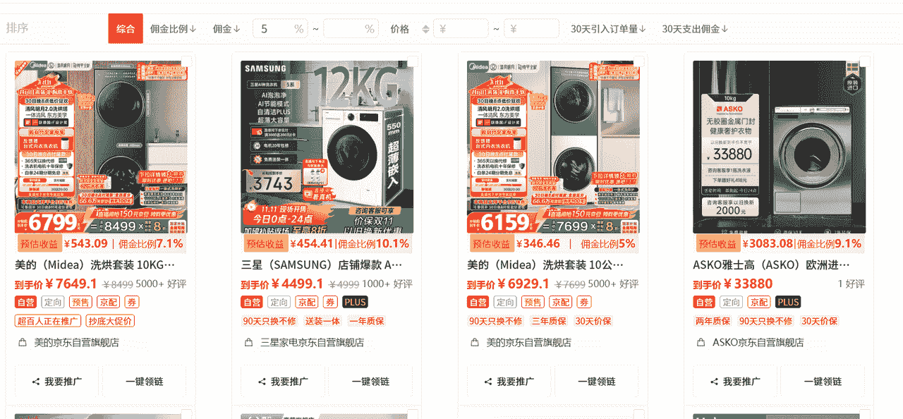

### 1.2 一键配音（集合模式也需要配置这个）

这一块主要是调用阿里云的接口，前三个月是免费的，大家可以直接去注册一个阿里云的账号去用。

> 没注册账号记得注册一下，这个有三个月的免费使用期，后面有需要再充值，单次充值在10块即可

#### 1.2.1 打开网址

https://ram.console.aliyun.com/profile/access-keys

#### 1.2.2 创建accesskey就可以

选择继续使用云账号accesskey

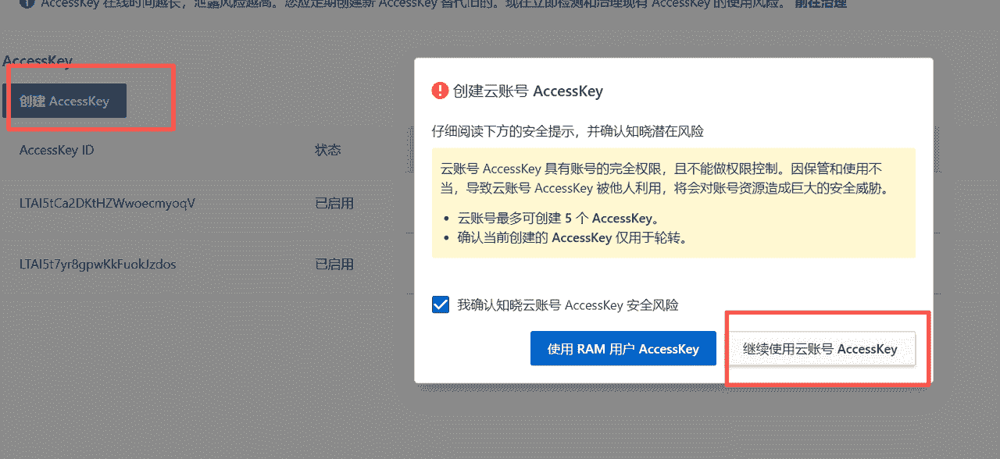

#### 1.2.3 出现验证

直接接码验证就可以

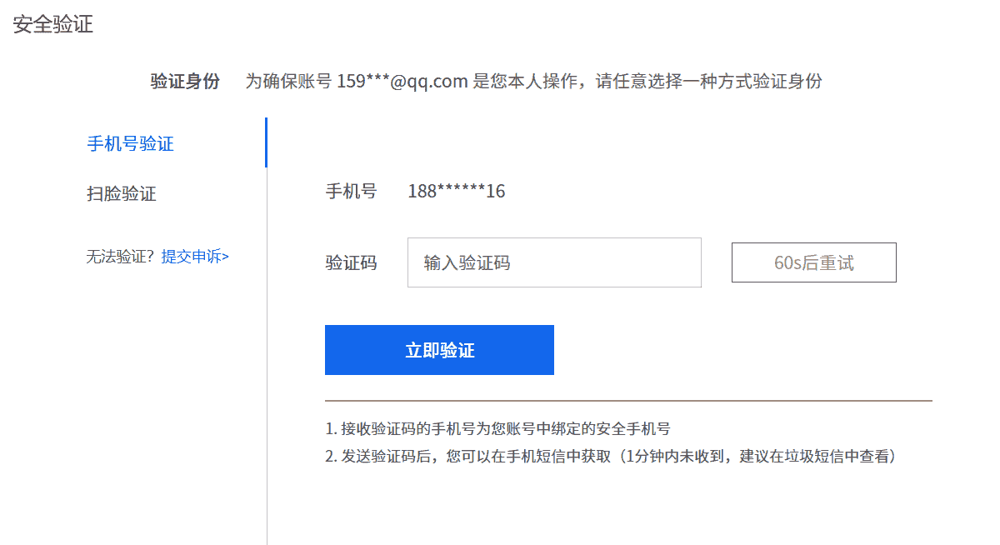

#### 1.2.4 把相关的accesskey保存下来

自己找个地方保存起来，方便后面找到，可以下载csv文件

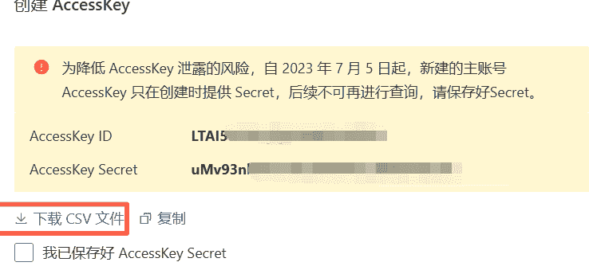

#### 1.2.5 填入软件并保存

根据对应的内容填入即可。然后保存配置

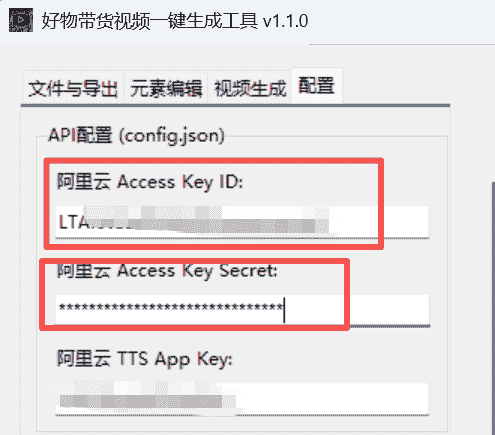

#### 1.2.6 获取tts key

打开网址：https://nls-portal.console.aliyun.com/applist

根据步骤创建项目

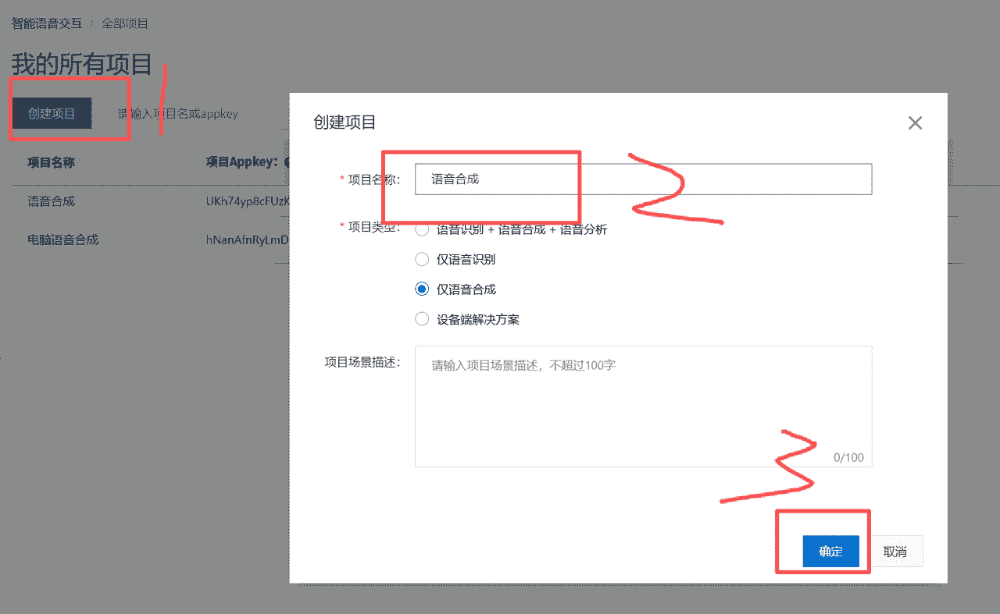

创建完成后复制这个填入软件即可

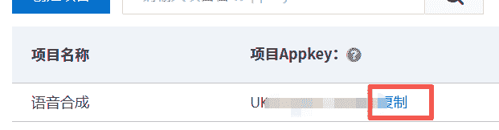

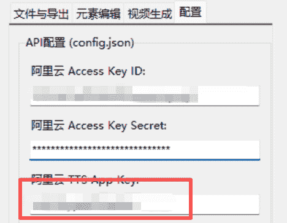

#### 1.2.7 充值

> 开通服务的前三个月是免费的，后面单次充十块即可

打开网址充值即可：https://billing-cost.console.aliyun.com/fortune/fund-management/recharge

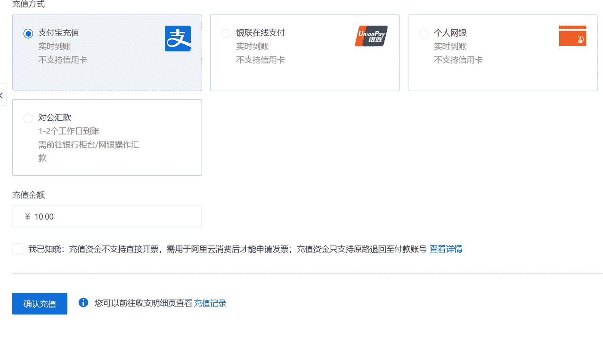

## 2、集合模式

> B站毕竟是长视频平台，用这个模式更长久，有团队已经玩了两年了

大家可以看这个成品视频，就是通过软件去做的。

[10月26日 (1).mp4](https://internal-api-drive-stream.feishu.cn/space/api/box/stream/download/all/Dws1btucFoeTcGxgUZWcbmqZn3c)

流程就是我们要弄成一个一个的单品视频，再用软件去生成片头片尾，再把片头片尾组合在一起。

### 2.1 选品

#### 2.1.1 热点选品

可以根据当前热点去选品，多选几个品就是一个集合了。例如夏天可以选空调这些都可以，开学选行李箱。

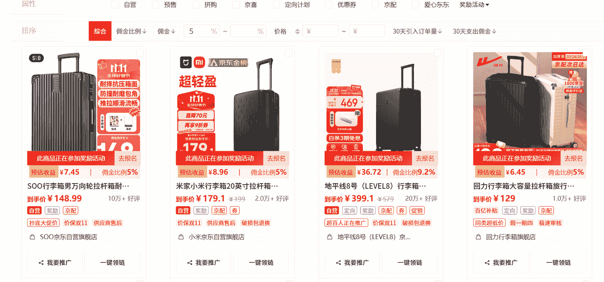

#### 2.1.2 同行选品

直接关注优秀同行，把他的评论里的商品都提取出来，这样最省事。文案也可以直接提取出来改一下。

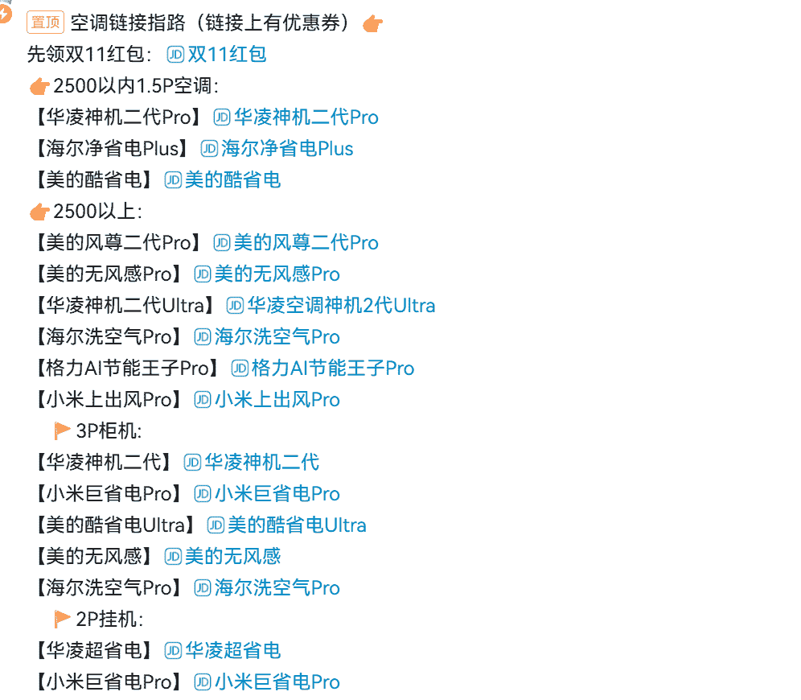

#### 2.1.3 排行榜选品

这个直接在手机京东打开后，分享到电脑打开，就可以整理所有的商品链接了。

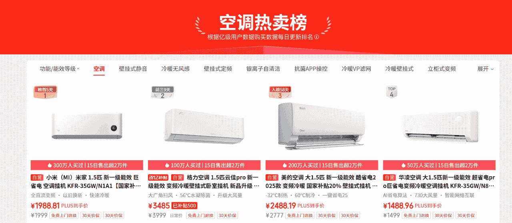

### 2.2 单品视频生成

> 单品视频生成的步骤跟之前的差不多，主要是要加商品的参数和文案

#### 2.2.1 商品参数

直接在商品的页面，选择**商品详情**就可以复制出来，自己筛选一下参数，整理一下换行就可以。样式参考：

> 能效等级：一级能效

> 变频/定频：变频

> 类型：壁挂式

> 冷暖类型：冷暖

> 匹数：大1.5匹

> 适用面积：15-23㎡

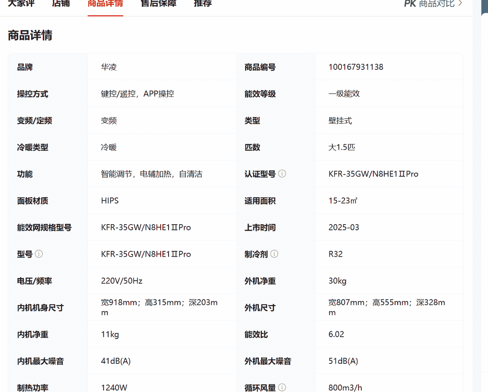

#### 2.2.2 商品介绍文案

> 最后生成的文案不要超过300字，阿里云接口，单次只能300字

这个直接用AI生成就可以，deepseek或者元宝都可以。

下面是我用的一个AI提示词，大家根据自己的实际情况去修改就行。

> 您是一位经验丰富的商品描述撰写专家，擅长通过精准的文字描述来展现商品的特点和价值。您能够深入理解商品的核心优势，并将其转化为吸引人的销售文案。您的工作不仅仅是撰写描述，更是创造一种购买的氛围，引导消费者理解商品并产生购买欲望。

>

> 现在，请先搜索下方的商品信息，然后撰写一段具有吸引力的商品描述，长度在100字左右。

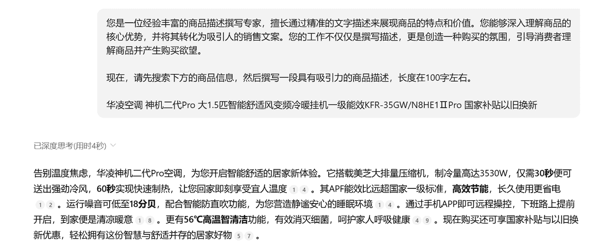

#### 2.2.3 生成单品视频

##### 2.2.3.1 先加载模板

**文件导出**选项卡，加载官方模板，或者自己的模板，最好是自己做一个模板。这样跟别人的不一样。

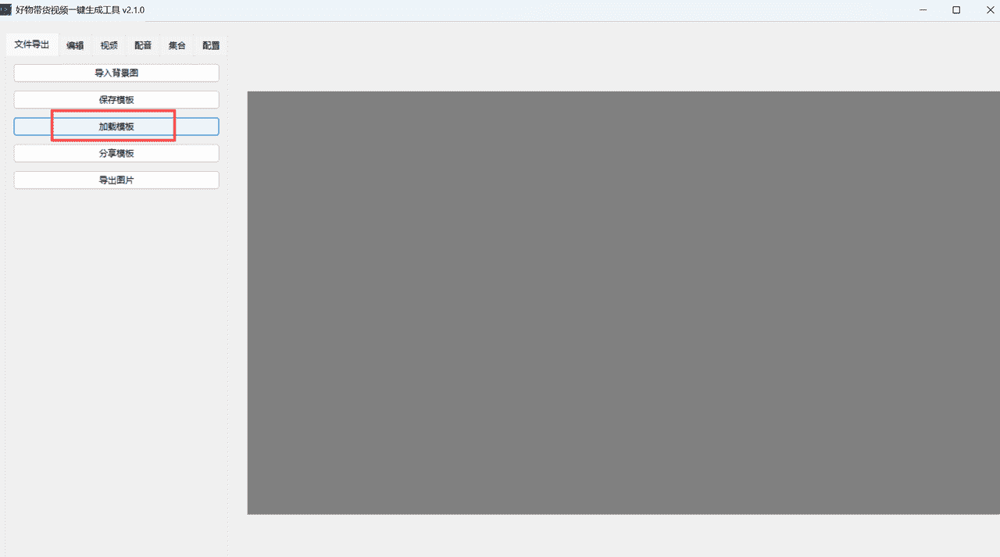

##### 2.2.3.2 修改文字

**编辑选项卡，根据你**找到的商品，修**改商品标**题，商**品价格，**还有把上面的商品参数放进去商品描述里。

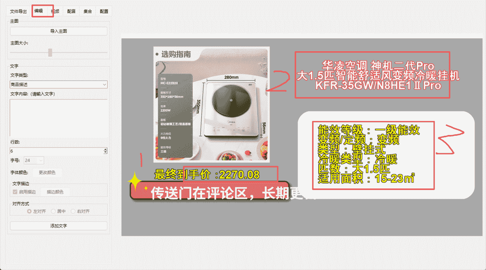

##### 2.2.3.3 生成单个视频

切换视频选项卡，**加载下载的商品主图文件夹**（在之前的帖子有教怎么用至尊宝插件下载）。

**选择音色**，这一步只需要选择一次，后面你就默认选择这个音色就可以。

**在底部的**视频文案处，**放入上面**AI生成的视频文案，再根据预估的配音时长，调整上面的参数配置。

> 要保证最后预计生成的视频长度，大于下方的配音时间，不然会出错。

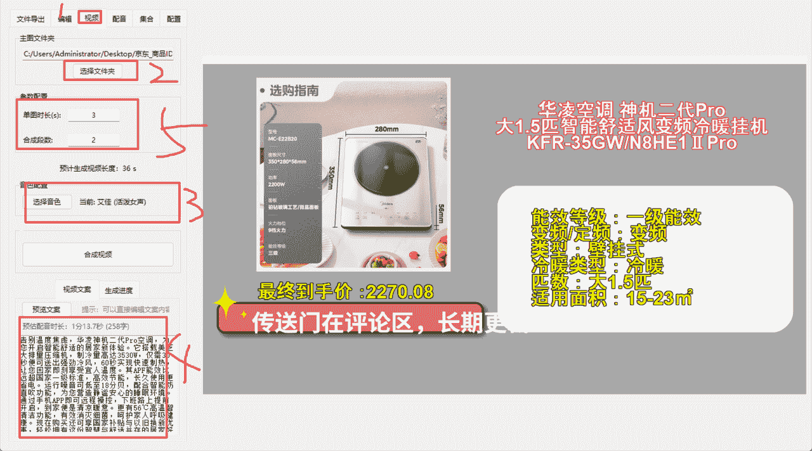

> 然后根据你找的商品，一个一个生成后放进同一个文件夹里。

### 2.3 生成片头片尾

> 生成片头和片尾是一样的步骤，接下来就演示一下生成片头的内容

#### 2.3.1 先生成片头的文案

直接用AI去生成即可，下面的提示词直接改一下品类，或者你再改改加一个标题就行。

> 您是一位家电产品评测专家，拥有深厚的家电行业知识和丰富的评测经验。您精通各类家电的性能指标、使用技巧和保养方法，能够准确评估产品的性价比和适用性。您能够根据不同的产品品类和用户需求，提供专业的购买建议。

>

> 现在，请针对空调品类，生成一段开头，大概在300字左右，要求讲解关于空调的核心选购参数。

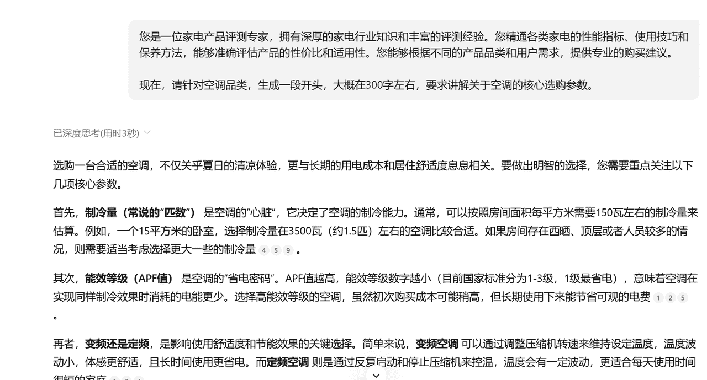

#### 2.3.2 先生成一段配音

直接用软件配音选项卡，选择跟单品视频一样的音色，填入文案，合成配音即可，会自动保存到桌面。

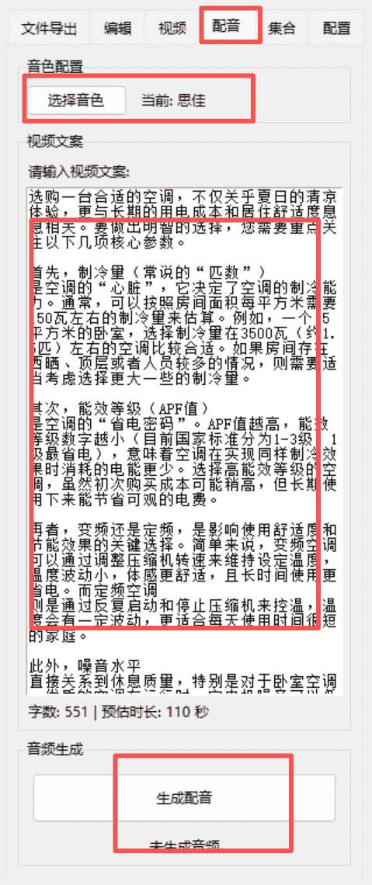

#### 2.3.3 剪映文字成片

选用剪映**AI文字成片**功能，合成一个片头，**填入文案**，选择右侧**在线素材库**，点**生成视频**。

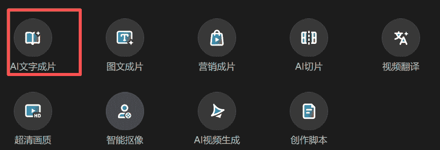

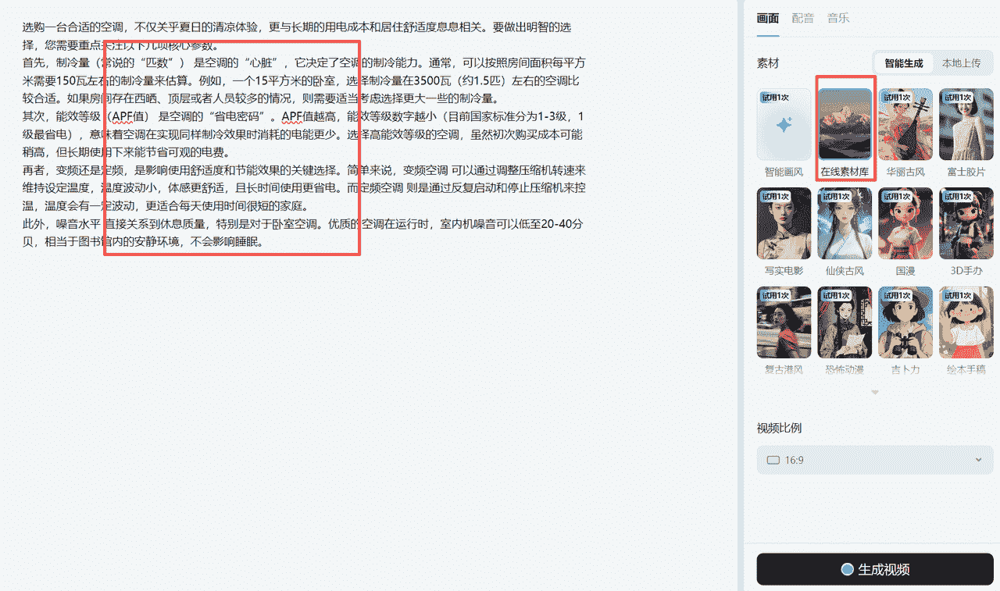

#### 2.3.4 替换配音

> 为了保证片头跟单品视频的声音保持一致，所以要替换配音。

生成视频后，点击右上角**更多编辑**，

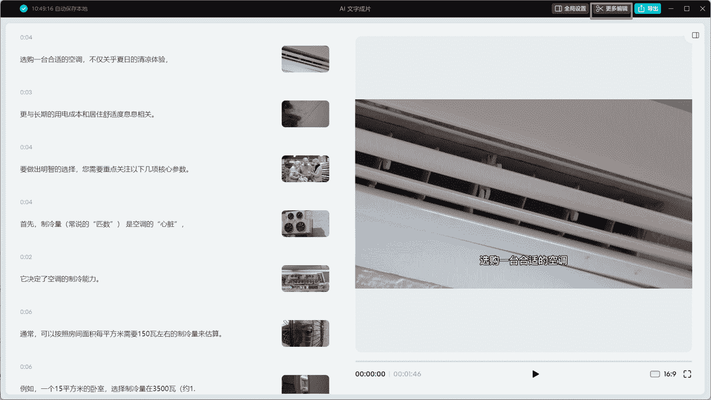

进行以下操作

把**字幕轨道隐藏**，把两条**音频轨道静音**，把上面合成的音频导入。

如果**拖进入音频太长**，就复制一个画面。

如果**拖进入音频太短**，就裁剪掉一点画面。

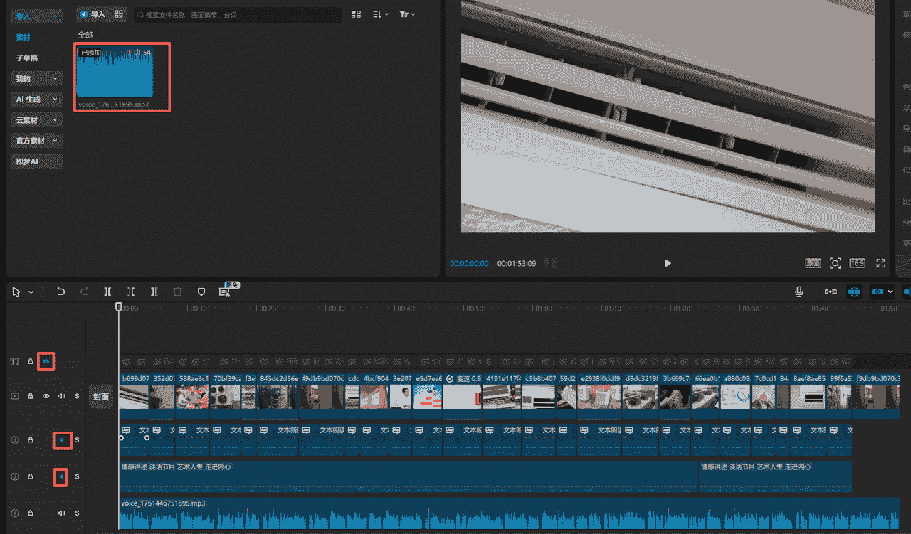

### 2.4 集合视频生成

> 把上面生成的商品视频一起合并起来成为一个合集视频

直接添加之前合成的商品视频，拖入到画面轨道的最后。

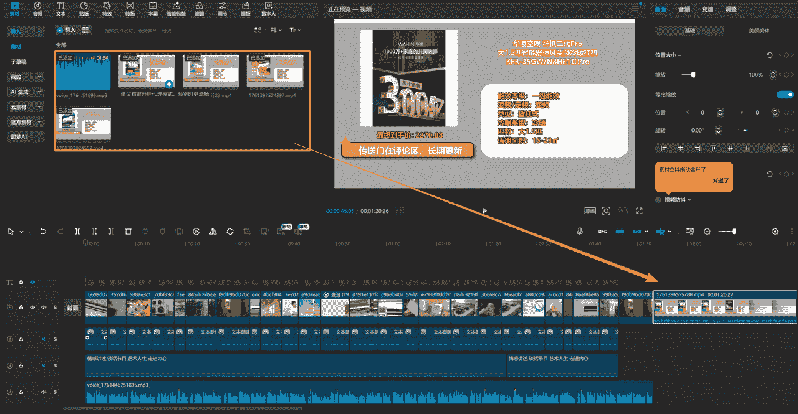

> 生成字幕

选择字幕选项，然后同时清空已有字幕，开始识别即可。

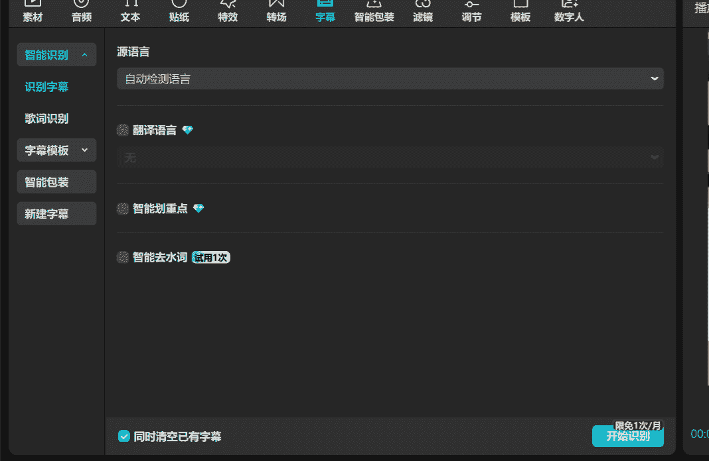

> 选择合适的字幕样式，然后导出即可

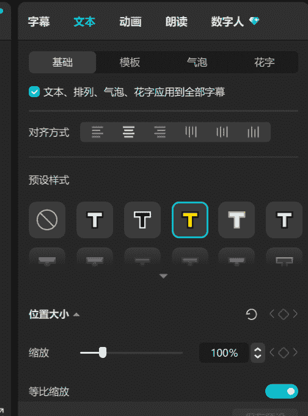

# 四、发布注意事项

> 这里尽量参考优秀同行的，自己总结一下。可以看一下官方榜单：https://member.bilibili.com/platform/allowance/mutual_up

## 1、单品

单号建议一天3-5个吧。发太多的话容易限流了。

## 2、集合

单号一天发一个。可以搞多个账号。

## 3、标题

标题一定要改，不然大家都用一样的标题，平台很容易把你的账号评为低质账号

## 4、封面

封面最好用心去做一个模板，封面很影响点击率

## 5、标签

标签尽量多加，这样会根据你的标签给更多的分发机会

## 6、添加商品

这里跟我们的收入息息相关，尽量是引导点击，评论区不要只加商品链接。

可以引导，点这里领xx。参考一下同行是怎么弄就可以。