# 60天从想法到现金流：AI小工具0-1变现之路

> 来源：[https://xuqiwei1986.feishu.cn/docx/KGFUdSaANoqS8bxg12qcbTc4nud](https://xuqiwei1986.feishu.cn/docx/KGFUdSaANoqS8bxg12qcbTc4nud)

# 摘要（给忙碌的老板看）

+   立项原因：

1）这个项目偏实验性质，我们希望通过这个实验，探索如何依靠AI提效与DSO推广，在最短周期内让AI小工具从0到1，实现稳定现金流。

2）一旦验证类似模式，可以研究提取SOP，将产能高效拉升，利用兼职模式快速做100个细分产品，规模化增长。因为波波觉得，未来的公司组织模式，未必适合小产品矩阵的海量研发，因为我们在北京杭州这类大城市，产研人员成本过高，适合研发大型或者超级精品类产品，一些细分需求，可以通过合作模式来提效。

+   目标：在60天内，从0到1把头像生成类AI小工具做成可持续现金流的小型App。

+   盈利模式：苹果App会员付费订阅（因为我家比较擅长App产品的推广）

+   研发模式：AI兼职工作流（3人兼职小团队 + AI协作）

+   推广模式：DSO搜索优化，0信息流投放

+   成果：累计用户：5w+，月营收：3w左右，Appstore中国区“图形和设计”分类榜最高排名：31名

## 一、为什么选择「头像生成类AI小工具」

1.  **轻资产、快试错**：模型、素材、工作流高度复用，单点场景更容易聚焦需求与定价。

1.  **AI生图技术的发展**：ChatGPT 4o和NanoBanana让通过AI生成优质图片成为可能，尤其是“吉卜力”、“emoji小人”、“真人手办”等风格的图像生成质量效果显著。风向标里面，也有大量的相关内容的变现研究。

1.  **AI带来的开发提效**：从需求拆解、原型生成、UI适配，到后端接口与内容生成流水线，AI均可显著缩短研发周期。

1.  **为何选择头像类赛道？**

通过爱搜（aidso.com**）数据调研，我们发现“头****像”是小红书日均搜索量第一的关****键词，平均每日搜索约**131万次；在**抖音，“头像”****“头像女”等关键词**平均合计每日搜索也有约50万次。从竞争度看，这条赛道并不友好，按常规应当规避；但数据清楚地显示出头像类产品的巨大需求。因此我们最终选择高竞争赛道，将本项目定位为一场以AI驱动的增长与变现“实验”：在最难的赛道里，用最短时间跑通可持续现金流。

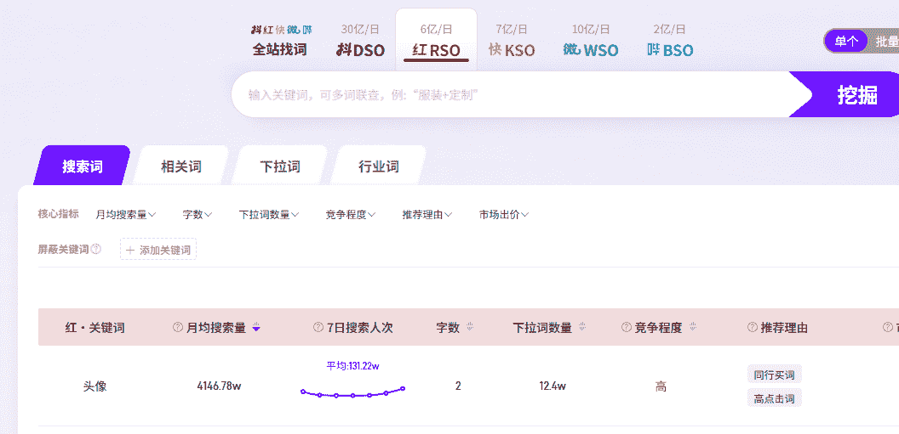

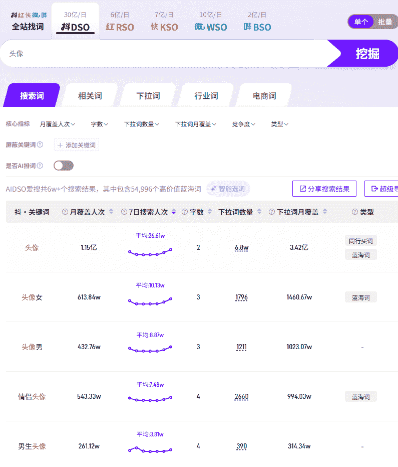

## 二、产品定位：AI卡通头像生成

+   类别：AI照片→卡通/漫画化（头像为主，延展到亲子合照、情侣照、宠物等）

+   场景：社交平台头像更换、节日头像换肤、校园/婚恋/宠物主题。

+   核心价值：**一键生成**、**风格好看**、**价格可承受**。

## 三、研发模式：AI兼职工作流模式

### 1、传统开发

**流程**：需求→设计→开发→测试→上线，流程长成本高。

**组织****：产品/UI/**前端/后端/测试/运维多角色协作，分工细但链路长，需强项目管理。

**产出****：PRD/架构**/API/测试/发布等文档与评审繁多，可追溯但沟通与等待成本高。

**工期**：中小型APP通常**2–3个月起**（设计+开发+测试+灰度），**试错慢**。

**痛点/对策**：需求变更代价大、内部消耗重、会议多。

### 2、AI驱动开发

**流程**：并行迭代 + 数据驱动决策，**原型/代码/文案可快速生成**，支持持续A/B与分钟级改稿。

**组织**：人**+AI助手**，沟通半径短，响应快。

**产出****：PRD草**案、原**型、UI组件、**样板代码、单测脚本、营销素材批量自动化，沉淀提示词与模板库。

**工期**：TTM显著缩短，**≤14天可上架MVP**；周发版为常态，试错成本低。

**优势**：**成本轻、速度快**；易做个性化与多版本并行探索。

**风险/对策**：质量波动、模型漂移、供应商依赖与合规边界。

**我们采用“3**人小队 + AI协作**”AI兼职工作流模式：由一名全职产品经理统**筹需求与节奏，一名**全栈工程师（兼**职**）依托Claude Code生****成前端代码与后端接口开发（**费用约5k，来自大厂兼职），UI设计（兼职）以AI生成UI组件与快速出稿（费用约1k，偏“超级个体/善用AI”）。前期投入成本约1w（外部成本6k + 内部成本4k），在明确里程碑与守门机制的前提下，用2周完成MVP开发与上线。

## 四、DSO优化方案与实施

### 1、确立目标

**目标客户群体**：核心用户集中在 18-35 岁，00 后是平台增量最快的用户群体

**运营形式**：视频＆图文

**DSO核心目标：**通过抖音、小红书平台，用DSO获客逻辑，引导对“AI漫改头像”有潜在需求的用户下载APP。

### 2、账号搭建

**官方账号数量**：2个（抖音蓝v：33525745136 小红书蓝v: 小红书：94389011199）

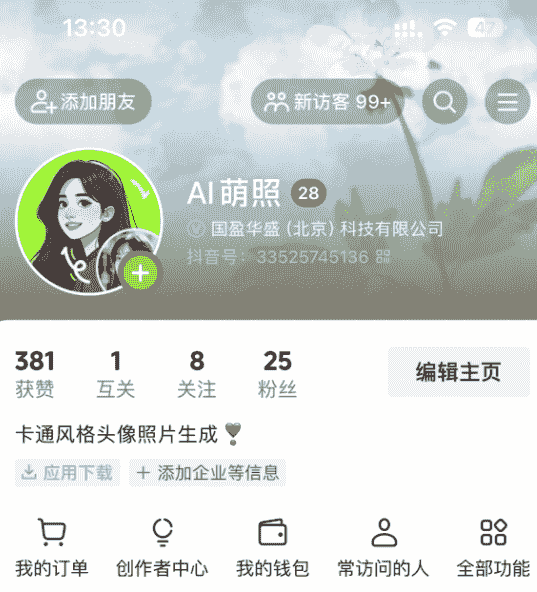

**素人账号数量：10个**。来自员工个人老账号或新注册账号，如果考虑进一步放大，也可以采取兼职的模式。

### 3、制定关键词库

抖音关键词库（数据来源：爱搜）

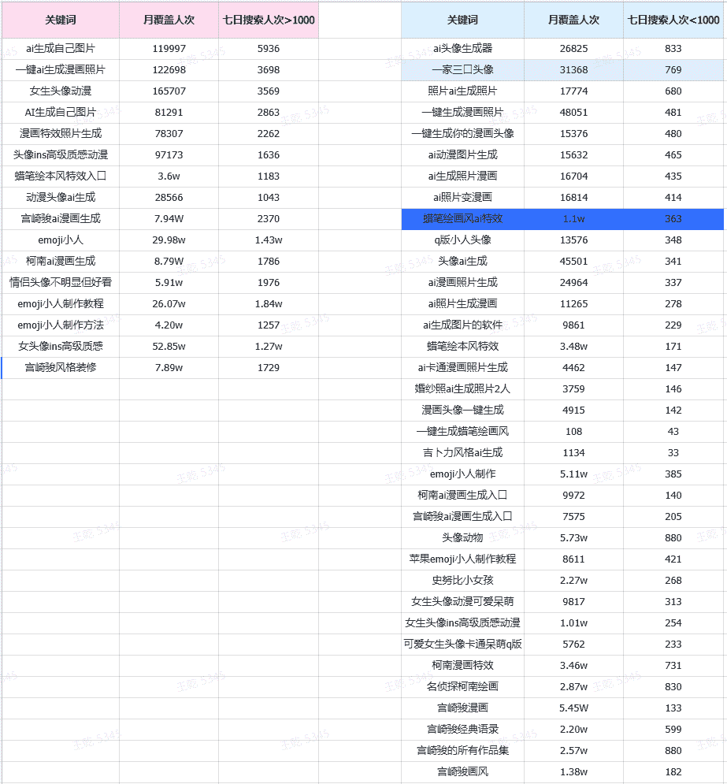

小红书关键词库（数据来源：爱搜）

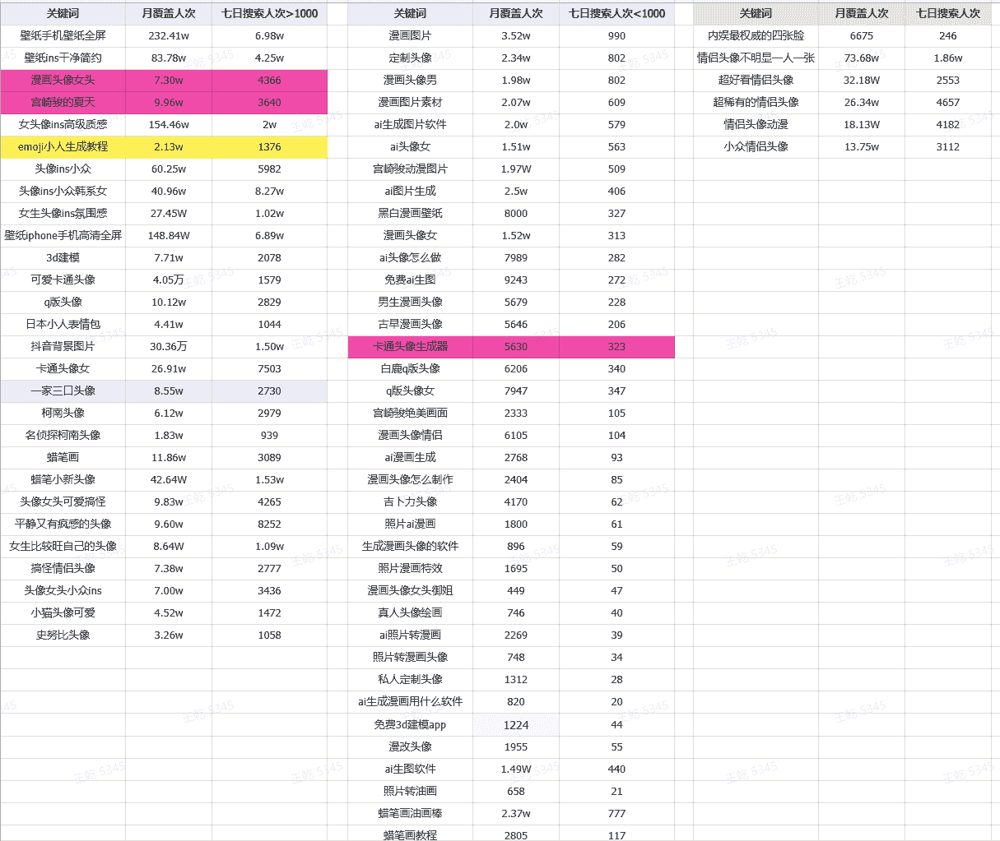

### 4、DSO数据成果

使用爱搜（aidso.com）平台的关键词监测功能统计数据

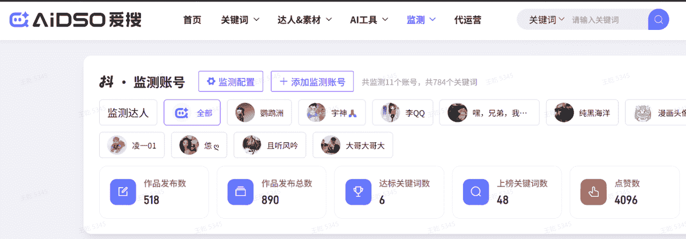

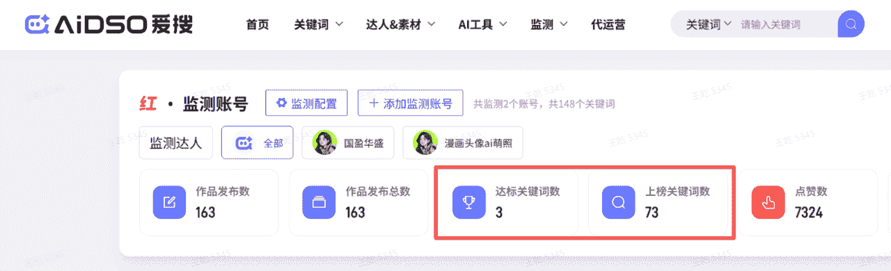

+   内容产出:1053条图文/视频内容

+   总曝光: 约76w+

+   搜索占领: 各平台累计覆盖121个上榜关键词

+   “搜索流量”成为了占比最大的流量来源

作品抖音数据展示：

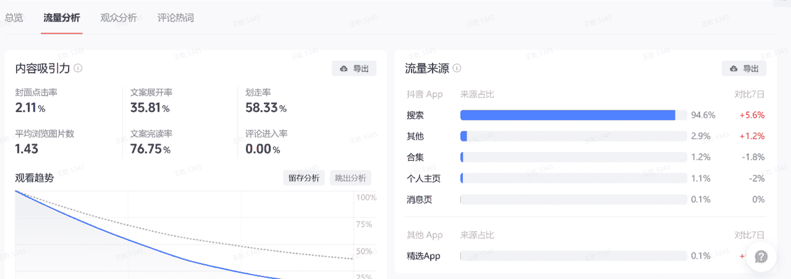

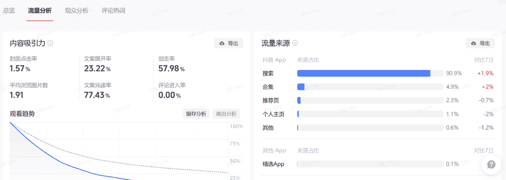

小红书数据展示：

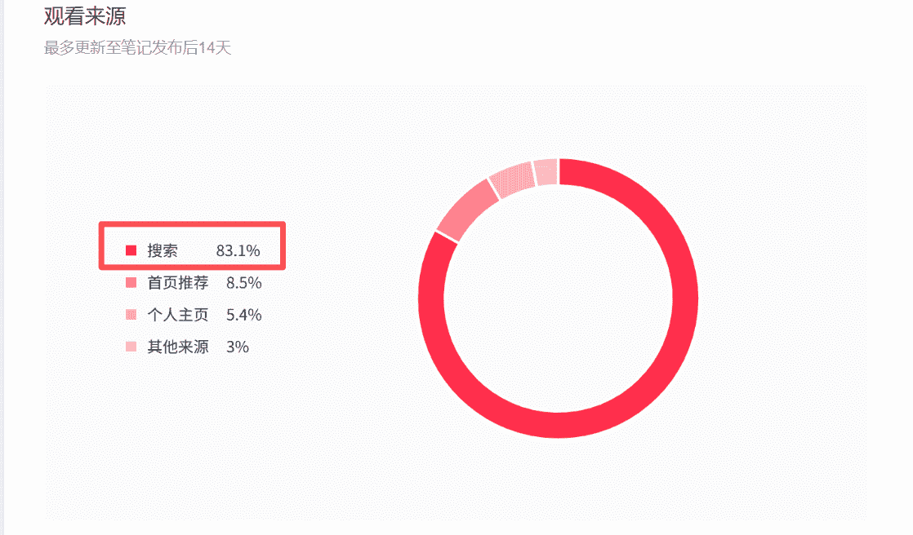

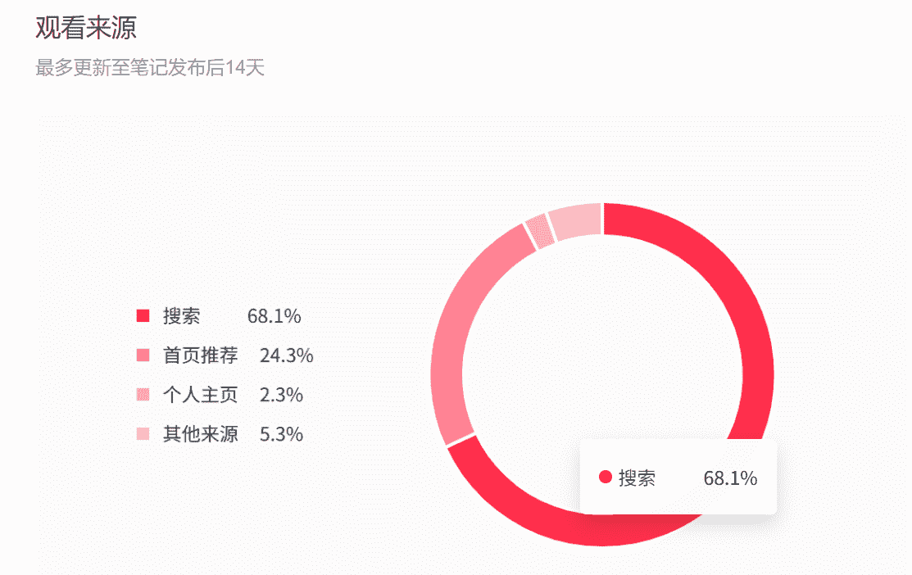

## 五、60天路线图总结

+   D1-D7：需求与方案 + 基础设施准备

+   搜集竞品样例与用户痛点。

+   明确MVP子场景。

+   产出PRD草案、交互原型、模型/推理方案与合规清单。

+   域名购买与实名认证（备案需求）。

+   服务器购买。

+   域名ICP备案：提交域名与主体验证材料。

+   APP ICP备案。

+   D8-D14：MVP与内测 + APP备案申请

+   前后端骨架设计与开发。

+   UI适配与监控。

+   小范围TestFlight内测。

+   App Store提审与素材准备。

+   D15：App Store上架，完成MVP

+   头像类App隐私要求较高，与苹果沟通多次才顺利完成上架。

+   D16-D30：版本升级+DSO起步

+   App UI优化后重新发版。

+   DSO账号搭建准备。

+   DSO建立关键词库。

+   DSO内容生产发布。

+   D30-D45：DSO内容和关键词探索

+   测试不同的内容形式。

+   测试不同关键词起量效果。

+   测试不同关键词的转化效果。

+   **D45-D55：DSO起量**

+   确定量级和转化效果较好的关键词和内容形式。

+   流量逐渐增长。

+   用户开始充值、产生复购。

+   现金流打正形成闭环。

**最终，实现了**60天内从0到1把头像生成类AI小工具做成可持续现金流的小产品。累计用户：5w+，月营收：3w+，Appstore中国区“图形和设计”分类榜最高排名：31名。

## 六、总结

我们并非AI原生团队，**没有“超级个体”与AI技术大牛****。在这样的起点下，我**们选择“头像”这一高竞争、超大搜索需**求赛道作为实验样本，验**证**了A****I兼职工**作流 + DSO搜索增长**的可行**性：以**AI兼职模式**、轻量投入，两周完成并上架MVP；依托抖音/小红书的搜索流量作为主要流量来源，最终在60天内跑通可持续现金流。更重要的是，这套方法论为普通公司或个人提供了一条可操作的新思路：不必先成为AI大牛或AI原生公司，也能用小团队与AI协作+DSO流量，在高需求赛道中用最短路径和最小成本验证产品与现金流。