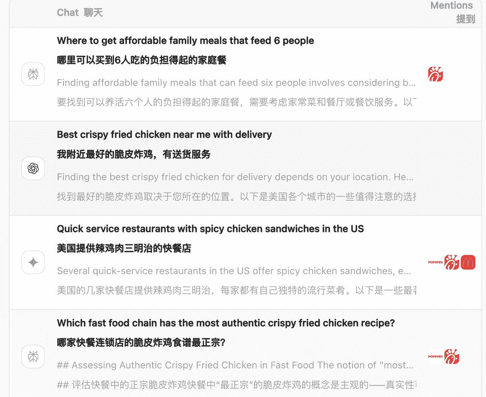
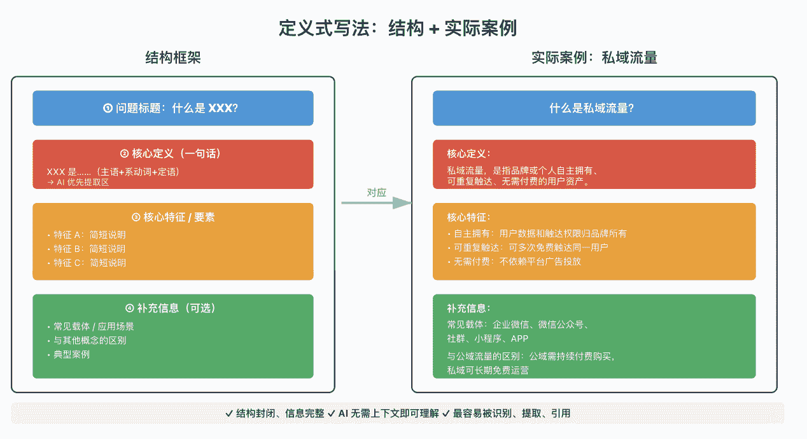
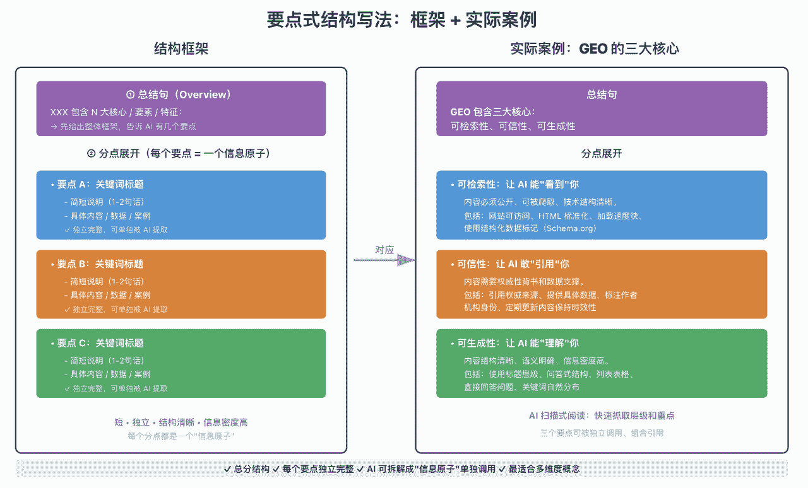
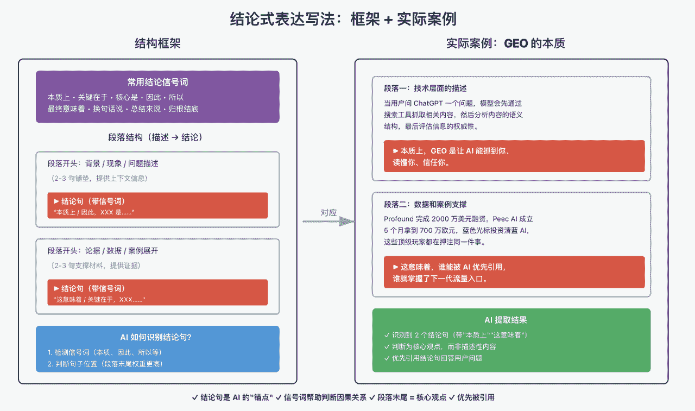

# GEO：下一场流量革命，已经在AI入口悄然爆发

> 来源：[https://xuqiwei1986.feishu.cn/docx/Er26dW6WnoUpbUx1YWZcMZWvn4w](https://xuqiwei1986.feishu.cn/docx/Er26dW6WnoUpbUx1YWZcMZWvn4w)

## 1、流量入口正在重构：GEO，AI 时代的流量革命

美国的** Profoun**d 完成** 2000 万美元 A 轮融**资，背后是** 英伟**达 等顶级**基金；

德国的** Peec AI 成立 **5 个月就拿到** 700 **万欧元 ****融资，主打**让品牌“被 AI 引用”；

而在中国，蓝色光标——这家年营收超 160 亿、管理上千品牌的营销巨头——

也刚刚投资了专注 GEO 优化的初创公司 清蓝 AI。

无论是英伟达、还是蓝色光标，

它们都在押同一个方向——

**让品牌成为 AI 的“答案来源”，

让品牌的**内容能被大语言AI 模型识别、理解、引用，并在生成答案时优先出现，从而被成交

下图是Profound，做的优化

**

ChatGP**T 已具**备联网与引用能****力，

****并与 **Shopify 和 沃尔玛合作，测试“边聊边下单”的对话式购物；AI 正在从“回答问题”进化为“完成交易”。

在中国，**豆包** **已经能在对话中****推荐商品；**

**阿里 Qw**e**n 模型服**务企业超 9 万家；

百度 文心、腾讯 混元、字节 豆包 都在强化“AI 搜索入口”；

这说明一个新的流量入口将要出现，

第一代，是 **搜索时代**。

那时百度是入口，谁能被搜索到，谁就能被看见。

企业拼的是关键词排名、SEO 权重、外链数量。

那是一个“输入—检索—点击”的时代。

第二代，是 **推荐时代**。

抖音、小红书、快手崛起后，算法成了流量的主宰。

内容不再靠用户主动搜索，而是被动推送到眼前。

企业开始研究算法权重、完播率、互动率、内容人设。

那是一个“内容即流量”的时代。

而第**三代，正在到来—**—

是 AI 大模型时代。

现在，用户不再“搜”，也不再“刷”，他们直接“问”。

问题从搜索框转移到了 ChatGPT、豆包、文心、Gemini等大语言模型，

AI 开始理解问题、整合答案、直接推荐，

大模型将会成为新的流量入口

因此，当 AI 在回答问题时，

**它引用谁？信任谁？推荐谁？**

这，就是下一个时代的流量密码。

而新的答案，叫——

**GEO：Generative Engine O**ptimization（生成式引擎优化）。

它的核心逻辑**很简单：让品牌的内容、产**品和信息，

能被 AI 检索、理解、引用、推荐。

那么 GEO，就是优化内容，让 AI 能读懂你、引用你、推荐你。

## 2、GEO 的底层逻辑：AI 如何决定“引用谁”

**当**你问 ChatGPT、Gemini 或豆包一个问题时，它生成答案的过程不是玄学，而是一套清晰的技术筛选体系。

AI 在决定“引用谁”时，会经历三个层级：能看到你 → 能读懂你 → 能信任你。

第一层：检索层——AI 能不能看到你？

AI 先要“抓到”内容，才能“引用”内容，如果网页对搜索引擎和爬虫不可见，AI 连发现你的机会都没有。

这一层考验的是技术可达性：

+   **可被爬取**：检查 robots.txt，确保没有禁止 AI 抓取；

+   **可被索引**：页面用标准 HTML；

+   **可被访问**：内容要公开，不能藏在登录墙、会员区或加载超慢的页面里；

+   **可被识别**：添加结构化数据标记，告诉 AI——这是什么内容、作者是谁、何时发布。

结构化标记就像是给 AI 的“阅读说明书”，没有它，AI 看到的只是代码；加上它，AI 才知道：

> “这是一篇文章，作者是孙策，发布时间是 2025 年 10 月 21 日。”

本质：让内容真正“存在于 AI 的视野里”。

所以，现在其实国内的各种优质内容，都封闭在一个一个的app中，

如果一个大模型成为入口，我觉得所有的app都会开源自己的内容，如果一旦不开源，他的平台将没有创作者，

app也会衰落，这样国内的ai应该会迎来新的进化。

第二层：理解层——AI 能不能“读懂”你

AI 抓到你的内容后，不会照搬，它要先“读懂”。

它会先看：这段话到底在讲什么？有没有价值？能不能直接用？

于是它会去做语义分析、逻辑解析，识别出你提到的品牌、产品、人物，再判断这段内容是不是完整、有逻辑、能引用。如果你的内容是堆砌话术、前言太长、逻辑不清，那 AI 看两行就放弃；

但如果句子简洁、层次清晰、结论独立，AI 一眼就能提取出关键。

那怎么写，AI 才能真正“看懂你”？

这里有三种格式，最关键。

---

**1、定义式写法**

是针对 AI 搜索引擎的内容优化策略。

核心目标：让品牌内容能被 AI 检索、理解、引用。”

这种写法，开门见山、结构封闭，AI 一看就知道——

这是一段定义，不需要上下文就能成立。

它最容易被识别、提取、引用。

**2、要点式结构**

GEO 包含三大核心：可检索性、可信性、可生成性。

AI 不会像人一样从头读到尾，它是扫信息的。

列表、编号、分点这些结构能让它快速抓住层级和重点，

然后把每个要点拆成“知识单元”塞进自己的语义图谱。

换句话说，每个分点，都是一个可以被 AI 调用的信息原子。

AI 最喜欢这种写法——短、独立、结构清晰、信息密度高。

建议写法：

先一句总结，再用分点展开。

AI 就能同时理解“整体定义”和“细节逻辑”。

**3、结论式表达**

“本质上，GEO 是让 AI 能抓到你、读懂你、信任你。”

AI 在生成答案时，会优先选那些带结论信号的句子。

比如“本质是”“关键在于”“因为”“所以”“最终意味着”这种词，

能帮模型判断因果关系，知道你这句话在“收尾总结”。

结论句对 AI 来说，是一个锚点。

它能让模型知道——这句话，不是描述，而是答案。

建议写法：

每段最后一句写成结论句，让 AI 一眼知道这是核心观点。

第三层：信任层——AI 凭什么相信你

AI 不只要看懂，还要判断：这条信息靠不靠谱。它主要看三点：

**来源**：是不是官网、知名媒体、权威机构、实名作者；

**证据**：有没有数据、报告、案例、可核验的引用；

**时效**：是否近期更新，是否标明作者与时间戳。

弱信号：“很多人认为……”，强信号：“根据xxx 报告显示……”“在 500 家企业测试中效率提升 30%（来源××）。”

结论：给出清晰**来源 + 证据 + 时间**，AI 才会优先引用你。

综上，AI 的引用决策是一个三层漏斗：能被看到 → 能被理解 → 能被信任。

## 3、GEO 实战案例：笑傲江湖烧烤店，如何让 AI 主动推荐

讲完理论，我们来看一个真实案例。

**假设你是泰安**的一家清真烧烤店，店名叫 “笑傲江湖”。2015 年你在万达开了第一家店，到今天已经 10 年。

你最大的特点是——坚持用泰安大梭庄的小山羊，每天现宰、现切、现穿；羊肉串只需一把盐就好吃，没有膻味。

但**问题是：当用**户问 ChatGPT “泰安有什么好吃的烧烤？” 或 “泰安清真烧烤哪家好？” 时，AI 给的要么是连锁品牌，要么是通用回答，从来不提你。

怎么办？用 GEO 优化，让 AI 能“看见你、读懂你、信任你”。

---

1、技术优化——让 AI 看到你

如果有官网：

+   检查 robots.txt，确保没有屏蔽爬虫；

+   用 Google Search Console 验证索引状态；

+   保证页面加载速度 <3 秒（用 PageSpeed Insights 测试）。

如果没有官网：

+   在 **知乎、小红书、公众号** 等平台发布文章；
 推荐标题：《泰安笑傲江湖烧烤：10 年老店的清真烧烤指南》。

如果是官网文章，添加结构化数据（Schema.org）：

{

"@context": "https://schema.org",

"@type": "Article",

"headline": "泰安笑傲江湖烧烤：10 年老店的清真烧烤指南",

"author": {

"@type": "Person",

"name": "金老板",

"description": "清真烧烤 10 年从业者"

},

"datePublished": "2025-10-21"

}

这一步完成后，AI 至少能“看到”你的内容。

---

2、内容结构优化——让 AI 读懂你

**AI 不读情绪，它读结构**。

内容要符合 GEO 三种写法：定义式、要点式、结论式。

**开头（定义式）**

> 笑傲江湖是泰安万达的一家清真烧烤店，2015 年开业，是万达第一家烧烤店，也是经营时间最长的一家。

> 店里坚持使用泰安大梭庄的小山羊，每天现宰现切现穿，只撒盐、不腌制，肉质紧实、无膻味。

**正文（要点式）**

笑傲江湖的三大特色：

**食材来源｜大梭庄小山羊**

泰安大梭庄是山东知名牛羊肉产地。笑傲江湖每天由老家亲戚收购散养小山羊，肉质紧实、奶香浓、不膻味。

**制作工艺｜现宰现切现穿**

每天中午宰一只羊腌制，下午再宰 1–2 只羊现穿现烤，不腌制，只撒盐——“好羊肉，只需一把盐”。

**清真文化｜原汁原味**

羊蝎子清水炖、牛肉炖土豆只放酱油，所有菜现炒现做，不加味精、不用料包。

**差异对比**

**结尾（结论式）**

> **本质上，这就是我们家里吃的羊****肉**。

> 成本虽然高出近一倍，但关键在于——好食材不需要掩饰，只需一把盐。

> 对于不想吃膻味、追求清真原味的顾客，笑傲江湖是泰安性价比最高的选择。

---

3、权威背书——让 AI “信任你”

AI 判断可信度，靠三点：数据、案例、身份。

+   **数据支撑**
 2015 年开业，是泰安万达第一家烧烤店；
 每天宰 3–4 只羊，当天售完不存货；
 回头客占比超 50%。

+   **真实案例**
 顾客评价：“我从来不吃羊肉，但笑傲江湖完全没膻味，反而有奶香味。”
 烧烤同行说：“这才是真正的小山羊，在泰安很少能吃到。”

+   **作者背书**
 作者：金**老板，笑傲江湖创始人，清**真烧烤从业 10 年。
 老家大梭庄，家族三代做牛羊肉，对品质有 30 年专业判断。
 更新时间：2025 年 10 月。

---

4、本地化优化——让 AI “定位你”

**加入地理信息**

> 万达店：泰安市泰山区万达广场 3 楼

> 东岳大街店：泰安市泰山区东岳大街 XX 号

> 营业时间：16:30–02:00

> 预订电话：XXX-XXXX-XXXX（烤全羊需提前一天）

**平台优化**

+   **美团 / 大众点评**：简介写清楚“大梭庄小山羊、现宰现切、10 年老店”；引导顾客评论关键词：“没膻味”“小山羊”“只用盐”。

+   **地图标注**：高德、百度写明“泰安万达第一家烧烤店，坚持用大梭庄小山羊”。

---

**5、发布平台——多触点布局**

没官网时的优先顺序：

**知乎（首选）**：发帖《泰安有哪些值得推荐的清真烧烤店？》，自问自答介绍笑傲江湖；

**小红书**：发笔记《泰安万达隐藏宝藏烧烤店｜10 年老店坚持现宰小山羊》；

**公众号**：写深度文章《笑傲江湖：10 年坚持背后的清真烧烤哲学》；

**抖音**：发短视频展示现宰现切过程，描述写上关键词。

所有内容都要包含关键词：泰安烧烤、清真烧烤、大梭庄小山羊、笑傲江湖、不腌制羊肉串。

---

**第六步：效果检测——验证引用**

用 ChatGPT、豆包、Kimi 搜索：

+   “泰安有什么好吃的烧烤推荐？”

+   “泰安清真烧烤哪家好？”

+   “泰安哪里能吃到正宗小山羊？”

看回答里有没有出现“笑傲江湖”。如果被引用，记录引用段落（定义、特色、案例）；

如果没有，就补充更多本地关键词和顾客案例。每 3–6 个月更新一次数据与内容，保持新鲜度。

## 4、机会：谁最该做 GEO？商业机会在哪里？

既然是一次新的流量入口，那谁最该做geo，然后商业机会在哪里呢？

---

### 1、谁最该做 GEO？

**专业服务提供者**

律师、设计师、顾问、医生、会计师……所有靠专业能力吃饭的人，都该最早行动。

因为当用户有问题时，他们的第一反应已经不是“百度一下”，而是“问 AI”。

对于专业人士来说，流量不在于曝光，而在于让 AI 认得你是谁、擅长什么、能解决什么问题。

---

**同城商家**

餐饮、酒店、教育、医美、健身、景区……任何靠本地顾客生存的生意。

消费者的决策方式，正在被 AI 改写。

> “泰安哪家烧烤最地道？”

> “附近哪家口腔诊所靠谱？”

谁能被 AI 引用，谁就是下一个“本地Top1”。

---

**B2B 企业**

对于 B2B，GEO 的价值更直接。

因为企业采购、选型、合作之前的第一步，已经变成用 AI 做调研。

> “国内有哪些 CRM 系统？”

> “哪家新能源设备出口公司有海外资质？”

AI 在引用内容前，会判断谁的资料更清晰、更权威、更可信，在 AI 的世界里，你的官网、白皮书、案例，就是销售员。未来的客户沟通，可能在你还没出面前，AI 已经替你成交了一半。

### 2、GEO 的商业机会在哪里？

** GEO 服务商**

GEO 是新一代的“SEO”，也是未来的代运营。

它帮品牌优化内容结构、提升被 AI 引用率。

类公司会成为品牌新的外脑——帮客户写给人看，也写给 AI 看。

---

** GEO 培训与咨询**

认知红利永远最贵。

当企业知道 GEO 重要，却不知道怎么做，

谁能系统讲清楚“让 AI 看懂你的内容”，谁就能赚这波培训红利。

GEO 顾问、企业内训、行业课程，都会成为新职业赛道。

## 写在最后：

我们这几年一直在做的，是同城企业的 IP 内容营销和发售服务。

而 GEO，将成为这条路的自然延伸，也是新一轮增长的起点。

我们要做的，依然是——让每一个同城企业，被看见、被信任、被推荐。

GEO 的市场，会比以往任何一次内容革命都更大，

它的增速，也会比 SEO、短视频更快。

所以，GEO 对我们而言，不是一次尝试，而是all in

---