# AI短篇小说从入门到入土：AI短篇小说新人全方位攻略

> 来源：[https://xuqiwei1986.feishu.cn/docx/Vpytdci0Ao6PFsxnqsZczvsZnp5](https://xuqiwei1986.feishu.cn/docx/Vpytdci0Ao6PFsxnqsZczvsZnp5)

## 一、短篇小说概览

### 一）、短篇小说的定义与特点

短篇小说是一种在有限篇幅内讲述一个完整故事的文学体裁。通常字数在8000到12000字之间。其核心标准在于叙事的紧凑性与结构的完整性。

与长篇小说不同，短篇小说通常聚焦于单一事件、一个核心矛盾或某个特定的人物片段，旨在快速有效地传递信息和情感。

主要特点如下：

---

#### 1、结构紧凑，节奏明快

短篇小说要求在极短的篇幅内迅速切入主题，往往开篇即为冲突的起点，用最直接的方式展现故事张力，避免不必要的铺垫和冗余的描述。

---

#### 2、人物与情节高度凝练

故事通常只围绕一到两位核心人物展开，通过一个关键场景、一段重要对话或一个决定性行为来塑造其鲜明性格。情节被高度简化，集中于一个单一且有影响力的核心冲突。

---

#### 3、主题鲜明集中

由于篇幅限制，短篇小说的主题表达通常直接、清晰且强烈，目的是在短时间内引发读者的情感共鸣或深度思考。结尾常采用留白手法，为读者提供解读和想象的空间。

---

#### 4、契合碎片化阅读

其“短平快”的形式天然适应了移动互联网时代用户的阅读习惯。读者可以在碎片化时间内读完一个完整的故事，这种模式非常利于在社交媒体和在线阅读平台上传播。

### 二）、常见题材与分类

短篇小说的题材分类在不同平台会有差异，主要可分为官方分类与市场衍生分类两种。了解这些有助于创作者定位赛道，并利用AI进行针对性创作。

---

#### 1、平台官方分类

这里是指小说平台为作品设定的官方标签，它既是读者的搜索入口，也是平台推荐算法的核心依据。

+   **主要类别：** 平台通常会提供几个大的分类，例如言情、虐文、世情、悬疑、爽文等。

+   **细分标签：** 在大类之下，会提供更具体的子标签，如“复仇”、“重生”、“校园”、“娱乐圈”等。这些标签能帮助读者快速定位兴趣点，也为创作者指明了热门创作方向。

---

#### 2、市场衍生分类

这里是指创作者和读者群体根据市场热度和阅读偏好，在实践中总结出的更细分的流行类别，通常是爆款短篇的高频特征。

以下是目前市场比较火爆的分类：

+   **追妻火葬场：** 核心情节为男主角在伤害女主角后，追悔莫及并设法挽回。

+   **死人文学：** 以“意外死亡后重生”或进入“平行世界”为核心设定的故事。

+   **世情文：**以人情世故、市井百态为主题，强调现实感和讽喻性。常见于家庭伦理、邻里关系、社会缩影类短篇，往往通过一个小人物或一件日常小事折射社会矛盾，具有较强的批判性与写实色彩。

**注意：**不同平台的分类体系和热门题材不尽相同。因此，在创作前，务必先观察目标平台的分类标签与热门榜单，再确定创作方向。

### 三）、不同风格与受众群体

短篇小说的创作在不同的平台会形成各自独特的“平台风格”。这种风格不仅体现在语言与叙事手法上，更直接受受众群体、阅读习惯以及商业模式的影响。

目前市场有三种主流风格：**知乎风、小程序风与UC风。**

---

#### 1、知乎风

+   **受众群体：** 以 16–25 岁女性为主，文化程度普遍较高，具备一定消费能力和阅读品味。

+   **叙事视角：** 多采用第一人称，以“我”的视角展开故事，增强代入感。

+   **篇幅长度：** 8000–30000 字为主，常见在 12000 字左右。

+   **题材内容：** 复仇、打脸爽文、虐恋、脑洞设定、反套路、悬疑等题材广受欢迎。

+   **语言风格：** 语言较精致，逻辑严谨，强调文字表现力与感染力，兼具深度与内涵。

+   **情节特点：** 节奏紧凑，故事张力强，常设置反转与悬念。

---

#### 2、小程序风

+   **受众群体：** 家庭主妇、宝妈、中年人等为主，整体更偏下沉市场。

+   **叙事视角：** 以第一人称居多，追求快速代入与强情绪。

+   **篇幅长度：** 5000–15000 字，契合碎片化阅读需求。

+   **题材内容：** 世情爽文、言情虐文为主，如豪门恩怨、霸总爱恋。

+   **语言风格：** 通俗直白，快速传递情节与情绪，少有复杂修辞。

+   **情节特点：** 节奏明快，冲突密集，情绪刺激强。

---

#### 3、UC风

+   **受众群体：** 18–60 岁二三线城市男性用户为主。

+   **叙事视角：** 第一人称或第三人称全知皆可，第三人称更适合复杂场景。

+   **篇幅长度：** 10000–30000 字，多为中短篇。

+   **题材内容：** 世情题材结合“性擦边”元素，或玄幻、武侠、历史等冒险刺激内容。

+   **语言风格：** 通俗接地气，偏口语化和网络化，强调亲近感。

+   **情节特点：** 强调惊险刺激，跌宕起伏，常见冒险、打斗场面。

---

#### 总结

+   **知乎风**：重思考与文采 → 受众是追求品质的年轻女性。

+   **小程序风**：重快感与代入 → 受众是碎片化时间的下沉市场群体。

+   **UC风**：重通俗与刺激 → 受众是寻求娱乐感的男性读者。

创作者在选择风格时，应首先明确目标读者和平台特点，避免内容与受众错位，从而提升作品的传播力与商业价值。

### 四）、短篇小说的收益模式

短篇小说的创作不仅是表达与创意的出口，更是许多作者尝试内容变现的重要途径。整体来看，行业内的收益模式大体可以分为三种：纯分成、买断制、保底＋分成。

---

#### 1、纯分成模式

纯分成是目前最常见的短篇小说收益方式。作者将作品发布在平台，由平台根据阅读量、广告点击率或会员订阅情况产生收益，再按照既定比例与作者分成。

+   **代表平台**：知乎（签约55分成）、番茄小说（广告流量分成）、UC大鱼号等。

+   **收益逻辑**：读者越多，广告与流量转化越高，作者的收入就越高。

+   **优缺点**：门槛低、机会多，但收入波动大。如果作品缺乏曝光，可能只有几分钱的收益；若能抓住热门题材，则可能月入数万。

+   **创作者策略**：以数量对抗概率。尤其在番茄小说这样的流量平台，持续输出是积累曝光和提升概率的有效方式。

---

#### 2、买断制模式

买断制指编辑或内容机构一次性购买作者的稿件，支付固定稿酬，后续作品产生的所有收益与作者无关。

+   **常见渠道**：内容工作室、签约机构。

+   **价格区间**：通常按千字计算，业内常见为千字30元（K30）至千字100元（K100），精品稿件或头部作者可达到更高单价。

+   **优势**：回款快，作者能立即获得确定收益，适合需要快速变现的写手。

+   **劣势**：失去后续收益权，如果作品爆火，后期利润完全归买断方。

+   **应用场景**：一些机构缺稿时，会收购题材潜力较大的稿件，再由编辑二次加工后投放平台，从而赚取流量分成。

---

#### 3、保底＋分成模式

这是目前行业内最为稳妥且广泛采用的一种合作模式。平台或机构会为作品设定一个最低收益保障，超过保底部分则按比例与作者分成。

+   **收益标准**：最低一般为K30起步，高者可达K200，顶尖作者甚至能拿到K1000（千字1000元）的签约待遇。

+   **典型案例**：知乎的“作家经纪签”模式，为高人气作者提供数万甚至数十万的保底金，同时分享后续的渠道分成。

+   **优势**：既能避免“白写”的风险，又能在作品爆火时享受额外分成。

+   **劣势**：审核门槛较高，通常面向已有标杆作品或具备粉丝基础的作者。

---

#### 4、延伸收益

除了短篇小说文本本身的收益，优质短篇小说还有机会被改编为短剧。

短剧市场兴起，短篇小说的改编潜力正在成为新的重要变现路径。

---

#### 小结

短篇小说的收益模式大致可分为：

+   **纯分成** → 靠流量吃饭，适合持续产出型作者；

+   **买断制** → 一次性回款快，适合追求稳定收入的作者；

+   **保底＋分成** → 收益保障与成长空间兼顾，适合实力型或有潜力的作者。

## 二、AI写作工具介绍

### 一）、主流大模型

在短篇小说的AI创作中，大模型（Large Language Model, LLM）是最核心的写作工具。它们不仅能快速生成大段文本，还能根据提示完成剧情设计、人物对白和语言风格的模仿。

以下介绍几款当前较常见且适合小说创作的大模型：

---

#### 1、Gemini

Gemini 是谷歌推出的新一代生成式人工智能模型系列，具备强大的多模态能力，不仅能处理文本，还能理解图像、音频甚至代码。它包含多个版本：Gemini Pro、Gemini Flash、Gemini Ultra 和 Gemini Nano，分别面向不同的复杂度与效率需求。

---

##### 1.1、核心功能特点

+   **多模态处理**：能同时理解和生成文字、图片、音频、视频、代码，适合跨形式的内容创作。

+   **文本生成**：可快速生成多种格式的文本，包括诗歌、小说、剧本、歌词等，创作风格灵活多变。

+   **语言支持**：覆盖 45 种以上语言，支持高质量翻译，跨语种写作更加便捷。

+   **深度研究**：能自动收集网络资料，生成分析报告，帮助创作者在写作前快速做背景调研。

+   **个性化服务**：可根据用户习惯调整风格，甚至通过 “Gems” 功能打造专属 AI（如写作助手、编辑顾问）。

+   **代码与数据辅助**：提供代码建议与数据分析能力，对需要自动化运营的写作者（如批量文本整理、数据统计）非常有帮助。

+   **与谷歌应用互联**：可直接调用日历、便签等应用，支持任务自动化和创作流程管理。

---

##### 1.2、在短篇小说写作中的应用

+   **选题与调研**：利用深度研究功能，为小说构建时代背景、社会议题或专业知识支持。

+   **多语言创作**：支持跨语种写作与翻译，适合尝试海外平台或双语创作。

+   **多模态助力**：可结合图片、音频，为小说创作衍生出宣传素材（如封面文案、配套配音）。

+   **长文本稳定性**：Gemini 在超长上下文窗口方面表现优异，能更好地处理 2–3 万字的连续性故事。

+   **个性化助手**：通过 Gems 定制一个“小说写作顾问”，在不同作品中保持风格一致。

---

##### 1.3、使用入口

**Gemini 官网**

+   **网址**：`https://gemini.google.com`

+   **特点**：提供对话式界面，用户可以直接输入问题或任务，与 Gemini 进行交互。界面简洁，适合日常使用和轻量创作。

+   **适用场景**：个人写作练习、灵感激发、轻量级文本生成。

**Google AI Studio**

+   **网址**：`https://aistudio.google.com`

+   **特点**：面向创作者和开发者的专业化工具，可以更灵活地调用 Gemini，支持自定义上下文、参数控制和批量操作。

+   **费用情况**：目前 AI Studio 本身是免费的，用户可直接注册使用，但调用 Gemini API 进行大规模生成时可能会产生按量计费。

+   **适用场景**：需要进行大规模写作、批量生成，或想在系统中集成 Gemini 的用户。

---

#### 2、Claude

Claude 是由 Anthropic 公司推出的高性能 AI 智能助手，以安全、可靠和符合道德规范为设计理念。它遵循“宪法式人工智能”原则，强调透明性和可控性，是目前 ChatGPT 之外最受关注的大模型之一。

**截至该手册编写完成日期，** Claude 已更新到 **Claude 4 系列**，并提供多个子版本，适应不同的应用需求：

+   **Claude Opus 4.1**：性能最强，擅长复杂推理和高难度创作，适合需要深度逻辑和长文本的一流写作任务。

+   **Claude Sonnet 4**：性能与速度均衡，适合日常写作、学习与中等复杂度的创作任务。

+   Claude Sonnet 3.7：上一代版本，兼顾速度和稳定性，适合企业与一般用户的常规应用。

+   **Claude Opus 3**：上一代高性能模型，依旧在逻辑复杂度和创意生成上有较好表现。

+   Claude Haiku 3.5：响应最快的轻量版本，适合日常简单任务和轻量写作。

---

##### 2.1、核心功能特点

+   **文本生成与处理**：高质量的文本创作，适合小说、文章、翻译、总结等多场景应用。

+   **长文本处理**：可支持超长上下文，适合创作 1–3 万字的短篇合集或长篇草稿。

+   **研究与推理**：多轮搜索与系统性推理，能帮助创作者理清复杂情节或多线索故事。

+   **多模态能力**：支持图像输入，结合文本进行分析与创作。

+   **工具与 API 集成**：可与外部工具连接，生成结构化输出。

+   **办公辅助**：逐步扩展与 Google Workspace 等应用集成，支持文档处理和任务管理。

---

##### 2.2、在短篇小说写作中的应用

+   **语言与文风打磨**：Claude 的语言自然优美，适合润色情感类、治愈类或文学化作品。

+   **逻辑与结构控制**：长文本处理稳定，适合需要多重反转和逻辑缜密的悬疑类作品。

+   **细节扩展**：能根据简短设定扩写为完整场景，对人物心理描写尤其擅长。

+   **辅助调研**：利用推理和联网能力，收集资料并整合为背景信息，提升现实题材的真实感。

---

##### 2.3、使用入口

+   **Claude 官网**：`https://claude.ai`

---

#### 3、ChatGPT

ChatGPT 是由 OpenAI 推出的生成式人工智能对话模型，截至该手册编写完成日期，已经发展到第五代（GPT-5），在自然语言理解与生成方面处于行业领先地位。它以灵活、多样和易用著称，是当前使用最广泛的写作类 AI 工具之一。

OpenAI 提供了不同层级和接口的 ChatGPT，以满足多种需求：

+   **GPT-5**：最新旗舰版本，逻辑推理、长文本生成和复杂对话的综合能力最强，适合高要求的创作与研究。

+   **GPT-4o**：主打高效与多模态，支持文本、语音、图像输入与输出，在互动体验和实时性上表现突出。

+   **GPT-4o mini**：轻量版，速度快、成本低，适合日常问答与轻量化写作。

---

##### 3.1、核心功能特点

+   **文本生成**：可进行小说、散文、剧本、歌词等多种文体创作，风格切换灵活。

+   **逻辑与推理**：在多轮对话中保持较强的一致性与逻辑性，适合复杂情节的推演。

+   **多模态能力**：支持文本、语音、图像的输入输出，能生成插图提示词或解析图像作为创作辅助。

+   **长文本支持**：最新版本上下文容量大幅提升，能在一篇文章内保持连贯性和一致风格。

+   **可定制化**：用户可以通过自定义指令或 API 参数，调整输出风格和细节。

+   **生态丰富**：ChatGPT 已接入大量插件（如浏览器搜索、文件解析、代码运行环境），扩展性强。

---

##### 3.2、在短篇小说写作中的应用

+   **灵感生成**：根据关键词快速提供多个故事走向，帮助作者突破创意瓶颈。

+   **大纲设计**：能生成结构清晰的故事框架，包括三幕式、起承转合等。

+   **人物塑造**：可生成详细的人物小传与性格设定，方便快速搭建角色关系。

+   **正文生成**：支持分章节逐步生成正文，并能根据提示调整文风与节奏。

+   **润色与修改**：能从逻辑、语言、情感等方面优化草稿，让作品更流畅。

+   **多模态创作**：结合图像能力，帮助生成小说封面提示词或角色视觉草图。

---

##### 3.3、使用入口

+   **ChatGPT 官网**：`https://chat.openai.com`

---

#### 4、DeepSeek

DeepSeek 是幻方量化旗下人工智能公司深度求索研发的开源大模型和智能助手，专注于通用人工智能（AGI）底层技术的探索。它通过高效的架构设计和低成本训练，推出了一系列具有国际竞争力的模型，如 DeepSeek-V3.1 和 DeepSeek-R1，分别对标 OpenAI 的 GPT-4o 和 o1 系列。

其中 DeepSeek V3.1 是 2025 年最新发布的开源大语言模型，在推理、数学、编程和中文写作方面表现突出，并具备超长上下文窗口（128K tokens），适合长文本创作与复杂任务处理。

---

##### 4.1、核心功能特点

+   **智能问答与对话**：多轮交互能力强，能处理科学、历史、文化等多类知识问题。

+   **文本创作**：支持文章、小说、诗歌等创意写作，尤其在中文生成方面表现优异。

+   **数学与推理**：在逻辑推演与数学计算上能力突出，适合复杂情节和多线索故事的构建。

+   **代码生成与调试**：支持多语言代码生成，提升开发与运营效率。

+   **联网搜索**：实时获取最新信息，保证创作素材与背景的时效性。

+   **数据与可视化**：能进行数据清洗与统计，并生成图表。

+   **深度思考模式（R1）**：专注于多步推理和复杂逻辑问题的解决。

+   **开源优势**：V3.1 已在 HuggingFace 开放权重，MIT 许可证允许商业使用与二次开发。

### 4.2、在短篇小说写作中的应用

+ 中文文风优势：`DeepSeek` 在中文数据训练上有明显优势，生成的语言更符合网络小说风格，尤其适合世情文、爽文与现实题材。

+ 长文本创作：`V3.1` 拥有 128K tokens 上下文窗口，能支撑 2–3 万字的连续故事，不易出现断裂。

+ 逻辑与反转：借助 `R1` 的深度推理能力，适合需要多重反转和严密逻辑的悬疑类短篇。

+ 快速迭代：开源特性让作者可以结合自己的提示词库或二次微调，打造专属“写作助手”。

+ 实时素材支持：联网搜索功能可帮助快速获取社会热点、背景知识，增强作品的现实感。

### 4.3、使用入口

+ `DeepSeek` 官网网址：https://www.deepseek.com

## 5、Kimi

`Kimi` 智能助手是由北京月之暗面（`Moonshot AI`）推出的 AI 产品，主打 超长文本处理能力 与 实时联网搜索。它能支持高达 200 万字的输入与输出，非常适合需要处理长篇内容的场景。同时，`Kimi` 还具备文件解析、多模态推理和个性化助手功能，是中文写作和学术研究领域的代表性产品之一。

### 5.1、核心功能特点

+ 智能搜索：实时联网，结合搜索结果提供详尽回答，并标注信息来源。

+ 长文本处理：一次可处理 200 万汉字（约 400 万 tokens），支持书籍、学术论文、合同等超长文档。

+ 文件阅读与解析：支持 `TXT`、`PDF`、`Word`、`Excel`、`PPT` 等多种格式的文件。

+ 网页解析：能直接解析网页内容并生成摘要或延伸内容。

+ 辅助创作：擅长生成小说、诗歌、报告和商业文案，能帮助整理大纲与续写内容。

+ 多模态能力：部分模型具备视觉与音频处理能力，能结合图像或语音进行推理。

+ 编程支持：快速阅读 `API` 文档、生成和调试代码，适合开发与自动化。

+ 增强版功能：

+ `Kimi+`：提供专业扩展功能，如 `PPT` 生成器、公文助手、翻译通等。

+ `Kimi` 探索版：支持复杂问题的逐步推理，搜索能力提升 10 倍。

+ `CoT` 思维链：展示推理过程，便于用户理解答案来源。

+ 自我反思：在给出答案后可重新评估，优化结果质量。

### 5.2、在短篇小说写作中的应用

+ 长篇与系列写作：`Kimi` 的长文本窗口非常适合一次性处理大体量内容，可用于 2–5 万字的中短篇合集，避免断章或前后矛盾。

+ 文档辅助：能直接读取大纲、笔记、设定文档（如 `Word`/`PDF`），快速提取要点并生成故事骨架。

+ 资料收集与扩写：利用联网搜索整合社会热点、文化背景或专业资料，提升作品真实感。

+ 结构化创作：可将复杂情节拆解成子问题，逐步生成完整故事结构，适合多线索短篇。

+ 跨文体拓展：不仅能写小说，还能生成与小说配套的 `PPT`、角色档案或宣传文案。

### 5.3、使用入口

+ `Kimi` 官网网址：https://kimi.moonshot.cn

## 6、以上大模型实操对比

为了方便大家更直观感受以上大模型生成内容的区别并进行取舍，我将用同一套简单地提示词生成的小说内容(节选）进行直出对比：

注：以下只是为了方便大家了解进行简单演示，并非可以投稿的效果。

> 提示词如下，大家有兴趣也可以复制玩玩：

> **角色：**

> 你是一位擅长创作情感故事的网络作家，尤其精通情节反转和情绪拉扯。

> **任务：** 请根据以下框架，创作一篇约1万字的、情节跌宕起伏的“追夫火葬场”短篇小说。

### 第一阶段：故事大纲

1. 一句话核心：妻子为了她的白月光，逼我净身出户，并嘲笑我的梦想一文不值。三年后，她家公司破产，来求的资方大佬，正是我。

1. 开篇场景：结婚纪念日，我用我们所有的积蓄，买下了一个小画廊，想实现她曾经的梦想。她却带着她的白月光回来，将离婚协议甩在我脸上，说我所谓的梦想让她感到恶心。

1. 人物简介：

+ 主角（我）：顾远，一个痴迷艺术、为爱牺牲的画家，性格温和坚韧。离婚后，蜕变为冷静、果决的艺术投资界新贵。

+ 反派（妻子）：苏晚晴，出身优渥，骄傲且现实的豪门千金。曾有过艺术梦想，后为家族利益放弃，并因此看不起坚持梦想的我。

1. 故事梗概：深爱妻子的画家顾远，为支持苏晚晴的家族事业，甘愿放下画笔。在他倾尽所有为妻子买下画廊，以为能重燃两人梦想时，苏晚晴却为了回归的白月光初恋，无情地将他赶走，并摧毁了他的尊严。心死的顾远远走他乡，凭借对艺术的独特眼光，在三年内逆袭成为艺术投资界的神秘大佬“Ares”。当苏家陷入危机，苏晚晴被迫前来寻求投资时，才发现那个掌控着她家族命运的人，正是被她抛弃的前夫。面对顾远的冷漠和他身边优秀的新伴侣，苏晚晴幡然醒悟，开始了痛苦的追夫火葬场之路。

### 第二阶段：分章节剧情

+ 核心要求：每一章都需要有冲突、有推进、有反转、有悬念。

+ 第1章：

1. 【开篇冲突】：结婚纪念日，我将画廊的钥匙作为礼物送给苏晚晴，她却带来了她的白月光，并扔给我一份离婚协议。

1. 【情节推进】：她嘲讽我“天真”、“活在梦里”，说她的白月光才能在事业上帮助她。我被要求净身出户。

1. 【关键反转/爽点】：我没有争吵，只是平静地在离婚协议上签了字，并在离开前告诉她：“你会后悔的。”

1. 【结尾悬念】：我烧掉了为她画的所有画像，只留下一幅背影，然后登上了离开这座城市的飞机。

+ 第2章：

1. 【开篇冲突】：离婚后，我生活拮据，靠在街头画像为生。而苏晚晴和她的白月光则频频登上财经新闻，风光无限。

1. 【情节推进】：在一个艺术展上，我偶遇了一位欣赏我才华的欧洲画商，他邀请我出国发展。

1. 【关键反转/爽点】：我答应了他。在国外，我不再只当画家，而是利用我的专业眼光，开始涉足艺术品投资。

1. 【结尾悬念】：三年后，我以神秘投资人“Ares”的身份，收购了苏晚晴家族企业最大的竞争对手。

+ 第3章：

1. 【开篇冲突】：我回国了。第一站，就是参观那家被我收购的公司。而苏晚晴正带着团队来这里谈合作，我们不期而遇。

1. 【情节推进】：她没有认出我，只是将我当成一个普通的员工，态度倨傲。而她的白月光则因为一次失败的投资，正焦头烂额。

1. 【关键反转/爽点】：在会议上，我一针见血地指出了他们合作方案中的致命漏洞，让苏晚晴颜面尽失。

1. 【结尾悬念】：会议结束，我的助理称呼我为“顾总”，苏晚晴听到我的名字，瞬间脸色煞白。

+ 第4章：【付费点】

+ 苏家的公司陷入绝境，唯一的希望就是获得神秘大佬“Ares”的投资。在一个重要的商业酒会上，苏晚晴放下所有尊严，四处寻找“Ares”。当主持人邀请“Ares”上台演讲时，她才骇然发现，那个在台上光芒万丈、掌控着她家族命运的人，竟然就是三年前被她扫地出门的我。

+ 第5章 - 第10章（或更多）：

+ 苏晚晴开始疯狂地道歉、弥补，试图挽回我，但我身边已经有了欣赏我、支持我的红颜知己。她的白月光在投资失败后，露出了真面目，与她反目成仇。在一次次的被我无视和拒绝后，苏晚晴终于崩溃。故事的最后，我并没有报复苏家，而是注资救活了它，但唯一的条件，是苏晚晴必须放弃所有股份，回到那个被她亲手砸碎的画廊，用余生去面对她真正抛弃的东西——不是我，而是她自己。

### 第三阶段：正文创作核心指令

1. 视角：全文使用第一人称“我”。

1. 节奏：必须快节奏，强情绪，情节紧凑不拖沓。

1. 逻辑：确保故事逻辑通顺，人物行为符合其设定。

1. 对话：对话要精炼，能推动剧情发展。

1. 结局：必须是主角彻底胜利的爽文结局，让背叛者付出应有的代价，追悔莫及。

**Gemini:**

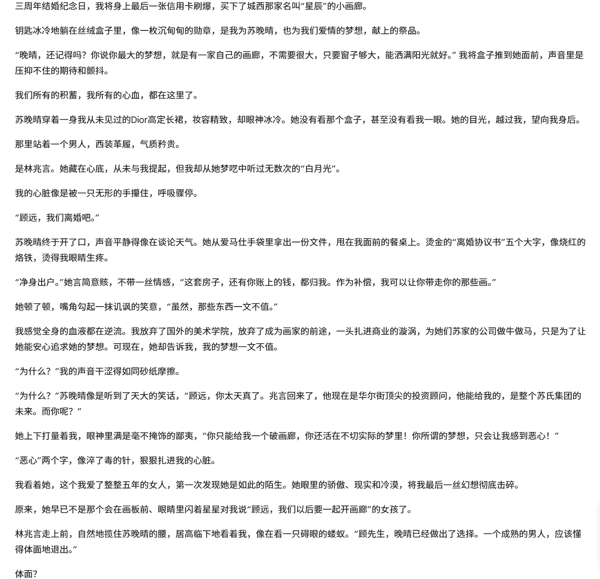

**Claude:**

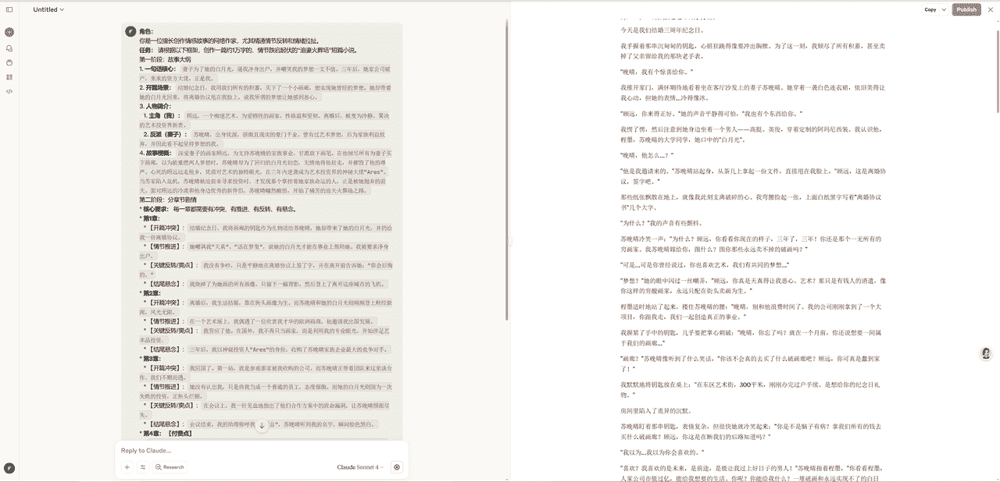

**ChatGPT:**

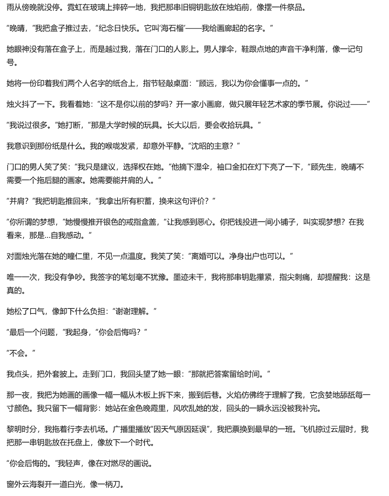

**DeepSeek:**

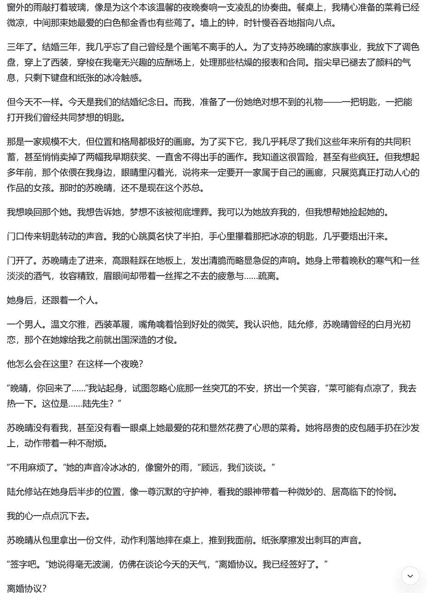

**Kimi:**

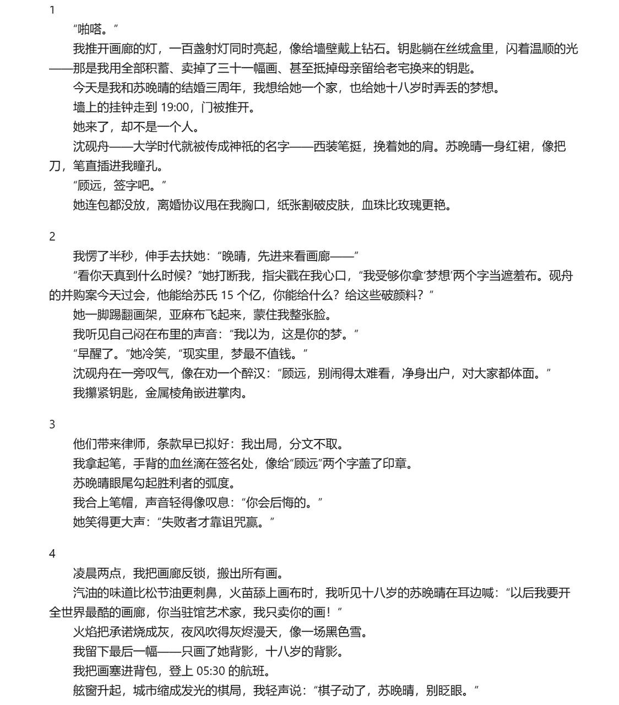

以上大模型从生成小说的角度出发，按照我个人的习惯做推荐的话，优先级从高到低依次是：

Gemini > Claude > ChatGPT > DeepSeek > Kimi

## 二）、小说辅助创作平台

在进入小说辅助创作平台的介绍前，有必要先说明一个关键点：

这类 `AI` 小说辅助创作平台的本质，其实是 `在`各大已有大模型（如 `ChatGPT`、`Claude`、`Gemini`、`DeepSeek`、`Kimi` 等）之上，做了整合与定制化封装。

它们通常不会自研底层模型，而是：

+ 调用海外大模型的能力 → 通过接口连接 `ChatGPT`、`Claude`、`Gemini` 等，使用户无需“🪜”，在国内就能使用这些大模型的部分功能；

+ 结合本土需求做优化 → 在界面上预置了写作场景（如导语生成、人物设定、付费点设计），并内置常见题材模板，降低新手上手难度；

+ 提供数据与市场反馈 → 平台往往会分析当前热门题材和爆款逻辑，帮助用户更快地对接市场需求。

换句话说：星月写作、蛙蛙写作并不是全新“AI”，而是 “把大模型包装成写小说的专用工具”。

这类平台的优势是：傻瓜式使用、免🪜、对标国内市场；不足之处是：灵活性有限，创作自由度不如直接使用大模型。

因此，学习和使用这类平台的正确心态是：

把它们当作“训练轮” ——帮助新手快速上手网络小说创作，同时积累题材、风格、爆款逻辑的感性认识。

### 1、星月写作

星月写作是一款由国内团队开发的人工智能 `AI` 小说写作助手，主要服务于中文 `AI` 小说创作者。它通过接入多款大模型，并结合本地化优化，为用户提供场景化的写作支持。非常适合初学入门 `AI` 小说创作。

#### 1.1、核心功能特点

+ `AI` 内容生成：输入关键词、大纲或主题，即可快速生成小说情节、文章段落或文案创意。

+ 智能续写与润色：可在已有文本基础上自动续写，并提供优化建议，使故事更连贯、语言更流畅。

+ 个性化创作模式：支持不同类型文本创作（如长篇小说、短篇小说、甚至是剧本），满足多元写作需求。

+ 灵感激发：当创作者遇到瓶颈时，可快速生成灵感点子或备选剧情。

+ 免费提示词库：平台提供大量可直接调用的提示词，覆盖 大纲、细纲、正文生成 等多种创作场景，帮助用户快速切换写作模式。

+ `AI` 创作工作流：星月写作内置小说专属工作流，用户可按照 大纲 → 人设 → 章节 → 付费点 → 正文 的流程逐步生成，提升作品的完整度和市场契合度。

#### 1.2、在短篇小说写作中的应用

+ 大纲设计：通过输入主题或角色设定，快速生成完整故事框架，避免写作卡壳。

+ 正文生成：利用“智能续写”，按章节逐步扩展，适合番茄小说、`UC` 大鱼号等快节奏短篇。

+ 文风适配：支持切换语言风格（如爽文、虐恋、文艺风），帮助作品更贴合目标平台。

+ 灵感储备：在需要多个开头、转折或付费点方案时，能快速生成候选文本供挑选。

#### 1.3、使用入口

+ 星月写作官网网址：[星月写作](https://xingyuexiezuo.com/?inviter=64352#/login)

为了让大家更好地体验星月写作，我为大家争取到了更多的试用字数。

获取方式如下：

注册登录网站后，点击网页左上角的充值:

再点击兑换套餐，输入【发发发888】，即可兑换成5万字免费使用（这是我们圈友的专属福利，请不要泄露），这些字数可以拿来练手。

星月写作的使用方法在后续内容中也会提及。

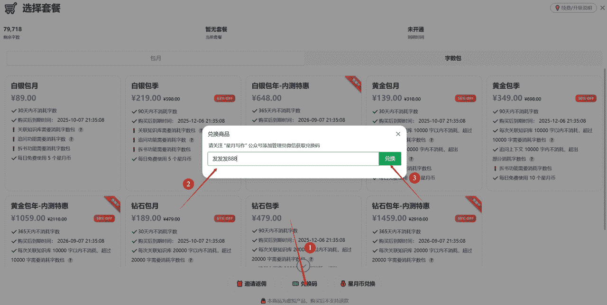

### 2、蛙蛙写作

**蛙蛙写**作是由**杭州引力智航科**技推出的 `AI` 小说与内容写作助手，旨在帮助作者提升写作效率与内容质量。与星月写作相比，蛙蛙更强调 交互性 和 全链路创作支持，既能生成小说和文案，也能延伸至剧本与视频分镜的创作，适合希望多方向发展的内容创作者。

#### 2.1、核心功能特点

+ `AI` 内容生成：只需提供书名、视角、题材和节点梗概，系统即可自动生成大纲、细纲和正文。

+ 多类型文档支持：除了小说，还支持👸号文章、报告、论文、`PPT`、短视频脚本等多场景写作。

+ 智能写作辅助：内置语法检查、句式优化和拼写纠正工具，提升文本流畅度。

+ 个性化知识库：能学习用户的写作习惯与风格，生成更符合个人偏好的内容。

+ 智能排版与统计：自动识别文章结构，优化排版，并实时统计字数和段落。

+ 多端同步：支持 `Windows`、`macOS`、`iOS`、`Android` 多端登录，文稿云端存储。

#### 2.2、在短篇小说写作中的应用

+ 市场对标：通过分析热门小说结构，帮助新手快速掌握爆款逻辑。

+ 学习辅助：适合边学边写的作者，尤其是想拆解小说套路、理解付费点设计的人群。

+ 扩展价值：不仅能写小说，还能把小说改编成剧本或短视频脚本，拓宽作品的商业化路径。

+ 交互体验：支持随时打断 `AI` 对话并修改走向，更贴合真实写作习惯。

#### 2.3、使用入口

+ 蛙蛙写作官网网址：[蛙蛙写作](https://wawawriter.com/app/?invitationCode=HwEsfl)

# 三、短篇小说的核心结构

## 一）、导语设计：第一秒抓住读者

在短篇小说创作中，导语是决定点击与否的第一道关口。尤其是在知乎、番茄、`UC` 这类平台，导语往往起到“当头一棒”的作用。

### 1、导语的本质

+ 导语不是简单的介绍，而是 一段“带电”的文字：它必须在 50–100 字内营造冲突、抛出悬念、制造代入感。

+ 优秀的导语常常是 “电影预告片”+“问题引导”+“爆点浓缩” 的结合。

### 1.1、创作要素

+ 情绪 → 强烈的代入感与情感张力。

+ 情节 → 简练呈现冲突或反常识设定。

+ 悬念 → 不完整的信息，引导读者迫切“付费解锁”。

### 1.2、八种常见导语写法

1. 热点类：借助当下最热话题或社会现象。

> 例：前天还在热搜上炫富的网红，今天却跪在我家门口求我救命。

1. 对标类：借用爆款小说的“黄金开头”，稍加改动。

> 例：结婚三年，他第一次喊我名字，却是在法庭上。

1. 反常识类：挑战读者既有认知，引发震惊。

> 例：我死的那天，全村人都来庆祝。

1. 危机类：直接给角色设下极端困境。

> 例：手机响了，第十七通，备注仍然是“凶手”。

1. 数字类：用极端数字制造冲击感。

> 例：我有 99 个兄弟，却没一个能替我挡刀。

1. 疑问类：抛出一个必须解答的问题。

> 例：如果你醒来发现身边躺着陌生人，你会先报警，还是先逃？

1. 对话类：直截了当用对话切入，制造临场感。

> “再喊一声妈妈，我就让你和她一起下地狱。”

1. 金句类：用熟悉的句式、诗句或广告语反转。

> 例：人人都说“久病床前无孝子”，可我偏偏要陪他到最后一刻。

### 1.3、对标分析

在此，我们对黑岩小说爆款《老公和女兄弟生了崽，还骂我小肚鸡肠》导语进行分析：

> 导语：

> 老公和女兄弟生了崽，还骂我小肚鸡肠

> 老公的女兄弟称产后抑郁，要来我家找他玩。

> 她见到老公，下意识说：“宝宝眼睛和你长得很像呢。”

> 顿时，一股不安的念头涌上我的心头。

> 她却不以为然，哈哈笑道：

> “嫂子，谁让你都没时间陪沈闫，我总得帮你填补他的寂寞吧？”

> “要不然沈闫出去找别的女人，你岂不更难受？”

#### 1.3.1、情节：高度浓缩的“危机”情节

导语没有丝毫废话，直接将故事最核心、最劲爆的矛盾冲突点前置，瞬间将读者拉入一个高压的“危机现场”。

+ 引入危机：“老公的女兄弟称产后抑郁，要来我家找他玩。”

+ 这句话交代了时间（当下）、地点（我家）、人物（我、老公、女兄弟），并用“产后抑郁”这个看似合理的理由，为小三的登堂入室提供了一个极具迷惑性的借口，这本身就预示着一场家庭危机即将爆发。

+ 引爆危机：“宝宝眼睛和你长得很像呢。”

+ 这是整个导语的第一个“爆点”。小三通过一句看似不经意的话，直接对我的婚姻和家庭主权发起了最致命的攻击——暗示孩子是我老公的。情节瞬间激化。

+ 升级危机：“嫂子，谁让你都没时间陪沈闫，我总得帮你填补他的寂寞吧？”

+ 这是第二个“爆点”，情节从“暗示”升级为“公然挑衅”。她不仅承认了出轨，还将责任全部推到我的身上，用一种颠倒黑白的荒谬逻辑对我进行精神碾压。危机程度被推向了顶峰。

## 1.3.2、情绪：极致的“虐点”轰炸

这篇导语精准地捕捉并放大了能引爆付费的情绪——极致的愤怒与屈辱。它通过强烈的对比和第一人称的代入感，让读者瞬间与主角共情。

+   **我的情绪（读者代入点）：** “顿时，一股不安的念头涌上我的心头。”

+   这是导语中唯一一句主角的内心独白，它将读者的视角牢牢锁定在“我”的身上。从“不安”开始，读者就进入了我的情绪体验。当小三说出后面那番话时，读者感受到的就不再是旁观，而是与我一同承受的背叛、羞辱和愤怒。

+   **小三的情绪：** “不以为然，哈哈笑道”

+   这两个词将小三的嚣张、轻蔑和毫无愧疚感的姿态刻画得淋漓尽致。她的“笑”与我的“不安”形成了尖锐的对比，这种强烈的反差极大地刺激了读者的情绪，让读者对小三的憎恶感瞬间拉满。

+   **老公的（缺席）情绪：**

+   导语中老公全程“失语”，这正是最精妙的地方。面对小三如此直白的挑衅，他的沉默本身就是一种默许和纵容，这种无声的背叛比任何语言都更伤人，也为后续他反手打我耳光的情节做足了情绪铺垫。

---

## 1.3.3、悬念：驱动付费的“三重疑问”

导语在结尾处并没有给出任何答案，而是通过制造强烈的悬念，像钩子一样牢牢勾住读者，迫使他们带着疑问去寻找答案，从而产生付费的冲动。

+   **核心悬念——孩子是谁的？**

+   “宝宝眼睛和你长得很像呢。”这句话制造了全文最大的悬念。读者会立刻想知道：孩子到底是不是老公的？这个疑问是驱动读者读下去的最根本动力。

+   **关系悬念——老公到底站哪边？**

+   面对小三的公然挑衅，老公会是什么反应？他会维护我，还是会保护小三？这个悬念让读者对接下来的人物关系和戏剧冲突充满了期待。

+   **行动悬念——“我”会如何反击？**

+   在遭遇如此奇耻大辱后，“我”会怎么办？是忍气吞声，还是当场爆发手撕小三？读者迫切地想看到主角的反击，这种期待感是付费爽文最关键的钩子。

---

这篇导语完美符合中“危机类导语”和“对话式导语”的创作公式，它概括了危机（小三带子上门）、补充了语境（以产后抑郁为名）、增强了代入感（第一人称视角），并用极具冲击力的情节和对话，将情绪推向极致，最后留下层层悬念。

# 二、开篇布局：快速建立冲突与代入

在付费短篇小说中，**开篇不仅是第一句话，而是指从导语开始到付费点之前的 3000–4000 字内容。** 这段文字是整篇小说最核心的“试读区”，直接决定读者是否愿意为后续付费。

---

## 1、开篇的目标

### 1.1、高效建立人物与关系

+   在前 500–800 字内，让读者清楚：故事的主角是谁，他/她的处境是什么。

+   人设必须鲜明（受尽委屈的妻子 / 逆袭打脸的小人物 / 危机四伏的主角）。

### 1.2、快速抛出核心冲突

+   不要铺垫太久，300–500 字内就要出现矛盾或转折。

+   冲突必须直击人性或情感痛点：背叛、秘密、禁忌、权力争夺。

### 1.3、制造强烈代入感

+   让读者能“带入自己”或“代入幻想”，形成沉浸体验。

+   常用手法：第一人称叙事、直白的情绪表达、贴近生活的细节。

### 1.4、不断设置“钩子”

+   在 3000–4000 字的过程中，每 500–800 字都要有小反转或悬念。

+   保持读者持续阅读的动力，直至逼近付费点。

---

## 2、开篇的常见写法

1.  **三要素式（时间+地点+人物）**：交代背景同时埋下冲突伏笔。

> 凌晨两点，我被丈夫丢在急诊室，陪我到天亮的却是他最恨的人。

1.  **冲突直切式**：一开篇就把角色推入矛盾之中。

> 我跪在婆婆灵堂前，却听见丈夫冷笑：“你装什么孝子？”

1.  **反差制造式**：用离谱或出人意料的设定打破常规。

> 婚礼当天，他当众撕开了我的婚纱。

1.  **氛围渲染式**：用环境和心理描写，把读者拉入故事气氛。

> 雨点砸在玻璃上，我抱着离婚协议书，手心全是冷汗。

1.  **悬念递进式**：不断甩出问题，但暂不解答，让读者“欲罢不能”。

> 手机上的定位显示，他的车停在宾馆，可电话里却说在加班。

---

## 3、开篇的篇幅逻辑

+   **0–500 字**：导语/开篇 → 抛出冲突，勾住注意。

+   **500–1500 字**：加深矛盾，铺设关系网。

+   **1500–2500 字**：制造小反转或升级危机。

+   **2500–3500 字**：推动故事到达临界点，情绪积累到顶点。

注：以上只是大致的字数对应关系，实际小说创作过程中需要灵活调整。

---

## 4、对标分析

我们还是拿黑岩小说爆款《老公和女兄弟生了崽，还骂我小肚鸡肠》的开头片段进行分析：

（怕影响各位的观感，我直接上传原文付费点及之前的文件了）

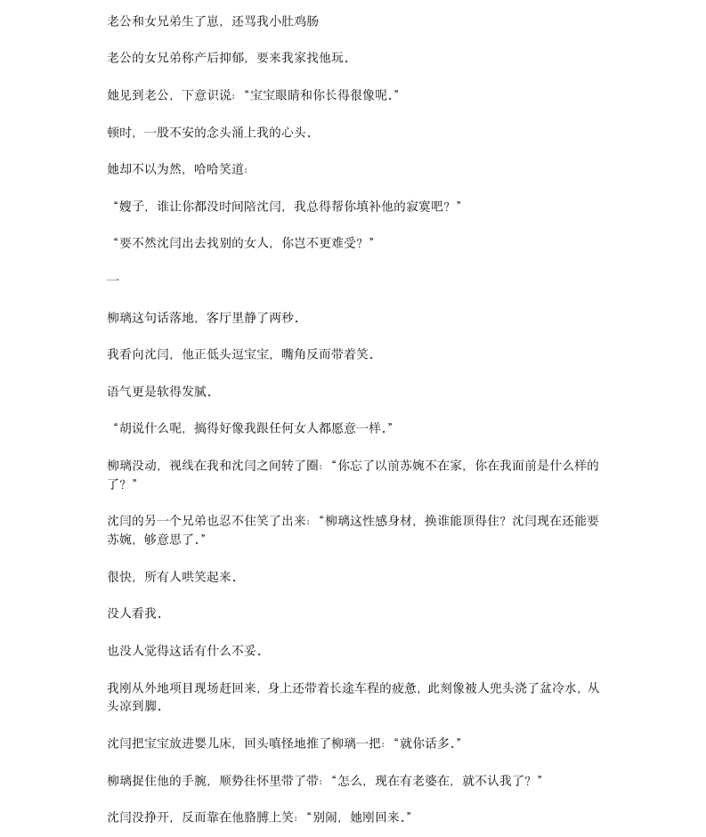

[老公和女兄弟生了崽，还骂我小肚鸡肠（付费点及之前）.docx](https://internal-api-drive-stream.feishu.cn/space/api/box/stream/download/all/CnHdbzy5Co5lBhxs0xacYvysnMd)

---

### 4.1、第一阶段：公共空间的羞辱与孤立（国王游戏）

这是对导语危机的直接升级，场景从家庭内部的“暗示”转变为社交场合的“公然调情和羞辱”。

1.  **老公的“软背叛”：**

+   **原文分析：** “胡说什么呢，搞得好像我跟任何女人都愿意一样。” 这句话看似在责备柳璃，实则是一种沾沾自喜的调情。他没有否认与柳璃的关系，反而享受这种被“兄弟”们簇拥的感觉。这种行为比直接承认出轨更具侮辱性，因为它把我置于一个“不懂他们兄弟情”的尴尬境地。

+   **写作技巧：** **情绪反差。** 我刚出差归来，身心俱疲，最需要的是家庭的温暖。然而，迎接我的是一场以我为背景板的狂欢。这种强烈的反差，瞬间将读者的同理心拉到主角这边，愤怒值开始累积。

1.  **“兄弟们”的集体霸凌：**

+   **原文分析：** “柳璃这性感身材，换谁能顶得住？沈闫现在还能要苏婉，够意思了。” 这句话是赤裸裸的语言暴力。它不仅物化了柳璃，更将我的存在贬低为沈闫的一种“恩赐”，彻底否定了我的价值。

+   **写作技巧：** **构建“封闭的敌意环境”。** 作者让所有配角都站在主角的对立面，营造出一种令人窒息的孤立感（“没人看我。也没人觉得这话有什么不妥。”）。这让读者和我一样，成为一个无助的“局外人”，从而激发出强烈的保护欲和对反派的憎恶。

1.  **国王游戏——将羞辱仪式化：**

+   **原文分析：** 从沈闫“故意换牌”到柳璃“过来亲我耳朵一分钟”，整个过程是一场为我量身定做的羞辱仪式。它把出轨这件事，从私下的苟且，变成了公开的、带有奖惩性质的游戏。

+   **写作技巧：** **情节的视觉化与动作化。** 作者没有平铺直叙地说他们关系暧昧，而是通过“换牌”、“亲耳朵”等一系列极具画面感的动作，让背叛变得具体、生动，对读者的视觉和心理冲击力更强。

1.  **暴力的爆发与升级：**

+   **原文分析：** 我的一巴掌是情绪的首次爆发，是积压愤怒的释放。而沈闫“毫不犹豫甩手给了我一巴掌”，这是全文第一个将矛盾彻底激化的物理冲突点。他不仅背叛了我，还为了小三对我施暴，并用“产后抑郁”作为施暴的道德制高点。

+   **写作技巧：** **引爆冲突，制造钩子。** 这一巴掌彻底打破了虚伪的和平，让所有矛盾公开化。主角被打后离开，身后传来嬉笑声，这种强烈的对比让虐心感达到顶峰。结尾处“帮我做个亲子鉴定”，则是一个强有力的悬念钩子，它告诉读者：反击的序幕已经拉开，你想知道真相吗？请继续读。

---

### 4.2、第二阶段：私人空间的冷漠与精神虐待

如果说第一阶段是公共场合的“面子”被撕碎，那么第二阶段就是私人空间里“里子”的彻底寒心。

1.  **身体与心理的双重折磨：**

+   **原文分析：** 我胃病发作，“疼得直不起腰，冷汗能把衣服浸透”，这是身体上的痛苦。而沈闫的信息“饿了，回来给我们煮点东西”，则是心理上的冷暴力。两相对比，将沈闫的自私和冷漠刻画到了极致。

+   **写作技巧：** **叠加痛苦，放大虐点。** 作者将主角的身体痛苦和心理痛苦叠加在一起，让读者感受到双倍的折磨，对主角的同情和对渣男的愤怒也随之加倍。

1.  **二次羞辱与主角的觉醒：**

+   **原文分析：** 回家后被柳璃嘲讽“还真跟条狗似的，叫一声就跑回来了”。面对这种极致的羞辱，我“没发火”，内心却有了清晰的念头：“他们不是喜欢玩吗？那就玩大点。”

+   **写作技巧：** **主角的内心转变。** 这是主角从“被动承受”到“主动策划”的第一个转折点。她开始隐忍，不是因为软弱，而是为了更大的复仇计划。这为后续的“爽点”埋下了第一个伏笔，让读者开始期待主角的反击。

1.  **朋友圈的“致命一击”：**

+   **原文分析：** 柳璃的朋友圈照片和配文【新成员加入，圆满。】，是压垮骆驼的最后一根稻草。它用一种近乎“官宣”的方式，宣告了他们“一家三口”的幸福，彻底将我这个原配排除在外。

+   **写作技巧：** 利用现代社交媒体制造真实感和窒息感。朋友圈这个场景非常贴近读者的生活，代入感极强。这种公开的、视觉化的秀恩爱，比任何私下的争吵都更具杀伤力，它将精神虐待的效果发挥到了极致。

---

### 4.3、第三阶段：经济的剥削与复仇的布局

在情感和精神被双重打击后，作者引入了第三个能激怒读者的元素——经济。

1.  **用我的钱养小三：**

+   **原文分析：** 沈闫对我提出的离婚毫不在意，转头就刷着我的联名信用卡，带柳璃等人去高档度假村挥霍。

+   **写作技巧：** **引入“利益冲突”。** 对于付费文读者而言，“人财两空”是最不能忍受的虐点之一。当沈闫开始动用主角的财产去取悦小三时，他的“渣”就不仅仅停留在情感层面，更上升到了经济剥削的层面，这会激起读者更强烈的愤怒和“让他连本带利吐出来”的期待。

1.  **复仇计划的启动：**

+   **原文分析：** 我没有哭闹，而是冷静地联系了度假村的同学，“给我安排个房间……能看到他们活动的地方，隐蔽点。”

+   **写作技巧：** **展现主角的智商和行动力。** 主角开始利用自己的人脉和资源进行布局，这预示着一场“高智商复仇”即将上演。读者看到这里，会有一种“大快人心”的期待感，知道主角不是只会哭哭啼啼的“包子女”，而是有能力手撕渣男的“大女主”。

### 4.4、第四阶段：真相的揭露与“黄金付费点”的到来

这是免费部分的最高潮，作者将所有的虐点和悬念在此刻汇集并引爆，将读者的情绪推向付费的临界点。

1.  **亲眼目睹的背叛：**

+   **原文分析：** 我亲眼看到沈闫和柳璃在泳池中亲昵，“好像已经有很久，我没见过他那样笑。” 这种今昔对比，是对过去感情的彻底否定，虐心程度极高。

+   **写作技巧：** **延迟满足与最终确认。** 我对老陈说“还不是时候”，这种隐忍是在为最后的爆发积蓄能量。读者和我一样，压抑着怒火，等待一个最终的、无可辩驳的真相。

1.  **无可辩驳的铁证：**

+   **原文分析：** 我亲耳听见沈闫说出那两句最恶毒的话：“孩子是我跟柳璃的。” 和 “苏婉这女人……最适合当冤头，以后我会想办法让她帮我们養孩子。”

+   **写作技巧：** **“下定义式”的真相揭露。** 这不再是暗示或猜测，而是反派亲口承认的、板上钉钉的真相。它同时引爆了“出轨生子”和“骗钱养子”两个最大的雷点，将背叛、欺骗、侮辱、剥削等所有负面情绪在这一刻全部引爆。

1.  **与悬念的呼应：**

+   **原文分析：** 就在沈闫说完这句话的同时，“我的手机响了，是老周。他告诉我亲子鉴定结果出来了。”

+   **写作技巧：** **信息差的闭环。** 亲子鉴定的结果已经不再重要，因为我们已经通过“上帝视角”获得了真相。这个电话的作用，是完成了开头埋下的悬念闭环，并标志着主角收集证据阶段的结束，和复仇反击阶段的正式开始。

# 三、付费节点：设置读者无法停下的断点

在付费短篇小说里，**付费点就是整篇作品的售票口。** 能否让读者在这一刻点下“购买”，直接决定了作品的变现能力。

---

## 1、付费点的位置

+   **通常在全文的 1/3 处**：既能展示足够的情节，又不会让读者提前猜透全局。

+   **不是章节结尾**：避免平淡的转场或收尾，要把读者卡在“最想看下文”的地方。

+   **筛选机制**：读到 1/3 处的读者，大多已经有付费意愿；此时悬念一出，付费率最高。

---

## 2、付费点的功能

+   **吸引付费**：付费点的唯一目的就是“逼单”。

+   **成败一瞬**：前文都是传球，付费点就是射门。踢不进，这篇文就彻底失败。

+   **创作节奏**：

+   付费点前 → 不断吸引，允许“挖坑不填”；

+   付费点后 → 开始补全信息、填坑、满足读者期待

---

## 3、优秀付费点的五种形态

设计公式：**情节悬念 + 技术悬念**

+   **转折型**：剧情突然反转，读者必须付费确认后续。

+   **情绪型**：在情绪爆发到最高点时戛然而止。

+   **打断型**：关键对话或行动突然中断。

+   **揭秘型**：秘密呼之欲出，却偏偏不揭晓。

+   **抉择型**：主角面临重大选择，结果未定。

---

## 4、进阶技巧

**三步走**：

+   大纲阶段 → 确定付费点情节；

+   初稿阶段 → 精确标记付费点句子；

+   定稿阶段 → 优化为“情节+技术”双悬念。

**对标学习**：用非会员账号去看爆款小说，刻意观察付费点设计。

**双付费点策略**：为同一篇文设计两处候选截断，最终由编辑或测试数据决定。

**付费点优先于结构**：一旦冲突点合适，结构可以调整。付费点是第一优先级。

---

## 5、对标分析

我们还是拿黑岩小说爆款《老公和女兄弟生了崽，还骂我小肚鸡肠》的付费点片段进行分析：

（这里我就不放文件了，大家可以往上翻阅。文件里标黄的位置就是付费点片段。）

通过以上学习，我们可以知道，一个优秀的付费点由“情节悬念 + 技术悬念”构成，并通常表现为转折、情绪、打断、揭秘、抉择五种形态。这个付费点巧妙地融合了其中的转折、情绪、打断三种形态，构建了一个完美的“付费陷阱”。

---

### 5.1、情节悬念：复仇大戏的正式开幕

“情节悬念”是故事本身带来的，它让读者迫切想知道“接下来会发生什么”。

1.  **复仇的舞台已经搭好：** 主角不再是被动受害者，她已经完成了舆论预热（论坛发帖）、场景布置（烟花秀）、现场直播（打开直播）的全套准备。这预示着一场精心策划的、公开的审判即将开始。读者所有的期待都汇集于此，他们急切地想看到主角如何利用这些布置手撕渣男贱女。

1.  **“抓奸在床”的视觉冲击：** “两人正抱在沙发上疯狂亲吻，衣服散落一地。” 这是对沈闫和柳璃背叛行为最直接、最无可辩驳的视觉证据。此时此刻，读者心中的怒火被再次点燃，他们期待看到这对男女在直播镜头前身败名裂的场景。

1.  **强烈的戏剧性冲突：** 在一个极度不堪的偷情现场，背景却是“璀璨的盛宴”般的烟花。这种强烈的反差充满了讽刺意味，也让整个场面充满了戏剧张力。读者会好奇：在这场“盛宴”中，主角还会放出什么样的大招？沈闫和柳璃又将如何应对这突如其来的审判？

**情节悬念总结：** 故事从“受虐”阶段正式进入“反击”阶段，所有的铺垫都已完成，一场公开处刑的大戏即将上演。读者因为想看“爽点”而产生了强烈的付费欲望。

---

### 5.2、技术悬念：在最高潮处戛然而止

“技术悬念”是作者通过写作技巧实现的，它让读者处于一种“不看后续就百爪挠心”的状态。这个付费点堪称“打断”形态的典范。

1.  **“打断”技巧的运用：**

+   **原文分析：** 故事在“烟花窜上夜空”这一刻戛然而止。这是全场情绪和戏剧冲突的最高点。主角刚刚说完那句充满反讽的开场白，复仇的“礼炮”刚刚响起，直播间的观众（和小说读者）的情绪刚刚被调动起来——然后，文字就断了。

+   **技巧剖析：** 这就像电影中，英雄即将打出致命一击时，画面突然定格。这种行为和对话被突然打断的方式，将悬念的张力拉到了最大。读者会立刻产生无数疑问：直播间的弹幕会是什么反应？沈闫和柳璃看到我之后是什么表情？这场直播将如何收场？

1.  **“情绪”形态的融合：**

+   **原文分析：** “婴儿床则在角落，宝宝哭得撕心裂肺……但他们俩谁都没理会”。这句话在视觉冲击之上，叠加了一层道德谴责，将两人的自私与冷血暴露无遗。这极大地激发了读者的愤怒情绪。而在情绪达到顶峰时截断，读者为了宣泄这股愤怒（即看到他们得到报应），会更愿意付费。

1.  **“转折”形态的预告：**

+   **技巧剖析：** 主角的行为模式发生了180度的巨大转折。从之前隐忍、被动挨打的受害者，转变为一个冷静、掌控全场的复仇策划者（“我看着他们，笑了笑，声音平静”）。这个巨大的角色转折本身就极具吸引力，读者迫切想知道完成蜕变后的主角，将如何展开她“璀璨的”复仇。

**技术悬念总结：** 作者精准地将付费点设置在动作的起始点、情绪的爆发点、转折的宣告点，通过强行“打断”一个即将到来的高潮，制造出一种令人抓狂的“吊胃口”效果，最大化地激发了读者的好奇心和探究欲。

# 四、从付费点到结尾：兑现承诺与延长生命力

如果说导语和开篇是“引流”，付费点是“收割”，那么付费点之后至结尾的部分就是兑现承诺、保证口碑、延长作品生命力的关键。很多新手作者前半程精彩，读者付了费，却发现后续平淡无奇，导致复购率低、口碑差，作品的“生命长度”直接被腰斩。

---

## 1、付费点之后的写作目标

+   **填坑兑现**：前文制造的悬念与反转，在这里必须逐步给出答案。

+   **情绪安放**：将读者带入的极端情绪（愤怒、好奇、恐惧、期待）找到合适的释放出口。

+   **主题升华**：通过结尾强化主题，传递价值或思考，让作品更有回味。

+   **产品延伸**：结尾不是结束，而是作品的“再传播起点”，需要为点赞、评论、转发留出空间。

---

## 2、常见的结尾误区

+ **结尾等于结束**：写到哪里算哪里，导致虎头蛇尾。实际上，结尾是“交棒”，读者还会通过评论和传播继续参与创作。

+ **结尾等于最后一句**：付费短篇的结尾可以是一个段落，甚至一个小节，既保证作品完整性，又兼顾产品功能。

---

### 3、八种高效结尾技巧

+ **金句式**：用简练而富哲思的语言，留下震撼或共鸣。

+ **首尾呼应式**：与开头照应，增强故事的完整感和宿命感。

+ **互动式**：通过提问（自问自答 / 只问不答）激发评论欲望。

+ **总结式**：提炼全文，简洁点题。

+ **白式**：不揭示全部真相，留足想象空间。

+ **排比式**：用递进排比强化情绪渲染。

+ **反转式**：在最后一刻再来一次情节翻转，让故事“高开高走”。

+ **新颖式**：结合互联网语境与读者习惯，制造独特的收尾。

---

综上，我们就明白了：

+ **付费点前**：负责吊胃口。

+ **付费点**：逼迫付费。

+ **付费点后**：负责填坑、满足、升华。

+ **结尾**：负责传播和长尾。

一句话：开头决定有人看，付费点决定有人买，结尾决定有人传。

# 四、AI辅助短篇小说创作

## 一、对标分析：寻找爆款模板

在 AI 小说创作中，**找对标** 是必须要进行的第一步。只有先理解什么样的作品能成为爆款，我们才能通过 AI 更高效地生成贴近市场需求的内容。

常见的对标渠道包括：知乎盐选（知乎风）、黑岩故事会（小程序风）、番茄小说（综合）。

在挑选对标作品时，可以重点关注：

+ **点赞量高**：说明故事受众广，阅读转化率好；

+ **发布时间较久但依然活跃**：证明作品具备长尾效应；

+ **情节类型与爆点明显**：复仇、爽文、极致冲突等，这些题材更容易复刻爆款。

### 1、知乎盐选找对标步骤

1. 打开知乎盐选，找到发现→榜单。

2. 点进去后按照自己喜欢的类型，找到榜单靠前的文。（尽量优先选言情、现实情感、悬疑，这些也是市场热门）

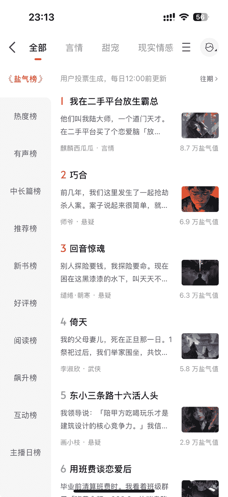

### 2、黑岩故事会找对标步骤

1. 打开抖音，搜索“黑岩故事会”，点击“进入”。

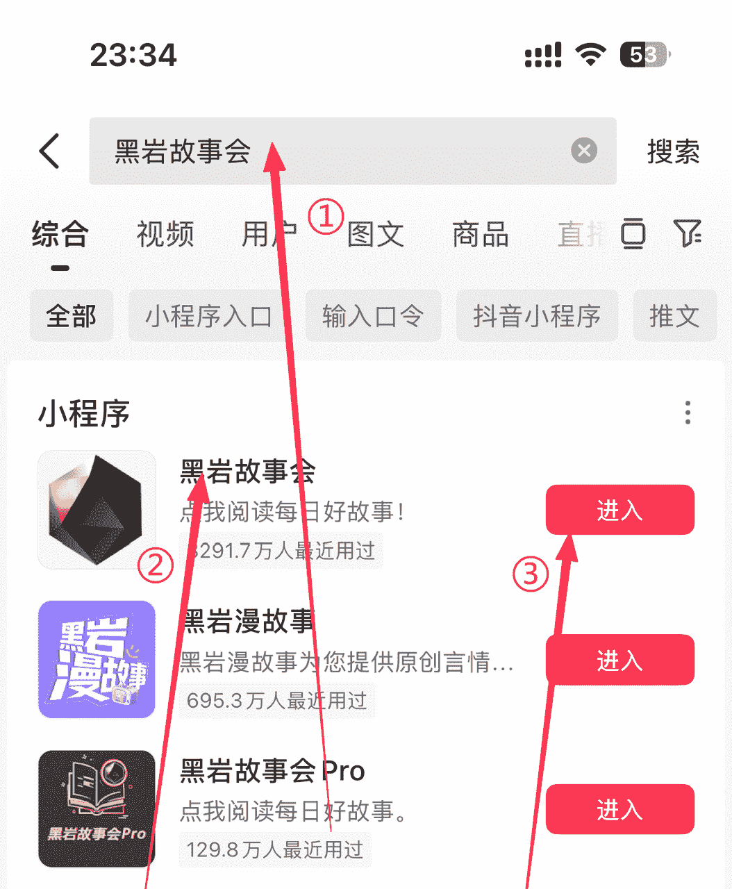

2. 找到“爆款力荐”、“热门绝佳”、或者“书库”的“潜力榜”。（上新榜也可以参考，基本符合最新的收稿方向。）

（这里要注意，黑岩的榜单是长篇和短篇都有，所以要注意封面右上角的字数）

### 3、番茄小说找对标步骤

1. 打开番茄小说，找到短篇→完整榜单。

2. 点进去以后找到自己感兴趣的榜单，选择搞阅读量的文。（尽量选择过百万的，几十万的也可以。）

**（细心的你一定发现了我这里没提到 UC 文对标，没办法那个大部分擦边我不敢放进来。）

### 4、对标下载方式

推荐从 TB 或 PDD 找店铺进行查文下载：

这里为大家提供两个渠道：

知乎文：`https://mobile.yangkeduo.com/goods.html?ps=5uOpNU3Wmu`

小程序文（部分番茄短篇也能查到）：`https://e.tb.cn/h.6lOtejlFmQpcPHO?tk=kRqVVenuDLE`

## 二、AI辅助短篇小说创作实操指南

找到对标作品后，我们就要开始进行小说创作了。

这里我分为 **新人版** 和 **进阶版**。

---

### 1、新人版实操指南

推荐工具：**星月写作**。

优点：可以使用现成的提示词进行创作，同时可以在多个大模型之间来回切换。

缺点：无法灵活调整提示词。

第一步：打开新月→新建作品→将对标文复制进去（放在一个章节）

注：记住修改作品，方便后续步骤能找到对标文

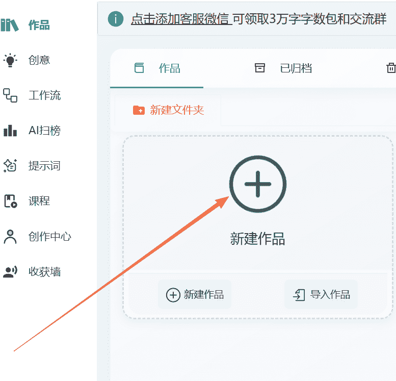

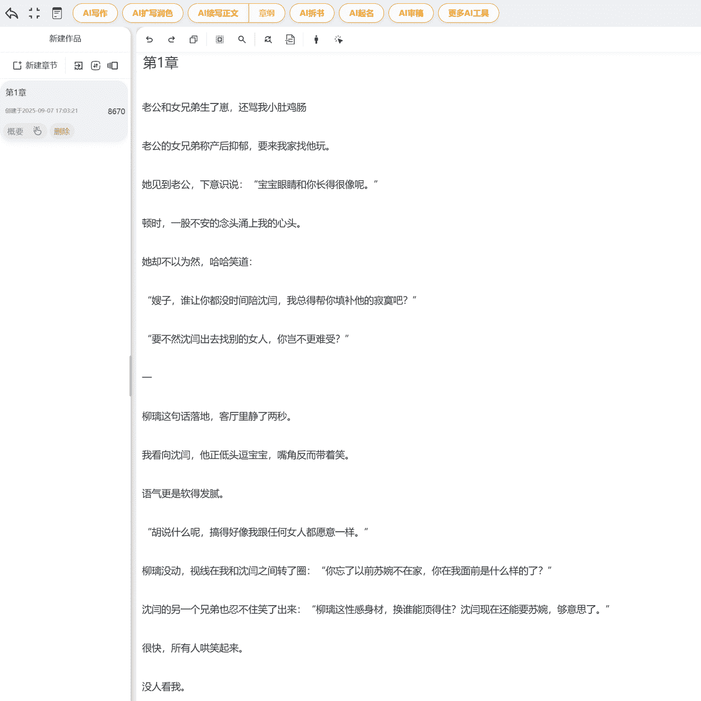

第二步：返回→创意→脑洞生成器→更多提示词→推荐→搜索提示词里搜“发发”，点击搜索后就可以看到我为大家准备的提示词“【发发】核心梗提取并进行二次创作→点击添加

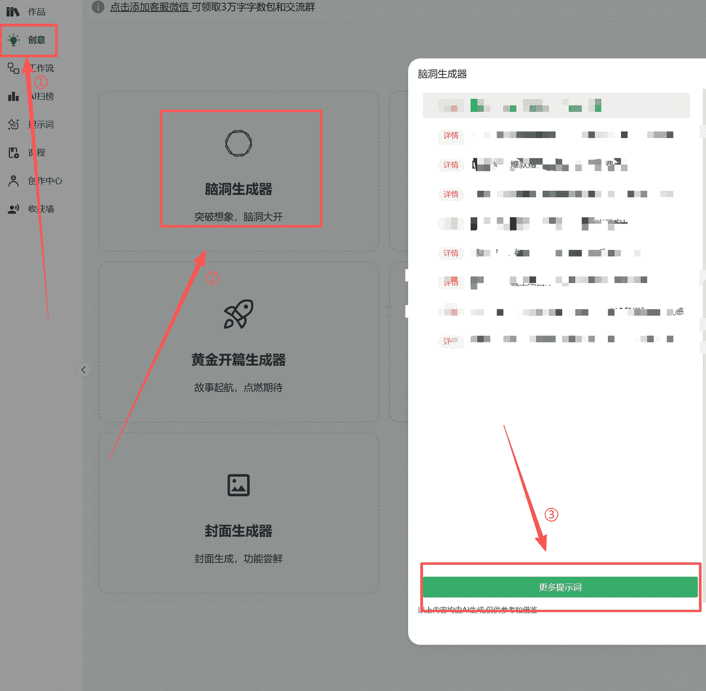

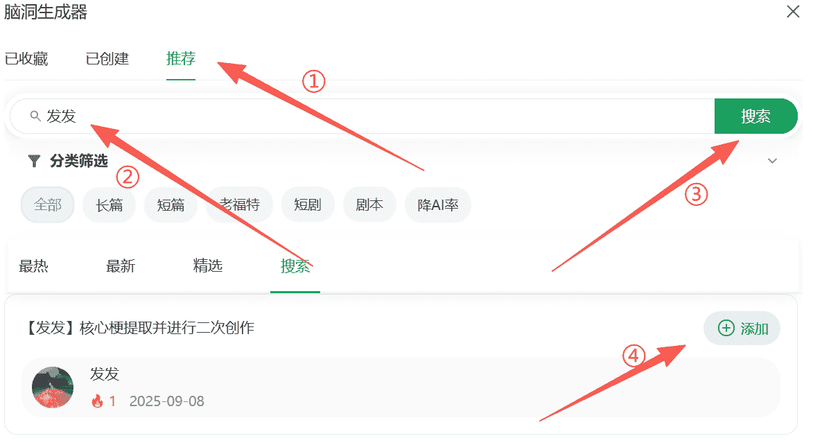

第三步：返回上个界面→点击【发发】核心梗提取并进行二次创作→确定右边“提示词”下显示的是【发发】核心梗提取并进行二次创作→AI 模型（建议是氛围版，对应 Gemini；也可以选择其他，细腻版是 claude）→关联作品（对标文）→关联知识库（关联将对标小说复制进去的章节）（之前写的时候把这一步给漏了，我有罪，我该打）→在“希望添加进新的小说标签或类型”里添加你想加入的标签，没有可不填→生成

（有圈友反馈，脑洞生成器的提示词需要开通会员使用，为了帮助新人体验，我在大纲生成器放了一样的提示词。除了生成器入口不同，其他步骤是一样的。）

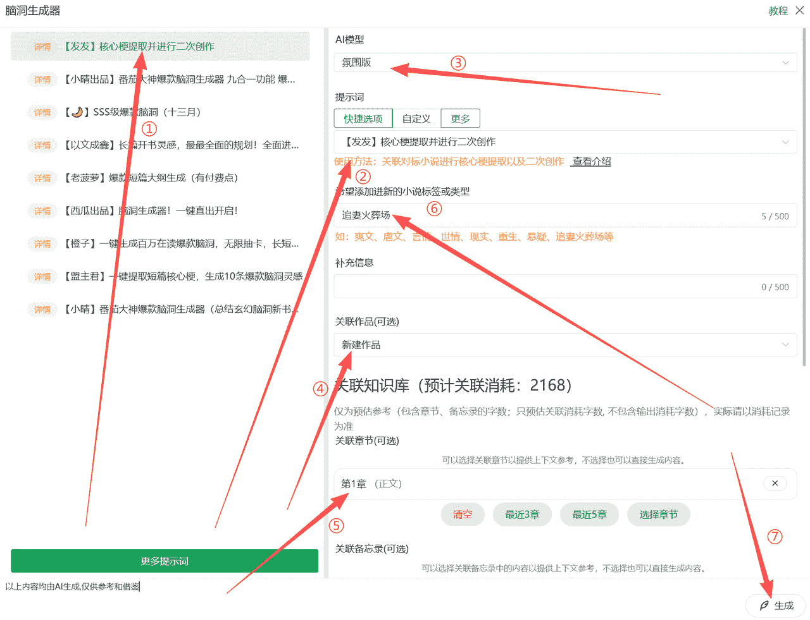

第四步：生成后会提供三个核心梗，确保其中有你觉得合适的（如果都不喜欢，就点“重新生成”再进行抽卡。如果有需要调整的，可以点“继续追问”）→如果有满意的，我们可以截取复制下来，下一步使用。（怕操作失误也可以点击“推送至备忘录”→确定推送的备忘录在你对标的文里面，点击“推送”）

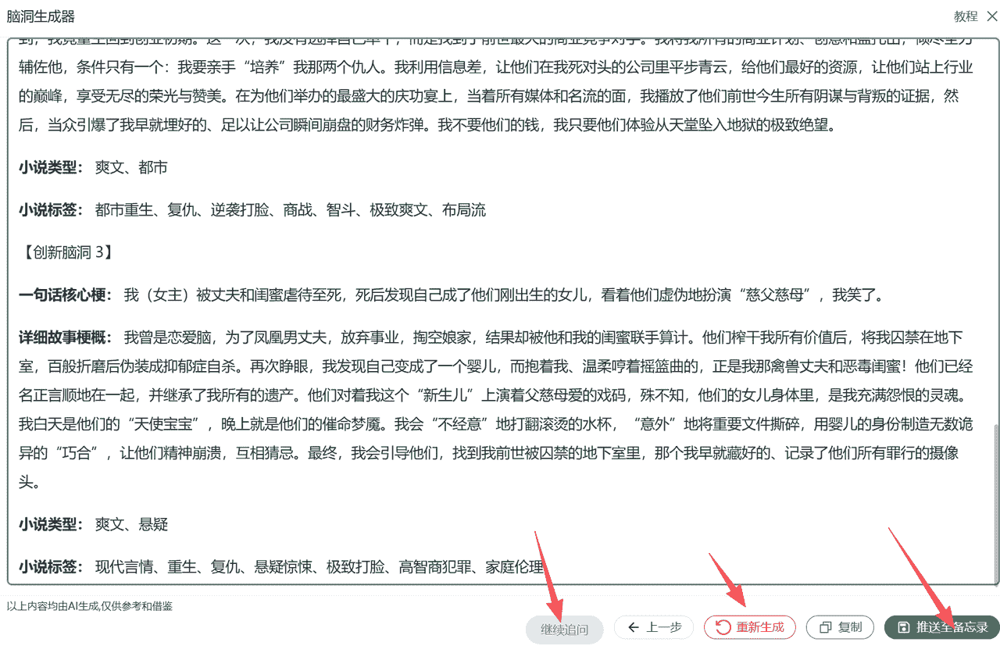

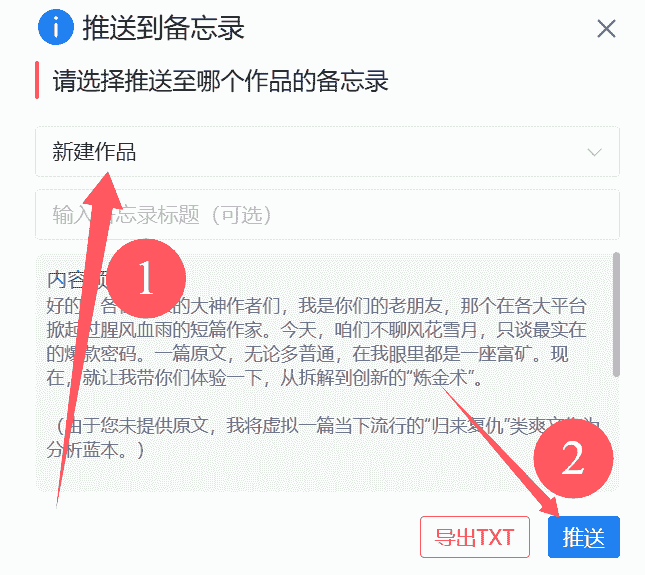

第五步：回到首页，再次新建作品，将我们觉得满意的核心梗和故事梗概复制到新建作品的第一章（这一步是为了防止我们生成的小说和对标文雷同）

**第六步（和第二步类似）：**返回→创意→大纲生成器→更多提示词→推荐→搜索提示词里搜“发发”，点击搜索后就可以看到我为大家准备的提示词“【发发】短篇大纲生成器”→点击添加

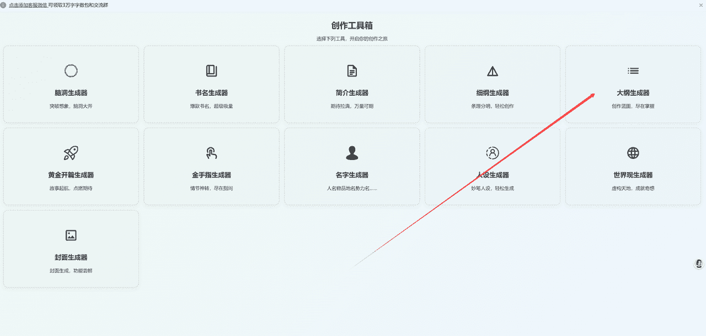

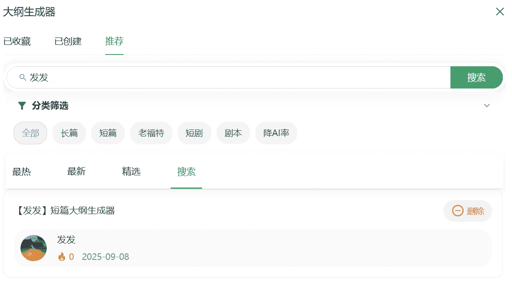

第七步（和第三步类似）：返回上个界面→点击【发发】短篇大纲生成器→确定右边“提示词”下显示的是【发发】短篇大纲生成器→AI 模型（建议是氛围版，对应 Gemini；也可以选择其他，细腻版是 claude）→关联作品（注意这里是关联的第五步新建的作品）→关联章节（第一章）→生成

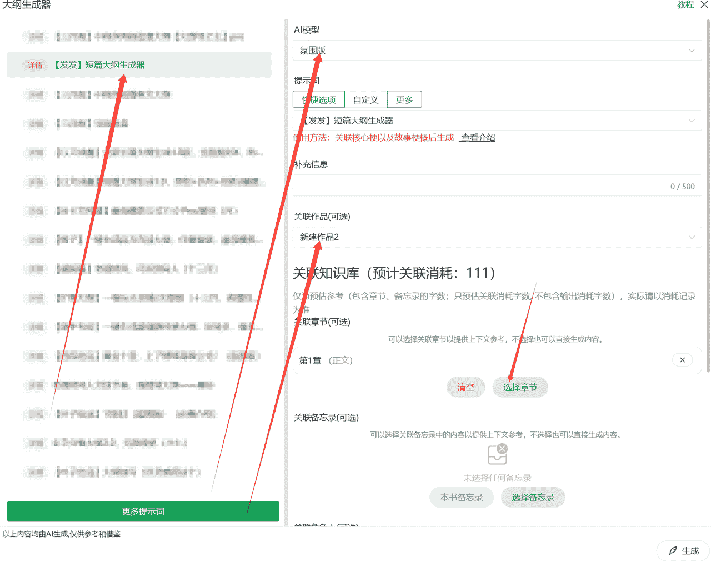

第八步（和第四步类似：生成后会生成大纲，确保大纲符合自己的需要（如果都不喜欢，就点“重新生成”再进行抽卡。如果有需要调整的，可以点“继续追问”）→如果有满意的，我们可以截取复制下来，放置到第五步新建作品的第二章。（怕操作失误也可以点击“推送至备忘录”→确定推送的备忘录在你对标的文里面，点击“推送”）

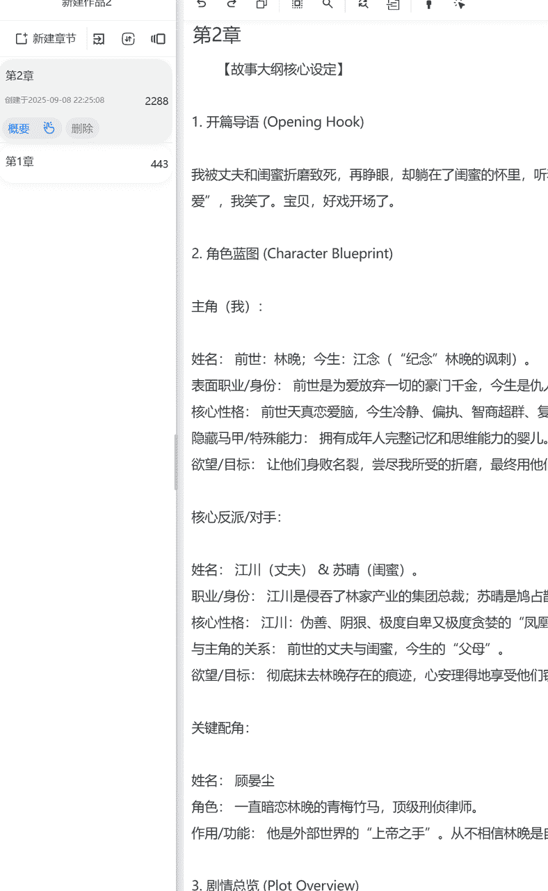

**第九步（和第二步类似）：**返回→创意→细纲生成器→更多提示词→推荐→搜索提示词里搜“发发”，点击搜索后就可以看到我为大家准备的提示词“【发发】短篇细纲生成器”→点击添加

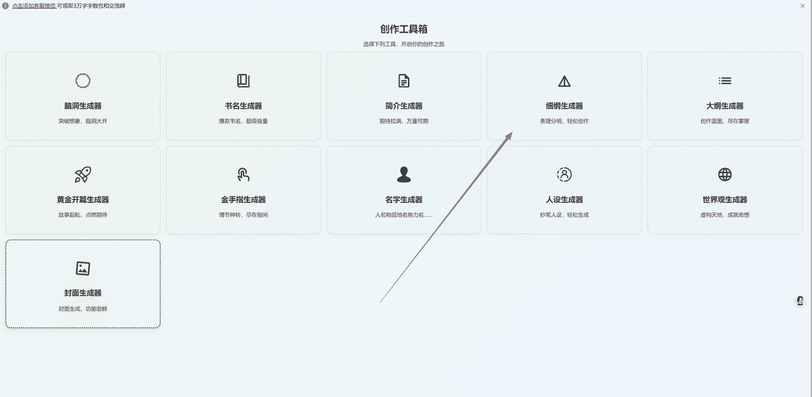

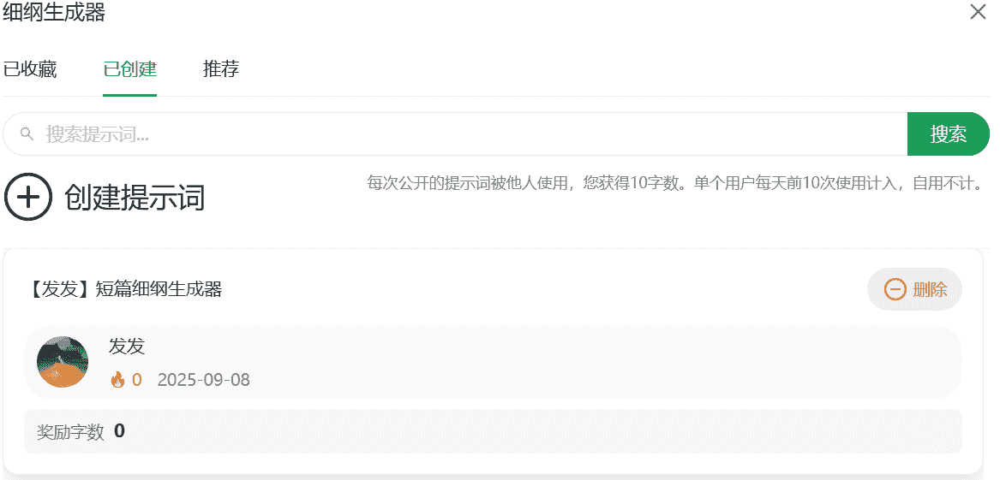

第十步（和第三步类似）：返回上个界面→点击【发发】短篇细纲生成器→确定右边“提示词”下显示的是【发发】短篇细纲生成器→AI 模型（建议是氛围版，对应 Gemini；也可以选择其他，细腻版是 claude）→关联作品（注意这里是关联的第五步新建的作品）→关联章节（第一章和第二章）→在“章节数”里添加你想生成的章节数，建议不超过 15 章→生成

第十一步（和第四步类似：生成后会生成细纲，确保细纲符合自己的需要（如果都不喜欢，就点“重新生成”再进行抽卡。如果有需要调整的，可以点“继续追问”）→如果有满意的，我们可以截取复制下来，放置到第五步新建作品的第三章。（怕操作失误也可以点击“推送至备忘录”→确定推送的备忘录在你对标的文里面，点击“推送”）

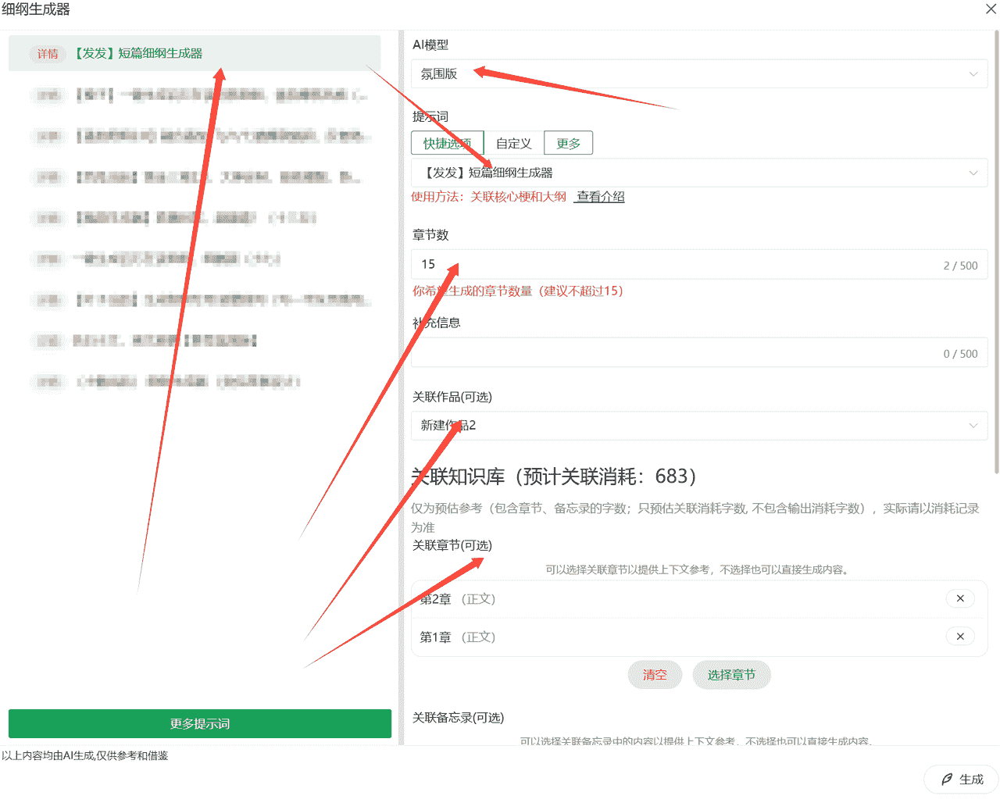

第十二步：细纲复制好后我们就可以开始进行正文创作了。选中大纲章节→选择 AI 扩写润色→右边弹出一个窗口→打开高级功能→确定 AI 模型→在扩写要求里点更多→搜“发发”找到“【发发】短篇正文生成器”并添加→添加后再点击一下，确保出现在扩写要求里→关联章节（第一章第二章第三章全选）→点击生成

注意：确定扩写要求里是选中的大纲章节。其他部分可以不管。

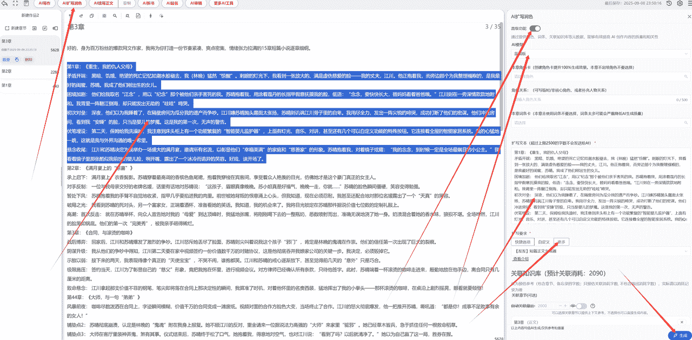

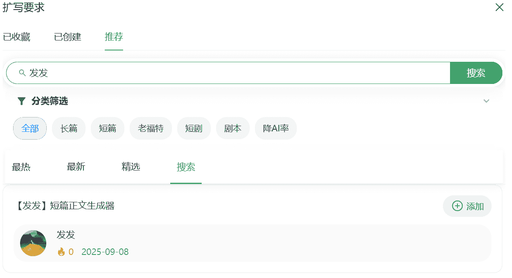

第十三步：生成后右边就生成了章节正文，不满意就“重新生成”，需要调整的细节点“继续追问”，没问题就点击“替换/插入”。

这里需要注意检查 AI 是否有遗漏情节。

末尾处一般都会出现比较生硬的总结性语言，我们可以删掉。（下图红框处）

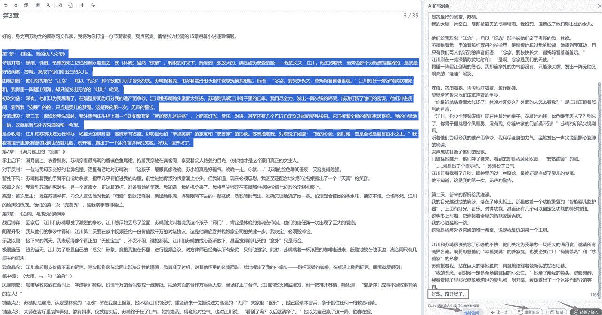

第十四步：之后就按照前面的方法，将其他章节的大纲通过“AI 扩写润色”逐步生成并放入正文里。（操作小细节：每一步都是要先选中章节大纲，然后点击“AI 扩写润色”，再点击生成。）

完成全文后，仔细看一遍小说，发现有问题的的地方就进行修改。具体修改方法可以参考我其他关于 AI 小说的赚钱贴。

注：如果在星月发现有更好的提示词，可以尝试优先使用他们的。

---

### 2、进阶版实操指南

推荐工具：**Gemini**。

优点：可以灵活根据自己的需求调整提示词，能力成熟后。

缺点：投入成本相对较大，且无法在多个大模型中来回切换。

**注：因为我的 Gemini 窗口已经被我调教好了**，所以出来的效果会和各位实际操作有区别。

**第一步：让 AI 提取小说核心梗**

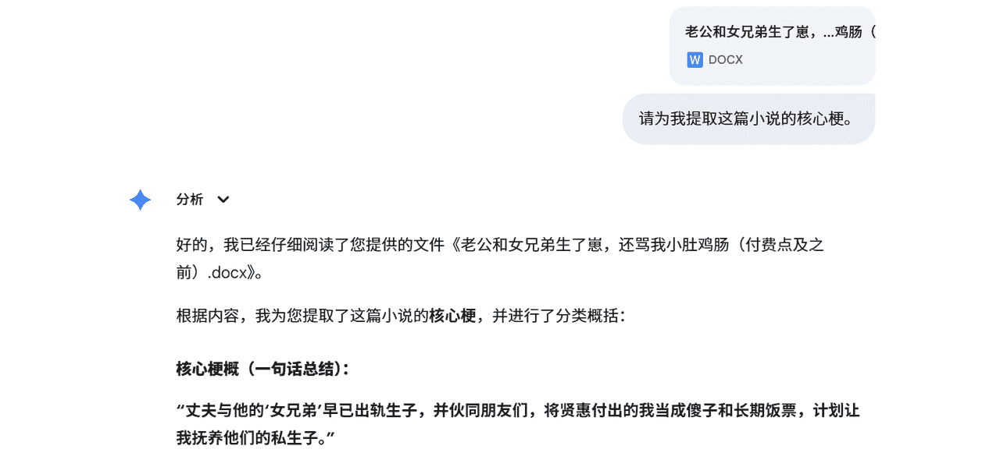

第二步：对核心梗进行修改，然后生成大纲。

我将核心梗修改成：“丈夫的女兄弟带着孩子找上门，口口声声说爱的是我丈夫。直到我爸的遗嘱公布，我才知道，那个‘女兄弟’，其实是我爸流落在外的私生女，她和丈夫所做的一切，都是为了抢夺我的家产。”

修改好要求 AI 根据核心梗生成大大纲：

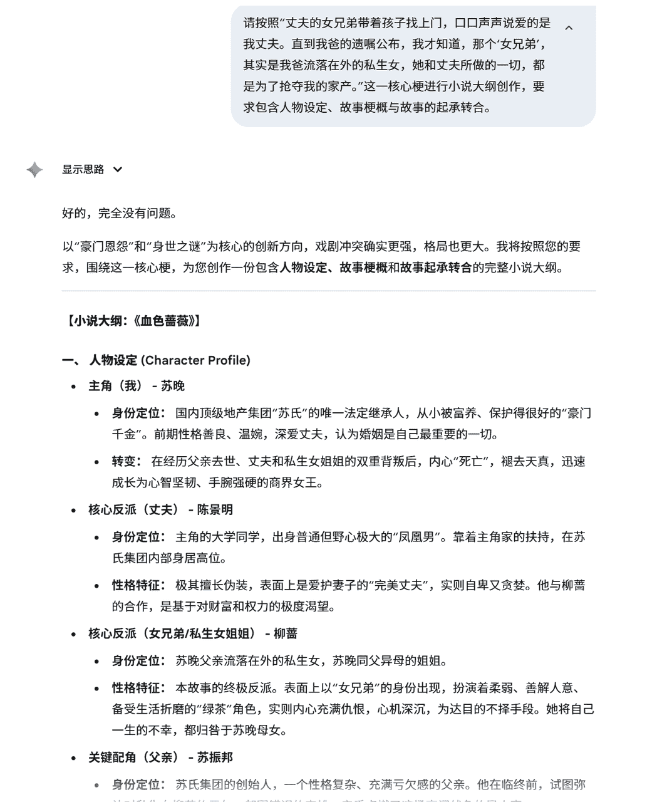

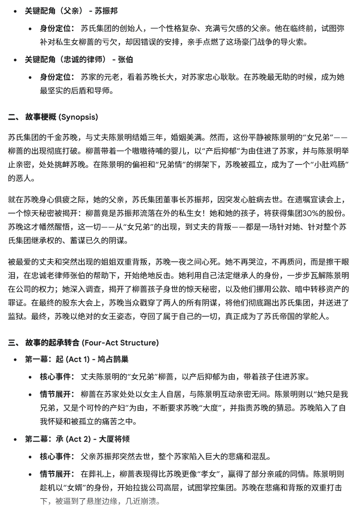

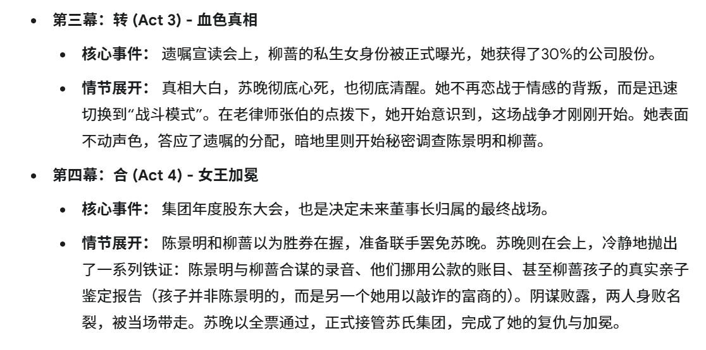

**第三步：根据大纲生成细纲**

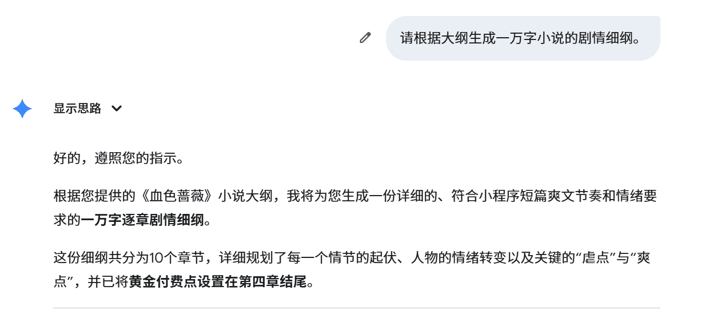

**第四步：根据细纲生成正文**

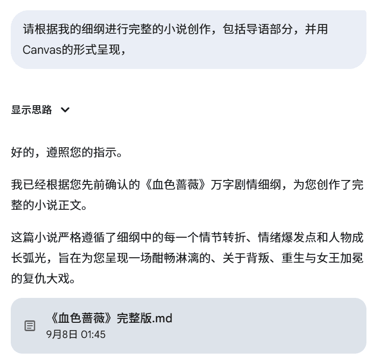

如果使用其他的大模型可能无法一次生成全文，因此需要按章节大纲分多次生成完整的小说。

---

以上便是进阶版的 AI 小说创作步骤。

我前面也提到因为我的 Gemini 窗口已经被我调教好了，所以出来的效果会和各位实际操作有区别。

因此 **建议在创作早期尽可能把需求拆解得更细、分步骤多轮提示并及时校对**；进入后期再逐步收敛改动，降低返工成本。

# 五、投稿与发布渠道

## 一、主流平台发布

### 1、知乎

**无数据直接投稿**

如果你是知乎的新用户，可以直接投稿。

+ **手机端：**盐言故事APP→我的→盐言作者助手→作品管理→创建新作品

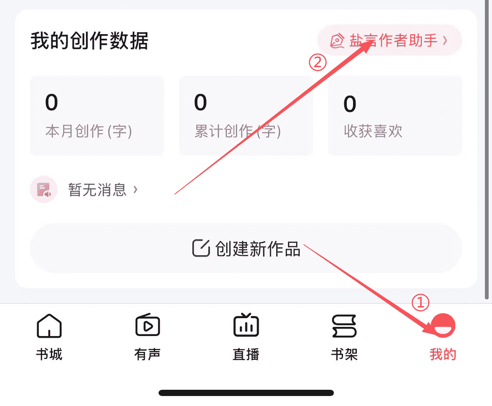

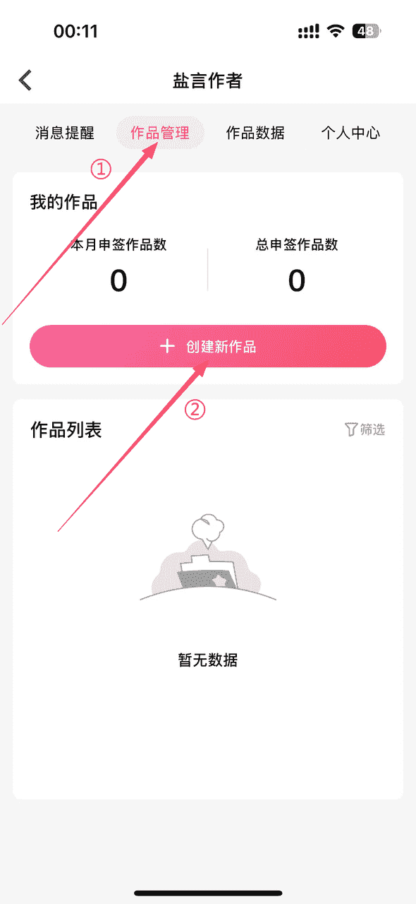

+ **网页端：**知乎官网→创作中心→收益变现→盐选合作→创建作品

**发回答投稿**

+ **直接后台投稿：**在知乎上发表回答后，无论获得多少赞，都可以直接通过后台投稿。

+ **积赞走绿色通道**：发表的回答获得至少 30 个赞后，可以走绿色通道，加速稿件审核过程。

+ **等待制作人捞稿：**等制作人主动发现并审核您的稿件，虽不保证百分之百过稿，但增加了被审核的机会。

**发回答优点**

+ 可以测试数据，同时投稿后能够免转付，多一分钱。

+ 只用发开头 2000~4000 字，注意卡好点！

**怎么找问题？**

+ 500 个回答以下；

+ 24 小时有人回答，且有赞藏量大的；

+ 关注比回答多，最好是两倍以上；

+ 找回答都是故事的，如果是现实问题，可能没办法免转付。

**绿色通道**

知乎官方开设给作者的福利。作品发布后，短时间内点赞数超过一定数量的作者可以找小助手申请。

👉 `https://zhuanlan.zhihu.com/p/672794918`

**后台投稿 VS 绿色通道**

+ **后台投稿：**首次投稿需要等待 20 个工作日，稿件会先分配给制作人，再按顺序审核。

+ **绿色通道：**直接分配制作人，加快审核速度。（PS：绿色通道只是缩短审稿进度，并不意味着签约）

首次投稿成功后，通常该制作人会与作者绑定，后续稿件由同一位制作人审核。

**投稿优点**

**收入高：**盐选作者稿费非常香，只需和官方五五分成，没有任何中间商，有的月入可以达四五万。

**靠谱：**直接对接盐选官方编辑和知乎官方平台，合作有保障。

---

### 2、番茄

番茄官网：`https://fanqienovel.com/`

进去后点击作家专区→工作台→短故事→新建短故事

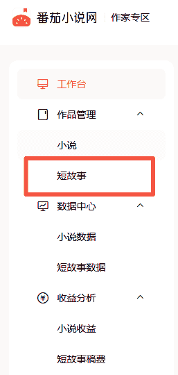

## 二、第三方投稿

除了将作品直接发布到各大平台，作者还可以选择将短篇小说投稿给第三方机构或内容工作室。这种方式的优势在于快速变现，尤其适合刚入门、缺乏流量和运营经验的新人作者。

因此我们可以去 📕 上搜索各个收稿机构编辑的收稿信息自行投稿，或者通过投稿工具进行协助投稿。

自行投稿这里不过多讲解，一般都是通过加上编辑的 🐧/🛰️ 进行小窗投稿，或者自己通过邮箱发给编辑。（切忌群发和一稿多投！）

这里介绍一下自动投稿工具：**投稿168**。

---

### 1、投稿168操作指南

由于编辑岗位流动性较高，经常出现人员更替，同时部分编辑的收稿方向变化较大，再加上作者单独联系编辑投稿往往效率较低，因此更推荐使用像“投稿168”这样的专业投稿工具，能够统一对接渠道，实时更新编辑信息，有助于我们提升投稿效率与成功率。

目前，**投稿168** 已经收录了超过 **3000 位** 编辑信息，其中正在收稿的编辑超过 **1000 位**。在首页即可看到按 **超短、短篇、中短、长篇** 分类的收稿编辑信息，并且短篇部分还细分了多种类型，用户可以 一键复制平台编辑邮箱，实现高效投递。

除了基础的邮箱复制功能，投稿168 还提供了：

+ **手动投稿精准匹配**：支持 AI 匹配收稿编辑，可单个或批量复制邮箱，避免无效投递；

+ **自动投稿功能**：一篇作品最多可覆盖 300 家平台，系统会自动统计投稿数量、回复情况和过稿结果，并在作品过稿后通过服务号通知作者；

+ **自动撤回**：支持过稿后自动撤回重复投稿，节省人工操作；

+ **投稿计划管理**：作者可设定多轮、多次灵活投稿，系统会智能匹配适合作品字数、类型和风格的收稿编辑；

+ **智能托管与调控**：提供 AI 托管，对新人作者非常友好；

+ **邮件链路优化**：大幅降低邮件被拦截或进入垃圾箱的风险。

**第一步：下载客户端**

电脑浏览器打开网址：`https://tougao168.com/dw`

🛰️ 打开无法下载，请使用电脑浏览器打开下载，再按自己电脑操作系统选择对应版本，建议直接保存到电脑桌面。

如果浏览器拦截，点击“...”并选择保留，就可以下载了。

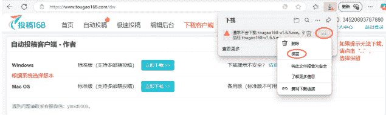

**第二步：运行客户端**

Windows 系统双击打开 `tougao168.exe`，Mac 系统右键打开 `tougao168.app`

软件已提交 360 和 金山毒霸检测，请放心使用！

如果 Windows 系统打开软件后首页统计数量如果显示 0

请更新 Edge 浏览器到最新版：`https://www.microsoft.com/zh-cn/edge/download`

或安装 Edge 浏览器插件：`https://go.microsoft.com/fwlink/p/?LinkId=2124703`

Mac 系统只要正常显示软件图标就可以打开，如果提示不能运行请多试几次右键打开软件

直到提示下图，再到 “隐私安全” 里面允许运行即可，隐私安全设置教程：

第三步：登录后进入自动投稿菜单，配置投稿邮箱

# 投稿168 使用指南

## 前期准备

（这里也为大家申请了一个小福利，通过我的邀请链接注册可以获得投稿168的1000墨宝，可以换取两次投稿机会：https://www.tougao168.com/share/10105130）

投稿邮箱和授权码只需要配置一次，第二次投稿直接创建投稿计划，就可以开始投稿

PS：建议用🐧邮箱，因为大部分编编老师用🐧邮箱收稿，🐧邮箱一天能发80-150封邮件，且不容易被系统当成垃圾邮件。

获取邮箱授权码教程：https://www.tougao168.com/tutorial/3.html

## 第四步：创建投稿计划

点击【创建投稿计划】按钮，按页面内容完善投稿计划信息。

1、首次创建计划，会提示关注🛰️服务号，服务号会推送投稿完成、过稿消息给您。

### 左边区域

2、选择作品文件，完善作品字数、分类、风格、类型

3、智能托管，建议使用AI托管，也可以自己填写邮件信息 或 选择投稿频率和日限

### 右边区域

4、可以通过AI智选、多维智选、收藏分类、导入等方式选择要投稿的平台

AI智选：会根据作品字数、风格、类型匹配收稿编辑，实现有效投稿

多维智选：可以在AI智选的基础上，叠加条件筛选编辑

收藏分类：可以选择自己收藏的编辑 或 平台分类的编辑

导入未投：如果有自己收集的编辑，可以直接导入进行投稿

导入已投：如果🐧小窗 或 自己发邮件投的一些平台，可以导入已投排除重复投稿

删除无回复：可以一键删除多次投稿没有回复的编辑

建议先用“AI智选”匹配平台进行投稿，如果投完3天没有过稿，再考虑用“智选所有”等其它方式补充编辑继续投稿

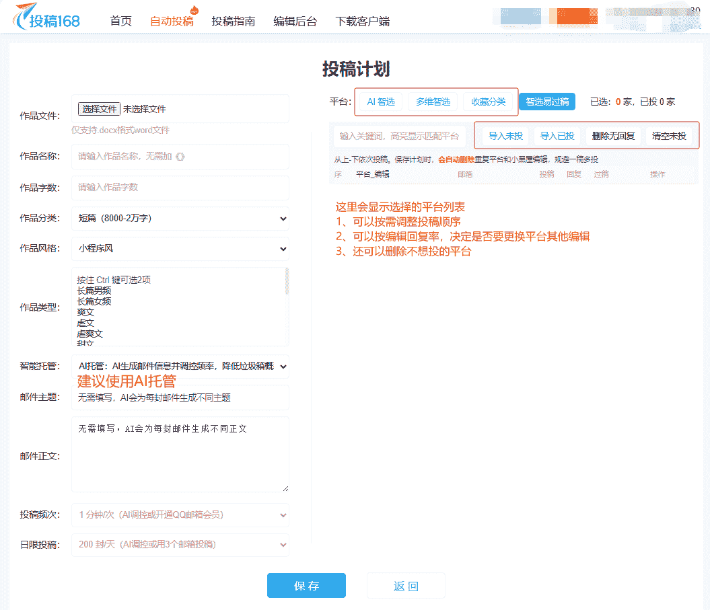

## 第五步：选择投稿邮箱，开始投稿

1、点击投稿计划列表操作列的【开始投稿】，选择投稿邮箱

2、一篇作品最多可以选择3个邮箱进行投稿，建议用1个邮箱投1篇作品，如果有屯作品，可以用不同邮箱同时投稿不同的作品

3、查看投稿效果，新作品投稿前可以点击并进入自己的邮箱 已发送 和 收件箱 查看邮件内容

## 第六步：怎么判断是否正确投稿

### 6.1 观察投稿计划列表的状态列，看是否在投稿中

### 6.2 点击右下角【悬浮图标】查看投稿记录，确认有一条投稿成功的信息，就没有问题了

### 6.3 进入投稿邮箱的 "已发送" 查看邮件记录

更多关于投稿168的使用方法，大家可以看一下他们的官方手册：https://www.tougao168.com/tutorial

---

## 投稿过程中存在的部分问题说明

1、投稿过程中可以隐藏投稿记录，再次点击右下角【状态图标】就可以打开查看

2、投稿过程中可以最小化软件，利用电脑去做别的事情（例如写作），不会影响投稿

3、投稿过程中电脑电源选项，要设置不休眠，可以允许自动息屏，息屏不会影响投稿

4、选择投稿邮箱时，提示邮箱正在使用（实际并没有），关闭软件重新打开软件即可

5、关闭投稿软件时，提示还有作品在投稿中（实际并没有），直接关闭即可，就算有投稿中的作品也会暂停

---

## 自动投稿扣费说明

1、每个投稿计划对应一篇作品，只会收取一次费用

2、投稿可以暂停，暂停后也可以修改投稿计划继续增加收稿平台，不额外收费

3、自己暂停 或 意外暂停，重新打开客户端软件，点击开始投稿就会接着投没有投过的编辑

---

## 投稿细节

小说投稿都是用 word 文档 作为 邮件附件 投递，短篇小说一般都是导语 + 全文一起放 word 文档。

### 短篇小说作品文件排版建议

1、新建 .docx 格式 word 文档，给导语和正文粘贴到文档，Ctrl + A 选中所有内容，调整字体和行距。

字体：宋体，小四

行距：1.5倍

2、如果格式调整无效，说明粘贴的内容原格式有问题，需要清除内容格式，格式无问题则跳过此步。

清除格式：右键新建 txt 文本文档，给作品全文粘贴到 txt 文本，再从 txt 文档里面复制到 word 文档。

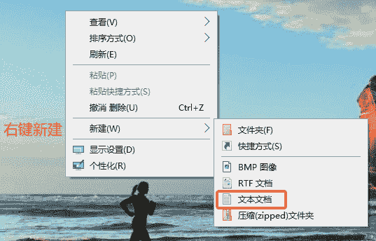

3、作品导语：导语结束后换行，以“……”分隔正文部分。

4、作品正文：内容需要标章节序号，段落之间可以空一行。

对话格式：统一用双引号 “对话” ，如果是知乎作品也没关系，知乎平台上传会自动转换为 「对话」

5、作品文件命名：《作品名称》-笔名-字数。

---

## 海投、群发和一稿多投

之前我们提到“切忌群发和一稿多投”，那么什么是群发和一稿多投呢？

### 群发（不允许）

同一篇文章，使用邮箱群发给不同的编辑，编辑是不会审稿的。

如果是邮件群发投稿，记得一定要选【分别发送】，因为群发编辑如果回复邮件，其它编辑都能看到。

如图所示：

### 一稿多投（不允许）

一个平台有多个收稿编辑，一篇作品投给同一个平台的不同编辑属于一稿多投，这个非常忌讳，一定要规避。

重点在于区分编辑是否属于同一个平台，这点投稿168做了编辑平台归属，使用投稿168是不会一稿多投的。

### 海投

除了以上两个概念，还有一个“海投”：

海投指的是同一篇文章同时给多个平台投稿，大部分稿子都是靠海投售出的。

海投可以增加过稿率，如果同时多家过稿，可以选择价高的。

注意：编辑老师忌讳与收稿要求不符合的作品投稿，盲目海投也会造成不利影响，请一定要选准与作品收稿风格一致的平台。
