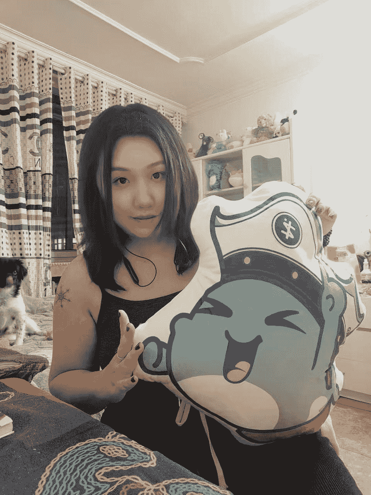
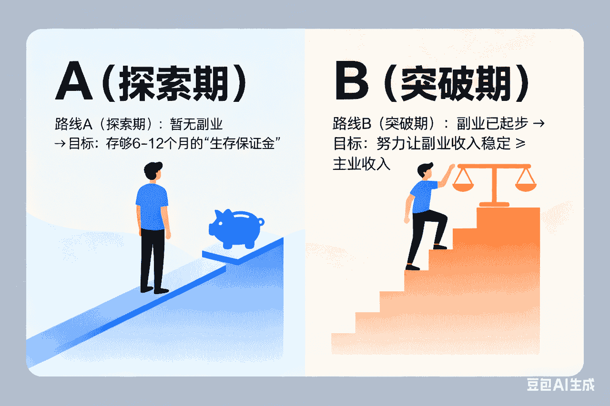
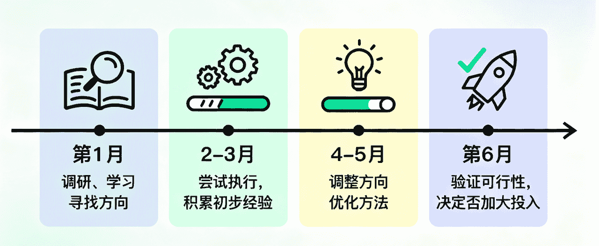
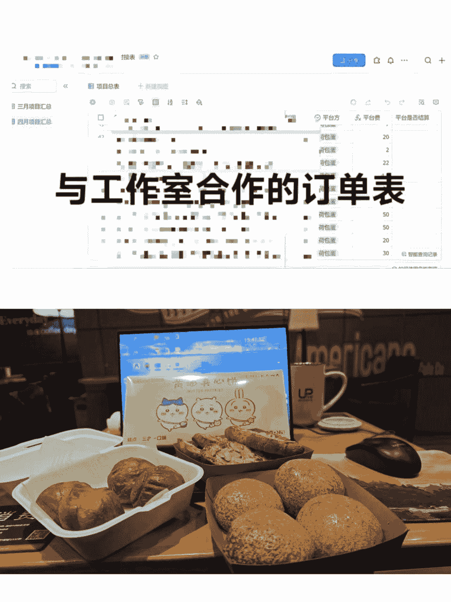
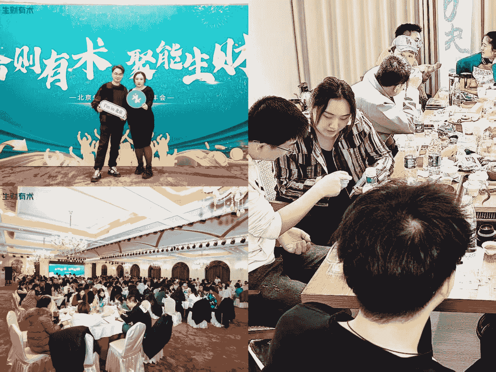
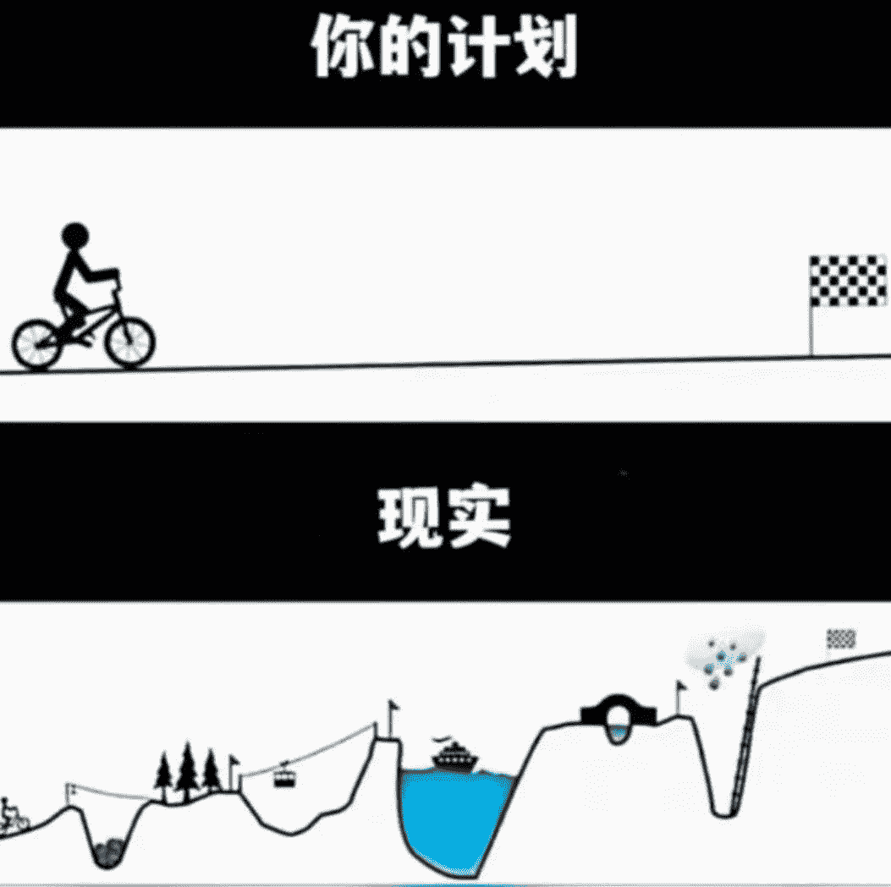
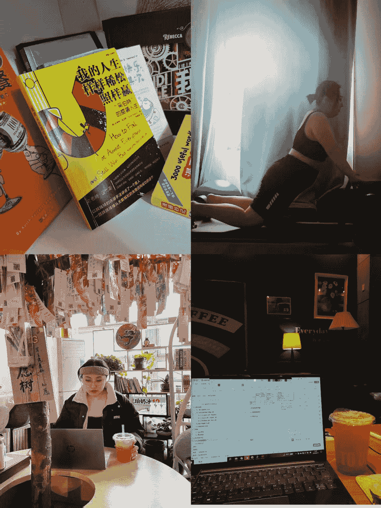
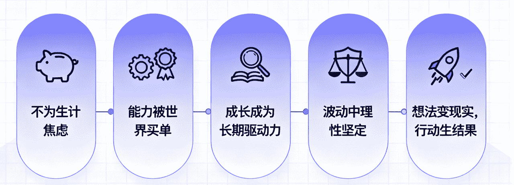

# 满足什么情况，可以开始从上班转型自由职业？

> 来源：[https://xuqiwei1986.feishu.cn/docx/Y7aiddmOmovjqtxSqcgc6f9Wnhe](https://xuqiwei1986.feishu.cn/docx/Y7aiddmOmovjqtxSqcgc6f9Wnhe)

# 前言

圈友们好，我是荷包蛋糕。00后，目前写作第六年，自由职业第三年，正在搭建属于自己的“人生躺赢系统”。

22年刚毕业那会儿，我和大多数人一样，被父母传统思维裹挟，找了个稳定的工作。

早高峰挤地铁，午饭排长队，晚上加班到十点。

群消息不敢静音，生怕错过脑残老板的信息；

工资不多不少三千刚好，离我梦想的旅居生活越来越远了。

也许  你和三年前的我一样经常幻想：要是能做自由职业就好了。

不用看领导脸色，想什么时候起床就什么时候起床， 在咖啡馆里边工作边旅行，多自由啊。

可下一秒又反问自己—— “我真的可以吗？” “我满足什么条件，才有底气开始自由职业？”

23年加入生财之后，我看到了外面的世界，我才知道原来这么多人可以不上班，也能赚到那么多钱！！

于是我干脆利落地告别了“上班牛马”的生活，开始All in 自由职业。

我不再每天早八晚六打卡，不再被老板PUA后还得强颜欢笑，也不用在人山人海的五一假期享受我难得的自由。

我开始真正为自己打工，短短两年过去了，我也完成了自己收入的十倍增长。

少年应有鸿鹄志，当骑骏马踏平川。

**借**此机会，我想写给那些还在上班、却心里隐隐想辞职、想开始自由职业却又不敢迈出第一步的你： 满足什么情况，可以从坐班转型自由职业？

**别光等着别人发“馒头”，也许你，已**经具备了开始烤属于自己的“蛋糕”的条件。

# 01 你要有「基本」的经济缓冲

我知道，第一条就提到钱，很多人会本能地头疼。

心里嘀咕：“我要是有钱，早就自由了，还上什么班？”

但是人在没解决“吃饭”的问题前，是谈不上“理想”的。

自由职业更是如此。

当你没有经济缓冲时，任何风吹草动都会变成压垮信心的稻草，它可以确保你在找到稳定的收入源之前，不会因为“下一顿饭没着落”而恐慌性地接下一个劣质项目，然后几个月后项目失败灰溜溜的爬回公司继续当牛马。

这边给大家两个路径可以根据自己的真实情况来选择：

**（1）****探索期**

**如果你现在还没有清晰的副业路径，现在要做的第一步就是为自己存下**足够的 fuckyou money！！

当你有了fuckyou  money ,你就可以为自由职业开启第一步，先赶紧把烦人的老板炒掉！

也不用太多，足够覆盖你6个月的基本生存开销就好。

六个月，是普通人从“探索”到“验证”的基本周期。

如果时间太短，你会因为焦虑而频繁换方向；太长，又容易陷入拖延和空转。

当你不再被房租、账单、饭钱追着跑，你才能安静地去学习、实践、积累，在不断地探索中，找到那个真正属于你的方向。

**（2）****突破期**

**如果你目前已经在做副业，并且已经实现了0-1的****突破，也可以根据副业收入来判断何时转型。

当你**的副业收入稳定且与主业持平，那么恭喜你——你的基本经济缓冲，已经被“现金流”替代。

你可以开始认真考虑，是不是可以往自由职业迈出第一步了？

18年的时候，我还在上大学，也一样迷茫。

没有明确方向，就干各种能赚钱的活，捡快递、卖包子、电话销售、APP拉新……

但是经过这几年的积累 现金流逐渐充盈。

19年开始，我决定深耕写作。到23年在家待业的半年时间靠副业我成功攒下了人生的第一笔十万元。

正是有了这份托底，我方可心无旁骛地追逐自己想要的生活方式，开始All in自由职业。

# 02 你要有「可被市场验证」的技能

很多人的价值，其实是依附于公司的，离开公司，就像鱼离了水。

离开后他们才发现自己并没有核心技能来支撑自己的自由职业，最后只能无奈放弃。

我们要用真实与独特性去逃离同质化的竞争。

**一**些日常中你没有发觉的小事情都可能成为你的独特性优势，将它打磨形成自己的核心技能，并放到真实市场中去验证，它就会成为你最有竞争力的底牌。

比如从小我就喜欢写作，写作成了我表达想法和情感的方式。

最初，它只是我的兴趣爱好，偶尔写点日记和短文，但逐渐发现它是我的核心技能，能清晰有力地表达自己的观点。

记得第一次把文章交给客户的时候，我心里满是忐忑，但是没想到反馈非常好，我第一次感受到，写作不仅仅是个人的兴趣，它有了市场的认可和价值。

从那时起，我更加坚定了依靠写作走自由职业这条路的决心。每当收到客户反馈或读者评论，我都感到写作是我最强大的武器，是我在自由职业中立足的基础。

随着时间的推移，写作不断得到市场的验证，我对自己的信心也愈加坚定。

分享一个小案例：

我认识的一位圈友，之前是做客服的。

每天接待客户、处理问题、回复模板，后来她发现，自己其实最擅长的是“沟通”

她能在最短时间内理解客户需求，并找到安抚的语言

于是她开始学习用户运营、社群管理，把沟通力变成服务力

如今成了一名社群操盘手，月入五位数。

**这样的例子在生财还有很多！！**

有人从短视频文案起步，能在三天内写出一条爆款抖音脚本；

有人靠技术转型，能搭建高需求的 n8n 自动化工作流；

有人做内容 IP，能拆解热门话题，快速打造小红书爆款，

有人专注效率工具，帮企业优化 Notion / 飞书系统，一单就能赚上千。

**当**你能够在不同场景下持续产出稳定结果，且有人愿意为你付费。

你就不再需要依附于公司，可以开始摆脱牛马身份了！

# 03 你要有「持续」的探索求知欲

说一个让人遗憾的真相：很多人到了二三十岁，甚至三四十岁，每天都在重复同样的日子。

我当牛马的时候经常发呆，在想我们到底是过了三万天，还是把同一天，重复了三万遍？

生活的重复性，会悄悄加速生命的流速。

小时候我们觉得时间很慢，是因为每一天都在探索，对世界充满好奇。

第一次骑车、第一次远足、第一次失败、第一次成功...那时的每个瞬间，都让生命往前延伸。

而长大以后，我们被社会的规训包裹，渐渐失去了对未知的渴望，开始追求安稳，我们被困在舒适圈里，只会错过无数原本可以抓住的机会。

**勇**敢的人先享受世界！唯有持续探索，你才能比别人更早嗅到下一个赚钱的风向。

不要在当一个NPC了！！你也可以成为一个主角！！

**想**要慢慢逃离 NPC循环，我们需要加强探索求知欲。

比如：

每天看看生财更新的精华帖，去看看不同的人是怎么拆解项目的、怎么变现的。

你会发现，哪怕是同一个方向，不同人做出来的思路和打法都不一样。

光是阅读、分析这些内容，就能帮你打开思路，让你知道“哦，原来还可以这样做”。

一定要多去参加生财的线下聚会！！哪怕只是去认识一两个新朋友、随便聊聊。

自由职业最大的优势就是信息的流动，而人脉，恰恰是最快的信息通道。

每天可以刻意去做一件自己“没做过”的小事。

把每天微小的改变写下来！用记录来强化探索，慢慢加强你对新鲜事物的好奇心。

# 04 你要有「稳定」的内核心力

纵观任何一家龙头企业，无论是谷歌还是华为，它们的营收曲线都不可能持续高歌猛进。

**对**于自由职业来说也一样，不确定性是常态。

**你的收入是不确定的，**我刚自由职业的时候写作项目有淡旺季，上半年忙到连轴转，下半年订单锐减。上个月还赚了十万元，下个月立马掉到了一千，收入一波波的起伏，让我焦虑得睡不着觉。

**你的时间是不确定的。**以前上班的时候，虽然朝九晚六，但是好歹有双休、有节假日，生活节奏非常规律。到了周五晚上关掉电脑，立马美美的过周末。

但现在all in自由职业后，工作和生活彻底交织在一起，每天都在为自己工作。

好不容易到了周末，朋友休假了，叫我出去放松一下喝个下午茶。

我每十分钟就得看一眼手机，怕错过任何一个客户消息，就连凌晨回客户消息都成了我的日常。

最忙的时候，我几乎三天没睡过一个完整的觉，一看到手机弹出新的提示音，就生理性恶心想吐。

那段时间真的太痛苦了，我几乎每天都在崩溃的边缘徘徊，有过无数次放弃的念头。

但是看了生财里那么多优秀圈友的故事，无一例外，他们稳定的内核心力也不是与生俱来，而是后天的刻意练习。

自由职业这条路上，理想和现实之间，仍有翻天覆地的巨大差距。

如果没有及时建立稳定的内核心力，我们很难撑过自由职业的低谷期。

我们要学会用长期主义的思维去看待自由职业过程中的波动。

在情绪最低的时候，不要硬逼自己继续输出，先停下来复盘，看看问题出在哪，流程能不能优化。

现在我也会把项目分层：长期项目稳住现金流，短期项目留出灵活和试错空间。

淡季不焦虑，反而用来充电、打磨技能；旺季就抓紧节奏，多接单、多赚钱。

同时用加科学的平衡自由职业者的时间管理，现在吃饭的时候我就会安心吃饭，把一些工作外包给助理，让自己有更好休息，可以用更佳的状态去面对接下来的挑战！

#  05 你要有「立即落地」的执行力

纸上谈兵终觉浅，唯有下场亲自干。

关于执行力，毋庸多言。光有想法，没有行动，一切都只是空谈。

**很**多人天天喊着口号，却连最小的一步都迈不出去。

其实我以前也是个拖延症晚期患者，执行力欠缺让我吃了很多苦头。

每个月都有那么几天啥也不想干，就想躺着，打游戏，最后稿子越堆越多，自己被整的焦头烂额。

有次一个重要客户的稿子，我拖了三天没写，第四天对方直接要求换人了。

明明知道再不执行时间就来不及了，却一拖再拖，给自己找了无数个理由。

“现在状态不好，等灵感来了再开始。”“打完这把游戏一定开始，下次一定”

结果deadline一步步逼近，已经没有时间了。

这就是我因为缺乏执行力，而吃的大亏！现在想起来我还是非常后悔！

我们不能三天打鱼两天晒网，因为自由度高的同时也要求更高的自律和执行力。

自由虽然让人可以自主选择、安排时间与行动，但没有外部约束时，更容易懒散或偏离目标。

没有外部约束时，我们更需要内在的秩序，用清醒与行动去对抗惰性与散漫。

现在我会逼着自己，坚持运动，坚持阅读，坚持写作。

用立即落地的执行力来贯彻自己的生活日常，想看书立马就去看绝不拖延一秒，就算有时候没有灵感也要打开电脑先把把思路写下来。

让它们成为我生活中必须做到一部分，慢慢养成习惯，搭建属于自己的执行系统。

日积月累的坚持，终将胜过三分热度的假装努力。

所以我们现在必须！立刻！马上！开始快速执行起来！

学习知识，就主动参加mini航海，深海圈  加深自己对项目的理解。

写文章，就立刻写第一段，为自己的第一篇精华帖冲刺；

想做账号，就赶快和生财之中取得结果的大佬们请教，参加航海开始实操；

想接项目，就先主动打破自己的卡点，尝试联系第一个客户。

当行动变成习惯，执行力融入生活，接下来自由职业生涯也会越来越有掌控感。

By the way，也不要盲目执行，自由职业是认知与行动的双循环系统。

认知提供方向，行动产出反馈，两者不断迭代，你的能力、收入、心态才会形成真正的增长。

# 写在最后

经过我们前文的梳理，也许你已经迫不及待的想判断自己是否转型自由职业了，最后，我再总结一下你需要具备的底层支撑：

要有【基本的经济缓冲】让自己不为生计焦虑；

要有【可被市场验证的技能】让能力能被世界买单；

要有【持续的探索求知欲】让成长成为长期驱动力；

要有【稳定的内核心力】在波动中依然理性坚定；

要有【立即落地的执行力】让想法变成现实、让行动生出结果。

也许此刻的你，还没有完全准备好，也没关系，继续攒钱，继续尝试，继续探索。

在生财多去学习、交流、碰撞，每个人都有属于自己的节奏。

当你真心投入、持续行动，你会发现：

**你早已不再守着别人发的的“馒头”，而是在**用自己的双手，烤出属于你的那份“蛋糕”。

希望你终将可以可以和我一样，自由的赚钱，自由的旅行，自由的享受生活。

我是荷包蛋，一个自由职业三年的00后，我们可以一起努力  想了解我更多， 可以关注我往期精华帖

> 25年

> 精华 ：【Ai写作】 我用ai写爽文小说 赚到第一笔小说稿费的故事 https://t.zsxq.com/vE1Vy

>

> 24年

> 精华：【AI写作】针对新手的私域谈单话术技巧与案例分享https://t.zsxq.com/2rCmR、

> 精华：【Claude绘制SVG图形】新手入门实操教程与结果展示https://t.zsxq.com/zODJI

> 精华：【AI私域写作变现百问百答】常见问题整理https://t.zsxq.com/1lGDJ

> 普通：【AI写作】适合新手宝宝们入局的写作提示词指令实操演示https://t.zsxq.com/hPz3V

希望对大家有所帮助     ！！