# 发第一篇精华帖后的40天里，我发生了巨大改变

> 来源：[https://xuqiwei1986.feishu.cn/docx/OAHtd6KPWoacPhxDkPOcnPBknAg](https://xuqiwei1986.feishu.cn/docx/OAHtd6KPWoacPhxDkPOcnPBknAg)

大家好，我是阿懂  ENFP 实战派

赚钱传术师&📕虚拟资料知识库航海教练

专注📕高客单引流及变现

2025年装修家装赛道半年成交150单变现百万

而我加入赚钱才一年

前几个月才发的第一篇分享····

有一些在赚钱学习的方法

以及发精华帖后40天里的收获

可以分享给大家

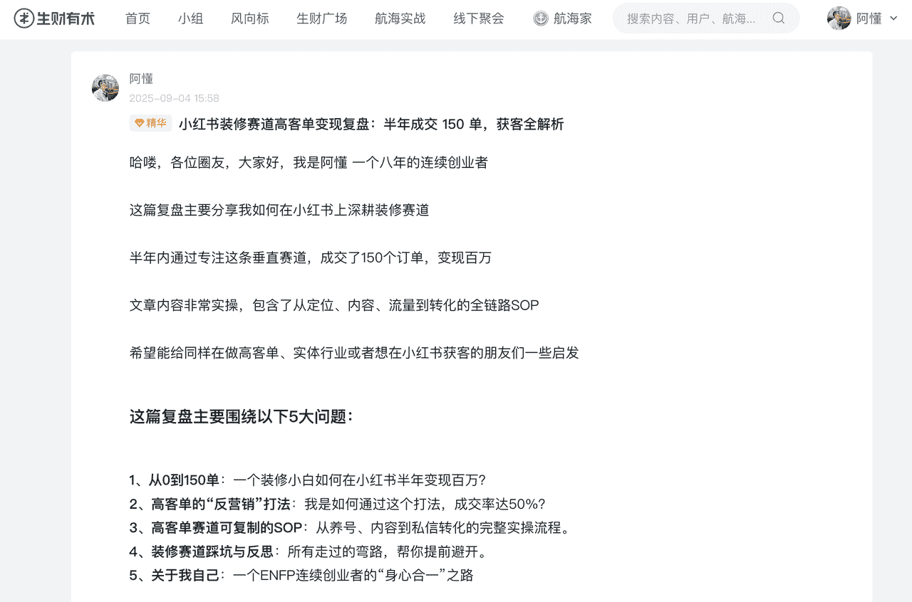

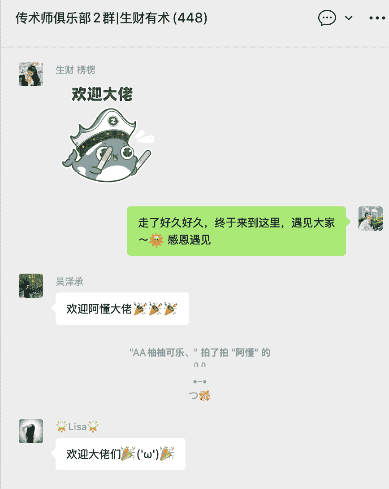

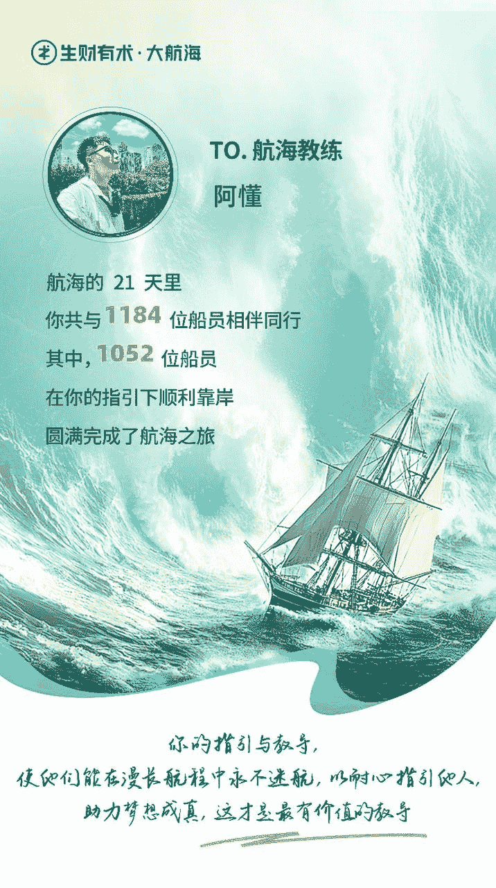

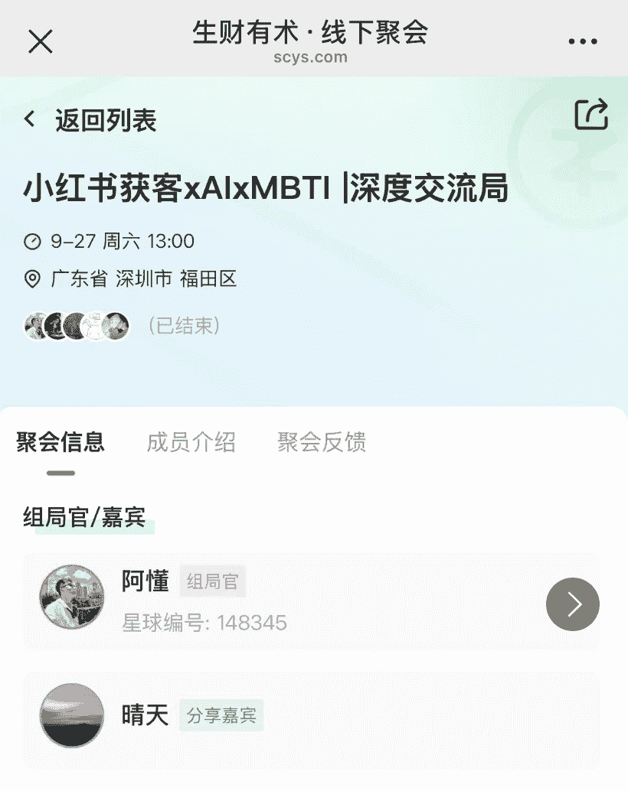

刚加入赚钱，面对海量的信息感到眼花缭乱、无从下手；潜水很久，收藏了无数精华帖，却依然找不到属于自己的那条路。但终于在40天前发了自己的一篇项目复盘贴，很多圈友通过精华帖认识了我，

发帖子后，在那之后的这些天里，体验了一段奇妙旅程，发生了太多的改变。

我想说的是，即使这篇项目复盘贴或者我的项目本身不是最优秀的，但对我的实践的一次自我复盘和检验，是我迈进下一阶段最大的底气。

我更想说的是，在此之前，我和你一样，也曾在赚钱的大量信息里感到过迷茫和焦虑。

## 一、第一篇帖子发出后经历了什么？

### 1、收获反馈

帖子发出后，意想不到的事情发生了。

收获了大量的善意和认可，这对我来说是久违的正反馈。有圈友说我的思考“很深入，超赞”，有人说“创业路漫漫，真诚永远是必杀技”，还有像鱼丸、Lucia、石榴爸爸、珍妮、谢无敌、阿军这些我非常尊重的朋友，也给了我莫大的鼓励。

每一条“加油”、“牛批”、“必成的阿懂”的鼓励，都像一股暖流。这不仅仅是几句赞美，这是在我选择“做自己”之后，世界给我的第一声响亮的回应。我意识到，当我不再伪装，掏出真心时，收获的不是嘲笑，而是共鸣。

这第一波最珍贵的正反馈，给了我巨大的勇气，让我敢于去迎接后续一系列更深刻的改变。

认识了很多优秀同频的圈友

更重要的是遇到了互补的合作伙伴

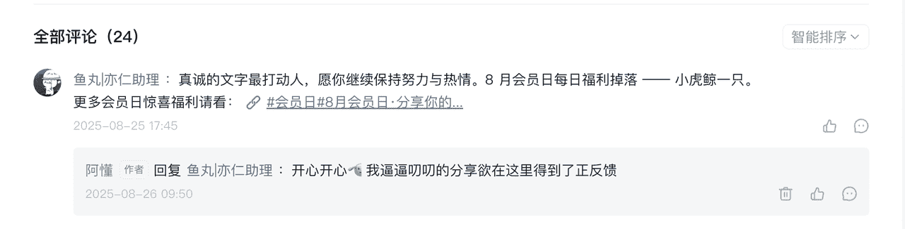

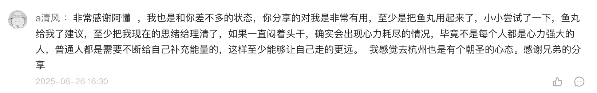

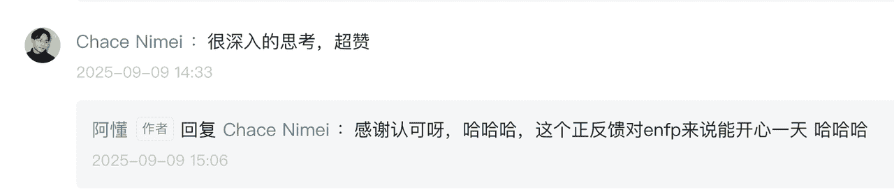

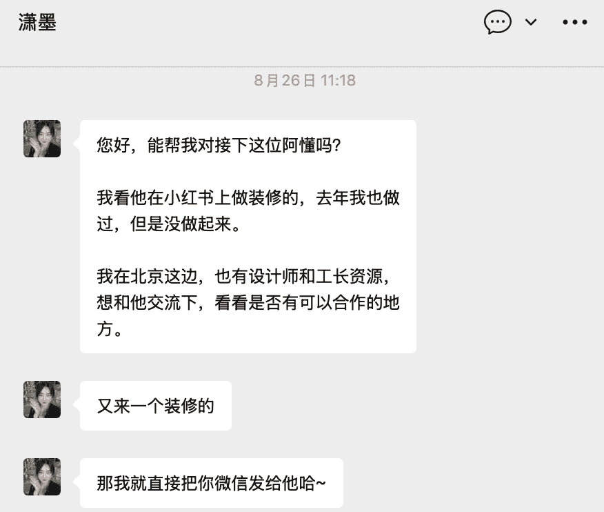

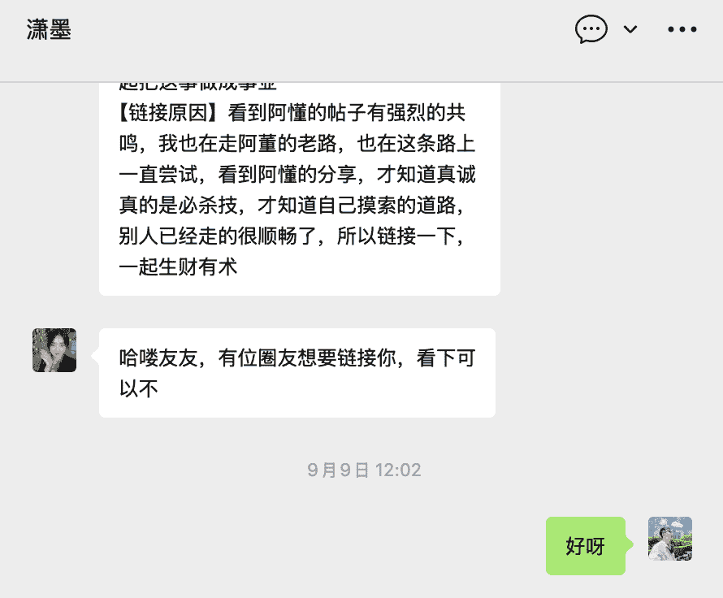

### 2、收获场域

为什么我敢发那篇帖子？因为赚钱给了我一个足够安全的场域去“暴露自己”。

20岁多岁时，曾“少年得志”，靠着时代红利赚了些钱，然后不可避免地“飘”了。我买了宝马，穿上西装，梳起油头，极力模仿“霸道总裁”（ENTJ）的模样。结果是彻底的“脱离群众基础”，生意失败，摔得极惨。我一个“谋士”，非要跑到战场上当“将军”，结局早已注定。

那段经历让我明白：

扮演别人，是对自己天赋最大的浪费。

带着这段“不堪”的过往，我很长一段时间不敢在朋友圈展示真实的自己。而赚钱这个付费社群，天然过滤了噪音，形成了一个高信任度的“安全区”。在这里，没人认识我的过去，或者在意我的过去，我可以毫无负担地分享我的思考，甚至是我的失败。

于是，我进行了一场“暴露疗法”。我把那段最失败的经历和我的软弱与无助写进帖子里，结果发现，大家非但没有嘲笑，反而因为我的坦诚产生了共鸣。我大大方方地承认我的“缺点”：三分钟热度、执行力看心情，看待问题总是从感性角度出发。而这些，恰恰成了别人眼中合作的“机会点”，尤其是ENTJ、INTJ等。

**赚钱这个场域**

让我有勇气把最真诚的自己展现出来

开始吸引那些能与我长板互补的圈友

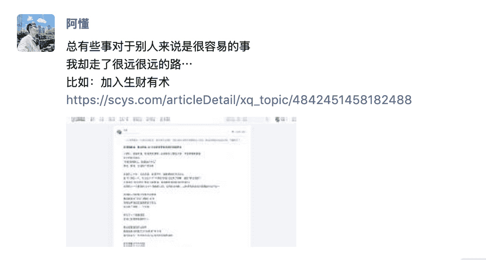

### 3、链接同频的圈友

记**得刚加入赚钱，我参加过一次讲AI的局，来的全是产品经理。我习惯性**地想用过去那套“人情世故”的方法融入，结果发现完全无效。那次经历让我意识到，在高认知密度的人群中，真诚和价值才是最重要的，想到第一次参加这个Ai局，假装城府很深掩饰自己啥也听不懂，哈哈哈哈哈，旁边坐的是@长庚......

在年初，我在一开始最先成为赚钱学习委员的，在群里口嗨的是我，一直不敢组局的也是我，我爱说话，组织过很多线下交友局，就是那些聊成长的，我怕在赚钱关于专业的知识输出不够；

不过在发第一篇项目复盘贴后，我开始有信心尝试组局，刚好晴天和我一起，我就更放心了，作为enfp的我可以让大家有获得感，但作为intj的晴天能让大家获得，我们一拍即合。主题是“📕获客xAIxMBTI深度交流”。

我的目的不是功利地“链接人脉”，或者推广自己某些项目或产品，而是无心地分享。

结果，那次活动的反响超出了我所有的预期。

圈友评价说：“这是我参加的目前最好的一次线下活动，阿懂官真诚的分享干货……” 还有圈友说：“谢谢阿懂和晴天，组合从术和道层面都给予我极强的前瞻性和实操性，活动最后意犹未尽恋恋不舍。”

这些反馈让我受宠若惊，也让我第一次真切地感受到，原来当我把真实的自己和盘托出时，能够创造出如此高的价值。

我发现我其实经验储备够够的了

勇敢输出和实践就行

此后在赚钱，我链接到的不再是🛰️列表里冰冷的头像，而是找到了一个个可以深夜长谈、可以并肩作战的“真人”。和大家交换的不再是名片，而是真实的困境、坦诚的弱点和不设防的信任。

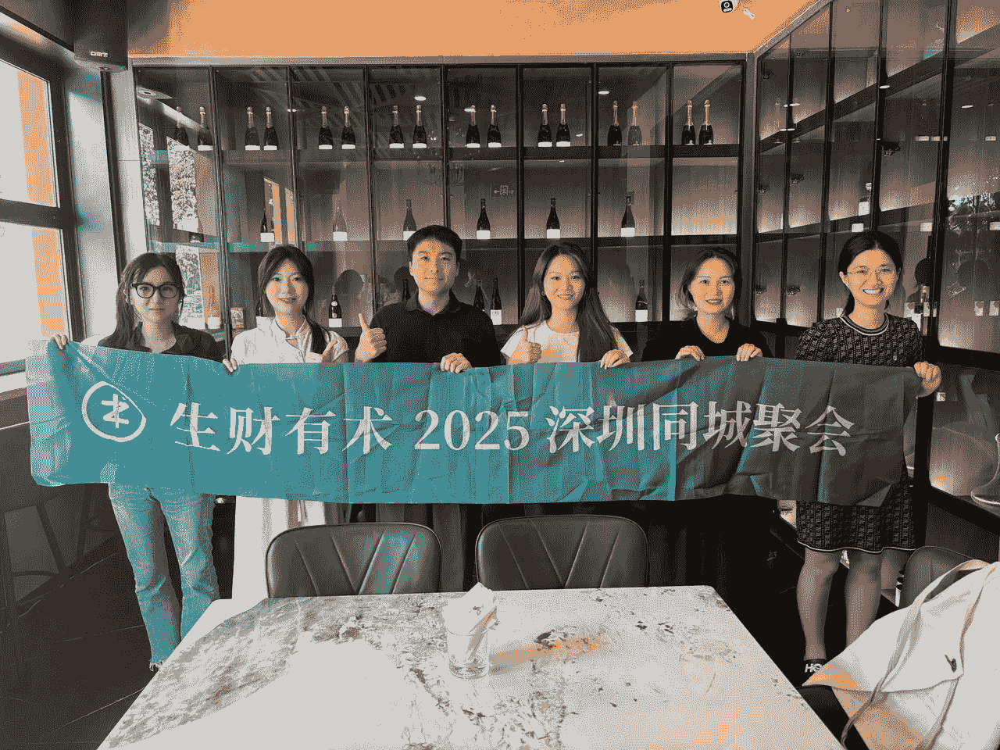

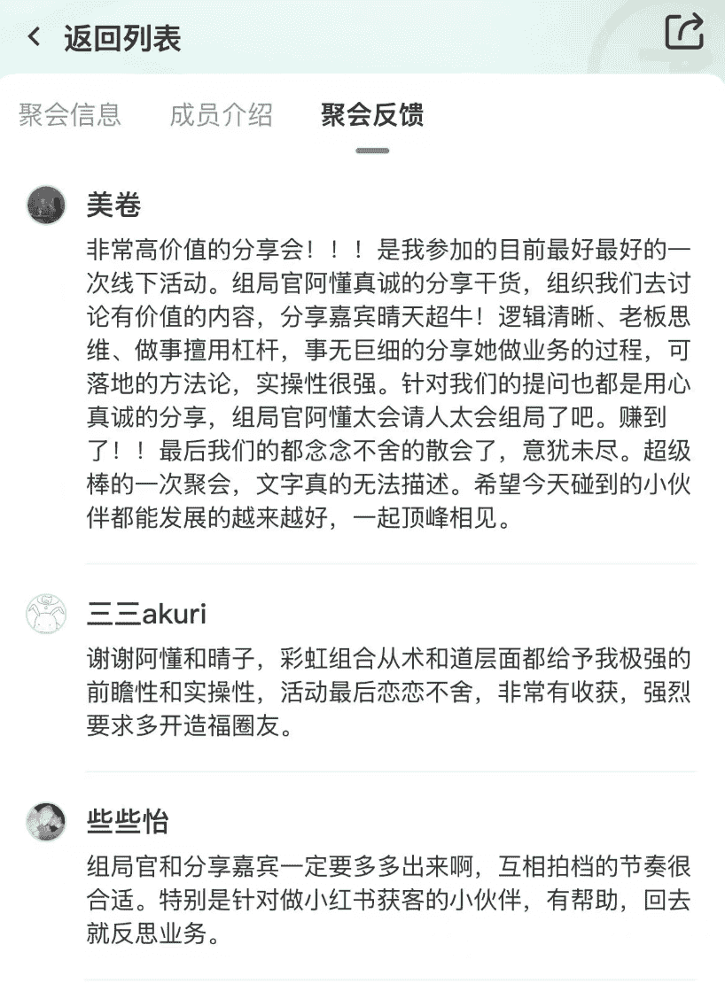

### 4、成为了航海教练

与此同时，刚好遇到9月航海，成为了“📕虚拟资料-知识库”航海的教练。这个角色的转变，让我从一个知识的“吸收者”，变成了一个价值的“给予者”，第一次当教练，也许不是最好的教练。但让我对龙哥盟社群的理解，迈入了更深的层次。

在担任教练的21天里，回答上千个船员的问题。发现当教练的这些天，也倒逼我把我从0到1的经验，那些散落的“显性知识”，和隐藏在我脑海里的“默会知识”，全部系统化地通过交流梳理出来，毫无保留地分享给船员们。当我看到他们因为我的一句话而豁然开朗，当我鼓励他们“你一定能成！冲！”的时候，我感受到了比自己出单更强烈的正反馈。

从一篇精华帖作者到航海教练

让我明白了“极致的利他，才是最终的利己”

无论是写的第一篇精华复盘帖

还是后来当教练、组织线下分享

我都在不自觉地做一件事：

**通过输出来检验自己的输入**

写复盘帖子，是检验我项目实践的阶段性成果

当教练和分享，是检验我知识储备的深度和体系

而结果证明了一切：**越分享，越幸运。**

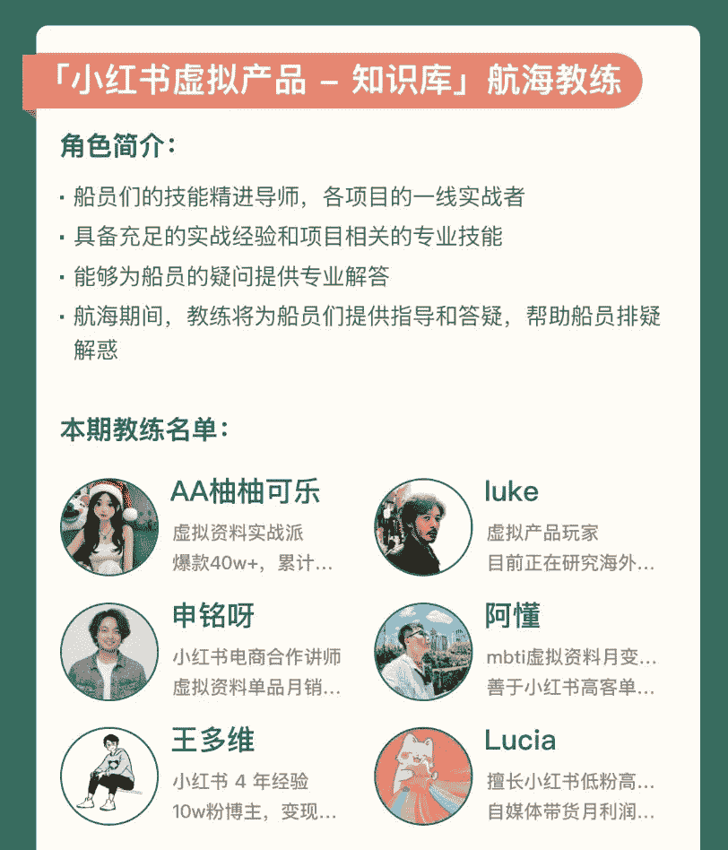

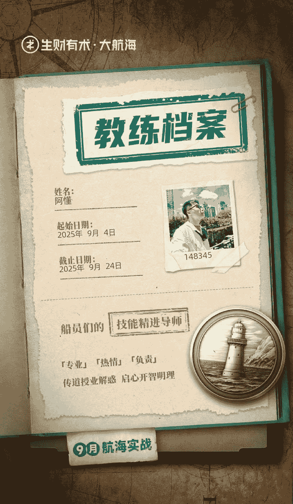

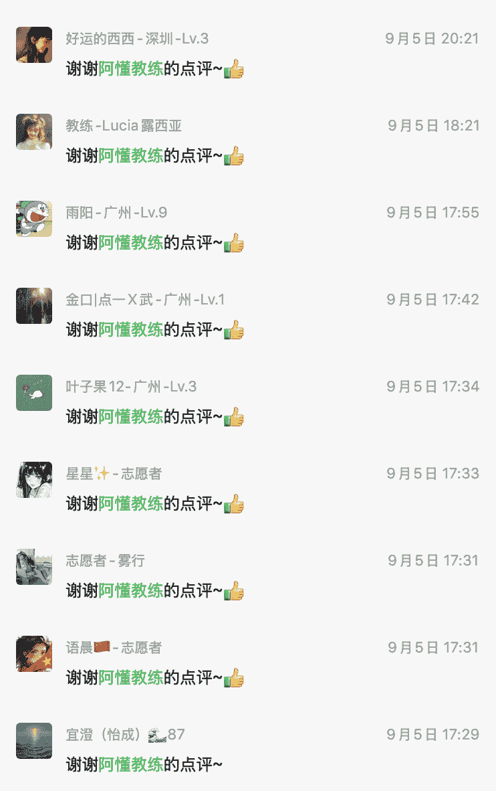

## 二、我做对了什么？

在分享我的具体方法之前，我先插入一个关键的心态转变。因为我刚加入赚钱时发现我的常态是

像仓鼠一样，不停地收藏精华帖，成为了一个焦虑的‘信息消费者’。

我们的收藏夹越来越满，但因为缺少行动，那些知识从未真正变成自己的能力。

对我而言，写那篇复盘帖的本质

是一次身份的转变

从一个“旁观者”和“索取者”

变成了一个“参与者”和“共建者”

**意识到了不需要成为大佬才能分享**

**而是通过分享**

**才会在某个细分领域成为大佬**

发现分享，不一定是要拿出惊天动地的千万级项目复盘。它可以是对一个工具的深度使用心得，一次小实验的完整记录，或者像我一样对自己跑通的0-1流程毫无保留的拆解，0-1相对1-2-3来说也是不完美的，也会存在很多问题

但完成比完美重要，真诚比全面重要。

当开始输出，就开启了一个检验自己、接收反馈、获得链接的全新循环。这个心态的转变，是所有后续故事发生的基础。

## 三、在赚钱学习的一些方法？

### 1、如何系统化学习

意识到，赚钱圈里的精华帖大多是高手们“点状”的实战经验，非常宝贵，但直接吸收容易消化不良。我的方法是：

**先建立自己赛道的系统的知识框架**

再用圈里的精华帖去填充我的知识体系

**找框架**

想好自己想要垂直的领域，通过调研、找对标，最后让Ai梳理一个自己将要学习知识页面树。

**建仓库**

把这个页面树框架当成一个空的“知识库”骨架。

**填血肉**

我回到赚钱，带着问题、有目的地去搜索帖子，把圈友们用真金白银验证过的实战经验、避坑指南，也就是最宝贵的“默会知识”，包括自己的实践经验深度阅读理解后转化成笔记填充到我知识库的相应位置。

这样一来，我就有了一个既有系统理论、又有实战细节的个人知识体系。其他与我无关的信息或者重复的信息，我一概不看，极大提升了学习效率。

ENFP执行力那么差，怎么做到？

我是典型的ENFP，想法多、灵感迸发，但**持续的执行力是我的短板。我的**解决方案是：能用AI干的，绝不自己动手。 我把AI武装到了牙齿。

### 2、如何用Ai高效输入输出

#### 用AI做调研

把对标账号的所有爆款笔记、评论区的用户痛点，甚至一整本专业书籍，全部喂给AI，让它帮我总结、分析、提炼。横向纵向反复分析、反复提问，发挥我所有的好奇心。

#### 用AI写初稿

现在写内容，如果让我自己一个字一个字敲，可能一个月也憋不出来。我的方法是：先简单告诉AI我要写什么，然后让它“对我提出200个问题”。我用语音回答这些问题，把录音转成文字，再把几万字的口水话丢给AI，让它帮我整理成文。AI补足了我执行力的短板，让我能把所有精力聚焦在思考、洞察和与人链接上，同时发挥了ENFP思考过多，一说话说个不停的特点。

### 3、如何补充心力

作为ENFP

我知道我极度需要外部的正向反馈来补充能量。

#### 寻找“能量源”

我会有意识地链接圈里能持续给我正反馈的朋友，比如鱼丸。每次有了新想法或小成果，我都会告诉他，他的鼓励是我坚持下去的重要动力，也是我的心力杠杆。

#### 树立“假想敌”

我发现了一个特别有效的学习方法。我找到圈内一位喜欢的大佬，直接“宣战”，告诉她“我要加入你的核心团队”或者“我要做一个跟你一模一样的项目”。我把她当成我的“假想敌”，每个月都去对标她的进展，想一切办法与她交流学习，这种方式给了我极强的追赶动力和学习目标。注意不是恶狠狠真的把别人当敌人，该尊重还是要尊重。

### 3、如何做减法

最近很多新认识的圈友问我，赚钱很多线下活动为什么不去参加？搁在以前，我一定会背着小书包去仔细研究，链接各种大佬。但我没有去。

这背后是我学习方式的又一次进化：从“乱链接”到“有意识链接、精准链接”。

以前的我，生怕错过任何信息，到处参加活动，链接大佬，一定程度上来说这是一种“加法”，和假装很努力一样，效率很低，反而加重了焦虑。不仅ENFP,凡是是E人最喜欢认识新朋友了，可物极必反呀～

但学会了做“减法”。我所有学习和链接，都围绕我的主线任务

**从实际工作中去反推，看哪个环节需要什么，再去研究，再去**链接。主要是人的精力有限，只能合理规划。

不再追着热点跑，而是让我的项目需求，来指引我学习的方向。这种转变，让我从信息焦虑中彻底解放出来，学习变得极其高效和精准。

也许这就是走在高阶ENFP的路上了吧～

哈哈哈哈哈哈哈哈哈哈，开心

### ❤️写在最后

回望加入赚钱这一年，从一个流量盲区里的小白，到分享经验的航海教练，我最大的收获是终于在赚钱找到了与世界相处的舒适姿态。

在这里，我学到了系统的知识，找到了安全的场域，遇见了真实可爱的同路人。我不再强求自己补短板，不再害怕暴露缺点，不再追求成为别人。

**勇敢地分享。越分享，越幸运。**

而这段旅程，才刚刚开始。我们路上见

国庆中秋快乐～

🍭 [阿懂的摄影和朗读小空间](https://dq6cur0sqsb.feishu.cn/wiki/XM24wU35YiPAneks6qhcq1PYnoh)

❤️往期文章

2025 年 8 月：[很多人只把鱼丸当客服，而她是我在赚钱里最大的贵人](https://dq6cur0sqsb.feishu.cn/wiki/NwUIwIcXXiRcx6kTGK7cdZTYn9b)

2025 年 9 月：[📕装修赛道高客单变现复盘：半年成交 150 单，获客全解析](https://dq6cur0sqsb.feishu.cn/wiki/LfwBwjjIoiB7dBkoOiccbOfQnxe?from=from_copylink)

2025年9月：[总强调真诚：我如何在 30 岁找到高客单变现的天赋赛道](https://dq6cur0sqsb.feishu.cn/wiki/IipjwrclJi19kbkYl99cHfF0nnh)

🏷️下期分享

10月

《获客操盘手如何找到确定性》

《家装老板如何在线上“真实”地做成一门生意》

一个屁话特别多说话也会有逻辑的

ENFP

2025 年 秋天🍂  龙哥盟 🌞