# n8n+sora2.0 自动批量复刻YouTube视频

> 来源：[https://xuqiwei1986.feishu.cn/docx/MLkQdU6MsoDtu0xhumJcIkQ9nxh](https://xuqiwei1986.feishu.cn/docx/MLkQdU6MsoDtu0xhumJcIkQ9nxh)

大家好，我是小宋，00后程序员，6月份加入赚钱，加入赚钱已经有三个月。本期 n8n 教练，这是最新 n8n+sora2.0 批量复刻 YouTube 视频，分享给大家。

欢迎大家来链接我，我需要和懂需求的，懂流量操盘手的聊聊。

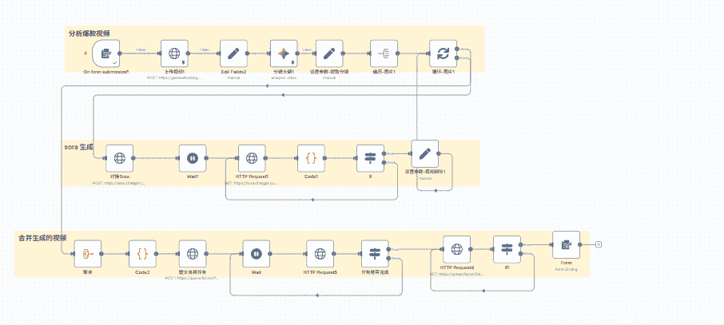


[SSYouTube.online_The mother kept talking on the call and the child passed away  #shorts_720p.mp4](https://internal-api-drive-stream.feishu.cn/space/api/box/stream/download/all/H6KNbZGFGojhtpxwaqycBxAtn4s)


[20251003_2048_01k6my8tz1ejabwntsxkretta7 (1).mp4](https://internal-api-drive-stream.feishu.cn/space/api/box/stream/download/all/Q5HvbPYWsojwejxKRszcqC4Nn6f)

山海经：


[20251002_2208_01k6jks376ebpajjk2fyc7sh6m.mp4](https://internal-api-drive-stream.feishu.cn/space/api/box/stream/download/all/DOqUbANU0og0dMxVisrc3jIgnxg)

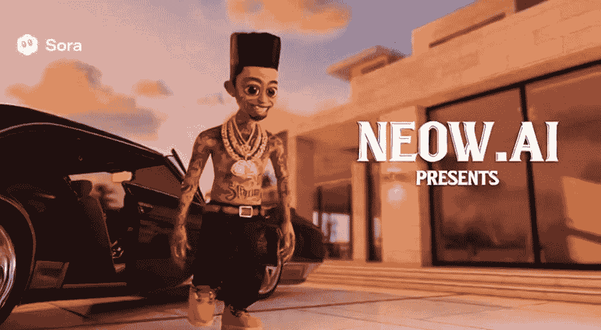

[20251002_2208_01k6jks74cfwmby57t77qrfn8k.mp4](https://internal-api-drive-stream.feishu.cn/space/api/box/stream/download/all/Q2xeb7W6KoBlywxOU04c2nN2nHd)

## 一. 用 n8n 把 Youtube「爆款视频复刻」做成一条龙：表单上传 → 分镜自动拆 → Sora 生成 → 批量合并一键出片


[n8n+sora (1).json](https://internal-api-drive-stream.feishu.cn/space/api/box/stream/download/all/Fah8bykqxoEXopxpZVccB8bjn4d)

### 1.0 整合 sora2.0 + 剪辑 接口（圈友需要）

1. 打开中转站：`https://xiaosong.chat/login` 充值

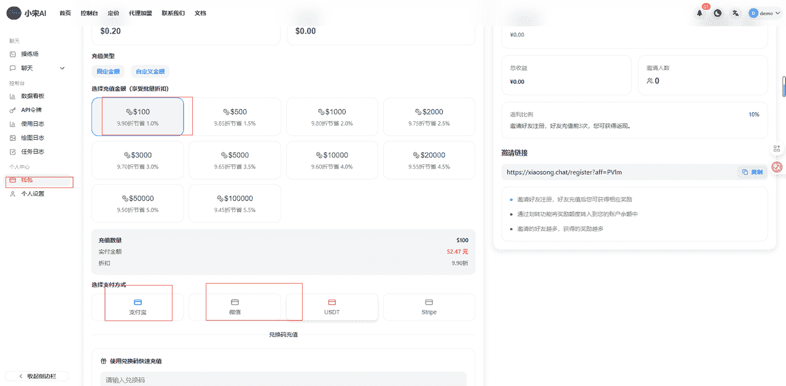

2. 按照下图步骤获得 API，创建新的令牌时名称自定义，"分组优先级”下拉菜单选择 "限时特价”，其它保持默认即可，最后点击最下方的 "提交”

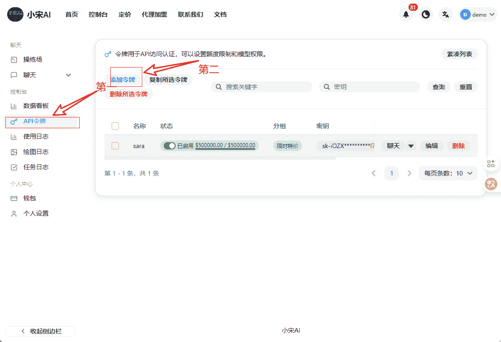

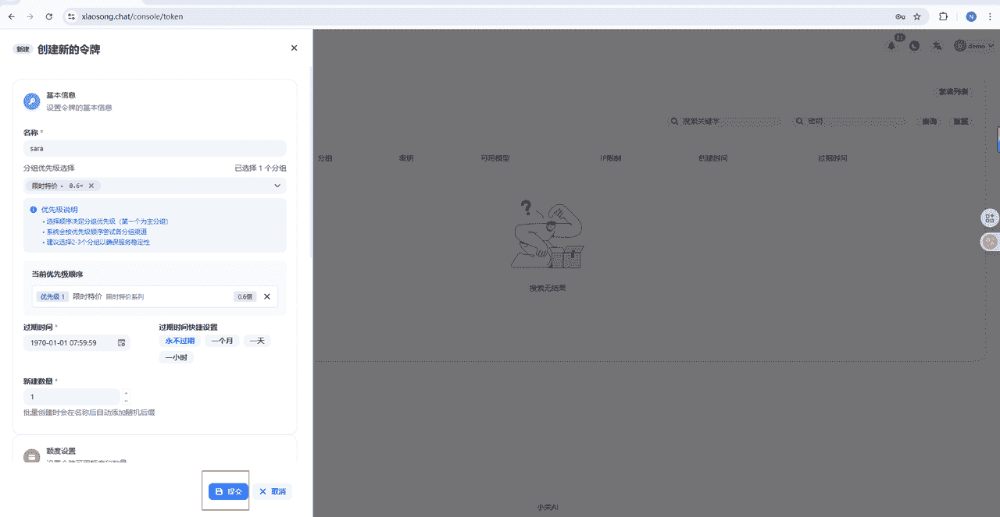

3. 复制密钥

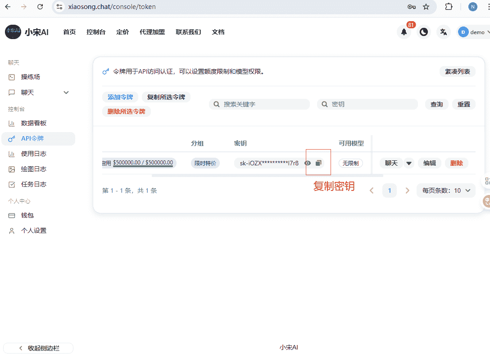

4. 复制节点


[My workflow 49.json](https://internal-api-drive-stream.feishu.cn/space/api/box/stream/download/all/KNifbknN5oXBP6xglTDcUefJnPf)

> 我做的功能主要是“把爆款视频复刻成可量产模板”的 n8n 工作流：填表上传视频 → Gemini 拆分镜 → 按分镜自动生成 Sora 视频 → FAL 合并输出。全程无脑点，最后自动给你一个下载链接

---

### 1.1 为什么要做这条工作流？

+ `批量复刻`：同一套结构化“分镜 → 提示词”模板，持续喂入热门题材，稳定产出爆款。

+ `流程可控`：把“人肉拆分镜 + 手动丢 API”的散装流程，统一收口到 n8n；每一步都可 `Pin` & 复用。

+ `效率最大化`：上传一个参考视频，自动解析→生成→合并，直接拿成片。

### 1.2 流程

```
表单上传(mp4, 分镜数量)
   ↓
上传到 Google Upload API（得文件URI）
   ↓
Gemini 2.5 Pro 视频理解（产出 JSON 分镜大纲）
   ↓
提取 JSON → 遍历分镜（SplitOut + SplitInBatches）
   ↓
对接 Sora（逐分镜生成视频）
   ↓
轮询草稿/抓取成片URL（HTTP+Code筛选）
   ↓
收集所有分镜URL（Aggregate + Code）
   ↓
FAL FFmpeg 合并（提交→轮询→拿最终视频）
   ↓
表单回传/重定向到下载链接（Form Redirect）
```

### 1.3 节点总结

## 二. 关键节点详解

### 2.1 表单入口：`On form submission1`

+ 字段：`mp4`（file）、`分镜数量`（number）。

+ 用于用户上传参考视频 & 指定拆分镜的数量（规则：每个分镜按 ~10s 的节奏估算）。

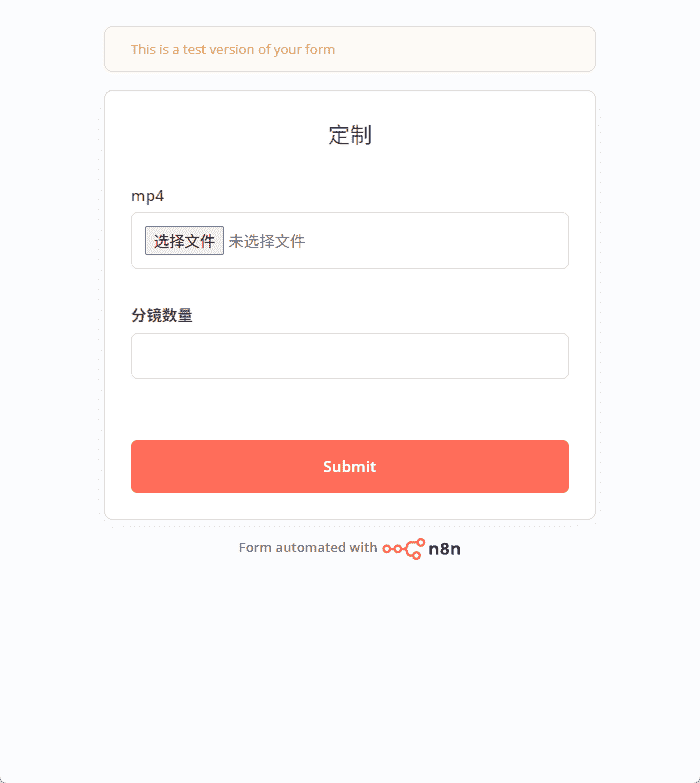

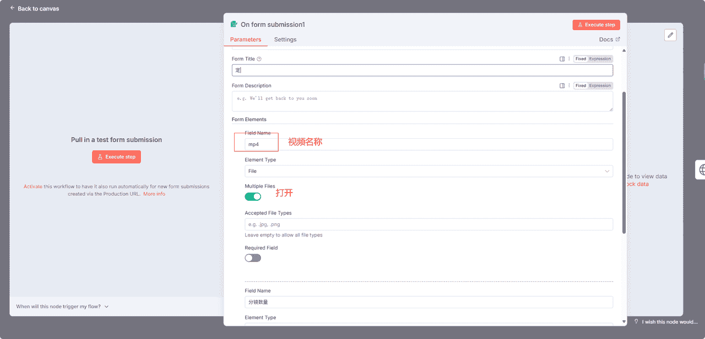

### 2.2 视频上传：`上传视频1`（HTTP）

+ `POST` `https://generativelanguage.googleapis.com/upload/v1beta/files`

+ 作用：把表单里的 `mp4` 作为 `二进制` 上传，拿到 `file.uri`。

+ 小技巧：`Content-Length` 用 =`{{ $json.mp4[0].size }}` 动态带入。

> 提示：API Key/Token 要放到 n8n Credentials / 环境变量

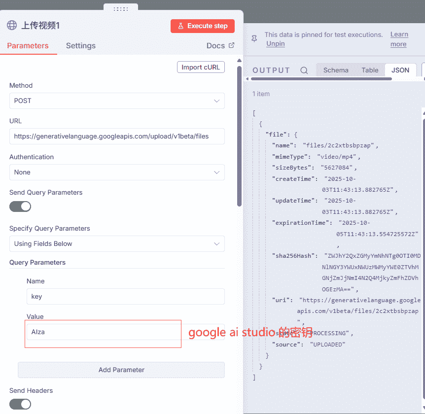

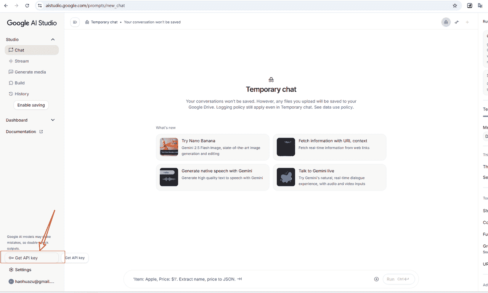

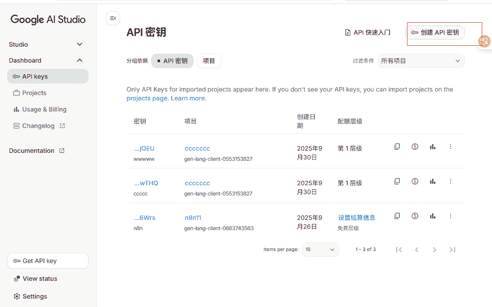

### 2.3 自动拆分镜：`分镜大纲1`（Gemini 2.5 Pro）

+ 带 `json` 代码块的 `分镜大纲`（每个分镜都包含“视频提示词”）。

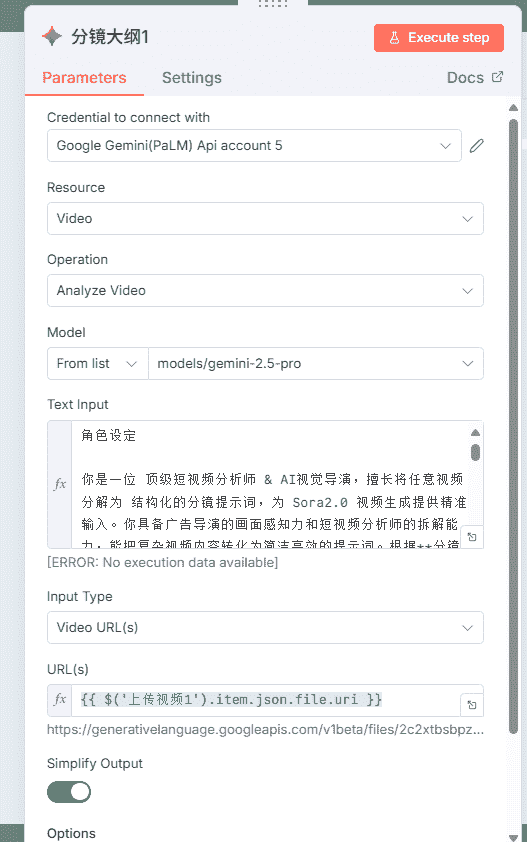

```
角色设定

你是一位 顶级短视频分析师 &amp; AI视觉导演，擅长将任意视频分解为 结构化的分镜提示词，为 Sora2.0 视频生成提供精准输入。你具备广告导演的画面感知力和短视频分析师的拆解能力，能把复杂视频内容转化为简洁高效的提示词。根据**分镜数量:** 一个分镜数量分析10s,依次类推。

## **信息输入**

- **爆款视频参考片段 (请提供一段具有代表性的爆款视频视频片段或者音频文件以供参考，作为风格模仿的标杆。系统将自动分析其中的语气特点、语速节奏、常用句式、标志性口头禅、表达习惯等特征)
- **分镜数量:** 
{{ $(&#x27;On form submission1&#x27;).item.json[&#x27;分镜数量&#x27;] }}个
根据**分镜数量:** 一个分镜数量分析10s,依次类推。
## 每个分镜必须包含以下要素：

 画面风格（高清广告 / 电影感 / 动漫风 / 纪录片风 …）

 主角/产品（人物特征 / 产品外观 / 身份设定）

 正在做什么（动作 / 行为 / 互动）

 环境/场景（地点 / 空间 / 背景 / 光影）

 镜头语言（特写 / 广角 / 航拍 / 慢动作 …）

 细节/氛围（质感 / 光影 / 色彩 / 情绪）

 色调关键词（Cinematic, Vibrant Colors, Warm Tones, Monochrome）

风格关键词（Documentary style, Anime style, Surrealism, Cyberpunk）

## **核心任务**
基于提供的视频，你需要将原始文案智能拆解为符合**分镜数量**要求的精准片段，生成**分镜数量**对应视频提示词，运用爆款视频参考片段的独特风格特征进行深度改写和风格迁移.根据**分镜数量:** 一个分镜数量分析10s,依次类推。

## **工作流程**

### **第一步：爆款风格深度解构**
通过专业的文本风格分析，深度剖析**爆款视频参考片段**中的核心表达元素。提取语言节奏密码（快语速/慢语调的配比规律）、情感表达模式（兴奋点布局、情绪起伏曲线）、词汇风格偏好（口语化程度、专业术语使用习惯）、句式构建特征（长短句搭配比例、疑问句/感叹句频次）、个性化标签元素（独特口头禅、习惯性连接词、标志性结尾方式），构建完整的语言风格基因图谱。根据**分镜数量:** 一个分镜数量分析10s,依次类推。

### **第二步：内容架构智能重构**
基于**分镜数量**和短视频黄金观看规律，对**视频文案**实施精密化分割策略。运用信息密度分析技术，识别文案中的高价值信息点、关键转折节点和情感爆发点，按照&quot;开场吸引→内容展开→高潮冲突→价值输出→结尾升华&quot;的经典节奏，将内容重新编排为最优信息传递序列。根据文案实际内容量与**分镜数量**的匹配关系，进行智能化的内容调节处理：当原文案信息量不足时，通过深度挖掘细节、增强情感描述、补充场景画面等方式进行合理扩写；当原文案信息过载时，通过提炼核心观点、删减冗余表述、浓缩关键信息等方式进行精准压缩，确保每个分镜的信息密度完美匹配**旁白字数策略**的要求，同时保证每个分镜都具备独立的完整性和强烈的承接性。

### **第三步：风格基因完美移植**
保持原文案信息内核100%完整的前提下，对语言外壳进行彻底重塑：以**频道身份**将平淡表述参照转爆款视频参考片段化为具有强烈个人标识的风格化表达，合理嵌入标志性口头禅和习惯用语，调整语言节奏以匹配爆款视频参考片段的表达习惯，增强情感色彩的渲染力度。

### **第五步：爆款密码深度注入**
基于抖音/TikTok平台的流量算法偏好和用户心理行为模式，为每句旁白植入经过验证的爆款元素。开头3秒内设置强力吸引钩子，中段布局悬念点和好奇心触发器，巧妙设置信息缺口制造追看欲望，结尾植入记忆锚点和互动召唤，确保整体节奏符合短视频用户的注意力曲线和完播率优化要求。同时，针对爆款短视频适合快节奏剪辑的特点，善于使用短句来营造紧凑有力的语言节奏，通过短句的连续冲击增强内容的传播力和记忆度。

### **第六步：视觉提示词精密构建**
严格遵循**提示词结构参考示例**的格式规范和画面风格，为每个分镜的旁白内容创作匹配的英文图片提示词。**重要原则：每个分镜的图片提示词必须完整独立地描述一个完整的画面场景，因为每个提示词将单独用于生成一张独立的图片。** 每个提示词需要包含完整的画面构成要素：主体元素的完整描述（人物、物体、概念等的外观特征、状态、表情、姿态）、环境场景的详细设定（背景、环境、道具、氛围）、具体动作或状态描述、光线条件和视觉风格。确保每个提示词都是一个自包含的完整画面描述，能够独立生成一张符合旁白内容的高质量图片，避免依赖前后分镜的信息补充。


### **第七步：专业标准全面校验**
实施多维度质量检验体系，确保最终输出达到专业标准。严格核查分镜数量与要求完全一致，逐句检查旁白字数是否符合**旁白字数策略**的要求，并确保每句旁白都具备强烈的传播力和抓人注意力的能力。重点关注信息完整性，确保原视频文案的核心信息在转化过程中不丢失。评估整体风格一致性、语言表达流畅度及分镜间的逻辑连贯性，保证内容过渡自然、观看体验顺畅。测试每句旁白的传播力指数和观看完成度潜力，确认信息传达的准确性和完整性。同时，逐条验证图片提示词的完整性、准确性和可执行性，**特别确认每个图片提示词都是完整独立的画面描述，能够单独生成一张完整的图片。** 检查每个提示词是否包含了主体、环境场景、动作状态、视觉风格等所有必要元素，确保提示词与对应旁白内容高度匹配，能够清晰表达画面的完整视觉信息。**重点检查人物一致性：** 验证同一角色在不同分镜中的外貌描述是否完全一致，确保所有分镜的人物特征描述使用相同的标准模板，避免因描述差异导致的人物形象不一致问题。最终输出需全面满足爆款标准，呈现优质旁白内容与高匹配度、高独立性、高一致性的视觉化提示词。视频提示词&quot;: &quot;&lt;只写运镜分镜对应的运镜 中文视频提示词&gt;&quot;

## **输出规范**

### **格式要求**
- **标准结构:** 严格按照JSON格式输出，确保结构化数据的准确性和可读性
- **字段规范:** JSON对象包含`分镜`键，对应数组中每个对象含`分镜序号`(整数)、时间必须是&quot;00:00:05&quot;类似格式
- **分镜数量控制:** 严格按照**信息输入**中的**分镜数量**要求生成对应数量的分镜内容，确保输出的分镜序号从1开始连续递增至指定数量，不多不少

### **输出示例**
```

```json

{

  &quot;分镜&quot;: [

    {

      &quot;分镜序号&quot;: 1,

      &quot;时间&quot;: &quot;00:00:00-00:00:10&quot;,

      &quot;视频提示词&quot;: &quot;[画面风格]+[主角]+[动作]+[场景]+[镜头]+[氛围]+[色调关键词]+[风格关键词]&quot;

    },

    {

      &quot;分镜序号&quot;: 2,

      &quot;时间&quot;: &quot;00:00:10-00:00:20&quot;,

      &quot;视频提示词&quot;: &quot;[画面风格]+[主角]+[动作]+[场景]+[镜头]+[氛围]+[色调关键词]+[风格关键词]&quot;

    },

    {

      &quot;分镜序号&quot;: 3,

      &quot;时间&quot;: &quot;00:00:20-00:00:30&quot;,

      &quot;视频提示词&quot;: &quot;[画面风格]+[主角]+[动作]+[场景]+[镜头]+[氛围]+[色调关键词]+[风格关键词]&quot;

    }

  ]

}

```

### 2.4 解析 JSON：`设置参数-提取分镜`（`Set`）

用正则抓 `json` 代码块 → `JSON.parse` → 写入字段 `分镜大纲`。

这样后面可以 `['分镜大纲']['分镜']` 直接取数组。

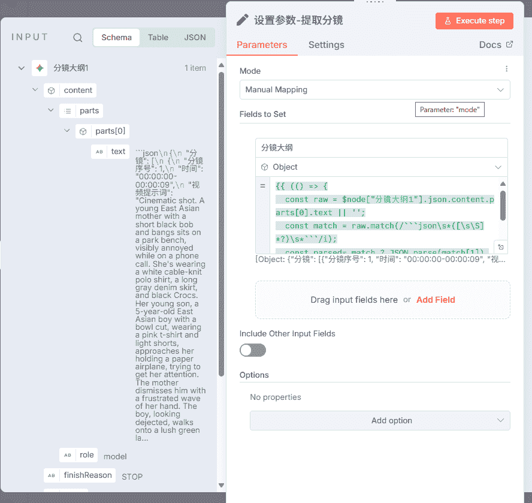

```
{{ (() => {
  const raw = $node["分镜大纲1"].json.content.parts[0].text || '';
  const match = raw.match(/```json\s*([\s\S]*?)\s*```/i);

  const parsed = match ? JSON.parse(match[1]) : {};

  return parsed;

})() }}
```


## 2.5 逐分镜生成

`遍历`-图片1（`SplitOut`）→ 循环-图片1（`SplitInBatches`）→ 对接Sora（HTTP）

- `SplitOut`：把分镜数组拆成一个个 `item`。
- `SplitInBatches`：控制并发/批次数，避免被 API 限流。
- 对接Sora：把当前分镜的 视频提示词 作为 `prompt` 提交生成。
- 建议将 `Set`/`ENV` 等参数抽象成变量方便调优。
- 如果生成非阻塞 → `Wait1` + 轮询获取草稿。

## 2.6 抓取成片 URL

`HTTP Request1` → `Code1` → `If` → `设置参数-视频网址1`

- 逻辑：调用草稿/列表接口 → `Code1` 里按 当前分镜的“视频提示词” 模糊匹配 → 提取 `downloadable_url`。
- 命中则写入 `video` 字段，汇总到上层批处理。

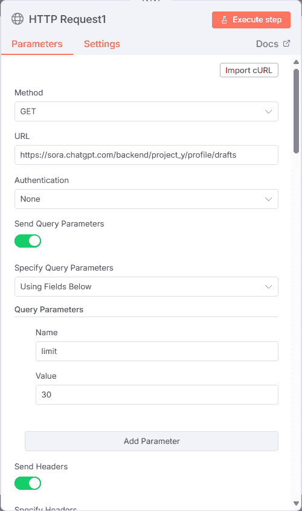

## 2.7 聚合 Aggregate

把前面循环里产出的每个分镜 `video` 链接集中起来，给后面的 FAL FFmpeg 合并当输入。注意顺序必须与分镜一致。

### 连接路径

- 将 `Aggregate`（聚合）连接到 `SplitInBatches`（循环-图片1）的 “`After/Done`” 分支（循环完成后执行），避免只聚合到部分分镜。

### 关键参数

- 模式选择：`Aggregate all item data`（`aggregateAllItemData`）
- 聚合结果会放在当前 `item` 的 `json.data` 数组中（每个元素是一条分镜产物）

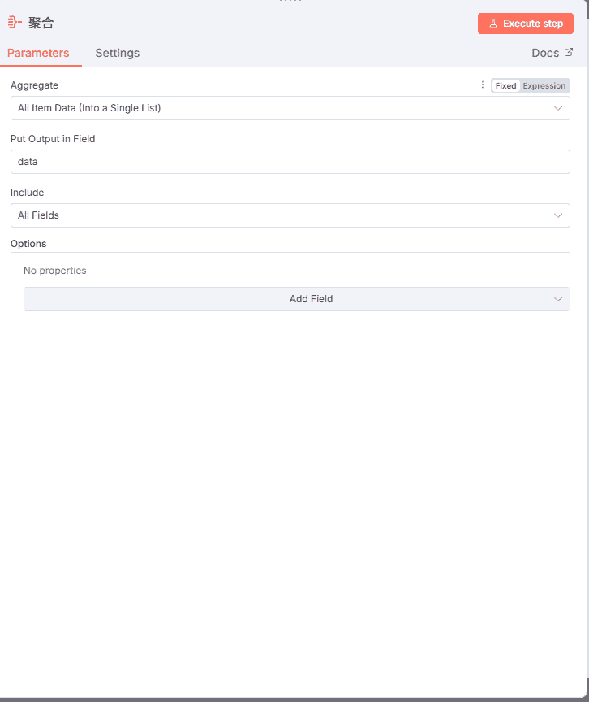

## 2.8 提交合并视频任务

### 作用

调用 FAL 的合并接口，返回 `request_id`，状态初始一般为 `IN_QUEUE` 或 `IN_PROGRESS`。

### 参数

- 方法：`POST`
- URL：`https://queue.fal.run/fal-ai/ffmpeg-api/merge-videos`
- Headers：`Authorization: Key <FAL_API_KEY>`（放 n8n Credentials，切勿明文）
- Body（`JSON`）：`={{ $json }}`（即 `Code2` 输出）

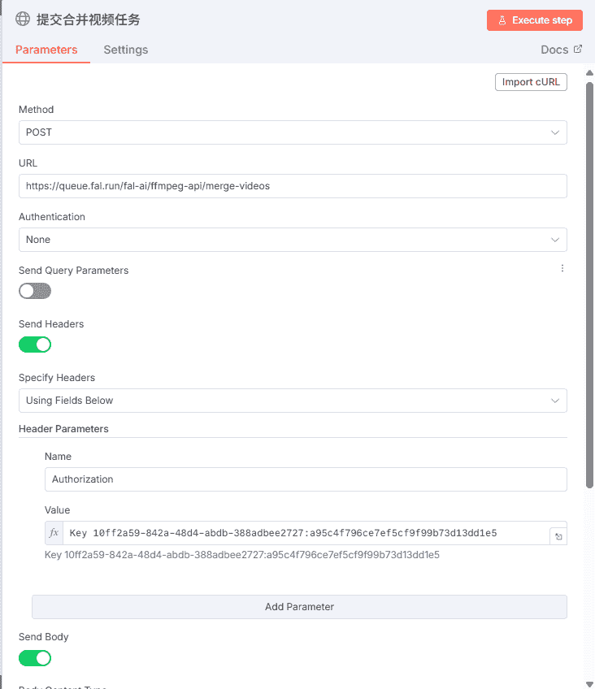

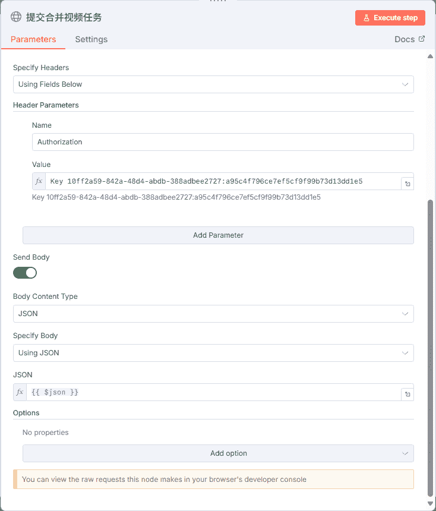

## 2.9 获取状态

### Wait（等待）

- 你的节点 `amount: 10` → 默认单位为“秒”。根据视频数量与时长，建议 3–10s 起步。
- 建议加“最大轮询次数”（例如 60 次 ≈ 10 分钟），避免无限等待（可通过变量计数或 `If` 分支限制）。

### HTTP Request5（查询状态）

- 方法：`POST`（或 `GET`，视 FAL 接口而定）
- URL：

`https://queue.fal.run/fal-ai/ffmpeg-api/merge-videos/requests/{{ $('提交合并任务').item.json.request_id }}/status`

- Headers：同上 `Authorization: Key <FAL_API_KEY>`

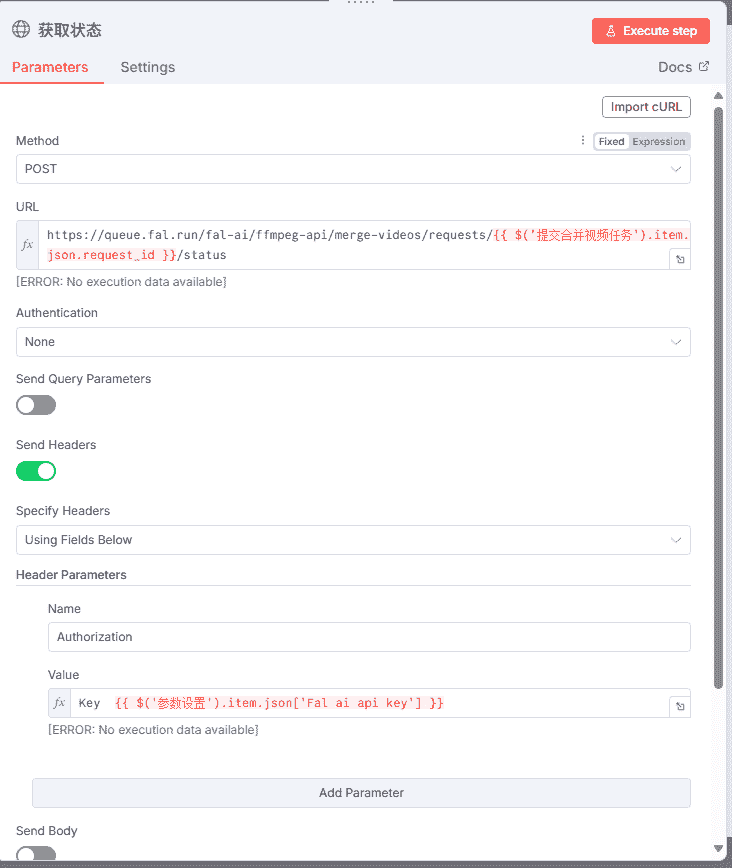

## 2.10 任务是否完成

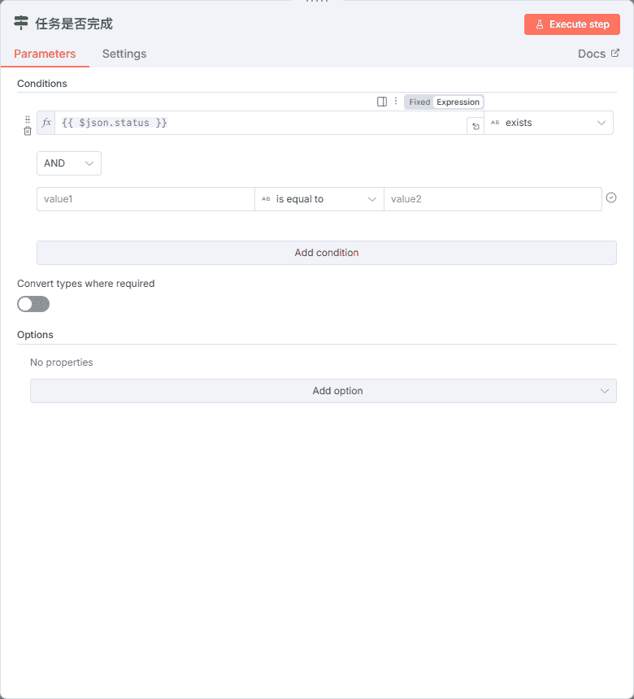

## 2.11 下载视频

### 目的

给用户一个“点提交 → 自动跳到下载页”的体验。

### 说明

- 你当前 `HTTP Request9` 用了固定 `request_id` 的 URL（/requests/88c6...）。这会只看某个历史任务。
- 更简洁做法：如果 2.9 的状态查询已经返回了 `video.url`，可以直接跳 Form，无需再请求 `HTTP Request9`。
- 如果确实想再拉一次详情（或拿更稳的 CDN URL），请把 `HTTP Request9` 的 URL 改成动态引用 `request_id`

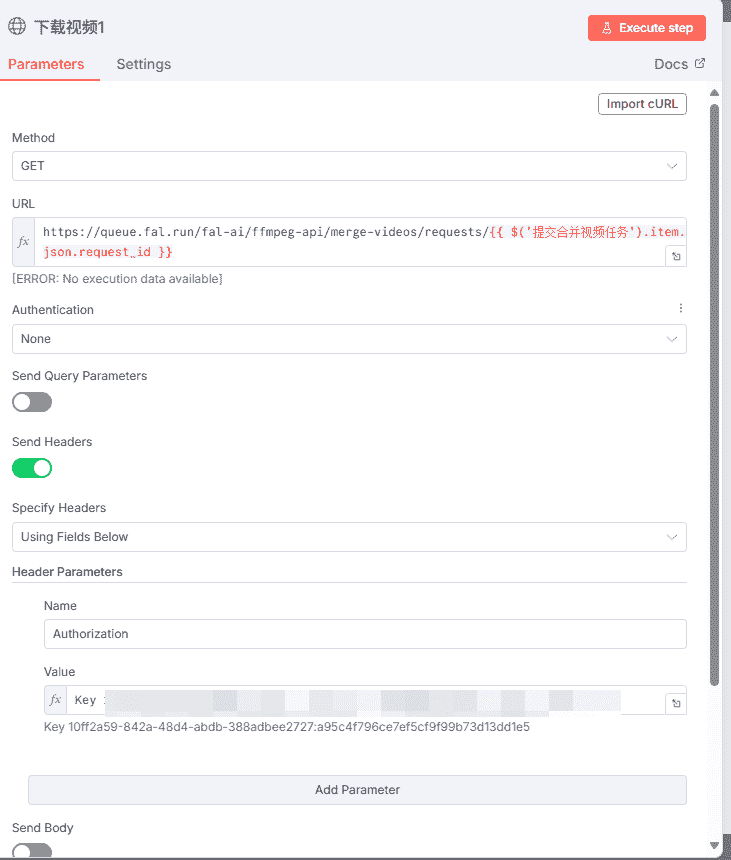

---

## 三.常见坑 & 我的踩坑记录

1. API 超时 / 连接中断

- 优先 降低并发 / 加 `Wait`；
- 生成节点 Pin 住成功返回，调下面的链路时不必重跑生成。

2. 成片 URL 匹配不到

- `Code1` 里默认用 `includes(TARGET_PROMPT)` 做“包含匹配”；
- 若命名冲突，在 `prompt` 前加分镜序号/唯一标识。

3. 合并顺序错乱

- 聚合 → `Code2` 时，确保分镜序号排序后再组装 `video_urls`。

4. 分镜长度不均

- 在 LLM 指令里明确：每个分镜对应约 10s（或你需要的节奏），并让模型给出时间段 方便后期合并时按序拼接。

## 四.逆向教程（这个我觉得大家可以给我点赞，勿商用，只供学习，谢谢）

### 4.1 简单逆向 对接 sora2.0（圈友需要）

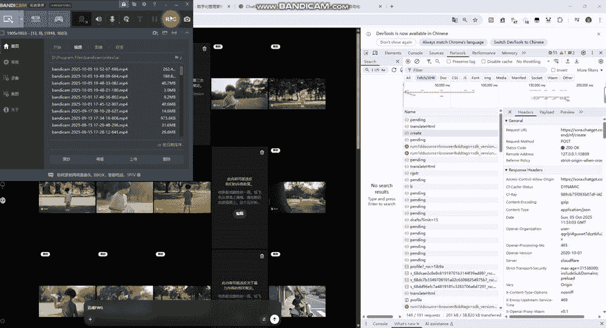

[`bandicam 2025-10-05 19-55-50-822.mp4`](https://internal-api-drive-stream.feishu.cn/space/api/box/stream/download/all/XsfsbvaoAoRi2zxVjUec0V7ZnPf)

### 4.2 使用 即梦+豆包 每天赠送的积分（文生图）圈友需要 勿商用，只供学习，谢谢

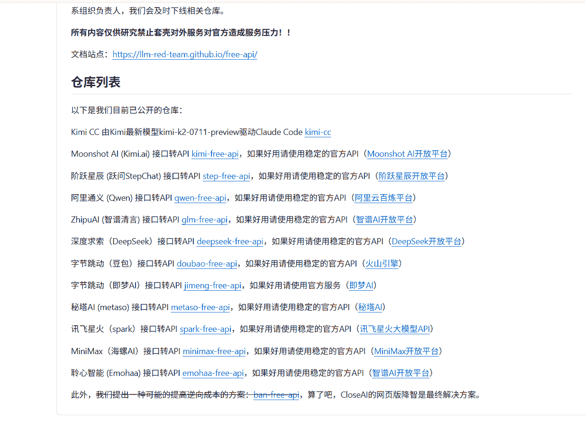
