# 爆肝10小时sora2.0，从基础到AI场景落地毫无保留的分享给大家。

> 来源：[https://xuqiwei1986.feishu.cn/docx/YNucdEe5kotSjixPHkmcG6Cgngb](https://xuqiwei1986.feishu.cn/docx/YNucdEe5kotSjixPHkmcG6Cgngb)

大家好，我是小宋，00后程序员，6月份加入赚钱，加入赚钱已经有三个月。 本期n8n 教练,这是最新Sora2.0从使用注册到应用场景毫无保留的分享给大家。

欢迎大家来链接我，我需要和懂需求的，懂流量操盘手的聊聊。后期我会用 n8n+sora 做一些Youtube 短剧的自动化 。

先别听我吹，自己看"官方的Demo视频”。把手机亮度调到最亮，戴上你最贵的耳机，点开下面这个视频。记住你接下来看到、听到、感受到的一切，都来自一个不存在的宇宙。视听一体+长故事+连贯性的突破。

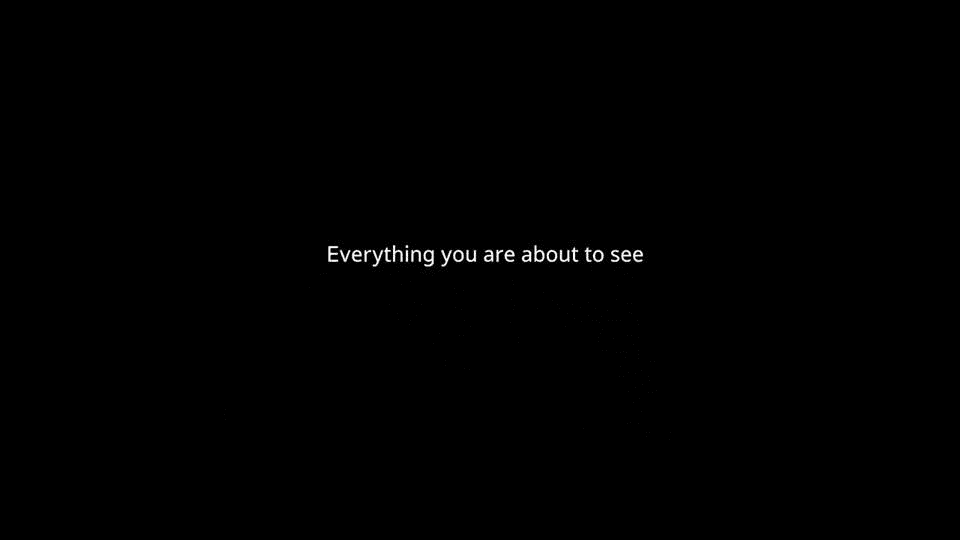

[p (1).mp4](https://internal-api-drive-stream.feishu.cn/space/api/box/stream/download/all/WAZNbrFmOo1FxQxKDGZcnCrenLe)

**记得点赞收藏和投矛哈**

# 一.如何使用sora?

## 一.App store

### 1.苹果手机(需美区/加拿大）IoS 16以上系统/电脑（设备要出国）或者魔法

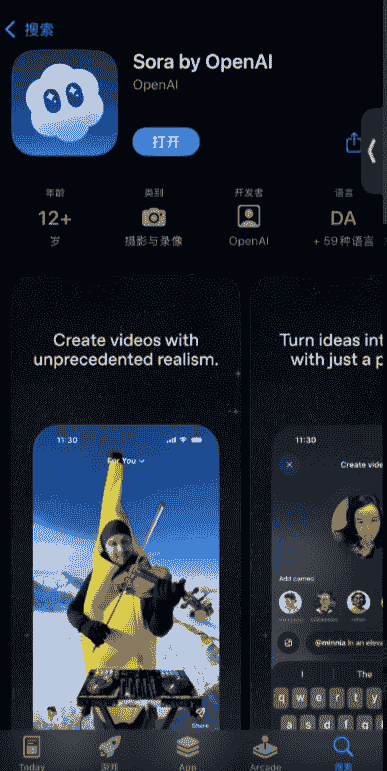


### 2.填入邀请码：

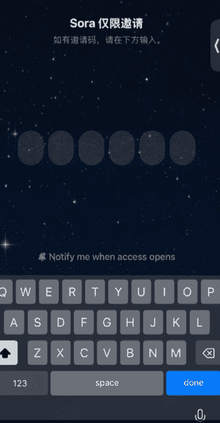

###

### 4.下载无水印视频

**无水印链接的路径中目录是 00000(例如 /v**ideos/00000/src.mp4)

**有水印链接的路径中目录是 00000_wm(例如 /vide**os/00000_wm/src.mp4)

网页版目前看都是有水印，要无水印版只能i0S抓包

## 二.网页

进入这个网站 https://sora.chatgpt.com/

保证自己在美区IP

1.填写昵称（超过3个字就行）


2.输入邀请码（Enter invite code）

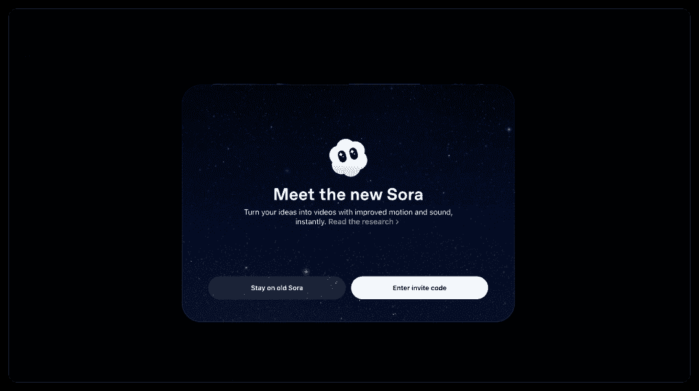


即可使用

一个人可以有4个邀请码，这里我创建了一个邀请码裂变群，方便大家快速获得邀请码开始上手实测

## 三.Sora 无水印链接获取

[Sora无水印链接获取](https://gcnax5pj3z0y.feishu.cn/base/Wj7tbjDnyaEryZsIt4tcDbNonwb?table=ldxby3arkZlCO7FQ)

# 二.Sora2有哪些功能？

## 1.核心能力(**视听一体+长故事+连贯性的突破**)

1.  **高级生成能力**：作为 Sora 应用内推出的新版本，在视频和音频生成上有显著提升，能处理复杂物理交互（如奥运体操动作、滑水板后空翻），可生成更长、更连贯的故事。

1.  **音频生成**：首个同时生成视频和音频的 Sora 模型，支持多语言对话、音效及沉浸式音景，提供更全面的多媒体体验。

1.  **动态范围**：相比前代模型，动态范围更广、更多样，避免单一审美，输出更真实多样，受创作社区关注。

1.  **技术改进**：物理交互更智能、可控性提升、擅长长故事生成（可一次生成多镜头）、运动物理效果达到行业领先水平。


[19700121_1641_68dc38a88fe48191a54a419d37554093.mp4](https://internal-api-drive-stream.feishu.cn/space/api/box/stream/download/all/HNEbbYAICo6pCJxuZ3oceSC7n8d)

总结：**视听一体+长故事+连贯性的突破**

## 2.终极杀招“Cameo”:你的"数字人虚拟孪生兄弟”，实现你的所有场景梦想（APP专属）

> Tips: 只有App 才有哦

Sora 2这次最大的亮点就是它的“Cameo出镜秀”，类似于创造一个数字人，但步骤更简单。

只需要一分钟，录制一段自己的脸和三秒钟的声音，即可创建自己的形象，可随时调用。人物一致性保持得堪称完美。

山姆·奥特曼这两天已经被全世界网友给玩坏了～

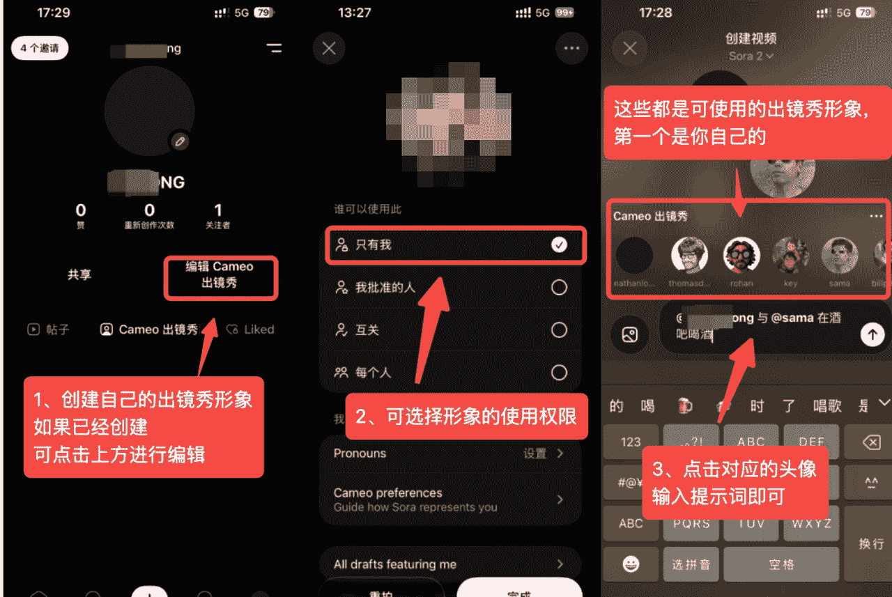

今天就能出道了这个App的核心，是一个叫“Cameo”(客串)的 功能，先看视频

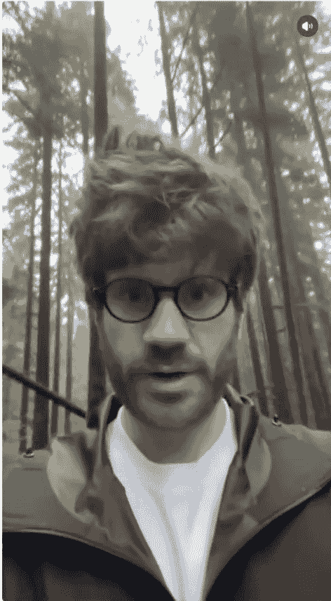

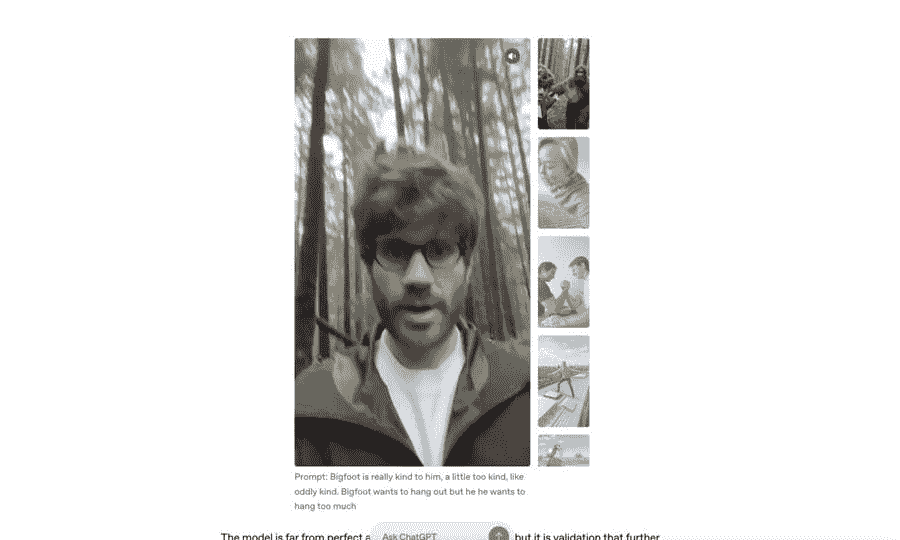

[p (2).mp4](https://internal-api-drive-stream.feishu.cn/space/api/box/stream/download/all/ZG8Sb8PgIoQ38mxyLEacJ4Aenah)

比如

想让龙哥在火星被群友拿着鞭子追吗？

想让昨天的你在月球上骑着独角兽打马球?

想让你老板在《权力的游戏》里被龙追着跑?

想让你暗恋的女孩看到你在银河里为她放烟花?“

Cameo"，就是这个*世界里，专属于你的“任意门”这才是真正的“社交元宇宙”。

什么VR头显，都弱爆了。

你的一个念头，就能生成一个世界观。所想即所得。

一个创意，就能生成视频的时代来了

## 3.Remix"再创作:病毒传播的催化剂

除**了 Came0**，另一个被很多人忽略的强大功能是"Remix”在信息流里看到任何一个有趣的视频，你都可以点击“Remix”，将其作为参考视频，进行二次创作。

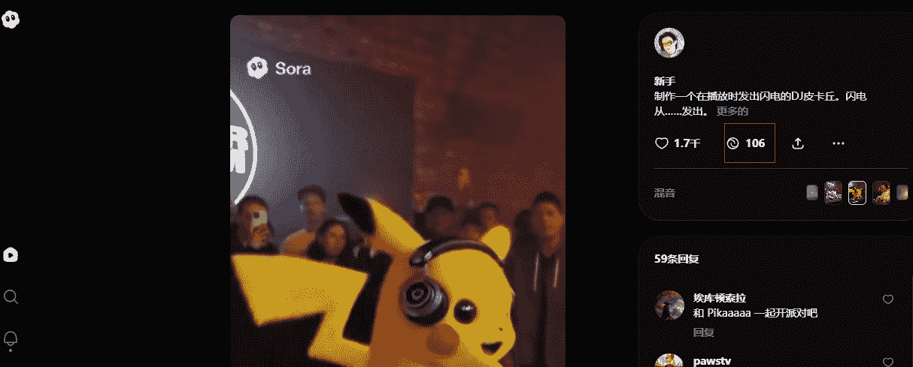

**              **       中间圆圆的就是remix了

这个功能，为社区的病毒式传播和 Meme 文化的发酵，提供了可能性。一个爆款视频，可能会被Remix 出成千上万个不同版本，形成一场创作的狂欢。Cameo + Remix，这两大功能组合在一起，构建了 Sora App 的核心社交循环。

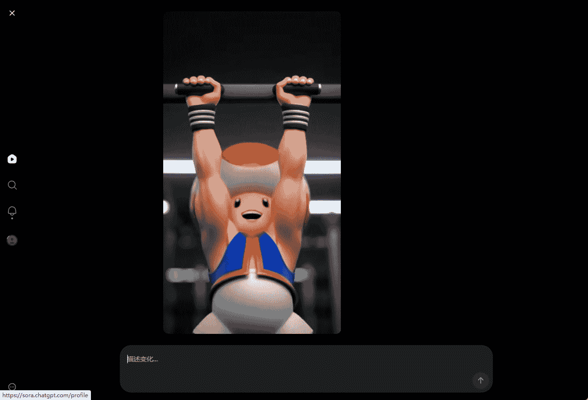

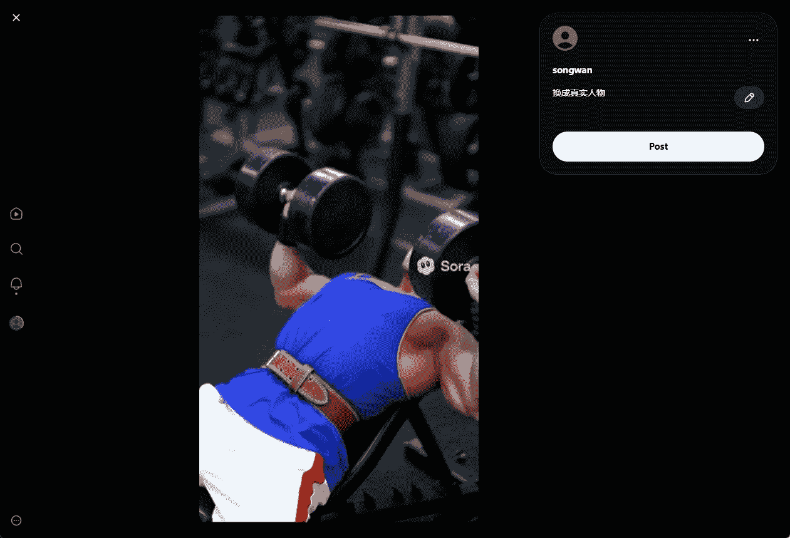

好了，基本功能就介绍到这里，之后我们主要看怎么玩!

## 4.违规

色情、暴力、青少年、 版权.…..


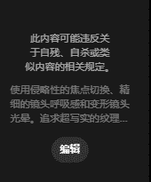


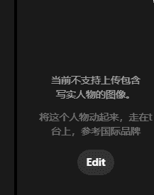

# 三.Sora2.0带来的行业机会

### 0.想一想会不会取代 tiktok?（高ip+场景）

### 1.Youtube  中长短剧视频

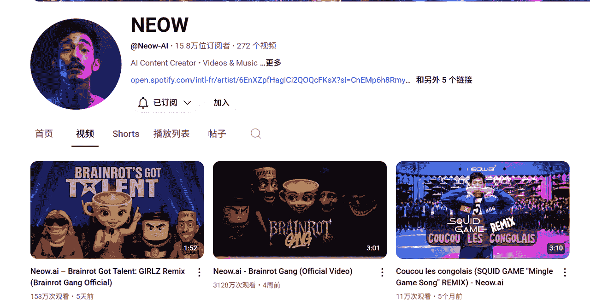

> 这个频道只更了三条长视频，其中4周前的一条，3128W，视频很有故事性，3分钟的AI长视频来说，算是很精致了，至少他比上面图片拼凑那个有技术含量多了😂，就是你看上去很有电影的既视感，还有很多镜头的处理，又是纹身又是嘻哈那种风格，很是美国那种街头文化风格。

>

> RPM按1.5计算，预估单条长视频收益4.7w刀

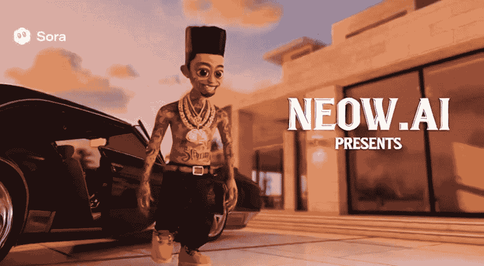

[20251002_2208_01k6jks74cfwmby57t77qrfn8k.mp4](https://internal-api-drive-stream.feishu.cn/space/api/box/stream/download/all/Uo5Jb0EoMo1Pnuxy4OWcRsRHnWh)


[20251002_2208_01k6jks376ebpajjk2fyc7sh6m.mp4](https://internal-api-drive-stream.feishu.cn/space/api/box/stream/download/all/M0IGb0FVVoL8CgxbmiMc2uUOn3e)

### 2.电商带货

在电商行业，**短视频和直播**是成交的关键。

但过去，做一条带货视频需要：场地、模特、化妆、拍摄、灯光、剪辑、后期修图……成本高、周期长。

+   **一键生成带货视频**：输入产品图片 + 场景提示词，就能立刻生成高清短片。


[p (4).mp4](https://internal-api-drive-stream.feishu.cn/space/api/box/stream/download/all/Y5EIbjqJ9o7XCZxRM0FcbffUnXA)


[p (5).mp4](https://internal-api-drive-stream.feishu.cn/space/api/box/stream/download/all/ZhsWbu4VDoPUKtxTAMGc6jCGn4c)

### 3.个性广告

传统广**告往往千篇一律，观众缺乏****共鸣。

而 S**ora 的个性广告能力，可以让品牌用最低成本，快速产出 具备国际大牌质感、同时贴合年轻用户审美的广告短片。

```
“高清电影质感，10秒广告短片。开头镜头：夏日城市街头，阳光透过高楼洒在地面，一位年轻中国都市青年走入画面，身穿 小宋T恤。T恤剪裁利落，面料轻盈透气，在阳光下显得质感高级。中景镜头：他骑着单车穿过林荫大道，风吹动衣角，展现舒适与自由。特写镜头：胸前简洁的 小宋T恤 LOGO，领口与衣料细节清晰可见，凸显精致工艺。最后镜头拉远：青年站在城市天台，迎风张开双臂，背景是落日余晖，字幕缓缓浮现——‘自在 · 年轻 · 小宋T恤’。风格参考国际大牌广告，极简、清新、现代。
```


[20251002_1856_01k6j8zdv3frr8hrrbw1q51fzt (1).mp4](https://internal-api-drive-stream.feishu.cn/space/api/box/stream/download/all/NTJvbDIo6ohnThxDTVhc0uiZnHc)


[20251002_1854_01k6j8tve9evs8fpy0b9w491v8.mp4](https://internal-api-drive-stream.feishu.cn/space/api/box/stream/download/all/VvWkbfPF1o1JJcxiYAxcIwV0nQh)

### 4.微电影/微动漫

过去要拍一支微电影或制作一部动漫短片，需要庞大的团队：编剧、导演、演员、动画师、后期、配音……周期动辄数月，成本高昂。

而现在，有了 **Sora**：

+   **只需要一个故事大**纲，就能快速生成 微电影级别的短片；

+   **只需要几张角色设**定图，就能产出 完整的微动漫视频；

+   光影、镜头、动作、配音，全部由 AI 自动完成。


[19700121_1641_68dc5d841698819192c312db7653eae0.mp4](https://internal-api-drive-stream.feishu.cn/space/api/box/stream/download/all/PEENb1tUao9lZwxnK82c9jihnRg)

```
孙悟空大闹天宫打翻炼丹炉，玉帝急得跳脚突然掏出游戏机放下，孙悟空立刻坐下来玩游戏，玉帝擦汗“早说啊”动漫风格
```


[20251002_1750_01k6j56zm2e3r9kgqf2tbh2j28.mp4](https://internal-api-drive-stream.feishu.cn/space/api/box/stream/download/all/KQkeboc1ro60Ibxrj8ecFprnnwc)

```
[场景]天宫金碧辉煌的大殿，祥云缭绕。[分镜1·全景]中国青年孙悟空风格的角色，大吼一声，挥棒把炼丹炉打翻，烈焰冲天。[分镜2·中景]玉帝气得跳，表情夸张，准备下令天兵天将。[分镜3·中心]玉帝额头冒汗，急忙掏出一台闪着光的最新游戏机递过去。[分镜4·慢动作]孙悟空瞬间坐下，双眼放光，疯狂玩游戏。[分镜5·特色]玉帝擦汗长出吐，表情极度夸张搞笑。[风格]喜剧夸张，色彩缤纷，快节奏切换，10秒短剧。
```


[20251002_1812_01k6j5ya8vf8fr06c8erxr3b2p.mp4](https://internal-api-drive-stream.feishu.cn/space/api/box/stream/download/all/P943blv9KoBMwjxe5rBc5T2xnNd)

Sora 让人人都能拍微电影，人人都能做动漫导演。

它把过去只有大公司、大团队才能实现的内容生产力，交到了普通创作者和品牌手中。

### 5.搞笑无厘头短视频


[20251002_1748_01k6j53hnefcsadajkd6s0z702.mp4](https://internal-api-drive-stream.feishu.cn/space/api/box/stream/download/all/FDbvb2RLwoFmNsx4MhjcLw2hntf)

```
一名原始部落的人在干农活，他停顿了一下说:“好像忘记了件事?&quot;接着画面以超快的快进效果穿越数个世纪(出现村庄、城市、工业革命等场景)，现在他身处现代，穿着西装，站在发布会上，说:“今天到底是不是放假了
```

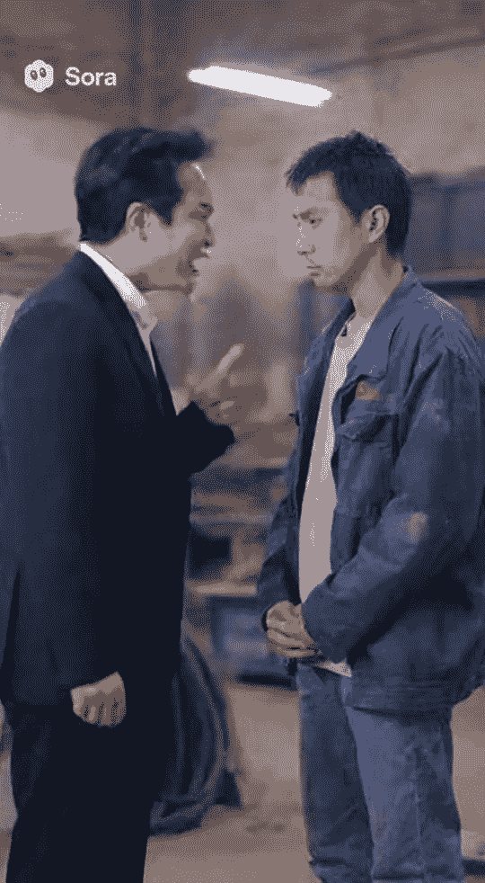

[20251002_1810_01k6j5wz6kf1btrhj4yxmxzche.mp4](https://internal-api-drive-stream.feishu.cn/space/api/box/stream/download/all/TVsrbgiEAoLwFNxHni0cFvZAnDg)

```
一个中国打工人，穿着普通工装，站在老板面前被秒骂惨惨突然。镜头切换：他拿出手机，账户余额显示十亿人民币。老板瞬间跪下求饶。打工人冷冷地说：“迟了。”镜头近距离动作，背景光芒闪耀，十剧爽朗风格
```


[20251002_1814_01k6j5xw4besftn9bmzk7e3wy6.mp4](https://internal-api-drive-stream.feishu.cn/space/api/box/stream/download/all/Od1eblrtVocppHxLhTicYrCPnZf)

```
一名中国女孩在大街上被渣男甩掉，渣男得意洋洋转身。突然，豪车呼啸停下，车门打开，是国际巨星邀请女孩上车。女孩微笑，反手甩下渣男的礼物。渣男呆立原地。镜头酷炫快切，音乐燃，10秒爆款爽剧。

```

#

# 四.案例说明

### 1.跨地域的专属个性化营销广告（服装为例子）

> promt: [画面风格] + [产品] + [正在做什么] + [环境/场景] + [镜头语言] + [氛围]

需求：小宋，服装店老板，全国100家门店，提供不同地域的营销广告

**北方的冲锋衣：**


[20251002_1854_01k6j8tve9evs8fpy0b9w491v8.mp4](https://internal-api-drive-stream.feishu.cn/space/api/box/stream/download/all/U4PYbt6BEoQalexgg9acDywZnkf)

南方的衬衫

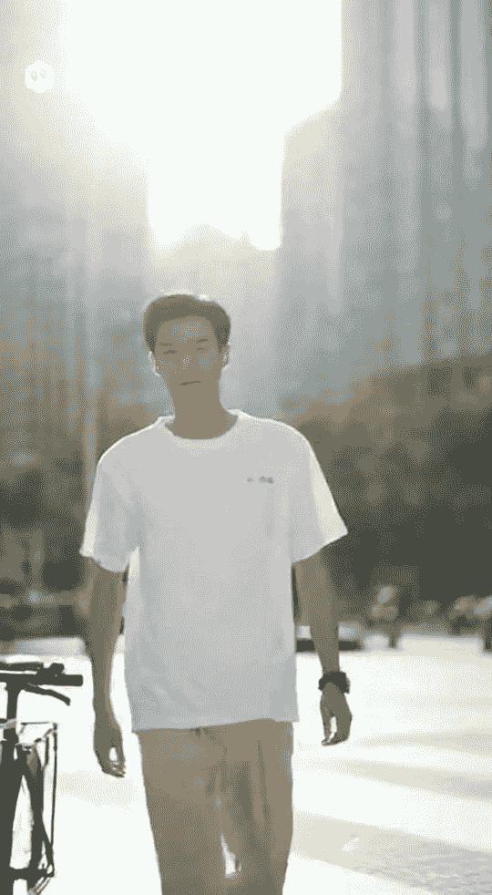

[20251002_1856_01k6j8zdv3frr8hrrbw1q51fzt (1).mp4](https://internal-api-drive-stream.feishu.cn/space/api/box/stream/download/all/BbDOb8UpvowTdhxDOnfcRgAYnvd)

**16:9**


[20251002_1858_01k6j92kc7fqpv3k81d8amkdxd.mp4](https://internal-api-drive-stream.feishu.cn/space/api/box/stream/download/all/ZvZPbsHTSoUZvDxi0P7c0s4fnQb)

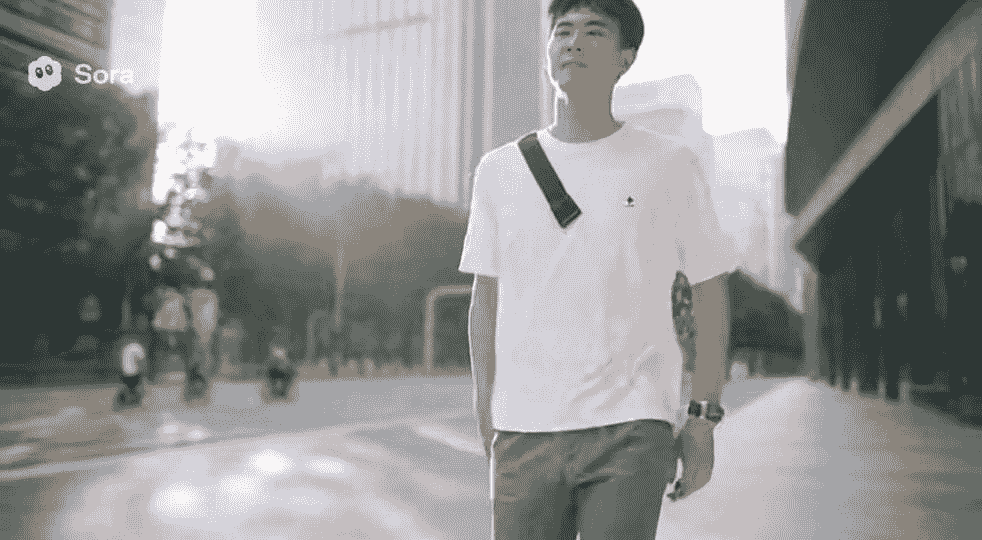

[20251002_1858_01k6j90f9ffehtfar3vr75873v.mp4](https://internal-api-drive-stream.feishu.cn/space/api/box/stream/download/all/O2GIbgL1ioGemAxXGMPcsvl8nLd)

```

```

### 2.品牌 从讲故事到讲世界观（比如 越野车为例）

需求：小宋汽车，全球越野车品牌，世界观： 征服 · 信赖 · 永恒，匹配场景，打造品牌世界观。比如在月球，在火星，在丛林

> 开头场景 + 出场+动作+世界观+氛围+sologn


[20251002_2018_01k6jaw8b8fd99bpdv5pc944qy.mp4](https://internal-api-drive-stream.feishu.cn/space/api/box/stream/download/all/ILJ4bjs6GoWjw8x740hcskWunWD)


[20251002_2016_01k6jars88e549fqdm2590nqbw.mp4](https://internal-api-drive-stream.feishu.cn/space/api/box/stream/download/all/BKvMb8a0Mo1ybpxOsrbcSf1Hnre)


[20251002_2016_01k6japrkjexav7vrqpqkaf17p.mp4](https://internal-api-drive-stream.feishu.cn/space/api/box/stream/download/all/MNl0bQUv6oYdcixhZiJcqiWgnag)


[20251002_2016_01k6japgpnfec8y36cq9wgad24.mp4](https://internal-api-drive-stream.feishu.cn/space/api/box/stream/download/all/SsA5bfl4Hopi9TxbKk8cmLa0nVg)

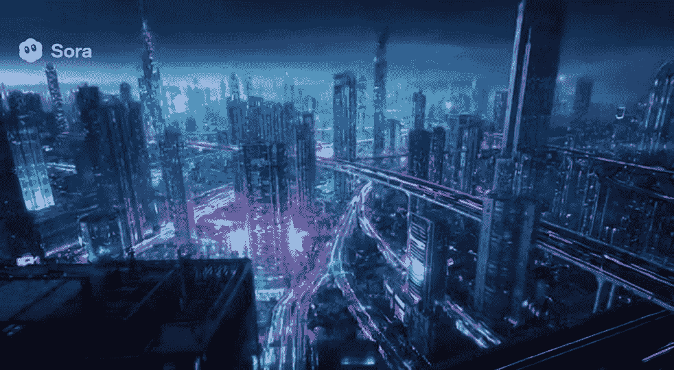

[20251002_2016_01k6jasyb8eprs1hpjqr6ewjer.mp4](https://internal-api-drive-stream.feishu.cn/space/api/box/stream/download/all/SfckbucoPo1henxcuBtcSFIYnMC)

“无论地球、宇宙、未来或废墟，小宋汽车都是征服、信赖、永恒的象征。”

将这些"世界切片"，作为你日常社交媒体的内容，持续不断地输出。

用户记住的，不再是你某个具体的产品，而是你创造的那个令人向往的"世界"。你卖的，不再是车，而是世界观。这建立了最高维度的品牌护城河。

### 3.从设计到视频只需要一个想法（以设计楼房为例）

过去，一个建筑设计从构想到展示，需要一整套繁琐的链条：

设计师先画效果图 → 建模师进行3D建模 → 渲染师出图 → 再拼接成视频。

整个过程既耗时，又昂贵，往往几周甚至几个月才能看到成品。

**现在**，就能将脑海中的想法，立刻变成一个在真实物理环境中、动态的、光影效果极其逼真的"虚拟原型"。


[20251002_2033_01k6jejc1decessbyfss63f7wn.mp4](https://internal-api-drive-stream.feishu.cn/space/api/box/stream/download/all/RsL4bv7Xio0urYxFBO4cI60rnXf)

研发周期被极限压缩。设计师的创意，可以被更快地验证和迭代。更重要的是，在客户沟通，你展示的不再是冰冷的图纸，而是一个"活生生"的建筑。

### 4.新品调研（以服装为例）

想象一下：一件全**新的服装设计，刚刚从设计师的画**布上诞生。过去，它需要做样衣、拍摄大片、运往各地做市场测试，才能得到零散的反馈。

但现在，有了 Sora 的虚拟生成与场景模拟


[20251002_2046_01k6jexrhtejnbsm2ehtjmzfrt (1).mp4](https://internal-api-drive-stream.feishu.cn/space/api/box/stream/download/all/JU7CbMdEgoGenixrOv0cIGLOnJh)

调研团队只需将这些 Sora 生成的视频投放到社交媒体或小范围内测平台：

+   哪个版本的点击率更高？

+   哪种场景下的购买欲望更强？

+   哪个年龄层的反馈最积极？

所有数据即时回流，形成一份 **精准的新品调研图谱**，帮助品牌决定：

到底是量产、改版，还是限量发布。

### 5.数字人分身（专门用于IP 电商带货）

现在，通过 Sora + Add Cameno 技术，你只需要一个基础数字人分身，就能：

+   在 **不同场景**（办公室、街头、虚拟舞台、异世界）中自由切换。

+   拥有 **不同形象**（职场精英、潮流青年、未来机甲战士…）。

+   执行 **不同对话/口播**（广告带货、IP剧情、知识分享、品牌故事）。

**核心价值：同一个IP，可以无限延展，保**持统一识别度的同时，呈现多样化的表现力。


[3ff5642093056e8b4d10b0510e557d7d.mp4](https://internal-api-drive-stream.feishu.cn/space/api/box/stream/download/all/MoXKbfHuNoH98Qxllp5cIhggnOb)

视频来源：多老师有点AI

### 6.和朋友一起搞短剧（愉快的玩耍）

过去想和朋友拍短剧，要找场地、准备服装、安排摄影和灯光，还要后期剪辑，动辄耗费几天甚至几周。

现在，有了 **Sora**：

+   **只需要输入一个简单**的故事梗概，就能立刻生成 10 秒的完整短剧。

+   场景随意切换：咖啡厅、学校操场、豪华别墅、未来都市，都能秒级生成。

+   **人物表演细腻，情绪**到位，甚至可以根据提示词完成 哭、笑、争吵、拥抱 等高难度表演。

+   **你和朋友**可以一起写狗血剧情，分饰角色，甚至让 数字分身 代替真人出演。


[p (3).mp4](https://internal-api-drive-stream.feishu.cn/space/api/box/stream/download/all/IB8GbR4KtoYSYfxyQ1rca4BYnRb)

### 7.给客户的情绪价值

过去的广告，都是“千篇一律”：同一个模特，同一支片子，投放给成千上万的用户。

结果是——大多数人看了觉得“与他无关”，转化率自然有限。你可以生成和他相关的。

现在，结合用户的 **年龄、性**别、兴趣、穿衣风格**等数据，Sora 可以生成一**个与用户本人极为相似的 虚拟主角，出演一段专属的 人生剧本.不同人物的不同剧本

这类内容具备三重力量：

**“与他个人有关”**：广告里的角色就是“他自己”，代入感极强。

**情绪触发**：不仅展示产品，还演绎了用户的梦想与渴望。

**精准转化****：这种情感**价值的精准滴灌，让广告转化率不再是线性提升，而是 指数级爆发。