# 【保姆级教程】用好公众号AI协作工作流，效率提高10倍！（点赞+收藏）

> 来源：[https://xuqiwei1986.feishu.cn/docx/QF2xd5wSwowZ1sxjjMTcad2zn1f](https://xuqiwei1986.feishu.cn/docx/QF2xd5wSwowZ1sxjjMTcad2zn1f)

Hi，我是米斗，**AI商业实战教练**。我带不会技术的创业者，用 A**I 更快写内容、更快涨粉、更**快变现。过去有服务100+创业者，我做的核心事情只有一件：少走弯路，让AI成为你最强的赚钱合伙人。


> 公众号多账号运营太麻烦？我分享一套正在实战的写作+排版+发布流程：从录音转文字、AI排版到飞书一键发文，全流程省时高效，适合懒人、小白、自媒体创作者，看完你将收获一个“效率倍增”的公众号创作系统。

# 用好公众号AI协作工作流，效率提高10倍！

来自米斗老师的一套“偷懒但高效”的公众号写作工作流

永澄教练说：内容真的很实用！整体看下来，你这套方法不仅提升了效率，更关键的是降低了创作门槛，真的很适合像我这样又忙又想高效输出的人。再次感谢你的分享，期待你后续更多干货！

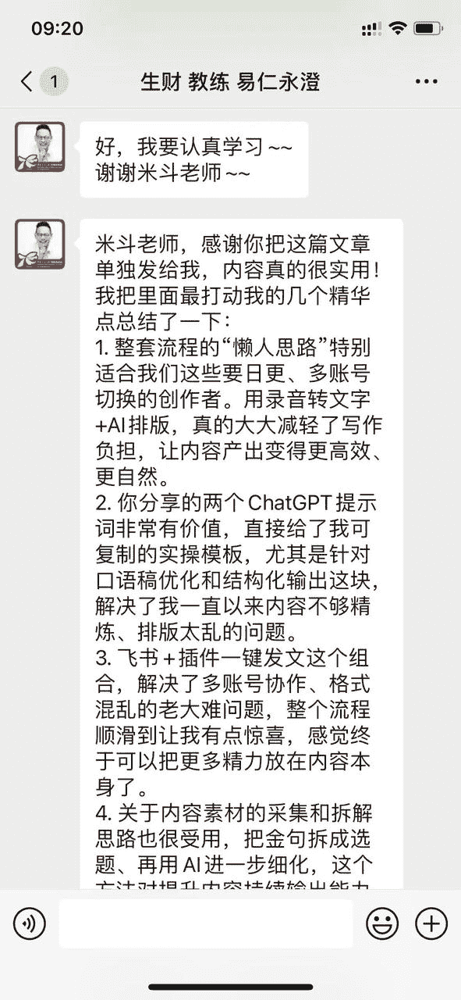

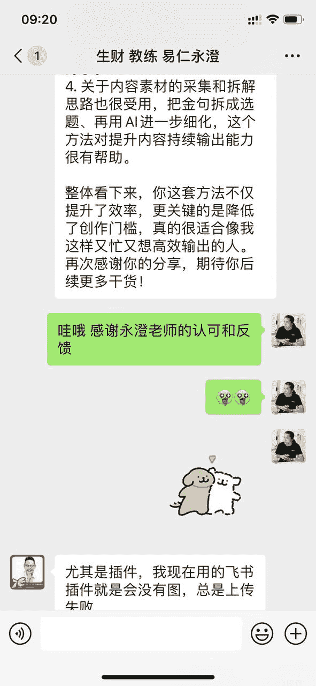

PS：来自永澄教练看完教程的反馈，截图已授权。

今天在群里看到有朋友问：

> “微信公众号编辑有什么软件推荐啊？我有多个公众号账号需要切换。之前用的是微小宝，但它已经不运营了，还有什么好用的替代方案吗？”


我听到这个问题，第一反应就是：**你不是一个人在痛苦。**

怎么办？不用急，我给你整理了一套我自己每天在用的公众号创作 + 编辑 + 发布的完整工作流，而且对新手也非常友好👇

## ✍️飞书+AI搞定整套公众号创作

这套工作流的核心思路是：「公众号不是写出来的，是整理出来的」

过去大家写一篇推文，可能是：

+   Word 打草稿

+   再复制到公众号后台

+   再一段段改格式、改排版

+   再调图、调配色，操作一大堆

## 🎁 我的公众号内容产出流程（适合日更/多账号操作）

### 步骤1：录音 or 直播素材收集

不管是我自己讲的内容，还是拆别人直播、会议金句，我都会开通义听悟录屏。


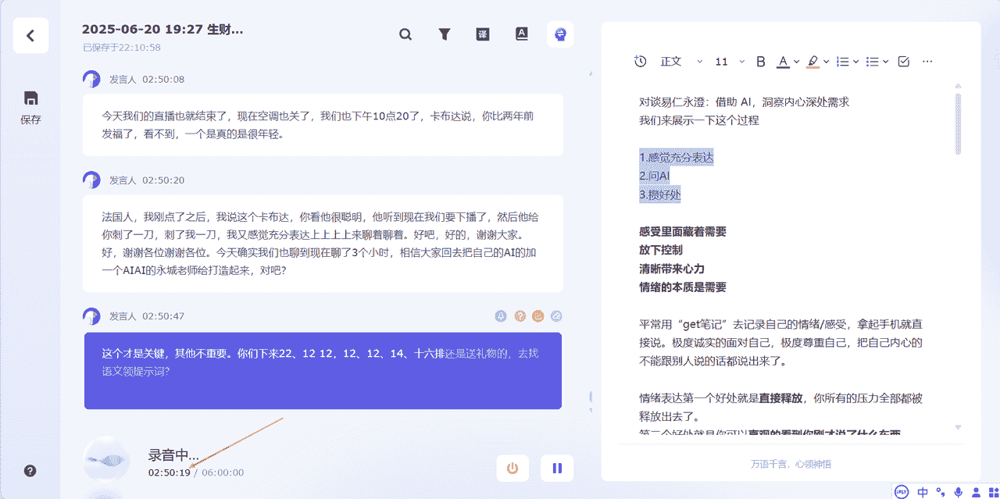

📎 工具推荐：

+   **通义听悟**（支持自动语音转文字）

+   **飞书会议录制+字幕功能**（长内容更友好）

**我经常直播答疑，或者**在群里一通输出完观点后，根本不会再重复写一遍，直接转文字就搞定 80% 文稿内容。

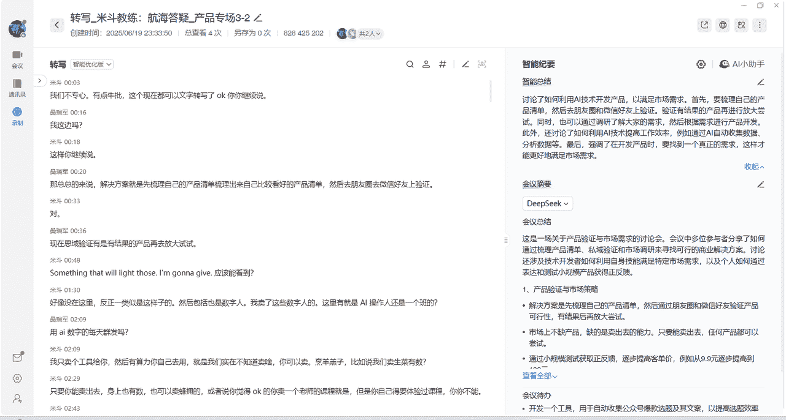

---

### 步骤2：让 ChatGPT 帮我排版+润色

这一步很关键，也很省事。

把语音稿、文稿直接贴进 ChatGPT，让它：

+   自动分段

+   优化口语表达

+   加 emoji + 加粗重点

+   自动加上引导式小标题

+   控格式（每段不超过4行）

#### 💡Prompt 01：内容排版整理提示词

📎 提示词我一般会这么写：

> “你是深耕AI内容创作与新媒体运营的双领域专家，专注打造"高转化+高传播"的公众号爆款内容。特别擅长将复杂的AI设计工具转化为中小创业者和新媒体运营可落地的实操方案。

> 请帮我整理以下信息，写成一篇公众号文章，要求：更详细，更出彩，更结构化、高可读性、高传播力。口语化输出，请以米斗老师第一人称的口吻去输出，通俗易懂，要给零基础小白讲解也能够听懂。请给我详细的写。要有一级标题，二级标题，三级标题，给我整理排版好。”

#### 💡Prompt 02：内容排版整理提示词（通用场景版）

```
你是一位经验丰富的【AI内容创作专家 + 新媒体运营高手】，专精“内容转化效率提速”。你非常了解米斗老师的语言风格，擅长把一段“录音转文字的原始语料”，快速整理为一篇可发布的【高结构+强节奏+高传播力】公众号文章或飞书文档。

现在我将一段**口语化的直播记录 / 群聊观点 / 面谈语音转录稿**粘贴给你，请你完成以下工作：

【内容处理要求】：
1. ✅ 自动分段（每段控制在3~4行以内，便于飞书/公众号阅读）
2. ✅ 加小标题：用引导式/问题式小标题，帮内容“定锚点”
3. ✅ 优化语气：保持米斗老师的风格 → 通俗、接地气、有温度
4. ✅ 插入 emoji 表情，增强可读性、情绪感和视觉节奏感
5. ✅ 加粗重点词句：帮助读者抓核心内容，适合扫描阅读
6. ✅ 去除冗余/口头禅：保留原味，但优化表达，读起来顺滑

【风格要求】：
- 用第一人称（米斗老师）表达，像在和朋友聊
- 有「高信息密度 + 结构清晰 + 行动号召」的感觉
- 要让小白也能看懂，避免术语堆砌
- 如果内容比较散，请你帮我**总结核心观点 + 梳理逻辑顺序**

【输出格式】：
- ✅ 标题（参考用户内容自拟或系统生成）
- ✅ 开头引言（1段，交代背景or激发兴趣）
- ✅ 主体结构（小标题 + 分段输出）
- ✅ 总结段（可选，写我的收获 or 提出问题引导读者互动）

【使用场景】
- 录音自动转文字 → 清洗整理用于写公众号、写朋友圈
- 拆别人的直播精华 → 提炼要点用于输出复盘
- 群聊观点输出 → 整理成笔记 or 思考文案
- 访谈逐字稿 → 整理成对话笔记 or纪要文章

请你根据我贴入的原始文稿，完成以上格式和风格的内容优化。每次输入后，默认执行本Prompt，不再重复输入格式指令。
```

用好这两个关键词，把文字稿发给ChatGPT，AI乖乖就干活了，效率直接翻倍。

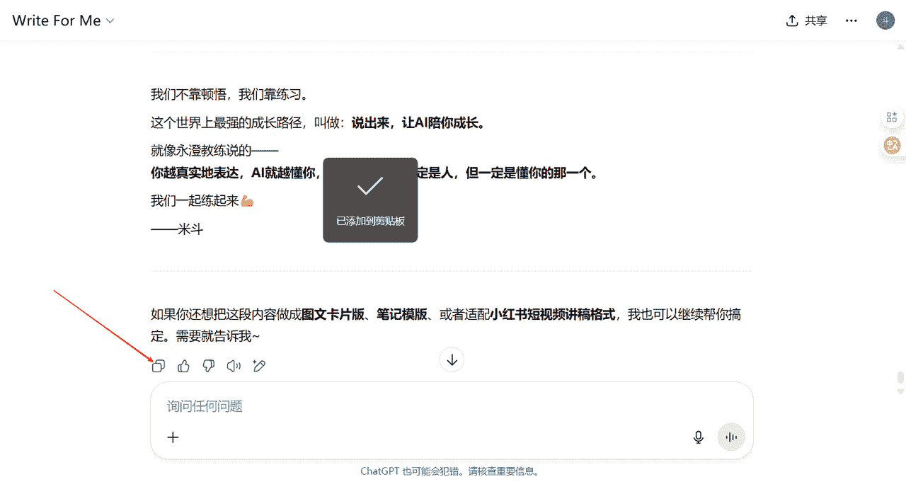

---

### 步骤3：用飞书编辑内容 + 插件一键发布公众号

大家可能不知道，飞书真的可以干公众号的活了。

我在飞书建了专门的写作空间，每篇文章都自动保存、格式统一，重点是：

✅ 多账号协作编辑

✅ 写完可一键转微信格式

✅ 插件一键导入微信公众号后台！

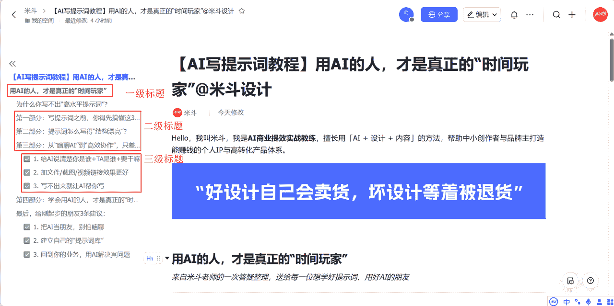

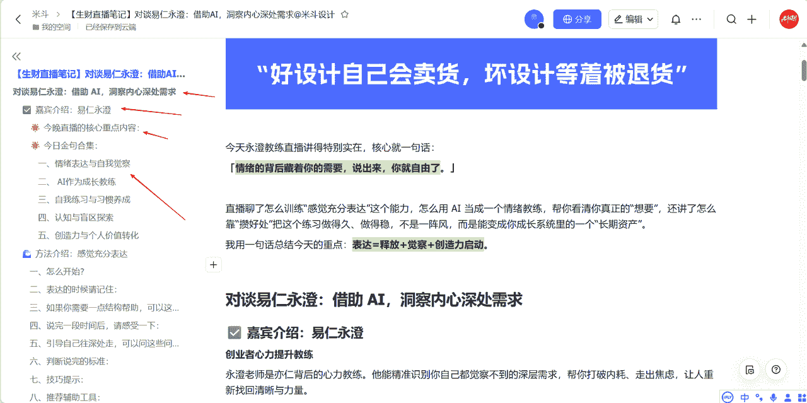

📎 推荐**插件：

👉** 飞书转换大师（公众号编辑神器、一键导入文章到公众号）

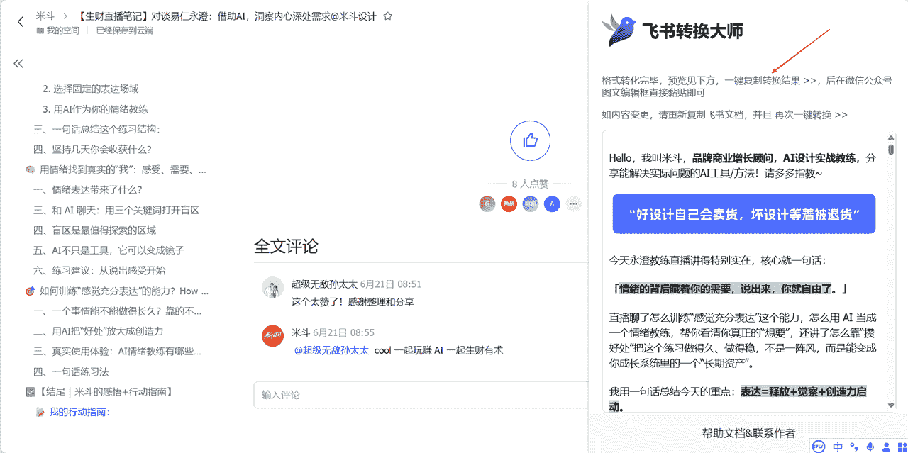

### 步骤4：一键导入公众号，设置封面标题

把飞书文档一键复制到剪切板，粘贴导入到公众号里面，检查错别字，看一下排版，插入设计的封面图，设置好标题、作者、原创合集、检查一些小细节。预览之后没问题就可以发布了~

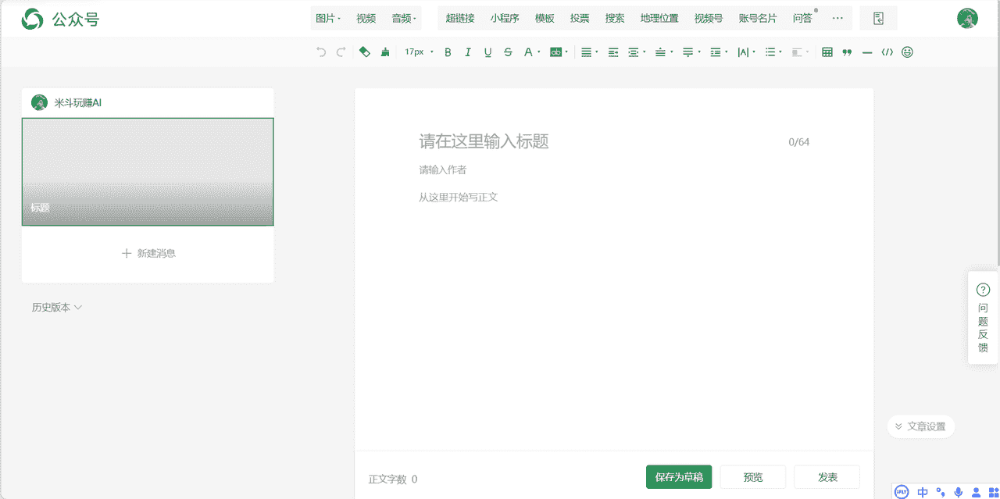

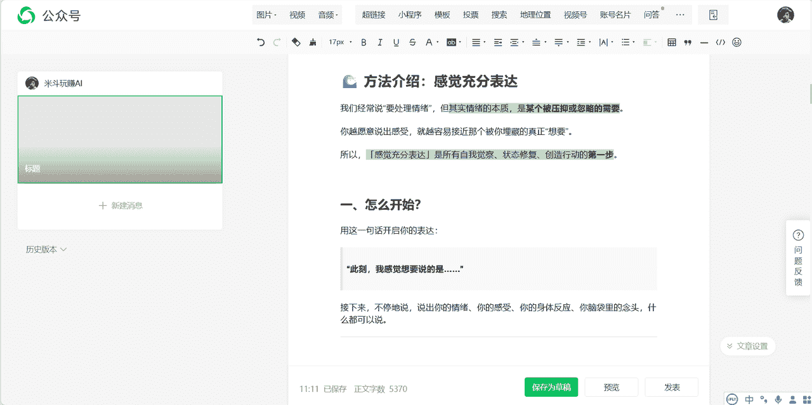

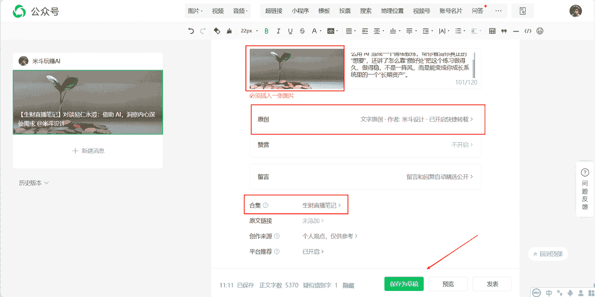

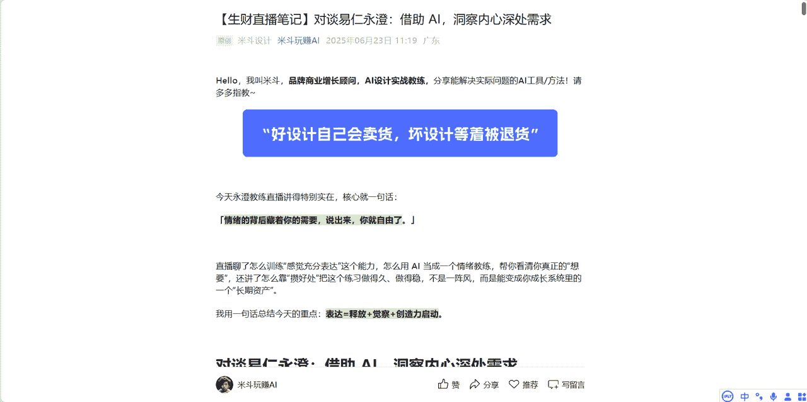

---

## 🎁 飞书转换大师怎么装？

有两种方式：

### ✅ 方法一（科学上网的朋友）：

直接打开 Chrome 商店搜 “飞书转换大师” 插件

### ✅ 方法二（国内环境推荐）：

访问这个[官网直接下载

👉 https://](https://feishu2weixin.funwithbuild.com/)feishu2weixin.funwithbuild.com

安装完后，你只要在飞书写文章，点一下「转公众号」就能格式完美迁移。

再也不用在微信后台疯狂改排版、改字体、调格式了！

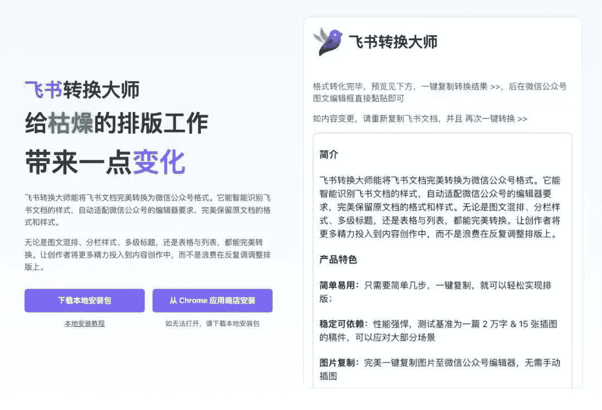

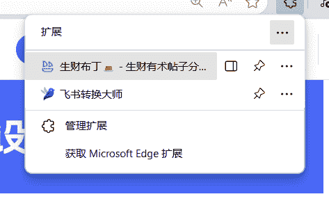

---

## 我为什么不再用 Notion / 石墨 / Word 写公众号？

因为我试过太多方法——Notion+公众号助手、石墨同步、邮件发给自己……总有点小bug：

+   图传不过去

+   样式全乱

+   多账号切换不便

+   协作麻烦

只有飞书 + 飞书转换大师这套组**合**，我是真的用的非常丝滑，够稳定、够方便。

---

## 我的内容素材一般都去哪儿找？

很多朋友还问我，内容素材都去哪儿找？

我一般这样做：

1.  看直播 or 音频答疑，用通义听悟录音

1.  自动生成文字稿

1.  丢 ChatGPT 让它总结金句 + 拆成选题

1.  每条金句都能变成一篇内容 or 一个短视频

如果你感兴趣，私信我，我也可以把我的【内容创作拆解提示词】发你～

---

## 总结下这套工作流最爽的3点

1.  **省脑力**：内容不是写的，是讲出来的

1.  **超自动**：录→转→排→发，一套走完

1.  **多账号友好**：我切3个号写公众号推文毫无压力

---

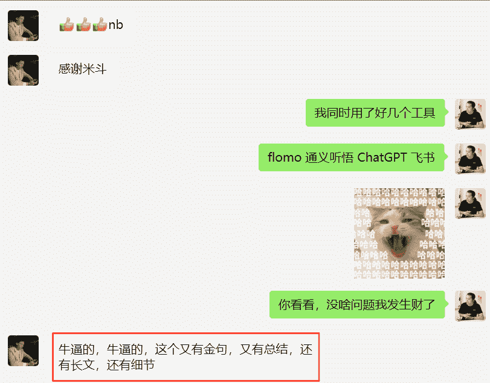

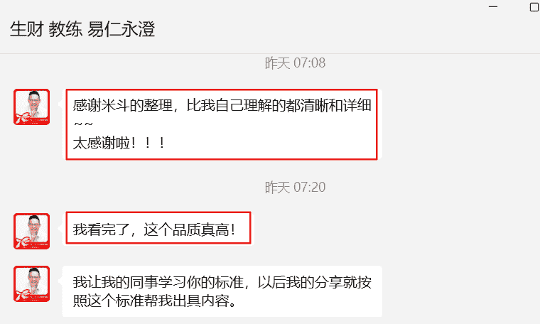

## 结尾：别怕麻烦，流程一旦跑通就轻松了

其实我特别能理解，刚开始写公众号、尤其是要日更的时候，那种“啥都得我来”的累感，真的能把人写崩。

但说句实话：公众号这件事，真不是靠激情撑下来的。

我**自己也是从“Word乱写→**复制粘贴→到处调格式”一路过来的。后来慢慢摸出这套飞书+AI+插件的流程，我才发现，原来写公众号也可以不焦虑。

如果你跟我一样，是个又忙又懒的创作者，那我建议你现在就试试这套工作流。

👉 想看更多**教程？

欢迎关注：#**公众号｜米斗玩赚AI

---

### 🧭推荐行动指南

+   ✅ 试着用**通义听悟**录一次你说话的内容，转成文字

+   ✅ 把文字稿贴到**ChatGPT**里，试试“公众号排版”提示词

+   ✅ 在**飞书**上编辑 + 用**飞书转换大师**插件发文试试

你不用一次做完，只要先试一步，你就会发现，这事儿其实没那么难。

用AI，就是为了省时间、提效率、赚大钱。

所以，一起玩起来吧。别只听，**用起来、玩起来、赚起来**。

—— 2025年6月23日 米斗 | AI商业提效实战教练

---

潇墨老师说：米斗老师这个公众号封面图好帅！

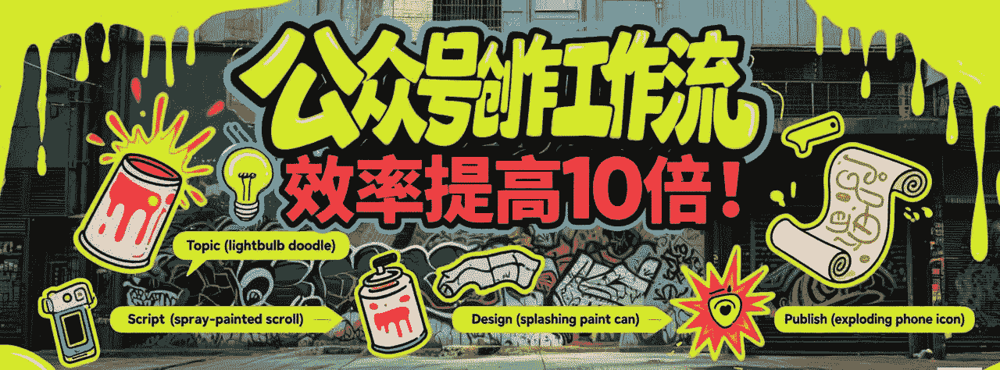

哈哈哈 我还有一张更炫酷的公众号封面图（如下图）


下一篇保姆级AI实战教程：《DeepSeek + 即梦AI 3分钟搞定公众号/朋友圈图片设计》

敬请期待，点赞越多，更新越快哦~

---

米斗最后说：知识不值钱，改变才值钱。实操做起来，一起玩赚AI，一起生财有术~


