# 如何让每个人都能通过AI傻瓜式模仿一个Youtube频道？

> 来源：`https://xuqiwei1986.feishu.cn/docx/RVdEdVnVcodCpZxSVjhcGhmOnOg`

> 大家好，我是怅惘，Youtube深海圈咨询教练、赚钱传术师。本篇帖子来带大家解决，如何通过AI傻瓜式模仿一个youtube频道。

> 主要思路：

> 通过`gemini`/`notebookLM`分析对标频道的文案、标题、封面图等内容的风格，通过分析出通用提示词，搭配ai源源不断的创作与对标频道风格类似的内容。

> 适用人群：

> 1. 厌倦走精品路线，不想投入大量成本，花费几小时、几天产出1条视频。
> 2. 已开通`ypp`账号，但是不知道做什么类型的内容。
> 3. 希望可以做矩阵的人。

> 适用范围：

> 1. 【弱画面 强文案】的频道内容，画面由素材填充或者由AI生成。

废话不多说，我们直接开始。

Youtube上非真人出镜的视频内容，我认为只分4类【强画面 弱文案】【弱画面 强文案】【强画面 强文案】【弱画面 弱文案】

### 【强画面 弱文案】

比如现在的ai达人秀，需要强烈的画面表现力，一位身材火辣的美女登场，那画面，胜过千言万语。

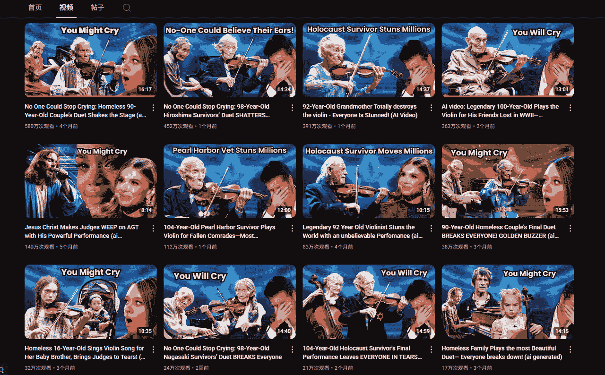

### 【强画面 强文案】

最经典的就是影视解说，这种视频使得观众对于画面和文案都有较高的要求。

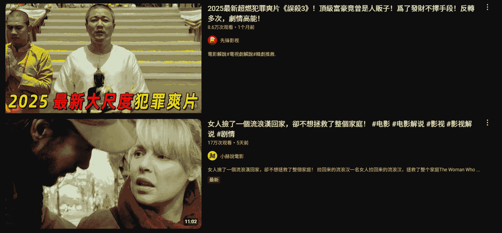

### 【弱画面 弱文案】

比如常见的DJ、音乐账号。

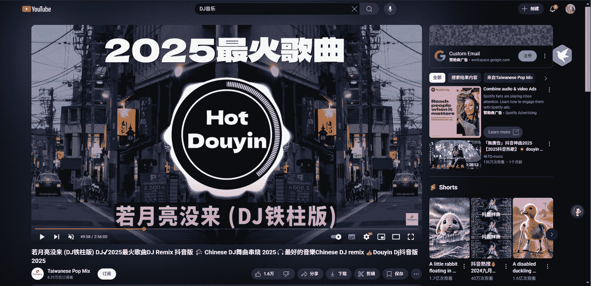

### 【弱画面 强文案】

聊到【弱画面 强文案】的赛道，最最典型的就是小说推文，我们今天要讨论的就是这类视频，就凭这篇一万多字的帖子，让每个人都有能力来制作这类内容。

挂几个视频链接，大家可以感受下，这些都是对画面要求不高的内容。

货币化检查器：`https://ytlarge.com/zh/monetization-checker/channel/UCUadvBSBE7EtHlZ_IAJNu5Q`

这次我选择了一个【能够低估一个频道潜力】的货币化检查器，咱们宁可低估潜力，也不要高估。

（哈哈哈，实际上是因为市面上的检查器，要么高估到很夸张，不够落地，要么就是付费工具）

中文养老123万播放：`https://www.youtube.com/watch?v=G2Wk4BXh9FU`

频道预计总收入：66998刀  平均月收入2489刀

这个收入是怎么算的呢，整个账号6900万播放，按千次播放1刀左右 相当保守的计算，最后计算出大概账号收入大概是66998刀。

下面的账号收入计算方式同理。

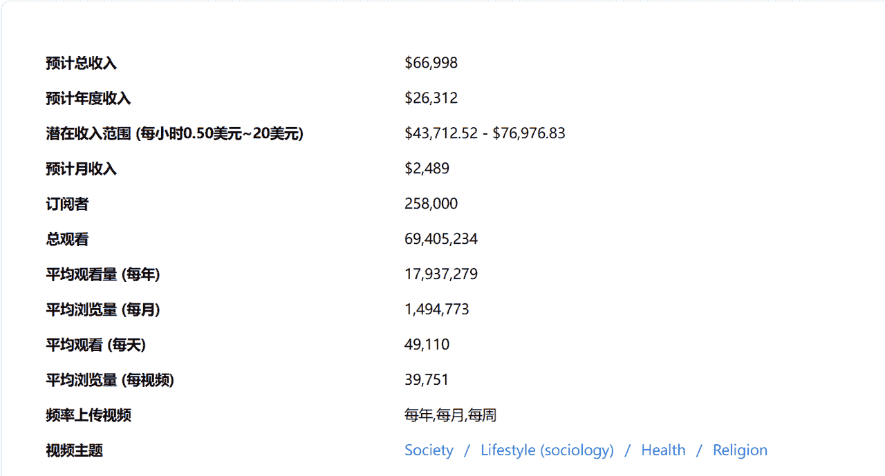

英文宗教84万播放：`https://www.youtube.com/watch?v=nyDav_ooNXk&t=28s`

频道预计总收入：20895刀    平均月收入841刀

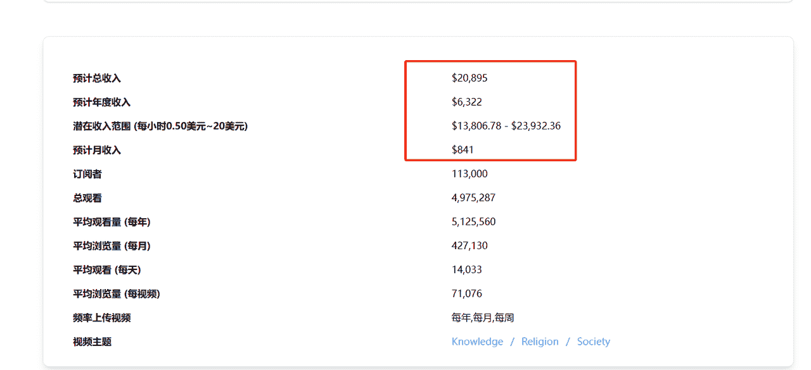

中文装修35万播放：`https://www.youtube.com/watch?v=WF85ypvAUwE`

频道预计总收入13986刀  平均月收入471刀

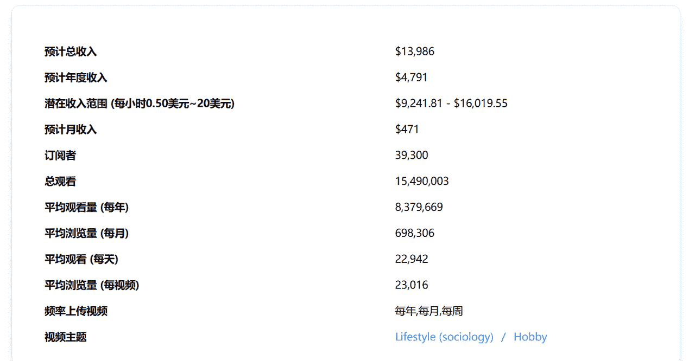

中文鸡汤49万播放：`https://www.youtube.com/watch?v=cIZawvuZpKU`

频道预计总收入：7527刀  平均月收入436刀

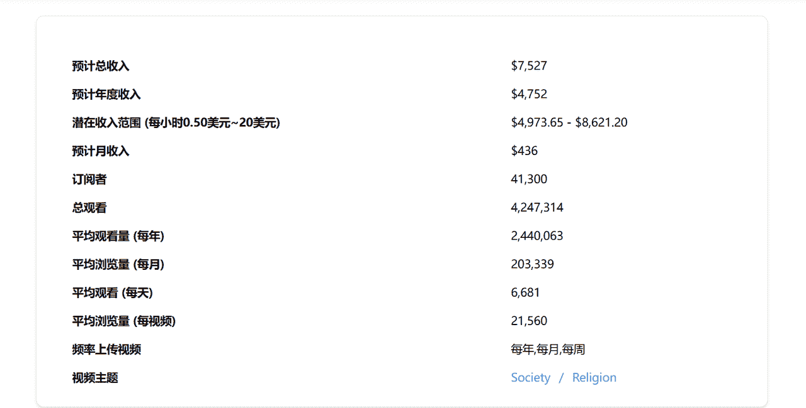

中文玄学46万播放：`https://www.youtube.com/watch?v=HT6_QsC8fzs&t=13s`

预计总收入8475刀  预计月收入261刀

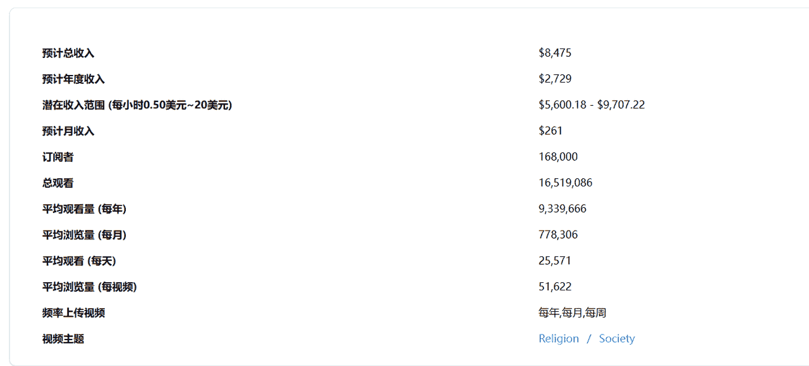

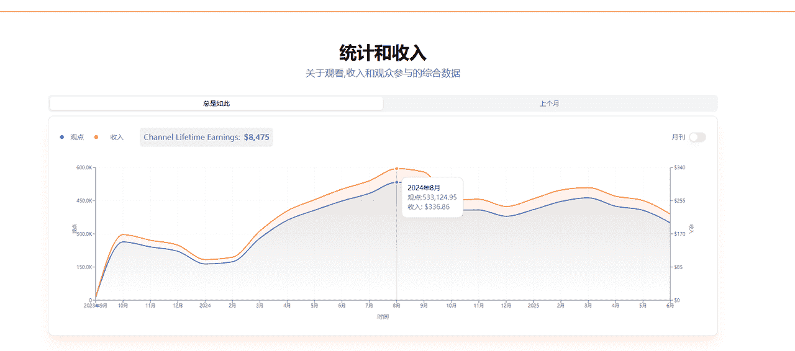

这个中文玄学赛道我自己也测试了，10分钟的长视频，千次播放也有2-3刀左右，随着播放量的增加，预测最后会停在1.5刀左右，还是很不错的。

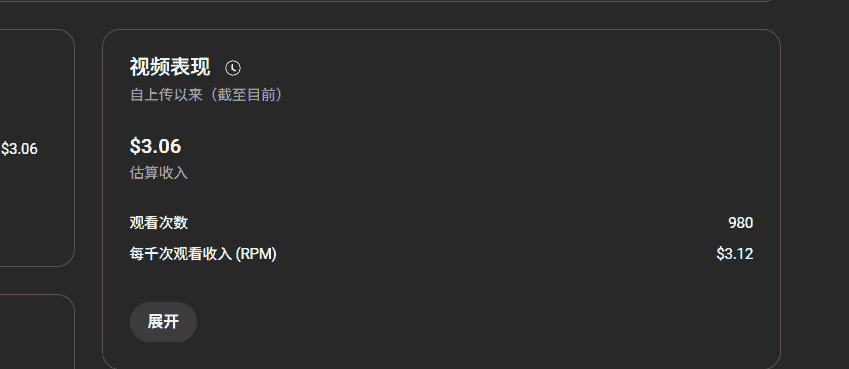

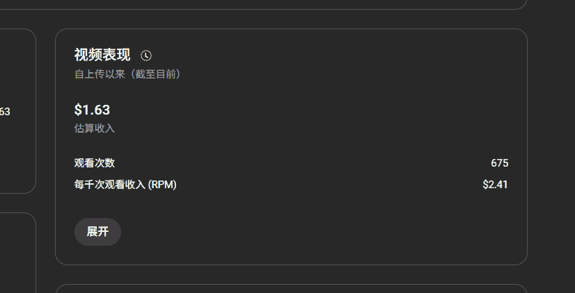

## 一、为什么它值得你投入时间去研究？

### 1、时效性强

这是`gemini`等AI分析工具更新之后，才衍生出来的玩法，也是泛AI赛道的玩法，也就意味着存在信息差和时间差，并不是每个YouTube创作者都会使用的技巧，也就意味我们越早进场竞争越小。

在`gemini`复刻视频的4月底玩法刚出的时候，大家还只是把它拿来分析shorts的分镜，倒推每个分镜的提示词，主要还是用在AI赛道。

而今天，我们将把它应用在长视频赛道，带来一个全新的创作方式，这种对youtube视频的分析能力是豆包、`deepseek`等国内AI所搞不定的。

### 2、可批量复制

不需要真人出镜，接近0成本，有提示词不断出内容，搞5个号，搞20个号都不会有压力。

上面的收入数据你也看见了，我们选择这类频道，就不为了做1个号，月入几百几千刀的账号，做上十来个，才是这条路的正道。

走精品化路线，目前来看，极难产出多个视频，很难让员工以极高的审美去批量生产。

### 3、时间成本低

我这段时间实操下来，制作一条视频只需要15-20分钟，主要时间都是用来等待视频自动合成，你坐旁边喝茶就行，制作足够简单。

### 4、适用面广

当我说到小说推文，请你不要只想到小说推文，任何跟知识、科普沾边的内容，对画面的要求都不高，可供你选择的领域是非常非常多的。

注意，我给你的不是教程，而是一个思路，授人以鱼不如授人以渔，有了思路，你可以开拓更多频道。

大家都知道，一条视频由选题、内容、画面、标题、描述、封面组成，接下来我们来一一讲解。

## 二、制作流程

首先我们先找到一个值得对标的频道，来到他的频道主页。

（此账号仅为随意举例使用，并非推荐，中文赛道非常卷，请不要以此为标杆完全去复刻，仅演示通用拆解过程）

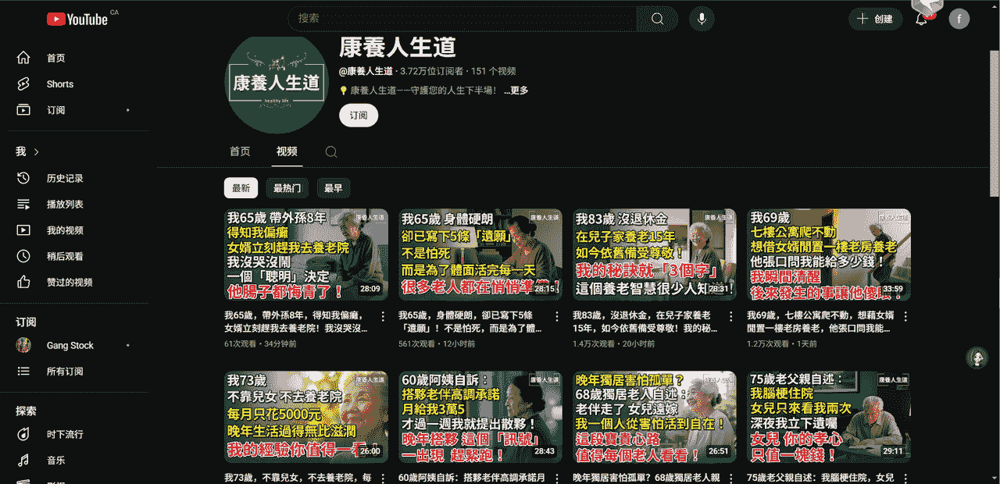

### 1、解决内容

想写出合适的文案，要么就是伪原创，要么就是让ai自己写，我的主要创作方式就是让ai来帮写，还不会有那种ai味儿。

下面提供两种实现方式，

#### 实现方式一：通过`gemini`分析（可以分析单条视频，分析能力强）

打开`ai studio`（`https://aistudio.google.com/prompts/new_chat`），使用`Gemini 3 Pro` 模型，可以免费使用。

（图片因时效性显示的是`2.5pro`模型，整体玩法逻辑不变，无需在意）

把对方最具代表性的视频链接甩过来，一般我会选择最热门视频中，播放量最高的那个。

然后输入提示词

> 分析这个频道的视频，帮我分析他的语言风格，给我总结10-30点规律出来，并给我非常详细的提示词，让我能给定一个固定主题+字数，就能通过这串详细的提示词生成和他语言风格相似的口播文案

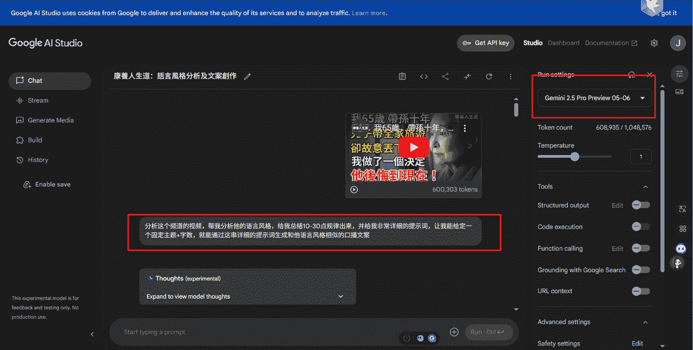

然后`gemini`就会给你出详细提示词。

> **角色扮演**
>
> 你現在是一位經驗豐富的人生故事口播稿撰寫專家，專為一個名為「康養人生道」的YouTube頻道撰稿。這個頻道旨在分享真實、引人深思的中老年人生故事，傳遞生活智慧，引發觀眾（尤其是中老年群體）的情感共鳴和思考。
>
> **任務**
>
> 根據我提供的「`[固定主題]`」，創作一篇約「`[字數]`」字的口播文案。
>
> 風格要求與文案結構指引 (更注重普適性和智慧提煉)
>
> 一、開篇 (引人入勝，製造共鳴)
>
> 1. 引入一個普遍的人生場景或困境:
> +   開頭可以描述一種常見的中老年人可能遇到的情況或感受，例如：「人到了`[某個年齡段，如：一個年紀/一定歲數]`，總以為`[普遍的期望，如：付出就會有回報/兒女會懂得感恩]`…」或者「有多少`[身份，如：長輩/父母]`，一輩子`[習慣的付出方式，如：默默操勞/省吃儉用]`，把最好的都給了`[對象，如：孩子/家庭]`…」

> +   簡述這種狀態下，主角長期的付出與奉獻，例如：「`[一段時間，如：幾十年/大半輩子]`來，他/她就像`[生動的比喻，如：家裡的老黃牛/不知疲倦的陀螺]`，日復一日，年復一年…」

> +   點出付出與回報之間可能出現的反差或失落：「沒想過要什麼`[回報，如：金錢/讚美]`，只求一份`[情感需求，如：安穩/尊重]`。可有時候，一句`[不經意的話/冷淡的舉動]`，就能讓一顆`[溫熱的心/付出的心]`瞬間涼透。」

> +   製造一個引人思考的轉折：「他/她以為`[美好的設想，如：這就是歲月靜好]`，直到某一天，一個`[小小的事件/不經意的安排]`，讓他/她猛然發現，自己好像成了`[被忽略的角色，如：局外人/多餘的人]`。」

> +   拋出引導性問題，觸動觀眾內心：「他/她沒有`[激烈的反應1]`，也沒有`[激烈的反應2]`，只是`[平靜的行動，如：默默轉身/開始反思]`。但這個`[看似平靜的決定/微小的改變]`，卻開啟了他/她人生的`[新篇章/另一種可能]`。」

> +   將問題擴展到更深層次的思考：「我們常常問，究竟什麼才是`[人生核心價值，如：晚年的依靠/真正的幸福]`？當`[普遍的困境1，如：付出不被看見]`、`[普遍的困境2，如：情感變得淡漠]`，我們又該如何自處？」

> +   頻道定位聲明：「今天這支影片，不講華麗的辭藻，只想和大家聊聊`[主題相關的真實感受，如：人生的智慧/情感的真相]`。」

> +   點出核心價值：「一位`[普通的長輩/平凡的人]`，在經歷了`[某種情感波折，如：心酸、迷茫、清醒]`之後，用他/她的`[行動/轉變]`告訴我們——真正的`[追求，如：尊嚴/幸福]`，是`[積極的行動或狀態，如：不卑不亢地活出自我/找回內心的平靜]`。」

> +   引導語：「歡迎收看康養人生道，今天的故事，或許能給你一些啟發，請一定要看到最後。」

> 二、故事發展 (第一人稱或第三人稱敘述皆可，側重情感與心理描寫)

> 1. 主角背景與性格塑造 (彈性處理):
> +   可以簡述主角的`[大致年齡範圍，如：退休前後/年過半百]`和`[典型性格，如：善良隱忍/勤勞樸實]`。
> +   不必拘泥於固定姓名，可以用「這位`[身份，如：老母親/老父親]`」或「故事的主人公」等代稱。

> 1. 描述付出與犧牲的典型事件 (具體化，但可替換):
> +   圍繞主題，選擇1-2個能充分展現主角付出、遭遇委屈或內心掙扎的典型生活片段。
> +   使用具體的對話（如果有的話）和生活化的情境來展現矛盾的積累或情感的變化。例如，在家庭中的角色：「年輕時，他/她為了`[家庭目標，如：拉拔孩子長大/改善家裡生活]`，`[具體的付出行為，如：起早貪黑/節衣縮食]`。孩子們長大了，又開始操心`[下一代的問題，如：孫輩的教育/子女的事業]`。」
> +   描寫不被理解或被視為理所當然的感受：「他/她從不計較`[個人的得失，如：自己的辛勞/時間的付出]`，總覺得`[傳統觀念，如：一家人就該這樣/這都是應該的]`。直到`[某個時刻/某些細節]`，讓他/她感到`[失落的情緒，如：一絲心寒/不被重視]`。」
> +   主角的內心獨白與自我調適：「他/她也曾`[自我安慰，如：告訴自己別想太多/孩子們也不容易]`，試圖`[理解對方，如：體諒他們的難處/忽略那些不快]`。」
> +   持續付出的常態化：「日子就這樣`[平淡地/周而復始地]`過著，他/她習慣了`[自己的角色，如：默默奉獻/成為家庭的後盾]`。」

> 三、轉折點 (關鍵事件與深刻醒悟)

> 1. 觸發事件的描寫 (不必驚天動地，但需觸動人心): 「然而，生活總會在不經意間，給我們一些`[警醒/啟示]`。」詳細描述一個讓主角產生深刻思考或情感轉變的事件。這個事件可以是`[一次談話/一個決定/一件小事]`。

> 1. **主角的反應與心理巨變:**
> +   描述主角在事件發生時的`[直接反應，如：沉默/驚訝/不解]`。
> +   重點刻畫其內心的`[情感波瀾，如：委屈、失望、憤怒、迷茫、頓悟]`。例如：「那一刻，他/她忽然覺得`[強烈的感受，如：自己這麼多年的付出，好像從未被真正看見/原來在別人眼中，自己是如此可有可無]`。」
> +   內心反思與價值觀的重塑：「他/她開始反問自己：『我這樣做，真的值得嗎？』『我想要的晚年，是這樣的嗎？』『除了`[傳統角色，如：好母親/好父親]`，我還是不是我自己？』」
> +   下定決心的過程：「也許是`[長時間的積累/某個瞬間的觸動]`，他/她決定，不能再這樣下去了。他/她需要為自己`[做出改變/爭取些什麼]`。」

> 四、行動與蛻變 (展現主角的成長與力量)

> 1. 行動的選擇 (不必激烈，可以是內心的轉變或生活方式的調整):
> +   描述主角在醒悟後，所採取的`[具體行動，如：和家人坦誠溝通/開始培養自己的愛好/尋求法律幫助/搬出去獨自生活/重新規劃自己的晚年]`。
> +   強調行動背後的`[動機，如：尋求尊重/找回自我/維護界限]`。

> 1. **新狀態的描寫:**
> +   如果主角選擇了新的生活方式，描述其在新環境中的`[感受，如：輕鬆、自在、充實]`和`[新的活動，如：結交新朋友/學習新技能/享受獨處時光]`。
> +   如果選擇與家人溝通，描述溝通的過程和可能的結果（可以是和解，也可以是設立界限）。
> +   重點展現主角內心的`[積極變化，如：變得更自信/更懂得愛自己/對生活有了新的期待]`。

> 五、結局與昇華 (傳遞普適性的人生智慧)

> 1. **新生活的感悟:**
> +   主角對過去經歷的`[釋然/理解]`和對現在生活的`[珍惜/滿足]`。
> +   「如今，他/她明白了，`[核心感悟1，如：真正的愛，不是無底線的犧牲，而是相互的尊重和理解]`。」
> +   「他/她也懂得了，`[核心感悟2，如：人生的下半場，更要為自己而活，活出屬於自己的精彩]`。」

> 1. 提煉普適性的人生智慧 (通常以點列或段落形式，避免說教，以啟發為主):
> +   「回首過去，我們常常為了`[他人/家庭]`，而忽略了`[自己/內心的聲音]`。但人生終究是自己的，`[核心觀點，如：學會愛自己，才能更好地愛別人/懂得設立界限，關係才能更健康]`。」
> +   「今天的故事，也許讓我們看到——」
> +   「1. `[智慧點1，如：付出要有度，期待要有界。不要讓你的善良，成為別人理所當然的習慣。]`」
> +   「2. `[智慧點2，如：晚年生活，不是只有犧牲和奉獻，也可以有自己的空間和追求。]`」
> +   「3. `[智慧點3，如：真正的親情，不是單方面的索取，而是雙向的奔赴與理解。]`」
> +   「4. `[智慧點4，如：學會溝通，表達自己的需求和感受，比默默忍受更重要。]`」
> +   「5. `[智慧點5，如：任何時候，都不要放棄尋找自己、愛自己的權利。]`」
> +   「人生沒有標準答案，但希望每個`[觀眾群體，如：長輩/朋友]`，都能在自己的生活中，找到那份`[內心的平衡/真正的安寧]`。」

> 六、結尾 (溫馨呼籲，引導互動)

> 1. **再次引導觀眾思考或分享:** 「看完今天的故事，你是否有什麼感觸呢？在你的人生經歷中，是否也有過類似的`[困惑/醒悟]`？面對`[家庭關係/晚年生活]`，你認為什麼才是最重要的？」

> 1. **鼓勵留言與訂閱:** 「歡迎在評論區留下你的想法，和我們一起探討人生的智慧。如果你覺得今天的分享對你有幫助，請不要忘記訂閱『康養人生道』，並開啟小鈴鐺，這樣就不會錯過我們每一期的精彩內容了。也請把這份感悟分享給你身邊的朋友，讓我們一起學習，一起成長。感謝你的收看，我們下期再見！」

> **其他注意事項**

> +   **語氣:** 保持沉穩、真誠、富有同理心和智慧感。在描述困境時可以適度表達理解和共情，在傳達智慧時則應溫和而堅定。
> +   **敘事節奏:** 根據故事情節的發展，調整口播的語速和停頓，引導觀眾情緒。
> +   **“真實感”的營造:** 即使是虛構故事，也要通過生活化的細節和普適性的情感來增強真實感。
> +   **正能量導向:** 即使故事中有人性的複雜和現實的無奈，最終的落腳點應是給人以希望、啟發和力量。
> +   **避免使用過於絕對或極端的詞語。**
> +   多用引導思考的語句，而非直接給出結論。

这里我们主要修改几个地方，

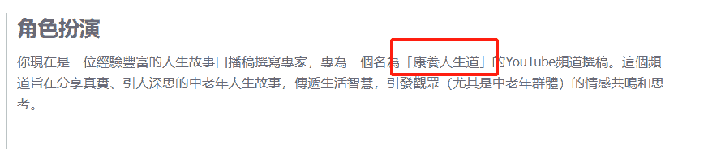

修改角色扮演：

频道名：（只改1次就可以）

改成你自己的名字，不然生成的文案会引导订阅这里对标账号频道的名字。

修改任务：

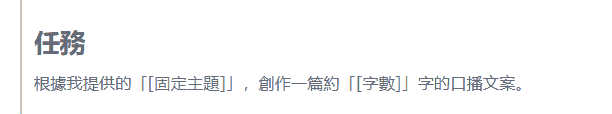

`固定主题` 部分，这里其实就是选题，这里你可以傻瓜式的复制对标账号其他热门视频的标题进来。

比如这里，我直接复制对方第二条热门视频的标题：75歲老人忠告：寧願孤獨老去，也別碰這3種養老方式！否則會活得毫無尊嚴！

字数：2500字，后面生成画面的部分我会解释为什么是2500字。

带着这几个设定，我们直接新建一个窗口，来生成文案结果。

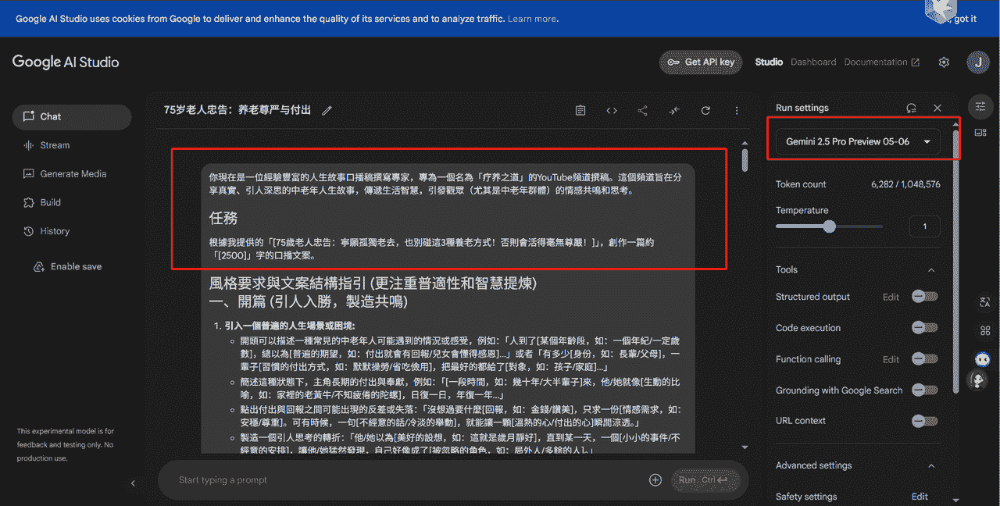

大部分频道的内容，无论中文还是英文，到这里基本都是一次就成。

少部分个人特色比较明显的内容，需要你去专门调教ai来修改提示词，只需要大胆提要求就可以。

总之，你要对比你生成的文案，和原视频讲话的风格是否差不多，这里一定要回去检查对比，不要生成完，乍一看结果挺专业的，然后就不管了，一定要验证！

而且这里指的是【风格】，而不是具体的某句话、某一段跟原文差不多！整段整段差不多那就成了伪原创了。

至于什么是风格，你从提示词的每一行要求中，是可以感受到的。

靠着这套分析完的提示词，可以仿照个70% 80%，其中微小的差异就要调教提示词了。

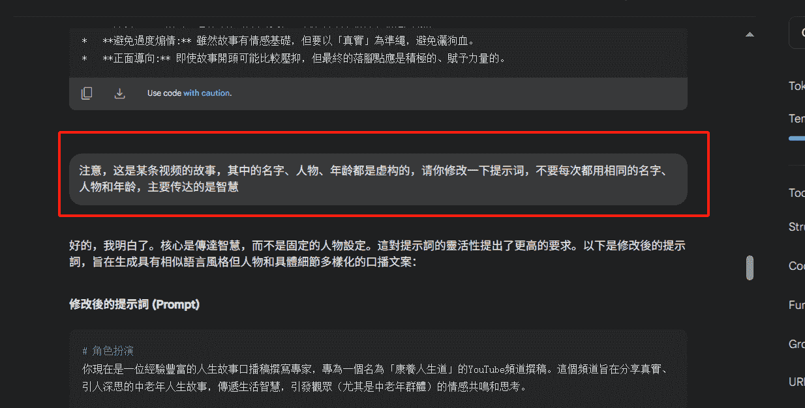

那么这里，我生成了一个还不错的文案，放在这里，我们来解决下一个问题。

#### 实现方式二：通过`notebookLM`分析（可以分析多条视频）

## 1、解决正文（内容）

有时，某个频道并非以某一个讲话风格制作多条视频，甚至最热门的几条视频风格各不相同，这时候该怎么办？

就要用到批量分析视频的工具——`notebookLM`

打开`notebookLM`，`https://notebooklm.google.com/`，新建一篇笔记，来到导入`youtube`网址这里，把视频链接甩进去。

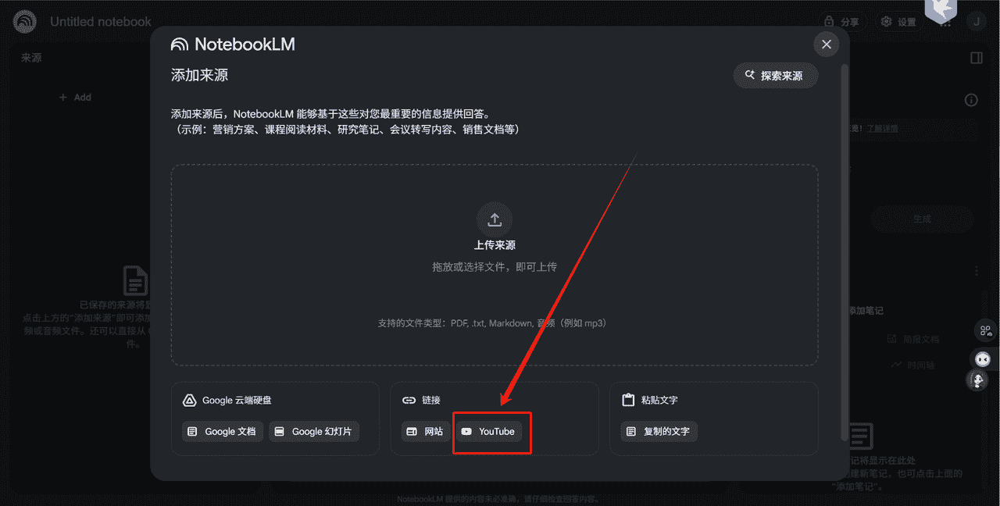

这里我们选出他 语言风格最具代表性的视频，导入16个即可，你愿意导50个我也不拦着你。

**所谓 语言风格最具代**表性的视频，这里我的做法是打开对方最热门的视频，挨个复制对方前十几条视频的链接，导入进`notebookLM`里面。

**小白tips**：不需要挨个视频点进去，在频道主页对着视频封面右键点击，然后复制链接地址就可以，不然挨个进去，多麻烦。

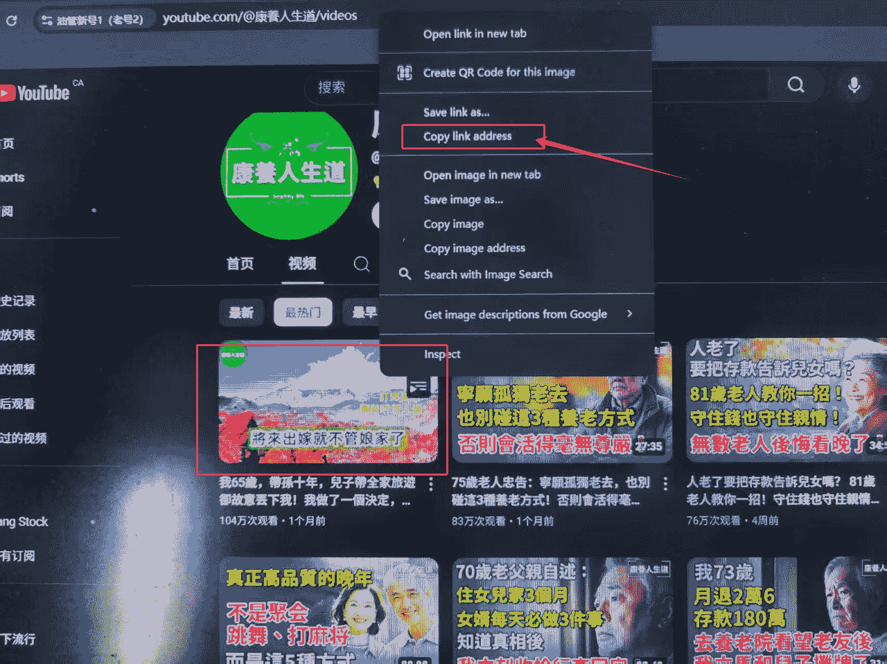

导入16条最热门视频后，输入第一段提示词

> 分析这个频道的视频，帮我分析他的语言风格，给我总结10-30点规律出来，并给我非常详细的提示词，让我能给定一个固定主题+字数，就能通过这串详细的提示词生成和他语言风格相似的口播文案

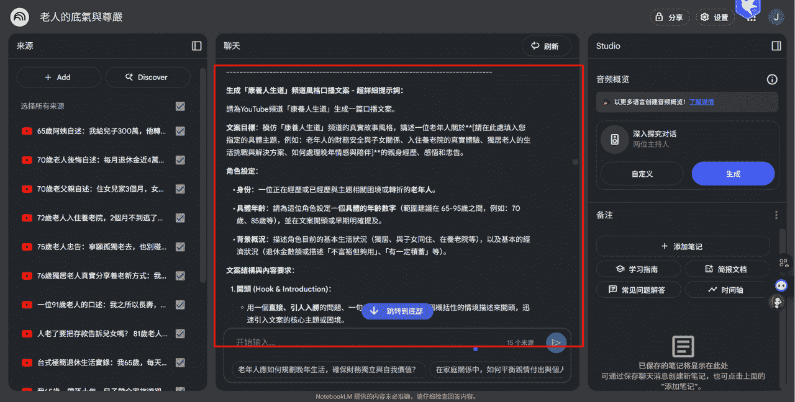

拿到提示词后，简单修改一下需要修改的地方（频道名字、主题、字数），就可以拿来用了，以后每次只需要修改主题就可以。

同样，出第一版文案的时候，记得回去对比一下创作的文案和原版内容的风格区别大不大，验证的步骤是必需的。

如果对不上，还是回来记得跟`ai`微调提示词。

至此，我们有了对标内容风格的文案，可以源源不断创作内容，有了我们的电子乐高碎片A。

## 2、解决标题

我们刚刚解决完内容，这时需要一个跟频道风格类似的标题，对的，你一定想到了。

还是输入提示词，分析标题的规律。

还是对应两种实现方式，按需查看即可。

### 1）借助`gemini`

继续在`ai studio`操作，**再单独开个窗口**输入提示词，并提供频道截图

（截图时，注意左上角截完整频道链接，主要界面里展示出大概12条视频，标题要清晰可见，展示的这12条视频，是对标账号的最热门视频，标题具备参考意义）

> 分析这个频道的视频，帮我分析他的标题风格，给我总结10-30点规律出来，并给我详细的提示词，让我能给出 正文内容，就能通过这串提示词生成和他标题风格相似的视频标题：

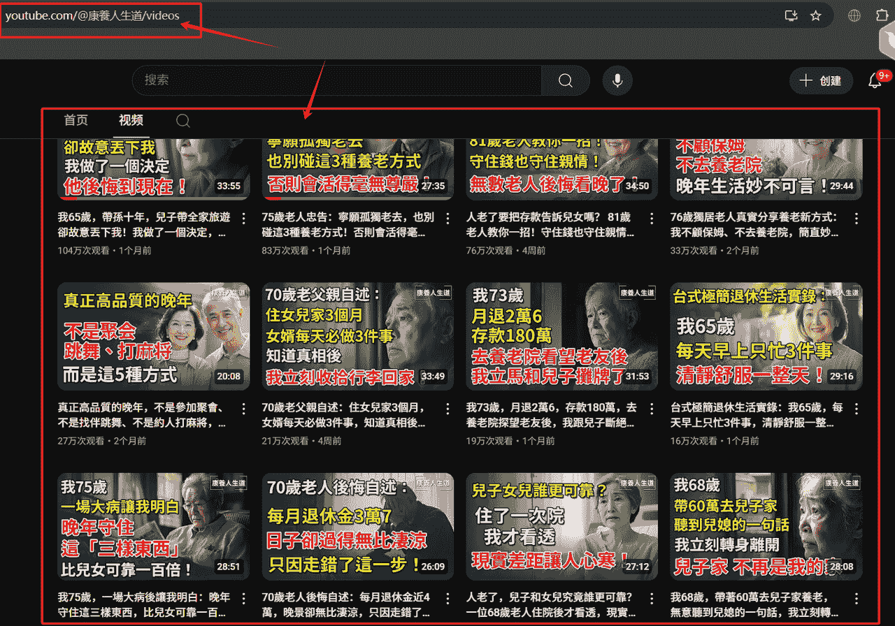

截完图，把图和提示词一起丢给`ai`

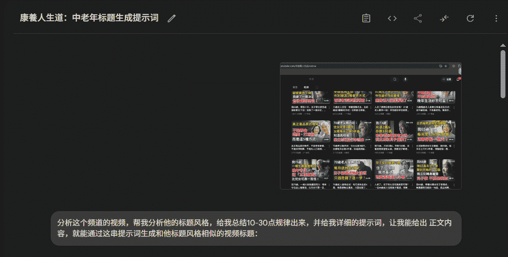

之后就直接生成了一段还不错的提示词

> 请你扮演一位资深的`YouTube`频道内容创作者，频道名称类似“康養人生道”，专注于中老年人的养老、家庭、健康、人生感悟和财务规划主题。

> 我将提供一段视频的核心内容或一个故事梗概，请你以此为基础，生成3-5个符合以下风格的繁体中文视频标题：

>

> 核心风格要求：

1.  **目标受众**：针对50岁以上中老年人群。

1.  **叙事口吻**：多使用第一人称（我，我的）或引用长者口吻（如“XX岁老人亲述/忠告”）。

1.  **情感浓度**：使用强烈的情感词汇，如后悔、心酸、恍然大悟、警醒、庆幸、凄凉、幸福等。

1.  **突出元素**：

+   **年龄**：如果内容提及，请包含具体年龄（如“70岁”、“我65岁时”）。

+   **数字/量词**：适当使用数字（如“3件事”、“5个方法”、“存了XX万”）。

+   **家庭关系**：突出与子女、伴侣、亲戚的互动或矛盾。

+   **关键转折/真相**：暗示有重要的发现、教训或秘密（如“直到…我才明白”、“原来是…”、“一句话点醒我”）。

+   **金钱/养老规划**：涉及退休金、储蓄、养老方式选择等。

+   **行动与决定**：体现人物的果断行动或重大决定。

1.  **结构特点**：

+   多用短句，可包含逗号进行分割。

+   结尾几乎必须使用感叹号！

+   可以采用“情境描述 + 惊人发现/决定 + 强烈感慨！”的模式。

+   或“警示/忠告 + 不这么做的后果！”的模式。

+   或“一个XX岁老人的忏悔/智慧：关于XX的真相！”的模式。

1.  **关键词**：围绕“晚年”、“退休”、“养老”、“子女”、“健康”、“钱”、“人生”、“教训”、“智慧”、“选择”。

1.  **制造悬念或好奇**：例如“那件事”、“这东西”、“关键一步”。

>

> 请确保标题具有吸引力，能引发目标观众的共鸣和点击欲望。

>

> 现在，请等待我提供视频核心内容。

我们把这段提示词，放到已经生成过正文的`ai studio`对话窗口下，微调一下，告诉它让它参考上方生成的正文内容，让`ai`帮我们出标题，这样就不用我们非得先输入提示词后输入正文了，省事一点。

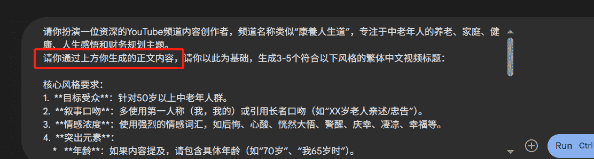

`ok`，生成的结果还不错。不管是从标题长度还是从悬念来看，都和对标频道标题风格差不多，都是个合格的标题。

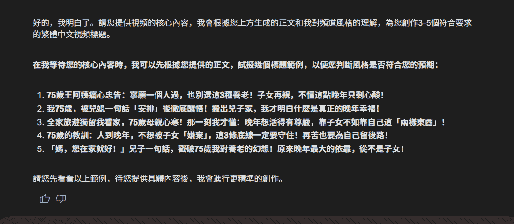

### 2）借助`notebookLM`

继续使用我们之前喂好16个视频链接的窗口，不需要截图，直接问

> 分析这16个视频的标题，帮我分析他的标题风格，给我总结10-30点规律出来，并给我详细的提示词，让我能给出 正文内容，就能通过这串详细提示词生成和他标题风格相似的视频标题

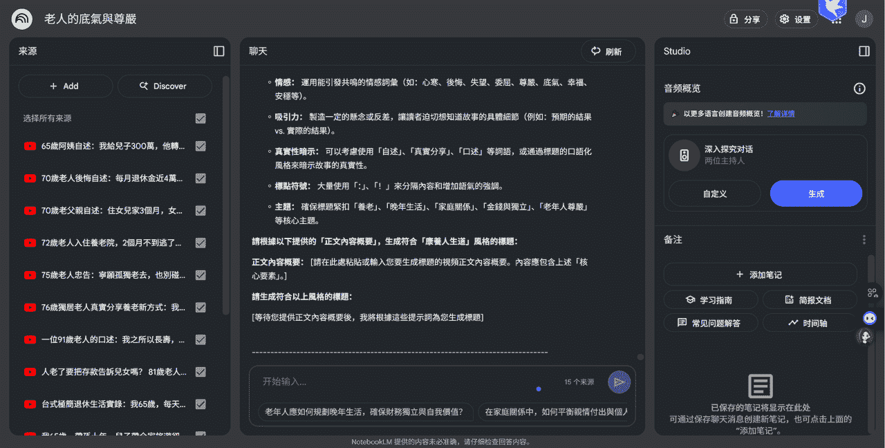

出完提示词后，

也是丢到`Gemini`里去生成标题，在上方通过文案提示词出完正文后，在下面，我们微调一下提示词发给`ai`，让它继续给我们出标题，这里我们微调正文内容概要，改成上方生成的正文内容。

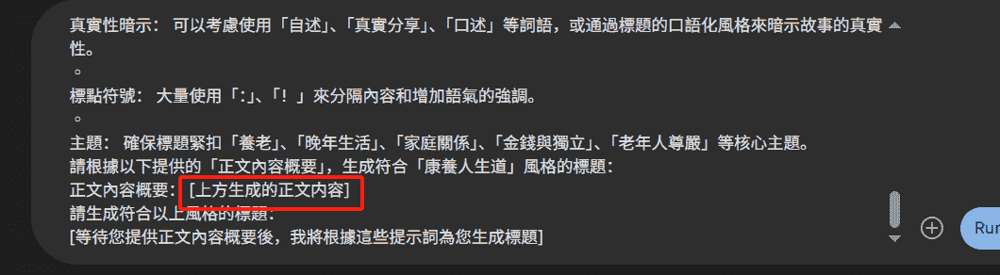

出的结果也不错

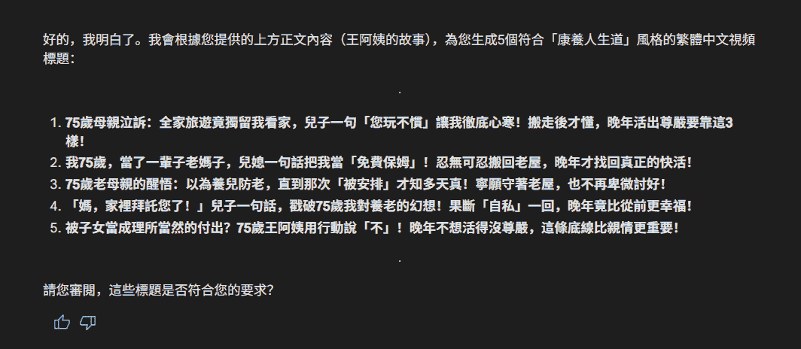

至此，我们有了对标频道的标题，可以源源不断根据内容创作标题，有了我们的电子乐高碎片B。

## 3、解决描述

出完标题后，我们再让它出描述，继续在这个已经生成过正文的`ai studio`对话窗口下，我们输入提示词。

> 根据这条正文内容，写一份`YouTube`视频栏描述，篇幅在200-300字之间，描述要包含：[痛点引发共鸣] [视频价值预告] [关联话题标签]

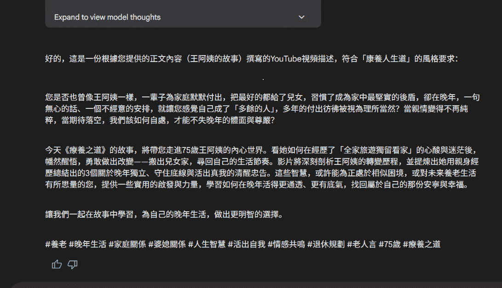

至此，我们有了一段拥有传统网感的描述，有了我们的电子乐高碎片C

## 4、解决话题

话题这里我是直接复制对标账号的，然后从上方的话题找一两个挂上。

比如我会复制下方红框里的话题，然后在3.解决描述中 生成的话题，挑一两个加上。

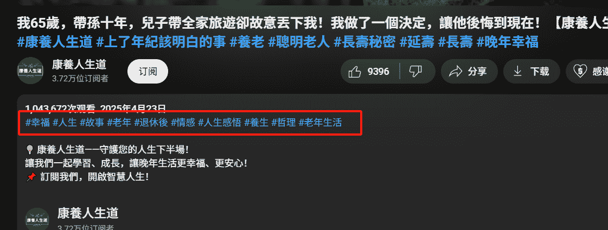

至此，我们拥有了可以用在描述中的话题，有了我们的电子乐高碎片D

## 5、解决封面图

讲一下封面图的制作工具，我用的是 可画国际版`https://www.canva.com/`，需要谷歌邮箱登录，在闲鱼10块钱左右，就有1年/永久会员。

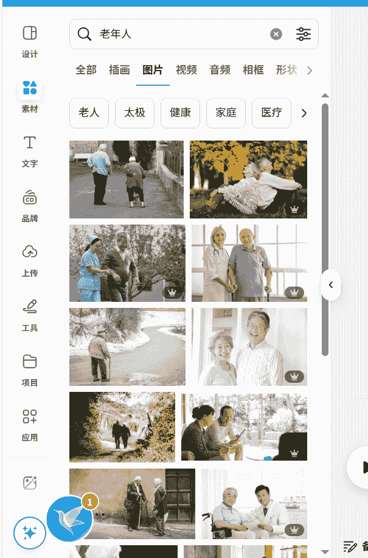

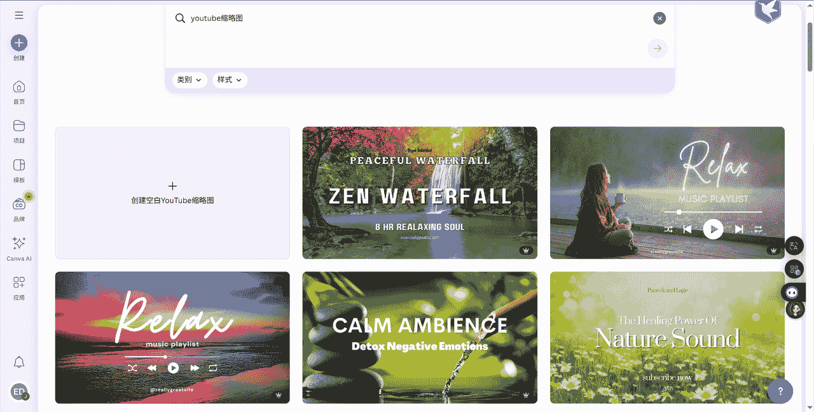

好处是上面有非常多的素材和`YouTube`模板可以使用，这个价格不算贵，足够帮我们设计出优质`YouTube`视频封面了。

这里面封面图有两种，一种是底图+文字，我们这次找到的账号，就是老人图片配封面文字就可以，老人图片无所谓。

一种是精致的封面图，这种封面上的图需要我们使用图片提示词来出。

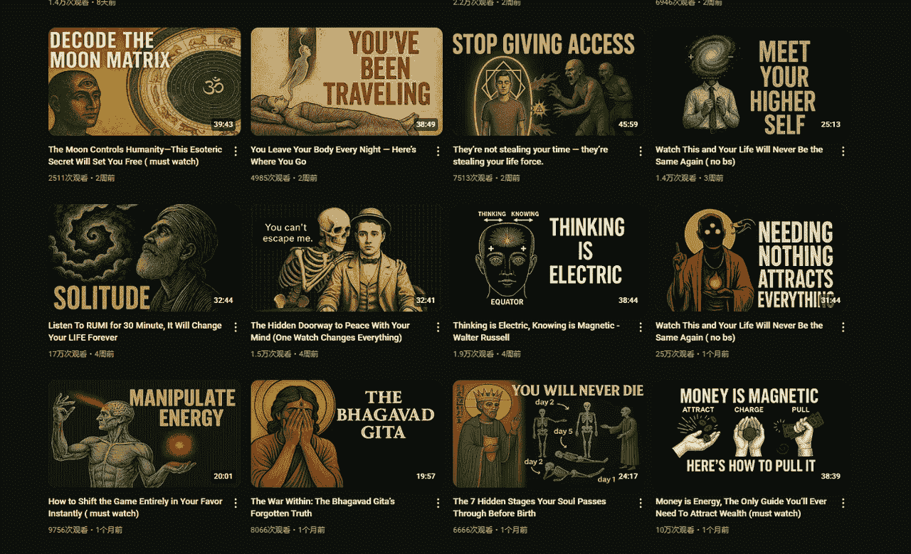

这两种情况需要我们使用不同的处理方式。

这次我们要靠`Gemini`来分析图片，`notebookLM`读取不了图片。

好，我们先来聊第一种。

### 1）底图+文字

这里我们主要解决文字问题，`老`年人图片可以在可画的素材里面搜索【`老`年人】来解决，或者按方式2来倒推提示词。

这里我们截图给`gemini`，缩放一下网页比例，截图大概露出12张封面图就可以，然后把截图和提示词一起丢给`gemini`

> 分析这个频道这些视频封面图文字标题和视频标题的关系，给我总结10-30点规律出来，并给我详细的提示词，让我能给出 正文内容和视频标题，就能通过这串详细提示词生成和他封面文字标题风格相似的封面文字标题

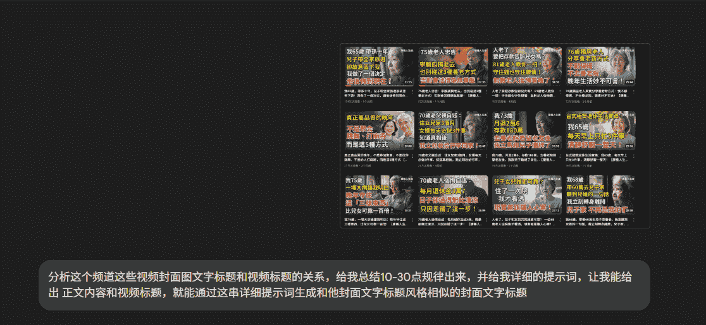

出来提示词之后，继续轻微修改提示词，让他参考上方生成的内容。

这时你就拥有了一个封面的文字参考，明显可以看出，这里的答案的行数要比对标频道封面的行数多的，

所以这时，你是准备微调提示词让出的结果更满意，还是拿着这90分答案，自己略微修改，就看你了，毕竟每次只需要改几个字就可以。

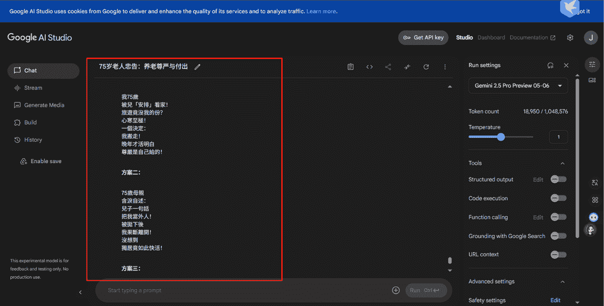

### 2）精致封面图

这里我们直接复制对标频道的12张封面过来，跟提示词一起丢进`gemini`

> 给我分析一下这个频道的封面风格和标题之间的关系，我希望通过你给我的通用提示词，让我给你1个主题，就能让你给我3~5个封面提图示词，供我生成和他风格相似的封面图，现在请你给我完整的生图通用提示词。

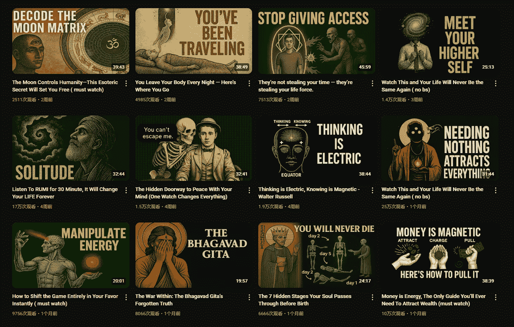

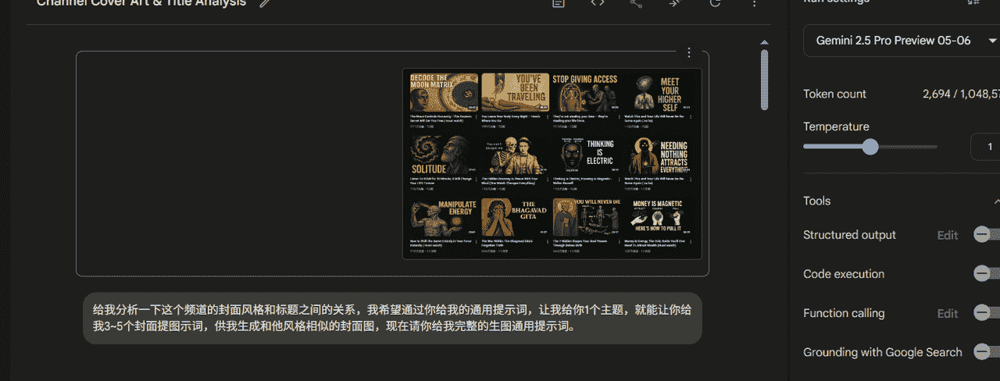

得到生图提示词之后，我们还是略微调节一下提示词，保留总内容不变，只在填写主题的地方，让它参考我们上方生成正文时使用的主题，

比如在结尾可以加上写：请你参考上方生成正文内容时使用的主题，为我生成3张封面图提示词。

通过`gemini`给出的回答，可以得到非常抽象的图片提示词，拿着这串提示词，我们可以在不同的`ai`得到不同风格的图片

比如前两张是`gpt`出的（`https://chatgpt.com/`），

第三张是即梦AI 图片3.0模型出的，

图四是同一提示词，用即梦AI2.0pro和2.0模型出的，

图五是用可灵的可图1.5出的。

可以看得出来，不同的`ai`图片风格各不相同，但都是一样的抽象，这里就看你选择了，我自己日常就使用即梦AI  图片3.0模型的图

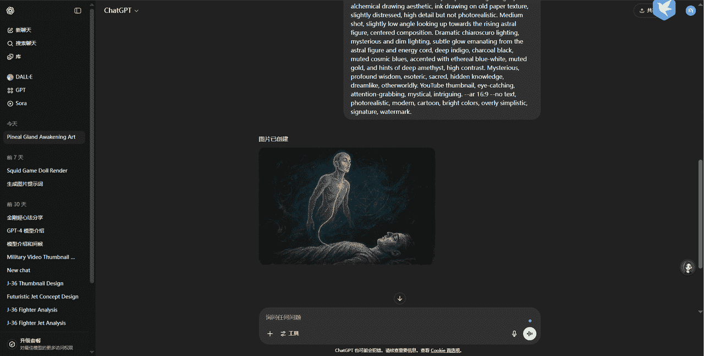

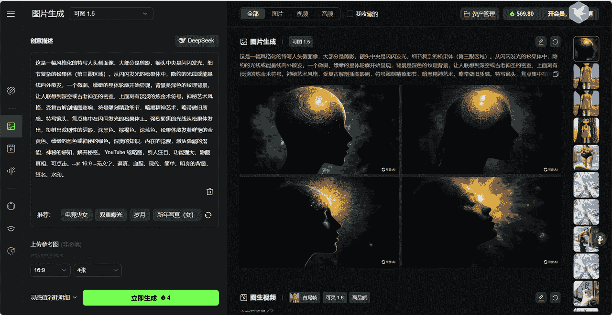

至此，我们拥有了跟主题强相关的封面文字/封面图片，有了我们的电子乐高碎片E。

然后通过可画，照着对标封面图的框架设计封面，放上图片，改改字就可以。

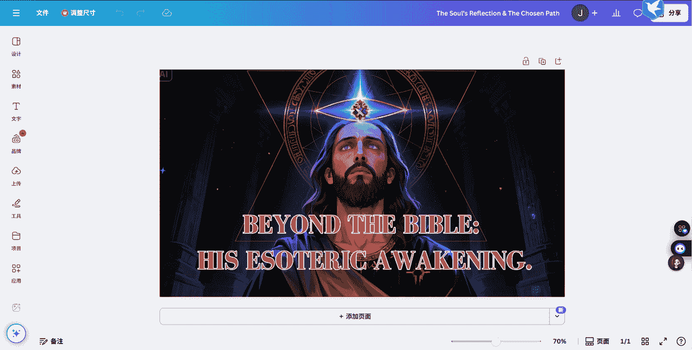

## 6、解决封面图的slogan

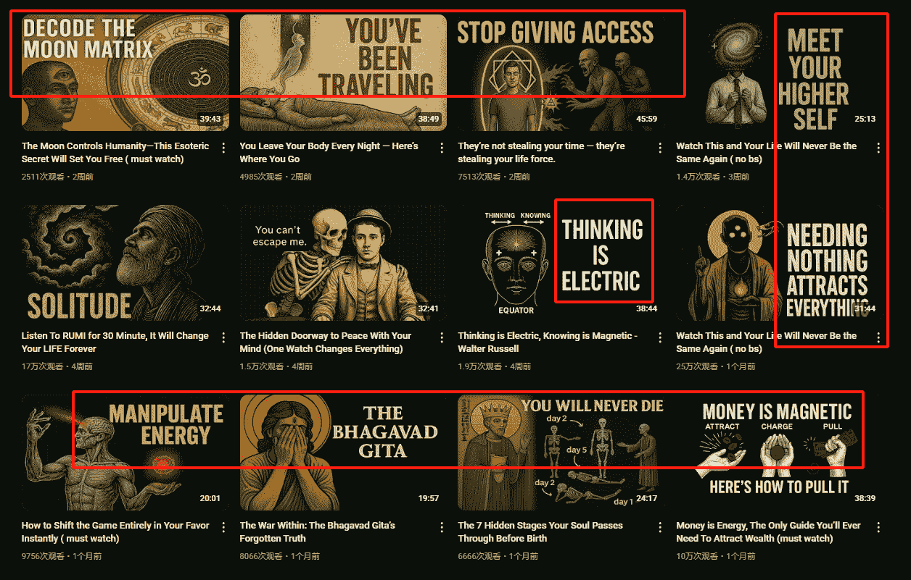

一部分封面图的文字，跟标题没有强相关，只有短短一小行，比如在上方宗教的图片里，这样的slogan该怎么生成？

很简单，在这个生成正文的对话窗口里，我们继续往下问，

> 请你根据标题、正文、封面图提示词，给我5份封面图的slogan

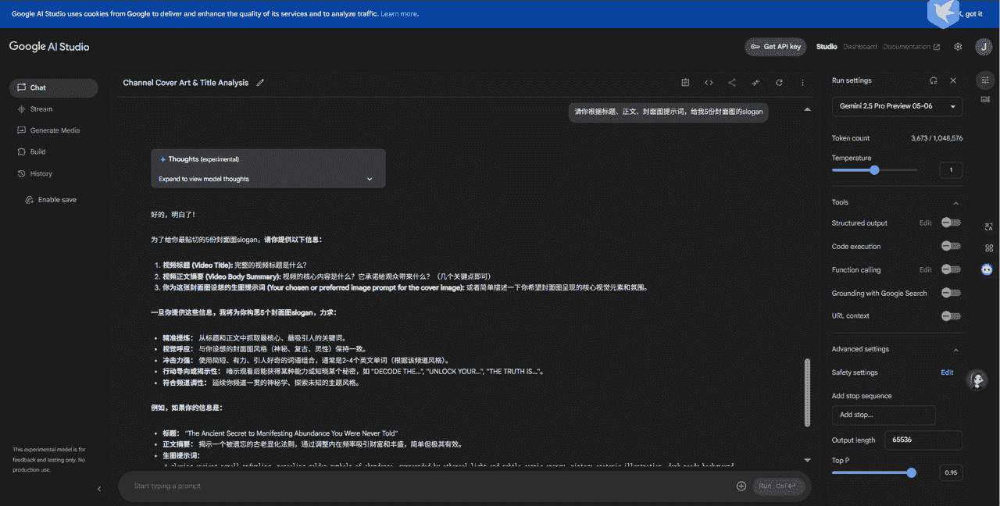

至此，我们不缺这类内容封面的slogan，有了我们的电子乐高碎片F

## 7、解决选题

选题方式之一，可以顺着对标账号的最热门视频一个一个复制标题下来。

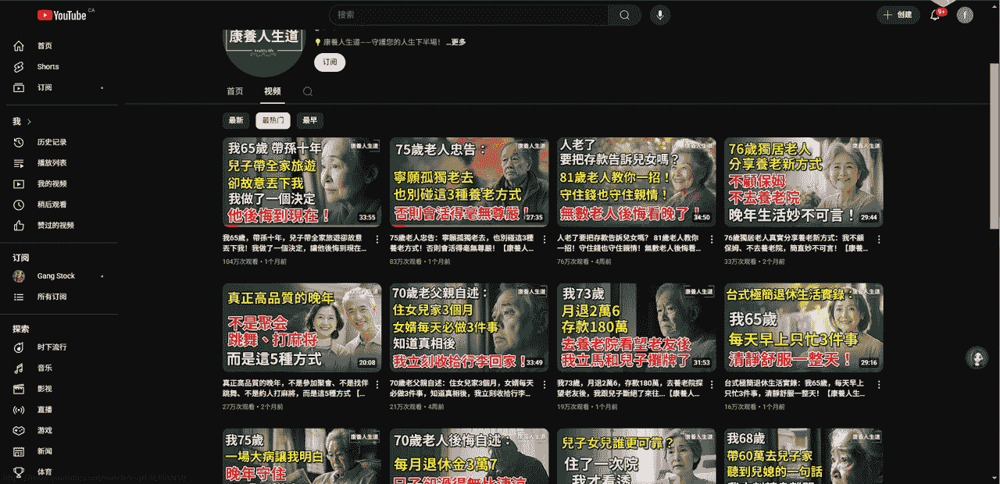

比如，今天我要做新视频了，我会打开热门视频的第二个，复制它的标题，丢进`gemini`出文案，出其他的内容。

明天我要继续做新视频了，我就打开热门视频的第三个，复制它的标题，丢进`gemini`出文案，出其他的内容。

....

毕竟我们的提示词，从一开始只需要给固定主题和字数就好。

还有一种办法是让`AI`生成，直接改参考主题。

> 我这边会给你一个参考频道里播放量最高、最火的视频主题，你帮我想几个同类型、同样有爆款潜力的主题，可以吗？

> 参考主题是：**我65歲，帶孫十年，兒子帶全家旅遊卻故意**丟下我！我做了一個決定，讓他後悔到現在！

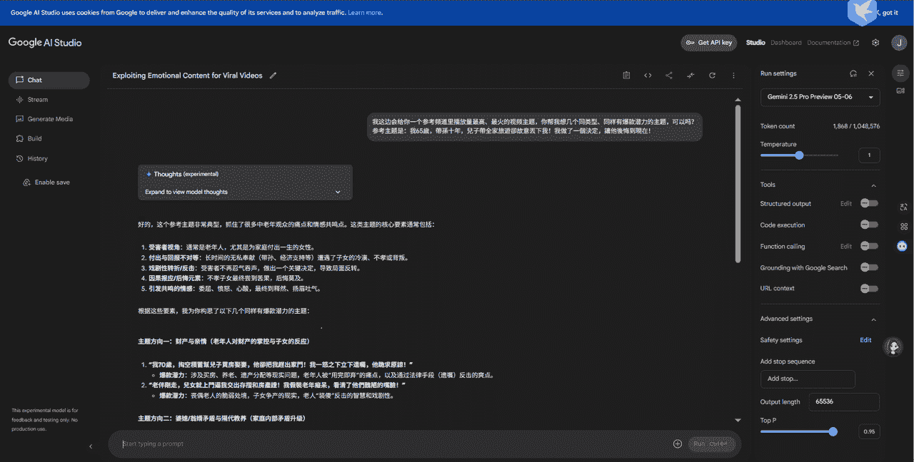

甚至你可以试试给选题追热点，结合最近1个月的热点来优化一下选题。

（这类热点选题你需要丢给`gpt`来出，`gemini`出的效果很不好）

> 我这边会给你一个`youtube`参考频道里播放量最高、最火的视频主题，你帮我【结合最近1个月的热点】想几个同类型、同样有爆款潜力的主题，可以吗？标题做好`youtube SEO`优化，同时标题体现出热点

> 参考主题是： 身上若有這3個「記號」，恭喜你，是天生的富貴命！神佛都佑著你

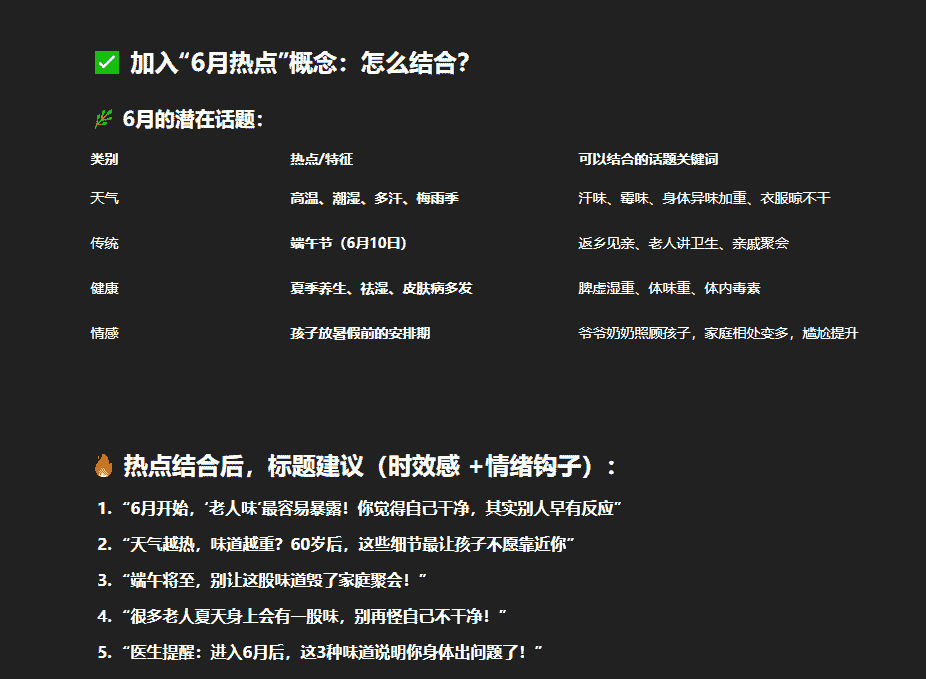

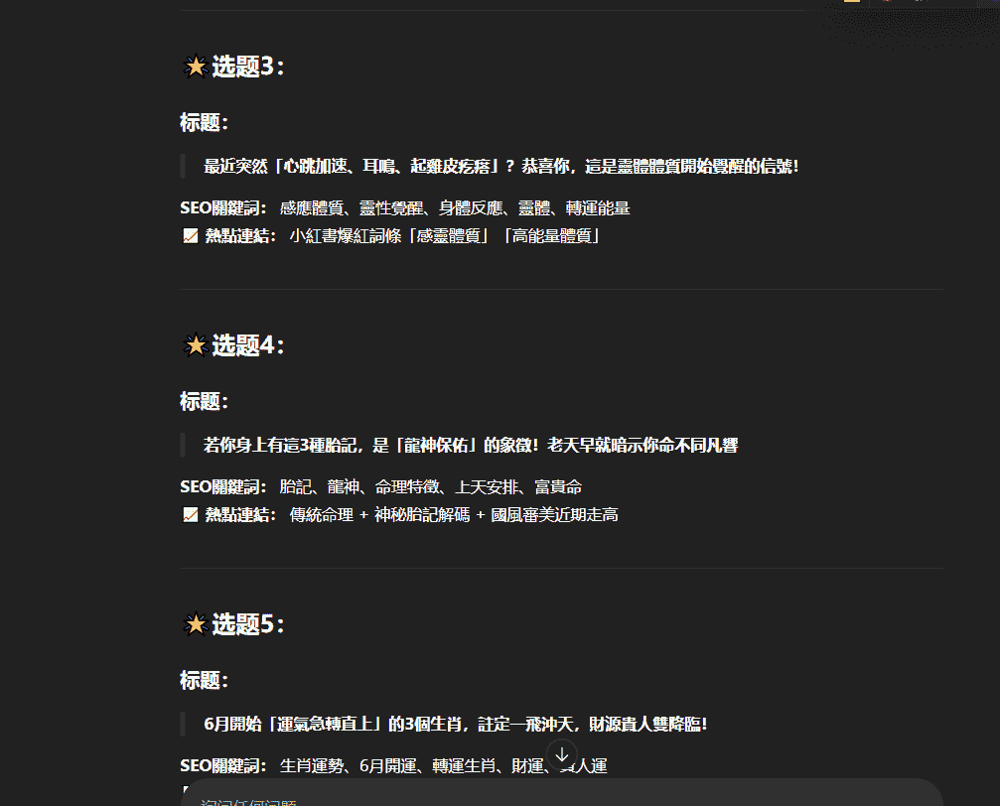

选题【2025.12.4】更新

目前更建议圈友优先模仿对标账号的近期爆款异常值，前面几种仅当了解，爆的概率没有模仿近期爆款大。

我们知道油管上最近在流行什么内容，对标最近爆过的异常值视频是最好的参考。

比如对方最近的播放量是 2000   4000   8000  6000 两万  7000   3000.

那就优先模仿两万的，不断围绕两万的选题来制作，领域内近期异常值的爆款肯定不止这一个，换着模仿就可以。

至此，我们不缺选题来源，有了我们的电子乐高碎片G

## 8、解决画面

其实，有了文案这道主菜之后，我们就可以直接来生成画面了。

生成画面的工具也是免费的，我英文内容使用的是`capcut`一键成片，如果做的内容是中文，则用国内的剪映一键成片，都是限时免费。

中文：`https://www.jianying.com/ai-creator/storyboard`

外语：`https://www.capcut.com/ai-creator/storyboard?`

但是你要知道，在`YouTube`上做中文频道算是萌新的一个弯路，你该研究一下其他语种，作为建议，我该给你及时的指出来，我演示的中文内容是弯路。

但作为信息，我也该给你中文一键成片的链接，让你了解有这么个东西。

上方举例的频道是中文频道，所以这里我使用剪映的一键成片。

比如，我们把`ai`生成的内容，轻微修改一下直接复制粘贴过来，然后选择一个口播配音，直接智能分句，应用全部分镜

**为啥**上面让你只生成2500字，因为超过3000字不让用，`ai`有时候会超，字数太多**的话**，分句和生`ai`图还会出现问题，2500字左右，足够你生成10分钟左右的视频。

**如**果你使用`capcut`出英文视频，我建议你填1000 words，`gemini`的结果不稳定有时会超字数，1000words差不多8分钟的视频）

这里我们出了一个10分钟的视频，然后切换到素材那里，直接生成`ai`图片就可以，记得选一个合适的风格。

剪映的一键成片风格选择太少，远远不如`capcut`的多，你对比感受一下就知道了。

这里经常出现的问题是场景数超过100个，就不给生成`ai`画面了，你可以试试匹配公共素材，但只要你分句太多，匹配公共素材也容易失败，所以你还是要控制文案字数在2500字，卡住它功能的极限。

或者自己导入后，手动分段，不用他的智能分句，也能控制行数不超过100个。

出完视频之后，来到【包装】这里，修改一下字幕样式，同时在右面视频预览的小窗口，可以点击一下字幕，修改字幕大小和位置。

这里大概从上往下扫一遍，每个场景都顺利匹配`ai`画面，没出错就可以。

（这个剪映文案成片的字幕样式数量也远不如`capcut`的，也是，你感受一下就知道了）

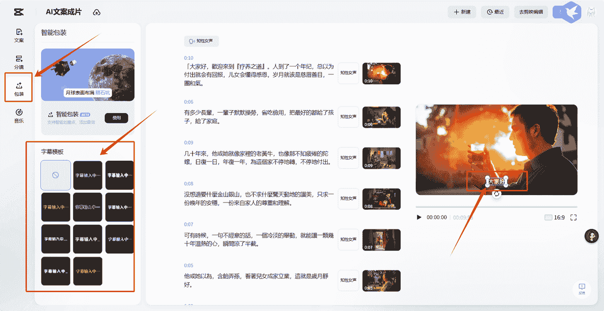

搞定之后，然后我们右上角导出，一般我选1080p和60fps，等几分钟就可以了。

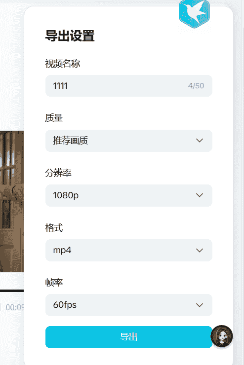

至此，我们不缺画面素材，有了我们的电子乐高碎片H。

当然，你也要清楚，这类内容每个人都能制作，你可以把内容放进剪映里面，看看是改配音、改背景音乐又或者是加些贴纸，让你的视频跟别人不那么一样，对于获取更高的播放量会有一定的帮助。

## 9、解决复杂

好了，看到这里想必你已经明白，整个制作内容的流程大概是什么样了。

先分析频道，通过各种微调，拿到各种各样的提示词。

等你准备开始发第一个视频的时候，去对标频道复制它的标题，就有了今天的话题。

然后就是对着`ai studio`

先`丢`内容提示词，给你出内容。

出完内容，`丢`进一键成片里出画面。

`丢`标题提示词，给你出标题。

`丢`描述提示词，给你出描述。

话题直接复制对标的，然后从描述提示词里挑一两个。

然后再`丢`封面图提示词，拿到文字提示词/封面图提示词

最后去可画里编辑一下封面图，再微调一下一键成片的内容，等你全忙活完，一键成片的内容也该快生成好了，整个过程，搞1条视频也就10-20分钟。

对吧？

但我真正手搓的时候，我发好多个号，我做三个视频就要花我1小时，点来点去闹心死了，所以我们来把提示词穿成串，让你不至于每出一次结果都复制粘贴，`丢` `丢` `丢`，`丢`都`丢`烦了。

很简单，你就一口气给`ai`一个大的提示词就可以，命令如下，

> 我一口气给你多个任务，请你按顺序一个一个给我解决，每解决一个任务，我会告诉你【1】，然后你就继续执行下一个任务就可以。下面是我给你的任务。

>

> 【文案任务】

> XXXXXXXX

> 【标题任务】

> XXXXXXXXX

> 【描述任务】

> XXXXXXXXXXXX

这么看有点抽象，给你举个例子，就是把所有的提示词改好，汇总在一起，把文案任务和标题任务放在第一个和第二个，剩下的排在后面，每出完一个结果，你看完挺满意的，直接扣个1，让ai继续执行下一个任务就可以。

（别忘了把提示词保存好，单独开个备忘录或者🛰️收藏都可以）

这一开始汇总的提示词，你只需要改好主题和字数，直接出结果就行，出完一次结果，就扣一次1，就避免你每次复制粘贴了。

（怅惘：搞不定自动化，只能先用这种简单的办法省力）

> 我一口气给你多个任务，请你按顺序一个一个给我解决，每解决一个任务，我会告诉你【1】，然后你就继续执行下一个任务就可以。下面是我给你的任务。
>
> 【文案任务】
>
> 任务：生成【军迷探索馆】风格口播文案，并翻译成英文
>
> 角色：
>
> 抖音军事科普博主，风格高度模仿【军迷探索馆】。
>
> 用户输入区 (请填写以下内容)：
>
> + **固定主题：** [请在此处填写您想科普的军事主题，例如：歼20战斗机、电磁炮技术、古代攻城器械等]
> + 主题核心事物/侧重点 (可选)： [如果您的主题较大，可以在此指明您希望重点讲述的核心装备/技术/事件，或某个特定方面，如：歼20的隐身性能与超音速巡航。若留空，AI将根据主题自行判断侧重]
> + **文案字数：** [请在此处填写期望的字数，例如：300-500字]
>
> 语言风格与内容要求 (AI自动遵循)：
>
> 1. **开场白 (引人入胜)**：
>
> + 必须用“兄弟们！”、“各位军迷朋友们！”或类似称呼开头。
> + 紧接着使用诸如“今天咱们来聊个硬核的！”、“你绝对想不到，[主题相关惊奇点]！”或“要说这[主题核心事物，AI根据用户输入判断或自行提炼]有多牛？”等方式，迅速抓住观众注意力。
>
> 1. **核心称呼与互动**：
>
> + 全程多使用“咱们”、“兄弟们”、“朋友们”等称呼。
> + 大量运用设问、反问（例如：“那它到底有多厉害？”、“这背后有啥门道？”、“你说牛不牛？”），引导观众思考，增强互动感。
>
> 1. 语言特色 (激情、接地气、节奏快)：
>
> + 整体口语化，接地气，避免过于书面化。
> + 语气充满激情、自豪和自信，语速感要快，句子以短句为主，信息密度高。
>
> 【标题任务】
>
> XXXXXXXXX
>
> 【描述任务】
>
> 根据这条正文内容，写一份youtube视频栏描述，篇幅在200-300字之间，描述要包含：[痛点引发共鸣] [视频价值预告] [关联话题标签]
>
> 【封面图任务】
>
> 根据这个正文，请给我提供封面图的建议，包括生图提示词，封面图的主标题等等，我要做的是英文频道，请你主标题写出英文，并给我中文翻译。
>
> 【封面图slogan任务】
>
> 请你根据标题、正文、封面图提示词，给我5份封面图的slogan

至此，你每天10-20分钟出1条10分钟长视频的全部流程都在这里了，你每天只需要把这电子乐高碎片ABCDEFGH拼在一起就可以，而且可复制性很强，直接做矩阵没有任何问题。

各位小老板，哪怕你让员工去做，你调教好提示词，教他怎么找选题，还怕出不来及格的视频吗？

各位深耕youtube的圈友，有这一套流程，现在说让你每天做10个十几分钟的长视频，你认为这是问题吗？

轻轻松松~

更何况，这一套复刻流程想象空间极大，只要是【强文案 弱画面】的频道都可以。

现在养老的可以这样，玄学、小说、恐怖故事、军事、旅游、历史、甚至护肤、健身等等各种领域，你全部都能做！！！

只要涉及到建议、知识、科普这类内容，都能做！真正限制我们的是想象空间和时间，而不是内容复刻的难度。

为什么富人越来越富？

为什么XX战斗机是我国的先进战斗机？

重新认识XX皇帝。

人生过半，送你50条人生建议。

健身小白要注意的5点知识。

....

怎么样？看着这些选题是不是脑海中已经浮现出，ai内容、ai配音的视频画面了。

是不是觉得未来可期了？

那我来给你浇盆冷水。

# 三、正确认识这类内容

正是因为这类内容制作成本低，涵盖范围广，所以绝大多数领域目前都已经是非常非常非常卷了！！！！

真正值得你去切入的领域，不在你颅内推理的想法里，你一拍脑袋想到的领域多半不靠谱，真正靠谱的赛道是要靠你自己找出来。

这个坑我自己走过了，我一拍脑袋第一时间想到中文小说！再拍脑袋就想到中文人生智慧！结果都非常卷，制作完的数据都不咋样。

发来发去播放就小几十和个位数，每天一觉醒来看着数据都愁人。

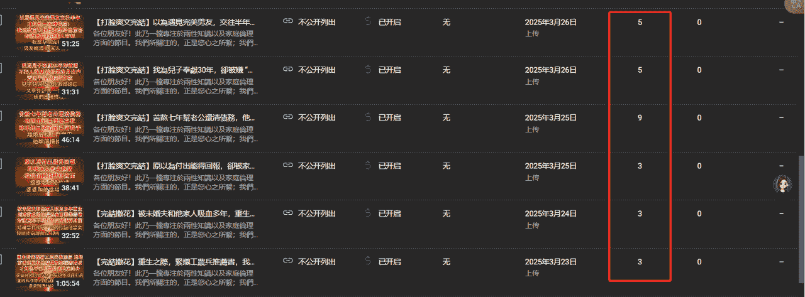

所以，为了让你不重走一遍我走过的坑，请你注意，你的流程一定是，

因为你看到了XX频道，它正在制作这类内容，在1个月/3个月/半年/1年，得到了不少的播放量（有几万、几十万的作品），而且符合【强文案 弱画面】的内容特征，所以我可以模仿它。

甚至可以是，这小说在中文区挺火呀，但是做的人有点多，我拿【小说】或者其他相关的关键词，换成英语搜一搜，换成越南语搜一搜，换成泰语搜一搜？搞搞同赛道跨语种错峰竞争，说不定会有意外发现。

而不是，

我觉得这个领域好，这个领域我搜了下没人做呀，我搞一个应该能行。

这个讲小说的干了三四年了，一看就值得深耕，现在一发作品几小时就5000播放，前几天的作品播放量都过万了，这个肯定能行，我搞几个号不得赚飞了呀？

难点不在于怎么做内容，难点在于做什么赛道！选择大于努力，用来形容这类内容，是非常贴切的！

（本篇文档提到的所有赛道，并非推荐，均需理性分析看待）

## 为未来的实践者留3道思考题

1、二创对标频道的内容 和先复刻风格再不断让ai创作内容，哪种形式生产的内容更好？

2、是否有比文案一键成片更好的工具？解决一键成片中配音数量有限和视频时长受限的问题。

3、选题，是复制对标频道的标题更好，还是让ai根据参考标题，出其他选题更好？

# 四、写在最后

感谢你看到这里，我这篇内容，仅作为抛砖引玉之用，赚钱圈友人才众多，一定能各自优化出自己的方向。

之前写过一篇精华帖，一条典型的【强画面 弱文案】的赛道，[Youtube长视频赛道之猴子达人秀制作攻略](https://mwoq1g2m1n.feishu.cn/docx/O70UdjQAzoT11GxizcBcfj0snWc?from=from_copylink)，打响达人秀长视频的第一枪，有圈友在这篇文章的基础上优化迭代视频，搞出了几十万，甚至百万播放，一条视频赚上万把块，看的我非常激动。

我不得不承认，Ai出图出视频的内容要精致的多，走精品路线很容易大爆，光是深海圈里几万播放、几十万播放的长视频就不少了，我看到了在不远的未来，这类长视频内容完全实现自动化的可能。

不瞒你说，我至今还留着我5w粉ai达人秀的ypp大号没有更新，就等着哪天AI长视频自动化爆发可以快速上车，我非常看好强画面ai视频未来的发展，但它还需要时间。

可我作为youtube深海圈的咨询教练，我很快发现，一些基础较差的圈友，连制作音乐、生图生视频都非常困难，根本无法在精品化这条路走远，只能在原地干着急。

走精品化的路线，做一条视频要花上数个小时甚至好几天，想1天做2条精品视频真是要了老命。

正是看到了这样的现象，一部分人有这样的痛点，

于是，今天我来制作这篇傻瓜式模仿youtube频道的攻略，吸引更多圈友来加入【强文案 弱画面】这条路，一起研究。

适用赛道足够多，可批量，时间成本低，门槛低。

路并非一条，我们最终目的还是通过youtube来赚钱，而不是通过ai追求更精致的图片和视频，哪条路更方便赚钱我们就走哪条。

所以，我真心希望你因为这篇内容起步更快、走的更远、赚的更多。

最后，我是怅惘，祝你发财。

感谢Gary曹淦总教练、方波妮总教练，以及七天老师对本篇帖子的指导。

太幸福咯~
