# 多账号管理工具。

> 来源：[https://xuqiwei1986.feishu.cn/docx/LCTbdMfkPoxnHgxTPOlcLXnLnnb](https://xuqiwei1986.feishu.cn/docx/LCTbdMfkPoxnHgxTPOlcLXnLnnb)

## 下载地址

[多账号矩阵管理软件（独立环境、独立ip、防关联）WIN版](https://udxxg5rx5m.feishu.cn/docx/Sa5Wdx0Naoq2AExhFx1cKFrUnXd?from=from_copylink)

下次更新：

接入接收端口。可被影刀等其他rpa工具调用。

我是施仁，专注于小众赛道项目开发。

很多人认为我是程序员，

但其实我接触的大部分技术都是在实际操作中自学的。

为什么走上这条路，

最初，我是从知乎相关项目入门的。

当时我想要一款软件，能够定时自动搜索指定话题，按时间排序，筛选最近几天的内容进行回答，并在回答中穿插软营销广告。

然而，我对编程并不了解，于是找人定制了这款软件。

初次使用时，觉得软件还不错，但随着时间推移，问题接踵而至：

+   **功能不完善**：使用过程中才逐渐意识到新的需求和功能优化的重要性。

+   **平台限制**：为了规避平台限制，必须进行额外改动，这些改动需要反复测试。

+   **频繁的BUG与修改**：每次修复问题或新增功能，都需要支付额外费用，但结果往往难以完全满足预期。

这些问题需要不停的跟对方沟通，很麻烦，而且优化软件就像一个无底洞，不停花钱，没有止境。

最终我下定决心自学编程，用自己的能力解决问题，自己的软件想怎么改就怎么改。

后来随着越来越多项目需要自动化，我对技术的需求也不断提升。

为了满足自己的项目需求，我开始不断学习，针对知乎、视频号、快手、B站、📕、京东、得物等平台，开发了许多自动化工具。

今年年初，我整理自己的代码时发现，虽然开发了很多软件，但其中许多功能是重复的。

于是我萌生了一个想法：将这些工具整合到一个统一的软件中，未来如果有其他平台的需求，只需在这套软件上扩展功能即可。

这个想法看似简单，但执行起来却困难重重。

由于我自学编程，早期写的代码不够规范，且同样的功能在不同软件中实现的方式各不相同，导致整合过程非常复杂。我不得不重新梳理代码，进行修改和测试。

经过这一年的努力和深度使用，目前这款整合软件已经趋于完善，基本满足了我对稳定性和功能性的要求。

之前有圈友说我的软件最懂人性，听了之后我其实挺受宠若惊的。

实际上，这些软件的设计背后有一个简单的原因——那就是我懒。

软件是我自己需要的，所以才会去写。而不是为别人定制的收费软件，因此我特别用心去打磨。

我的目标很简单：做一个自己用起来最舒服、最方便的工具。

这款软件没有收费。相应的也不会有什么服务。

一些功能的更新和优化都是根据我自己的需求和一些合作的工作室伙伴的需求更改的。

功能比较多教程可能不定时在飞书更新。

精力有限。希望大家见谅。

如果通过什么方式联系到我，请教软件怎么使用那么我可能会直接忽略。

有问题可以直接在飞书里评论就好。

我先介绍一下这款软件：

## 软件核心功能

### 多平台矩阵管理

多平台矩阵管理功能是本软件的核心亮点之一，旨在解决用户在多个平台之间频繁切换账号的烦恼。

+   **支持多平台登录**： 支持登录几乎所有主流平台，包括抖音、快手、📕、知乎、得物、B站、京东、拼多多、淘宝等国内平台，以及 TikTok、Facebook、Instagram、Twitter、LinkedIn 等国际平台。

+   **高效切换账号**： 利用软件控制谷歌浏览器，用户可以快速切换不同平台的账号，显著提高工作效率。

+   **延长账号在线时间**： 减少频繁登录的麻烦，同时避免因长时间不活动而被平台强制下线。

---

### 账号管理功能

本软件具备强大的账号管理功能，帮助用户更好地组织和分类各类账号。

+   **备注与标记功能**： 用户可对每个账号添加备注和标记，方便分类和识别。对于矩阵管理用户来说，这一功能尤为重要。

+   **数据一键导出**： 支持将所有账号数据导出为本地表格，便于存档和分析。

---

### 浏览器环境隔离

为了保障多账号操作的隐私与安全，本软件提供了强大的浏览器环境隔离功能。

+   **独立浏览器指纹配置**： 每个账号都可以分配一个独立的浏览器指纹，防止平台通过指纹检测关联账号。

+   **多窗口支持**： 用户可以同时打开多个子窗口，并为每个窗口配置不同的账号、IP和操作环境。这一功能特别适合需要同时操作多个账号的用户。

---

### 自定义谷歌插件

我们深知每个用户的需求千差万别，因此特别加入了支持自定义谷歌插件的功能。

+   **插件加载方式简单**： 用户只需将插件文件夹放置在指定目录，启动浏览器时即可选择加载指定插件。

+   **功能扩展灵活**： 自定义插件支持极大地扩展了软件的使用场景，例如用户可以加载广告屏蔽插件、数据分析插件等。

---

### 自动化运营工具

自动化是提高运营效率的重要手段，本软件在这一领域提供了诸多功能。

+   **全自动发文功能**： 软件内置主流平台的自动化发文功能，用户可以批量发布内容，极大地节省时间和精力。

+   **定时任务与批量操作**： 支持定时发布让内容运营更加智能化。

---

### 实时监控

在数据驱动的时代，实时监控已成为精细化运营的关键。

+   **网页元素变化监控**： 支持实时监控网页指定元素的内容变化，例如更新提醒等。

+   **多平台更新提醒**： 例如用户可设置监控抖音和📕账号的新作品发布，并在第一时间收到通知。

---

### 飞书集成功能

为满足团队协作需求，本软件特别加入了飞书集成功能。

+   **实时数据同步**： 软件接入飞书API接口，支持实时获取账号的各种信息并同步至飞书平台，便于团队共享。

+   **飞书机器人通知**： 软件的实时动态（如任务完成通知等）可通过飞书机器人即时推送至群组，确保团队成员第一时间了解最新情况。

---

### 账号数据自定义获取

数据分析是制定运营策略的重要依据，本软件为此提供了强大的数据获取功能。

+   **批量数据获取**： 用户可批量获取账号的关键数据，例如粉丝数量、账号余额等。

---

## 软件的适用场景

1.  **内容创作者**

对于内容创作者来说，多平台运营已成为必然趋势。本软件能够大幅降低跨平台管理的难度，通过矩阵管理功能和自动化工具提高运营效率。

2.  **电商从业者**

电商从业者需要管理多个平台的店铺和账号，浏览器环境隔离和自动化运营工具能够帮助他们轻松实现多账号管理和批量操作。

3.  **数据分析师**

通过实时监控和数据获取功能，数据分析师可以高效收集所需数据，为运营决策提供有力支持。

4.  **团队协作**

对于需要多人协作的团队来说，飞书集成功能极大地优化了信息流转和任务分配效率。

## 使用方法

因为本软件功能繁多，长时间更新已经做[（免费）多账号登录浏览器](https://udxxg5rx5m.feishu.cn/docx/Sa5Wdx0Naoq2AExhFx1cKFrUnXd?from=from_copylink)更多优化，如果你没有太严格的使用需求，可以直接移步 这个教程，适合新手小白上手。下面的教程属于早期教程。设置比较繁琐。

### 启动浏览器

软件目前也优化了操作步骤，使用起来也很简单，可以直接把谷歌启动的图标拖进 首页 的 浏览器路径选择。

我设置了三个路径，可以根据需求启动不同版本的浏览器，理论上市面常见的浏览器都可以用，但是我目前主流使用谷歌的，想要其他浏览器的可以自己测试。

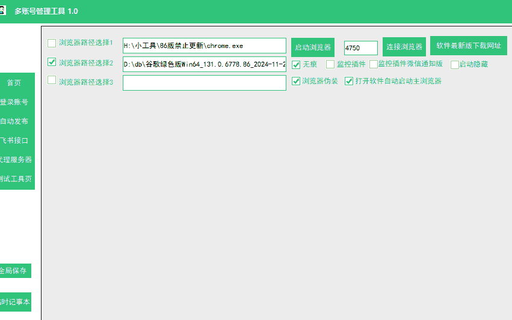

有了浏览器路径，点启动浏览器。就OK了。

启动浏览器这个按钮启动的是主浏览器。登录切换保存账号。自动发布，都用的是这个浏览器。

如果你没有同时打开多个浏览器的需求，那么用这个就足够了。

同时我还增加了子窗口的打开功能。

比如你想多开几个浏览器用来查看或者手动操作其他事情。

账号列表单击右键。会有一个 打开独立窗口 。

他会另外启动一个全新的浏览器。

根据你当前账号的浏览器指纹+IP，搭建一个新环境。

然后登录账号，这个浏览器打开，登录好账号后。软件就不会对他做其他控制，只会保存一个连接端口。

登录切换保存账号。自动发布，其他功能都还是会在主浏览器执行。

### 代理服务器

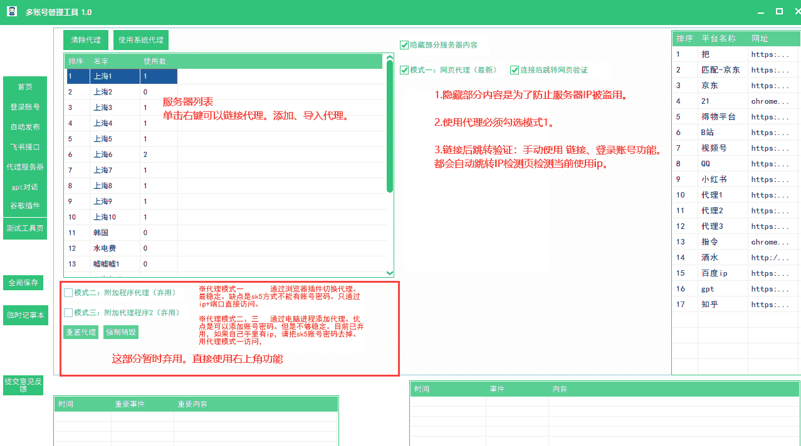

### 浏览器指纹

保存账号时会自动随机生成不同指纹，编辑账号资料时也会显示当前浏览器指纹。

### 软件登录

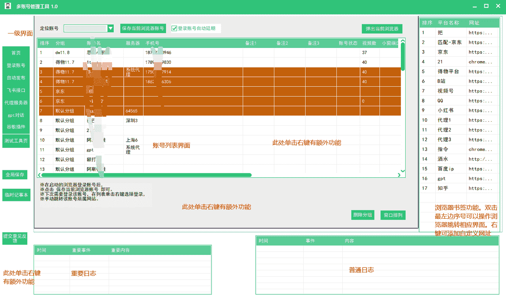

电脑弹出一个由软件启动的浏览器后，想登录👸号、📕、抖音，任何平台号，复制平台网址在浏览器跳转，登录你的账号。登陆完成后，在登录账号界面，点 保存当前浏览器账号。

注意，是要在浏览器登录账号以后，软件再点保存。

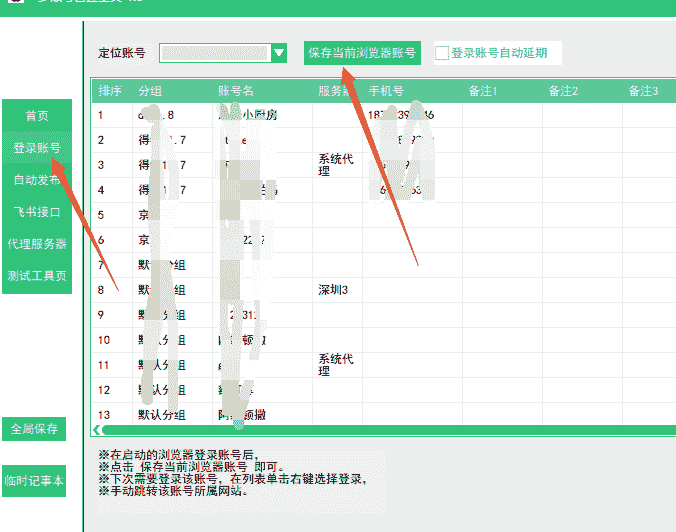

> 要注意的是，

> 软件保存账号以后。

> 就不要手动在浏览器里退出自己的账号了，

> 这样会导致软件也无法登陆。

> 正确的方法是，保存账号以后，在账号列表，单击右键，有 `清除登录信息`。

> 可以退出浏览器账号。

> 登录新账号也是在软件账号列表单击右键，清楚登录信息。然后在登录新的账号即可。

点击 保存当前浏览器账号 ，会弹出一些账号相关信息，你可以自由设定。

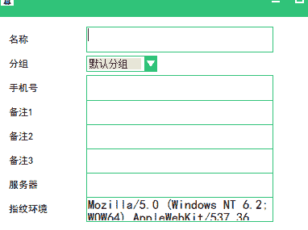

保存好以后。账号列表里单击左键选择一个账号，然后再右键就会弹出这个账号相关的一些功能。

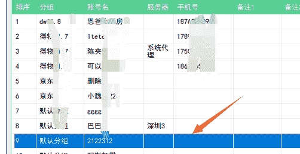

里面有个延长登录时间，是通过修改`cookie`的`expires`，保证账号不会掉线。但是这个功能只对部分平台有效。自行测试。

账号列表里可以设定账号的浏览器指纹，服务器ip。服务器ip需要你购买ip才行。这两个功能结合就可以完成账号环境的独立搭建了。

### 登录第二个账号

只需要先在软件账号列表单击右键，`清除登录信息`。然后在登录新的账号即可。

### 书签功能

右边我增加了一个书签功能，可以添加网址用来方便浏览器跳转。右键添加书签。这个书签功能只操作主浏览器。

小提示：为了批量操作子窗口更方便，在使用打开子窗口功能时，先左键选中一个书签网址。再回到账号列表单击右键，子窗口打开后会自动进行一次跳转。

### 账号批量操作

ctrl或者shift，加鼠标左键可以进行多选账号，多选后，右键出现的菜单功能几乎都可以批量使用，除了登录，退出，编辑详细资料，设定当前账号位置 这几个只有在单选账号时可以使用。

你设置可以批量启动子窗口。并且通过软件直接把打开的窗口自定义大小排列。

[录制_2025_01_09_21_16_00_103.mp4](https://internal-api-drive-stream.feishu.cn/space/api/box/stream/download/all/OWtzbT6MzojGmCx12JbcsJ9Rngg)

### 自动发布

先把你需要批量操作的账号分到一个组，然后点击自动发布界面，这样你就可以看到你所有的分组了，选择你要操作的分组，你就会看到这个分组下所有账号，然后右边选择你想要发布的平台

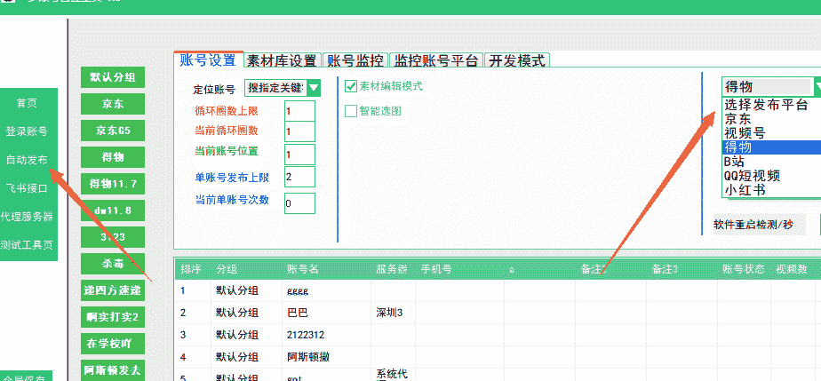

设定账号的素材库。一个账号对应一个视频文件夹，里面可以放好对应的视频。

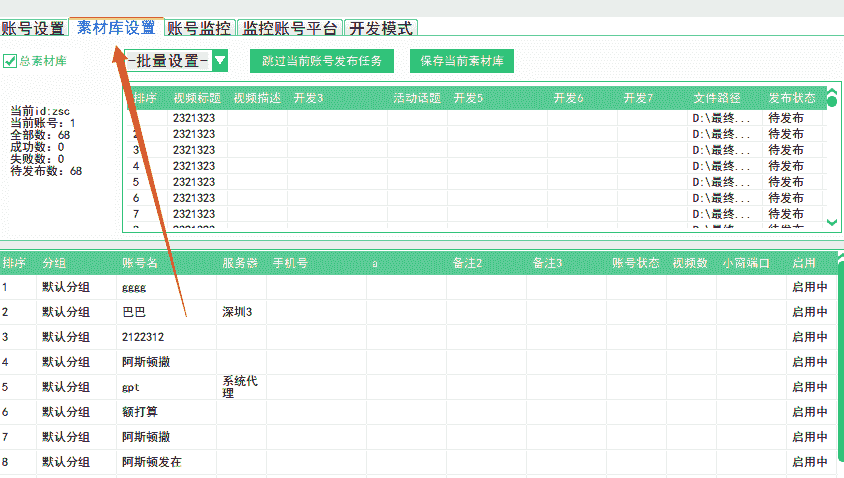

看不到素材路径可以往右划，就可以看到。单击左键会弹出设定弹窗。设置路径。

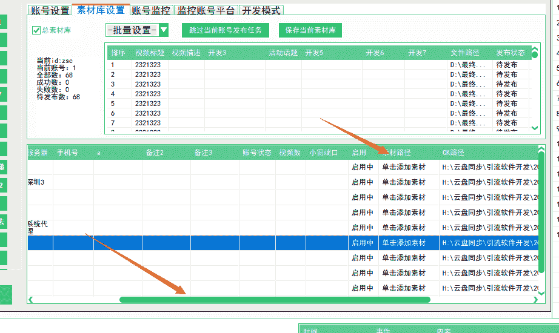

设定好账号的素材库。你选择哪个账号，最上方的素材库就会显示这个账号要发布的素材详情。

每个账号都可以设定独立的素材库。

可以单独设置每个视频的标题描述发布时的详情，也可以批量设置。

除了每个账号单独设置素材，还有一个总素材库。

右键总素材库，导入文件夹。所有账号发布作品都统一用一个文件夹。

设置好就可以点击开始，软件会自动登录账号，根据你设定的IP和浏览器指纹，搭建不同的浏览器环境进行发布。

### 账号监控

目前只可以监控自己视频号的数据，如果自己哪个视频突然爆火，会发送飞书提醒，对接了飞书文档，视频号的各个视频数据都可以在飞书文档呈现，但是这部分功能相对复杂，需要的可以看这个软件具体教程，我之前有录制。

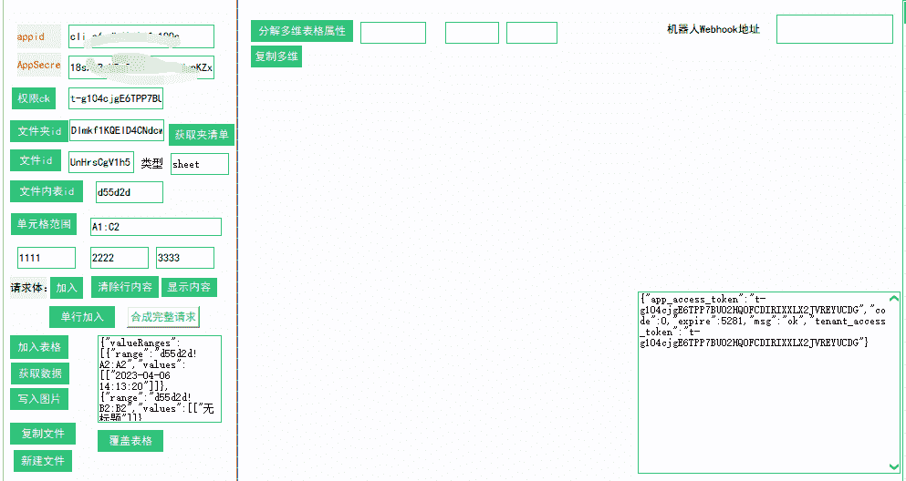

### 监控账号作品更新

我在软件里加了我自己写的谷歌插件。可以用来监控账号作品更新。

运行逻辑就是，根据你指定的网页元素进行监控。

比如你指定一个元素，这个元素里是抖音作品数：196 。他就会根据这个196进行判断。

每隔一定时间刷新页面。如果这个196变成197，或者只要不是原本的 196 这个数字。就会进行提醒。

这个功能因为监控元素是自定义的。所以可以监控任何平台，

只要在你监控的页面`F12`选择某个元素，单击右键。复制 `selector` 。就可以进行监控。非常方便。

结合我的软件，你可以一台电脑打开数十个浏览器。通过插件进行监控。前提是你电脑配置不要太遭。

如果监控的刷新次数过多，也可以通过软件设置每个浏览器不同的IP去进行监控。就可以完美规避访问次数过多导致的异常情况。

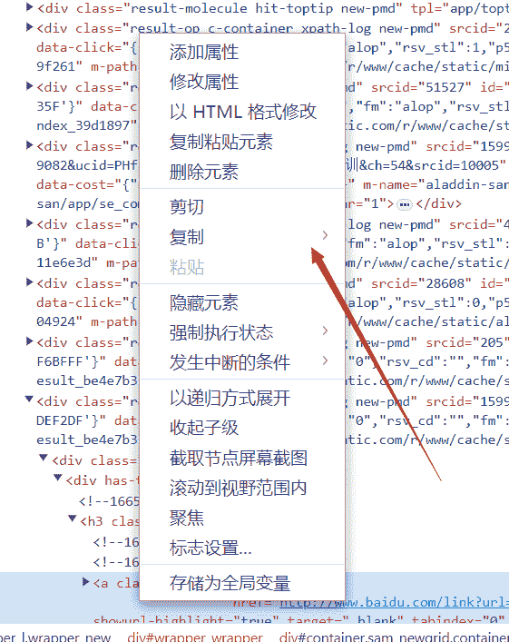

### 开发模式

可以在这个界面设置元素路径。

获取每个账号的某些信息。

比如这个账号的收益、播放等。

比如你指定某个页面的某个元素。

点击执行。软件会自动登录账号，跳转这个页面。

获取这个页面指定元素信息。

只要你会`F12`获取元素就可以。

只要是浏览器能看到的信息。都可以通过这种方式批量获取不同账号的指定信息。

我专门在账号列表增加了三个信息框（备注1.备注2.备注3）

软件还有其他的一些小功能我就不在这里说了，账号导出、导入，批量设置等。

### 飞书接口

没有飞书需求可以不用看本教程，因为设置比较繁琐。

目前接入飞书后可开启的功能：

1. 可以监控视频号数据写入飞书。

2. 知乎自动答题后写入飞书记录。

#### 1. 注册飞书企业号

[飞书企业号注册.mp4](https://internal-api-drive-stream.feishu.cn/space/api/box/stream/download/all/S2JLbuXuXoF9VHxgPRfcNl9tnSh)

#### 2. 自建应用

[如何飞书自建应用.mp4](https://internal-api-drive-stream.feishu.cn/space/api/box/stream/download/all/ODo0bkAgIoaMssxqSt2cTotknad)

#### 3. 设置环境

模板文件夹是设置好的监控模板，检测到的数据会以模板设置好的标题填入数据，不要有任何修改。

你要创建一个跟我一样的文件夹和文件夹里的模板。

文档模板 https://b1wy3h4qfoe.feishu.cn/drive/folder/WsKafdBXllp908dJf3dcpBLUnle?from=from_copylink

[创建飞书接口环境.mp4](https://internal-api-drive-stream.feishu.cn/space/api/box/stream/download/all/DK6XbCL6Xo44hYxKrR0c192fntc)

#### 4. 软件接入飞书模板链接

[软件接入飞书模板链接.mp4](https://internal-api-drive-stream.feishu.cn/space/api/box/stream/download/all/ZLRzbGLTDot31HxuWOAcYNgyn6g)

#### 5. 设置飞书机器人

[飞书机器人.mp4](https://internal-api-drive-stream.feishu.cn/space/api/box/stream/download/all/QysBbB15yoHD1vx9ZkZcXjo3nBd)

#### 6. 监控视频号接入飞书功能

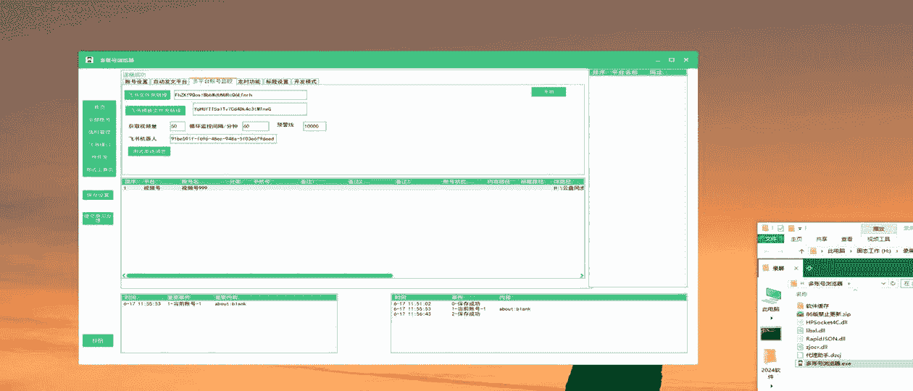

[开始监控视频号.mp4](https://internal-api-drive-stream.feishu.cn/space/api/box/stream/download/all/EoHWbxRXtoe1XzxVV6Mc6gAAn5c)

#### 7. 视频号简单监控模式

我又增加了一个简单版视频号监控的模式，视频号监控2不需要飞书接口也看不到采集的文档。会检测设定时间内视频达到预警值就会提醒。只需要把飞书机器人设置好即可。

### 谷歌插件开发

注意：在启动无痕情况下想要启动谷歌的插件，需要在浏览器扩展应用里设置。（主浏览器和每个子浏览器都要设置一次才会永久生效）

因为你启动的每个浏览器都是用的单独存储路径。（包括子浏览器）

如果你修改端口，或者每个子窗口第一次打开时，理论上都要重新设置一遍。一般端口设置一次不需要总去修改。

目前我自己接入了，代理插件、监控页面变化插件。

如果你自己写了谷歌的插件，插件文件夹需放在`软件当前文件夹\软件缓存\谷歌插件`，才会被读取，一个标准的chrome扩展文件夹中，包含一个`manifest.json`文件，此文件中含有扩展名称与版本等信息，

请选择`manifest.json`所在文件的根目录文件夹。大概如图这样。要把完整插件放在一个文件夹，并把文件夹放在谷歌插件里。

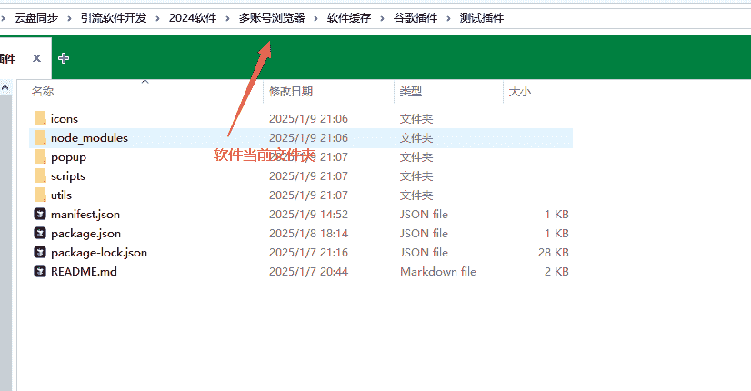

谷歌插件界面有一个读取按钮。会更新当前可加载的插件。

当你加载好后需要自己设置这个插件的名称，双击设置。这个名称必须是你真是的谷歌插件里的名字。如果名字不对无法正确加载。设置好点击保存。启用/禁止可以单击左键启用中切换。如果禁止，启动浏览器时则不会加载这个插件。

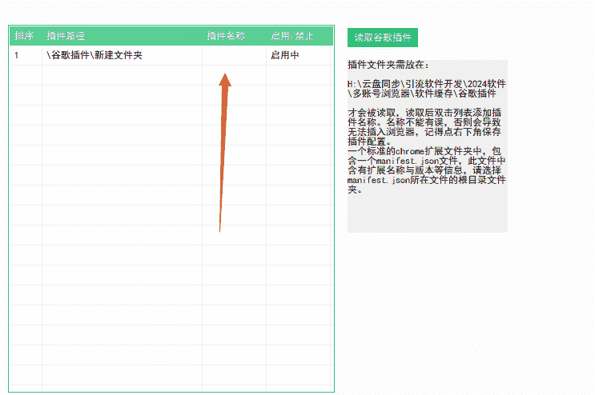

子窗口也可以直接使用这些插件。

## 其他功能

浏览器置顶，软件置顶。软件还有浮窗模式。很多优化体验。

软件每个地方单击右键都有不同的功能。

## 下载地址

[多账号矩阵管理软件（独立环境、独立ip、防关联）WIN版](https://udxxg5rx5m.feishu.cn/docx/Sa5Wdx0Naoq2AExhFx1cKFrUnXd?from=from_copylink)
