# 云端使用4_云端节点使用ComfyUI

> 来源：[https://xuqiwei1986.feishu.cn/docx/LEP8deADHosAbNx09B8cxGFdnff](https://xuqiwei1986.feishu.cn/docx/LEP8deADHosAbNx09B8cxGFdnff)

# 无显卡免费使用ComfyUI工作流（BizyAir实操教程+精选39个工作流示例下载）

# 无显卡怎么用ComfyUI？

## **以下几个场景怎么解决？**

1.  出门在外带的显卡很差的WIN轻薄笔记本，临时要用ComfyUI怎么办？

1.  出门在外带的苹果的MAC AIR系列笔记本，跑ComfyUI非常慢怎么办？

1.  老旧台式电脑没有显卡或显卡太差，想用ComfyUI怎么办？

**今天跟大家分享一个简单无门槛的方法实现无显卡也能玩AI绘图，方**案是ComfyUI+BizyAir节点。

## 云端网页ComfyUI和云端节点使用ComfyUI区别?

| ### 优劣势 | ### 云端网页使用ComfyUI（liblib/tusiart） | ### 云端节点使用ComfyUI（BizyAir） |
| --- | --- | --- |
| ### 优势 | 1.  简单方便有网络情况下，打开网站即可使用ComfyUI | 1.  可安装自己需要节点 |
| ### 劣势 | 1.  无法安装自己需要节点 | 1.  需本地安装COMFYUI |

## BizyAir是什么？

BizyAir是一组ComfyUI节点（一共有100多个子节点），无需下载模型和设置需求的耗时过程，使您能够直接使用云端GPU+云端模型，运行ComfyUI本地的工作流，而不受本地没有显卡的约束。

# ComfyUI安装

来来写的ComfyUI的航海手册有详细讲解《五、ComfyUI 安装与使用 @来来》，点击链接直达https://scys.com/view/docx/K4c8dIBNcok3JVxxbCAcoqOQnXk#IhKMdGUGGoYeuaxuOcGcPGban2b

# BizyAir节点安装

> 选择以下任何一种方法来安装BizyAir，无需重复安装。

### 方法1：下载windows便携式ComfyUI【推荐】

**已**内置Comfyui软件和BizyAir节点，无需单独下载COMFYUI解压即用，解压后1.7G左右。已经安装过COMFYUI用户请忽略。

可以🪜用户:

[https://github.com/siliconflow/ComfyUI/releases/downlo](https://github.com/siliconflow/ComfyUI/releases/tag/latest)ad/latest/new_ComfyUI_windows_portable_nvidia_none_or_cpu.7z

无法🪜用户

[ht](https://bizy-air.oss-cn-beijing.aliyuncs.com/new_ComfyUI_windows_portable_nvidia_none_or_cpu.7z)tps://bizy-air.oss-cn-beijing.aliyuncs.com/new_ComfyUI_windows_portable_nvidia_none_or_cpu.7z

### 方法2：通过ComfyUI管理器安装（需魔法）

安装前提是ComfyUI已安装了ComfyUI管理器节点

管理器中搜索BizyAir，单击“install”完成安装，安装完BizyAir重启ComfyUI。


### 方法3：通过git clone安装（需魔法）

安装前提是电脑上已经安装有GIT这个软件，下载地址为：https://git-scm.com/downloads。

打开git软件使用以下命令安装BizyAir，安装完BizyAir重启ComfyUI。

```
**# 请更换成你的C****omfyui****安装路径
c**d F:\AIGCTool\ComfyUI\custom_nodes
# 这里使用了原生github下载，需魔法
git clone https://github.com/siliconflow/BizyAir.git
```

### 方法4：通过git clone安装（无需魔法）

安装前提是电脑上已经安装有GIT这个软件，下载地址为：https://git-scm.com/downloads。

打开git软件使用以下命令安装BizyAir，安装完BizyAir重启ComfyUI。

```
# 请更换成你的Comfyui安装路径
cd F:\AIGCTool\ComfyUI\custom_nodes
# 这里使用了国内加速，无需魔法
git clone https://ghgo.xyz/https://github.com/siliconflow/BizyAir.git
```

### 方法5：通过Comfy CLI（需魔法）

安装前提

+   **确保安装了**pip install comfy-install

+   **安装ComfyUI**comfy install

然后使用以下命令安装BizyAir，安装完BizyAir重启ComfyUI。

```
comfy node install bizyair
```

# BizyAir使用工作流

## 设置API

1.  打开链接注册账户：https://cloud.siliconflow.cn/i/FDP8U9uZ（来来zonghe邀请链接，注册双方会送100万TOKEN的免费算力）
注册后点击登录：https://account.siliconflow.cn/login


1.  登录后点击API密钥，创建您的 API KEY（有100万TOKEN的免费算力）。

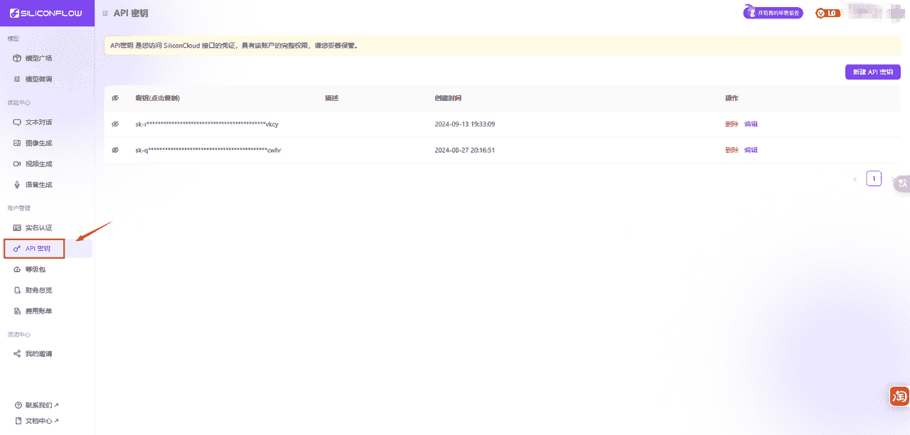

1.  打开Comfyui，首次使用BizyAir的时候需要点击API key，登录并获取到你的API即可正常运行BizyAir

> 仅首次使用时需要设置 API 密钥，您无需在每次启动都设置密钥，密钥会缓存在您的本地。

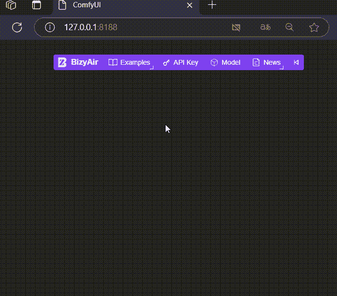

## 执行工作流

1.  单击“community”社区按钮


1.  选择加载内置的现成工作流，左侧前两个都是工作流，一个是官方上传的，一个是用户上传的工作流。右侧可以选择适合的模型版本。我以图片放大工作流举例。

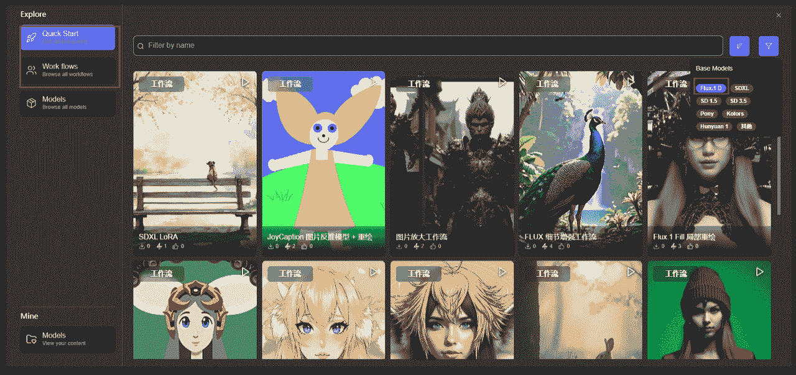

1.  点击缩略图，可以打开工作流，点击LOAD就是加载工作流，点击下面FILE的就是下载保存工作流。

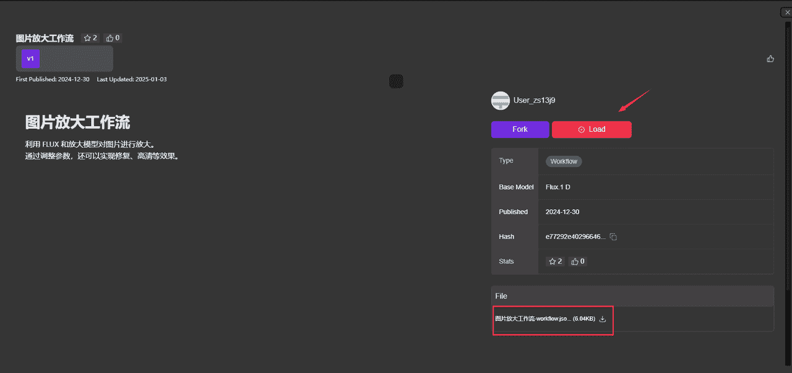

1.  工作流已经正常打开，并加载我们需要放大的美女图片。此处的模型是调用云端的模型，并非本地模型

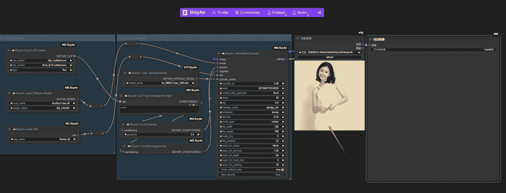

1.  点击右上角的运行，头一次放大可能较慢，后续基本是0.01秒即可。

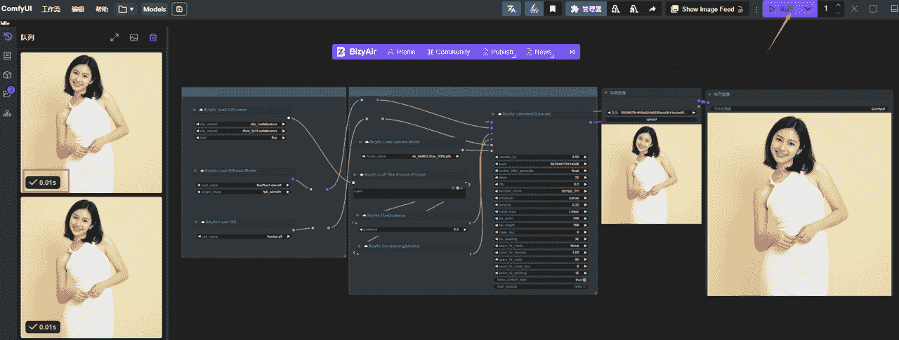

## 自建工作流

所有 BizyAir 节点均归类在“☁️BizyAir”下，可以按照自己的需求搭建适合云端API运行的工作流。


## 发布工作流

做好的工作流以及本地的LORA和CONTROLNET模型可以上传到云端，方便后续云端使用模型和工作流。


# BizyAir工作流示例

## FLUX模型工作流

### 反推提示词工作流

JoyCaption 是非常强大的图片反推模型，可以给出关于图片的详细描述。

BizyAir 中提供了 2 个 JoyCaption 的节点，分别对应 JoyCaption 和 JoyCaption 2 两个版本的模型。

JoyCaption 更容易使用，JoyCaption 2 更强大。

本工作流，利用 JoyCaption 得到原图片的详细提示词，再将提示词作为 prompt 输入 FLUX 模型，进行重绘。以此得到和原图类似，但是细节不同的新图片。

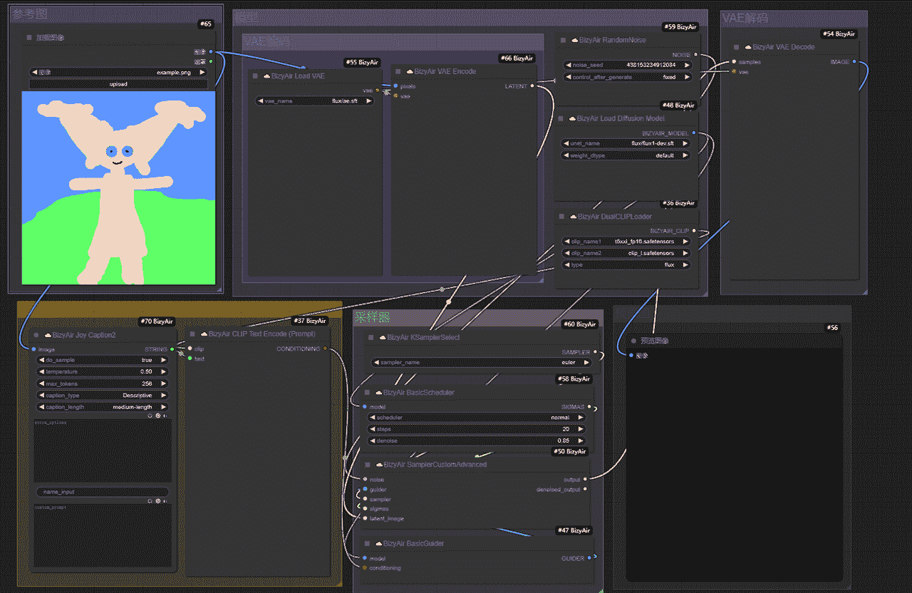

### 图片放大工作流

利用 FLUX 和放大模型对图片进行放大。通过调整参数，还可以实现修复、高清等效果。

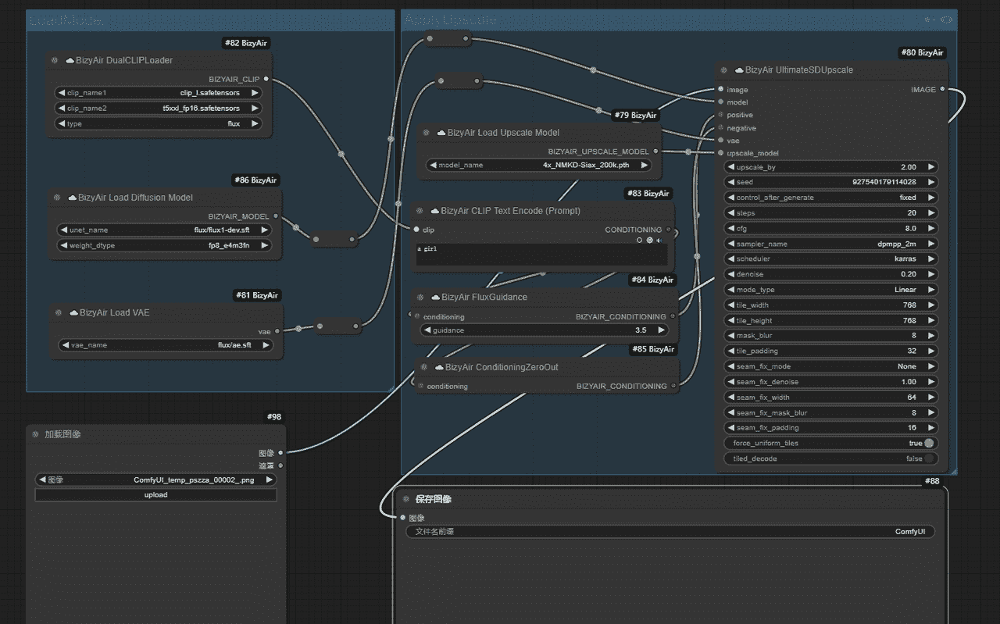

### 细节增强工作流

使用 Detail deamon 节点，可以通过参数，让图片的细节更加丰富。

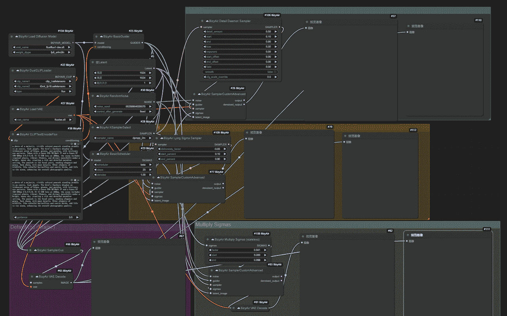

### 局部重绘工作流

在这个工作流中，我们通过 SAM 提取人脸的区域，作为 mask，确保 FLUX Fill 模型，只对脸部进行重绘。最终，将原图图像中的女生的脸，换成了一个戴眼镜女生的脸。

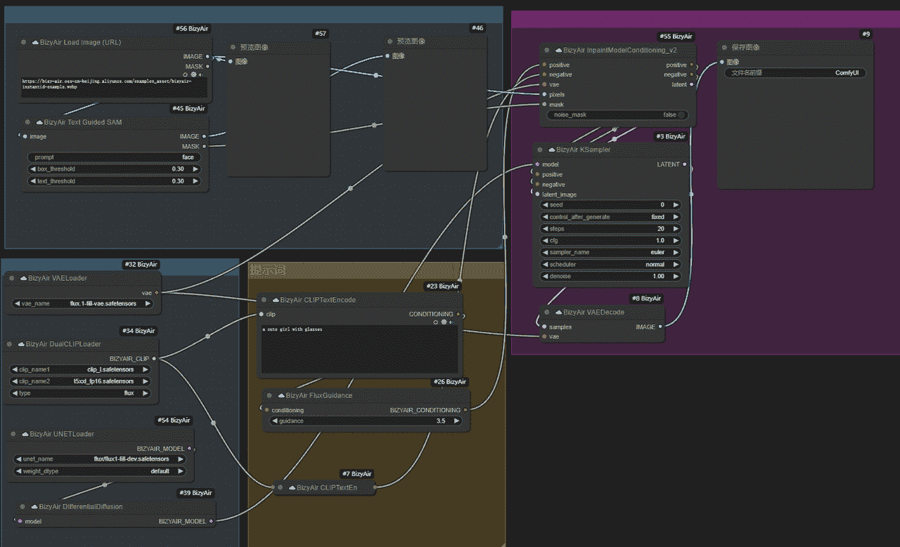

### 风格融合工作流

FLUX 官方发布的 Redux 可以将两个图像的风格进行融合，或者风格迁移。

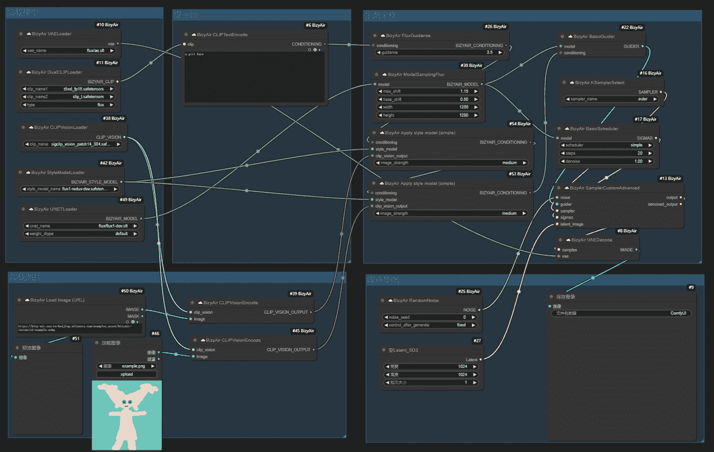

### 深度控制工作流

FLUX 官方发布的 ControlNet Depth，可以通过输入深度参考图，控制输出图片的构图。

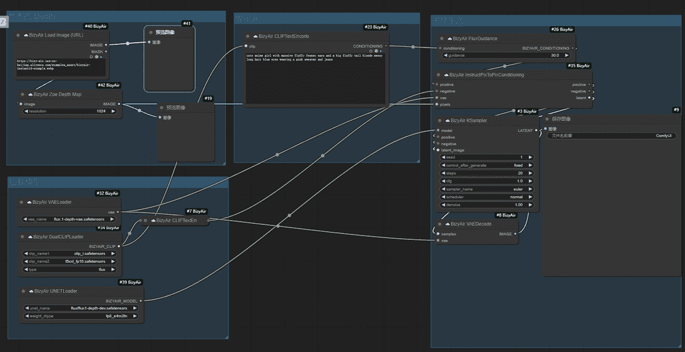

### 边缘控制工作流

FLUX.1 官方出的 Controlnet 模型，输入一张 Canny 形式的参考图，可输出受参考图控制的图片。


### PixelWave模型工作流

PixelWave 是基于 FLUX.1 Dev 加训的模型，在美学方面有较大提升。


### PuLID模型工作流

PuLID 模型可以增强脸部一致性，生成图片中的人物，与给定的参考图中的人物的脸会很相同。


### LORA 模型工作流

BizyAir 的用户可以上传、使用自己的 LoRA 模型，作为 FLUX 作图能力的补充。还可以在模型广场中筛选已有的 LoRA 模型或者将自己的模型分享给他人。通过 BizyAir 的 Load Lora 节点，可以选择和加载 LoRA 模型。


### 图生图工作流

最基础简单的图生图工作流：通过将原始的纯“白噪音”的垫图替换为一张真实图片，达到图生图的目的。真实图片需要先经过 VAE Encode 变成 latent 数据。其他步骤与文生图完全一样。


### 文生图工作流

FLUX.1 dev 文生图工作流


## SD3.5模型工作流


## SDXL模型工作流


## 可图模型工作流


## 其他模型


# BizyAir工作流下载

### 附送4大类开源AI绘画模型39个精选工作流

> 百度网盘链接: https://pan.baidu.com/s/1iG7QCQ54tpqChe6_FdmScw?pwd=lai6


# BizyAir视频课程

> **h**ttps://space.bilibili.com/3546734179387926/lists/3929471?type=season

## 第1节—文生图

<https://player.bilibili.com/player.html?bvid=1UrxseGEZn&spm_id_from=333.999.0.0&vd_source=290a2836f7818edc2c18c6eb525d4abe>

## 第1节—LLM使用

<https://player.bilibili.com/player.html?bvid=1WP2nY9Ee5&spm_id_from=333.999.0.0>

## 第3节—LoRA的使用和上传

<https://player.bilibili.com/player.html?bvid=1Dv23YrEi5&spm_id_from=333.999.0.0>

## 第4节—图生图工作流搭建＋JOY caption

<https://player.bilibili.com/player.html?bvid=1WrmVYuEHN&spm_id_from=333.999.0.0&vd_source=290a2836f7818edc2c18c6eb525d4abe>

## 第5节—局部重绘/细节修复

<https://player.bilibili.com/player.html?bvid=1nqyRYGEmb&spm_id_from=333.999.0.0&vd_source=290a2836f7818edc2c18c6eb525d4abe>

## 第6节—ControlNet的使用

<https://player.bilibili.com/player.html?bvid=1x7DdYiEvF&spm_id_from=333.999.0.0&vd_source=290a2836f7818edc2c18c6eb525d4abe>

## 第7节—InstantID和IPAdapter的介绍和应用场景

<https://player.bilibili.com/player.html?bvid=1qTmRYCErn&spm_id_from=333.788.videopod.sections&vd_source=290a2836f7818edc2c18c6eb525d4abe>