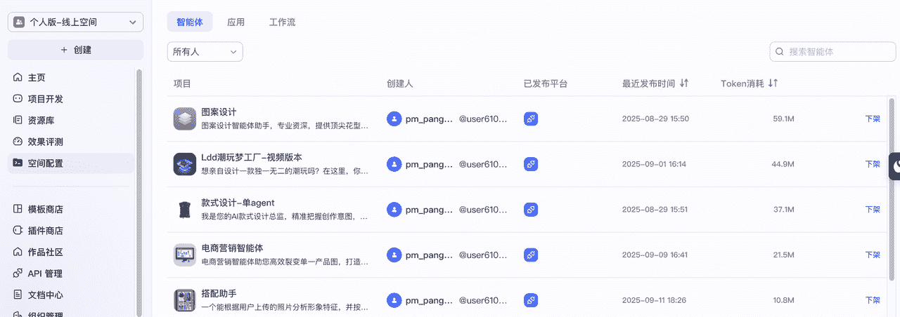
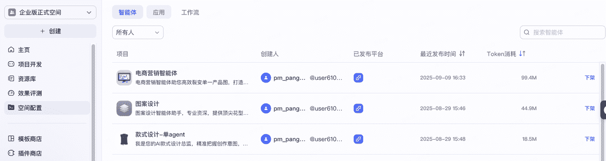
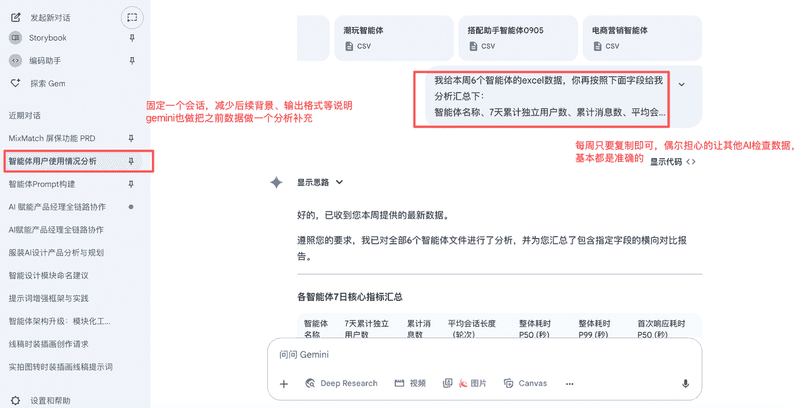
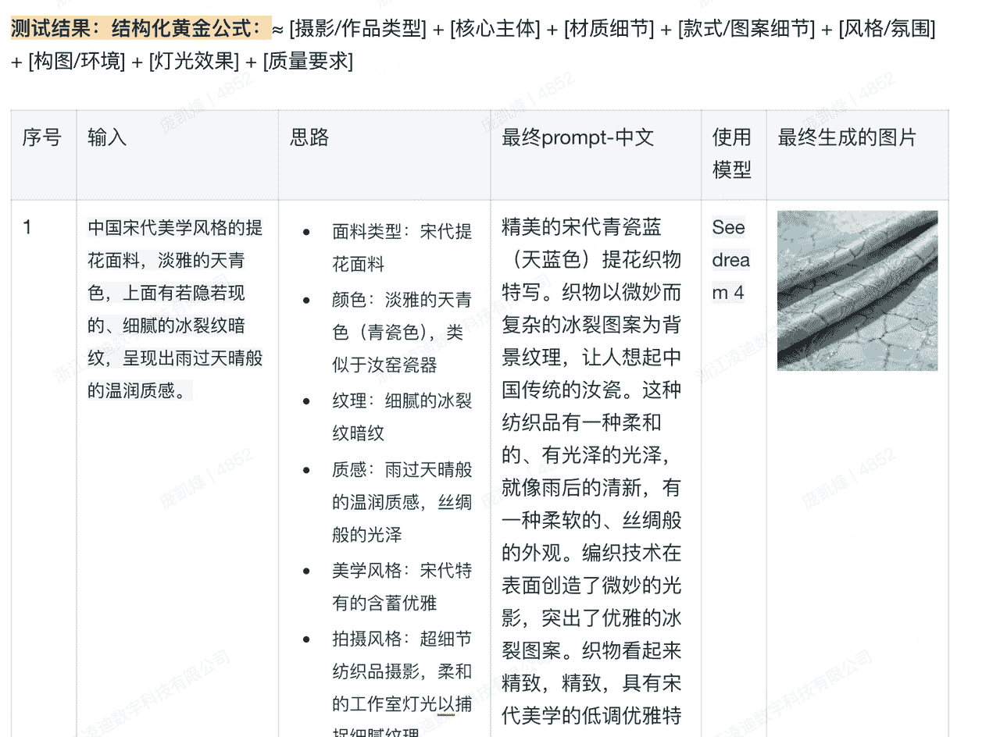
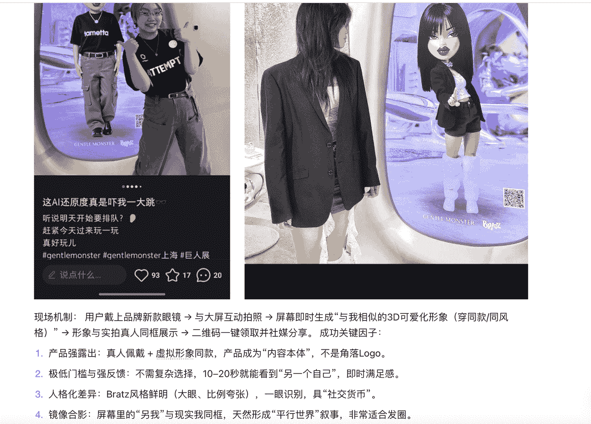
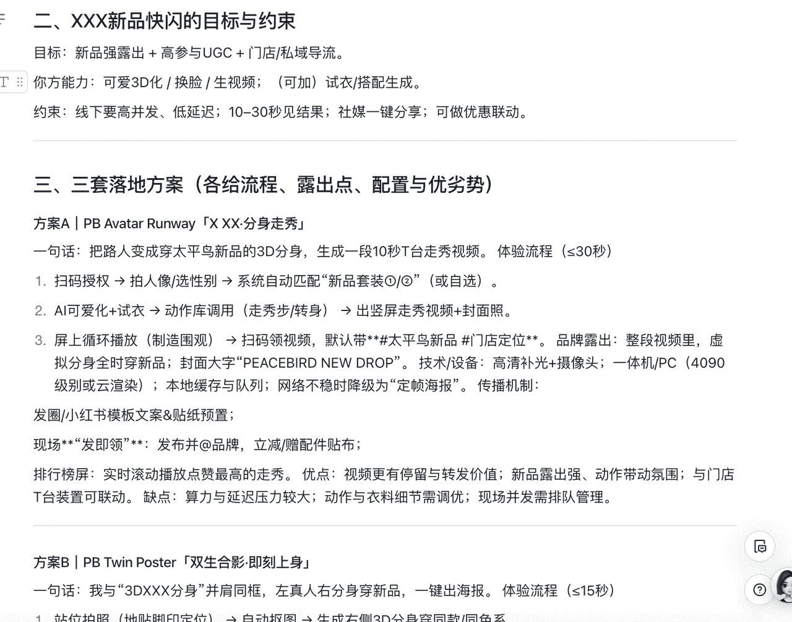
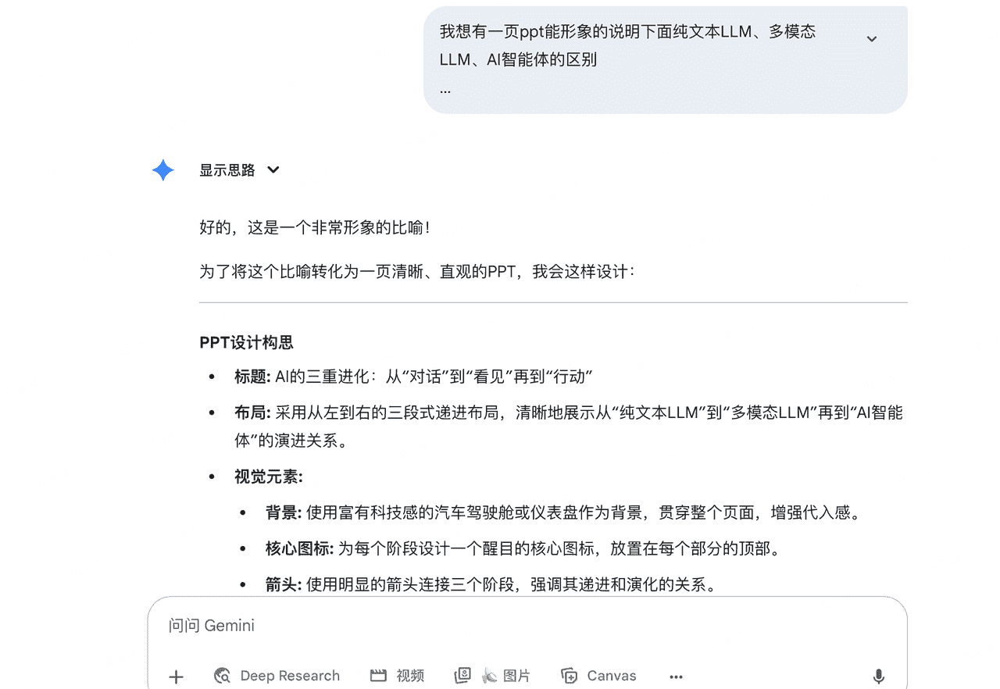
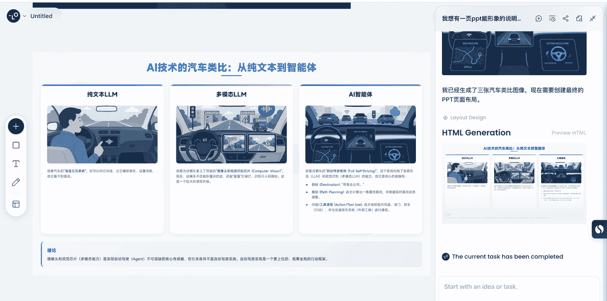
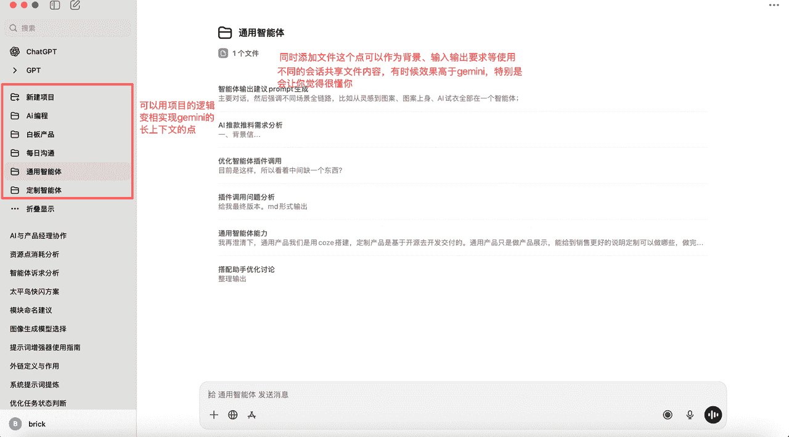
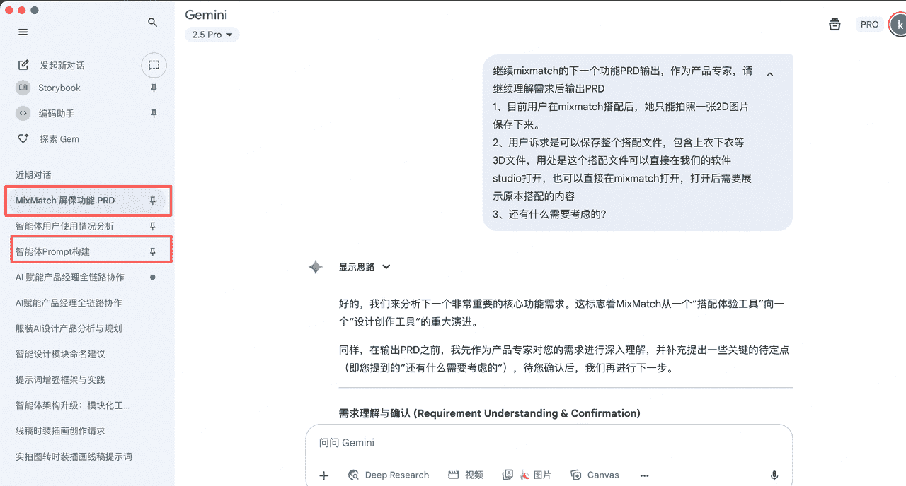

# AI赋能产品经理：6大应用场景与实战成果

> 来源：[https://xuqiwei1986.feishu.cn/docx/I0KbdfmYFowJjqxBp8WcJnMdnAf](https://xuqiwei1986.feishu.cn/docx/I0KbdfmYFowJjqxBp8WcJnMdnAf)

圈友们好，我是来自杭州的To B产品经理，公司主要服务服装行业的品牌方和ODM制造商。今年是我转做AI产品的第2年，目前在公司主要负责智能体的搭建与应用。我的核心工作是把AI逐步引入到服装产业的业务环节中，探索如何通过AI来提升设计、制造与营销的效率。

**这份分享，我**将结合自身角色，总结AI在产品经理工作中的 6大应用场景——从日常调研、需求拆解、方案设计，到落地验证与复盘，展示AI如何在不同环节发挥价值。

同时也分享一些实战成果：

+   搭建了 **5个面向B端服装行业的智能体**，覆盖图案、面料、款式、搭配和营销场景，上线一个月累计消耗4亿多token；





+   在客户侧，已支持 **10+品牌与制造公司试点落地**，帮助设计环节平均提效 **40%**；

+   **在内部工**作中，通过AI工具替代重复性流程，团队日均产出提升 30%+。

希望我的复盘能给同样在探索AI+行业的朋友一些启发。

## 第一部分：产品经理的工作，哪些我在与AI协作：

我会将我的AI协作实践，归纳为以下六大类：

1.  **提炼总结，逆向工程**：从竞品和优秀案例中发现“黄金公式”。

1.  **案例分析，策略生成**：解构成功案例，为我所用，输出定制化方案。

1.  **方案思辨，自我进化**：通过“AI辩论赛”模式，产出高质量的产品方案。

1.  **高效输出，多工具协同**：利用“流水线”组合拳，快速搞定PPT。

1.  **规范沉淀，高质量交付**：结合“外部记忆”和“分类处理”的PRD输出体系。

1.  **其他零碎使用：**

+   产品使用文档输出、产品文案输出、翻译、视频脚本输出等等；

+   业务知识的了解，扮演设计师等角色进行沟通

+   数据分析



**接下来，我会逐一展开，分享每个场景下**的具体做法和心得，重点梳理PRD输出模块

---

## 第二部分：AI协作实战详解

#### 提炼总结：让AI不做创造者，做“规律的发现者”

**我的场景：** 智能体需要迭代产品中的Prompt增强模块时，在看到lovart同样输入的时候由于有了prompt增强模块，他的效果好了很多，所以想要所以选择我去一个个爬出对应的输入，让AI去逆向总结对应的prompt；



**与AI的协作：** 我让AI扮演提示词工程师，对这些案例进行解构、归纳和总结，最终提炼出了一套结构化的“黄金公式”。

**成果：** 正如大家在图中所看到的 [摄影/作品类型] + [核心主体] + [材质细节]... 这个公式，就是AI帮我总结的，它现在已经成为了我们产品迭代的重要参考。

> **心**得1： AI不仅能“正向生成”，更能“逆向提炼”。面对不确定的问题，先找到最佳实践，再让AI帮你发现规律。

#### 案例分析与方案输出：从“别人的”变成“我们的”

[AI推荐的几个方案](https://m3x18800kh.feishu.cn/wiki/Q8BkwZ7xLiGqPFklS7LcCBshnic?from=from_copylink)

+   **我的场景：** 当需要为客户策划推广活动，或解决棘手的技术问题时，我会先寻找外部的成功案例或内部的日志数据。

+   **我的方法：**

+   **案例解构：** 我会把找到的网上爆款推广活动案例发给AI，让它扮演营销分析师，深入分析其成功因素、传播逻辑和用户心理。



+   **策略生成：** 接着，我输入客户的具体目标和我们的资源情况，AI就能基于刚才的分析，为我们量身定制出多个可落地的推广方案。



> **心**得2： AI是极佳的“解构者”和“连接者”，能帮你从别人的成功和自己的问题中汲取养分，并与你的目标进行创新性结合。

#### 产品方案输出：用“AI辩论赛”提升方案深度

+   **我的独门技巧：** 我发现让单个AI直接输出复杂方案，特别是自己也不是很懂的时候，就比较尴尬，不知道它有没有在胡言乱语或者思考不全面。这时候可以用“AI辩论赛”法。

+   **我的流程：**

1.  **多方提议：** 我会把同一个问题，比如“基于当前单智能体的方案以及问题输出多智能体方案”，同时发给2-3个不同的AI。

1.  **交叉评审与反思：**** 然后，我把A的方案发给B，让B分析利弊，并强制它反思“****为什么我没想到这些点，我可以借鉴什么”，接下不要让他直接输出**方案，需要先输出优化点，如果优化点非常多的时候可以要求一个个点输出，因为你可以一个个点评然后优化，然后继续输出，不然容易失控。

1.  **终极合成：** 最后，我再让其中一个AI综合所有讨论，输出一个集大成的最终版本。

> **心得3：** **加**入让‘反思’、‘借鉴’、“罗列优化点以及一步步输出优化的步骤，能有效激发AI进行更深层次的逻辑思考，输出结果的质量会指数级提升。

#### PPT输出：打造多工具协同的“流水线”

+   **我的方法论：** 做PPT是个体力活，我把它拆解成了一个“流水线”，让不同的AI工具各司其职。

+   **我的流水线**

+   第1站 - 结构与文案 (大脑)： 先用AI定义PPT的核心背景、目标受众，并输出极其详细的“逐页指令”，包含对应的主标题、副标题、布局结构、详细内容文案、设计风格（可以发给她我们公司之前的ppt，让他总结这是什么风格）。



+   第2站 - 生成**以及****优化pp**t： 把这些指令交给天工（可以下载ppt格式，但是也会偶尔有点乱，特别是字体字号以及组等）或智谱清言（只能PDF），快速生成基础的PPT/PDF文件。在过程中可以针对一些重新让AI给到修改建议，然后重新输出。

+   第3站 - 视觉美化 (血肉)：个别一张的可以给到lovart输出图片，如果需要中文字的就是用星流。相互结合，基本ppt就可以了。



> **心得4：** 拆解任务，让最擅长的AI工具干最擅长的事，才能实现效率最大化。

## 第三部分：PRD输出的实践

**目的：** 详细拆解是如何将PRD这项工作，通过AI协作变得更高效、更规范。

#### 我的PRD协作基石：构建“外部记忆”

+   **痛点：** 每次和AI聊需求都要重复背景、用户、规则，效率极低，而且输入内容差或者不全会导致AI的输出质量极不稳定。

+   **解决方案：** 为每个重要项目都创建了一个.md文档，并通过两种方式让AI“记住”它。

+   **方法展示**

+   方法A：“项目制”长效记忆 (ChatGPT)：chatgpt的项目逻辑，一开始上传md文件包含这个项目后续产品的背景、用户画像、一些关键业务规则，比如

+   coze中所有的通用智能体在点数不足的时候需要跳转我们平台的购买链接。

+   技术约束如输出的图片link要符合标准Markdown图片语法，视频格式使用以下HTML <video> 标签格式，每次插件要传入userid等等，输出的PRD格式要求包含XXXX。

+   另外每次发现问题后就可以往这个md文档继续补充一些内容。这样每次对话他都会读取这个，你不需要零零散散的一直罗列内容，另外不同的会话在一个项目他也会记录一些记忆。

+   这样在输出的内容上经常有惊喜。



+   方法B：“会话式”即时记忆 (Gemini)：利用gemini单个会话的超长上下文，直接一开始就塞进去那个md文档的内容，但是不好的地方是后续有一些更新要求比较麻烦，没发更新到一个地方，要是有一个类似cursor的rule文件或者gpt的分支聊天也是比较好的，另外就是不同的会话之间也没有记忆。



> **心得5：** **不**要依赖AI的短期记忆，为它构建一个稳定、可迭代的外部“长期记忆”。这个文档库，是保证后续所有PRD输出质量的基石。

#### 分类应对：不同类型PRD的“黄金Prompt配方”

+   **理念：** 有了“记忆”基础后，我们就可以针对不同类型的PRD，采用不同的协作策略和“黄金公式”，让PM真正回归“架构师”的角色。

#### 类型一：全新复杂功能 PRD

+   **特点：** 从0到1，信息缺失多，需要PM提供清晰的上下文以及初步的设计思路。

+   **协作模式：**

+   **我 (PM) 做什么：** 我会先完成MRD或核心功能框架的思考，定义好项目目标（例如，白板V1.0目标是实现核心串联）、核心用户与场景（例如，金陵纺织的核心场景是即时面料检索）、以及一期的产品边界（例如，白板V1.0暂时放弃复杂的对话式智能体模式）。

+   **AI做什么：** 我把这些内容作为输入，让AI帮我展开成包含用户故事、功能规格、异常处理等细节的完整PRD初稿。比如，白板需求中的“图片加载”、“多选缩放”等基础能力的具体规格，就可以让AI来填充和完善。

+   黄金Prompt配方 (Golden Prompt Formula):

```
### 角色
你是一名2B SaaS产品专家，精通我们[输入你的产品名，如：Style3D]的设计理念和技术架构。

### 背景与目标 (The Why)
这是本次项目的核心背景、商业目标和一期产品目标。
[粘贴MRD或项目概述的核心内容，例如《金陵纺织面料检索需求.md》的“项目概述”部分]

### 核心用户与场景 (The Who &amp; Where)
这是我们的目标用户和他们将要使用的核心场景。
[粘贴用户角色和核心场景描述，例如《金陵纺织面料检索需求.md》的“核心用户与场景”部分]

### 核心功能列表/框架 (The What - Blueprint)
这是一期需要实现的核心功能模块列表和关键设计决策。
[粘贴你已经定义好的高阶功能列表或框架，例如《（单点工具版本）AI+白板产品需求 (1).md》的“一期产品目标”和“入口产品形态说明”的核心要点]

### 任务
基于以上所有信息，为我生成一份详细的PRD文档初稿。要求：
1.  遵循我们团队标准的PRD结构（如果已在知识库定义，可省略此句）。
2.  将“核心功能列表”中的每一项，都展开为详细的功能需求，包含清晰的编号、描述和验收标准。
3.  针对有交互流程的功能点（如：白板的图片上传），请详细描述其正常流程、边界条件和异常处理。
4.  最后，基于项目目标，提出需要考虑的非功能性需求（如性能、安全等）。

```

#### 类型二：现有功能迭代/优化 PRD

+   **特点：** 有明确的“现状”和“目标”，核心是描述“变化 ”。

+   **协作模式：**

+   **我 (PM) 做什么：** 我会清晰地描述**现状****（企**业版已有任务管理、我的作品等模块）和目标（智能体需要无缝接入这些模块），并提供相关的界面截图作为参考。

+   **AI做什么：**** **AI的任务是帮我梳理出所有的**“集成点”和“改造点”**。比如，在PRD中，AI可以帮我快速生成：FR-3任务管理集成需要增加“智能体”来源，FR-4我的作品需要新增“智能体”Tab，FR-5详情页需要适配显示Prompt元数据。它能确保我不会遗漏任何一个需要改造的细节。

+   **黄金Prompt配方 **

```
### 角色
你是一名熟悉我们[输入你的产品名]现有功能架构的产品专家。

### 项目背景
本次迭代的目标是将“智能体”功能无缝迁移并整合到企业版现有体系中，复用其权限和计费系统。

### 核心输入：现状与目标

**1. 功能入口集成:**
   - **现状:** 企业版AI功能列表页无“智能体”入口。
   - **目标:** 新增“智能体”功能卡片入口，风格保持一致，点击后能跳转至对应智能体交互界面。

**2. 任务管理集成:**
   - **现状:** 全局“任务管理列表”不包含智能体生成的任务。
   - **目标:** 智能体的每次生成都必须创建任务记录，并汇入全局任务列表，来源字段标记为“智能体”。

**3. 我的作品集成:**
   - **现状:** “我的作品”中无法筛选智能体生成的内容。
   - **目标:** 新增“智能体”Tab，用于筛选所有智能体作品。

[...继续以“现状 vs 目标”的格式，列出所有需要迭代的模块...]

### 任务
基于以上“现状”与“目标”的对比，为我生成一份本次功能迁移的PRD文档。要求：
1.  为每一个集成点生成清晰的功能需求
2.  对于系统层面的改造，如权限和计费，请生成对应的非功能性需求，强调必须复用现有系统模块。
3.  为每个FR，都明确指出需要改造的现有模块和关键的验收标准。

```

---

#### 类型三：纯规则/策略类 PRD

+   **特点：** 界面变化少，核心是底层逻辑、规则和系统行为的变更，通常用于解决一个“问题”。

+   **举例：** [智能体调用插件幻觉问题](https://alidocs.dingtalk.com/i/nodes/m9bN7RYPWdlm4m7Du3LLDgPaWZd1wyK0)

+   **协作模式：**

+   **我 (PM) 做什么：** 我会将问题现状和日志给AI，让它分析根源并提出解决方案。

+   **AI做什么：**提出可能的问题，与我确认是否存在。提出可能的方案。输出一份完整的文档，作为和技术团队讨论的起点。

+   黄金Prompt配方 (Golden Prompt Formula):

```
### 角色
你是一名顶级的AI产品架构师，擅长解决大型语言模型在实际应用中的不确定性问题。

### 问题背景与根源分析 (The Problem)
[粘贴你对问题的描述和根源分析，例如《智能体调用插件幻愈问题.md》的“现状与问题点”和“问题根源分析”部分]
当前我们的智能体在用户输入足够丰富时，有概率不调用插件而直接“幻觉”出虚假结果。根本原因在于LLM的创造天性与我们期望的确定性执行之间的矛盾。

### 解决方案核心思想 (The Idea)
输入自己的一些想法，让AI判断说明理由，提出自己的思路与解决方案

### 任务
请基于我的核心思想，撰写一份完整的技术解决方案PRD。要求：
1.  详细阐述“规划阶段(Planner)”的Prompt应如何改造，以及它输出的JSON行动计划应包含哪些关键字段。
2.  详细阐述“执行阶段(Executor)”的后端工作流或子智能体应遵循的确定性逻辑步骤。
3.  详细描述“响应防火墙”方案的校验逻辑、拦截机制和自动干预的用户体验流程（如3秒后提示“正在为您重新生成”）。
4.  最后给出一个明确的PRD结论，强调两个方案需要双管齐下，以实现工业级的可靠性。
```

## 第四部分：最后总结

### 1、通用五段式协作流程

```
1、你现在是一个 [角色]，我会给你一个任务。请不要急于完成，而是先从任务目标出发，思考完成这类任务通常要包含哪些模块或步骤？
2、然后我会提供你现有的资源（如数据/文案/素材），你需要判断哪些模块能做，哪些做不了，哪些需要我补充。
3、在此基础上，我们再逐步进入每一个模块，分阶段完成它，确保每一块都有结构、有深度、有优化建议。
4、最后请你从结果出发再思考，有哪些地方可以做得更好？你还有哪些主动建议？
```

### 2、举例说明：任务类型适配方式

### 💡 一句话总结

> **把AI当成一个需要“详细说明的、知识面很广、逻辑能力很**强的产品经理，而不是会“读心术”的超人。