# TikTok跨境电商

> 来源：[https://xuqiwei1986.feishu.cn/docx/MC5hdgC5doFJOBxL1gfcRMJ2nOf](https://xuqiwei1986.feishu.cn/docx/MC5hdgC5doFJOBxL1gfcRMJ2nOf)

## 一、自我介绍

大家好，我是深耕跨境电商领域超6年的创业者，我在跨境平台运营上经验丰富，其中TikTok、Instagram深耕4年➕，亚马逊运营亦有多年经验（我在进入跨境前也是qq空间微商-快手短视频的运营人）——见证了TikTok从新兴平台成长为跨境电商流量高地，也在亚马逊的选品与店铺运营、Instagram的品牌社交营销中积累了大量实战心得。此前曾通过多平台运营推出多款跨境爆款产品，积累了成熟的供应链管理与全平台运营能力；目前主力运营面向美国市场的项目，通过全平台布局，已实现稳定盈利。

### 收益数据

目前团队以TikTok为核心，搭配Instagram老平台及Whatnot新平台，运营10个主力账号+50个辅助账号，全矩阵每日平均收益最低3万美金，月均收益超100万美金；其中TikTok单账号日均收益2000-4000美金，Whatnot新平台2025上线，单账号日均收益已突破400美金，盈利稳定性极强。

## 二、TikTok保姆级运营准备步骤

### 项目准备起步阶段

及时发现新型平台，勇于尝试，买网络，买手机，开播，开剪，开发。垂直做一件事。

### 市场调研

凭借自身敏锐的市场洞察力，快速深入分析美国黑人市场需求，确定“高客单真人发假发”的产品定位；结合各平台特性，优先选择TikTok作为核心发力点，复用过往积累的短视频流量逻辑与用户洞察。

### 基础搭建

组建初期团队，复用亚马逊的供应链管理经验、Instagram的社交营销思维，快速搭建短视频拍摄剪辑、达人对接、平台投流、直播，达播。等基础能力。塑造整体的工作sop流程，包括不限于单个人员战力的培训体系，工作流等等。

### 网络与设备准备

选择合法备案海外网络；设备用全新或恢复出厂设置的手机，语言设为英语、地区设为美国，避免使用被封禁过的设备。

### TikTok装机教程

TikTok安装注册装机教程

想要安装注册TikTok，不同系统的设备有着不同的详细步骤，分别介绍：

### 安卓手机

前期准备：确保手机运行Android 4.4及以上版本。如果手机没有预装谷歌服务框架、`Google Play`服务以及`Google Play`商店（俗称“谷歌三件套”），需要先安装。部分三星、谷歌Pixel系列手机可能已预装，若没有，可以在网上搜索靠谱的谷歌安装器来完成安装。同时，准备一张可用于境外支付的信用卡或借记卡，以备在TikTok上进行消费，如购买商品或打赏创作者。

安装方式：

`Google Play`商店：安装好谷歌三件套后，打开`Google Play`商店，在搜索栏输入“TikTok”，找到带有官方认证标识的应用，点击下载并等待安装完成，安装结束后即可点击图标打开应用。

第三方应用商店：若无法使用`Google Play`商店，可选择`APKPure`、`Aptoide`等知名第三方应用商店。以`APKPure`为例，打开手机浏览器，在搜索框输入“APKPure”，进入其官网后，找到下载链接将`APKPure`应用下载到手机并安装。安装完成后，打开`APKPure`应用，在搜索框输入“TikTok”，从搜索结果中选择正规的TikTok `APK`文件进行下载。但需注意，有些不良第三方应用商店可能会暗藏恶意软件、广告插件等，所以要选择知名度高、口碑好的，并在下载前查看用户评价。

使用`VPN`辅助（需合法合规）：未经电信主管部门批准，私自使用`VPN`属于违法违规行为。若有正规需求，需找合法合规、有资质的服务商，使用时严格按照服务商要求操作。

### 苹果手机

前期准备：手机型号需在iPhone 6及以上，内存16GB或以上，以保证TikTok的流畅运行。准备一个海外的苹果ID账号，可自行注册，也可在正规渠道购买。自行注册需要准备目标地区的相关信息，如地址、电话号码等；购买时选择正规平台，避免买到被盗用或有问题的账号。同时，准备稳定且可靠的虚拟私人网络（`VPN`），注意选择合法、信誉良好的服务提供商，以确保网络安全和稳定性，使用非法或不可信的`VPN`，可能会导致个人信息泄露，甚至面临法律风险。

安装步骤：

初始化，取出SIM卡：避免TikTok识别出国内运营商信息，影响下载。

更改手机设置：进入手机“设置”，点击“隐私”，关闭“定位服务”；在“隐私”中找到“广告”选项，开启“限制广告跟踪”；进入“设置”里的“通用”，选择“日期与时间”，关闭自动设置，将时区改成目标地区的，比如美国时区；再到“语言与地区”，把语言换成英语或者目标地区对应的语言。

下载TikTok：打开手机自带的`App Store`，登录海外苹果ID，在搜索栏输入“TikTok”，点击“获取”或“安装”按钮，下载过程中请保持网络连接稳定，避免因网络波动导致下载中断。

信任应用证书（部分情况）：下载安装完成后，若打开TikTok弹出“未受信任的企业级开发者”提示，进入手机“设置”，点击“通用”，找到“描述文件与设备管理”，在里面找到TikTok对应的描述文件，点击进去，再点击“信任”，按提示操作完成后，TikTok就能正常打开。

### TikTok注册教程

无论是安卓还是苹果设备，注册TikTok的流程大致相同：

开`TikTok`应用：安装完成后，点击`TikTok`应用图标打开，在简洁直观的界面上，点击“注册”按钮。

选择注册方式：`TikTok`提供手机号码、电子邮箱或社交媒体账号（如`outlook`、`Google`等）注册方式。

手机号码注册：输入海外手机号码，点击“发送验证码”，将收到的验证码输入完成验证。建议用邮箱。

电子邮箱注册：推荐使用`Gmail`、`Outlook`等海外邮箱注册，可提高注册成功率，避免使用国内邮箱。填写邮箱地址后，点击“发送验证码”，登录邮箱找到验证码并输入。

### 多重SOP设定与真机矩阵

下一段路为大家分享短视频操盘核心知识点：

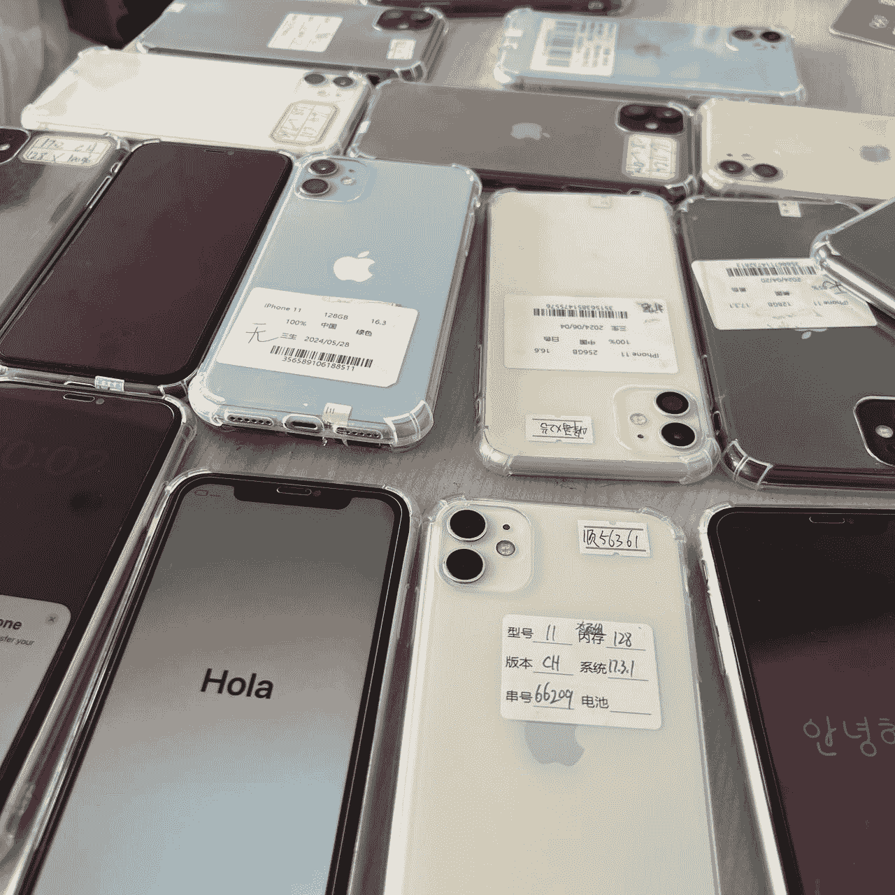

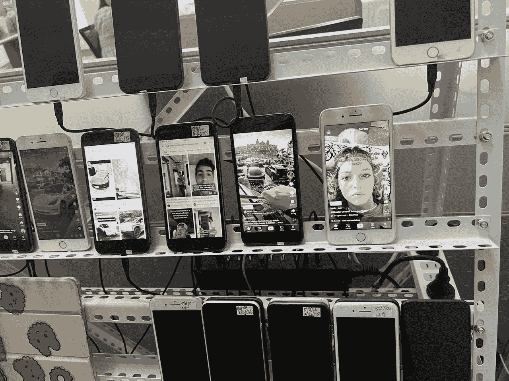

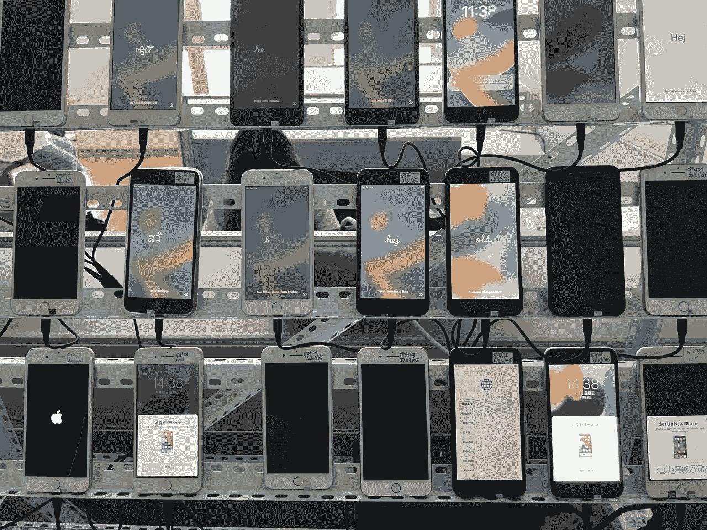

### 我的实施阶段过程

#### 短视频破局

借鉴国内抖音的品牌内容运营思路，从“短视频搬运剪辑”起步，逐步尝试打造；结合TikTok的流量算法，通过对接海外达人合作+精准投流，快速提升产品曝光，以及开设TikTok shop和独立站作为成交入口。实现首批订单转化。

#### 直播模式复制

下一段落有对直播非常详细的实操说明

复用国内抖音及多年TikTok运营的内容经验，落地TikTok直播；即使团队成员不懂英语，尝试用中文开展娱乐直播，也实现了“一天500-1000美金”的收益，验证了直播模式的可行性。然后将培养出来的娱乐直播主播转型培养进入带货领域

#### 平台拓展

2025年8月。在TikTok稳定盈利后，启动Whatnot平台开发，凭借过往多平台（Instagram/TikTok）的运营经验，新平台已取得显著成效，实现“全平台运营”布局。复用TikTok的选品、内容逻辑，仅用1个月就实现Whatnot单账号日均收益500美金，核心是利用‘信息差’抢占赛道红利。目前已形成“短视频引流+直播转化+多平台同步运营”的闭环，供应链与运营流程完全跑通；团队借助多年跨平台运营经验，能快速应对各平台规则变化，每日收益稳定在3万美金以上。形成‘10主20辅’账号矩阵，各平台流量、订单数据可相互联动补位，抗风险能力显著提升

## 三、短视频SOP账号启动法门

### 精准养号避坑指南

平台规则适配问题：虽有多年多平台运营经验，但不同平台规则差异大且频繁更新，在各方面都要注重，就像我前面截图到的直播需要注意的点，这些均需全员背诵。曾因未及时了解TikTok‘直播内容规范’，导致账号被中断、流量清零，被封禁。后续要求每天关注官方公告，新功能先小范围测试再推广。

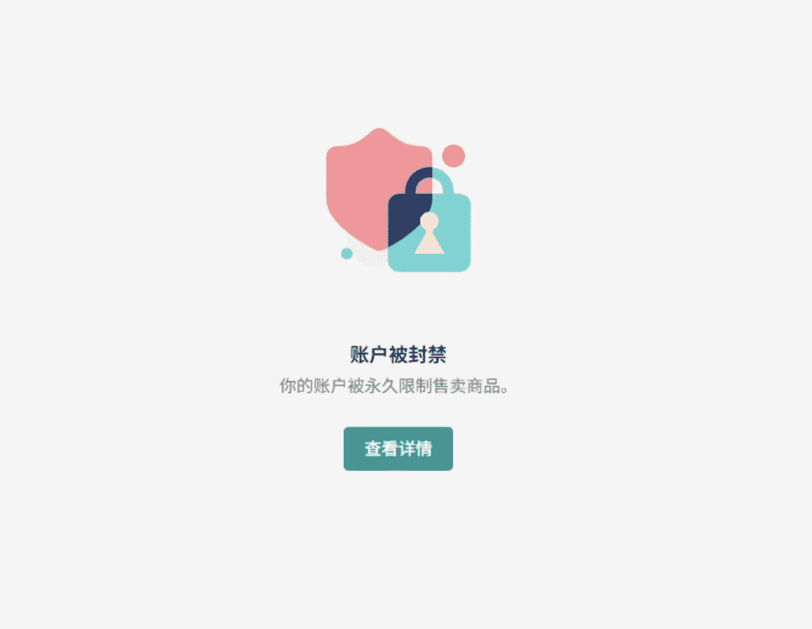

我在经营的时候很注意细节，从发布的细节还是各个方面

短视频素材优化：严格参照对标账号的拍摄标准，重点把控手机相机构图（如景别、角度、构图比例等），确保画面呈现专业、统一，避免因角度问题影响内容质感，做到“拍就拍好”。

### 账号内容垂直度提升

明确每个账号的核心主题与定位，删除或调整偏离主题的内容，保证主页内容聚焦、逻辑清晰，增强用户浏览欲望，避免“杂乱无章”。

### 内容精细化运营

视频制作：针对黑人视频，优先选用黑人用户偏好的音乐配音，在刷取群体时注意好，摒弃自身主观判断，以目标群体的喜好为导向。

标签使用：借鉴黑人用户发布头发等内容时常用的标签，逐一整理并应用到对应视频中，提升内容曝光精准度。

在账号养成上一直加大力度

养新号工作的，需注册前期完成账号注册（规范注册 `outlook`，确保网络环境地区适配），养号后进入内容发布阶段：第三天筹备、第四天发作品，按“一天两小时左右发一条原创内容”节奏，用 `3-5` 条测账号权重，观察基础流量数据；若流量不佳则刷机重置，流量达标再持续发布，同时贯穿上述拍摄、垂直度、黑人内容运营的优化要点，保障账号运营效果。如账号权重低下，及时做出措施。

踩坑经历：早期运营时，一个新号未按养号流程工作，连续发布N天➕内容后才发现流量低迷，每条播放量不足100，最终只能刷机重置，浪费了N天的内容制作时间；也浪费了筛选账号的时间，还有一次因忽略黑人用户的音乐偏好，用了国内流行音乐做背景音，导致一条本应爆火的假发展示视频，播放量仅为同类视频的1/5，后续替换音乐重新发布，播放量才提升至10万+。

避坑指南：新号必须严格执行“`3-5`条测权重”，像真人一样使用app等流程，每条内容发布后24小时内观察数据，若基础播放量低于500，立即重新开始；制作某领域短视频时，先去搜索其要做产品的关键词，确保刷到的内容，和发布的内容贴合目标群体喜好。比如说做某个产品的，就把大数据全部刷成这个领域。

### 网络与工具问题

很多创业者/同行为节省成本，使用非合规、低质量网络，导致直播卡顿、账号不稳定，影响运营效率（此问题在早年TikTok运营中也曾遇到，需反复强调）

踩坑经历：早期贪便宜用低价网络，导致直播频繁卡顿，1个账号被限流7天，损失了很多的心血，从此坚决选择合法备案服务商

避坑指南：坚决选择合法备案的海外网络，不是贪图便宜，不要贪图便宜购买“一次性”网络工具，优先选择按季度或年度付费的正规服务商。

### 人才缺口问题

随着规模扩大，行业“极度缺人才”，尤其是懂多平台运营（如同时熟悉TikTok与Instagram）的直播、达人对接类岗位，招聘与留存关键人才成为难题。

而且一个能掌握TikTok等平台运营能力的人才，不管是主播还是运营，哪怕不创业，去打工，你的工资待遇前景也非常可观，这句话很重要。

### 服务商踩坑问题

项目初期购买高价服务，部分工具短时间内失效，造成成本浪费。

踩坑经历：我认识一个女生，99年的，很棒，这几天做跨境电商创业很厉害。每月收益差不多有6万多人民币。她在2024年陆陆续续花费万元购买所谓的真人店铺，这种买了之后，服务商是不会管的，甚至有的商家都会不发货，收了钱就不管了。她遭遇过两次这样的事情，不仅这类，还有很多卷价格的服务，都不是很靠谱的，一定要找熟人斟酌好在去购买。

### TikTok短视频养号启动操作步骤

#### 账号注册阶段（第1天）

#### 设备准备

使用全新或恢复出厂设置的手机，避免使用曾被封禁账号的设备；手机语言设置为“英语”，地区设置为“美国”。或者销售国家。

#### 注册细节

用`outlook`邮箱注册，注册时填写的姓名、生日等信息，要符合美国用户的常用习惯（可参考美国人口普查局的常见姓名数据）；注册过程中避免使用国内IP，确保网络环境稳定。

#### 养号阶段（第2天）

模拟真实用户行为：每天用账号浏览TikTok 1-1.5个小时，搜索相应关键词，对同类假发视频进行“点赞+评论+收藏”，评论内容要贴合视频主题，如“Where did you get this wig? It looks amazing!”；关注30-50个同类爆款账号与黑人达人账号，模仿真实用户的关注逻辑。

避免违规操作：养号期间不发布内容、不修改资料、不私信陌生人，防止被平台判定为“营销号”。

#### 内容筹备与发布阶段（第3-7天）

确定账号定位（如“某产品工厂人设“），设计账号头像、昵称与简介，同时筹备3-5条原创内容，内容类型包括产品展示、教程、真人测评等。

#### 第4天

发布短视频，北京时间早晨以及北京时间晚上8点后。美国时间和我们反着。发布要打好标签`tag`如：核心词+长尾词

#### 第5-7天

每天发布5条左右内容，间隔8小时以上；每条内容发布后，用另一个真实用户账号（非运营号）进行评论互动，提升账号活跃度；72小时内观察每条内容的“播放量、点赞率、评论率”，若播放量≥500、点赞率≥3%、评论率≥1%，说明账号权重达标，可继续发布；若未达标，立即刷机重置，重新开始注册养号流程。

### 短视频发布要求细节

发布时间：根据美国用户的活跃时间调整，通过TikTok后台“创作者工具-受众分析”查看目标用户的活跃时段，通常美国东部时间19:00-22:00（国内次日7:00-10:00）是活跃高峰，优先在这个时间段发布内容。

内容格式：视频时长控制在15-30秒，画质清晰度≥1080P，横屏比例为16:9，竖屏比例为9:16；开头3秒必须抓住注意力。

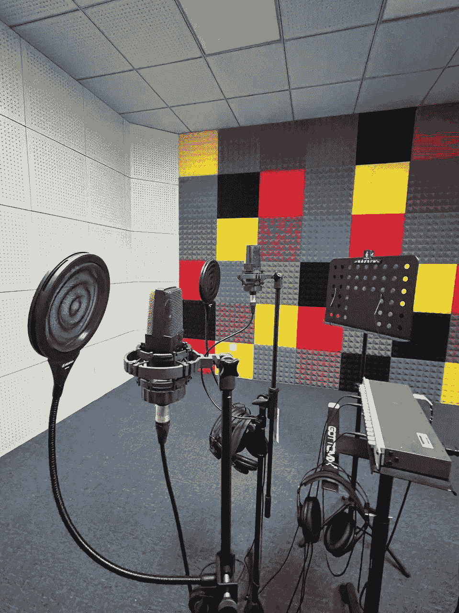

短视频高爆分析：多看多刷，提升网感！

> 原生内容作为平台用户心智的「数据镜像」，下面的内容选取了TK站内假发行业相关的`hashtag`进行分类拆析，发现站内用户的功能性需求，追踪最新的审美迭代趋势，以及短视频如何与站内用户建立情感共鸣。

> 数据来源：TikTok Creative Center

| **假发基础话题🏷️** |  |  |  |  |  |
| --- | --- | --- | --- | --- | --- |
| **热门话题** | **趋势解读** |  |  |  |  |
| **热门内容参考** |  |  |  |  |  |
| **假发风格&效果话题🏷️** |  |  |  |  |  |
| **热门话题** | **趋势解读** |  |  |  |  |
| **热门内容参考** |  |  |  |  |  |
| TikTok站内长青热门话题🏷️ |  |  |  |  |  |
| **热门话题** | **趋势解读** |  |  |  |  |
| **热门内容参考** |  |  |  |  |  |
| 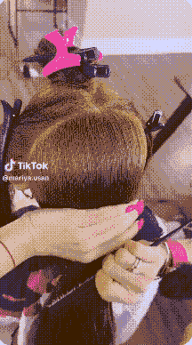 | 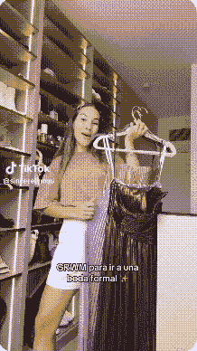 | 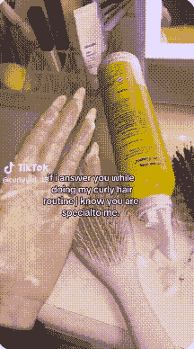 | 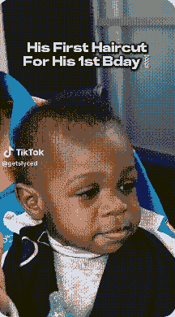 |  | 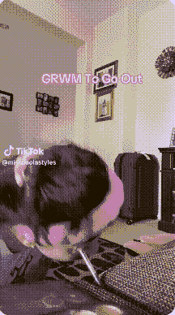 |
| **假发衍生话题🏷️** |  |  |  |  |  |
| **热门话题** | **趋势解读** |  |  |  |  |
| **热门内容参考** |  |  |  |  |  |
|  |  |  |  |  | 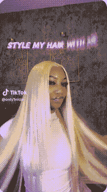 |
| **时尚心智标签🏷️** |  |  |  |  |  |
| **热门话题** | **趋势解读** |  |  |  |  |
| **热门内容参考** |  |  |  |  |  |

|  | 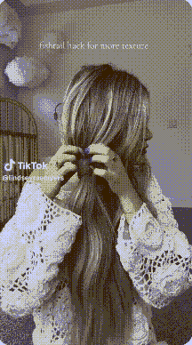 |  |  | 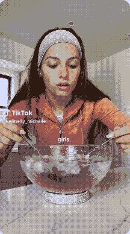 |  |

| **假发电商活动相关话题🏷️** |  |  |  |  |  |
| --- | --- | --- | --- | --- | --- |
| **热门话题** | **趋势解读** |  |  |  |  |
| **热门内容参考** |  |  |  |  |  |

| 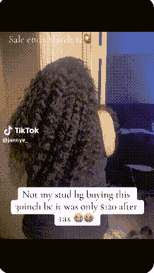 | 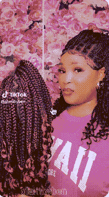 |  |  |  |  |

## 高点击素材：靠痛点

+ **核心逻辑：**通过强视觉冲击与痛点解决建立用户信任，CTR 可达 5.5%+。

+ **内容亮点：**

> **产品展示型：**聚焦假发造型过程，搭配氛围感 BGM，突出设计自由度与美观度。

> **达人种草型**：达人亲自演示佩戴教程、拆箱测评，结合对比效果，口播强调 “自然原生感”“免胶便捷” 等核心卖点。

> **强信任感型**：一镜到底回应评论区问题（如 “是否掉发”“尺寸是否合适”），以真实体验强化产品可靠性。

| **创意类型** | **产品展示型** |  | **达人种草测评型** |  |
| --- | --- | --- | --- | --- |
| **案例视频** |  |  |  |  |
| **数据** | CTR 5%+ | CTR 5.5%+ | CTR 4%+ | CTR 5%+ |
| **亮点内容** | + 展示假发造型的打造过程，手艺精巧，造型美观，反映假发优秀的设计自由度 | + 假发佩戴教学视频主题，结合产品展示、开箱、造型设计、佩戴等多种创意元素 | + 开头情绪饱满吸引注意，建立用户信任：如果你还没找到心仪的假发，还在搜索，直接看看我的测评 | + 既有达人口喷引导用户关注产品核心性能，也有配音描述产品的原生自然感 |
| **公式** | + 效果前置+试戴过程+成果展示 | + 效果前置+拆箱+产品展示+造型设计+成果展示 | + 痛点引入+效果对比+产品展示+试戴效果展示 | + 产品展示+试戴+造型设计+成果展示+引导点击 |

| **创意类型** | **强信任感型** |  |  |  |
| --- | --- | --- | --- | --- |
| **案例视频** |  |  |  |  |
| **数据** | CTR 5.5%+ | CTR 4.5%+ | CTR 4%+ | CTR 4.5%+ |
| **亮点内容** | + 达人情绪饱满，口喷夸张描述如“没有任何缺点”“哪里我都很满意”，吸引用户兴趣 | + 达人情绪饱满，试戴后展现惊喜之感 | + 产品测评+拆箱，全程口播，慢节奏带领用户深入感受产品品质与核心卖点。 | + 回应评论区问题，一镜到底展示产品不掉发的核心卖点，同时以答疑形式强调物流快、产品尺寸、厚度等问题，信任感强 |
| **公式** | + 口喷产品优点+强调对产品喜爱+引导点击 | + 产品展示+试戴+成果展示 | + 拆箱+产品展示+造型设计+成果展示 | + 回答问题+一镜到底+强调产品属性+引导点击 |

[download.mp4](https://internal-api-drive-stream.feishu.cn/space/api/box/stream/download/all/SgHxb3nwaoym70x3oYGcqzIInHd)

[download (5).mp4](https://internal-api-drive-stream.feishu.cn/space/api/box/stream/download/all/JvGqbjzACo4ikoxz3JOczbfDnNh)

[3_download (1).mp4](https://internal-api-drive-stream.feishu.cn/space/api/box/stream/download/all/KlFCbAHUto8ceXxfNY2c53Hgnmf)

[4_download (8).mp4](https://internal-api-drive-stream.feishu.cn/space/api/box/stream/download/all/TZTObzVBTogDKKxp5GJc0YQwn9e)

[5_download (4).mp4](https://internal-api-drive-stream.feishu.cn/space/api/box/stream/download/all/P8cybUHsloP0xBx2tn2chPE9ngf)

[6_download (2).mp4](https://internal-api-drive-stream.feishu.cn/space/api/box/stream/download/all/IQccbolFyoDVKcxRjArcp31rnNb)

[7_download (3).mp4](https://internal-api-drive-stream.feishu.cn/space/api/box/stream/download/all/Qpixb7V2ToMgblxFOXKcmyt2nDh)

[8_download (7).mp4](https://internal-api-drive-stream.feishu.cn/space/api/box/stream/download/all/Chmlbj05XoTF7mxUuUxc0phenJf)

## 💎高转化素材：靠信任

+ **核心逻辑：**通过情绪共鸣与细节解读推动用户加购下单，CVR 最高达 5.5%+。

+ **内容亮点：**

+ **情绪种草型：**对比不同假发效果，达人情绪饱满（如 “终于找到完美假发”），结尾强调价格优势。

+ **拆箱详述型：**细致展示产品细节（如发丝顺滑度、网帽透气性），搭配 “Put on & go” 等场景化字幕，降低用户决策门槛。

+ **场景化引导：**结合促销节点，字幕突出折扣信息，引导点击购物车。

| **创意类型** | **情绪种草型** |  |  |  |
| --- | --- | --- | --- | --- |
| **案例视频** |  |  |  |  |
| **数据** | CVR 5%+ | CVR 5.5%+ | CVR 4%+ | CTR 5.5%+ |
| **亮点内容** | + 开头情绪饱满吸引注意，从对比两种不同质量的假发效果切入，分析产品特点与核心卖点 | + 完整试戴产品，且节奏适中，每个部分都有详细的产品解读以及感受分析，增强用户信任 | + 达人情绪饱满，口喷夸张描述如“没有任何缺点”“哪里我都很满意”，吸引用户兴趣 | + 达人情绪饱满，试戴后展现惊喜之感 |
| **公式** | + 效果对比+产品解读+试戴展示+造型展示 | + 效果前置+产品展示+造型设计+成果展示 | + 口喷产品优点+强调对产品喜爱+引导点击 | + 产品展示+试戴+成果展示 |

| **创意类型** | **拆箱展示型** |  | **产品详述型** |  |
| --- | --- | --- | --- | --- |
| **案例视频** |  |  |  |  |
| **数据** | CVR 4.5%+ | CVR 4%+ | CVR 4.5%+ | CVR 4%+ |
| **亮点内容** | + 开头将使用过的假发拉直，假发依旧保持顺滑柔顺，发丝依然饱满无损，充分展现其耐用性和高品质工艺 | + 产品拆箱后，详细陈述产品的尺寸以及属性，加深用户对产品的直观感受 | + 既有达人口喷引导用户关注产品核心性能，也有配音描述产品的原生自然感 | + 回应评论区问题，一镜到底展示产品不掉发的核心卖点，同时以答疑形式强调物流快、产品尺寸、厚度等问题，信任感强 |
| **公式** | + 拉直假发+佩戴展示+成果展示+引导点击&看评论 | + 效果前置+拆箱+产品展示+造型设计+引导点击 | + 产品展示+试戴+造型设计+成果展示+引导点击 | + 回答问题+一镜到底+强调产品属性+引导点击 |

[9_download.mp4](https://internal-api-drive-stream.feishu.cn/space/api/box/stream/download/all/WwqSbDP7do5Vsfx6gg0cSUvTnLd)

[10_download (1).mp4](https://internal-api-drive-stream.feishu.cn/space/api/box/stream/download/all/Eh7SbcJblocjKNxpZGecAEtUnEe)

[11_download (4).mp4](https://internal-api-drive-stream.feishu.cn/space/api/box/stream/download/all/OGY7bEYh7oVAB7xFallcdps2nNd)

[12_download (5).mp4](https://internal-api-drive-stream.feishu.cn/space/api/box/stream/download/all/HMOwbklkloyKzvxCISkc21kUn6e)

[13_download (2).mp4](https://internal-api-drive-stream.feishu.cn/space/api/box/stream/download/all/Gn3cbwy76optzNx3IUNc4AGRnpf)

[14_download (3).mp4](https://internal-api-drive-stream.feishu.cn/space/api/box/stream/download/all/FQqubDlEWo7ro4x6yoQcfJicnhe)

[15_download (6).mp4](https://internal-api-drive-stream.feishu.cn/space/api/box/stream/download/all/O5Okb3mYIoRN2UxohDScFDzznqc)

[16_download (7).mp4](https://internal-api-drive-stream.feishu.cn/space/api/box/stream/download/all/W2Tubj7g0oZcMix43lbcPDMInih)

## 🎬高完播素材：靠故事

+ **核心逻辑：**用故事性与互动感延长用户停留，3s 完播率最高超 40%。

+ **内容亮点：**

**原生故事型：**以 “给妈妈 / 舍友试戴” 为剧情线，通过达人互动展现假发自然效果，生活化场景增强代入感。

**创意吸睛型：**设计 “路人误认原生发” 等反转剧情，搭配动感 BGM 与夸张动作（如甩发、舞蹈），强化 “隐形逼真” 卖点。

**信息密度型：**大字幕轮播核心卖点，小字幕贴合热门话题（如 #grwm #pov），兼顾视觉与信息效率。

| **创意类型** | **原生故事型** |  | **口喷种草型** |  |
| --- | --- | --- | --- | --- |
| **案例视频** |  |  |  |  |
| **数据** | 3s完播率 30%+ | 3s完播率 30%+ | 3s完播率 30%+ | 3s完播率 30%+ |
| **亮点内容** | + 以「给妈妈试戴发片」为故事线，两位达人互动展示发片亮点 | + 以「给舍友试戴发片」为故事线，两位达人互动展示发片亮点 | + 用夸张的动作展示产品核心卖点，无胶&牢固 | + 视频场景居家，原生感强 |
| **公式** | + 产品展示+试戴+成果展示 | + 效果前置+产品展示+产品试戴+成果展示 | + 效果前置+拆箱+产品试戴+多角度成果展示 | + 试戴展示+产品解读 |

| **创意类型** | **小品故事型** |  | **产品展示型** |  |
| --- | --- | --- | --- | --- |
| **案例视频** |  |  |  |  |
| **数据** | 3s完播率 40%+ | 3s完播率 35%+ | 3s完播率 30%+ | 3s完播率 35%+ |
| **亮点内容** | + 小品类短视频，通过路人以为达人原生发，展示假发优质自然的卖点 | + 达人配合动感bgm欢快舞动，用户注意力聚焦「有了它就稳了」的字幕 | + 大字幕轮播展示产品核心卖点，小字幕贴合站内话题趋势 | + 细致的造型设计过程 |
| **公式** | + 假装被路人打断，夸赞头发 | + 产品展示+动感舞蹈 | + 产品展示+字幕轮播产品卖点 | + 造型设计+成果展示 |

[17_download (3).mp4](https://internal-api-drive-stream.feishu.cn/space/api/box/stream/download/all/K2nqboUiloDojcxTL2OcYQGrnVb)

[18_download (6).mp4](https://internal-api-drive-stream.feishu.cn/space/api/box/stream/download/all/Decib2JZCoAWNNx5LPmcV6Alnge)

[19_download (2).mp4](https://internal-api-drive-stream.feishu.cn/space/api/box/stream/download/all/QALXb8nHuoq4MLxttpacHXaYnte)

[20_download.mp4](https://internal-api-drive-stream.feishu.cn/space/api/box/stream/download/all/SI9fbr2CNob2GDxv6ABcEquynjs)

[21_download (4).mp4](https://internal-api-drive-stream.feishu.cn/space/api/box/stream/download/all/W6vqbVQuLotSrmxCLPncM39gnqe)

[download (7).mp4](https://internal-api-drive-stream.feishu.cn/space/api/box/stream/download/all/Te4JbA7fDoWh5jxyzgDcyQgwnrF)

[23_download (1).mp4](https://internal-api-drive-stream.feishu.cn/space/api/box/stream/download/all/AXY8bnumOoB7cGxdD0fcN3cInTh)

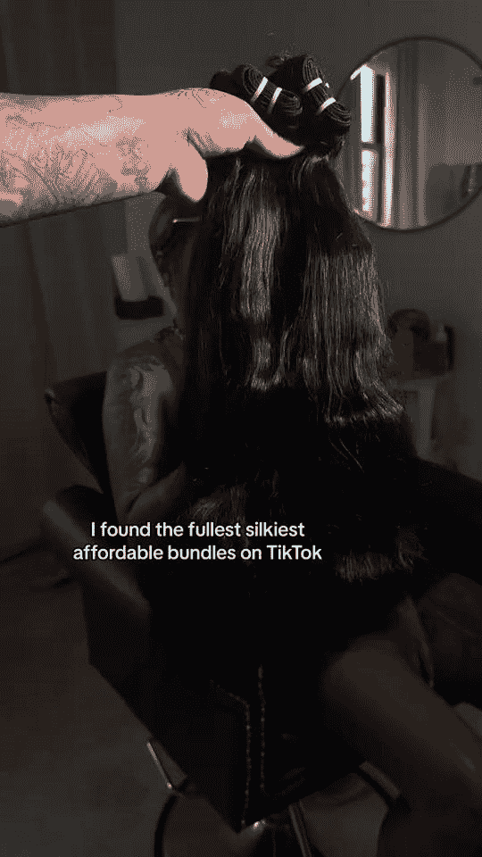

[24_download (5).mp4](https://internal-api-drive-stream.feishu.cn/space/api/box/stream/download/all/I8nHbmeAvoJUofxR7mxcD0G0nbb)

## 高跑量素材：靠效率

> **核心逻辑：**通过规模化产出与平台趋势适配实现流量突围，数据亮眼。

+ **内容亮点：**

**折扣驱动型：**动感 BGM 搭配 “限时折扣”等字幕，吸引价格敏感型用户。

**纯展示型：**多角度拍摄假发细节，适合快速复制量产，降低素材成本。

**详细解说型：**达人全程口播产品优势，结合场景化佩戴，覆盖多元需求。

| **创意类型** | **折扣驱动型** | **纯产品展示型** | **产品解说类** |  |
| --- | --- | --- | --- | --- |
| **案例视频** |  |  |  |  |
| **亮点数据** | CVR 3.5%+ | CTR 2.5%+ | 3s完播率 25%+ | CTR 2.5%+ |
| **亮点内容** | + 动感bgm，配上字幕强调产品折扣 | + 自制素材，拆箱后多角度展示产品细节 | + 达人情绪感染力强，配音多角度解说产品亮点 | + 达人情绪感染力强，全程口喷解说产品亮点 |
| **公式** | + 造型展示+折扣字幕 | + 拆箱+产品展示 | + 产品解读+多角度造型展示 | + 产品解读+造型展示 |

| **创意类型** | **产品解说类** |  |  |  |
| --- | --- | --- | --- | --- |
| **案例视频** |  |  |  |  |
| **亮点数据** | CTR 2.5%+ | ROAS 5.5+ | CTR 2%+ | CTR 3%+ |

| 亮点内容 | 视频时长3分钟，达人娓娓道来自己原本从不在TK买假发，但遇到了这个惊艳的产品，并给出详细的介绍 | 配音解说产品尺寸等基础信息 | 配音解说，特效字幕强调折扣价格 | 完整试戴产品，节奏适中，每个部分都有配音，详细解读产品 |

| 公式 | 造型展示+详细口喷解说 | 效果前置+产品展示+造型设计+成果展示 | 效果前置+产品展示+造型设计+成果展示 | 产品展示+试戴+成果展示 |

[download (4).mp4](https://internal-api-drive-stream.feishu.cn/space/api/box/stream/download/all/PFsjbXqZBoMcnjxSeVccJWyMnIP)

[download (1).mp4](https://internal-api-drive-stream.feishu.cn/space/api/box/stream/download/all/MScgbIXkyosRevxQp🐧cGfo9ntf)

[download (2).mp4](https://internal-api-drive-stream.feishu.cn/space/api/box/stream/download/all/FxtTbTsX9oWfzZxqsKXcZJVanDh)

[download.mp4](https://internal-api-drive-stream.feishu.cn/space/api/box/stream/download/all/UMfXbvoT0oijfKxgPc6cv78xnpe)

[download (8).mp4](https://internal-api-drive-stream.feishu.cn/space/api/box/stream/download/all/Oj2ibMfbSon3zQxpPO7cWINindb)

[download (5).mp4](https://internal-api-drive-stream.feishu.cn/space/api/box/stream/download/all/Ln8rbtEXzofCTex9y2WcCgQ9nid)

[download (6).mp4](https://internal-api-drive-stream.feishu.cn/space/api/box/stream/download/all/RjSabXkh3oWuQjxEFdJcuhOZnXi)

[download (3).mp4](https://internal-api-drive-stream.feishu.cn/space/api/box/stream/download/all/A2Chb6OBioXs91xSCbIcfvTLnre)

# 四（2）直播SOP团队搭建与精细化运营

## 团队架构

| 团队组建 | 如何搭建匹配模式的团队架构 |
| --- | --- |
| 团队建议 | 前期:2人,主播+运营 |
| 不同直播不同准备！开播就在明天！ | 1. 如果是不需要主播出镜的手播模式,早期运营可以直接上。 |
| 前置准备 | 1. 制定排班 |

具体负责直播间内的管理，组成这个部门的人员主要包括运营负责人、主播、运营/客服、场控。

为所有直播间服务的配套部门，主要人员为偏导、短视频拍摄、短视频剪辑、广告投放人员、选品人员。

主要包括行政、财务及仓库物流等后勤人员。

## 直播间搭建

### 直播前准备事项（0-1）

❗️确认是否可以直播

+ 电商权限：当店铺开通完成后，可自动获取电商权限（包括锚点短视频，橱窗和电商直播的权限）
+ 直播权限：当店铺开通完成且在商家后台绑定TikTok 美区账号后
+ 绑定的1个美区官方账号自动获得直播权限。店铺中的商品可自动同步到官方账号的橱窗；
+ 4个美区渠道账号需满足5k粉丝获得绑定，绑定后获得直播权限，渠道账号需要手动添加到橱窗

### 直播间搭建准备

> 场景搭建的基础常识

+ 直播间场景通常具备**主推区、商品区、道具区**三个功能区

1. 主推区的核心作用是突出主播讲解及展示的商品。
1. 商品区用于向用户展示其他商品,延长用户在直播间的停留时间,增加直播间的氛围感和用户的信任感。
1. 道具区用于增强品牌信任度、告知福利活动或者突出那些需要用户知道的信息。

> 场景搭建与主播着装，务必注意颜色一致性（如果消费客户为女性，推荐粉色）

### 直播间场景布局

| PS：场地:不同的人员配置,对直播间场地大小的要求不一样。在选择直播间场地时,一定要测试场地的隔音和回声情况。 |  |  |  |  |
| --- | --- | --- | --- | --- |
| 工厂/仓库直播 | 半无人直播 | 坐姿半身直播 | 站姿半身直播 | 站姿全身直播 |
| 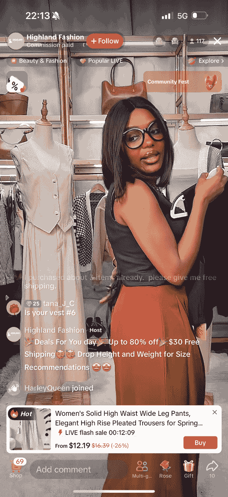 | 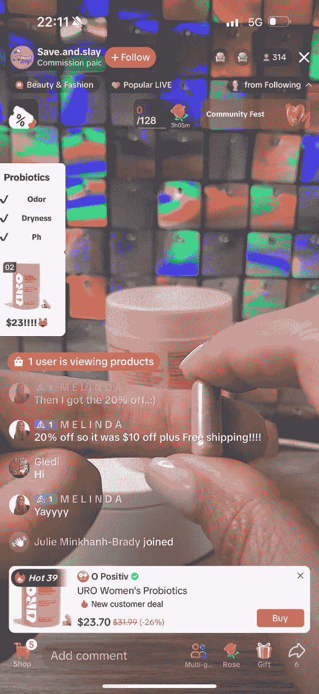 | 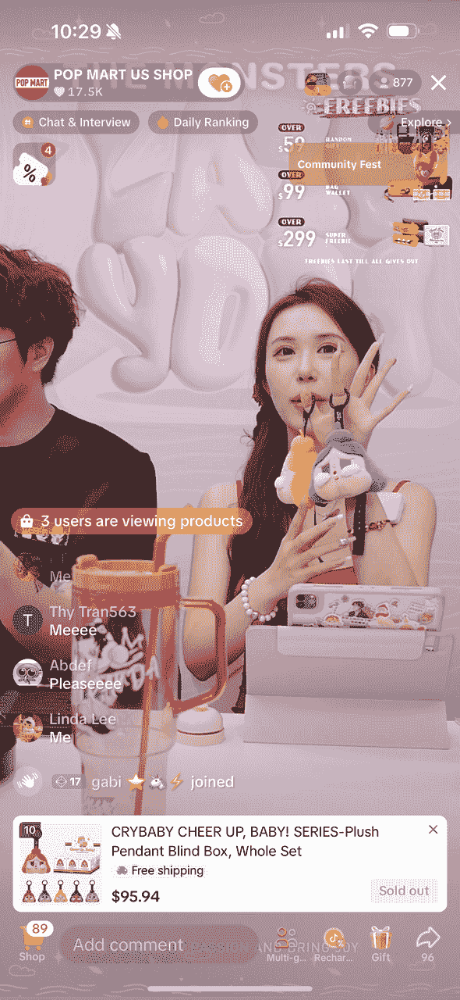 |  |  |
| **特点：**以工厂为背景，突出产品从工厂直销更低价。适合性价比产品，i.e. 家具清仓场景。 | **特点：**适用于需要特写的小商品，i.e. 首饰；配饰 | **特点：**便于展示产品，以及主播模拟使用产品的过程和效果；i.e. 玩具，家具厨房用品 | **特点：**用于展示商品与整体场景，特别是家纺类商品能更好的展示使用场景。 | **特点：**能完整展示主播全身效果。特别是下半身的服饰等。适合高客单产品，i.e.运动器械，家电。 |

### 直播间搭建模板参考

### 直播间灯光建议

灯光:有的直播间画面不清晰且有噪点,而有的直播间画面非常清晰且有质感。两者之间的差异很多时候就在于,直播间灯光的角度和位置。

**服饰、美妆：**

使用白光，接近美国本土光的色温光度，利于在镜头前展示服装和化妆品、护肤品等产品的展示状态，减少色差。

**家居：**

使用暖光，使得家居家纺更温馨。

**珠宝类：**

结合珠宝类型和光泽，再决定是白光还是暖光。

### 直播间色彩建议

环境:直播间的环境应保持光线清晰,环境整洁。所有出现在直播画面中的物品都应摆放整齐,擦洗干净。

**墙面**

+ 重刷墙漆，贴墙纸、墙布（造价相对较高）。以纯色为主，选择莫兰迪色系等低饱和度的颜色，可以在墙上装饰上品牌logo，强化客户心智。

+ 此外灰色是最安全的色彩，比较简约，是一个中立色，它可以和任何色彩搭配。也是摄像头最适合的背景色，不会过度曝光，视觉舒适，有利于突出服装、妆容或者产品的颜色

+ 不反光，不宜使用荧光色等刺眼的色彩

+ 最好选择浅色、纯色，以简约、大方、明亮为主，不要太花哨，否则会影响观众的注意力。不建议使用白墙，容易导致打光问题和曝光过度。

+ 灯光不够专业的情况下，可以选用深色背景，会显得主播比较白净一些。但是深色系会让买家产生距离感。

+ 使用背景布。可以任意更换，给买家带来新鲜感，成本不会很高。可以考虑选用

### 主播衣着与背景的搭配

**实景直播间**

+ 主播衣着色调应该避免跟产品、背景板、软装等重色融合。（背景、人物、产品三者颜色要拉开对比，以突出主播和产品）
+ 直播间搭建的软装配色应该与品牌调性一致，或者与直播主题相吻合。
+ 直播间的打光要与直播间软装相搭配，保持直播的视觉一致，不要过度曝光或过于昏暗。

**虚拟直播间**

+ 建议穿着深色系的服装，衣服边缘清晰，扣像效果较好。（不建议毛绒材质，扣像效果差会带绿色毛边，使观众不被这些小细节影响而转移注意力）
+ 主播不要穿着蓝色、绿色的衣服跟饰品，谨慎穿黄绿色、蓝绿色等色系的衣服。否则背景抠像的同时，也会造成主播的衣服被扣掉，使得画面不美观。
+ 主播衣着色调应该避免跟产品、字幕、弹幕等重色融合。（背景、人物、产品三者颜色要区分开）
+ 直播间的打光应提早进行测试和调整。以免灯光问题，导致产品色彩出现偏差，从而使得产品被绿幕扣掉（其中如果产品本身是蓝绿色系的包装，则不建议使用绿幕/蓝幕扣像）

### 直播间氛围物料

+ 一定要添加符合调性的贴片
+ 贴片中突出直播间主题活动
+ 以及call to action: i.e. 包邮/限量
+ 突出玩法: 比如福袋，清仓，$1 drop
+ 服饰直播间露出主播名字, 身高体重与尺码，或者身高体重如何做尺码选择

### 直播间实物物料

+ 手写板/pvc板
+ i.e. 比价，线下/其他平台价格
+ 尺码对比图；颜色对比图等

### 开播流程玩法设计

| 开播前 | 开播中 | 开播后 |
| --- | --- | --- |
| 1. 开播前:预热短视频发布 | 直播设置： | 1. 精彩瞬间发布，将一些高光时刻截取为短视频发布，降低自制短视频成本，形成多次宣传 |

> 预告设置参考:[开播前/中/后的事项汇总](https://bytedance.larkoffice.com/docx/doxcn6LXm3dWEw8gQuoJ9kZBUFb)

+ 重点突出直播新品上新款式、直播节点促销优惠、直播折扣优惠,结尾提醒醒关注转发等;视频内容中可添加一些小箭头指向您的头像,引导用户的关注

1. 查看直播数据曲线->挑选数据好的时间段的切片
1. 选择卖点介绍的内容
1. 选择观众高频问答的内容

### 目标玩法设计

提升人气

1. 短视频引流，开播前和开播时发短视频做预告，加热此条短视频为直播间引流
1. 定期做直播，固定开播时间，通过周期性开播让粉丝更容易记住直播间，培养粉丝粘性形成回访
1. 直播间加热，通过投放为直播间引流

提升互动

1. 通过主播口播引导，带动粉丝完成评论，分享，加关注等互动
1. 制造话题，比如引导有想要秒杀的朋友扣ａ等
1. 猜价格，引导粉丝猜直播间产品价格，同时准备上秒杀品引导转化

提升停留

1. 随机福利，通过随机发放福利的形式，吸引用户停留在直播间抢福利
1. 讲趣闻，讲和产品相关的故事和趣闻，吸引粉丝停留
1. 打招呼，和每个进直播间的用户直接叫名字打招呼，让用户觉得被关注从而吸引停留
1. 游戏或上才艺，适当得展示一些才艺培养主播人设，让观看用户不无聊从而提升停留

提升转化

1. 优质好货，用户愿意购买除了主播因素外更重要的还是货品本身，价格和选品很重要
1. 控制库存，对不同产品设置不同库存。可设置浅库存迅速卖完产品，营造直播间抢购氛围
1. 道具应用，展示适当的道具，例如包邮牌，关注，抢购的指示牌，提升粉丝购物兴趣

### 脚本设计（创建副本）

+ [直播间脚本模板 （可创建副本）](https://bytedance.sg.larkoffice.com/sheets/KmWDs66gehiYDetyQPFlZw16gDg)

# 五、经验总结

## 货源端

优先对接工厂源头

## 启动端

从熟悉的TikTok/Instagram平台入手，购买合法备案网络，注册安装，先做混剪视频练手，用AI/等翻译工具对接达人，低成本测试流量（借助过往平台内容运营经验）。

## 放大端

搭建多平台运营团队，聚焦“短视频+直播+达人合作+投流”组合拳，全平台同步运营。

# 六、普通人复制的门槛

低门槛：即使是素人，不懂英语也能起步（可用AI翻译工具、中文直播），核心先掌握混剪、基础投流技能；若有亚马逊/Instagram等平台基础，可更快上手。

核心能力：英语能力（加分项，利于沟通与内容创作）、达人对接与场控，电商运营能力、稳定货源资源；懂多平台基础运营者更具优势。

就业与创业前景：行业人才缺口大，懂等多平台运营的从业者更吃香；新人可从“个人”或者“小团队+单一熟悉平台”起步，风险可控。

不管是学会创业还是去应聘工作都没有差，

去上班底薪非常的到位。

过去的TikTok等平台，用户在习惯平台。同行在擦边在搞撸羊毛的项目

重点：国内有无数的产品值得你去做。

实际上“外贸”这两个字的含金量自己悟一下吧。

# 七、我们所做的，是一个可以沉淀的资产

未来依旧流量时代 干流量的业务 是非常持久性的

还有最重要的中国制造-外贸

# 八、本人下一步的计划（后续放大/发展方向）

平台深化：持续深耕TikTok直播，TikTok短视频内容，做好IP。 加大Whatnot平台投入（利用信息差抢占先机），同时优化Instagram账号的品牌营销，提升用户粘性。

产品升级：根据多平台用户反馈（如TikTok的直播互动、Instagram的评论），优化款式与材质，不断创新。

团队扩张：建立更完善的人才培养与激励体系，重点招募多平台运营人才，解决行业人才缺口问题。

模式输出：将“供应链+多平台运营”的成熟模式，复制到其他符合“刚性需求”的跨境品类中。

# 九、给各位的建议

一是货源（可对接工厂）并选定持久产品，二是培养自身及团队的混剪、投流、达人对接等基础运营能力，三是沉淀坚持耐心磨合平台规则，门槛不高，素人也能起步，甚至有人不懂英语做中文直播也赚了很多钱。回头看，做得最对的事是坚持深耕社交媒体流量，流量在哪就去哪，积累的经验能快速复用，比如最近直接启动whatnot成为第一波吃螃蟹的人；没有想重来的事，始终要求自己每一步都为了明天更好，且想赚很多钱就要专注一件事、做其专家，不断学习沉淀，三天打鱼两天晒网做不成事。踩过的坑有：网络上别贪便宜用非合规网络，会导致账号卡顿、限流，要选合法高质量网络；规则上即使有多年经验也要多养号测试规则，关注政策变化；坚决不做假货，刚需市场靠品质长久经营。下一步重点做TikTok的IP工作，打造规模化博主账号，深耕whatnot直播（很多人没发现其优势，有大信息差），同时深化品牌营销；建议创业者展开思路，外贸永远都在，可将多平台运营经验复制到其他刚需跨境品类做“模式输出”。最后想对还没动手的人说，别被“跨境”吓住，有任何平台（哪怕是抖音、📕）基础都能快速复用经验，跨境核心是“中国制造产品+海外客户刚需”和“稳扎稳打”，先从一条混剪视频、一个小达人对接开始，避开投机取巧的坑，市场会给正向反馈。

**送给大家的一句话**：稳扎稳打，从最小的动作（比如剪一条混剪视频）开始，跨境的各类刚需产品市场从不缺机会，缺的是敢启动且能坚持优化的人；别被“跨境”吓住，专注一件事、做其专家，不断学习沉淀，避开投机取巧的坑，市场终会给你正向反馈。
