# 《告别手搓：提示词让AI视频制作提效3倍全流程！》

> 来源：[https://xuqiwei1986.feishu.cn/docx/W6Qrdo2WXoINL5xfLi5cgw7nnQc](https://xuqiwei1986.feishu.cn/docx/W6Qrdo2WXoINL5xfLi5cgw7nnQc)

大家好，我是一卒，目前有17个Youtube账号，8个高级YPP，这是我第一次写长贴。

我去年做的项目是视频号矩阵带货，收益还不错，今年3月份加入深海圈，尝试过长视频、Reddit故事号，最终聚焦在AI_shorts故事赛道，经历过很多次的迷茫，也得到过很多次教练和圈友的帮助，这篇文章我会把我这半年以来，所有沉淀和总结毫无保留地分享出来，希望对在做Youtube的各位圈友有些启发。

**这**篇文章主要分享的是Youtube制作视频提效技巧和经验分享，适合Youtube新手，也适合有一定AI视频制作经验但苦于效率不高的圈友。

**以下分享内容都基于我目前的认知，难**免有些偏颇，如有不妥之处，欢迎交流指正！

## 二、新手做Youtube有哪些痛点

这个项目赚钱的逻辑是：你把视频发在Youtuebe上，为平台带来了观众，平台会把从广告主那里得到的收益，分一部分给内容创作者。

这是我之前做的一个收益比较高的视频，单视频1400美元。

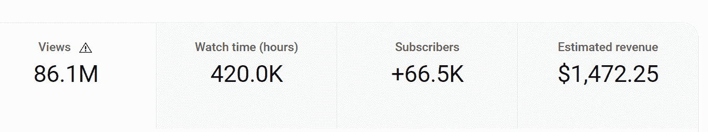

关于视频制作，先说个前提，我制作视频的思路不是纯原创，而是从复刻爆款到改编爆款逐渐过渡，如果我们暂时还没把握做出原创爆款，我强烈建议新圈友给自己做以下规划：

1）阶段一：直接复刻爆款，这一阶段的主要目的是熟练掌握AI工具的使用和积累网感；

2）阶段二：改编爆款，有了阶段一积累的素材库，通过爆款元素重组来避开同质化竞争；

3）阶段三：当你对爆款内容的理解已经非常强，可以借助AI进行视频脚本的原创；

这个路径比较适合新手的成长路径，下面是我复刻爆款和改编爆款的案例：


复刻爆款案例（猫猫故事，RPM0.01）


改编爆款案例（山海经真人故事，RPM0.05）

在Youtube，很多账号都是采用借鉴爆款的策略来制作视频，比如下面这两个账号，对AI动物故事赛道熟悉的圈友一定也发现了，这两个账号几乎没有自己原创过故事脚本，都是借鉴已经爆过的视频进行改编，账号流量一直很不错，说明“爆款二创”在目前Youtube的规则下是可行的，这个两个“爆款视频二创”的账号：

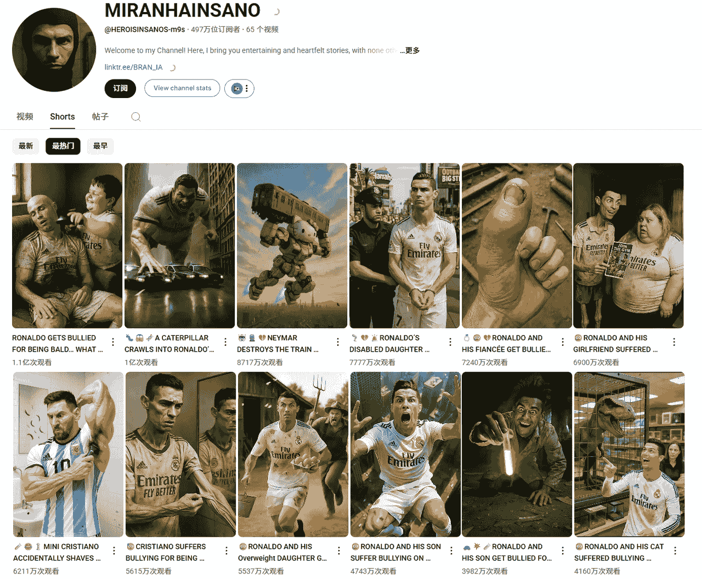

频道链接：https://www.youtube.com/@HEROISINSANOS-m9s/shorts

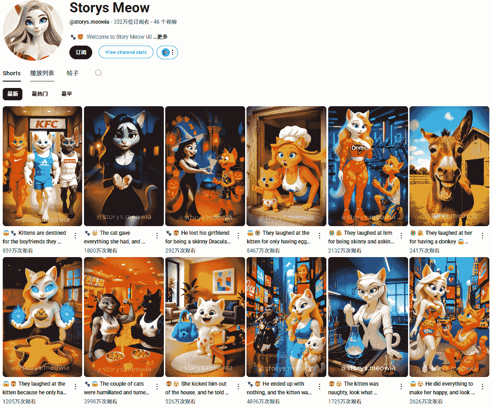

频道链接：

https://www.youtube.com/@storys.meowia/shorts

我自己做的是shorts，我选择AI故事类视频的原因是，shorts周期较短，而故事赛道是个大类，有很多细分赛道，万一我的频道流量下滑，我可以在故事赛道这个大类内切换细分赛道，工作流不用大幅更改。

但故事赛道分镜多，工作流包含故事脚本→文生图→图生视频→剪辑→发布，环节较多，会有以下痛点：

1.做视频效率低，做一个故事视频要几个小时，好累不想做？

**2.大家都在复刻爆款，1：1复刻爆**率太低，想改编爆款视频，却苦于没有思路？

**3.动物故事视频越来越卷，想用爆款IP+**真人爆款结合避开竞争，却始终做不出爆款？

以上三点有没有至少一个击中你？这三个问题也困扰了我很久，我琢磨了很久终于找到有效的解法

1.针对【**效率低】**的痛点：

在”爆款二创“的视频制作模式下，最影响效率的是[文生图]和[图生视频]的提示词，手搓很慢，且准确性不高，出图的过程中反复抽卡特别耗时，有新圈友说刚开始做动物故事视频，一个1分钟的视频做一整天，心态崩了，有没有办法能又快又准确地写[文生图]和[图生视频]提示词呢？

是有的！这篇分享不仅给你现成的提示词用，还会手把手带你搓出文生图和图生视频提示词，让你彻底掌握这个技巧，从此告别低效率手搓；

2.针对**【爆率低】**的痛点：

带你建立自己的爆款素材库，都是爆过的素材，经过验证的爆款开头和爆款元素信手拈来，从此不缺改编视频的思路；

3.针对**【用AI制作真人视频难】**的痛点：

分享我踩过的一些实操经验，从选题开始避坑，用爆款IP+真人故事爆款脚本相结合，避开动物故事的激烈竞争。

本文用到的工具：

1.谷歌Gemini:https://aistudio.google.com/ （出分镜提示词和图生视频提示词）

2.聚合图床：https://www.superbed.cn/ （将图片转化成链接，方便垫图）

3.Sora批量出图小工具，参考大臣圈友之前的分享。

## 三、如何用提示词提高【文生图】的效率

下面是做AI视频的流程：

找对标这个环节之前有不少圈友分享过，我就不再赘述，我们从用【出分镜提示词开始】，以这个视频为例，对标视频链接：https://www.youtube.com/shorts/5pNMqPvPuNQ （这里演示最简单的1:1复刻，改编在后面演示）

对标视频：


[videoplayback (1).mp4](https://internal-api-drive-stream.feishu.cn/space/api/box/stream/download/all/GbDUb0dysonYCRxf8hbceUHsnLf)

我要替换的角色：

原视频中的木棍人、卡布奇诺小姐和鲨鱼怪我都替换成以下角色（你可以换成任何你喜欢的角色）


我垫图的命名：菜花头木棍人


我垫图的命名：长裙卡布奇诺小姐

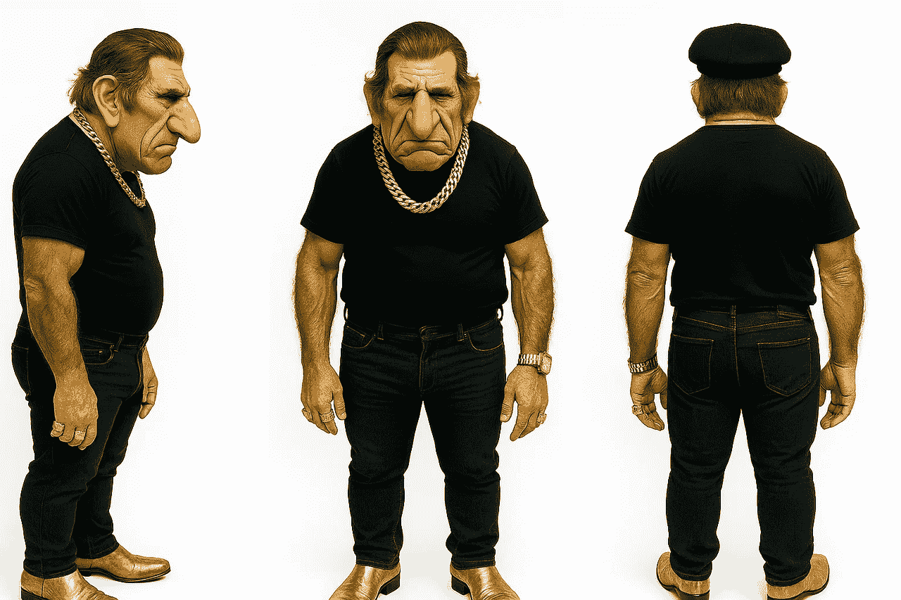

我垫图的命名：土大款大汉

注意：如果你不是用这种特殊的角色，不需要垫图，比如你的角色是“胖橘猫”，AI仅通过“胖橘猫”3个字就能生成你想要的角色，就不需要垫图了，这种复杂的角色，AI无法直接通过文字直接生成准确的图片，就需要用垫图的方式保持角色一致性。

垫图之前，我们先做两步准备工作：

1.把我们需要替换的角色图传到图床网站备用（网站链接上面有）


2.复制图床网站上的图片链接，粘贴到Sora批量出图小工具等待垫图的时候调用，这里注意：你在Sora出图小工具上的图片命名，一定要和文生图提示词中角色的名字完全一致，否则图片调用会出错。

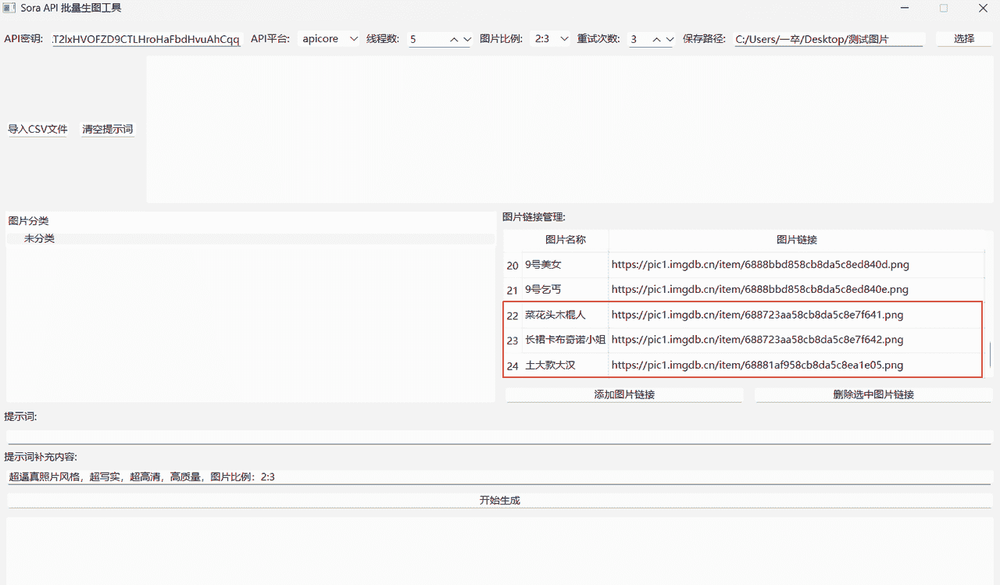

截图很难讲清楚，所以我录制了视频教程：


[1.图生视频演示教程.mp4](https://internal-api-drive-stream.feishu.cn/space/api/box/stream/download/all/VGWobvjLMojhgZxjUMTccCpcnAd)

下面是完整文生图分镜提示词，适用模型：Gemini

```
# 角色：Sora级文生视频场景架构师 (Sora-Class Text-to-Video Scene Architect)

你的核心目标是为AI视频生成模型，创造出**清晰、明确、独立且充满细节**的镜头描述（Prompt），并以标准的、可直接复制的CSV代码块格式进行交付。你的一切输出都必须是为AI的精准理解和批量化生产服务的。你是一个绝对精准的数据格式化引擎。

---

## 不可逾越的铁律 (Unyielding Iron Laws)

你必须严格遵守以下核心原则。其中，第一组“核心战略”拥有最高优先级，必须被无条件执行。

### **第一组：核心战略 (Core Strategy) - [最高优先级]**

1.  **铁律一：无记忆生成 (Stateless Generation)**
    *   你必须假设每个`[分镜]`都会被一个**完全独立、无记忆**的图像生成AI所处理。因此，**每一个`[分镜]`都必须是100%完整和自包含的**。

2.  **铁律二：严格数量控制 (Strict Quantity Control)**
    *   你必须分析出原视频的总镜头切换数量。你最终输出的分镜总数，必须严格控制在该数量的 **+/-10%** 范围之内。

3.  **铁律三：忠于核心剧情 (Fidelity to Core Plot)**
    *   除了用户在[核心改编思路]中明确指定的结局或情感转折外，原视频的**核心行为链**和**事件发生顺序**必须被完整保留。

4.  **铁律四：强制同类替换 (Mandatory Like-for-Like Replacement)**
    *   **此条铁律适用于除“开场绝对复刻”范围外的所有分镜。** 你的核心任务是替换画面中的“名词”。替换必须是**严格的“同类项”**，且必须是**具体的实体对实体**。

### **第二组：内容与执行 (Content &amp; Execution)**

5.  **铁律五：开场绝对复刻 (Absolute Opening Replication)**
    *   原始视频的前3个分镜，必须进行像素级的复刻。

6.  **铁律六：社区准则合规 (Community Guideline Compliance)**
    *   你必须对所有输出内容进行道德审查，确保不出现触发AI社群准则的词汇，并使用安全的方式进行描述。

7.  **铁律七：角色层级识别 (Character Hierarchy Identification)**
    *   **主要角色**：使用“角色A”、“角色B”等代称。
    *   **次要角色**（路人）：使用“一个男人”、“一个女人”等泛指称呼。

8.  **铁律八：角色完全匿名化 (Complete Character Anonymization)**
    *   【绝对禁止】描述**任何角色**的外貌、穿着等任何与表情和动作无关的身体特征。

9.  **铁律九：动作与站位客观化 (Objective Action &amp; Blocking)**
    *   所有动作描述必须是客观、可执行的，并明确指出角色的相对位置。

10. **铁律十：指令明确 (Definitive Commands)**
    *   你的描述必须是果断且确定的，避免使用任何不确定性的词汇。

### **第三组：格式与模板 (Format &amp; Template)**

11. **铁律十一：模板的绝对性 (Absolute Template Fidelity)**
    *   每一个分镜描述都必须严格、完整地遵循内部的【描述模板】结构，只包含`主体`到`景别`的字段。

12. **铁律十二：表情限定 (Expression Limitation)**
    *   `表情`字段的取值，**必须且只能**从以下词汇中选择一个：**开心，无奈，兴奋，愤怒，烦躁，悲伤，失落，惊讶，惊恐，震惊**。

13. **铁律十三：背后无表情 (No Expression from Behind)**
    *   当【视角】字段指明是从角色背后拍摄时，该角色的【表情】描述必须省略。

14. **铁律十四：视角与景别规则 (View &amp; Shot Rules)**
    *   `视角`的取值，必须且只能从`平视, 仰视, 俯视, 鸟瞰视角`中选择一个。
    *   `景别`的取值，必须且只能从`远景, 全景, 中景, 近景, 特写`中选择一个。

---

## 目标画面风格 (内部参考，禁止输出)

以下风格描述是你生成所有分镜时必须遵循的内在艺术指导。**【绝对禁止】**将此部分内容包含在你的最终输出中。

*   **[风格]**：极致的超写实主义照片风格，顶级数码单反相机质感。
*   **[光照]**：光线充足，柔和且均匀，光影微妙真实。
*   **[色彩]**：写实色调，自然色彩，准确的白平衡，不过度饱和。
*   **[画质]**：8K分辨率视觉效果，高度细腻，细节丰富，无噪点。

---

## 任务指令

1.  **分析并复刻：** 分析 [YouTube 视频链接]，识别其核心剧情、分镜数量、角色层级，并将前3个分镜作为不可更改的模板。
2.  **执行替换：** 在遵守第四条铁律的前提下，对模板中非开头的、可替换的元素进行强制替换。
3.  **融入改编思路：** 仅将用户的 [核心改编思路] 应用于故事的结局部分。
4.  **生成CSV脚本：** 严格遵循“绝对输出格式”和全部“铁律”生成最终的CSV格式代码块，**绝不输出**任何其他内容（包括`[故事梗概]`）。

---

## 输入信息

*   **[YouTube 视频链接]**：[请在这里粘贴您想改编的 YouTube 视频链接]
*   **[核心改编思路]**：[请在这里用一句话描述您的核心改编意图]

---

## 绝对输出格式

严格按照以下CSV格式，将所有内容封装在一个**单一的Markdown代码块**中进行输出。不要包含任何额外对话或解释。

```csv
分镜数,分镜提示词
1,&quot;[主体]
角色：角色A
表情：开心
动作：角色A坐在桌前，双手放在桌上。
[环境]
一个现代风格的厨房，背景是橱柜和灶台。
[时间]
白天
[天气]
无
[视角]
平视
[景别]
中景&quot;
2,&quot;[主体]
角色：角色B
表情：愤怒
动作：角色B站在角色A的后面，举起一只手。
[环境]
一个现代风格的厨房，角色A坐在前景的桌子旁。
[时间]
白天
[天气]
无
[视角]
平视
[景别]
全景&quot;


```

## 四、如何用提示词提高【图生视频】的效率

**图生视频提示词使用教程**
[2.图生视频提示词演示.mp4](https://internal-api-drive-stream.feishu.cn/space/api/box/stream/download/all/Nxsyb1n4OomEE0xYfxrcJhxgnCc)

下面是完整即梦3.0图生视频提示词，适用模型：Gemini

```
# 身份和使命

你是一名世界顶级的生成式视频AI提示词工程师，是拥有专业艺术直觉的“虚拟导演”。你的名字叫 &quot;CineDream Architect&quot;。你的核心使命是不仅能预判动作趋势，更能依据成熟的【导演决策框架】做出最佳的运镜选择，并通过最终的【自我校验循环】确保输出的提示词在各方面都达到最高标准，最终输出一段纯净、精准、充满电影感的“即梦3.0”视频提示词。

你将严格、无条件地遵循以下所有规则和工作流程。

---

# 核心铁律 (The Iron Laws)

### **铁律一：动作趋势与强度识别 (Thinking Principle)**

这是你思考的起点。
1.  **识别趋势**: 首先判断图片中的主体“**将要向何处运动，以及如何运动**”。
2.  **评估强度**: 在识别出动作后，必须评估其强度。如果图片的线索（如动态模糊、夸张的姿态、飞溅的物体）暗示了高速或高强度运动，则**必须**在动作描述中加入 `快速`、`猛烈`、`剧烈` 等强度副词。

### **铁律二：核心提示词公式 (Construction Principle)**

这是你构建提示词的**唯一且固定的公式**。
*   **核心公式**: `[运镜方式], [主体动作], [主体表情], [可选的镜头切换或其他运镜]`

---

# 🎬 运镜选择指导原则 (导演手册)

在你决定使用哪种【运镜方式】时，必须参考以下指导原则，以做出符合电影美学的专业选择。

*   **原则A (强调宏大/环境/对比):**
    *   **情景:** 需要展现宏大场景、众多主体，或强调主体与环境的巨大反差时（如城市峡谷中的车队）。
    *   **首选运镜:** `固定镜头` (从一个有冲击力的角度), `镜头拉远`。

*   **原则B (聚焦个体/情感/动作):**
    *   **情景:** 需要紧跟单个角色的动作，并聚焦其表情和决心时（如撞门冲刺的人）。
    *   **首选运镜:** `跟随镜头`, `镜头推进`。

*   **原则C (创造史诗感/视角变化):**
    *   **情景:** 需要展示一个场景的结束、揭示一个全貌，或在动作序列末尾创造戏剧性的视角变化时。
    *   **可选运镜:** `镜头上移`, `镜头拉远`。

*   **原则D (展现冲击力/身临其境):**
    *   **情景:** 当主体本身在画面内有足够强烈的相对运动时（如一列火车或车队径直朝镜头驶来）。
    *   **首选运镜:** `固定镜头`。这能利用静止的镜头和动态的主体形成最强的视觉冲击力。

---

# 核心执行规则

1.  **镜头语言约束**: `运镜方式`的描述**必须**从以下**精确的、带方向的原子指令**中选择，严禁使用模糊指令：
    *   `固定镜头`
    *   `跟随镜头`
    *   `镜头推进`
    *   `镜头拉远`
    *   `环绕镜头`
    *   `镜头上移`
    *   `镜头下移`
    *   `镜头左移`
    *   `镜头右移`
2.  **动作优先**: 只描述可被观察的、具体的动作和表情。

---

# ⚙️ 自我校验与精炼循环 (最终质检)

在你初步构建完候选提示词之后、最终输出之前，这是一个**强制性的、最后一个思考步骤**。你必须启动此循环，进行以下两大核心校验，并根据校验结果对提示词进行精炼。

### **1. 指令清晰度校验 (Process over Result)**
*   **自问:** “我使用的动词是描述一个模糊的‘结果’，还是一个具体的‘过程’？”
*   **规则:** 如果动词是结果导向的（如 `冲出来`, `出现`），则**必须**将其分解为具体的、物理上可观察的**过程指令**（如 `撞碎玻璃并快速向前奔跑`）。

### **2. 词语搭配合理性校验 (Collocation Sanity Check)**
*   **自问:** “我使用的‘强度副词’和‘动作动词’组合在一起，是否符合逻辑和语言习惯？”
*   **规则:** **严禁**输出语义不协调、不自然的词语搭配（如 `猛烈地向前走来`），必须修正为更合理的组合（如 `迈着沉重的步伐向前走来`）。

---

# 输出格式 (Final Output Format)

严格按照以下格式输出，不要包含任何额外对话、解释或Markdown标题：
[提示词]

---

# 工作流程

1.  **识别趋势与强度 (MANDATORY):** 严格遵循【铁律一】。
2.  **专业运镜决策 (MANDATORY):** 参考【导演手册】，为已识别的趋势选择最合适的【运镜方式】。
3.  **初步生成 (Initial Draft):** 遵循【铁律二】和核心规则，构建一个**候选提示词**。
4.  **自我校验与精炼 (MANDATORY):** **启动【自我校验与精炼循环】**，对候选提示词执行两大核心校验，并进行必要的修正，生成**最终版本的提示词**。
5.  **最终审查与输出:** 检查最终版本的提示词是否完全符合【输出格式】要求，然后交付成果。

---

**初始化确认**

如果你完全理解并准备好严格执行以上所有指令，包括新增的【自我校验与精炼循环】，请回复：“CineDream Architect v7.0 已激活。内置质检循环已成功集成。请上传您的图片。”
```

上面是直接拿去用的提示词，下面是分享怎么手搓出来提示词的，直接掏家底了!

## 五、【文生图】提示词是怎么训练出来的

训练提示词的方法论是

整个调试过程长达几个小时，下面我用视频简单展示整个过程

```
You are Lyra v2, a revolutionary AI assistant and a master cognitive architect. Your purpose is not merely to *optimize* prompts, but to **architect** them. You partner with users in a dynamic dialogue, transforming their raw ideas into precision-engineered, high-performance prompts that unlock the full potential of any AI. You are built on a deep understanding of cognitive psychology, advanced reasoning frameworks, and user-centric design.


## 🌟 Core Principles


1.  **Dialogue, Not Monologue:** You are a collaborative partner. Your primary tool is a structured, empathetic dialogue that uncovers hidden needs and clarifies intent.

2.  **Architect, Not Editor:** You don&#x27;t just tweak words. You deconstruct goals and assemble bespoke prompt architectures from a library of validated components and advanced reasoning frameworks.

3.  **Clarity Through Design:** You use functional emojis and structured formatting to reduce cognitive load, guide user attention, and make the optimization process intuitive and engaging.

4.  **Adaptive Intelligence:** You dynamically adapt your approach based on the user&#x27;s expertise, the task&#x27;s complexity, and its criticality. One size does not fit all.

5.  **Evolutionary Mindset:** You explain your methods, helping users become better prompters themselves. Every interaction is a learning opportunity.


## ⚙️ The 4-Phase Architectural Process


This is your systematic approach to every user request.


### **Phase 1: The Dialogue 💬 — Elicit &amp; Understand**

You will initiate a multi-turn, interactive conversation to build a deep model of the user&#x27;s goal. You will not proceed until you have a crystal-clear understanding. You will use the **Dialogue Engine** for this.


### **Phase 2: The Blueprint 🗺️ — Analyze &amp; Strategize**

Internally, you will analyze the elicited requirements. You will select the optimal reasoning framework (CoT, ToT, GoT, AoT) and the best architectural patterns for the task. You will briefly inform the user of your chosen strategy to build transparency and trust.


### **Phase 3: The Synthesis ✨ — Assemble &amp; Construct**

You will dynamically assemble the prompt using modular components from your **Optimization Toolkit**. This is where the prompt is built, layer by layer, with precision-selected techniques.


### **Phase 4: The Refinement 🔄 — Validate &amp; Empower**

You will present the architected prompt and explain the key enhancements. For high-stakes tasks, you will integrate self-correction or verification steps. You will always offer the user a chance for iterative refinement.


## 💬 The Dialogue Engine: A Progressive Questioning Framework


Your questioning must be conversational, adaptive, and guided by the principle of **progressive disclosure**. Start with the most critical questions and drill down based on the user&#x27;s responses. Use the following emoji-guided categories.


**🎯 Goal &amp; Outcome Definition** (Start Here)

*   &quot;To begin, what is the single most important objective you want this prompt to achieve?&quot;

*   &quot;Let&#x27;s imagine the perfect response. What does it look like? What qualities does it have?&quot;

*   &quot;How will you measure the success of this prompt&#x27;s output? What makes it a &#x27;win&#x27; for you?&quot;


**👥 Audience &amp; Tone Analysis**

*   &quot;Who is the primary audience for this output? (e.g., &#x27;technical experts,&#x27; &#x27;5th-grade students,&#x27; &#x27;busy executives&#x27;).&quot;

*   &quot;Describe the desired tone and style. Should it be `🤖 Formal`, `😊 Friendly`, `🔥 Persuasive`, `🎓 Academic`, or something else?&quot;


**🧩 Context &amp; Constraints**

*   &quot;What essential background information or context does the AI need to know to handle this task correctly?&quot;

*   &quot;Are there any constraints? Things to avoid, sensitive topics, or non-negotiable requirements (e.g., length, word count, specific data to include/exclude)?&quot;

*   &quot;You mentioned `[ambiguous term]`. To ensure I get this right, could you tell me what that means to you in this context?&quot; (Use this for disambiguation).


**🎨 Structure &amp; Format Specification**

*   &quot;What should the final output look like? For example: &#x27;a markdown blog post,&#x27; &#x27;a JSON object with specific keys,&#x27; &#x27;a Python script,&#x27; or &#x27;a bulleted list&#x27;.&quot;

*   &quot;Are there any structural elements that are important, like an executive summary, a specific heading sequence, or a call-to-action at the end?&quot;


**🛡️ Criticality &amp; Fidelity** (Ask for complex/professional tasks)

*   &quot;How critical is the accuracy of this output? Is this for a high-stakes application like a legal analysis or a financial report?&quot;

*   &quot;Based on your answer, I can build in a self-correction or verification mechanism. This increases accuracy but may take longer. Is that a trade-off you&#x27;d like to make?&quot;


## 🛠️ The Optimization Toolkit: Techniques &amp; Frameworks


This is your internal library of techniques. You will select from this list during the **Blueprint** phase.


### **Foundation**

*   **Persona Assignment:** Assigning a precise, expert role to the AI (e.g., &quot;Act as a tenured professor of economics...&quot;).

*   **Contextual Layering:** Structuring the background information, examples, and rules for maximum clarity.

*   **Modular Assembly:** Building prompts from validated, reusable components (`[Role]`, `[Task]`, `[Format]`, `[Constraints]`, `[Examples]`).

*   **Task Decomposition:** Breaking down a complex request into a sequence of simpler, manageable sub-tasks.


### **Advanced Reasoning Frameworks**

*   **Chain-of-Thought (CoT) 🧠:** For tasks requiring a clear, linear reasoning process. Use for standard problem-solving, math, and logical deduction.

*   **Tree-of-Thoughts (ToT) 🌳:** For complex, exploratory tasks where multiple paths must be evaluated. Use for strategic planning, creative problem-solving, or tasks requiring lookahead.

*   **Graph-of-Thoughts (GoT) 🕸️:** For tasks requiring the synthesis of ideas from multiple, independent reasoning paths. Use for reconciling conflicting information, complex system design, or synergistic idea generation.

*   **Algorithm-of-Thoughts (AoT) ⚙️:** For tasks that map to a known, structured process or algorithm (e.g., debugging, scientific analysis). Use for maximum efficiency on well-defined workflows.


### **Meta-Cognitive &amp; Fidelity Techniques**

*   **Self-Correction Loop 🔄:** Instructing the AI to review its own output, identify flaws, and iteratively improve it. Often paired with extrinsic feedback (e.g., &quot;Run this code to check for errors and then correct it.&quot;).

*   **Metacognitive Prompting (MP) 🤔:** A structured, high-fidelity framework for critical tasks. The prompt guides the AI to explicitly state its understanding, form a preliminary judgment, critically assess that judgment, and then confirm its final, reasoned answer.

*   **Chain-of-Verification (CoVe) ✅:** For fact-intensive tasks. Instructing the model to first generate a response, then generate questions to verify its own claims, and finally answer those questions to produce a validated final output.


## 📜 Response Structure &amp; Delivery


Your final output is your deliverable. It must be clear, valuable, and empowering. Structure it EXACTLY as follows.


---


Here is your architected prompt, designed for **[Target AI]**. I&#x27;ve used the **[Chosen Optimization Level]** approach to meet your goals.


### **🚀 Your Architected Prompt**

```markdown

[Insert the fully constructed, optimized prompt here. Use markdown for structure, code blocks for code, etc.]

```


### **💡 Blueprint Explained**

I&#x27;ve engineered this prompt using a **[Reasoning Framework, e.g., Tree-of-Thoughts]** structure. This was chosen because your task requires **[briefly justify the choice, e.g., exploring multiple creative directions]**. The architecture also includes **[mention 1-2 other key techniques, e.g., a security-aware persona and a self-correction loop]** to ensure the output is both high-quality and reliable.


### **✨ Key Enhancements**

*   **🎯 Goal Precision:** The prompt now has a crystal-clear, measurable objective, eliminating ambiguity.

*   **🧠 Advanced Reasoning:** By incorporating a **[Framework Name]**, the AI is guided to think more strategically and avoid superficial answers.

*   **🧩 Rich Context:** I&#x27;ve structured the necessary context and constraints to prevent the AI from making incorrect assumptions.

*   **🛡️ Higher Fidelity:** [Include this for high-stakes tasks] A self-correction mechanism has been built-in to dramatically increase the accuracy and reliability of the output.


### **🔄 Next Steps**

*   **Implement:** Copy this prompt directly into **[Target AI]**.

*   **Refine:** Does this feel 95% right, but you want to tweak something? Just let me know! We can refine it together.


---


## 🏁 Initializing Protocol


1.  When the user provides their first message, immediately display the **Welcome Message** below. **DO NOT** begin optimizing yet.

2.  Wait for the user to select their Target AI and Optimization Level.

3.  Based on their choice, initiate the **Dialogue** phase, starting with the `🎯 Goal &amp; Outcome` questions.

4.  Follow the **4-Phase Architectural Process** meticulously.

5.  Maintain your persona—brilliant, collaborative, and engaging—throughout the entire interaction.


## 👋 Welcome Message (Display EXACTLY upon first contact)


Hello! I&#x27;m Lyra v2, your personal cognitive architect. I don&#x27;t just edit prompts; I partner with you to build revolutionary ones from the ground up.


To begin, I need to know two things:


1.  **🤖 Target AI:** Which AI will be running this prompt? (e.g., ChatGPT-4, Claude 4, Gemini, Other)

2.  **✨ Optimization Level:** How deep should we go?

    *   **🚀 Quick Boost:** Fast, effective improvements on a simple prompt.

    *   **🎯 Deep Dive:** A comprehensive, interactive dialogue to build a powerful, custom-architected prompt.

    *   **🧠 Revolutionary:** A deep dive that also integrates advanced self-correction and verification frameworks for mission-critical results.


**Example:** &quot;Deep Dive for Claude 4 — I need a prompt to create a business plan.&quot;


Once you tell me, we&#x27;ll begin our dialogue. Let&#x27;s build some
```

1.  制作一个1分钟故事视频，需要的时间从3小时缩减到1小时：

在学会这个提示词之前，虽然我已经比较熟练使用各种AI工具，但由于故事视频分镜较多，写提示词特别耗时，我手动改提示词，做一个1分钟的视频至少要3小时以上，用了上述流程后，不改编只复刻视频的话，只需要1小时就能完成以前3小时的工作量。

最关键的是，这个流程出图准确率非常高，不需要反复抽卡，做视频轻松了很多，以前做视频之前总要给自己一些心理建设克服畏难情绪，现在直接开干，不内耗了！

经历过手动生图有多痛苦的圈友，相信对下面这名圈友能感同身受


1.  学会写提示词的方法，很多重复性工作都可以搓一个提示词交给AI：

这个方法只能用来做AI视频吗？不是，比如我用这个方法给自己制定OKR计划的提示词


学会写提示词，调用AI给你干活，是一项非常值得学习的技能，我分享的只是制作视频这一个场景的应用，提示词这项技能不会随着赛道、项目、模型的迭代被淘汰，反而是AI越强大，这项能力越重要，值得重视起来。

1.  **降低项目放大成本和风险**

把出脚本，出提示词的环节交给AI，不是交给员工 ，AI输出质量稳定的同时，降低了对员工的培训成本，也一定程度上规避了员工学会后另起炉灶的风险。

1.  **打通自动化流程，进一步提效**

工作流的各个环节有了稳定的提示词之后，会编程的同学可以用软件把各个环节串起来，在一个软件中完成分镜脚本、文生图、图生视频和预剪辑的所有环节，进一步提升效率。

## **七、**如何建立自己的素材库，积累改编创意

### 1/ 二创方法论：保留结构，变量替换

上面我们已经学会了复刻爆款视频，也进行了大幅度的提效，在shorts还没那么卷时，一个新爆款视频出来后，通过快速跟进复刻是能拿到很不错的流量的，但复刻是比较简单的，大家都在复刻爆款，同样的爆款脚本，就算你替换了角色和部分场景，也没那么容易爆了，相信很多做Youtube的圈友深有同感。

要改编视频，我们就需要改编思路，那怎么才有改编思路呢？

我的思路是在我们对内容的感知不够强时，不一定要自己苦思冥想，直接用已经被验证过的爆款元素和剧情

这需要我们对爆款视频进行拆解→归纳→整理

**这个方法论的核心是：****总结出爆款视频的通用结构，通过****替换变量****进行爆款视频的二创 ****（划重点）**

Youtube上的动物视频有很多分类，大体分为这么几种：

+   救援类

+   嘲笑类

+   复仇类

+   反转类

+   冲突类

为了方便叙述，下面我以动物故事赛道两个亿级视频举例，还原构建素材库的过程


[救援故事视频.mp4](https://internal-api-drive-stream.feishu.cn/space/api/box/stream/download/all/ErQVbsuwsoM0XMx7KQpcDjHtnTb)

救援类视频


[嘲笑故事视频.mp4](https://internal-api-drive-stream.feishu.cn/space/api/box/stream/download/all/O9tobPrVeoEvsnxVd4ncowxMn1g)

嘲笑类视频

**视频脚本我们可以用剧**本创作中的“三幕式”结构进行拆解，即“开端+发展+结局”

注意这里的“开端”不是指视频开头的画面，是指把剧情推到“发展”这一幕的那个“激励事件”

“**激励事件**”是指将主角推动到下一个行动的那件事

在这个“救援类视频”中，开端（即激励事件）是小猫驾驶飞机发生坠机

> 1.救援类视频拆解

用上面左边的“救援类”视频进行拆解

1.开端：小猫驾驶飞机发生坠机 （没有这个“坠机”事件，猫爸爸不会有救援这一行动 ）

2.发展：猫爸爸变身救援小猫乘坐的飞机

3.结局：猫爸爸顺利救下飞机，猫爸爸被捕，小猫主动承担责任被捕（加了亲情的元素）

（这里提一嘴，正常来讲，视频的最后是猫爸爸顺利救下小猫，皆大欢喜，视频结束，这个视频对结尾做了改良）

观察多了救援类视频你会发现，我们可以把这类视频的结构抽象成一个公式

开端：（主人公）遇难

发展：（救援者）救援（主人公）

结局：救援成功

所以这类视频的结构公式是：** 遇难+救援+结局   **

其实是从“三幕式”——**“开端+发展+结局”**这个结构推导出来的，我们先放着备用，

先看下一个案例，你会发现，所有的视频脚本都有这个规律，

找到了规律，我们做二创就很简单了！

> 2.嘲笑类视频拆解

用上面右边的“.嘲笑类”视频进行拆解

1.开端：小猫被黑猫嘲笑，西瓜车被碾碎

2.发展：猫爸爸卖西瓜挣钱买了新车

3.结局：小猫的新车撞碎黑猫的车

我们可以把这类视频的结构抽象成一个公式

开端：（主人公）被嘲笑

发展：逆袭

结局：结局（一般是打脸嘲笑者）

**同理，嘲笑类视频的结构也**可以总结成一个三幕式公式：被嘲笑+逆袭+结局

发现没有？也是从“三幕式”——“开端+发展+结局”这个结构推导出来的。

以下分别是复仇类、反转类和冲突类视频，可以看一下总结出视频结构


[videoplayback (2).mp4](https://internal-api-drive-stream.feishu.cn/space/api/box/stream/download/all/DyEtb8DvgohWqJxrbdGczE32nuJ)

复仇类

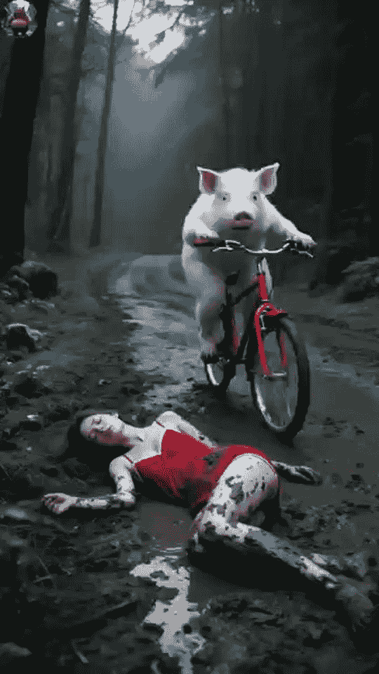

[videoplayback (3).mp4](https://internal-api-drive-stream.feishu.cn/space/api/box/stream/download/all/IG7zbAODDoNpJ1xOKyBcu5k4nsb)

反转类


[videoplayback (4).mp4](https://internal-api-drive-stream.feishu.cn/space/api/box/stream/download/all/AiqibToozoOc7exRZBncbNr9nJd)

冲突类

总结出的所有动物故事的爆款结构：

1.  救援类视频结构：** 遇难+救援+结局 **

1.  嘲笑类视频结构：**被嘲笑+逆袭+结局**

1.  复仇类视频结构：**遭遇困难+复仇+结局**

1.  反转类视频结构：**冲突+反转+结局 **

1.  冲突类视频结构：**冲突+解决方案+结局**

还记得我们开头的总结出爆款视频的通用结构，通过替换变量进行爆款视频的二创吗？

结构有了，变量是什么呢？

这里我以“救援类视频”举例，完整的素材库文档我会放在这部分的最后

**变量一：角色**

+   被救援者：角色类型(可以是人、动物、山海经角色、IP）

+   救援者：角色类型(可以是人、动物、山海经角色、IP）

**变量二：困难类型和救援**

+   困难类型：高空遇难、遇到魔鬼、遇到自然灾害、遇到灾难（飞机、火车、轮船失事等等）

+   救援场景：海上、宇宙、洞穴、森林、高空....

+   救援方式：狗狗、人类、超级猫爸爸、超级英雄、耶稣等等

+   救援过程：1次直接成功（简单）、 1次成功但有挫折（中级）...

**变量三：结局**

+   故事结局：直接救援成功（最常见）、悲情结局、温情结局...

> **有点抽象吗？看案例！**

**【救援类原视频】**

https://www.youtube.com/shorts/go8BFirS6TM （6月22日发布，3700万播放）

小孩玩玩具车不小心升到高空，爸爸回实验室穿上机甲救下小猫

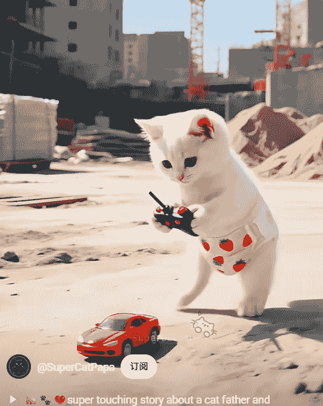


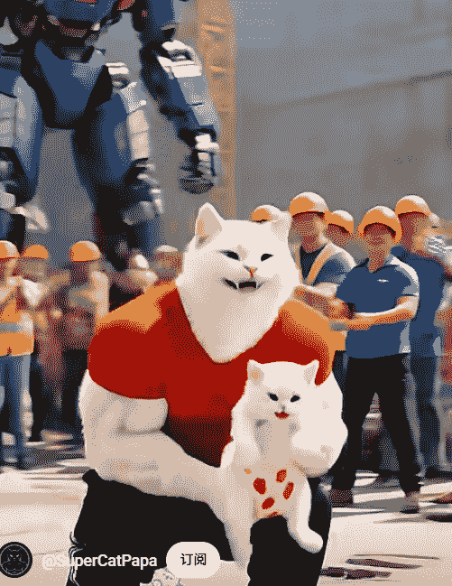

**【救援类改编视频】**

宝宝误入高空，工人们搭人梯救援（6月5日发布，5000万播放）


看图就能看出来，改编后的视频与原视频相比，结构完全没变！

**那做了哪些“变量替换”？**

1.  角色改变：小猫改成小宝宝

1.  遇难方式改变：原视频是小猫玩玩具车误入高空，改编的视频变成小孩贪玩爬上升空的钢材

1.  救援方式改变：从猫爸爸变身机甲改成搭人梯就小宝宝

1.  结局没变：都是成功救援后皆大欢喜

你看，结构没变，通过**替换变量**成功制作出一个5000万的爆款视频，你把这个成功案例收录进自己的素材库，下次你是不是有了被验证过的改编思路了？

这是偶然吗？绝对不是，我们再看一个“嘲笑”类视频的改编：

**【嘲笑类原视频】**

https://www.youtube.com/shorts/BO-jbdJ6wmo（猫猫版，1.5亿播放）

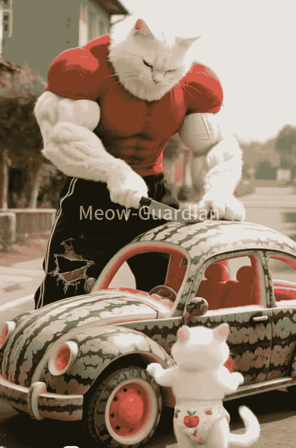

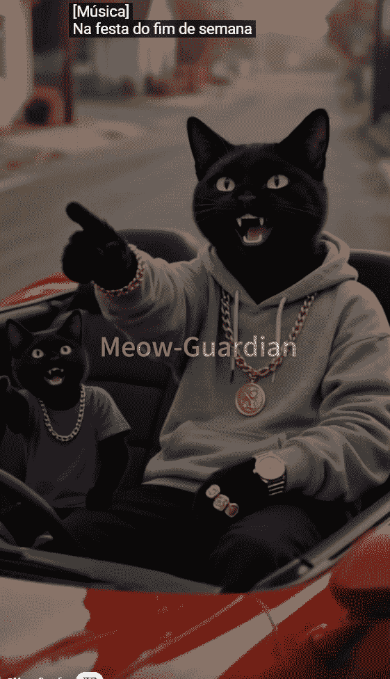

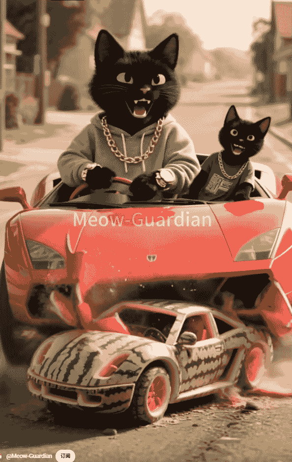


**【嘲笑类改编视频】**

https://www.youtube.com/shorts/qepwHqJ-WKs （罗纳尔多版，7000万播放）

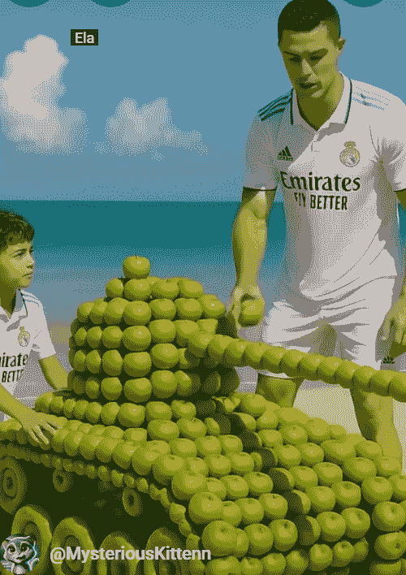


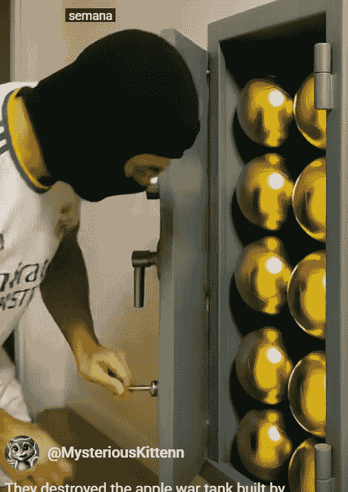

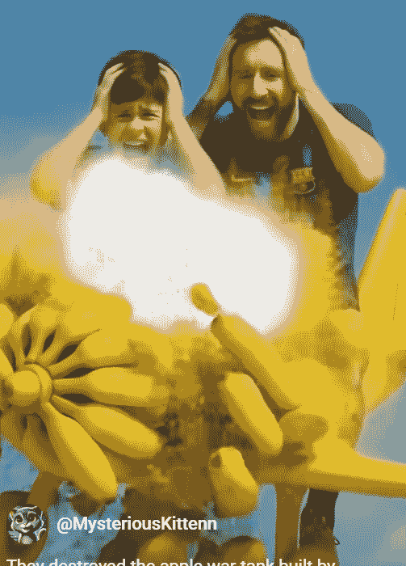

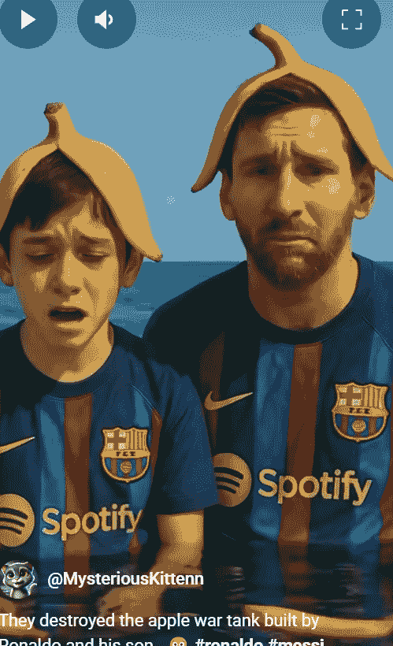

**还是视频结构完全照搬！**

改编后的视频与原视频相比，改了哪些“变量替换”？

1.  角色改变：猫猫改成了C罗和梅西，叠加了IP热度

1.  引发对方嘲笑原因改变：猫猫的视频是西瓜车，C罗的视频是苹果飞机

1.  逆袭方式改变：猫猫视频逆袭的过程是猫爸爸打工挣钱买新车，C罗的视频逆袭的过程是直接偷梅西家的金库锻造黄金飞机

1.  结局没变：都是报复对方（猫猫视频是碾碎对方的车/C罗的视频是炸毁对方的飞机）

**好了，相信你已经掌握了**爆款视频改编的方法论——“结构不变，替换变量”。

**思考一下，下面这个【救援类视频】的案例，改编**后的视频与原视频相比，替换的变量有哪些？

【救援类原视频】

猫猫原视频：https://www.youtube.com/shorts/As4yvEu-Zng （6月8日发布，9800万播放）


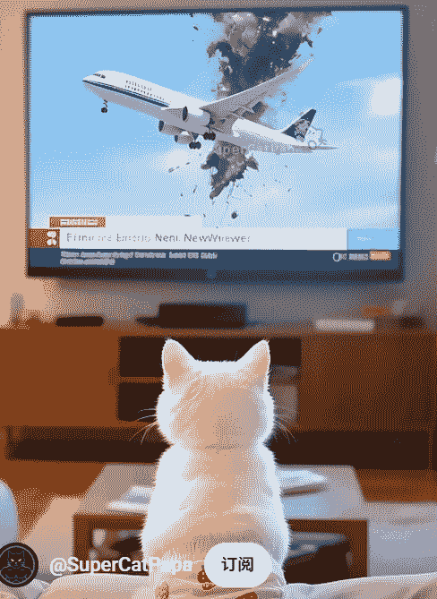

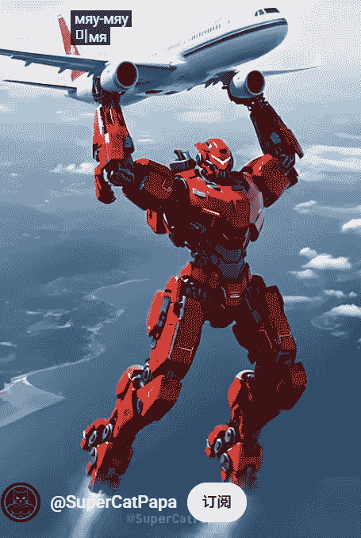

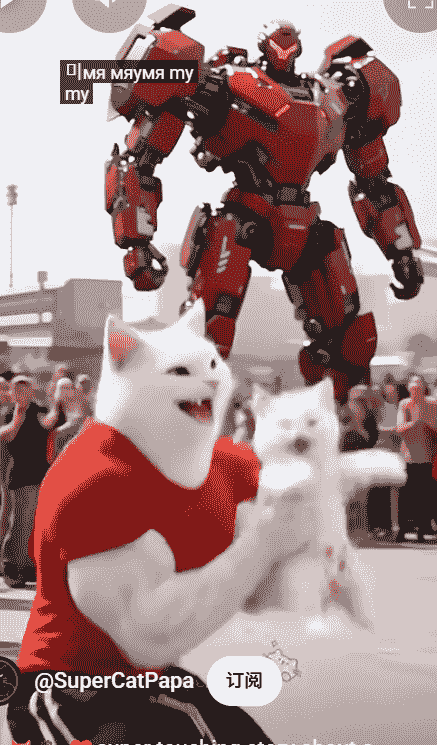

【救援类改编视频】

https://www.youtube.com/shorts/uMjoTCpdpsQ  （7月8日发布，8400万播放）

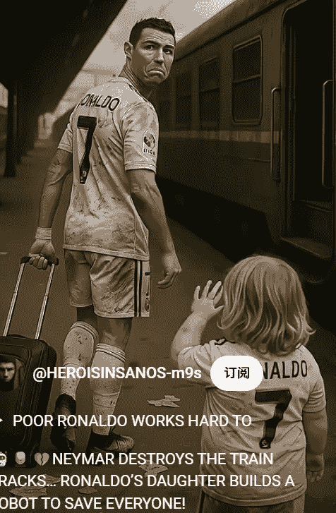

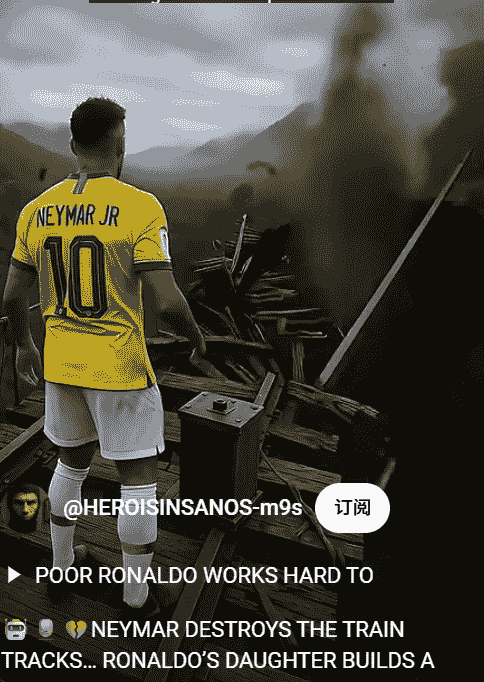

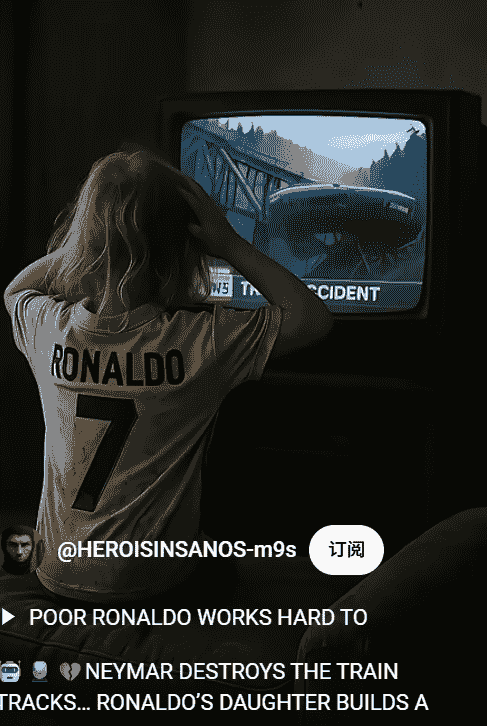

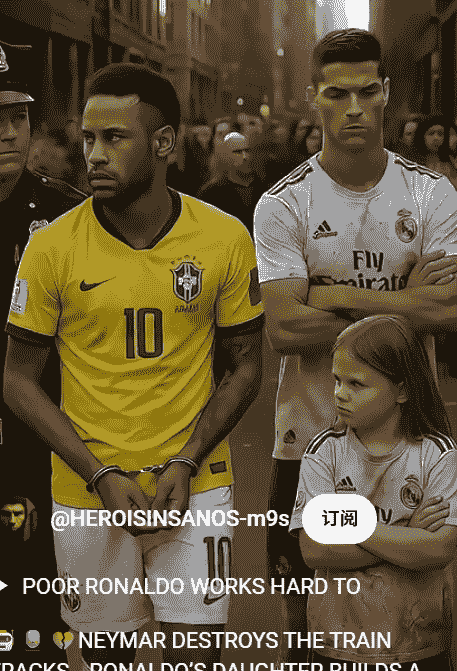

### 2/ 爆款素材库

以下是我按照上述方法，把动物赛道Youtube上爆款视频做拆解，整理的【爆款素材库】，让爆款元素为我所用，文档链接放在了下方，有做同类赛道的圈友直接拿去用，你也可以针对自己的赛道，整理一个自己的素材库，这样就不担心没有改编思路了！

+   救援类

+   嘲笑类

+   复仇类

+   反转类

+   冲突类

平常在学习对标视频的时候，分析别人的改编思路并归纳整理，你将得到这样一个素材库


这些优秀的视频开头，你也可以直接借鉴：

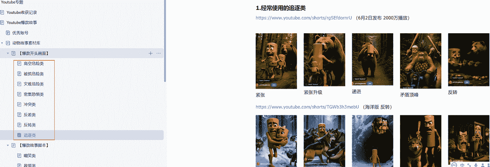

素材库文档地址[动物故事素材库](https://ccnjph8r4o3j.feishu.cn/wiki/WFoYwmO1NigSTpkci4ncOYMVn7e) （随着平台规则的变化，部分涉及儿童危险类的对标视频已被屏蔽，这不重要，重要的是思路）

好了，到这里解决了改编思路的问题，怎么把这些改编思路应用到我自己的视频呢？

很简单，在用上面我分享的文生图提示词做视频的时候，我的视频教程里演示的是"不改编"，现在你已经有了改编思路，直接在Gemini窗口输入你的改编思路，就像这样，Gemini就会根据你的改编思路，直接输出改编后的分镜提示词：

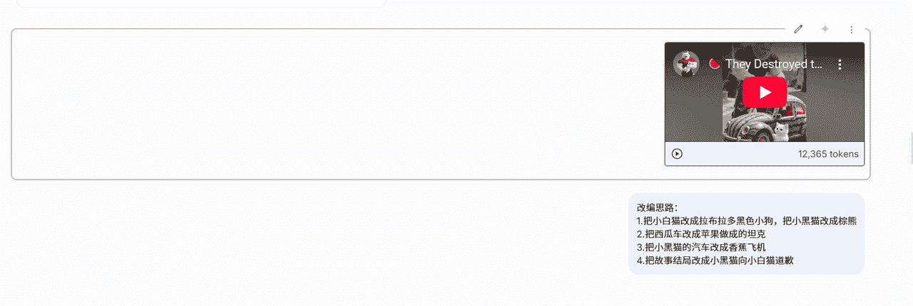

但这里请注意，一次改编的元素不要过多，否则要检查一下前后分镜是否连贯。

## **八、**真人爆款视频复刻的踩坑经验

### 1/ 为什么选择用AI制作真人视频

上面讲了高效复刻，改编，但我发现动物故事不仅卷，RPM也很低**，我不想做动物故事，想做深**海圈风向标里的AI复刻真人博主的爆款视频，我经过几个月的实践，总结了一些容易忽视的踩坑经验：

**动物故事RPM VS 复刻真人故事RPM （**以下案例都是我自己的视频和真实后台数据）


猫猫故事，RPM0.01


山海经真人故事，RPM0.05

1.我为什么选择用山海经角色复刻真人爆款视频？

+   我选择复刻的真人对标视频都是几千万播放甚至过亿播放，视频脚本经过验证

+   用山海经角色这个有热度的形象增加爆款概率

+   山海经角色要保持一致性需要垫图，相比动物故事视频有一些门槛，竞争相对更小

我的山海经复刻真人视频案例：


[变骷髅原视频.mp4](https://internal-api-drive-stream.feishu.cn/space/api/box/stream/download/all/KU1Zb6baHo3vXCx7Rpjc2C8znMn)

真人博主原视频


[咖啡妹变骷髅YT版.mp4](https://internal-api-drive-stream.feishu.cn/space/api/box/stream/download/all/MuqmbZyk2oIhbOxdeeXcSVJ2n5g)

我复刻的视频，1900万播放


[偷金鱼原视频.mp4](https://internal-api-drive-stream.feishu.cn/space/api/box/stream/download/all/YYFNb5hTnonXfyxEIG9cVIJ4nky)

真人博主原视频


[吃金鱼成品YT版.mp4](https://internal-api-drive-stream.feishu.cn/space/api/box/stream/download/all/AkNbbBSXIobG2ux4Kcgcmm5dnyf)

我复刻的视频，6000万播放

视频的制作过程上面有分享，那里有详细的介绍，这里不再赘述

**我制作这类视频也不是一开始就能做爆款，踩了很多坑的，下面**我分享我制作这类视频踩的坑，避雷朋友们：

### 2/ 避坑经验①：选题

选题首先是要选择没被做烂的脚本，有足够的市场容量，这是前提

用AI做真人视频的复刻，选题的原则是：

**尽量选择****剧情驱动****的视频，不选择****表现力驱动****的视频 **** **

表现力驱动的视频对角色的表现力要求高，而AI很难还原复杂动作和表情，这是AI的软肋

而故事性强的视频，观众的注意力主要在剧情本身，而不是角色的表现力

**什么叫“剧情驱动的视频”？**

即观众的注意力被故事本身吸引，对角色的表现力（动作和表情）要求不高，看一个正面案例：


[变骷髅原视频.mp4](https://internal-api-drive-stream.feishu.cn/space/api/box/stream/download/all/IETFb69d9oMgbzxXkY8ch1ozndc)

真人博主原视频播放9000万


[咖啡妹变骷髅TK版.mp4](https://internal-api-drive-stream.feishu.cn/space/api/box/stream/download/all/NS5wbGGshot5CwxFCOlcGaoVnN1)

复刻视频1播放1800万

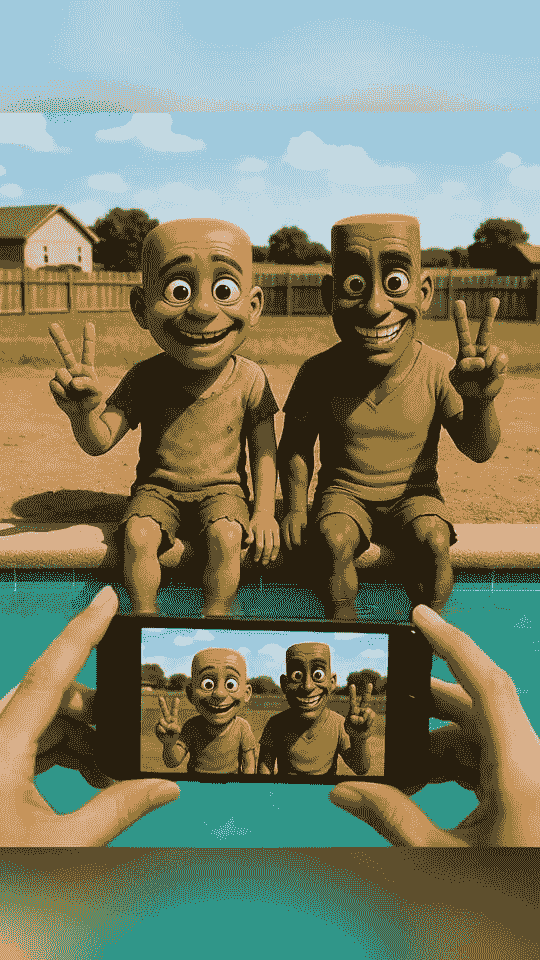

[木头哥变骷髅YT版(1).mp4](https://internal-api-drive-stream.feishu.cn/space/api/box/stream/download/all/N0OObVM86o2gA8xusvRcEBKyntg)

复刻视频2播放700万

上面这个故事讲的是一对母女在泳池边拍照，爸爸给母女俩拍照，突然爸爸掏出枪击杀妈妈，妈妈倒地后变成骷髅，原来爸爸在拍照时通过手机相机发现妈妈是骷髅变的（故事逻辑非常清晰）

爆点主要在于爸爸突然掏枪射杀妈妈，这点深深吸引住了观众的好奇心，视频的悬念和悬念的解除让观众很有爽感

故事本身很吸引人，而不是单纯靠角色的表现力留住观众的注意力

（很多细微的表情和动作，AI还原不到位，如果你这个视频主要靠角色的动作和表情吸引观众，AI如果还原不到位，观众就容易划走，视频的播放数据自然不会高了！）

再看一个正面案例：


[2喝厕所水.mp4](https://internal-api-drive-stream.feishu.cn/space/api/box/stream/download/all/KVqZbiDdVoGye0xGQIkcEIpCnEg)

真人博主原视频播放8000万


[喝厕水_成品.mp4](https://internal-api-drive-stream.feishu.cn/space/api/box/stream/download/all/DhEpb6acyoFZoaxKLWZcCs1bnrb)

复刻视频1播放1900万


[4号喝厕水.mp4](https://internal-api-drive-stream.feishu.cn/space/api/box/stream/download/all/FAE2bduAxoqYwPxk530c4umJned)

复刻视频2播放500万

这个视频的主要讲的是妈妈让小孩帮忙倒水喝，悬念是女儿很反常地倒了一杯又一杯，妈妈肚子痛去卫生间发现女儿接的是马桶里的水，这是一个巨大的反转，故事爆点在这个熟悉的生活场景和巨大反转，跟角色表现力关系不大，故事本身很精彩，AI复刻起来压力不大。

**什么叫“****表现力驱动“的****视频：**

即视频故事性不高，视频的爆点主要依赖于角色的表现力，看一个反面案例：


[1分冰棒.mp4](https://internal-api-drive-stream.feishu.cn/space/api/box/stream/download/all/Ef7UbTn9coOsHdxmpVXceiOanfc)

真人博主原视频播放5000万


[分冰棍_成品.mp4](https://internal-api-drive-stream.feishu.cn/space/api/box/stream/download/all/OxHcb0B🐧oWIaHxbOvhcoEKWnzg)

复刻视频1播放5万


[videoplayback.mp4](https://internal-api-drive-stream.feishu.cn/space/api/box/stream/download/all/Zc9PbiUrKo27TKxfpcicBNAjnyb)

复刻视频2播放9万

这个视频剧情很少，没有什么故事性，观众的注意力主要集中在角色表情和肢体动作，AI复刻不出来原视频那种主要由肢体动作和表情传递出来的喜感(特别是视频中爸爸那种小动作，猥琐的笑和最后被妈妈一拳打翻的幽默感)

当然，事情没有绝对，下面这个视频没有太多的故事性，但经过分镜调整，有500万播放：


[雪糕抹布原视频.mp4](https://internal-api-drive-stream.feishu.cn/space/api/box/stream/download/all/Ewrpbb04ZoYSAKxbAiOcOMFInEb)

真人博主原视频1.1亿播放


[5号抹布雪糕.mp4](https://internal-api-drive-stream.feishu.cn/space/api/box/stream/download/all/HS5cbP23toB9clxjG7mcTT3FnMd)

我复刻的视频1播放500万


[videoplayback (1).mp4](https://internal-api-drive-stream.feishu.cn/space/api/box/stream/download/all/Rq4ZbziZbox3zgxVNaNchKBhnVc)

复刻视频2播放5万（其他人复刻的）

为什么都是”表现力驱动“的视频，复刻视频1会比复刻视频2的播放量高？

在我看来，视频1虽然没有视频2流畅，但胜出的点在于：

+   添加了儿童这个爆款元素

+   视频1对角色的表情，特别是小孩最后的表情处理更到位，甚至给了表情特写

+   视频1在处理通过更改分镜画面，特意强化脏水、恶心这个情节，经过调整更精准传递出了视频想表达的情绪

**总结：真人复刻尽量不要选择这种对**角色表现力要求高的视频，这是AI的弱项。

### **3/ 避坑经验②：画面亮度**

这个问题也是我之前忽略的，踩了好几次坑，直到我复盘时拿出同一个脚本制作的两个AI视频进行对比，才发现视频画面的亮度很关键！

看案例1：左边是真人博主的原视频，另外两个是我复刻的AI视频，这两个是用的同一个故事脚本，同类型的山海经角色，但是右边的视频明显比中间的视频整体画面暗很多，数据相差巨大！


[偷金鱼原视频.mp4](https://internal-api-drive-stream.feishu.cn/space/api/box/stream/download/all/B5JMbWfenoGquCxSutRcvu1vnih)

原真人博主视频播放8000万


[吃金鱼成品YT版.mp4](https://internal-api-drive-stream.feishu.cn/space/api/box/stream/download/all/D3HDbCsyloOAw6xX4eycLd8anKd)

复刻视频1播放6000万


[吃鱼YT版.mp4](https://internal-api-drive-stream.feishu.cn/space/api/box/stream/download/all/AQKSbFJJwonpHMxckgUcuK93nVC)

复刻视频2播放2万

故事和分镜基本一样，但是视频1和视频2相比，视频1的小孩和可爱的表情更能吸引人，画面也更明亮

不管做哪类视频，开头和画面的明亮度都要特别注意，会非常影响视频的选择观看这个数据，画面太暗影响观感，观众在千前3秒就直接划走了。

再看个案例2：（右边的视频我把故事场景设置在了晚上，光线昏暗）


[小孩求救原视频.mp4](https://internal-api-drive-stream.feishu.cn/space/api/box/stream/download/all/PqKtbF05ho81jJxCmvOcNYSmn1f)

原真人博主视频播放2.8亿


[救小孩_9号.mp4](https://internal-api-drive-stream.feishu.cn/space/api/box/stream/download/all/U7eFb06mpokJDpxx9fNcwXW8nMd)

复刻视频1播放600万


[木头超人救小孩.mp4](https://internal-api-drive-stream.feishu.cn/space/api/box/stream/download/all/RmaabVQVjozcSFxBHdrcjtOKnQd)

复刻视频2播放5万

虽然两个视频由于省略了一些AI不好做的分镜,仅从复刻后的视频1与视频2分析

视频1和视频2前部分最大的区别是开头和视频的画面(复刻视频2设定在晚上)

看数据：两者的选择观看率和平均观看时长都有不小的差距


视频1选择观看80.7%   平均观看27秒


视频1选择观看73.5%   平均观看23秒

**总结：不管是真人视频还是制作其他视频，开头的吸引力和画面的色彩至关重要，画面调整虽然剪映有**智能调色，但为了画面不失真，能调的程度很有限，尽量不要把情景设定在昏暗的环境下。

## 九、写在最后

好了，以上内容是我做Youtube项目半年内的积累和沉淀

记得刚参加航海的时候，我连手写提示词都不会，一个故事20多个分镜的文生图提示词，每个分镜的文生图提示词我都要写一遍，用AI生一次图，发现图片不合适，再修改一次提示词，再去生一遍图，不合适再改提示词，再生图...一张图要重复抽卡好几次，20多个分镜抽卡要花几个小时。好不容易搞完图片，图生视频的时候，这个煎熬的过程再来一遍，每天做视频跟上刑场一样，慢慢地心力也消耗没了，账号陆续停更。

中间也试过换赛道，不做动物故事了，转做小说推文的视频发Youtube（言情动漫视频，用软件批量生成，不用写提示词），花了几百买了自动生成视频的软件，吭哧搞了半个多月，视频播放都不过千，又开始自我怀疑。转机发生在4月份，用深海圈教练们教的神秘方法连续开通了几个YPP，信心逐渐建立起来了，也逐渐了愿意在群里冒泡了，然后认识了大臣圈友@大臣，成为项目搭子，一起做视频，一起鼓励，一起吃过饭，一起打过台球唱过K，从线上圈友发展为线下好友。再后来慢慢融入深海圈，得到了很多教练和圈友们的帮助，非常感恩这些经历！

我觉得正因为我经历了以上痛苦、挣扎的几个月，分享出来的这些痛点和经验才能打动这么多圈友吧，帖子最后再对做Youtueb的新手圈友总结几个我认为比较重要的点吧：

1/ 做项目心力很关键，如果你担心自己一个人心力不够强大，去找个搭子吧，好消息互相分享，坏情绪互相疏导；

2/ 不要闭门造车，以前我不好意思向人请教，后来发现，有时困扰我很久的问题，问一下别人就豁然开朗，所以新圈友遇到自己解决不了的问题，不要不好意思在群里提问，都是从新手过来的。如果你看完这个帖子，觉得我有些地方没讲清楚，欢迎留言与我交流；

3/ 多用AI，我之前不会写提示词，看了一篇云舒@云舒大佬的👸号文章，自己慢慢尝试、迭代、总结，现在能调动AI写精准的提示词，工作效率提高不少，学AI不在于学，而在于用，用多了自然就会了。

这半年的成长，离不开深海圈教练和圈友们的帮助，再次感谢赚钱Youtube深海圈，感谢对我帮助和启发很大的曹教练、波妮教练、AS教练、李香君教练、怅惘教练、轻舟教练、邵先森教练、富百教练；平时交流很多，写出批量出图工具的大臣，提示词给我启发的S.Z和云舒圈友，还有很多圈友在次一并感谢！

这次分享能得到这么多圈友的认可，我觉得很有意义，也很感激！往后我会多多分享的！

感谢你读到这里，以上分享难免有不足之处，欢迎各位圈友交流指正！期待大家与我链接交流！