# 《2025一定要抓住的风口Whatnot：平台核心玩法+实操操盘解析，让你先一步吃到红利》

> 来源：[https://xuqiwei1986.feishu.cn/docx/KZAxdDJy0oCZ0vxuLCacwejAnOb](https://xuqiwei1986.feishu.cn/docx/KZAxdDJy0oCZ0vxuLCacwejAnOb)

# 一、平台本质：社交媒体的崛起，从收藏圈痛点到美国直播电商黑马

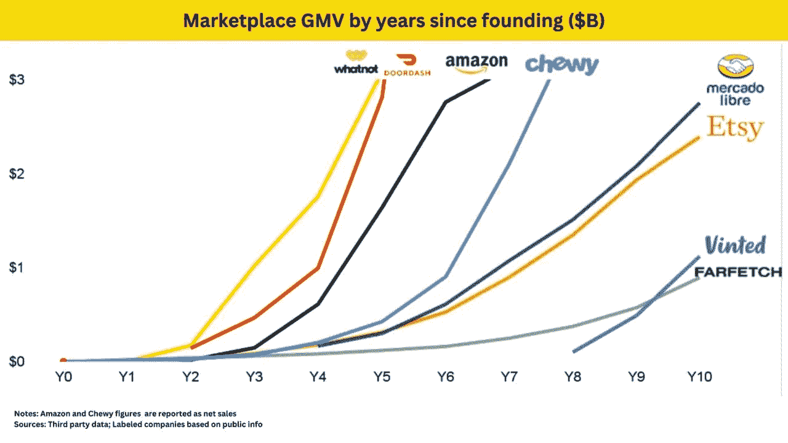

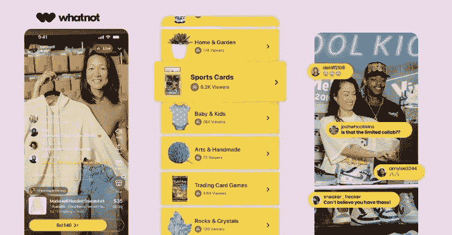

很多老外朋友就是在这个上面直播球鞋，很多是一个人自己在家播，大概每天都有5万美金的交易额。现在还有女装、中古、清仓等直播间。单直播间月GMV百万美金的也不少。今年（2025年）这个平台GMV比两年前增长了30倍都不止。由于这个平台就是一个直播卖货平台，所以用户上来看都是为了买东西，加上有趣的直播内容和互动，所以客户转化率也比较高。whatnot这个平台目前是不接受中国卖家直接入驻的，只允许美国本地运营，这也是为了控制物流时效和防止假货，保障消费者的购物体验。但是这些难不倒一生要卷的中国人。（懂得都懂）

Whatnot的崛起，要从两个收藏爱好者的“糟心事”说起。2019年，前Facebook产品经理Grant LaFontaine和球鞋平台GOAT员工Logan Head，都是资深的球星卡玩家——Grant想卖掉自己珍藏的2003年勒布朗·詹姆斯新秀球星卡，在eBay挂了3个月，咨询的人不少，但要么担心卡片是假货，要么疯狂砍价，始终没找到合适的买家；Logan的经历更无奈，他在Instagram组织了一场线上直播竞拍活动，全程盯着评论区记录报价，手忙脚乱写了10多页纸，最后还因为“漏看一条出价信息”被买家投诉，闹得很不愉快。

两人越聊越觉得：收藏圈不缺买家，缺的是一个“能建立信任、能互动交流、能实时完成交易”的圈子。2020年，Whatnot正式上线直播功能，推出了一个“反常规”的玩法——“10秒竞价重置机制”：商品上架后启动10秒倒计时，只要有新出价，倒计时就重新归零，直到最后没人再加价，立即完成成交。

这个玩法很快就火了。有位卖家回忆，他第一次用这个模式卖1996年科比的球星卡，倒计时最后3秒突然有人加价50美元，直播间瞬间沸腾，“满屏都是‘谁抢了’‘我还要加’的留言”，最终成交价比他预期的高了60%。也正是靠着这股“抢货的紧张感”，2020年7月到2021年7月，Whatnot的GMV直接翻了200倍，从“收藏圈小圈子平台”一跃成为美国直播电商领域的“黑马”。

**Whatnot的独特之处何在？**

Whatnot将电子商务、社交媒体和现场娱乐的最佳元素融为一体。用户可以实时出价、即时购买，还能直接与创作者互动，创造出一种吸引买家和卖家的互动体验。该平台还融入了游戏化元素（实时投票、实时抽奖、赠品、小游戏等）以及独家现场活动，通过“错过恐惧症”（FOMO）营造紧迫感。该平台主要面向Y世代（28至43岁），这一群体占其用户总数的五分之二以上。据调查研究，46%的用户主要出于娱乐目的访问该平台。平台最受欢迎的功能包括购买产品、关注特定创作者以及寻找优惠商品。

如今的Whatnot，早已不是只服务收藏圈的小平台，而是美国本土崛起的社交电商+直播拍卖平台，核心定位“兴趣圈层的互动式交易”，目前活跃用户超2000万，且以美国本土年轻群体为主。它能持续吸引用户和商家，关键在于三大核心特征：

## 一是拍卖式交易

区别于传统直播带货的“一口价”，平台商品多以“低价起拍+5-10秒倒计时抢拍”形式成交，常见3-5美金起拍，最终成交价翻倍的情况——这种模式把用户的“竞争欲”拉满，很多时候明明不是刚需，却因为“怕被抢”的心理完成下单。

## 二是强社交属性

用户可关注主播、加入兴趣社群（比如潮玩、复古家电、手工艺品、中式复古饰品等细分圈子），主播不用像传统带货那样喊“3、2、1上链接”，而是通过互动聊天、展示商品细节、分享产品背后的故事建立信任，这也让平台复购率远高于普通跨境电商平台。

## 三是小众高性价比品类

平台热门品类集中在尾货商品、小众潮品、二手好物等，客单价普遍在5-20美金，但胜在受众精准，且货源成本低，商家利润空间可控——尤其是中国供应链擅长的手工小物件、复古配件，在这些圈子里特别受欢迎。

# 二、Whatnot与TikTok Shop：两种逻辑的正面较量

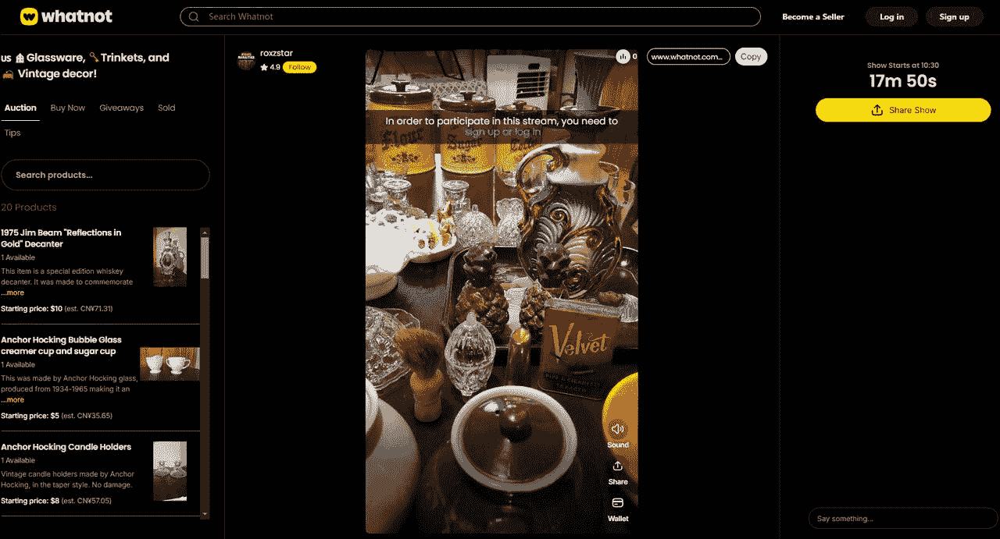

为什么说Whatnot是跨境圈的新风口？核心不是它的规模已经超越TikTok Shop，而是它走了一条和TikTok Shop完全不同的路，正好戳中了TikTok Shop的“软肋”，给商家提供了算法内卷之外的新选择。

从流量逻辑来看，TikTok Shop靠“短视频种草+算法推流”把带货效率拉到极致，但流量来得快也去得快，商家要一直投入资金买流量、做内容，才能维持订单——一旦停更短视频、停止投流，流量马上就掉。而Whatnot不依赖算法导流，而是靠“搭建圈子”让用户主动留下来：用户因为兴趣加入社群，平时在群里和同好聊天、分享，到了直播时间会主动进入直播间，甚至会把身边有同样爱好的朋友拉进社群。有商家做了3个月后，不用再花一分钱投流，每天也能有稳定订单，就是靠社群里的老用户自发拉新。

在转化路径上，TikTok Shop是“短视频种草→点击链接→跳转下单”，整个过程中用户很容易被其他视频吸引，“刷着刷着就忘了下单”，转化链条长、流失率高。但Whatnot是“社群互动→参与竞拍→即时成交”，比如一场中式复古灯具的竞拍，用户在社群里提前看到过其他群友晒的实物图，直播时盯着5-10秒的倒计时，看着不断有人加价，很容易“冲动完成下单”——有数据显示，Whatnot的整体转化率比TikTok Shop高了15%。

合规风险上的差异更明显，2024年以来，TikTok作为外国平台，美区合规审查越来越严格，不少商家因为“资质不全”“商品认证缺失”被下架商品，甚至封号。而Whatnot是美国本土平台，合规流程更简单，有商家反馈“提交美国雇主识别号（EIN）后，3天就通过了审核”，对于中小商家来说，踩坑的概率更低。

最关键的利润空间上，TikTok Shop里标品竞争太内卷，比如普通的塑料台灯，大家都卖20美元，为了抢流量还要降价促销，最后利润只剩3美元。但Whatnot上的非标品溢价空间很高，比如同样是台灯，换成带水墨图案的中式复古款，在“复古家居社群”里能卖到40美元，扣除成本后利润还能有15美元——这正是中国供应链的优势所在，毕竟手工改造、特色设计类的非标品，中国商家能拿到的货源成本远低于国外商家。

除了这些核心差异，Whatnot还靠“反TikTok逻辑”的运营策略，进一步强化了竞争力。

选品上，它专挑TikTok“看不上眼”的非标品。比如复古黑胶唱片机专用的氛围灯、能和电竞桌面联动的RGB灯、手工改造的复古相机灯，还有中国商家做的“汉服搭配专用氛围灯”“水墨意境台灯”，这些在TikTok上因为“受众太窄”没什么播放量的品类，在Whatnot的细分兴趣社群里反而成了爆款。有个做中式复古灯具的中国商家就说，他的产品在TikTok上发了10多条视频，每条播放量都不到500，可在Whatnot的“复古家居社群”里，一场2小时的直播就能卖出40多台，买家还会主动在社群里晒图，说“放在书房里和中式摆件特别搭”，带动了更多人下单。

主播定位上，Whatnot的主播更像“圈子里的资深玩家”，而非TikTok上的“叫卖式带货达人”。卖潮玩的主播会边拆盲盒边说“这个系列的设计灵感来自80年代的经典动画片，当时我小时候每天守着电视看”；卖复古服饰的主播会现场搭配，教观众“这件灯芯绒衬衫配刚才拍的复古氛围灯，晚上拍照特别有年代感”；卖中式饰品的主播会聊“这个吊坠的纹样是传统的回纹，在中国传统文化里代表吉祥如意”——这种分享式的直播，让观众不再是“刷到就走”的路人，而是会定期来看直播，甚至在社群里和主播、其他买家聊日常。有数据显示，Whatnot上60%的用户会复购同一位主播的产品，复购率比TikTok Shop高了近3倍。

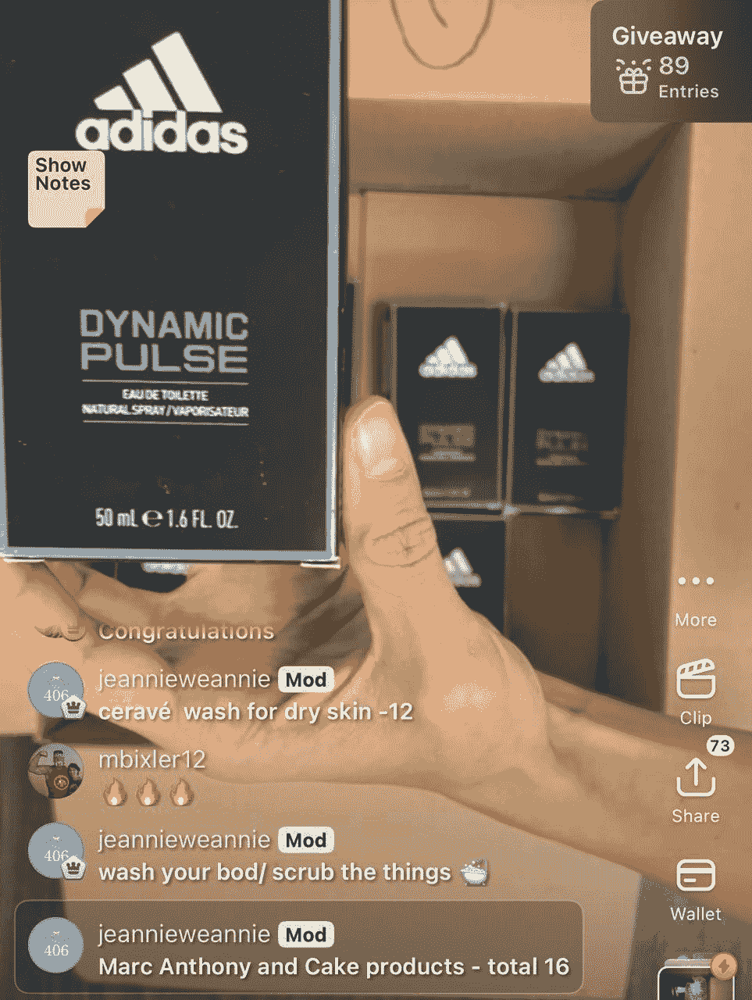

玩法设计上，Whatnot还加了“社群专属福利”，进一步绑定用户。比如某个社群的老用户，能优先参与稀缺品的竞拍——有个卖球星卡的主播，每次拿到限量款卡片，都会先在社群里通知老用户直播时间，让老用户提前10分钟进入直播间抢拍资格；卖家也可以发起“批量采购团”，只要社群里的用户一次性凑够20个以上的潮玩手办订单，就能拿到额外5%的折扣。这种“圈子专属的归属感”，让用户更愿意留在平台，有用户在采访里说，“在Whatnot买东西，更像和一群同好一起玩，而不是单纯的交易”。

# 三、在风口里怎么赚钱？：两类玩家核心玩法拆解

Whatnot虽然是风口，但并非所有人都能盈利，目前真正实现稳定赚钱的，集中在以下两类玩家，模式清晰、可复制性强。

## （一）服务商：靠“店铺号”赚快钱，6800元/个稳拿纯利

这类玩家是Whatnot风口的“第一批受益者”，核心靠“账号资源”变现，盈利逻辑简单且风险极低。

从业务核心来看，就是售卖Whatnot店铺号，单账号定价普遍6800元，目标客户是那些急于入局Whatnot，但不懂账号注册、审核规则，又没时间慢慢摸索的新手商家——尤其是很多中国跨境商家，不清楚美国本土注册需要的资料，自己尝试注册时经常因为信息不符被拒，所以愿意花钱买现成的合规账号。

服务边界也很清晰，服务商仅负责提供“可正常使用的店铺号”，并承诺28天质保，也就是说28天内如果账号因为注册时的资料问题（比如地址无效、手机号被封）被平台封禁，服务商会协助更换新账号；但如果是买家拿到账号后，因为自己运营违规（比如售卖侵权商品、诱导场外交易）导致账号被封，或者出现资金无法提现等问题，服务商不承担任何责任。

利润空间更是可观，账号注册本身没有高成本，主要靠“信息差+渠道资源”把控账号来源——比如服务商提前批量采购美国本土手机号（成本约50-80元/个），通过合作的本地资源获取真实美国地址，再用合规的美国公司资质（可代办，成本约1500-2000元/套）注册账号，单个账号的总成本也就2000元左右。买家付款6800元后，扣除成本，单个账号纯利能达到4800元左右，要是单月能卖出10个账号，纯利就能达到5-6万元。

## （二）美国本地玩家：尾货转卖，3元成本撬动45元利润

这类玩家凭借“本地化资源+供应链优势”，把“低价货源+直播拍卖”的模式玩到极致，利润率远超很多人的想象。

在货源端，他们主要从国内1688的“尾货清仓”频道、义乌小商品城线下批发市场采购尾货，比如平价饰品（耳环、项链）、家居小物件（厨房收纳盒、浴室置物架）、儿童玩具（益智拼图、小型积木）等，这些尾货因为是工厂清库存，单件成本仅2-3元人民币。采购后通过海运批量运至美国，虽然海运周期长（约20-30天），但批量发货能摊薄物流成本，算下来单件物流费用约2-3元，加上采购成本，单件总成本不超过5元人民币。

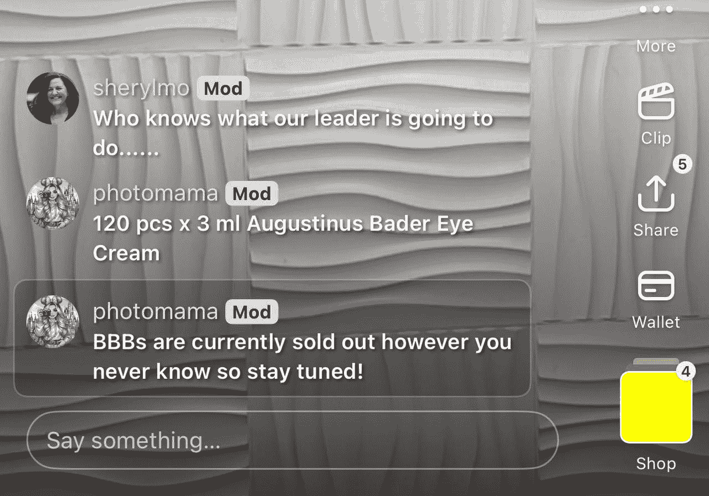

运营端的核心是本地化直播，首先要雇佣美国本地人担任主播，时薪约15-20美金，相比中国主播，美国本地主播更懂本土用户的沟通习惯，信任背书更强；直播间主打“高性价比拍卖”，商品起拍价定在5美金（约35元人民币），配合“5秒倒计时抢拍”话术，比如“最后5秒！当前出价5美金，有没有家人要加价？再不加就被别人抢走啦！”，用紧张感促使用户下单。

利润端的表现非常亮眼，因为尾货款式新颖（很多是前一季的热门款，只是工厂清库存）、价格优势明显，加上本地主播的信任背书，5秒内商品普遍能拍到7-8美金（约50-56元人民币），扣除5元的单件总成本，单件利润能达到45-51元，利润率直接超过1000%。

这类玩家的核心壁垒主要有两个，一是本地化团队能快速响应平台规则变化，比如平台突然加强对玩具品类的认证要求，本地团队能第一时间拿到信息，及时调整选品；同时本地主播更懂美国用户的审美和消费习惯，比如知道美国年轻群体更喜欢亮色系的饰品，家居用品更看重实用性和颜值兼具，能精准踩中用户需求。二是尾货货源稳定，他们长期和国内1688的尾货商家、义乌的批发商合作，能第一时间拿到优质尾货，而且采用“小批量高频次”的补货模式——每次采购500-1000件，卖完再补，避免库存积压，降低资金压力。

## 三、中国商家入局：红利和门槛都要看清

现在不少中国跨境商家都在关注Whatnot，但它并不是“谁都能做”的平台，红利和门槛都很明显，提前看清才能避免踩坑。

### （一）三大红利：中小商家的“蓝海机会”

首先是流量竞争压力小，不像TikTok Shop那样“百万商家抢流量”，Whatnot目前还处于蓝海期，尤其是细分兴趣社群里，商家数量少、用户精准，有商家分享自己的经历，第一次在Whatnot直播，只播了15分钟就出单了，卖的是自己设计的“汉服搭配专用氛围灯”，整个过程没投一分钱流量，就是因为这个品类在平台里做的商家少，社群里的用户正好有需求。

其次是运营成本较低，不用像在TikTok那样拍大量短视频，也不用一直投流买流量，只要把社群维护好，老用户就能带来新客户——比如平时在社群里回复用户的问题，分享产品的搭配技巧，偶尔发点新品预告，就能保持社群活跃度；而且平台没有Listing费用，商家上架商品不用花钱，中小商家的运营压力更小。

最后是非标品溢价高，中国供应链在非标品生产上优势明显，比如手工灯具、复古家电配件、中式复古饰品等，这些产品在国内拿货成本低，到了Whatnot的兴趣社群里，因为有“特色”“小众”属性，能卖出不错的价格，比做TikTok上的标品赚得多。

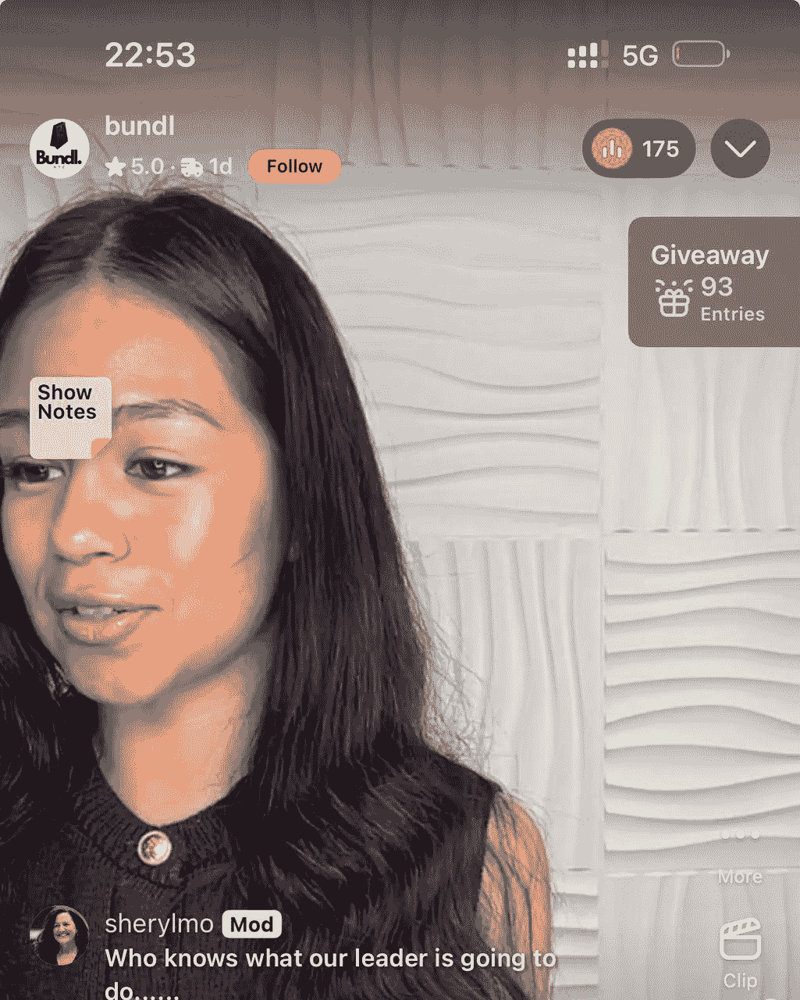

### （二）三大门槛：绕不开的实操难题

第一个门槛是本土发货是硬性要求，Whatnot规定商品必须从美国本土发货，商家要么找美国海外仓合作（支付仓储费和发货费），要么和本土物流公司对接，这就导致物流开销不低。有个卖小饰品的中国商家算过一笔账，他卖的耳环一对成本3元人民币，运到美国的海运成本2元，海外仓存储和发货费3元，加上平台佣金，一对耳环卖5美金（约35元）几乎没利润，最后只能换成客单价15美金以上的项链，才勉强有盈利空间，所以想做的商家要提前算清成本账，优先选客单价稍高的品类。

第二个门槛是合规资质不能少，开店需要美国社会安全号（SSN）或雇主识别号（EIN），没有这些资质根本没法开店——SSN主要针对美国公民，中国商家一般要办EIN，虽然流程不复杂，但需要准备美国公司资料，对于没接触过的商家来说还是要花时间摸索；而且部分品类需要额外认证，比如卖灯具要过UL认证（美国安全标准），申请下来得花2-3个月，要是没提前准备，等货运到美国了才发现没法上架，就会造成库存积压。

### 第三个门槛是内容能力要求高不能像在TikTok那样“拍个产品视频就行”，

要会做社群内容和直播内容。社群里要经常发产品拆箱图、用户晒单、搭配教程，比如卖中式复古灯具的商家，要在社群里分享“灯具+中式摆件”的搭配案例，教大家怎么摆放在书房、客厅更美观；直播时要聊产品背后的故事，比如“这个灯具的玻璃罩是手工吹制的，每个上面的纹路都不一样”，而不是单纯说“这个灯10美金起拍，想要的扣1”。有个商家踩过坑，直接把TikTok上的产品介绍视频搬到Whatnot社群，播了1小时只有2个观众，后来改成做“灯具搭配教程”，慢慢才积累起100多粉丝，现在每场直播能稳定出20多单。

# 四、新手入局：注册方法，先抓资源，再谈赚钱。

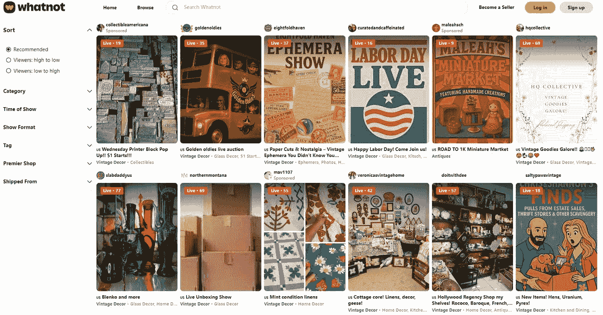

从两类玩家的模式能看出，Whatnot盈利的核心并非“靠流量碰运气”，而是“资源先行”，新手想入局，要先看清自己有什么资源，再决定往哪个方向走。

## （一）做服务商的关键：把控账号合规与稳定

如果想做服务商，核心是打通店铺号注册渠道，确保账号来源合规、稳定。首先要解决的是注册资料问题，美国本土手机号要从正规虚拟运营商平台采购，避免买到被平台标记为“黑号”的手机号；美国地址要真实有效，最好是能接收邮件的地址，因为平台偶尔会发送验证邮件，地址无效会导致账号被限制；美国公司资质要找靠谱的代办渠道，办完后要在州政府官网（比如加州Secretary of State网站）查询验证，确保公司状态为“活跃”，避免买到“休眠公司”导致账号注册失败。

其次要做好账号养号和风控，新账号注册后不能直接卖给买家，要先模拟真实用户行为养号3-5天：每天登录浏览2-3小时，关注5-10个同类主播，参与1-2场拍卖互动（不用真的下单，偶尔留言即可），第4天可以申请“直播权限”，提交简单的直播计划（比如“每周直播3场，主营平价饰品拍卖”），等平台审核通过（周期1-3个工作日）后，再把账号交付给买家，这样能降低账号交付后被封的概率，减少售后纠纷。

最后要明确服务边界，在和买家沟通时，一定要提前说清“质保范围”，比如“仅保障注册资料问题导致的封号，不承担运营违规责任”，成交后最好签署简单的服务协议，留存聊天记录和账号交付截图，避免后续出现纠纷时说不清楚。

## （二）做本地运营的关键：抓供应链与本地化团队

如果想做美国本地运营，第一步要优先链接国内尾货供应链，保证货源的低价和质量。可以多关注1688的“尾货清仓”频道，设置“新品提醒”，一旦有符合需求的品类（比如平价饰品、家居小工具）上架，第一时间联系商家拿样，确认质量没问题后再批量采购；也可以找义乌小商品城的线下批发商，说明自己是做跨境尾货的，长期合作能拿到更低的价格。采购时要注意控制单品类数量，首批采购500-1000件，单品类不超过300件，避免库存积压。

第二步要搭建简易的本地团队，核心是主播和发货人员。主播可以通过Upwork（美国自由职业平台）招聘，筛选时优先选有零售或直播经验、性格外向的本地人，时薪15-20美金，额外设置“销售额10%”的提成，比如单场销售额1000美金，主播能额外拿100美金提成，激发主播的积极性；发货人员可以找美国华人兼职，时薪10-15美金，负责打包商品、打印快递单，初期订单量少的时候，也可以和美国本地的华人仓储公司合作，让他们帮忙发货，省去雇佣人员的成本。

第三步要从“小品类试错”开始，不要一上来就铺很多品类。可以先选2-3个小品类，比如饰品、宠物用品，这些品类客单价适中、运输方便，而且受众广，容易出单。试播1-2周后，根据“单场观看人数、商品成交率、平均客单价”的数据，淘汰成交率低于30%的品类，把精力集中在爆款品类上——比如试播后发现饰品的成交率能达到50%，就可以重点采购饰品尾货，甚至拓展饰品的细分品类（比如耳环、项链、手链）。

## （三）避坑提醒：不盲目入局，从辅助角色积累资源

新手最容易踩的坑，就是轻信“零资源就能赚钱”的噱头，实际上没有资源很难在Whatnot立足。如果暂时没有账号注册渠道，也没有美国本地资源和供应链，不建议直接砸钱入局，可以先从“辅助角色”切入，积累经验和资源后再独立运营。

比如可以帮本地玩家选品，利用自己对国内供应链的了解，在1688上筛选适合Whatnot的尾货品类，推荐给美国本地运营的商家，每成功推荐一个爆款品类，收取“销售额5%”的佣金；也可以做直播脚本策划，根据Whatnot的直播特点，为主播写好开场互动、商品介绍、抢拍引导的话术，每个脚本收费500-1000元；还可以帮商家维护社群，每天在社群里发内容、回复用户问题，月薪3000-5000元。这些辅助工作虽然赚的不多，但能让你快速熟悉Whatnot的平台规则、用户喜好和运营逻辑，等积累了一定的资源和经验，再做服务商或本地运营，成功概率会高很多。

## （四）whatnotapp下载方式：

### （一）下载安装：

Whatnot目前主要以移动端应用为主，支持iOS和Android系统，无需海外苹果ID，国内ID就可以用。

目前仅对特定地区开放服务，下载需注意渠道和地域限制：

• 移动端下载：打开苹果App Store（iOS用户）或Google Play商店（Android用户），直接搜索“Whatnot”，找到带有官方标识的应用点击“下载”即可，过程无捆绑插件，安装后占用内存约200MB。

• 电脑端使用：暂未推出独立桌面客户端，可通过浏览器访问Whatnot官方网站（www.whatnot.com），登录账号后在网页端浏览商品、参与竞拍，但直播带货功能需通过移动端完成。

• 注意事项：需确保设备IP处于平台支持地区（目前含美国、加拿大、英国等），非支持地区用户仅能浏览部分内容，无法参与交易或开播；避免从第三方网站下载安装包，以防恶意软件风险。

### （二）账号注册：身份验证是核心

注册流程仅需3-5分钟，且买家、卖家共用基础账号体系，后续可灵活切换角色：

1.  打开App后，选择“Sign Up”（注册），支持通过邮箱、手机号或Google账号快捷注册，建议使用Gmail邮箱以提升账号认可度。

1.  按提示设置用户名（建议包含品类关键词，如“VintageLamp_Shop”），并完成手机号或邮箱验证码验证。

1.  首次登录需进行基础身份核验：买家仅需绑定支付方式（信用卡或PayPal），卖家则需额外上传政府签发的身份证件（驾照、护照等），通过Stripe系统完成实名认证，确保信息与后续填写的收货/发货地址一致。

### （三）角色设置：买家逛拍/卖家开播快速切换

账号注册后可根据需求选择使用场景，两者可随时切换：

买家视角：完成注册后，系统会引导勾选兴趣品类（如“中式复古饰品”“复古家电”），后续将精准推送相关直播间；首次竞拍前需填写完整收货地址，支付方式绑定后支持实时扣款，避免“空头出价”纠纷。

卖家视角：在账号后台点击“Become a Seller”（成为卖家），提交销售品类、直播计划等基础信息，审核周期通常为1-3个工作日；审核通过后需补充发货地址（需为平台支持地区地址），即可上架商品或申请直播权限。

# 五、实操操盘：从0到1的落地执行手册

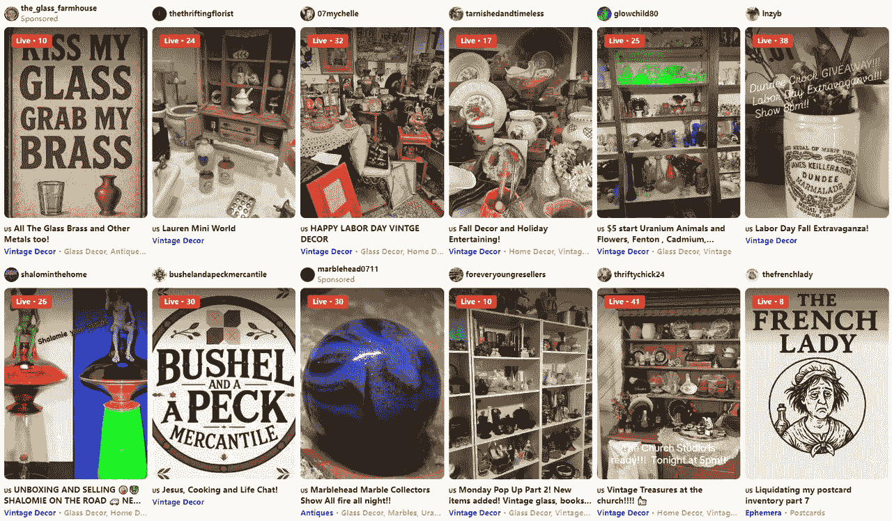

## （一）服务商模式：店铺号生意全流程

### 账号注册合规化操作

首先要准备注册所需资料，包括美国本土手机号、真实美国地址、美国公司资质。美国本土手机号可以通过Tello、Mint Mobile等虚拟运营商平台采购，注册时选择“预付费套餐”，成本约50-80元/个，注意要选支持国际短信接收的号码，方便接收平台的验证短信；真实美国地址可以通过两种方式获取，一是和美国本地的地址租赁平台合作（比如Shipito），成本约10-20美金/月，二是找华人海外仓合作，让他们提供地址用于注册，一般合作仓储就能免费获得；美国公司资质如果自己没有，可以找专业的代办机构，注册一家美国 LLC（有限责任公司），成本约1500-2000元/套，代办机构会提供公司注册证书、雇主识别号（EIN）等全套资料，拿到后要在州政府官网查询确认公司状态为“活跃”。

资料准备好后，开始注册账号。打开Whatnot官网，选择“Become a Seller”（成为卖家），按照提示填写信息：姓名填写美国公司法人姓名，手机号填写采购的美国本土号码（接收验证码），地址填写准备好的真实美国地址（要精确到门牌号），邮箱建议用Gmail邮箱（平台更认可），然后上传公司注册证书和EIN文件，提交审核。平台审核周期一般为3-5个工作日，审核通过后，卖家账号就注册成功了。

### 账号养号与风控

注册成功后，进入养号阶段，前3天要模拟真实用户行为：每天上午10点（美国东部时间晚上10点，用户活跃时段）登录账号，浏览“Toys & Hobbies”“Home & Kitchen”等热门品类的直播间，每个直播间停留15-20分钟，偶尔在评论区留言（比如“这个玩具看起来不错”“怎么参与竞拍”）；关注5-10个粉丝量在1000-5000的同类主播，比如做饰品的就关注饰品主播，做玩具的就关注玩具主播；每天参与1-2场拍卖，不用真的成交，出价1-2次即可，主要是让平台判定账号为“真实用户”。

第4天开始申请直播权限，点击账号后台的“Go Live”，选择“Apply for Live Selling”，按照要求填写直播计划：直播品类（比如“Fashion Jewelry”）、每周直播次数（建议填3-4次）、每次直播时长（建议填2-3小时）、直播内容简介（比如“High-quality Chinese jewelry at low auction prices”），提交后平台会在1-3个工作日内审核，审核通过后会收到邮件通知，此时账号就具备直播卖货功能，可以准备交付了。

### 账号变现与交付

首先要做账号包装，制作《账号交付手册》，内容包括账号登录信息（邮箱、密码）、账号状态说明（已通过直播权限审核、粉丝数、浏览记录）、平台规则避坑清单（比如“禁止售卖侵权商品”“禁止引导用户到🛰️交易”）、基础运营教程（比如“如何上架商品”“如何设置拍卖倒计时”），手册要做得简洁明了，让买家拿到后能快速上手。

然后是寻找客户和成交，主要渠道是跨境商家社群，比如龙哥盟、知识星球里的跨境电商社群，还有🛰️上的跨境卖家群。发布信息时要突出卖点：“Whatnot合规店铺号，已过直播权限，28天质保，即买即用，新手无需摸索注册流程”，可以设置限时优惠，比如“前3名下单立减500元”，吸引买家下单。

成交后要做好交付流程，先让买家支付50%定金，然后把账号登录信息发给买家，让买家登录确认账号状态（比如直播权限是否正常、资料是否完整），确认无误后买家支付尾款，服务商再把《账号交付手册》发给买家，并告知质保条款。交付完成后，要留存所有沟通记录和账号交付截图，万一后续出现质保范围内的问题，方便处理。

## （二）美国本地玩家模式：尾货直播拍卖全链路

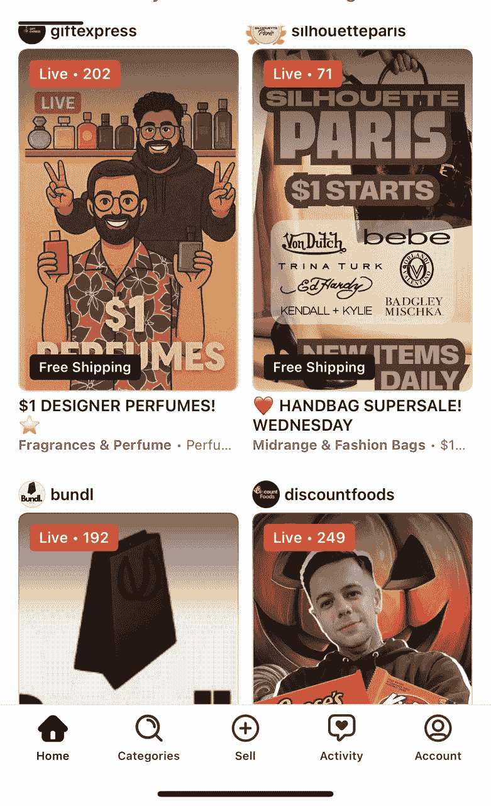

### 1.货源供应链搭建

选品采购方面，优先锁定三大类尾货：一是平价饰品，比如合金耳环、串珠项链，1688上很多商家的尾货单价2-3元，款式新颖，适合年轻女性用户；二是家居小工具，比如硅胶厨房收纳盒、可折叠浴室置物架，实用且重量轻，物流成本低；三是儿童玩具，比如小型益智拼图、软胶动物模型，美国家庭对儿童玩具的需求大，复购率高。

采购时要注意两个细节，一是拿样确认质量，比如在1688上看到一款耳环，先花10元买1对样品，收到后检查材质是否合格、是否有毛刺，确认没问题后再批量采购；二是谈账期，和供应商沟通“先付30%定金，到货后付尾款”，降低资金压力，尤其是首次合作的供应商，避免一次性付全款后出现质量问题。

物流仓储方面，选择海运渠道，推荐美森快船，虽然成本比普船高（约8-12元/件），但时效快（20-30天到货），能快速周转库存。发货时要注意避开旺季，每年11-12月是美国物流旺季，海运运费会涨到15-20元/件，而且仓位紧张，建议提前2个月备货，比如想在11月销售，9月就要发货。

仓储可以分两步走，初期订单量少（每天10-20单）时，和美国华人仓储公司合作（比如洛杉矶的华人仓储），他们提供存储、打包、发货一体化服务，存储费0.5美金/件/月，打包发货费2-3美金/单，不用自己租仓库、雇人；等订单量涨到每天50单以上，再租用小型仓库（比如洛杉矶华人区的仓库，月租约1500-2000美金），雇佣1-2名兼职发货人员（时薪10-15美金），降低长期成本。

库存管理上，要设置预警机制，用Excel表格记录每个品类的库存数量，当单品类库存低于50件时，立即联系国内供应商补货；同时每周复盘销售数据，淘汰成交率低于30%的品类，比如某款玩具连续2周成交率只有20%，就不再补货，把资金投入到成交率高的品类上。

## 直播运营与转化

主播团队搭建有两种模式，可根据成本和需求选择：

中国主播模式直接上，选人标准优先筛选有快手、抖音直播经验的主播，核心要求会基础英语，哪怕表达结巴也可以——平台美国用户对“带有中国口音的英语直播”接受度高，反而觉得新鲜有特色，流量推荐权重更高。成本方面，不用本地化雇佣，主播月薪仅3000-5000元人民币，远低于美国本地主播。还有就是手播，不出镜，简单播一播很不错。

运营时要提前为主播准备“英语话术模板”，降低表达压力，比如开场话术：“Hi everyone! Today we have super cheap Chinese jewelry, starting at $5! Don't miss it!”（大家好！今天我们有超便宜的中国饰品，5美金起拍！别错过！）；商品介绍话术：“This necklace is made of alloy, light and comfortable, suitable for daily wear. The original price in the US store is $20, today starting at $5!”（这条项链是合金材质，轻便舒适，适合日常佩戴，美国商店原价20美金，今天5美金起拍！）；抢拍引导话术：“Last 5 seconds! Current price $6, anyone want to add? 5,4,3,2,1! Sold!”（最后5秒！当前价格6美金，有人加价吗？5、4、3、2、1！成交！）。直播中还要让主播穿插“中国货源故事”，比如“这款饰品是义乌工厂的尾货，工厂本来是给美国品牌代工的，现在清库存，所以价格特别低”，强化性价比认知，提升转化。

第二种是美国本地主播模式，适合长期稳定运营。选人要求雇佣美国本地人，需满足英语流利、性格外向，有零售或直播经验者优先，比如可以找当地商场的促销员，他们有和顾客沟通的经验，更容易带动直播氛围。薪资结构为时薪15-20美金，额外设置“销售额1.5-12%提成”，比如单场直播销售额1000美金，主播可额外获得100美金提成，激发主播的积极性——有个商家测试过，加了提成后，主播的互动热情明显提高，单场销售额涨了30%。

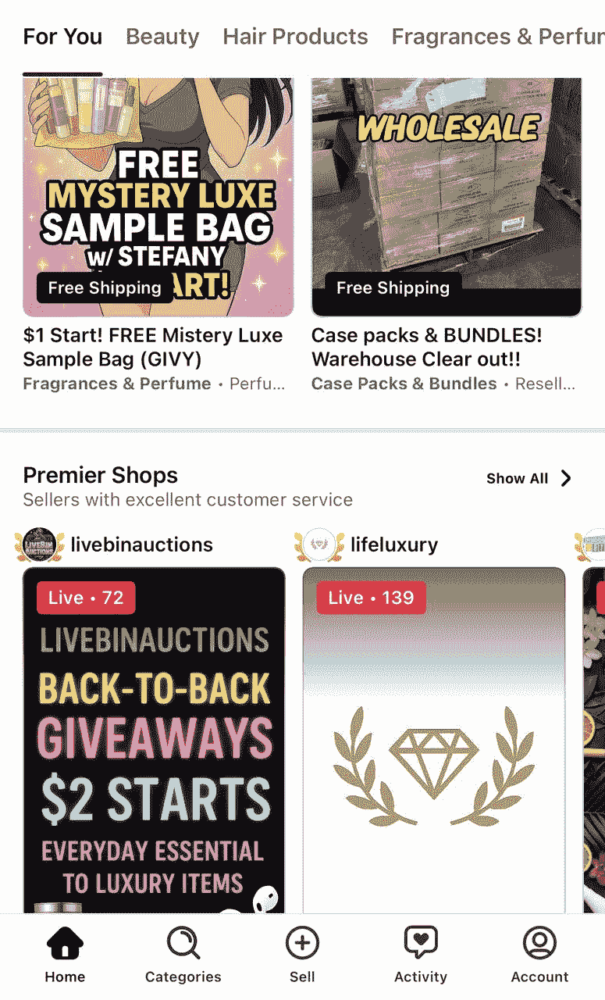

## 直播脚本要统一使用标准化模板，把控节奏效率：

1.  开场互动（1分钟）：用高性价比卖点快速抓住注意力，比如“Today we bring high-quality Chinese tail goods, starting at $5, miss it and wait a week!”（今天带来的都是中国高性价比尾货，5美金起拍，错过等一周！），同时展示3-5款热门商品样品，让用户直观看到产品。

1.  商品展示（3分钟）：每款商品分两步介绍，第一步展示细节，比如饰品要特写材质、纹路，玩具要演示玩法；第二步场景演示，比如家居收纳盒要展示“放在厨房能装多少调料瓶”，让用户知道“这个东西能用来干嘛”。

1.  5秒倒计时拍卖（核心环节）：报出当前出价后，启动倒计时，配合手势动作引导用户加价，比如伸出5根手指说“5 seconds left!”（还剩5秒！），然后逐秒递减，营造紧张感。

1.  新品预告（10秒）：展示下一款商品样品，用“Next one is better, don't leave!”（下一个更划算，别走开！）留住用户，避免用户在两款商品之间离开直播间。

## 直播执行时要注意三个细节：

一是固定直播时间，选择美国用户活跃时段，比如东部时间晚7-10点（此时美国大部分地区用户下班在家），每天固定时间直播，培养用户的观看习惯；二是控制直播节奏，每场直播2-3小时，上架30-50款商品，每款商品的介绍+拍卖时间控制在3-4分钟，避免用户等待太久；三是用工具提升效率，用OBS Studio（免费推流工具）推流直播，搭配“Countdown Timer”插件设置5秒倒计时，替代人工计时，减少失误。

直播后要做数据复盘，每周整理一次数据，重点关注三个指标：单场观看人数（反映流量情况，低于50人说明社群运营不到位）、商品成交率（反映选品情况，低于30%要淘汰对应品类）、平均客单价（反映定价情况，低于7美金可以适当提高起拍价）。根据数据调整运营策略，比如某场直播观看人数只有30人，下周就要加强社群运营，多在群里发用户晒单和搭配教程，吸引更多人来看直播。

售后与复购物流交付方面，选择美国本土快递USPS，运费约3-5美金/件，设置“满50美金免运费”的政策提升客单价——有商家测试过，设置免运费门槛后，客单价从7美金涨到了12美金。同时要承诺清晰的发货时效，在商品详情页注明“48小时内发货，7-10天送达”，让用户有明确的预期；发货时在包裹内放置手写感谢卡，内容可以简单写“Thank you for your purchase! Follow us for more deals!”（感谢购买！关注我们获取更多优惠！），增加用户好感。

用户运营的核心是社群和复购，首先要引导用户关注主播账号和加入社群，直播时每15分钟提醒一次：“Follow our account and join our Facebook group to get early access to new products!”（关注我们的账号，加入Facebook群，提前获取新品信息！）；其次要做好社群维护，每周在Facebook群里发3条内容：周一发“新品预告图+直播时间”，周三发“上周爆款返场通知”，周五发“用户晒单抽奖”（抽1名用户送免费拍卖资格），提升社群活跃度；最后要处理好差评，若用户因物流延迟、商品小瑕疵等问题给出差评，第一时间私信用户道歉，赠送10美金平台优惠券（下次拍卖可用），并解释问题原因（比如“Sorry for the delay, it's due to the logistics peak. We have expedited the shipment for you.”），据商家反馈，这种方式的差评挽回率超60%。

# 六、盈利回款方式：

PayPal为主的回款核心要点

PayPal是Whatnot中国商家最常用的回款工具，操作便捷但需注意信息匹配与风控，需在《账号交付手册》中明确以下核心内容：

1. PayPal账户绑定要求：登录Whatnot卖家后台“Payment Settings”，优先绑定企业版PayPal账户（个人版账户易因大额收款触发风控），绑定前需确保PayPal账户的“法人姓名/公司名、注册地址”与Whatnot店铺注册信息（EIN对应的公司信息）完全一致，避免因信息不符导致资金审核失败。

2. 回款周期与流程：平台默认交易完成后14天（二手品类21天）将资金结算至绑定的PayPal账户，到账后可在PayPal后台申请提现——支持提现至国内银行账户（需开通外汇接收功能）或第三方支付工具，提现到账时效约3-7个工作日。

3. 费用成本明细：需提前核算两层费用：一是PayPal交易手续费，月收款3000美金以下按4.4%+0.3美金/笔收取，3000-10000美金可降至3.9%+0.3美金/笔；二是提现费用，直接提现至国内银行按1.2%收取货币转换费，单笔提现超3000美金建议累积后提现，降低费率成本。

4. 风控避坑指南：新账户避免首笔收款超5000美金，建议先通过小额订单积累信誉；登录PayPal需使用固定设备和稳定网络，禁用VPN或公共Wi-Fi，频繁更换IP易触发账户冻结；留存所有订单截图、物流单据，若遇资金冻结可及时提交凭证申诉。

最后说一下：whatnot的回款时间是这样的：普通账号的话是T+4小时。客户签收后的4小时回到你的店铺钱包。当你销售单量达到1000单以后，回款变成T+0，客户签收后就回。关于回款银行：虽然说款是要回到账号的银行账号，但是你可以用第三方去生成美国citibank账号，比如派安盈、珊瑚就可以。有人说提款需要人脸，你注册的时候就把人脸过了就好了，买回来的店铺记得一定要对方过人脸。最后说一下，如果你账号被封了，又没有原则性错误的话，款是可以回的，大概等待期是一个月左右。

# 七、结语

## 关于这个平台，其操作之简便，与抖音、TikTok形成了鲜明对比。

熟悉抖音、TikTok直播的朋友都清楚，要在这些平台做好直播，从账号权限（如TikTok需千粉、实名认证等）、设备（高端手机或专业直播设备）、网络（稳定的海外专线）到直播间搭建（背景、灯光、互动元素的精心设计），每一环都需要投入大量精力。就像若想深入了解TikTok直播间搭建的细节，比如项目优势、执行SOP、短视频与直播的标准化流程等，感兴趣的朋友可点击下方链接跳转至赚钱网页帖子https://t.zsxq.com/FW2zt 查看高级直播间搭建方法。

但重点是！Whatnot完全不同，它几乎没有繁琐的门槛，只要具备基础的直播条件（能保证画面和声音清晰即可），就能直接开播。无需像运营抖音、TikTok那样，在开播前要攻克诸多环节。

大家在下方图片中可以清晰的看到平台直播的“简陋”

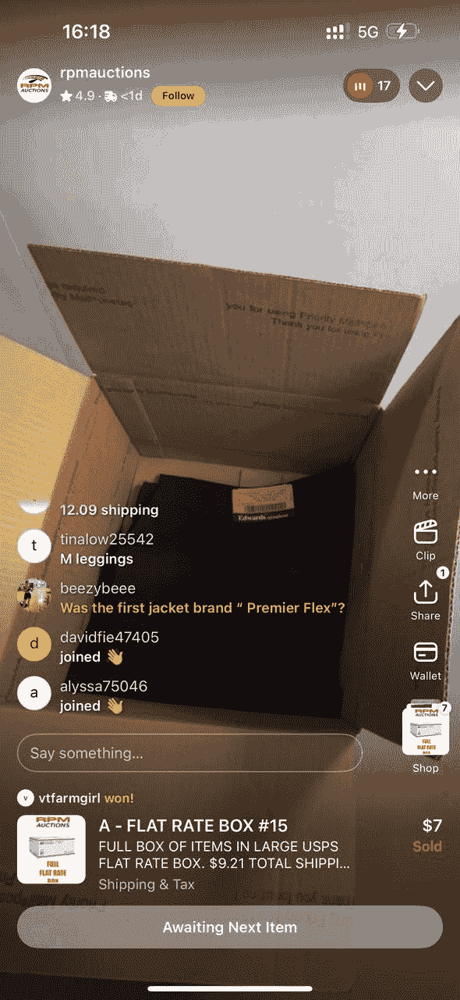

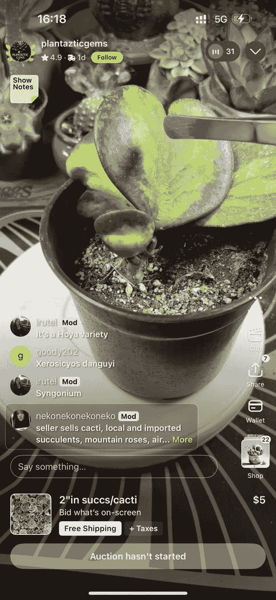

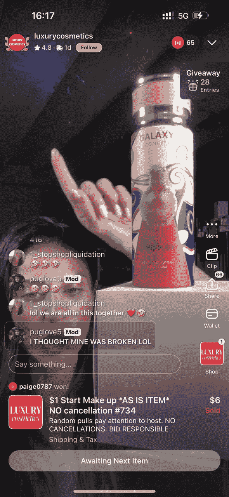

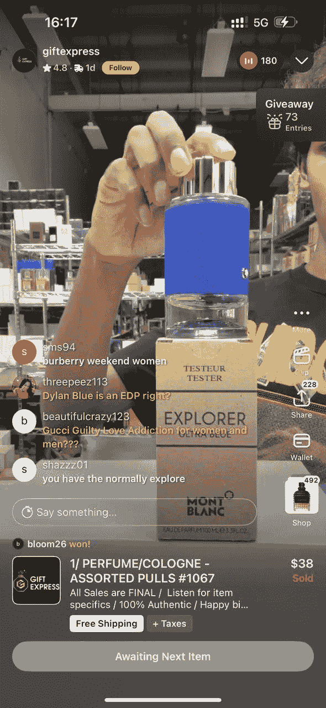

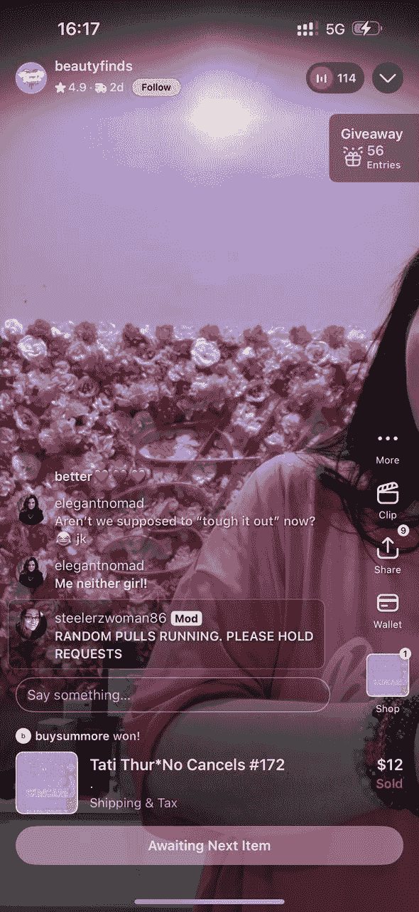

## 下方为本人🛰️朋友圈的一个对这个平台的评价：

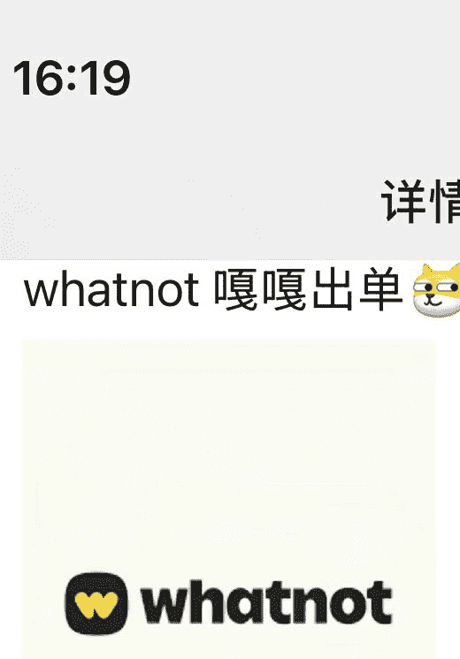

## 本人总结：

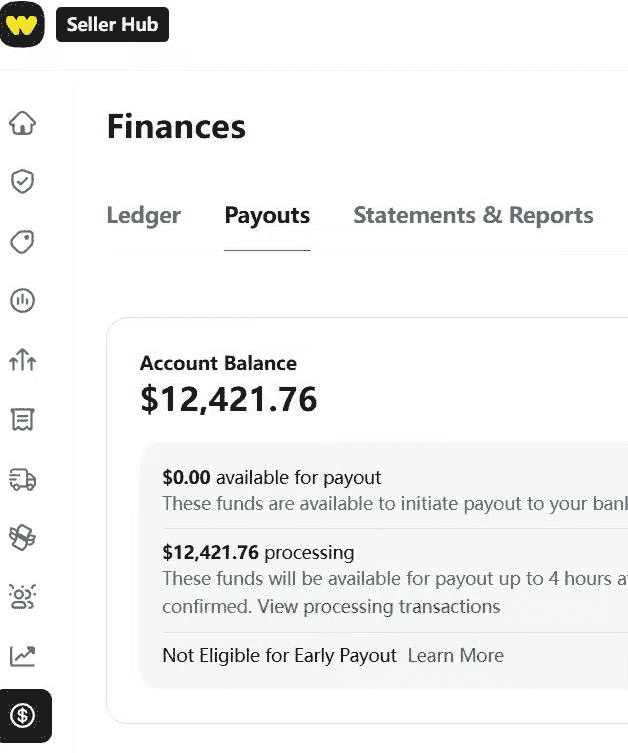

从以上收益数据可以直观看到，在这个“简单”的平台上，也能收获不错的成果。对于追求轻量化直播、想快速上手跨境电商直播的朋友，Whatnot无疑是个值得尝试的选择。

本人做跨境很久了，已经深耕TikTok和instagram多年

当然也没有放过whatnot 已经运营了一段时间了 今天在这里跟大家分享一下 希望大家多去研究 扬帆正当时 跨境出海没有问题

Whatnot的崛起，并非要取代TikTok，而是给跨境商家提供了另一条发展路径：当算法驱动的带货模式越来越内卷，“社群生意”反而有了新机会。

对中国商家来说，不用一直盯着TikTok的流量焦虑，不如多想想：中国供应链能做出哪些“小众非标品”？比如中式复古灯具、汉服配套饰品、手工改造家电，这些带着中国特色的产品，在Whatnot的“兴趣社群”里，反而能找到更精准的买家。

当然，也不用盲目入局，做任何生意都是需要沉淀的，任何的业务也是都有风险的，判断好后再入局。——就比如说，要先搞清楚自己的品类是不是“非标品”，能不能搞定美国本土发货和合规资质，再决定要不要做Whatnot。毕竟，跨境生意没有“万能平台”，只有“适合自己的平台”，看清自身优势，匹配平台逻辑，才能真正抓住这波红利。

