# 手把手教你10w+爆款（垂直小号、IP必看版）

> 来源：[https://xuqiwei1986.feishu.cn/docx/VjZHdpOs6omu46xPdTLcdTrfnUX](https://xuqiwei1986.feishu.cn/docx/VjZHdpOs6omu46xPdTLcdTrfnUX)

**大家好，我是耶耶，广州211准大四，目前深耕私域，未来**大方向是出海，擅长内容获客和精细化运营。

7月份小红书抖音开始大量跳实名，前段时间好多圈友问：小红书、抖音跳实名有什么好的解**决办法吗？其实我也一直在头疼这**个问题，也请教了业内的几位大佬，只得到了一个答案“保持对抗，对抗不了，直接躺平”....

**直到超级标“公众号**垂直小号”出炉，我才明白，过去拼矩阵堆量固然有效，但现在随着平台机制的完善，无论是小红书，抖音，还是公众号，我们最终都必须走向优质内容/投放，不可逆，必须选择和平台合作，所以我沉下心开始深耕优质内容（这也是我25-26年的核心发力点）

**但是**如**何做好内容一直以来**都是大家的痛点，今天这篇帖**子从人设、定位、**冲突、反转、热点、选题、标题、情绪、画面感、痒点，痛点、钩子、行文结构，文章主线副线、心锚来一一讲清楚，如何创作出优质内容，相信你认真看完，也能获得快速创作优质内容的能力。

「生财」提倡**“越分享，越幸运”，**也希望此帖能助力各位圈友们在9月的航海中取得好成绩~

全文13000字

**没收获拉黑我，**

**我说的，**

## 一、引言

亦仁上个月发了一条垂直小号的**超级标**

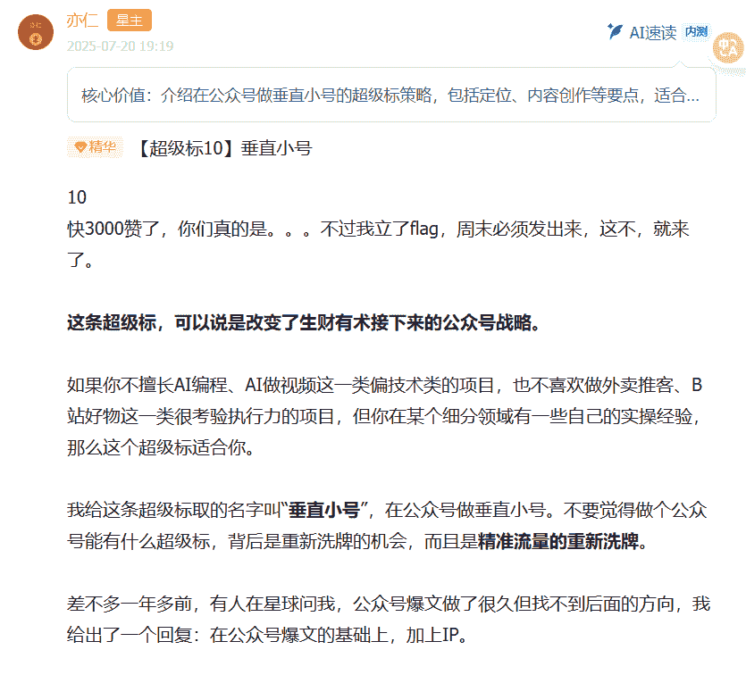

**但是，我最近发现不少**圈友就是把公众号当流水账来写，如果你只是想要记录生活的话，那完全没问题，那一定要持续出摊，搞不好有人喜欢看你的碎碎念，万一钱没赚到，你脱单了，那也赚了。

**但是如果目标是变现，你要提高你的赚钱效率，要努力去结合你行业热点（比如**AI），或者泛热点，如果你做搜索流，一定要有耐心，该堆号堆号，搜索流精准但是慢。

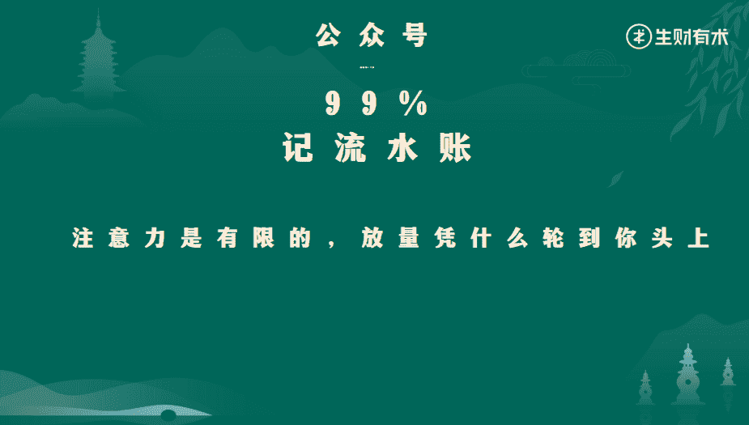

公众号现在的算法虽然从原来的粉丝推荐机制，改为自然推荐机制，但不代表放量就能轮到你啊，就像抖音，去中心化，但不见得我们能起来啊。

有人注意到**公众号下面有一行小字吗？**

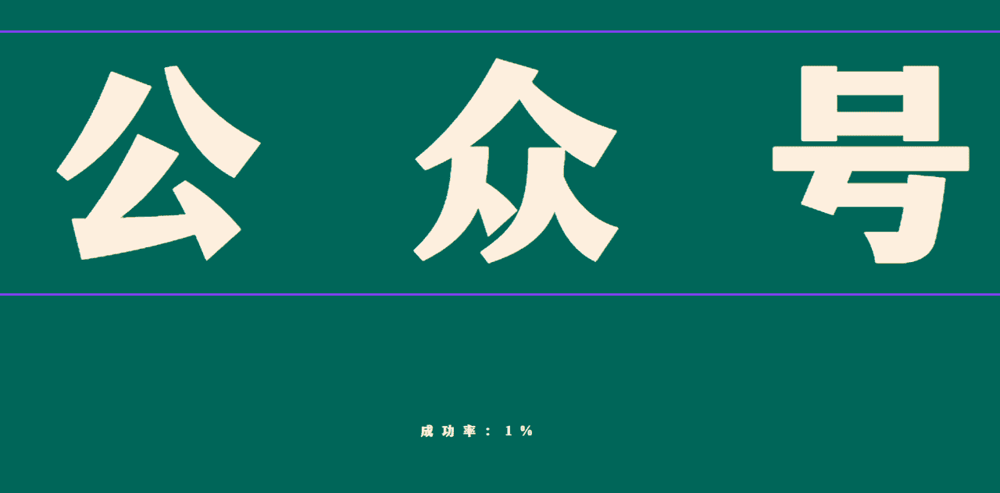

我写的是**成功率1%（夸张描述一下）**，你看，哪怕微信给你曝光，你也不中用。

主要是因为**很多人没有多做号的思维和能力**，也没有比较好**写作能力，不懂受众**，**也不蹭热点，标题没情绪**，中了知识的诅咒（就是不讲人话的意思）

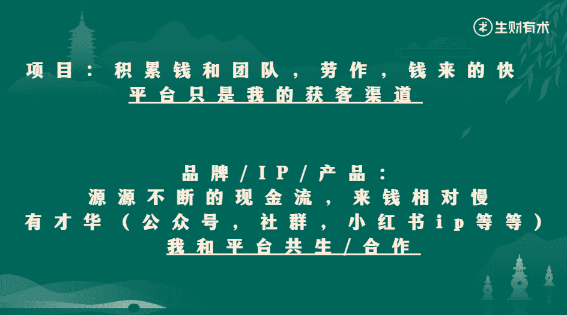

**公****众号爆文属于项目，变现主要****是**通过广告费，垂直小号我理解为IP的打法，而不是短平快项目的打法。玩的是信任，玩的是背书，这是大钱，需要你有才华，你认知高，或者你能掌握别人还不知道的信息也行。

因此，做垂直小号，只有掌握优质内容是宿命，优质内容很难，但实力到了，全是红利。

## 二、推流逻辑

首先，我们要知道，我们做内容干的就是自媒体，自媒体玩的就是文字游戏，卖的就是信息差，认知差，卖的就是“空气”

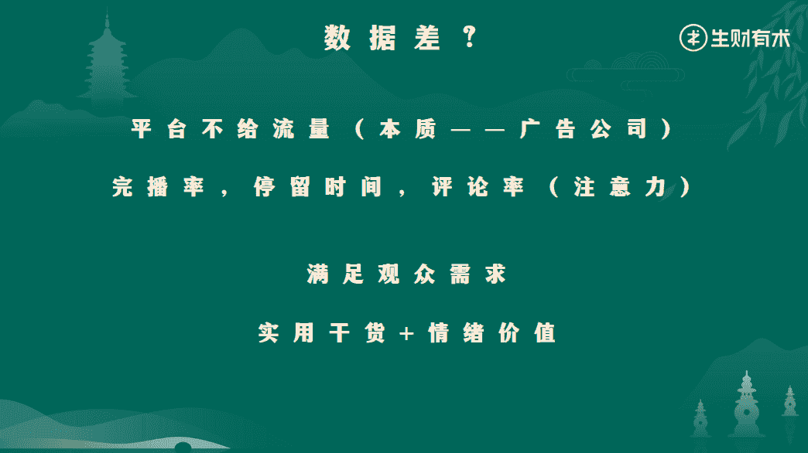

**数据差，平台不给我**们流量，我们要想平台的本质是什么？

第一性原理——平台本质都是广告公司，两**头赚**，玩的人多了，它才赚钱。比如抖音，小红书，b站，小宇宙，快手，知识星球，生财有术都一样，无非只是一个入口。

短**剧为什么赚钱，因为看的太爽，**只想把脑子放一边，人们愿意停留，平台自然给它流量。因此我们要做好内容，那就是做好完播率，停留率，评论率。

那再往下，我们如何做好内容——**实用干货+情绪价值**

实用干货早就有了，世界不缺少干货，来来回回都是那些，你再去做大而泛的干货，不做点差**异化，基本不可**能火，当然你**可**以博概率，堆量取胜，如果你号多，能把文章或者视频制作成本压缩到极致也完全没问题。

> 因为火过的内容还会再火一遍，无非是换个案例，换个标题，换个人设，换个钩子，换个配图，做排列组合

**解决方法：**

1.  **满足一个极细的需求**（非常细分垂直赛道，你比别人**略懂**即可）

1.  **蹭热点炒作，疯狂输出情绪**（AI也是热点，还在快速发展，更新足够快，你比同行快1h就行）

**情绪是多种多样的**，**人永远需要情绪**，特别是东亚人，是最最最压抑的一群人。当然这也是我们**这么多年进步这么快**的原因，压抑背后是一种能量极其高的能量。

因此，你做自媒体，你只需要释放/满足/操控人们情绪+干货价值，就能赚到钱！

## **三、文体**

这里我们忽略公众号爆文，只说垂直ip打法，主要有三种文体

1.  **清单体（难度2-3星）**

1.  **论述文（难度3-4星）**

1.  **故事/散文（难度4-5星）**

p**s：其实还有采访****体，但是采访本身你需要对接大v****或者网红，或者去头等舱采**访xxx，你都有这个实力和胆量了，还担心赚不到钱？因此我不考虑采访体，陈雪也是做了很多项目，有实操项目能力才能做起来的，需要提问能力很强，要会引导！（你都会精准提问了，你哪里缺钱啊，如何提出个好问题真的很难）

### **1.清单体**

举个简单理解的例子，比如亦仁老大这一条公众号，以及曹大最近在生财发的文章

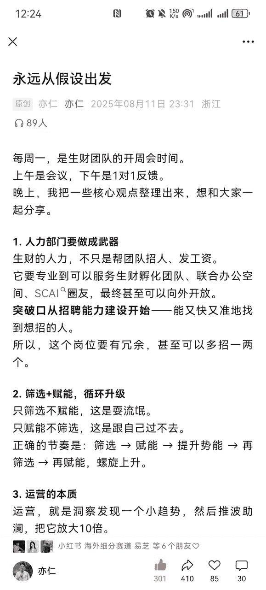

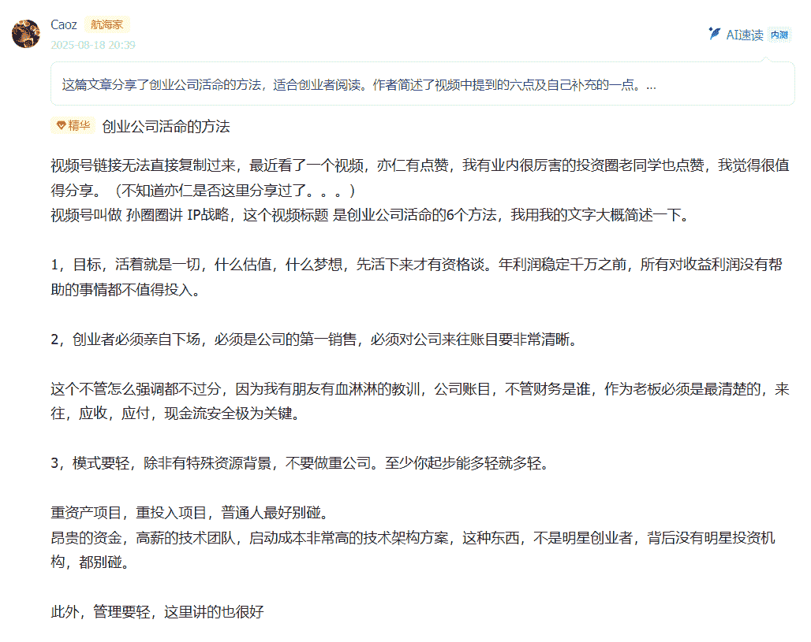

**主打的就是观点非常密集，**让你感觉**学有所获，你又懂了**，

实**际上如果你不结合自**身**业务/生活去思考，你看完估计过半小****时全忘了**，但这种文体容易火，利用了人们**想要大量获取知识的贪婪（干**货＋些许情绪价值）这种文章优点在于相对容易写，相对考验归纳总结的能力。总结归纳能力到最后就是金句频出的感觉，涛哥就很会讲金句，比如“ 念头一转，黄金万两。”

总之，你的文章/短视频只要让观众觉得他又懂了，他又无敌了，他又学到了，你就成功了。

**我们写公众号目的**

1.  **要么就是为了接广赚钱**

1.  **要么就是为了积攒信任，赚非标+私域+高客单+复**购/转介绍/升单的钱，赚资源链接的钱。（哪怕你刚开始写的很垃圾也没事，你会慢慢写的更好，这不就是养成系ip么？——持续见证一个人的成长/成功就是最高级的营销）

### **2.论述文**

从**一个点/热点**切入，进而去**深层递进论述****，还是举亦仁老**大的案例，你能看到亦仁老大清晰的逻辑链路

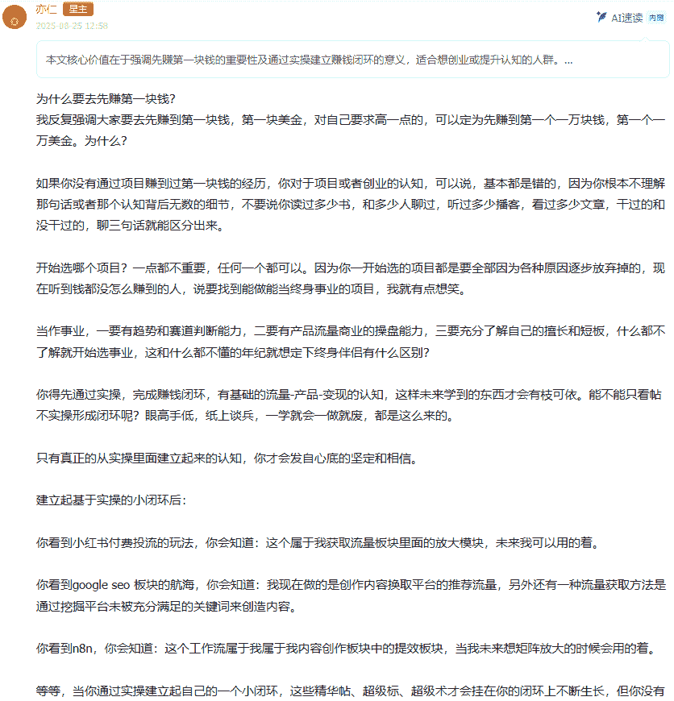

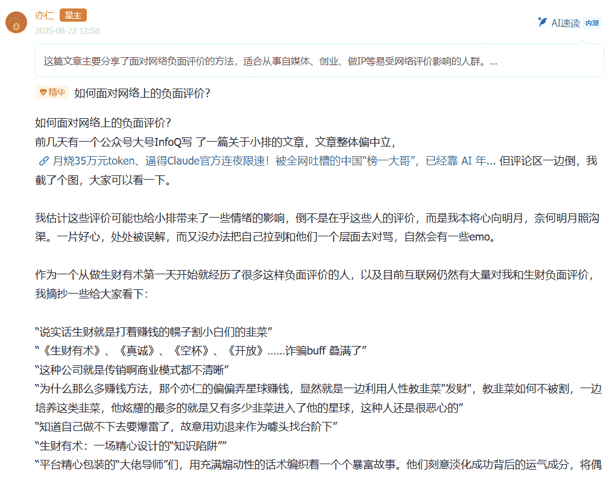

**这种文章相对难写**，**不要看简单易读**，背后是有大量的实践和见识做支撑，需要严密的逻辑链（想象一下，你现在自己去写“为什么要赚第一块钱”，你的思路大概是很发散的，不知道从哪里开始落笔）、总结、写作能力做支撑，

> 假如让我写这篇文章，我是这样思考路径：

> 最近经常有人问我，**什么赛道好？**——我会给对方一些我选赛道的**标准**，以及一些我看好的赛道，亦仁的千万模型**——**但是一般来说，我**还会**往下试**探这个人的能力——****如果发现对方能**力不够，没有商业闭**环的思维——那**我就会推荐对方随便跑项目**——先赚**到第一块钱再说——在这之间，攒**现金流和团队，**等实**力到了，遇到好**项目直接开**打—****—并且现****在项目变**化很快**，没有一直很好**的项目——先去赚第一块钱，别想太多——进而再根据”为什么要赚第一笔钱“这个标题分点描述，而不是一开始就无厘头，背后一定有个逻辑链条在的，是有事实依据的

但是，假如你是短视频，显然要**简单很多！**因为短视频差不多300-600字左右，信息密度小，观众很少会去扒你文案去分析逻辑链，而且你可以用动作和音乐去干扰观众的理性，观众还以为你很牛逼。。。

### **3.故事文/散文**

通过讲故事的方式讲道理/立人设/吸引同频人（这种是最难的，因为很难结构化！需要你发散自己的思路）

比较有名的就是公众号《xx承载》，这种文体门槛很**高，但如果掌握了，你**的内容是无穷无尽的，万事万物都是你的素材。

**优点就是足够差异化，一篇文章/视频就能出圈****，适合作为人设文章，缺点就是**很难规模化，当然一体两面，二者不可得兼。

> 视**频号《我的10年来**时路》题材属于这种文体，已经有人开到2w+拍摄一条视频了，评论区全靠刷哈哈哈哈。这种题材火主要是足够真实，传递希望，一篇就能立人设圈粉。

**文章结构一般是这样：**

> 首先是**选题/标题**

> **一个选题可以衍生出无限个标题**

> 比如：

> 选题：如何年入百万

> 标题：普通人如何赚到第一个100w，跨境电商如何赚到第一个100w，打工人如何赚到第一个100w，私域如何赚到第一个100w，手把手教普通人如何赚到第一个100w，普通人如何通过ai赚到第一个100w等等，2025年普通人如何通过AI赚到100w

>

> 再是针对事件/具体热点，结合背后的受众

> **讲观点/态度（****观点一定要前置****，****自媒体玩的就是标题**党，玩的就是观点，玩的就是一套自洽的逻辑体系）

>

> 以**讲故事的方式，从中穿**插痒点/痛点/情绪（具体的画面感，真实感）

> **痒点**（人们通常不会为此付费）：**烦躁，抱怨，累，不爽，沮丧等等**

> **痛点**（深思熟虑后的负面情绪）：**爱而不得，嫉妒，恨，不被理解，不配得**感，不安全感，不被需要，内疚，焦虑，迷茫

>

> **钩子/心锚（标签）**

1.  要么留下钩子，导流到我们的微信，或者购物/课程链接

1.  要么让观众记得我们是干什么的，让观众对我们贴标签（心锚，大白话来讲就是对我们有个印象）

**清**单体和论述文相对简单，也是垂直小号我推荐大家走的方向，最大的优势还是制作成本低，不那么费力，能坚持下来就超越了99.9%的人。

**ps：大部分营**销号（非贬义，营销号挺赚钱的）是清单体＋论述文结合，让你感觉收获很多，也确实有点逻辑性，这种也是最常见的文体了，也相对容易抄。

不过，我从故事/散文类型开始教学，先高一维度，后面我们降维打击就轻松了，本质是10倍思维。

---

## 四、案例（故事文）

我们先从故事文进行分析，**因为当你知道故事文如何构思，编导是如何**做的，我们就知道清单体和论述文多容易了！

**这是和一个上海圈友一起写的文章，**后面给大家具体分析他的思路，以下是正文。

标题：**就一社保，公司倒闭了**

> **时代的一粒沙，普通人一座山。**

本科毕业两年

人在上海，小公司，996

工资6000元

扣掉社保

到手就剩4000块

“大学生活就像泡脚，

4年泡得多舒服，

毕业喝洗脚水就有多恶心”

> **大学天天乐呵呵**

> **毕业无奈笑哈哈**

算了

毕竟是大环境不行

大家都一个样

比烂嘛，

谁还比不过谁了？

上个月去公司的早上

老板私聊说：

公司业绩不行

......

**“哎”**

“早知道大环境这么难

毕业就考公回老家了”

怪就怪自己毕业那会

自命不凡

总想逆天改命

到头来，

连上桌吃饭的资格都没有，

都说**00后最大的时代红利**：

是外卖大战

是**实现奶茶自由**

一天5杯奶茶嘎嘎猛

**可饭碗丢了**

给再多的膨胀神券

能给我炸出钦差吗？

哪还有什么心情喝什么奶茶...

说真的

**毕业时该去京东的**

**起码是个大厂**

嗯，

**我是说送外卖**

至少每天爬上爬下

起码还有点阳气

不至于天天水逆

也许还挺自豪

毕竟比起丑团

我们还有**社保**

以及陪东哥在一线创业的**荣誉感和归属感**

有人说：

“少关心宏观叙事，大环境是大环境，你是你”

也有人说：

**“时代的一粒沙，普通人一座山”**

**到底是我错了**

**还是世界错了**

**我真的不知道**

我只知道

去公司路上的我

就像个笑话

**我只记得**

**这两年数不清的委屈和内耗**

每天通勤挤着乌泱泱的地铁

就为了上那破班

公司电梯排半天，迟到被扣工资

同事净甩些脏活累活就算了，

背后还勾心斗角，

加班是少不了的

钱是分币不多的

> 美其名曰：

> 996是福报

好不容易提前下班

奖励自己刷会小红书

全是上海精致大女主

**更焦虑了**

> “有钱人多一个我会死啊？”

上班时

想着周末上进一下

可是到周末

又不知道学点什么

是看大学生毕业人数新增？

还是看A股创10年新高？

是看AI智商超过博士水平？

还是看美债要崩了呢？

一会这个瓜，那个瓜？

**到头被裁了**

**我才是那个站在风中凌乱的呆瓜**

半夜翻来覆去

想起白天浑浑噩噩

内疚的睡不着

爬下床找褪黑素

硬逼自己睡觉

结果就是深夜被噩梦惊醒

**空虚，迷茫，无奈，焦虑**

**侵袭我全身**

看眼手机，凌晨2：50分

不知是在提醒我早点睡

还是在骂我

这样生活一眼望到头，

**我还有救吗？**

**这个问题，**

**我问了自己，**

**整整一年。**

其实，**我早就想裸辞了，**

**但余额提醒我，**

**你不配**

不知道从哪天起发觉

上海不属于任何一个普通人

精致是没有的

钱是存不下的

**再繁华的国际大都市**

**又和我有什么关系呢？**

从外环挤进内环的我

就像端着蜜雪冰城

在LV门口摆拍一样

一个跳梁小丑罢了

可能老天看我过得太惨

实在看不下去了

有一天，

给我赏了口饭吃，

**命运的齿轮从此开始转动，**

那晚，刚加班回家

我躺床上刷视频号

一个长发大叔，

长得比我爸还老就算了，

还贼油腻，

在直播喊麦:

不记得具体讲什么了

只依稀记得一些语录

“你现在啥都没有，天花板无限高，怕啥啊，”

**“这才哪到哪，你才20多岁”**

---

**“念头一转，黄金万两”**

**这个油腻大叔，**

**评论区都叫他涛哥**

看半天，

还挺上瘾，

还给我燃起来了

堪比高三百日誓师，

不得二本逆袭到清北？

手举着张白色A4纸喊：

“加我本人微信，

ninekid，

手把手带”

**“来嘛，**

**送你张三天社群体验卡，**

**反正免费的，**

**不好的话算我的，”**

百思不得其解，

**“怎么有人精神状态这么好？**

**有毒吧？**

**卖课卖出信仰了？**

**这货早期肯定搞传销的，**

**绝对就是他妈出来卖的，**

不管了，

死马当活马医

不要白不要

鸡蛋都送家门口了

再不要就不礼貌了

苍蝇肉也是肉，蚊子腿也是腿”

后来才知道，

这个社群，

**叫生财有术**

不用想

看名字就知道是割韭菜的

心不在焉看没两篇文章

...

> “莫非我是来世释永信，上辈子修为太高？”

**卧槽，**

**这都能赚钱？**

能这样，还能这样？

正着叠，反着叠，

华为三折叠？

怎么折都有面？

无数和我一样没有背景的普通人

把无穷无尽的项目

从底层逻辑到具体落地

掰开，揉碎，嚼烂

手把手喂饭？

就差塞我嘴里了

怎么有人这么真诚分享？搁这做慈善呢？

> **”人永远无法赚到认知以外的钱“**

我就像在水下**渴望呼吸一般**

割肉付费加入了这个社群

并不便宜，心疼了好久

**企图抓住最后的救命稻草**

默然回首

在生财一年有余，

大家都是10倍增长的人生爽文

**我在想，我配吗？**

我不知道

若有所获，赚了点钱

但望着不多的微信余额，

不敢做声

但我清楚知道

最起码

我不那么内耗和委屈了

我有对抗生活的勇气了

后来，

我依旧失眠，焦虑，痛苦

还是做噩梦一身冷汗

褪黑素彻底无效

有天

凌晨3点在朋友圈抱怨失眠

评论区清一色全是：

“一样睡不着，起床一起做业务，”

**“睡不着拉倒，干他妈的”**

**“这钱就该我们赚”**

一时间不知道是喜还是悲

但最起码

我在路上，

最起码，

我肯定没来错地方，

**“聚是一团火，散是满天星”**

我想

这是对生财有术圈友

最贴切的描述

这一年发生了太多太多

也成长了不少，

不管怎样

我想，

我都会记得，

那个改变我人生的关键节点

**2024年4月9号**

遇见生财有术的那个晚上

**“来嘛，**

**送你张三天社群体验卡，**

**反正免费的，**

**不好的话算我的，”**

---

故事编完了，哪有什么上海圈友

作者就是本人耶耶而已

**说实话，我很讨厌讲故事，**

我总觉得

**故事是立人设的手段，虚伪又肮脏**

我目前准大四，

在广州，根本没在上海工作，

但，

2024年3月是我最痛苦的一个月

断断续续发了一个月的烧，

吃了很多很多的药，

打了不少吊针才有所缓解，

做事各种不顺，

心累，焦虑，抑郁

索性独自从广州飞到上海，

企图逃避现实，缓解焦虑，

落地上海

发烧难受就算了，

还多送了我耳鸣，

在酒店躺了整整一天

一直没好转，干脆顶着烧

一个人去了迪士尼，

不看地图攻略乱走，

**好像真的能找到解药似的，**

看了两场一模一样的烟花，

**好像真的能从中找到意义似的**

住在迪士尼附近

到环内要一个半小时

**环内外位置的距离**

**就像永远跨不了的阶级**

“如果我在上海打工，

通勤好累啊，

我能攒下钱吗？

上海会有我属于我自己的家吗？

我不知道，更不敢想”

我只记得当时疲惫，焦虑，迷茫，抑郁

就索性柔合在前面故事里

故事多少失真

---

**但，**

**感受假不了，情绪假不了**

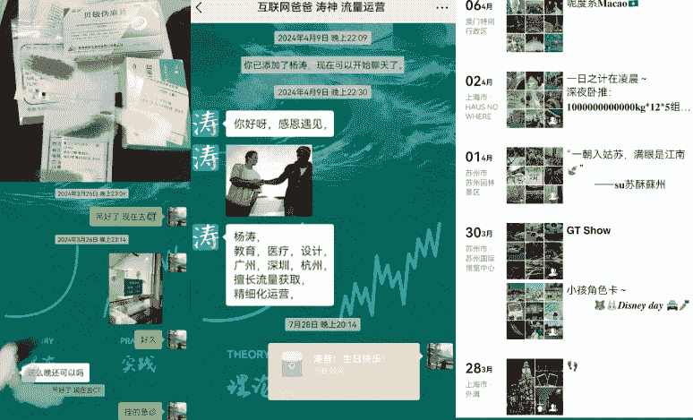

**24年我各种不顺**

**做了很多烂项目**

**唐僧取经那叫九九八十一难**

**蛤蟆取经那叫九九八十一烂**

颓废了小半年

无所事事旅居了20多个城市

光西藏就呆了20来天

超美，超绝，

**但，**

风大，暴雪，封路，

晕车，缺氧，想吐，

以及频繁半路拦截，

查不完的边防证

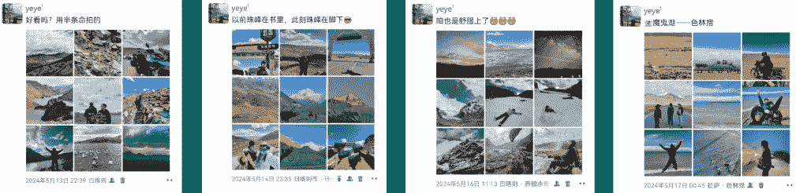

> “我人生最落魄的时候，只剩下银行卡里冰冷的40亿”——雷军

"再美的风景好像也不过如此，哪怕财富自由了，好像也就这样啊，"

**与不再被需要的空虚感相比，**

**朋友圈那点优越感不值一提，**

朋友圈都是给别人看的

过的好不好只有自己知道

**骗得了别人，但骗不了自己**

25年也是各种不顺

赚钱只是一小方面，睡眠就没有质量这一说法

褪黑素剂量拉满，却只能睡3个小时

半夜频繁做噩梦，冒一身冷汗

前文提到的考公

是我25年后的想法

当时和圈友做教培

越折腾越亏钱，

大年夜，

别人年年有余，我却年年有虑

人很丧，**还他妈出现deepseek**

教培天塌了，

自命不凡，

就是我一直以来的状态

是眼高手低还是志向远大

我不知道

我大脑一直有两个打架的小人

**“你早晚会成功的”**

**“要不还是算了吧”**

我时常纠结，

内耗，

在挑战圈踱步，

我到底能行吗？

**这个问题，今年问了自己无数次**

不过，

此时此刻，你看到这篇文章的我

可以确信的说：

**我找到答案了**

哪怕每天依旧有很多很多很多烦恼，困惑，焦虑，痛苦

但足够自洽，足够接纳自己，

**毕竟知道自己在正确的路上，**

**有方向感，笃定感，幸福感**

至于未来

会遇到多大的困难

我也不知道会怎么走

但是我知道

**只要待在生财，靠近生财**

**不管做什么**

**我的成功率都高了一半**

> **赠人玫瑰，手有余香**

涛哥亲自对我说过一句话，

这次，

换我对你说，

**“来嘛，**

**送你张三天社群体验卡，**

**反正免费的，**

**不好的话算我的，”**

**一起等风来**

**一起看风景**

---

**这是在生财一年的普通人**

**未来一年能赚几千万的那种**

**你肯定也是**

---

**全文完。**

## 五、手把手拆解思路（编导角度）

**故事到此结束，这篇文**章看似从社保切入，其实压根和社保没多大关系，前文一直在打情绪价值（内心刻画），咋咋呼呼，根本没啥干货，搞半天，故事一层套一层

这篇文章钩子就是生财三天体验卡，文章思路可能难想到，能从上海社保这么泛的内容转到生财体验卡也是没谁了，感觉我是生财第一个。。。

不过，好险，还好这里是生财有术，我会手把手说下我的框架，思路，方法论

**首先是框架**

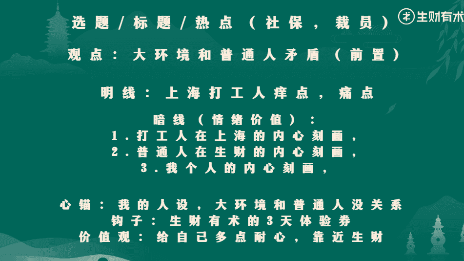

接下来是思路（最重要一环，最好多看几遍）：

1.  **选题**

1.  **人设/受众/角度**

1.  **标题**

1.  **观点/锐评/态度**

1.  **故事**

1.  **情绪价值**

1.  **心锚/钩子/价值观**

1.  **节奏/手法**

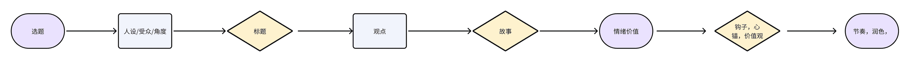

### **选题**

**有天**，我在朋友圈刷到有人**分享**一条公众号（内容大抵是**上**海工资5000r，扣掉社保，员工到手剩2500r）

**我在想：”**这么夸张吗？“，又想到联想到最近很多流量前端团队解散/裁员（账号实名，成本飙升）就想社保对小公司的员工和老板不是件好事。

关键词有了：**上海，社保，裁员，解散**

> 社保是一个热点，裁员也是这几年一个热词，因为背**后对应着大环境不好，对应着悲**观的情绪，负面的情绪传播速度比乐观的情绪快（传播学原理，因为利用了动物恐惧死亡的天性）

### **人设/受众/角度**

我可以选择**老板**，也可以选择**打工人**的叙事角度。（毕竟都是和社保，解散，裁员息息相关的人群）

但是，由于本人身份没办法感同身受利润千万的老**板们**，同时拿到大结果的人不是我线下组局的受众

> 这里有个前提：我为了在一个生财线下组局中，给圈友讲明白如何**内容创作，因**此联想到的是没有拿到大结果的圈友这类人群。因为拿到大结果的圈友一般不怎么出门。。。。

同时用普通人的叙事角度也更能**赢得普通人共鸣，**毕竟一年真正意**义10倍增**长的人是少数，大部分圈友是赚到第一块钱，但不多，只是提高认知。（普通人角度，受众够广）

你要学会给人群**贴标签**，要**细致一点****，比****如为什么**主人公是本科，一本，双非，为什么要量化毕业两年，而不是直说大学生，不是说打工人，都是有考究的

### **标题**

受众定了，那就是普通人的角度写关于社保和裁员的故事，下面就是标题

标**题我一开始想的是：”因为**社保，我被裁员了“，再是“一个社保，我被裁员了”，再是”因为社保，公司解散了“，最后感觉还是”就一社保，公司倒闭了“比较好。

因为**人群覆盖面更广，****”公司****倒闭了**“这个话题，不单单能吸引老板，也能吸引到打工人。用“就”这个词，显得社保明明很小，公司却倒闭了，做个反差。

**选题**我们想清楚了，受众，标题也想清楚了，那我们就要想，我们的观点了

### **观点/锐评/态度**

这**次**去杭州私域运营大会，我发现大家都在说精细化运营，不再是通投拉满，各位大腿都看好出海，对国内环境反而悲观，但也有人说：大环境是大环境，你是你。

**社保这件事让我联想起我之前内心中****的困惑，大环境到底影响个人吗**？也就是说，我内心早就有一个疑惑/冲突了

因此，我想到两句话：时代一粒沙，普通人一座山；大环境是大环境，你是你

这是两句话是我后来**精炼**出来的，不过在故事中我们要把**结****论/观点前置，陌生人和**你不熟悉听你逼逼赖赖干嘛？他们就是想听你的观点，他们就是好奇，他们也许在心中已经有答案了，但是需要别人帮他们说出来！

就像辩论赛一样怎么辩都有理，这两个点是对立的观点，我们都用起来就好了，你都干自媒体了，不玩点花活怎么能行？不玩点花活怎么吸引注意力？

对立意味着问题，冲突，矛盾，“发生矛盾，解决矛盾“是一切故事的核心。

但是，我们写文章都是要有一个**目的**存在的，**不能**仅是宣传负面情绪，大环境多差，有什么用吗？

观众只会更悲观，不会关注你，不会给你打赏，不会为你付费，最后落笔处都应该回归到个人可以改变现状的行动上。（也就是所谓的钩子）

那我们的最终观点必然是：**大环境和普通人好坏没关系。**

**我们在冲突的情况下，****要提供一个可落地的解法**

你喊必须干AI行不行，行，

你喊我们出海去行不行，行。

> 其实你要是实力足够强，你可以喊改变大环境，用一己之力带一群人改变，但那都是神人才能干的，需要你的力量足够强！比如伟大的毛爷爷

**钩子/解法是无穷无尽的，而且这样相****对丝滑**，人们更容易接受，但你要慢慢引导，不能急

### **故事**

观点有了，我们接下来需要对观点进行延伸，怎么才能往下写大环境和普通人没关系呢？

**一定是用故事表达我们的**思想，不能有说教感，故事类文章最怕有说教感

看到”上海社保“这个事情，我索性把它拆开，不任何设限，想到哪是哪

我去过上**海——什**么时候？—**—去年**3月底——为什么要去？——做项目不顺，焦虑，断断续续发烧一个月——我去上海干什么了？——发烧逛迪士尼——顺便去静安区购物——静安区和浦东距离很远——浦东偏，环内就是上海，环外感觉跟广州城中村一样，房价差距很大——又联想到最近上海的路易威登号（小红书刷到的）——最近还看了个电影唐僧是关系户，蛤蟆是普通人（浪浪山小妖怪）——阶级差距（又是一个矛盾点，又是大环境宏观）

上海社保——上海打工人——住在环外——坐地铁上班——很累，没存钱，日常刷小红书还焦虑——下班不知道学啥——新闻都是宏观大事——自己生活过的稀烂——在生财进步比其他人慢

结合这两个，**文章出现条模糊的线****（如果没**有想到这条线，就继续往下无限延伸）

**一个上海打工人，因为社保xxx，公****司没****了，不单单****没工作，还有打工背后积攒的负面情绪，最后来个**转折，埋下冲突要解决，这个解决方案就是钩子（想到这里的时候，我还没定钩子是什么）

但还不够，我们需要大量关于大环境和普通人的冲突！（因为这是文章主线，要持续通过制造冲突渲染情绪，最后让人深深信服大环境和普通人关系不大）

+   **冲突（短视频是文章的可视化，短视频不是前三秒，是无限**个三秒，你写长文要给观众持续持续的刺激）

> 这些主要看平时积累和上网冲浪，建议自己面对面建个微信群记录，随手记录

被裁员vs自命不凡，逆天改命

外卖大战vs被裁员

丑团没社保vs京东送外卖有荣誉感

毕业生突破新高vsAI超过博士水平

老美降息vsA股新高

蜜雪冰城vs上海路易威登号

唐僧取经vs蛤蟆取经

油腻长发大叔vs涛哥引导我进生财

生财名字割韭菜vs最后给生财推广

Deepseekvs教培天塌了

### **情绪价值**

结合我们的**故事人设**生活遇到的琐事，去想他们的**痒点，痛点**

**痒点：**

挤地铁累

上班坐电梯迟到

不知道学啥，

等等

**痛点：**

上海打工人（内疚，焦虑，迷茫）

价值体系崩塌（不知道是自己错了还是大环境错了）

旅居半年后，发现不被社会需要，价值缺失感（个人故事）

画面感（平时要多记录，都是素材库）：

+   涛哥手举着张白色A4纸喊：“加我本人微信，ninekid，手把手带”

+   半夜睡不着爬起来吃褪黑素，就是我2024-2025年上半年的常态

+   半夜睡不着，发朋友圈，圈友都在评论（这个是我编的哈哈哈）

+   我旅游拍的照片，迪士尼看烟花，坐飞机耳鸣

在写文章时，我们要让**情绪随着内容流动。**

> 关于情绪：

> 很多圈友说自己很理性，捕捉不到这些细节，其实不是的，更多的圈友是压抑，而不是没有情绪，压抑背后，是一种很高的能量，情绪是会爆发的，你再怎么当龟孙子，总会爆发的

>

> 实话讲，我最近调研了海外私域（黑五类多），我反而看好国内私域：

> 因为老登，中登，小登们都太**憋屈**了，情绪得不到释放。我最近发现好多人根本不会合理/适当表达自己的情绪。只要你帮助观众释放压抑，焦虑，抑郁，难受，害怕的情绪，你早晚能成的。

### **钩子，心锚/标签，价值观**

+   **钩子**

为什么我是用生财有术的体验卡作为钩子？

因**为还是从上**海这个词往下理，去**年4月份从上海回来，没过几天就加入生财了，我发现****起因居然是看**了涛哥的直播（这个转折/钩子，很性感，很丝滑，因为符合我们在家刷短视频的习惯，这个时候我才定下个钩子，我当时已经在广州了，不在上海了，但能用上就行）

**最重要的是这个事情足够真实，能够给人带来巨大的希望**，内容的尽头是鸡汤，能提高**生财续费**率！（如果单纯写**软文**推广，你直接**现编**一个就可以，这篇文章最难的点我觉得是真实）

有人说我的钩子很丝滑，其实是我决定做这个钩子后，提前引导观众情绪，先埋了一个痛点，否则是不会那么丝滑引入涛哥直播间的

> 上班时

> 想着周末上进一下

> 可是到周末

> 又不知道学点什么

**好内容不仅能够表达出自己所想，还能照顾/释放/操控观众情绪**，帮平台锁住流量，平台自然愿意给你推流。

+   **心锚/标签：**

我这个人的人设——至于我的人设是怎么样的，我也不知道，没在生财写过故事啊，圈友们快来生财评论区锐评我，感谢！——毕竟是观众给我贴标签——IP风格从来不是自己想出来的——是你主动输出，观众对你的印象

+   **价值观/口号：**

“现在的危机，是果，是两年前的我种下的因带来的”

有人还记得是谁说的么？——还是亦仁老大

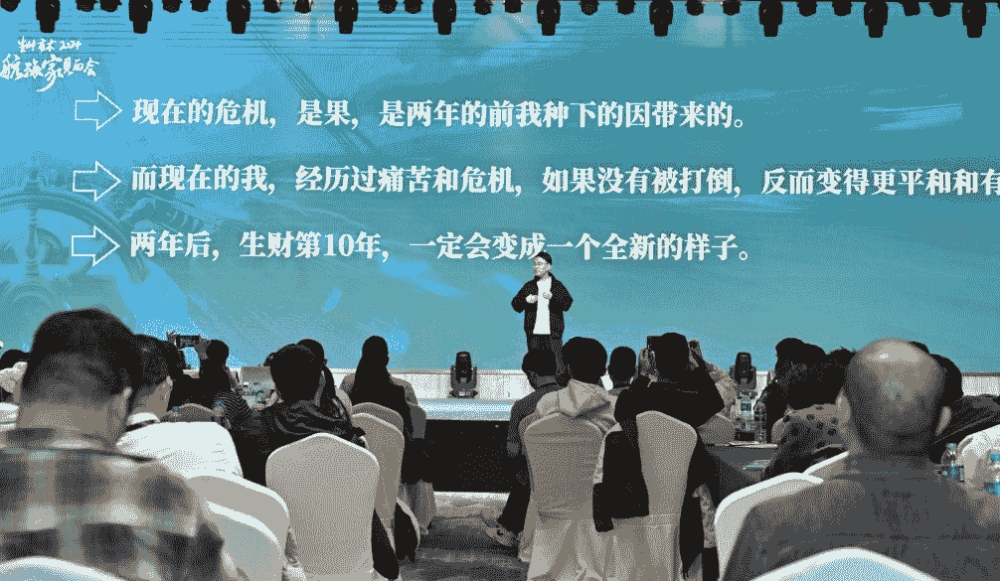

你的现状，一定程度是由过去的事情导致的

结合自身经历，过去我没有加生财时都是自己摸索，亚马逊，抖音商品卡，小红书电商，线**下教培（那会小红书电商**根本没啥流量，不像现在，真是风水轮流转）再是各种小项目——效率非常低，信息源很差

**我这个故事得告诉别人什么？**

我的答案是靠近生财多一点点，利用好生财，给自己多点耐心。

**你要想找到你的核/原动力是什么？这个核可以理解为一**种信念感，是你内心深处深度认可的价值观。

怎么吸引到同频的人？我的价值观是什么？

**——**“大环境和普通人没关系”？“我不喜欢写故事，觉得故事虚伪”？

——其实不是，这不算口号，不够大气，吸引不了同频人——文章结尾有答案

### **节奏/手法**

**这一节对**情绪价值表现很重**要，但是应该是最后**润色的板块，不然你会一团浆糊，主次不分

**为什么每**行都是**很简短的文字，**就是读者方便阅读，以及操纵读者的情绪，每次断句都是一次转折，我一直在频繁反转。

手法：我用了些**反讽/反转**

京东送外卖是大厂，

美团刻意叫丑团，

京东送外卖和东哥创业的荣誉感，

来世释永信，修为太高，

涛哥油腻，比我爸还老，到直接后面叫涛爸，

生财有术名字割韭菜，最后却留钩子，

我**们具体落地到**短视频或者长视频，那就是快镜头和慢镜头，以及画面感，以及背景音乐，是温馨，惊悚，是和谐，还是紧张，暖色调还是冷色调等等。

### **9.思路汇总：**

**总体创作的逻辑链：**

选题就和电商选品一**样，直****接**定生死，其实这种创作方法是蹭热点的打法，你根据一个非常泛的热点，去发散你的思路，不设限，只要能圆回来自己即可，但具体怎么圆回来需要多尝试，做内容没有绝对的方法论。再厉害的IP也不能保证篇篇爆款

实话实说，如果硬要让我把**社保和生财有术的体验卡**结合起来，那就是本末倒置了。内容创作者不该被严格限制，情绪类故事最难的一个点，你不能有太强的说教感，你要让观众代入主人公。

**有一种情况除外，你定位足够高，观众是仰视你的，愿**意听你吹牛逼，但问题是你肚子有没有料呢？

**清****单体和论述文就可以说教，**像亦仁和曹大的文章都是说教感很重的，不过如果你定位不高，硬说教也估计没人看，得搞个背书，还是得稍微蹭行业热点+日常生活

> 如**果是我做清**单体，我大概率稍微包装下人设，直接把别人的观点排列组合....换个案例，换个引言，换个形式，但是还是要蹭热点！

建议大家刚开始**不要****蹭那么泛**的热点，从小赛道的热点开始蹭，如果你是做细分赛道的，那就简单多了

**比如你是做AI+某个****细分赛**道，一个AI产品出现了，你可以夸张表达（情绪价值）这个产品厉害在哪（分点），具体怎么个厉害法，要有具体的使用场景，也就是画面感（刘小排老师就是这样的写作逻辑）最后回归到这个AI产品到你的细分赛道怎么用就行。

那可不可以不按照这个框架呢？

**当然可以，没有绝对的，自媒体就是玩观点的****，没有谁对谁错，只****有**适合不适合你而已。（包括这篇文章本身！）

## **六、总结/结语**

其实这篇故事文看似很长，但是想出来整体大纲就5-10分钟，手法和细节会打磨稍微久一点。只要掌握方法论和刻意练习，你会发现日常所有事情都是能写成软文的，有手就行！

### **1.如何刻意练习**？

首先是多和AI聊聊天，我花了两周一个人关房间和AI聊天，从小到大我记忆中的事情全聊了，你要足够了解你自己，AI真的好会引导啊！

> 把Gemini整个聊爆了，开新对话也不行...换加速器也不行...换电脑也不行...我的号废了，也是体验上bug了。

> 有圈友说：Chatgpt更好用，毕竟有全局记忆模式。我一直知道，但是就是懒得换，Gemini我用的更舒服一点

> 其实你可以看到我这个人比较固执，或者懒，本质是不知道chatgpt会多高效

> 那假如我们写文章，这个生活细节就是——明明知道xxxx，但就是不做

> 我们的观点可以是：**大道理我都懂，可是做不到（观点要前置）——“其实你没懂大道理，你只是以为自己懂了”（冲突）**——写个故事xxxx——因此xxx（一篇论述文+小故事文就出来了，手把手教学了）

**其次，****平时多品味生活，细细品**味，多记录，就算生活给你重重一拳，你也要顺势躺地上，说：不好意思，地上还挺舒服。

**如果你觉得故事类难度有点大****，没事，现在我们回**看**另外两种文体，简直就是降维打击啊。因为并不**需要对情绪精确的把控，只需要有观点，有论据，蹭热点事件，找个好的标题即可。

先做**清单体和论述文，****毕竟做内容是为了变现，赚钱效率高是最重要的。也**是我推荐大家走的方向，持续出摊＋优化即可

慢慢积累，多去体验生活，总有一天实力会到。

---

### 2.碎碎念

最后，

**我想借生财立个flag**（3个月前在生财立的flag已经实现了，生财旺我哈哈哈）

大学这三年立的flag，

10个有6个已经实现，

如果我预期资产年化增长率20%，

假如60%的概率达到预期，

以均值估算，

10年化增长率均值假如算12%，1.12**10=3.1，

就是10年3倍增长，310%的增幅!

什么水平？

**小刀哗啦屁股，开天眼的水平，**

能跑赢通胀，就非常了不起了，

说实话，

这flag说出来有点羞耻，

压力好大，i人社死，

但，

**"言出法随"**

flag就是：

"两年超越天才少女邓怡然，超不过我穿比基尼”

其实是在杭州夜宵局7.26，喝酒后吹牛逼的flag（天才少年的外号就这么来的....）

> 比基尼也是源于私域大会华哥一页ppt延伸出来的，喝大了，忘记是谁起哄了，印象中是帅气年轻活力的纪老板，纪老板组夜宵局真的氛围超好！！！很开心！！也因此认识了很多航海家圈友！

> **p2夜宵局敬天才美**少女怡然姐酒....（你看，生活处处都是素材）

> 这里我要特别感谢一下怡然姐凌晨2点对我的内容团队搭建指导！！！！

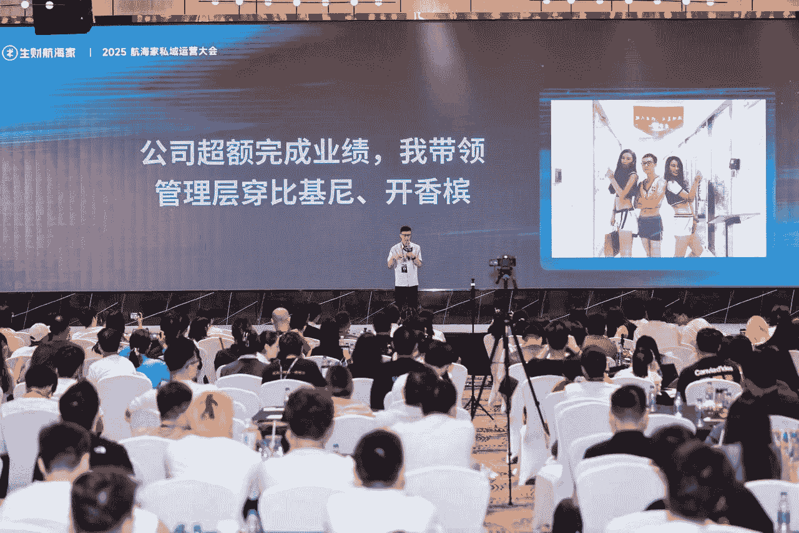

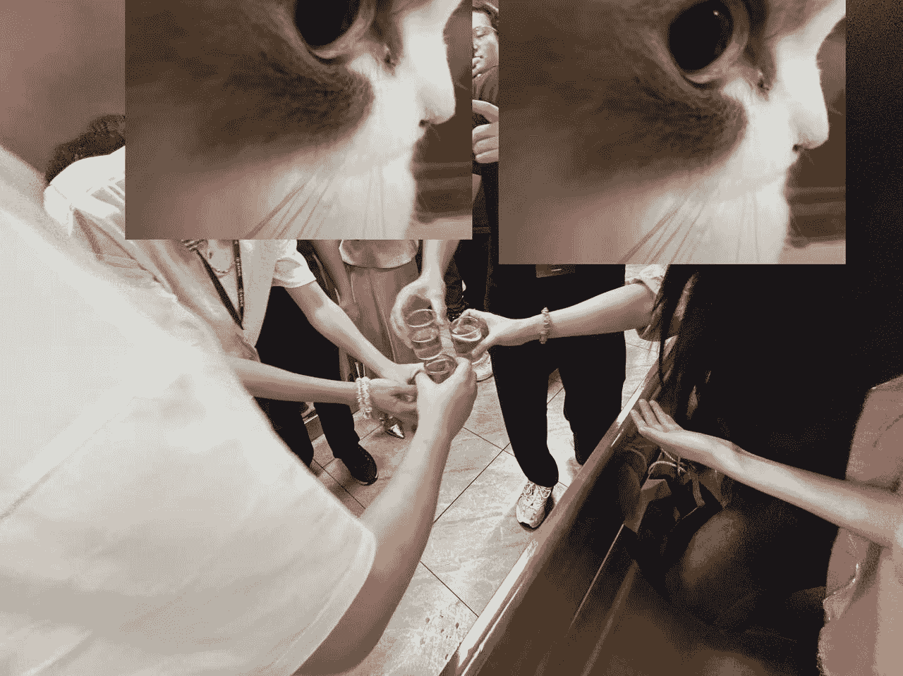

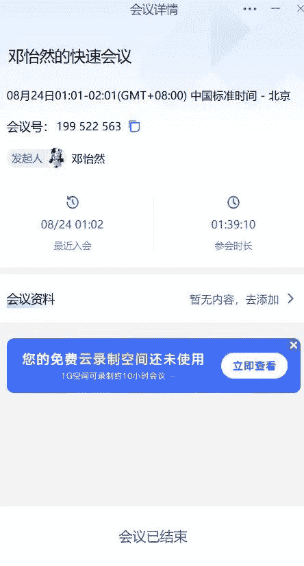

不过，

我们很难定义什么是超越，

GMV？

现金流？

**比她年轻？**

**还是比她美？**

**目标难以量化，**

**等于没有目标，**

我想，

**真正的超越，**

**是精神层面的超越，**

**毕竟，**

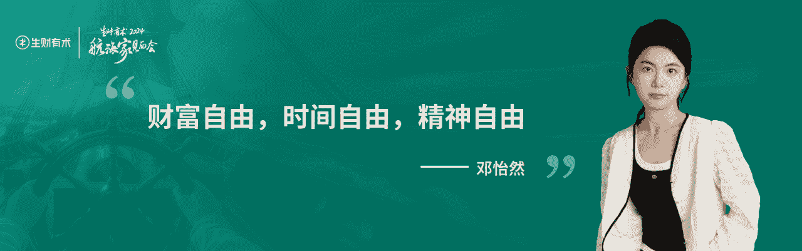

> **还记得我说我的价值**观在结尾提及么？这就是我的价值观，旅居到最后只剩下空虚，精神根本不自由

**每个人都有自己的路要走，**

**有自己的关要闯，**

**能够靠近她，**

**接近她，**

**我就已经在成功的路上。**

> **ip一定一定要爱惜自己的羽毛，**宁可弃牌，也不要为了小概率all in。

>

> **和比你影响力高的人站在一起****，**手把手教学蹭热点了，但也不是随便能乱蹭的，你在A平台你就不要去蹭B平台的大V，还有要是你蹭的人塌房了，你也会被反噬的（为什么要蹭，因为影响力不够高，别人不愿意看的）

>

> 开头引入我也在蹭亦仁超级标，曹大的文章，亦仁的公众号，亦仁之前大会分享的观点，涛哥的金句，私域大会华哥ppt，天才少女邓怡然，也是一种流量的打法，而且我也在输出我的价值观，吸引同频人跟随我

>

> ip尽头是打出一个旗帜，作为一个领袖，带领一群同频的人往前走

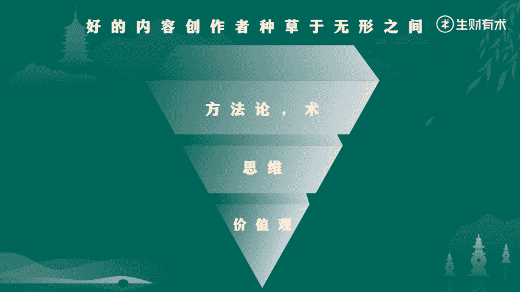

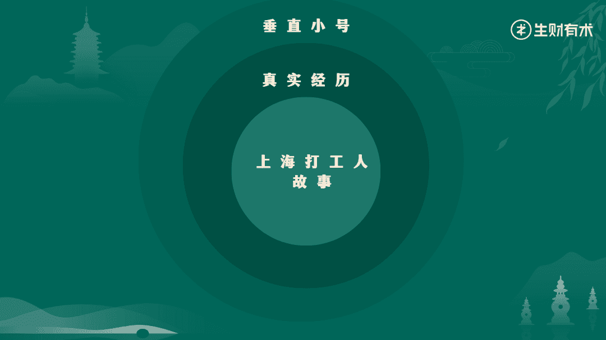

> 其实整篇文章有三个故事，前两个故事都是引子

> 1.我编的**上海打工人的故事**（这部分给你展示选题，人设，情绪价值，反转，如何丝滑埋钩子）

> 2.我自己的**真实经历**（主要是立人设，人设一定要真实，长期来看，真实维护成本最低！）

> 前两者相当于一篇软文，单独第一篇在公域平台其实也够推广了，但是为了锦上添花，我又说了我的真实经历。

>

> 3.**主线：教你如何写垂直小号，IP**

>

> 开头是术，方法论（**清单体，论**述文，故事文），中间穿**插了这两个故事，后面**我写了**我的故事**文创作思维（分为**8步**）最后是价值观，这是我这篇文章的核心，也是最大的壳子

>

> 如果只是为了立人设，我写前两篇杂糅在一起即可，我大可以直接在生财写文章标题说《普通大学生在生财的1年成长》这种方式注定更容易火，文章短，容易阅读，人们更喜欢看故事。

>

> 能看到这都是未来能年入千万的人才啊，太棒了！

最最后，

**信息只有分享才有价值，**

**分享才是最高级的浪漫。**

（先抛个观点）

恭喜你，

文章终于要结束了

不过，

当我决定分享时，

信息早已滞后，（看，这又是我在**渲染焦虑**，又在反转）

因此，

多多参加我的线下组局

（看，又是**钩子**）

为什么我现在愿意去分享，

真不是为了那点龙珠，

更不是为了做慈善，（我在回扣第一个上海打工人故事说的“怎么有人这么真诚分享”）

**真诚利他，**

**从来不止是深刻认可的价值观，**

**也是算清晰账，**

**内心笃定的必然，**

时间成本低，

边际效应高，

投产比足够高，

**“上去就是通投拉满”**

总有一天，

烦恼会越来越多，

表达欲会下降，

生命力也会下降，

趁现在还年轻，

**狠狠发力，**

**狠狠分享，**

毕竟，

**“越分享，越幸运”**

> **这里是生财有术，要么我写优质内容，要么做投**放，但生财做不了投放，那就只能选择前者，同时和平台合作是内容创作者的必然趋势，那宣传平台的价值观肯定没错

**文完，**

有帮助的话点个赞，（这篇文章比我想象的难写，把自己的创作思路掰开教学太难了）

祝你写出大爆款，

祝你早日发大财，

一起实现财富自由，时间自由，精神自由！