# 【播客保姆级实操手册】从0-1做播客及实现低粉高变现

> 来源：[https://xuqiwei1986.feishu.cn/docx/XDbGdDx3Qo2piKxFK9uc7H8inad](https://xuqiwei1986.feishu.cn/docx/XDbGdDx3Qo2piKxFK9uc7H8inad)

# 我是谁？

> loSummer Xia

> 大厂离职创业，在上海经营一家公关广告公司，专注线下品牌活动及线上小红书种草相关业务

> 播客节目《与她有关》

> 素人一枚，没有依靠播客走上人生巅峰，小宇宙订阅7K+

> 9期节目都上了新星榜，2期上了锋芒榜

> 苹果播客推荐

> 喜马拉雅首页及开屏节目推荐

> 在3个月不到涨到3000粉，之后就开始变现2W+

> 主业非常忙，播客常常不定期更新

# 写在最前面的话

> ⭐️100分可能很难教会30分的，但60分的可以教30分的，走过一样的路，更有同理心，也可能教得更好

> 📒纯结合自身经验与认知给出的一份素人（不带流量的普通人）如何从0-1快速开启播客的实用干货分享

> 💗不一定能帮助大家成为百万播客主播（目前播客界很少有百万粉丝的播客号，涨粉也很难）但一定能帮助大家顺利起号，开启播客之旅

> 💡都说播客是为爱发电，不赚钱。但其实这个赛道依然有人很赚钱，放弃粉丝数这种虚假繁荣的KPI指标，专注如何搞钱变现才是王道

>

> ✅想清楚为什么要做播客？谋定而后动，会少走很多弯路

> ✅播客在中国还是不太成熟，放大播客的长尾效应及独特的熄屏环境下的用户高粘性。

> ✅放弃完美主义，先完成再完美。可以小步快跑，稍后再改进。先更新个10期再说。

> ✅用正确的方法和积极的心态跑通流量闭环。

> ✅一开始就要先想清楚定位及变现方式（非常重要！！！）别想着先涨粉再变现，要以终为始想问题。

> ✅粉丝数没那么重要，变现才重要。

> ✅不要吊死在一棵树上，播客只是一环，其他自媒体平台结合互补一起高，全面开花。

> ✅不要为平台打工，要为自己打工，沉淀私域。

#

# 如何使用这本实操手册

+   基本涵盖了所有刚起步从0-1会遇到的问题、解决路径及经验分享，可以按标题检索

+   播客行业的相关报告

+   包括了实用工具🔧可以直接使用

+   剪辑软件下载及链接

+   logo及海报设计工具

+   AI工具

+   无版权音乐素材库链接

+   无版权高清图片库

+   免费的录音室推荐

+   可以帮忙链接播客主播相关的群、播客剪辑外包推荐、其他相关咨询等

# 1.认识播客

## 1.1 什么是播客

播客，源自英文“Podcast”，是一种数字媒体形式，它将一系列音频节目通过互联网发布，供用户订阅和下载后，可以在智能手机、平板电脑、电脑或其他便携式媒体播放器上随时收听。播客节目通常以系列形式发布，每集节目围绕特定主题或话题进行讨论、讲述故事或提供信息。

播客节目的内容非常丰富，涵盖了新闻、访谈、教育、科技、娱乐、艺术、健康等多个领域，适合不同年龄和兴趣的听众。与传统的广播节目不同，播客节目不受广播时间表的限制，用户可以根据自己的时间安排来选择收听节目的时机和集数。

播客的流行得益于智能手机和平板电脑的普及，以及互联网带宽的提升。用户可以通过专门的播客应用程序（如苹果的Podcasts、喜马拉雅FM等）或网页来订阅和管理自己喜爱的播客节目。随着技术的发展，一些播客平台还开始提供视频播客和互动功能，进一步丰富了用户的收听体验。

## 1.2 国内外播客平台比较

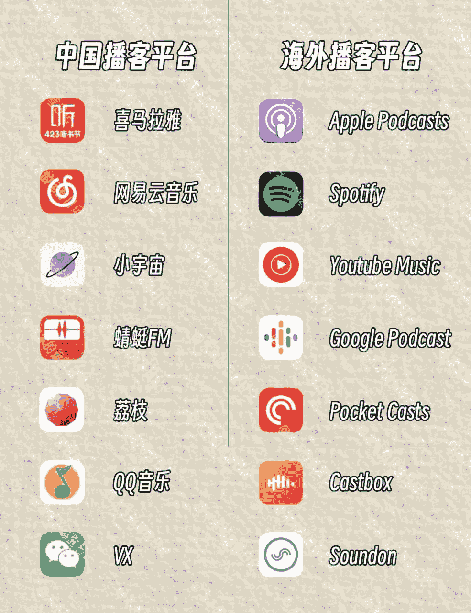

## 1.3 国内外播客生态比较

| **对比维度** | **美国播客生态** | **中国播客生态** |
| --- | --- | --- |
| **市场成熟度** | 成熟，历史悠久 | 发展迅速，但相对年轻 |
| **内容风格** | 多样，注重专业性和深度 | 丰富，贴近本土听众喜好，剧情和互动类节目较多 |
| **用户习惯** | 高接受度，作为日常生活一部分 | 接受度逐渐提高，社交分享和讨论为主 |
| **商业模式** | 成熟多元，广告、订阅、付费内容等 | 探索中，广告为主，付费订阅、赞助、电商等模式逐渐发展 |
| **监管政策** | 相对宽松，言论自由空间大 | 相对严格，内容审查影响创作和传播 |

## 1.4 国内播客市场

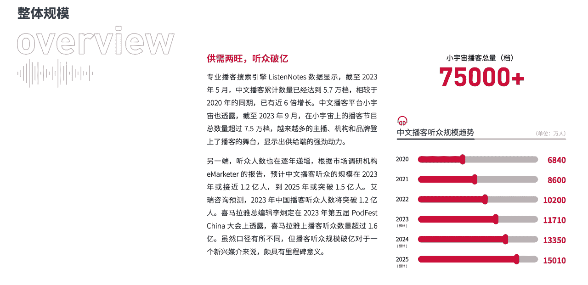

## 1.5 播客人群

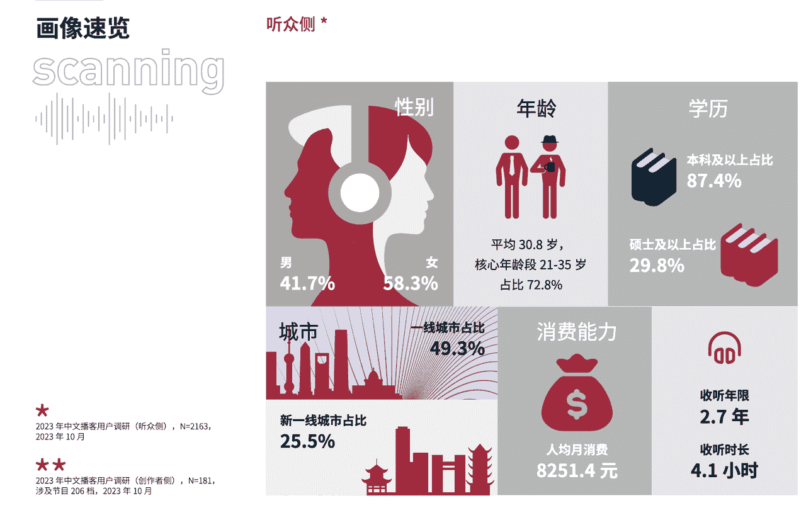

## 1.6 国内常见的播客平台

| **国内常见播客平台** | **logo标识** | **梯队** | **特点** | **优势** | **劣势** |
| --- | --- | --- | --- | --- | --- |
| 小宇宙 |  | T1 | 播客垂类APP，专注于播客内容，提供了一个相对纯粹的播客听播环境 | 1）界面简洁，专注于内容推荐和用户体验 | 1）没有什么自动推送的流量 |
| 苹果Podcast |  | T1 | 苹果公司官方播客平台，全球用户均可使用。全球最大的播客平台之一。 | 1）集成在iOS系统中，方便iPhone用户使用。苹果设备自带的app，不需要额外下载 | 1）与苹果设备密切相关，苹果Podcast只能在iphone、ipad、Apple Watch的App Store里才有 |
| 喜马拉雅 |  | T1 | 10年+，国内最大的音频分享平台之一， | 1）用户基数大，流量高 | 平台内容有点杂 |
| 网易云音乐 |  | T2 | 除了音乐外，也提供播客、电台等音频内容。 | 1）音乐资源丰富，与音乐内容相结合的播客节目具有特色 | 1）主要的场景是听音乐，播客内容相比专门的播客平台较少 |
| 荔枝FM |  | T2 | 以UGC为主，鼓励用户上传自制音频节目 | 1）内容多样，覆盖范围广 | 1）内容质量参差不齐，缺乏有效的内容筛选机制 |
| QQ音乐 |  | T2 | 音乐播放主流平台，除了音乐外，也提供播客、电台等音频内容。 | 1）音乐资源丰富，与音乐内容相结合的播客节目具有特色 | 1）主要的场景是听音乐，播客内容相比专门的播客平台较少 |
| 微博 | 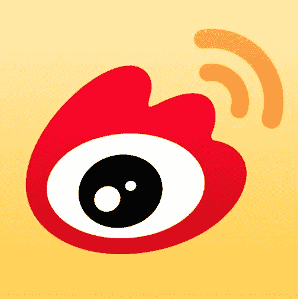 | T3 | 社交媒体平台，用户可以发布和分享音频内容。 | 1）社交属性强，有利于内容的传播和讨论 | 1）刷微博与长时间停留听播客的场景不符 |
| 豆瓣 |  | T3 | 以书评、影评起家，逐渐扩展到音频内容领域。 | 1）文化氛围浓厚，用户群体偏向文艺青年；播客内容偏重文化、艺术等领域。 | 用户基数和流量相比主流音频平台较小；界面设计和用户体验有待改进。 |
| 知乎 |  | T3 | 以深度长文为主，涵盖科技、文化、商业、生活等领域，早期由专业人士和行业领袖主导。问答驱动的社区模式及长尾效应显著。 | 深度内容沉淀和高信任度社区，适合需要专业见解或长尾知识的用 | 大众化转型与商业化的平衡仍是挑战，未来需在内容质量管控、创作者生态维护和用户体验优化上持续改进。刚刚开始内测播客，没什么流量，但只需要同步RSS一键 |
| ...... |  |  |  |  |  |

> 我自己先把节目上传在小宇宙上，通过RSS自动同步到苹果播客、微博、荔枝FM、知乎等平台，手动上传的平台只上传了喜马拉雅。

> 大家如果有时间完全可以全平台上传。

## 1.7 播客的优势

播客作为一种新兴的数字音频内容载体，依然有非常多的优势

1.  **便携性强**：播客可以通过智能手机、平板电脑、MP3播放器等移动设备随时随地收听，满足用户在通勤、健身、做家务等多种场合的娱乐和学习需求。

1.  **时间灵活**：用户可以根据自己的时间安排选择收听播客节目，不受传统广播时间表的限制，可以暂停、快进、回放，更好地控制收听时间。

1.  **内容多样**：播客节目涵盖了新闻、教育、科技、娱乐、艺术等众多领域，提供了丰富的选择，满足不同用户的兴趣和需求。

1.  **互动性高**：许多播客节目鼓励听众参与，通过评论、投票、互动游戏等方式与听众建立连接，提高节目的粘性和活跃度，形成了紧密的听众社区。

1.  **个性化推荐**：播客平台通常具备智能推荐算法，能够根据用户的收听历史和偏好推荐相似的内容，帮助用户发现更多感兴趣的节目。

1.  **成本较低**：相比于传统的广播电台，播客的制作和分发成本较低，门槛较低，使得更多的个人和小型团队能够参与到播客创作中来。

1.  **商业模式灵活**：播客的商业化模式多样，包括广告植入、付费订阅、内容赞助、周边商品销售等，为播客创作者和平台提供了多种盈利途径。

1.  **易于传播**：播客节目可以通过互联网轻松传播，用户可以通过社交媒体分享自己喜欢的节目，扩大节目的影响力和受众范围。

1.  **目前话题限制性小且可以引流：**播客节目目前在一些平台还是相对比较松的，除了政治敏感之类的话题不能提及外，比如在小红书、抖音平台不太好说的容易违规的，如：中医、玄学、情感、卖房等都可以聊，并不存在违规无法播放的情况，而且可以直接引流到私域。

## 1.8 播客行业相关报告

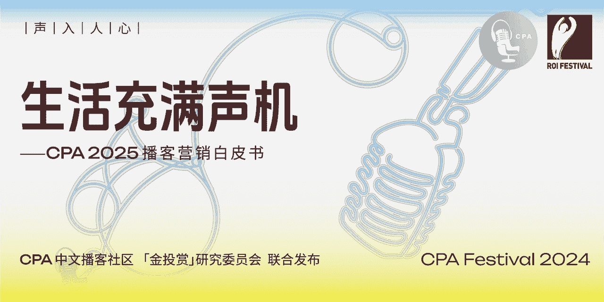

[2025 CPA播客营销白皮书.pdf](https://internal-api-drive-stream.feishu.cn/space/api/box/stream/download/all/SkdcbDNDEoAWk6xTxmTc8ERdnCe)

[2024中文播客新观察-JustPod.pdf](https://internal-api-drive-stream.feishu.cn/space/api/box/stream/download/all/Y3agbNVmKoAYf3xGipvckM4dn5g)

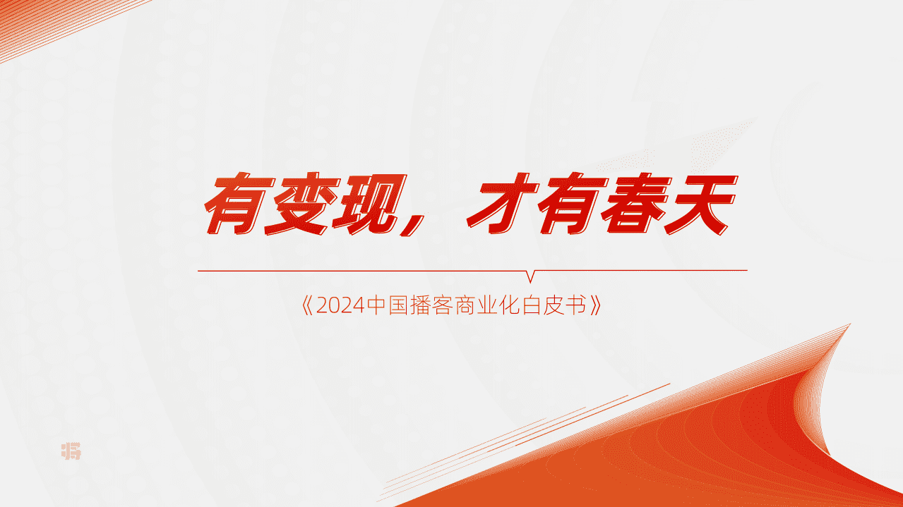

[2024中国播客商业化白皮书.pdf](https://internal-api-drive-stream.feishu.cn/space/api/box/stream/download/all/GY4Zbuy94oTBrpxwVUacN4Genrc)

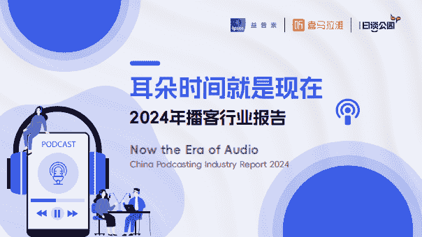

[2024年播客行业报告——耳朵时间就是现在-益普索&喜马拉雅&日谈公园-2024-50页.pdf](https://internal-api-drive-stream.feishu.cn/space/api/box/stream/download/all/Sv8JbrwkKoywmRxAGPKcp83Mnbg)

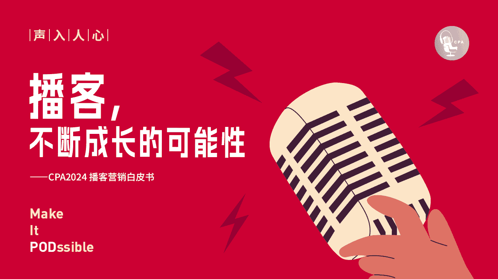

[2024播客营销白皮书.pdf](https://internal-api-drive-stream.feishu.cn/space/api/box/stream/download/all/R5EhbfLTeodDbcxfpCqcJiDynZe)

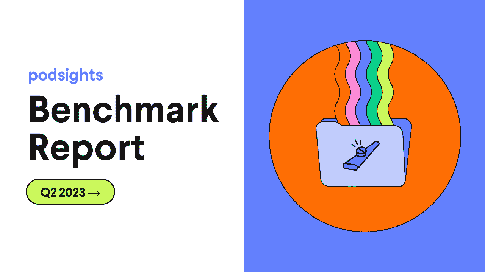

[Podsights 2023年Q2播客广告报告.pdf](https://internal-api-drive-stream.feishu.cn/space/api/box/stream/download/all/L97Kbhw4QoPe0jxvp83cpo0InTd)

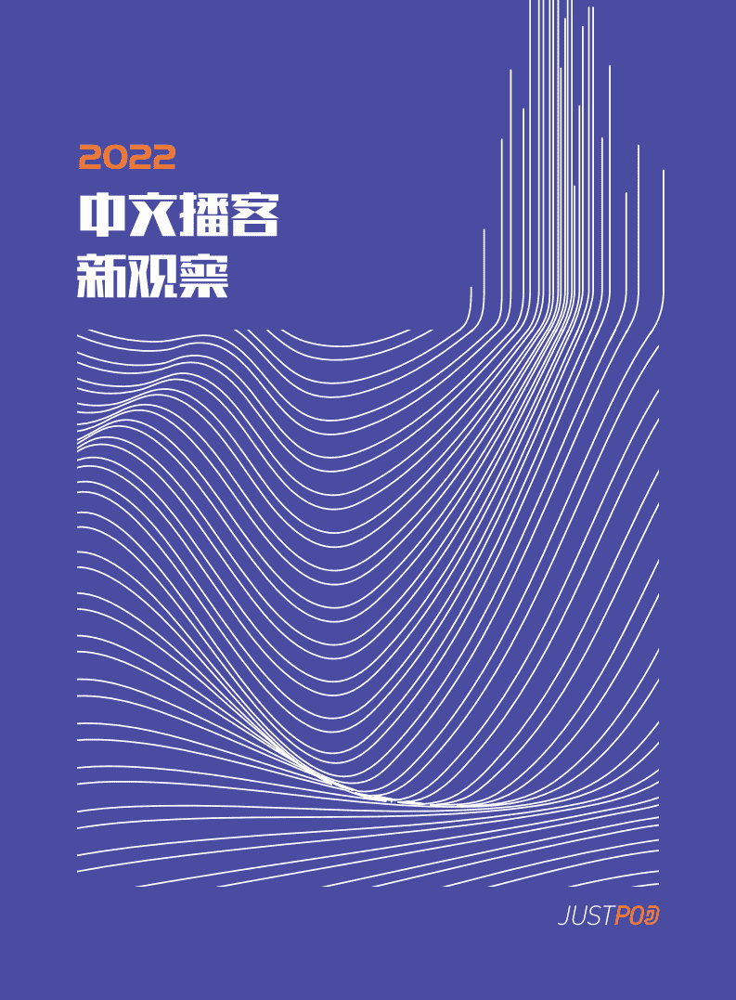

[JustPod-china-podcast-survey-2022-CN.pdf](https://internal-api-drive-stream.feishu.cn/space/api/box/stream/download/all/S2xpbZgAgo87MhxeK6tcIq8mnSg)

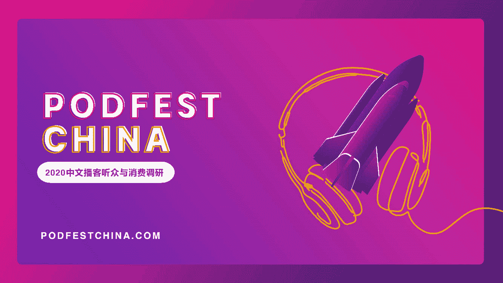

[PodFest China 2020中文播客听众与消费调.pdf](https://internal-api-drive-stream.feishu.cn/space/api/box/stream/download/all/XvcMbxMDyonrvsxuOk8cIAYInAd)

# 2.启动播客前期准备

## 2.1 播客基础优势

❗️几乎人人都可以做播客❗️

制作门槛相对比较低，只需要有手机就可以录制了

录制难度低，不需要出镜

制作成本低，剪辑的难度比视频低

## 2.2 制作播客动机

**1.分享知识和信息**

播客是一种传播知识的有效途径。无论是专业知识、教育内容还是日常生活技巧，播客都能够帮助听众学习新事物。

**2.表达观点和意见**

播客为个人或团体提供了一个自由的平台，可以在上面讨论各种话题，分享自己的见解和想法。

**3.建立个人品牌**

通过定期发布高质量的播客内容，创作者可以建立自己的个人品牌，并在特定的领域内成为权威人士。

**4.娱乐听众**

播客可以是一种娱乐形式，为听众提供故事、喜剧、角色扮演等轻松愉快的内容。

**5.社区建设**

播客可以围绕特定的兴趣或话题聚集听众，形成在线社区，促进听众之间的交流和互动。

**6.商业机会**

随着播客市场的增长，成功的播客可以带来广告收入、赞助和商品销售等商业机会。

**7.灵活性和便利性**

与传统的广播相比，播客制作成本较低，且可以随时随地上传和听取，为创作者和听众提供了极大的灵活性。

**8.个人成长**

制作播客的过程本身就是一种学习和成长的经历。它要求创作者进行研究、采访、编辑和沟通，这些活动有助于提升多方面的技能。

## 2.3 什么样的人适合做播客

1.有表达欲，有持续想要分享的话题，对人对世界充满好奇心

很多嘉宾都是我之前认识很久的朋友，但可能没有机会深入聊过。或者新认识的朋友，没有合适的机会深入聊一下，那透过播客就是一个非常好的渠道，这样一举二得，既做出了很好的节目，又增进了彼此的了解。在创业的路上，我反而觉得播客是个很好的充电方式，在前采、录制过程、闲聊的过程都非常开心。

2.朋友很多，很E，真诚且愿意接纳包容多元观点的人

如果你的朋友很多，而且在你的朋友当中有不少自带流量的人，那么嘉宾就能助力播客的势能和影响力，那就非常适合做播客。

假如你平时和朋友们聊天，你们的聊天内容很可能会给其他人带来启发。把不把这个聊天的过程同时录制下来分享给其他人，就是一个很轻松的方式，同时也能建立更多的影响力。

3.有自己的产品/服务，可以通过播客放大影响力及私域成交

播客的用户画像为一线城市人群、学历较高、消费水平较高，如果你的用户正是这样的人群，那你就非常适合去尝试播客。播客的时长比较长，容易建立信任感，对于高客单价产品，更适合。比如：房产经纪、保险经纪、学生高价培训、教练业务、心理咨询、法律咨询等。

播客目前是可以直接放二维码和微信的，非常容易帮助转化。真实案例，我身边很多朋友就是通过收听播客，长时期的陪伴获得了专业信任与好感，然后买了房子、保险、心理咨询、孩子的高价培训等。

4.在其他平台已经取得成果，放大效果

不知道大家有没有注意到很多明星艺人也都开始做播客了，开始来抢占播客这个小而美的渠道了。他们自带流量，第一天上线就能轻松聚集大量粉丝关注，这种优势得天独厚。

比如你在其他平台，比如小红书、B站、抖音等已经有了比较多的粉丝，可以降维护打击去做播客。

## 2.4 播客定位

### 2.4.1从目的维度思考

❗️开始之前一定要想清楚，谋定而后动！

做之前先想清楚自己的目的？

纯兴趣表达？为爱发电？

做影响力？

做品牌？

搞钱变现？

短期？长期？

主业？副业？

### 2.4.2 从平台类目维度思考

自己更适合哪个类目？

哪个类目太卷了？哪个类目相对没那么卷？哪个类目是蓝海市场？哪个类目现在加入有先发优势？

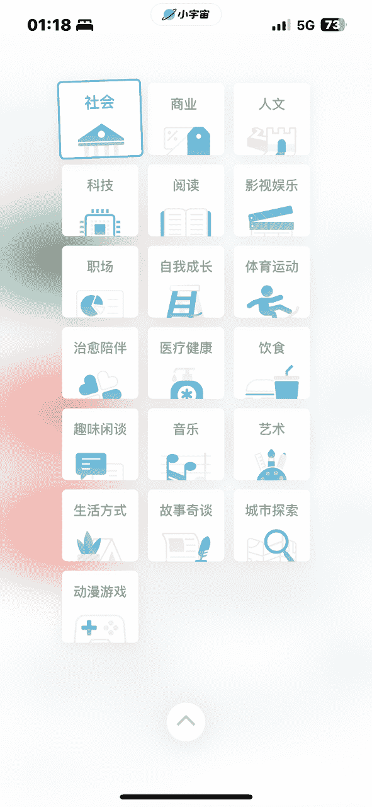

### 2.4.3 结合自身情况定位

⭐️和自身优势结合的才是最适合自己的赛道

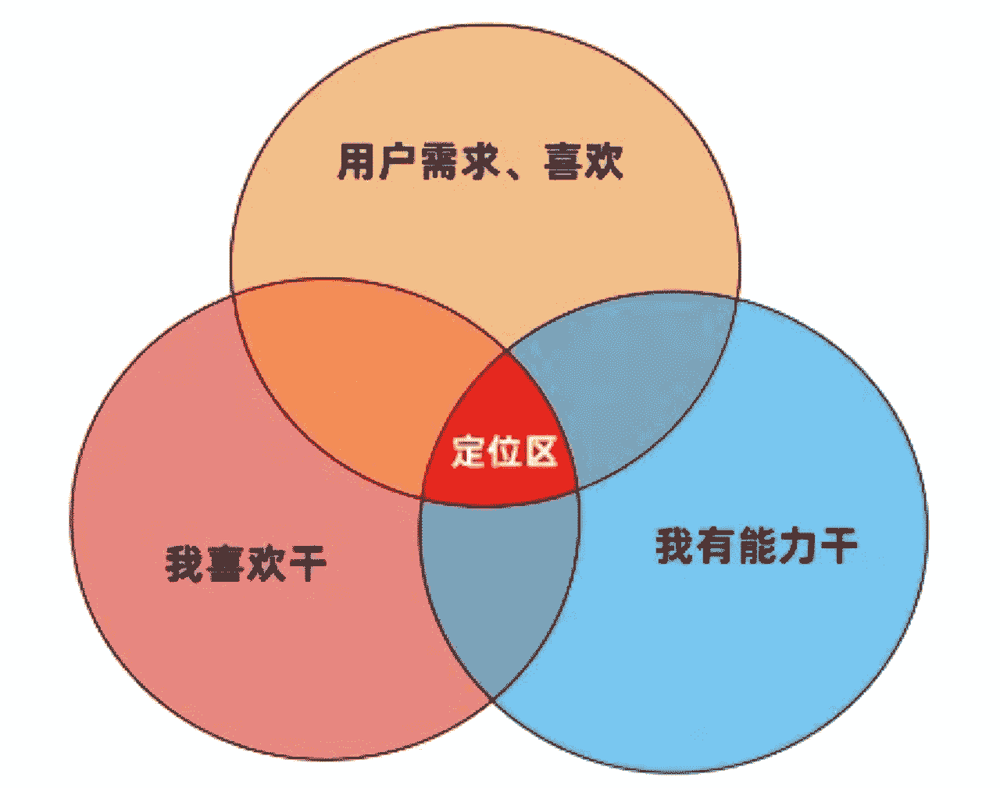

### 2.4.4 对标账号

#### 1.小宇宙APP搜关键词找对标账号

比如：搜索女性成长

出现的都是名字或者节目简介里带这个关键词的播客。看看里面做的比较好的账号对标起来。

重点看对方的头像、简介、shownotes、节目标题。

#### 2.小红书APP搜关键词+播客找对标账号

能找到很多被推荐的播客，看看大家的评论说了些什么，都是很好的灵感与启发。

#### 3.从其他平台搜关键词去找爆款拆解、积累选题库

### 2.4.5 差异化竞争

我能在别人已经有的基础上做些什么差异化？

形式：单口-〉多人-〉连线-〉

对话：双人对话-〉脱口秀

嘉宾：普通嘉宾-〉更大咖的嘉宾-〉明星

........

### 2.4.6 关键要素维度

1.  **内容主题：**选择一个清晰的主题或领域或类目，使您的播客在市场上具有独特性。主题应该是您热情所在，并且能够持续产出内容的领域。

1.  **目标听众**：了解并确定您的播客内容将服务于哪类听众。深入了解我希望吸引的目标听众群体。这包括他们的年龄段、性别、兴趣爱好、职业身份等信息。通过调研和分析，更清晰地了解他们的需求和关注点，为后续的主题选择提供方向。

1.  **风格和调性**：决定您的播客将采用何种风格和调性，例如正式、幽默、严肃、轻松等。这将影响听众的收听体验和您与听众的关系建立。

1.  **市场需求**：对播客市场进行分析，了解当前流行的主题和热点，以及已有的竞争对手。通过分析市场需求和竞争情况，我可以找到一个有吸引力且具有差异化的主题定位，避免和已有节目重复。

1.  **竞争分析**：分析同类播客的优劣势，了解他们的定位策略，从而确定您的播客如何在市场中脱颖而出。在确定主题定位时，考虑如何从独特的角度和立场出发，让节目与众不同。

1.  **品牌定位**：如果您的播客是品牌宣传的一部分，需要确保播客的内容和风格与品牌形象保持一致，并通过播客加强品牌认知。

1.  **测试与调整迭代：**通过一些小规模的测试来验证主题定位是否受到听众欢迎。这可以通过发布一些试听节目、与潜在听众进行沟通交流等方式来进行。根据反馈和数据，不断调整和优化节目主题和定位，以达到最佳效果。

1.  **长期规划**：考虑播客的长期发展，包括内容扩展、可能的多元化以及如何适应市场变化。

## 2.5 播客节目取名

> 好的名字是成功的一半。名字是你的咒语，每次都要重复，所以在最开始就要想清楚。要朗朗上口，能随时想起这个名字，想起值千金。

> 可能最后在苦死冥想，否掉了无数个名字后那个灵光乍现的名字才是真命节目名字。

### 2.5.1  播客节目名字中基础的不要❌

名字中最好不要有英文字母

名字中最好不要有生僻字

名字中最好不要有冷门词

名字中最好不要有违禁词

名字中最好不要是负向的

名字中最好不要太长，太怪

名字中最好不要添加符号

### 2.5.2  播客节目名字要符合大多数人能✅的意思

好的名字最好能一下子就能让人get到意思，比如：《搞钱女孩》、《与她有关》、《自我净化论》、《提钱退休》等

不要取特别需要一些背景知识才能get的点，举个例子，比如当时我想过的名字：《阿尔法女孩》，只有当时同时在美国的朋友能一下子get，但大部分其他朋友都一头雾水。没必要show高级，还是要接地气让大部分人秒懂才有利于传播。

### 2.5.3 播客节目起名思路

**1.以主播名字为主**

杨天真《天真不天真》

李诞《李诞》

张春《张春酷酷酷》

.......

适用于比较有名的人

**2.以播客主题为主**

《与她有关》

《搞钱女孩》

《组织进化论》

.......

**3.有趣谐音梗**

《贝望录》

《大食话》

《木有娱丸》

《人间布洛芬》

.......

**4.以公司名为主**

《耐听》

《GQtalk》

《红了再说》

.......

## 2.6 播客节目logo

### 2.6.1 logo色调

颜色醒目

和谐

看着舒服就行

### 2.6.2 logo字体大小

字体要大，起码要看的清

字体美观很重要

一般的字体其实就可以，但如果想要更好看点，开个VIP会员各种好看的字体都可以get了～

### 2.6.3 logo尺寸

500*500

### 2.6.4 logo设计（AI辅助寻找灵感）

标小志  www.logosc.cn

文心一格 AI 绘画网站 https://yige.baidu.com/

LibLib AI 绘画网站  https://www.liblib.art

Midjourney https://www.midjourney.com/ （需科学上网）

### 2.6.5 图形/元素设计

播客所需要用的图形及元素没有那么复杂，不一定需要花钱找专业设计师

推荐好用的图形设计工具

可画  https://www.canva.cn/

搞定设计  https://www.gaoding.com/

创客贴  https://www.chuangkit.com/

## 2.7 播客节目简介

一句话写清定位

注意埋入关键词（SEO）

## 2.8 播客形式及主播人数

# 3.播客内容创作

## 3.1 内容选题方法

1.  结合定位&赛道找选题

1.  看热点，找热门选题

小红书/抖音/视频号

爆过的选题换一种形式依然能爆

1.  结合营销日历节点：三八妇女节/情人节/618/七夕/教师节/国庆节/中秋节/双十一/春节

1.  直接问听友群的听友，最近想听什么话题

1.  利用关键词工具看最近趋势

百度指数、微信指数等

## 3.2 嘉宾选择思考维度

1.  嘉宾和选题是否契合

1.  嘉宾的分享和内容是否能带来信息增量

1.  嘉宾能够给节目带流量

1.  嘉宾是否真诚、利他、是否能带来情绪价值

## 3.3 如何找嘉宾

1.  朋友

1.  朋友的朋友

1.  去小红书/抖音/B站上找

1.  串台

1.  听友群里找

## 3.4 如何写采访大纲

1.  **了解嘉宾背景和专业领域**

在写采访大纲之前，先了解嘉宾的背景、专业领域和相关经历。这可以帮助你更好地理解嘉宾的观点和观点，从而制定更有针对性的问题。

1.  **确定采访主题**

根据嘉宾的背景和专业领域，确定本次采访的主题。明确主题应该与你的播客定位和目标听众相关联。

1.  **制定开放性问题和具体问题**

根据采访主题和焦点，制定一系列开放性问题和具体问题。开放性问题可以启动对话和思考，深入浅出提问、要问一些大家普遍关心的问题，深入挖掘。

1.  **考虑嘉宾的观点和立场**

尽量避免提问过于偏颇或引起争议的问题。保持客观、尊重和平衡是一个良好的原则。嘉宾明确表示不想问的问题就不要问了。

1.  **安排问题的逻辑顺序**

有时间的话可以和嘉宾安排一个简单的前采，顺一遍。将制定的问题按照逻辑顺序排列，确保整个采访过程有条不紊，内容连贯流畅。

1.  **添加互动和素材**

考虑在采访中添加一些互动环节或素材，增加节目的趣味性和参与度，如和嘉宾互动的一些设计。

1.  **与嘉宾沟通和确认**

在最终确定采访提纲后，与嘉宾进行沟通和确认，确保他们对采访内容有清晰的了解和准备，以及对问题的回答有充分的准备。

## 3.5 排期表（确保不断更）

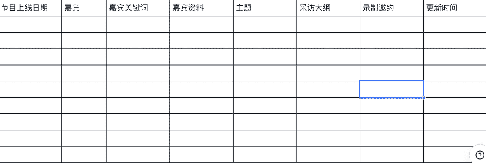

# 4.播客录制设备及流程

## 4.1 刚开始录音设备（从0元起步）

早期不建议采购大量设备，手机自带的录音功能就行。

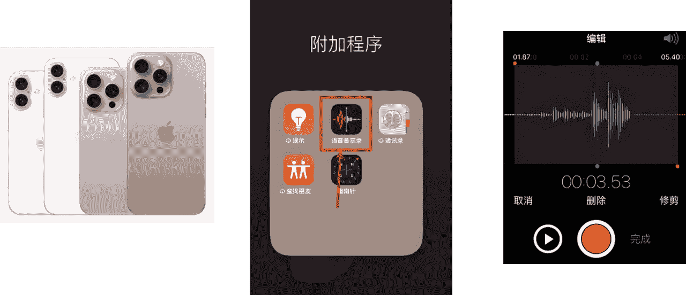

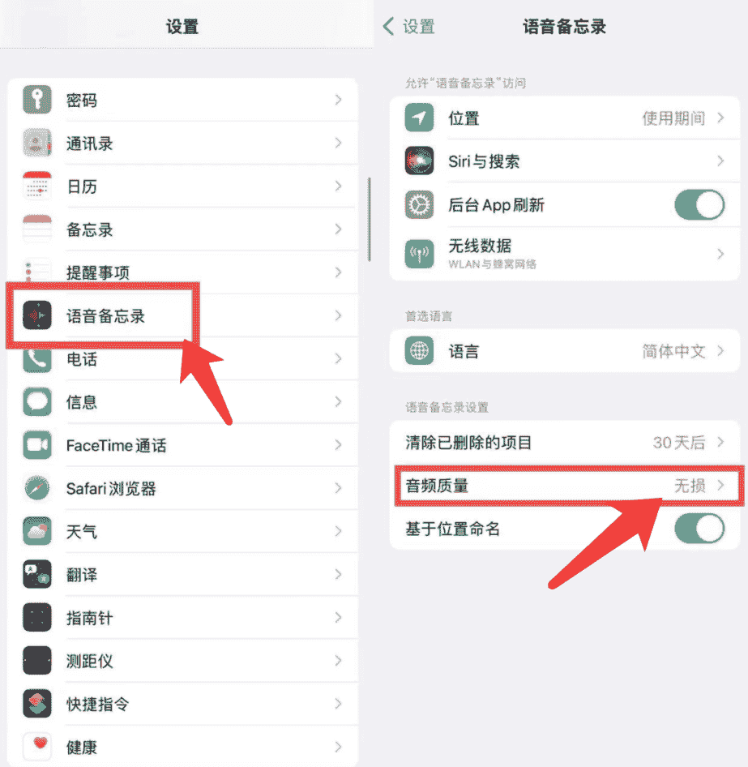

目前在线会议录制也基本可以满足录制需求。如后续有设备升级要求可再采购。

直接用在线会议软件 【 飞书会议/腾讯会议 】 录制，开或关视频均可。一副耳机用于收音。

| **飞书会议** | **腾讯会议** |
| --- | --- |
| 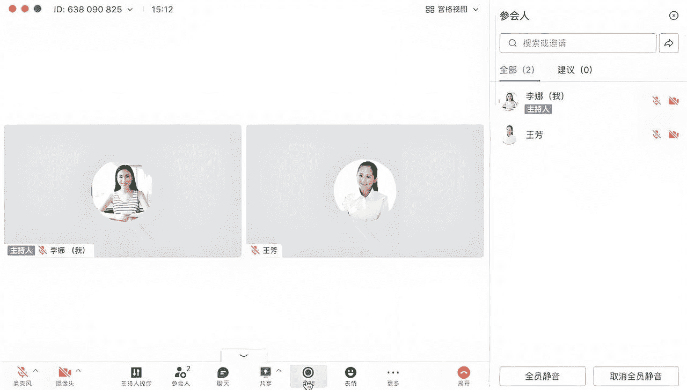 | 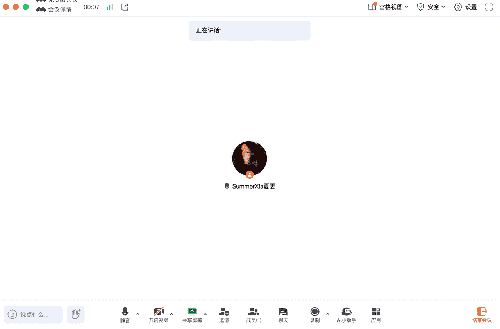 |
| **⭐️**但要注意如果没有开会员的话，45分钟会中断一下，最好提前充个会员 |  |

## 4.2 设备类型、优劣势及适合场景

| **麦克风** | **电容式麦克风** | **动圈式麦克风** | **动圈式麦克风** | **USB麦克风** |
| --- | --- | --- | --- | --- |
| **优势** | **原音重现、灵敏度高** | **适用环境多，结构简单可靠** | **适用环境多，结构简单可靠** | **连接方便、使用简单** |
| **劣势** | 体积大、连接繁琐、需要单独供电48V、受潮 | **细节不丰富、收声钝** | **细节不丰富、收声钝** | **需要软件适配、无法单独使用** |
| **⭐️总结：单人SOLO推荐USB麦克风；固定录音**室可以考虑电容麦；大多数场景可使用动圈麦 |  |  |  |  |

## 4.3 专业设备推荐

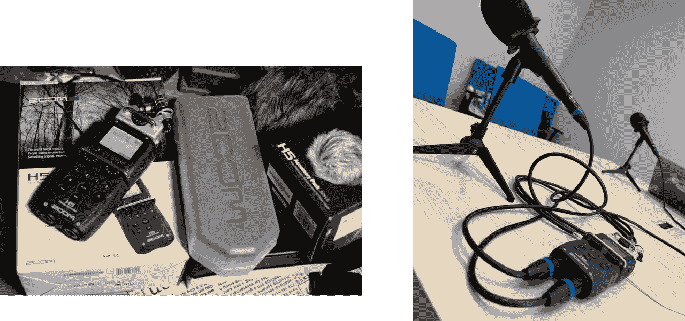

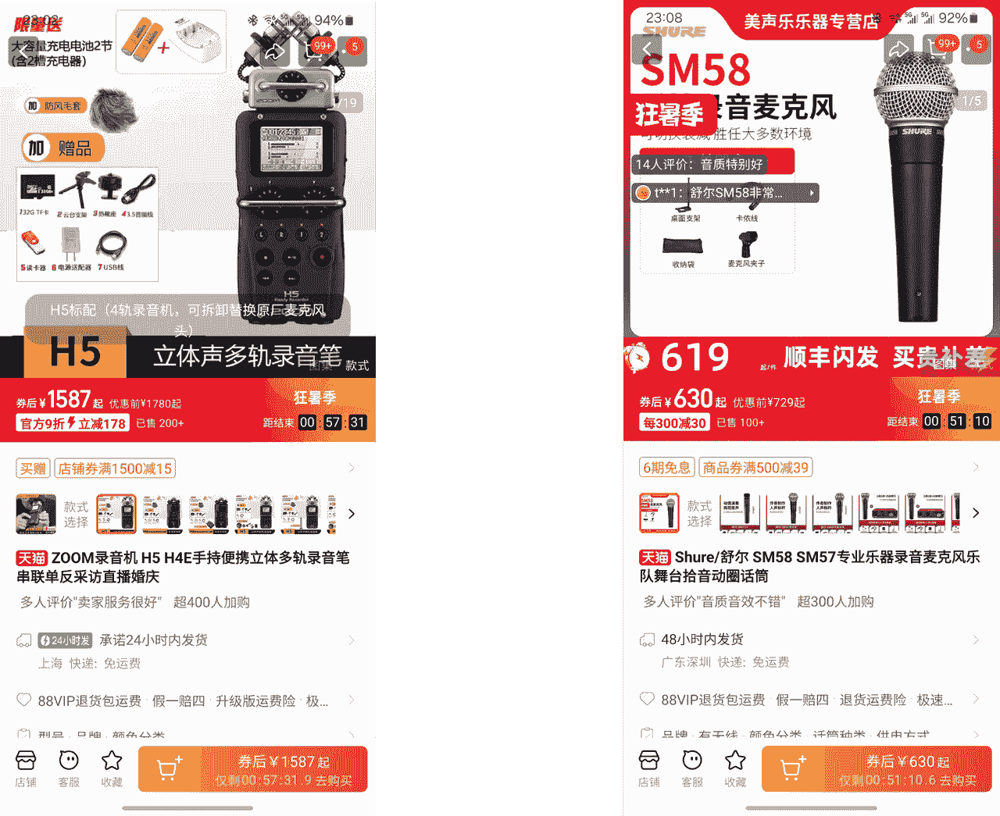

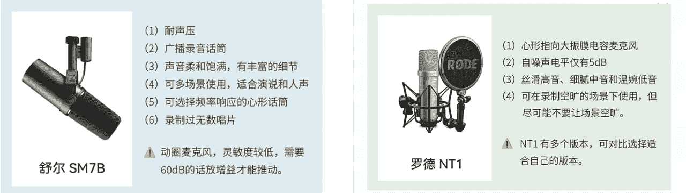

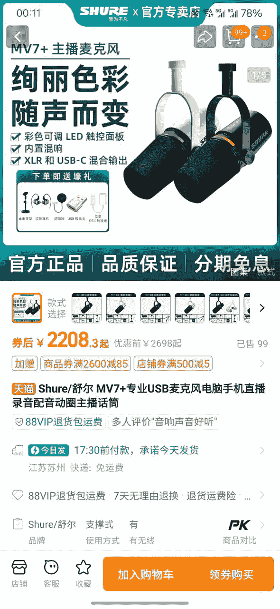

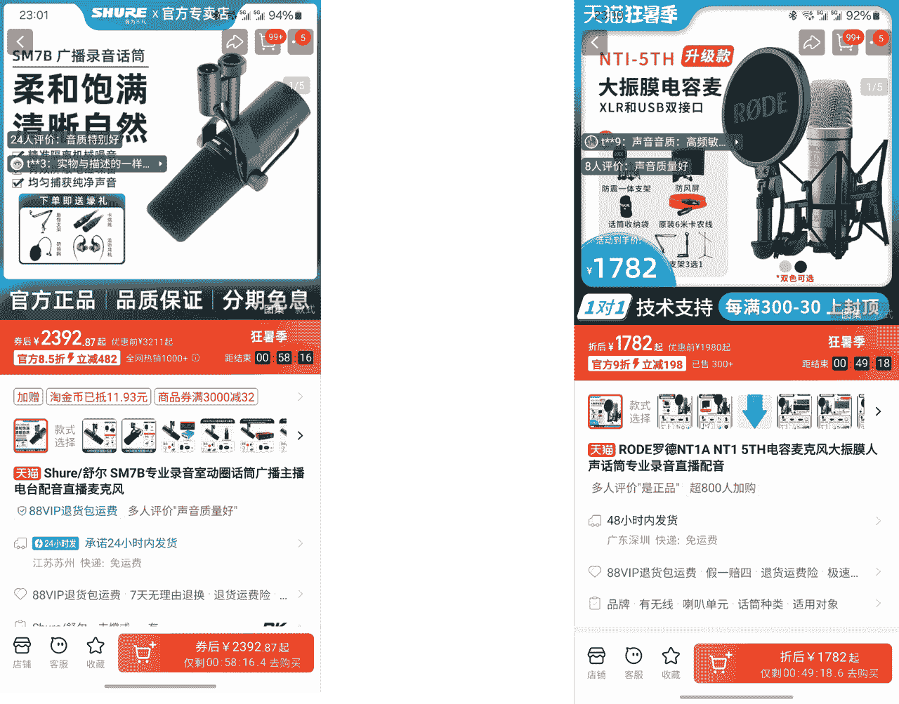

## 4.4 录音室推荐

专业录音室录音、书房改成录音室或租工作室

优势：

1.设备固定，环境稳定

2.可做声音环境的改造

3.环境舒适，线下录音品质稳定

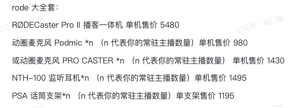

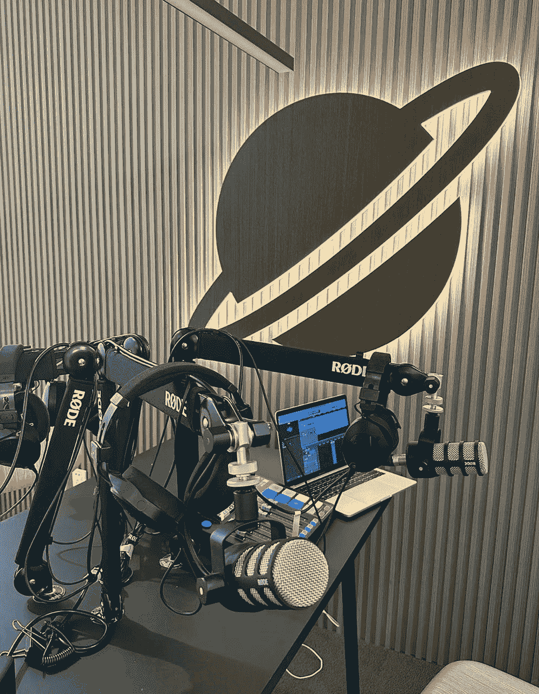

## 🆓上海目前暂时免费的录音室推荐（都需要提前预约）

小宇宙办公室：上海市杨浦区淞沪路303号（还是免费的，比较难约）

CPA办公室：上海金鹰 & 上海丽丰（现在可能需要收费了）

风筝店播：上海中山公园（最好消费个咖啡或酒水）

十二海里酒吧：上海愚园路（需消费酒水）

## 4.5 播客录制流程

1.  选题：

+   主播直接根据热点、想表达的内容列出选题，建议聚焦在 1 个主题，保证相关内容输出的密度

1.  大纲：

+   根据选题列举简单的聊天要点，用于现场提示。可以适当列举一些回答要点，不要太细，否则现场会像表演，影响实际发挥

1.  预热/预沟通：

+   如无外部嘉宾：主播自行商量是否需要预沟通

+   如有外部嘉宾：在正式录制前，提前约30min时间了解彼此风格，过大致问题和流程

1.  录制：

+   线上录制：选择安静和网络好的环境，打开腾讯会议/飞书会议，点击录制，戴耳机录制收音更好

+   线下录制：带好收音设备线下面对面录制

# 5.播客剪辑

播客剪辑软件的选择应基于个人的技能水平、操作系统兼容性以及预算。

## 5.1 播客常用的剪辑软件

### 5.1.1 播客剪辑软件推荐

#### **Audacity**

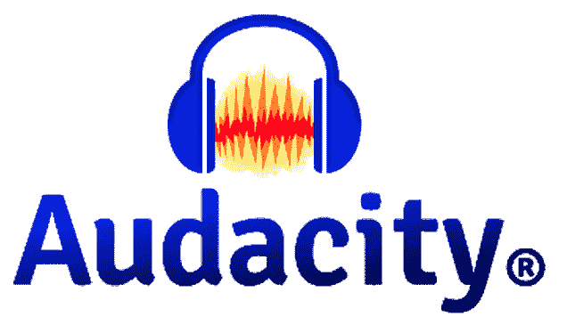

+   **平台**: Windows、macOS、Linux

+   **价格**: 免费

+   **特点**: Audacity是一个开源且免费的音频编辑软件，它拥有基本的剪辑、混音和效果处理功能，非常适合初学者使用。

#### **Adobe Audition**

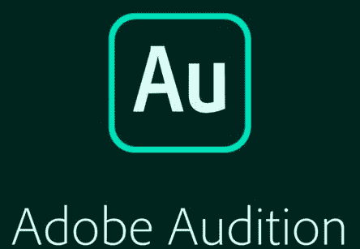

+   **平台**: Windows、macOS

+   **价格**: 付费订阅服务（Adobe Creative Cloud会员）

+   **特点**: Adobe Audition是一个专业级的音频工作站，提供了先进的音频编辑、修复、混音和效果处理工具，适合有经验的音频编辑者。

**免费破解版**

下载地址windows系统：https://www.yuque.com/u22458682/pd3ybv/tfmktu?

下载地址Mac系统：https://www.yuque.com/u22458682/pd3ybv/kpk0gc?

#### **GarageBand**

+   **平台**: macOS、iOS

+   **价格**: 免费（仅限苹果设备）

+   **特点**: GarageBand是苹果公司提供的一个入门级音频编辑软件，界面直观，集成了虚拟乐器和一些简单的音频效果，适合苹果用户使用。

### 5.1.2 平台自带的剪辑软件

#### 喜马拉雅云剪辑

可以AI转文字，直接根据文字剪

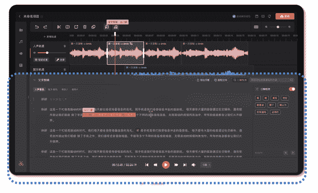

#### 小宇宙studio

可以AI转文字，直接根据文字剪

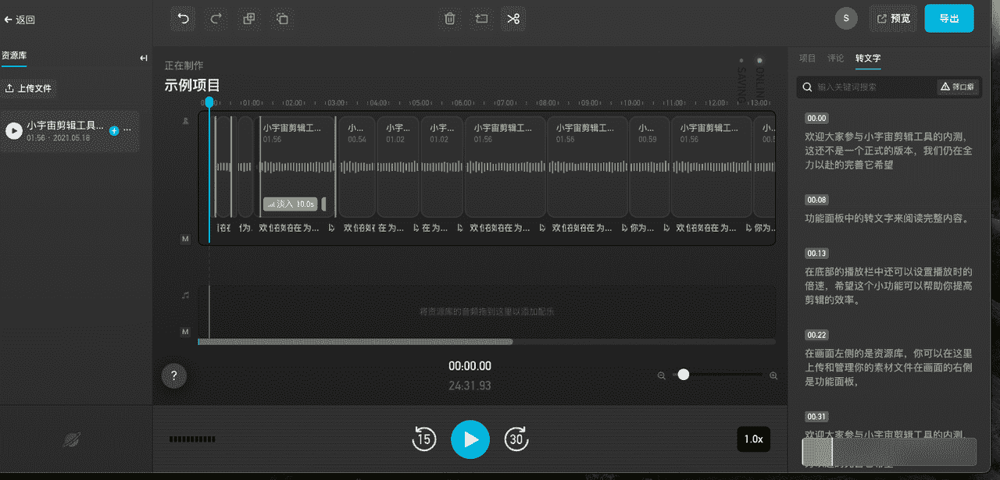

### 5.1.3 实操最好用的剪辑组合

喜马拉雅云剪辑+Adobe Audition组合使用。

先用AI转文字粗剪，再用AU波形剪，去调整，降噪，调节声音大小。

这个是对播客主播而言兼顾性价比、简单可上手又不失专业的做法。

## 5.2 剪辑标准操作流程

**1. 导入音频文件**

+   打开你的音频编辑软件

+   将录制好的音频文件导入到软件中

+   如果有多个音轨（比如音乐、音效、对话等），确保它们都已经被正确导入

**2. 语音转文字，初步剪辑**

+   把音频转成文字，可以用AI识别（飞书妙记转等）

+   仔细听录音，标记出需要删除的部分（如长时间的停顿、错误、重复等）。

+   使用剪切工具删除标记的部分。

+   确保剩余的音频部分流畅衔接。

**3. 清理音频**

+   使用噪声消除工具清除背景噪音。

+   使用去杂音或均衡器工具调整音频的清晰度和质量。

+   如有必要，使用压缩工具平衡音频的动态范围。

**4. 混音**

+   调整不同音轨之间的音量平衡，确保主要内容突出。

+   添加必要的音效，如过渡音乐、环境音效等。

+   如有对话，确保左右声道的平衡，模拟真实对话场景。

**5. 添加元数据**

+   为音频剪辑添加标记，方便后续查找和编辑。

+   如有必要，添加章节标记，对应播客内容的不同部分。

**6. 最终审查**

+   全面审查编辑后的播客，确保没有遗漏的错误或需要改进的地方。

+   调整任何细节，直到满意为止。

**7. 导出音频**

+   选择合适的音频格式和比特率（通常为MP3格式）。

**8. 质量检查**

+   使用不同的设备和播放环境测试导出的音频质量。

+   确保音频在各种情况下都能保持良好的听感。

**9. 备份**

+   保存原始音频文件和编辑过的音频文件的备份。

+   将最终导出的播客上传到云端或外部存储设备，以防丢失。

**10. 发布**

+   将播客上传到播客托管平台

+   确保播客的封面图片、标题、描述等信息准确无误，吸引听众。

*每个步骤都可能根据具体情况和个人偏好进行调整，重要的是保持一致性和专业性。

## 5.3 播客剪辑外包

一般而言，剪辑所花费的时间差不多是节目时长的3-4倍。

**剪辑外包的市场价格**

外包初级剪辑：150-300元/时

没有感情的剪辑人，你让他怎么剪就怎么剪。需要你对自己的节目有个清楚的标注和想法。

外包专业剪辑：500-800元/时

除了基本的剪辑外，会稍微注重下节目的框架、逻辑，音乐的配乐选择及音乐与语言的卡点等更精准更有逻辑。

*价格随市场播客，根据之前的经验，仅供参考

⭐️前期在没有盈利的前提下，非常建议自己剪辑，其实也不是很难，没盈利的情况下就外包找人花钱剪播客非常容易陷入一种倒贴做播客的感觉，很容易心态崩了～

# 6.播客发布

### 6.1 平台上传 **小宇宙**

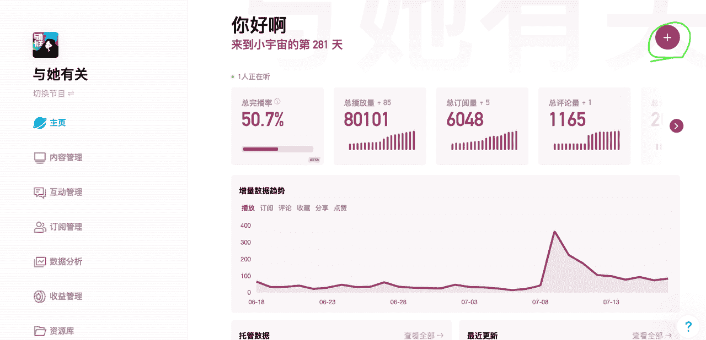

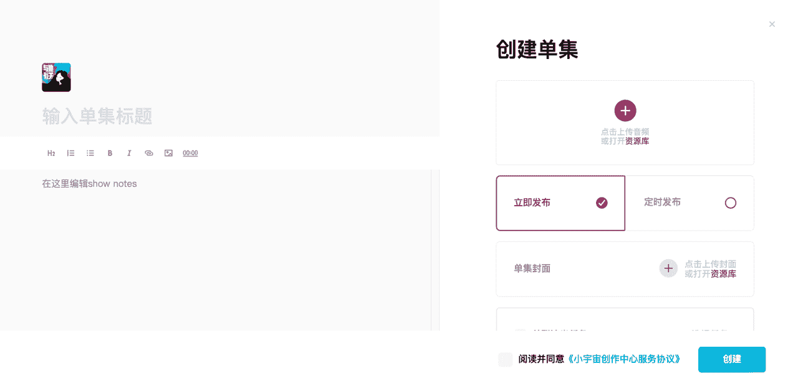

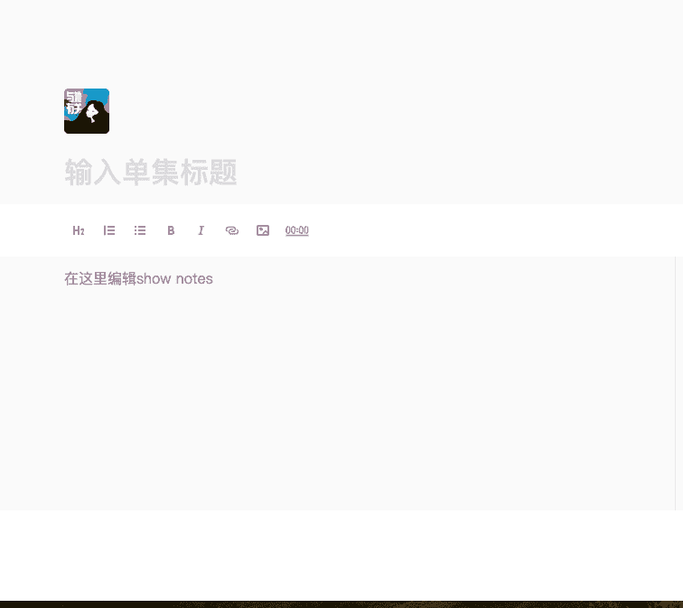

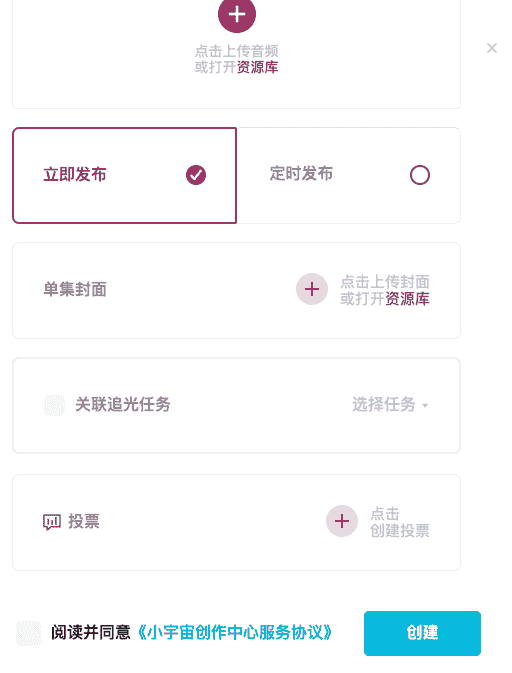

### 6.2 RSS同步到其他平台

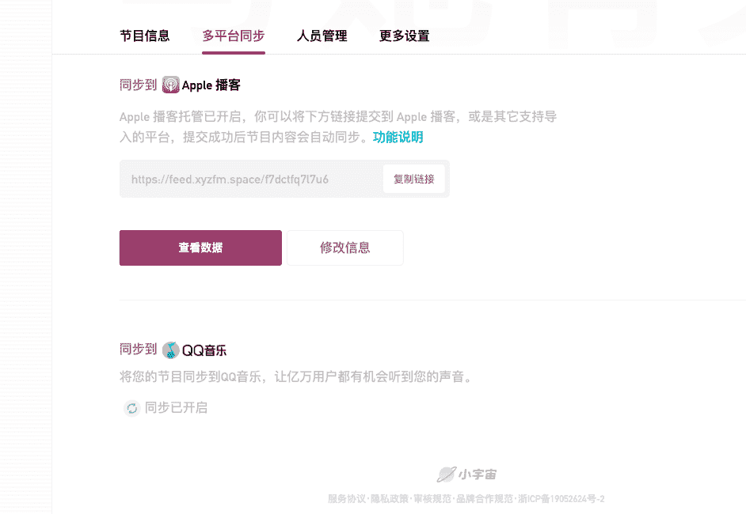

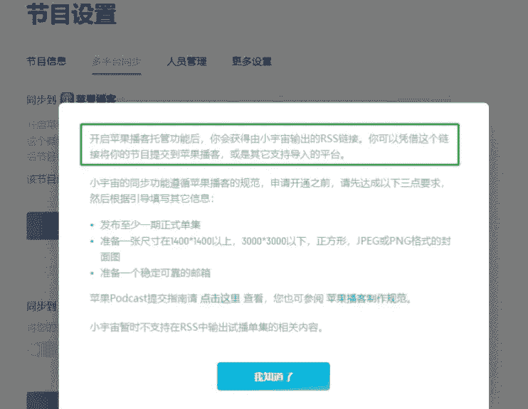

# 7.播客运营

> **运营的底层逻辑**

> 没有人不希望自己的内容被更多人听到，这样的反馈是正向积极的。

> 作为不自带流量的素人更要重视流量！我们更需要搞流量！

> ❌❌❌

> 自己做好了内容，不想让同事、朋友、亲戚看到，希望默默惊艳所有人。精心剪了几个小时，播放只有个位数。

> 这也是为什么很多人做了播客几期后就断更的原因。

## 7.1 冷启动播客推广思路

### 7.1.1私域

1）朋友圈

先抓住自己的第一层关系，果断转发朋友圈。

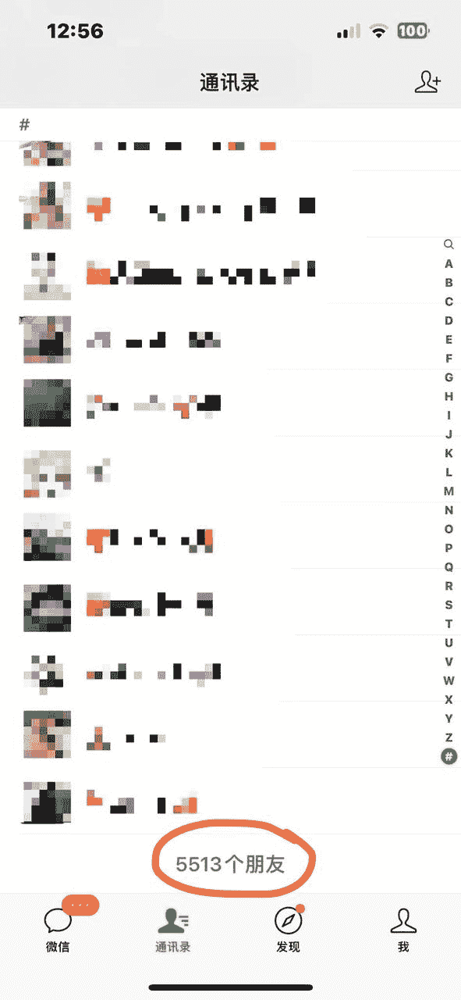

新播客的第一批用户，大多数都是来自身边的家人与朋友。你需要做得便是让自己身边的人知道这个播客，让他们去听播客，对播客做出正确评价，你不断去改进自己播客节目。目前主流的播客发现渠道便是来自好友推荐，找到自己第一批忠实粉丝，也便是走向更大世界的基础。

2）各种微信群

自己的各种群以及播客相关的群。

### 7.1.2公域

节目上线后维护好微博、小红书、微信公众号、B站、即刻、豆瓣等，有精力的话要全面铺开宣传才能曝光最大化。也可以播客视频化，一鱼多吃。最近B站推出了视频播客，有一定的流量扶持，可以去试试，对视频要求不高，很多人可能也就是听。

如果是有嘉宾，嘉宾有一定的流量，也可以让嘉宾帮忙转发宣传。

## 7.2 播客平台运营推广

### 利用播客平台进行推广

> 利用播客平台来推广自己播客节目，你必须了解平台规则。

> 平台规则并不是明确的，需要自己去研究平台推荐机制。同时多与平台的运营交流，能够帮助你快速理解平台的规则。

> 包括一些自荐平台都不要放过。

### 7.2.1 小宇宙

小宇宙有3个榜单：最热榜、锋芒榜、新星榜

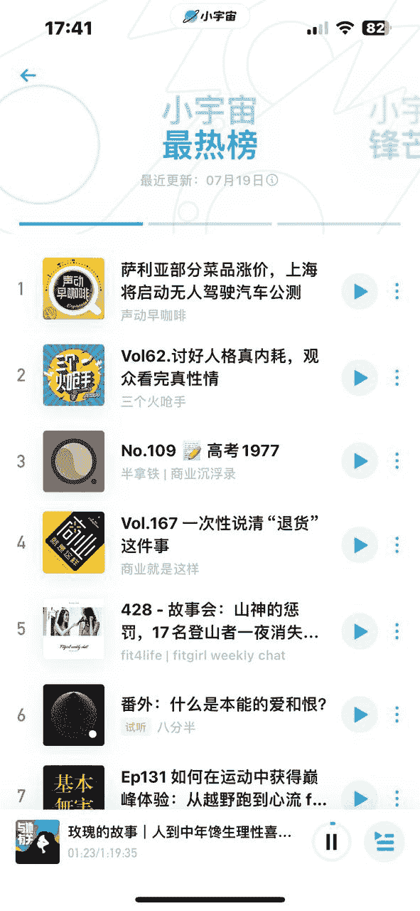

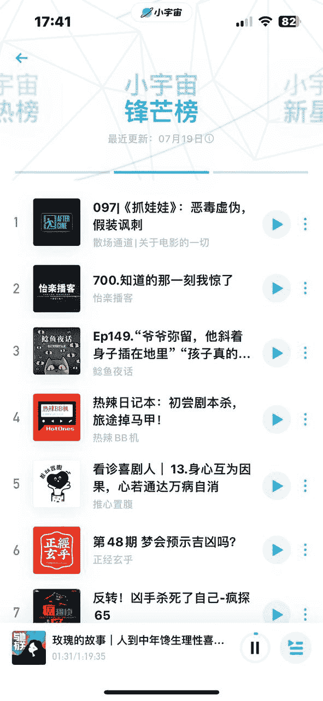

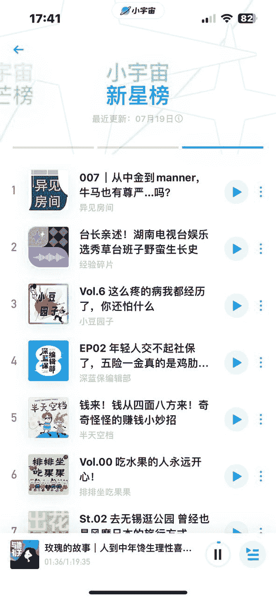

小宇宙目前是一个讨论氛围比较活跃的播客平台，也是国内播客一个主流重要平台。

播客不太容易获得自然流量，起号最容易的方法是靠小宇宙的榜单推荐，而小宇宙的推荐分四部分：

一是每天首页会有三期特别推荐，评选方式应该是机器初筛+编辑人工精选。具体的算法从来没有公开过。

分三个榜单，最热榜是最热门的单集，锋芒榜是有潜力的单集，新星榜是刚出的新节目才有机会上的。

> 重点说下新星榜！坊间摸索出规则，也是我当时亲测过的经验：

> 1.节目上线少于90天（从注册节目开始算，而不是按发布第一期节目算）

> **2.节目订阅量少于3000**

> **3.每期播放至少超过150，有评论点赞收**藏转发等（可能会随着竞争变化而调整数据）

> 以上三条，必须同时满足，任何一个超过了都不再进入新星榜。

> *个人真实经验，我到了第九期就突破了3000粉，一旦突破了3000粉后，数据比之前更好也上不了新星榜了

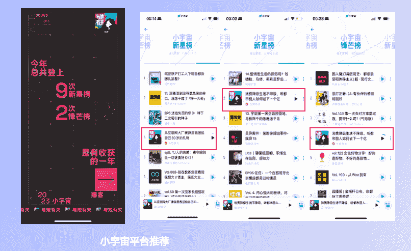

其他榜单的具体算法是一个黑盒，一般头部账号上榜比较多。

会考虑播放量、评论量、分享量、完播率、复播率、点击浏览、跳出率等各种指标，也受到“节目被举报、评论不友善被举报比例、喜欢比例、听众收听时长”等因素影响。

榜单每日更新一次，上榜后当天数据好，还可能出现“多日霸榜”的情况。

如果你想让你的节目上首页，可以邀请朋友们在评论区评论一些内容，这样被推荐首页的几率会高一些。同时，你还可以通过微博或者即刻，与小宇宙官方号进行互动，增加自己的节目的曝光机会。很多的优质的内容没有被推荐，只是因为播客节目不被编辑所知道。

当然，你也可以和小宇宙的运营小伙伴深入沟通，多了解平台近期的推荐机制。还可以统计并分析一下被推荐的节目类型，并以此为标准提高自己节目的选题和制作水准，以增加被推荐的概率。

### 7.2.2 苹果播客Apple Podcast

Apple Podcast 每年都会推出「年度播客」。虽然年度播客的评选方式并不是公开的，但你还是可以通过让用户评论、打五星等方式来提升节目的评分和热度，从而增加被评选为优质节目的机会。

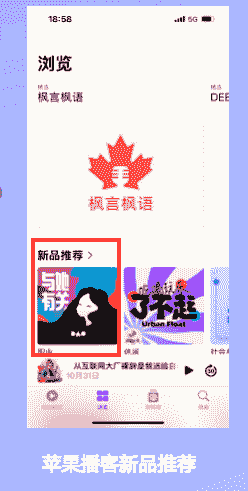

### 7.2.3 喜马拉雅

喜马拉雅的播客内容推荐机制分为三种：

一、首页的推荐

理解推荐，你需要理解平台鼓励什么。每个优质内容平台都鼓励优质内容。优质内容除了通过播放数来展现，还可以通过评论，关注数来体现。而且这些都不是以绝对值来看的。如果你的节目每次互动量都很高，或者播放数/关注数 高（大部分播放并非来自于关注），那么平台会判定你的内容比较优质，有被推荐的价值，算法大概率会把你的节目放在推荐库里。

二、播客频道的 Banner

Banner 推荐位大部分来自于官方的内容运营负责。如果你跟平台人员比较熟，或者有渠道接触，你可以去自荐节目。

三、 播客频道的信息流

这个信息流展现的原理是根据更新时间，最近更新的内容会展现在信息流的顶部。因而你更新得越频繁，曝光的机会越大。

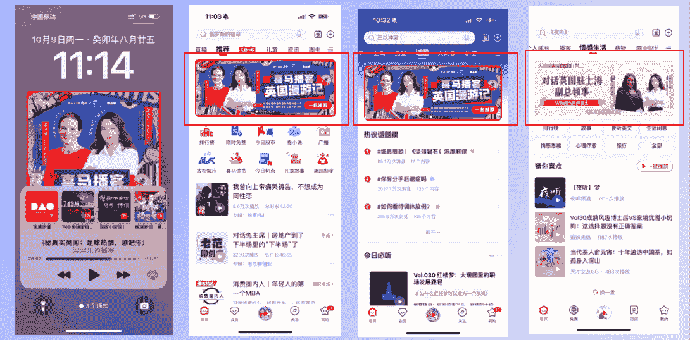

### 7.2.4 荔枝FM播客

1、荔枝播客节目自荐直通车：https://wenjuan.feishu.cn/m?t=sxdvYHC29aLi-zd24

2、荔枝播客运营指南：https://activitycommonstatic.lizhifm.com/static/groot/5363404519733596799/index.html#/home

3、荔枝北京录音室预约：https://activitycommonstatic.lizhifm.com/static/groot/5370276991497033343/index.html

### 7.2.5 微博播客

✅如何发布？

答：具体流程参考：https://weibo.com/ttarticle/p/show?id=2309404991583169675468

✅如何申请播客专属认证？

答：满足要求即可认证为：

[播客《XXX》官方微博] 或 [播客《XXX》主理人]

详情可参阅https://card.weibo.com/article/m/show/id/2309404978892224987323?_wb_client_=1

✅RSS相关问题解答

更多详情可参阅https://card.weibo.com/article/m/show/id/2309404978893978468610?_wb_client_=1

✅如何参与微博音频赋能激励计划

https://weibo.com/3860143361/5095945718468245

✅如何入驻微博广告共享计划

https://weibo.com/5189707911/4579566678448099

✅我发微博遇见了问题，该怎么办？

答：请您优先联系微博APP内的@微博客服，或者用账号绑定手机拨打4000-960-960，如遇见紧急情况，可在群内联系运营伙伴们咨询。

### 7.2.6 B站播客视频化

对接群里官方工作人员，播客UP专属自荐表

https://docs.qq.com/form/page/DYU5wYmNOTkdGRFhz

## 7.3 其他方式推广

### 7.3.1 搜索引擎优化

搜索引擎优化，是一个还没有被完全挖掘的流量入口。使用常用的搜索引擎优化方式，便可以提升自己节目搜索排名。同时，节目标题、节目描述、节目封面、shownotes 等都需要埋入关键词，有助于提升搜索优化。

### 7.3.1 串台

串台也是一个很棒的推广播客方式。可以实现1+1》2的效果。不仅能获得有效的曝光，还能够通过上节目展现自己另外的一面。

但串台需要谨慎，最好是目标定位类似的播客节目。目前播客的环境相对比较纯净，不是太功利，话题合适，目标人群类似的话，成功率会比较高。实现双方换粉。

### 7.3.2 听友群社群

用户运营是维护听众忠诚度很重要的手段。很多节目可能凭借节目内容吸引了一部分用户，但因为用户对主播的不了解，对节目的忠诚度也不会特别高。

用户运营更多需要主播以听众的视角来思考——听众需要什么，然后主播在适当的时候满足听众的需求。

### 7.3.3 听友群社群直播

偶尔的直播也能拉近与听众的距离，直播里能传递大量信息，让听众更好地了解你的想法，你的个人状态。

### 7.3.4 线下活动

线下活动是一个虽然看上去很费时费力的一个事情，但是它真的是最高效地让主播与听众产生真实的链接。

同时也能激活听众之间的链接。

# 8.播客变现

有变现才有春天-每年都是播客元年，播客界像狼来了一样的存在

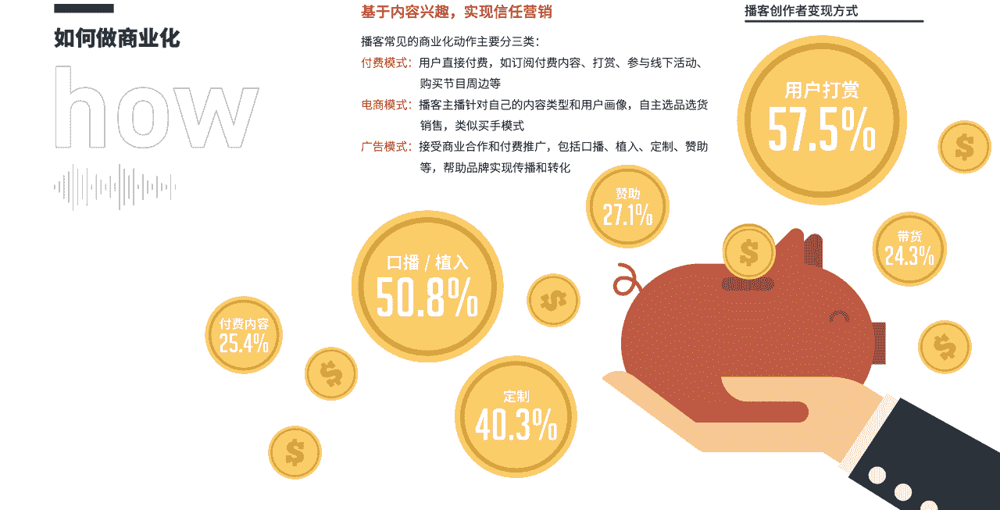

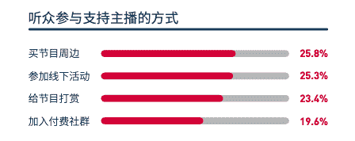

## 8.1 常见的变现方式

常常有人说播客都是为爱发电，播客不赚钱。但实际上来说，每个行业都有二八定律。只是相比于其他平台，播客赚钱没有那么快和容易。但播客依然是非常有潜力的一种媒体形式，同时人群质量也非常高。

### **广告收入**

广告是目前最普遍，也是大家最普遍的变现方式。也是目前很多播客都在接广告。

我自己本职公司开了一家公关广告公司，我们也为品牌提供营销服务。除了之前小红书种草、抖音外，其实现在已经有更多的品牌在尝试把播客作为一个新的渠道去投放了。

播客目前还处于增长期、成长期，目前进入依然还是很有机会。

一般分为以下几种类型：

#### **口播：**独立于内容的贴片广告

在合作单集合适位置插入1-3min品牌贴片广告，与单集内容主体独立（时长依据节目风格而定）

对节目本身的内容影响不大，通常算是比较轻量级的。甚至可以和节目内容完全没有关系，先录制完了，接了个口播广告，补录就行。

口播的广告费用也会比较低。

#### **定制单集：**根据指定主题制作内容

根据品牌指定主题或嘉宾，提供全集内容策划制作，植入3-6min品牌信息介绍（时长依据节目风格而定）

定制广告则围绕品牌和推广产品主题展开，是一个内容定制化的广告。

定制广告需要把内容定制丝滑植入在节目中，需要跟品牌方审核交流。同时还需要在shownotes出现、社群同步等。

定制单集的广告费用适中。

#### **冠名：**多期内容的冠名露出

批量赞助合作3个及以上单集，在单集开头或标题简介等处露出品牌信息

这个比较适合预算比较多的品牌方，在一段时间冠名赞助某个节目。

### **内容付费收入**

+   **付费节目：**整个节目都是付费的节目。

+   **付费单集或系列内容**：除了免费内容外，提供高质量的付费节目。

+   **众筹新节目**：通过平台如Kickstarter众筹资金来制作新节目。

### **商品销售收入**

+   **周边商品**：设计并销售与播客相关的T恤、帽子、杯子等商品。

+   **推荐商品**：在节目中推荐书籍、音乐、电子产品等，并通过联盟营销赚取佣金。

### **服务收入**

+   **咨询服务**：利用你的专业知识提供咨询服务。

+   **线上课程**：开设线上课程或工作坊，分享你的知识和技能。

### **活动收入**

+   **举办线下活动**：如讲座、研讨会、粉丝见面会等。

+   **线上直播活动**：通过直播互动，提供付费参与的线上活动。

+   **播客旅行团**：定制路线的特色旅行团。

### 社群**收入**

+   **举办线下活动**：如讲座、研讨会、粉丝见面会等。

+   **线上直播活动**：通过直播互动，提供付费参与的线上活动。

### 私域变现收入

举个例子，相比于其他平台（比如小红书），播客更容易转化到私域，有些播客的用户粘性很不错，他们就会把用户引流到私域当中，在社群里卖货，或者进行一些产品的分享。

据我了解，有的比较新的账号，可能大家也听说过，在私域变现了上百万，这真的很惊人。

比如：社区团购、商品CPS分佣、社群/课程CPS分佣、直接变现自己的产品（卖房规划、心理咨询、教练服务、玄学等）

### MCN厂牌播客矩阵收入

例如：

《大内密谈》

《津津乐道》

《日光派对》

等头部账号旗下都有其他节目，构成一个矩阵。

### **版权授权收入**

+   **内容授权**：将你的播客内容授权给其他媒体平台。

+   **影视剧本授权：**将你的播客内容授权改编成影视剧本。

+   **品牌合作**：与品牌合作，使用你的播客内容进行品牌推广。

+   **产品联名/品牌大使**

随着国内播客市场的不断发展，这些变现方式也在不断创新和完善中，播客主和平台可以根据自身特点和市场需求选择合适的变现策略。

## 8.2 一般播客常见的接广告的途径

### 8.2.1 品牌方/代理商主动来咨询

> 一定要留下你的商务联系方式，不要不好意思，微信和邮箱都要留！

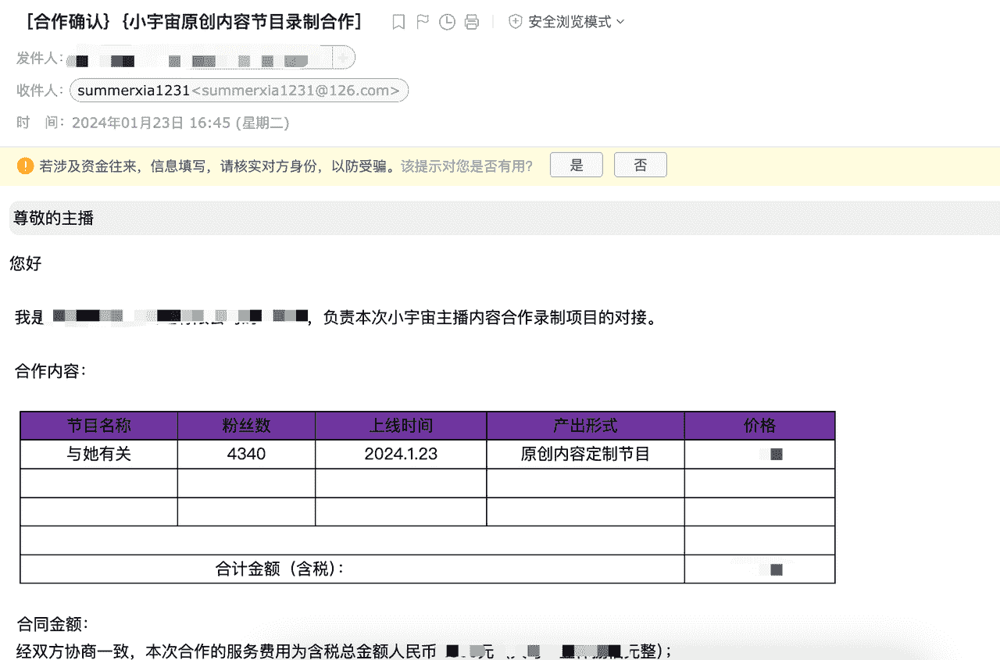

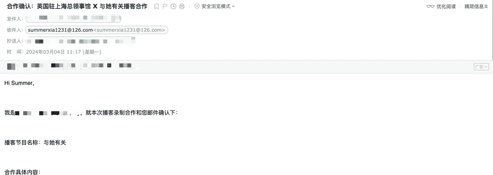

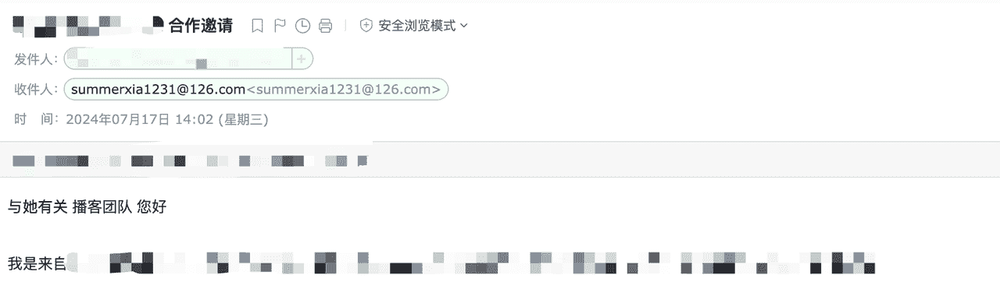

### 8.2.2 小宇宙官方接广告平台（追光）

小宇宙接广平台-追光

小宇宙平台（追光）现在有了类似小红书平台的接商单的平台（蒲公英）

小宇宙订阅数超过1000 Vs 小红书粉丝数超过1000

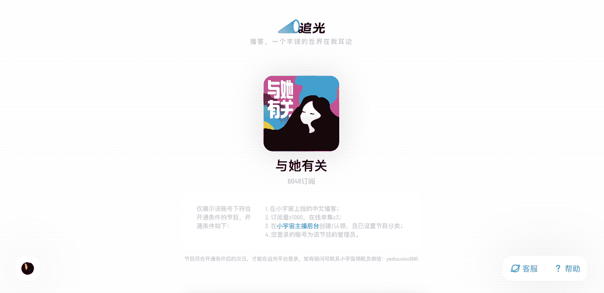

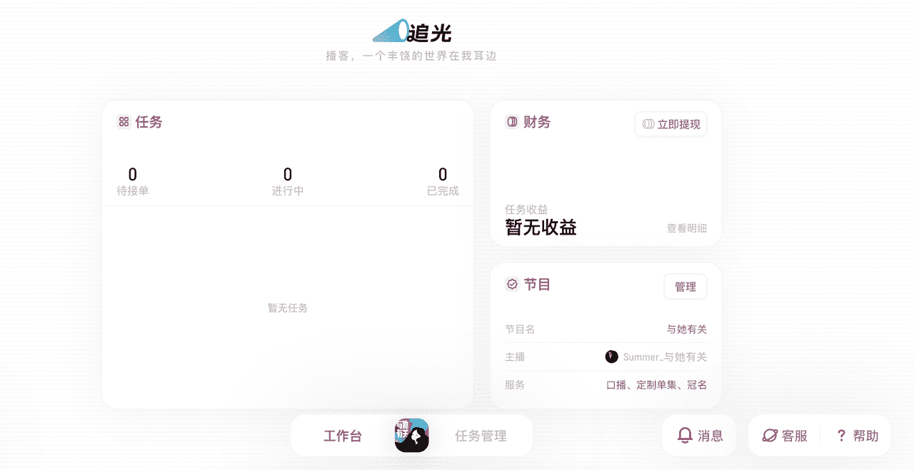

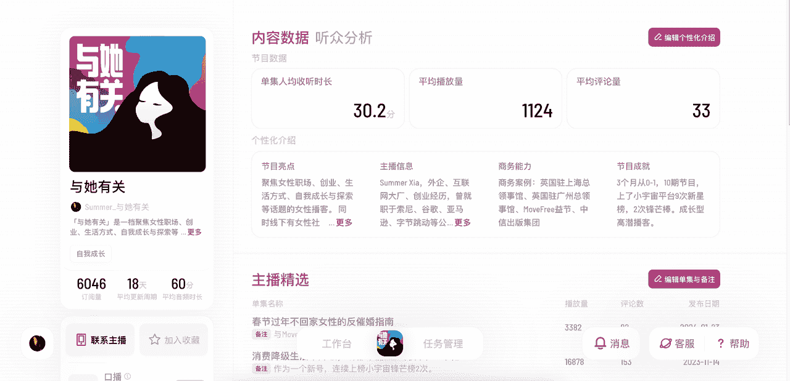

### 8.2.3 播客平台方商务推荐

喜马拉雅平台、小宇宙平台都会有一些平台直接接到的品牌客户需求，会直接匹配分包給合适的播客节目。一般都是体量比较大的播客节目。

### 8.2.4 MCN机构/厂牌派活儿

抽取30%-50%佣金

### 8.2.5 主动出击，主动寻找广告金主

自己主动去找品牌推销自己

## 8.3 播客广告报价

目前并没有明确的报价体系，处于是自己拍脑袋报的阶段。

很多品牌方只看粉丝数量再乘以一个系数来报价。

需要自己谈，建议制作刊例价报价。

⭐️悄悄剧透一下头部播客账号的广告报价，20万订阅的账号，报价大概6万左右。30万订阅的账号，报价大概10万左右。（没有明确定价规则，根据不同的数据表现有所差异化。可以自己谈）

## 8.4 如何报价卖个更高的价格？

播客报价不像小红书那么成熟，你可以拍脑袋随意开价，没有什么标准。

如果想要报个好价格，除了基础数据（粉丝订阅量、播放量、互动量）外，要给投放的品牌方附加价值。

给自己做个刊例价，参考如下：

[与她有关播客节目介绍.pdf](https://internal-api-drive-stream.feishu.cn/space/api/box/stream/download/all/HsWeb0gy3o3RKIxpe40cll2pnMb)

# 9.播客相关好用的工具汇总

## 9.1 无版权音乐素材库

以下是一些提供无版权（或免费商用）音乐素材的库，这些资源通常可以用于个人和商业项目，包括播客背景音乐：

**10个无版权音乐素材库**

1.  100Audio: https: //100audio.com/

1.  Bensound: https://www.bensound.com/

1.  Mixkit Music: https://mixkit.co/free-stock-music/

1.  耳聆网：https:/www.ear0.com/

1.  爱给网：https:/www.aigei.com/

1.  豆丁素材-音效：https:/v.docin.com/l-3-2-0-0-0-1.html

1.  淘声网：https:/www.tosound.com/

1.  SoundGator: https://www.soundgator.com/

1.  办公资源网：https:/www.bangongziyuan.com/music/

1.  Freesound: https: //www.freesound.cn/sound

##

## 9.2 播客logo设计推荐网站

1.  免费logo生成网：http:/www.freelogo.com.cn/

1.  一键LOGO设计：https:/www.yijianlogo.com/

1.  标智客：https:/www.logomaker.com.cn/

1.  Hatchful: https://www.shopify.com/tools/logo-maker

## 9.3 播客封面、海报设计网站/App

1.可画  https://www.canva.cn/

2.搞定设计  https://www.gaoding.com/

3.创客贴  https://www.chuangkit.com/

4.美图秀秀  https://pc.meitu.com/

5.黄油相机  https://www.bybutter.com/

## 9.4 AI绘画

豆包 https://www.doubao.com/chat/create-image

文心一格 AI 绘画网站 https://yige.baidu.com/

LibLib AI 绘画网站  https://www.liblib.art

Midjourney https://www.midjourney.com/ （需科学上网）

## 9.5 剪辑网页工具

喜马拉雅云剪辑  https://yunjianji.ximalaya.com/

小宇宙studio https://studio.xiaoyuzhoufm.com/

> **写在最后的话**

>

> ⭐️播客不是一个来钱快的项目，更像是一个长期主义的事情。流量也没有那么好，但它是一件有价值的事情，适合长期深耕。

>

> ⭐️先想好定位与如何变现再开始行动，否则中途很难改也很难继续。

>

> ⭐️做播客也是深度认识自己并盘点周边资源的机会。虽然播客不像其他项目来钱快，但它真的可以帮助我们链接到更多人，通过播客项目也让我认识了很多朋友，这个是其他项目无法得到的深度与广度。

>

> **慢慢来，反而比较快。**

> 如果你也想做播客，就赶快行动起来吧！听话照做，按时出摊，不要内耗！

**💡**希望这篇教程能对大家有所启发，欢迎大家和我交流搞钱经验和搞钱路子，也欢迎大家链接我，成为播客嘉宾，一起做期节目深入聊聊😄